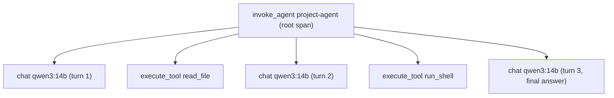

# Tracing: OpenTelemetry GenAI and Langfuse

## Why this matters

In [3.2](/part-03-agents/3.2-agent-loop) you wrote a step log: one JSON line per step, a file per run. That was enough to read a 6-turn run in an editor. It stops being enough when a run has 40 steps, a tool that calls a sub-agent, two models, and a question like "why did this take 90 seconds?" A flat log can't show you that the slow step was the third model call inside the second tool call, and you can't open it in a UI where you click a step and see its input, output, tokens and duration.

A **trace** is that log with structure: a tree of timed steps (**spans**), each carrying key-value **attributes**. **OpenTelemetry** (OTel) is the vendor-neutral standard for producing and shipping traces, and it has a set of naming conventions for LLM and agent steps, so a model call looks the same whichever tool displays it. **Langfuse** is an open-source LLM observability tool that accepts OTel traces and shows them in a UI built for this. This chapter takes your step log, turns it into spans that follow those conventions, and sends them to Langfuse.

This is also where the privacy question gets real. Traces are a copy of your prompts, your files and your tool output, stored somewhere else. What goes in them is a decision, not a default.

**Learning goals**

- Instrument the agent with OpenTelemetry spans
- Explain the GenAI semantic conventions (and check their stability status)
- View traces in Langfuse

## Explanation

### From a step log to a trace

Compare what the two give you.

| | Step log (3.2) | Trace |
|---|---|---|
| Shape | flat list of lines | tree: a tool call is *inside* the turn that requested it |
| Time | a timestamp per line | start and end per step, so duration and overlap are explicit |
| Format | yours | a standard other tools already understand |
| Viewing | `jq`, your renderer from 4.1 | a UI with a timeline, filtering by model, error, latency |
| Joining | by run id, by hand | trace and span ids, propagated across processes |

The step log doesn't go away. It stays the simplest thing that works, and a trace is built from the same events. The point of this chapter is that once you've looked at 20 transcripts by hand (4.1) and want to look at 200, or at one very long one, you want the tree and the timeline.

### Traces, spans, attributes

The OpenTelemetry docs define the vocabulary ([Traces concepts](https://opentelemetry.io/docs/concepts/signals/traces/)):

- A **trace** is the full path of one request through your application, made of spans that share a trace ID.
- A **span** is one unit of work. It has a name, a start and end time, a status, and a parent span ID. A span with no parent is the **root**.
- **Attributes** are key-value pairs on a span (strings, booleans, numbers, or arrays of those). They're the metadata you filter and aggregate by.
- **Span events** are timestamped, log-like annotations inside a span. The docs' rule of thumb: use an event when the moment matters, an attribute when it doesn't.
- **Span status** is `Unset` (the default, no error), `Error`, or `Ok` (explicitly marked fine).
- **Span kind** (`Client`, `Server`, `Internal`, `Producer`, `Consumer`) hints at how the backend should assemble the trace. The default is `Internal`.

Mapped onto your agent, one run is one trace:

The root span is the whole run. Each model call and each tool call is a child. In a multi-agent run ([3.10](/part-03-agents/3.10-multi-agent)) the sub-agent's whole run would be a subtree under the `delegate` tool's span, and that nesting is exactly what a flat log hides.

Two mechanics matter when you write the code, because both produce traces that look wrong:

1. **The active span decides the parent.** In OTel's JS API, `startActiveSpan` makes the new span the current one for the duration of its callback, so any span started inside becomes its child ([JS instrumentation docs](https://opentelemetry.io/docs/languages/js/instrumentation/)). Spans started outside that callback (say, in a loop you don't wrap) become new roots, and your trace splits into disconnected fragments.
2. **You must end every span.** The docs' example carries the comment "Be sure to end the span!". A span you forget to end is never exported. If a tool throws, the span still has to end, with its status set to `Error`; think about where that belongs in your loop.

The API and the SDK are separate packages in OTel: code that creates spans uses the API (`@opentelemetry/api`), and the SDK you start once at process startup decides where the spans go (an exporter). Without a registered SDK the API calls do nothing, which is why instrumented libraries are safe to ship. In a short-lived script you also have to shut the SDK down before exiting so buffered spans are flushed ([Langfuse JS SDK overview](https://langfuse.com/docs/observability/sdk/overview)).

::: info 📖 Read now
[OpenTelemetry: Traces](https://opentelemetry.io/docs/concepts/signals/traces/) · docs · ~10 min · **essential**

Look for: the definitions above in the project's own words, especially span context (the trace ID and span ID that get propagated between services), span kinds, and status. Ignore the distributed-systems examples about carts and payments; map every noun to a piece of your agent loop instead.
:::

### The GenAI semantic conventions

Without a convention, one team names the model attribute `model`, another `llm.model_name`, a third `ai.model.id`, and every tool needs its own mapping. **Semantic conventions** are the agreed names. The OpenTelemetry GenAI conventions define spans, attributes, metrics and events for LLM calls, agents and tools.

**Check stability before you build on them.** Each document in the conventions repo is marked **Status: Development**, and so are nearly all of the attributes in the span tables ([client spans](https://github.com/open-telemetry/semantic-conventions-genai/blob/main/docs/gen-ai/gen-ai-spans.md), [inference spans](https://github.com/open-telemetry/semantic-conventions-genai/blob/main/docs/gen-ai/client-inference.md)). Development means names can still change. The conventions have also moved: the OpenTelemetry website's GenAI page says they "have moved to the OpenTelemetry GenAI semantic conventions repository" ([opentelemetry.io](https://opentelemetry.io/docs/specs/semconv/gen-ai/), now [open-telemetry/semantic-conventions-genai](https://github.com/open-telemetry/semantic-conventions-genai)). If you read a 2025 blog post using `gen_ai.system` or `gen_ai.prompt.0.content`, expect names to differ from today's. Our standing note on this is in the [Landscape standards table](/landscape#key-standards-and-orgs).

The practical consequences: keep every attribute name in **one module** of your project, so a rename is a one-line change; copy the names from the spec, not from memory or an LLM; and prefer a backend that doesn't break when it sees a name it doesn't know (Langfuse puts unmapped attributes under metadata rather than dropping them, see below).

The three span types an agent needs, as the spec defines them:

| Span | Name pattern | Kind | Operation name | Required or core attributes |
|---|---|---|---|---|
| Agent run | `invoke_agent {gen_ai.agent.name}` | `CLIENT` | `invoke_agent` | `gen_ai.agent.name` (low cardinality, if you have one) |
| Model call | `{gen_ai.operation.name} {gen_ai.request.model}`, e.g. `chat qwen3:14b` | `CLIENT` (or `INTERNAL` for a model in the same process) | `chat` | `gen_ai.operation.name`, `gen_ai.provider.name` (required); `gen_ai.request.model`; `gen_ai.usage.input_tokens`, `gen_ai.usage.output_tokens`, `gen_ai.response.finish_reasons`, `gen_ai.response.model` (recommended) |
| Tool call | `execute_tool {gen_ai.tool.name}` | `INTERNAL` | `execute_tool` | `gen_ai.tool.name` (required); `gen_ai.tool.call.id` (conditionally); `gen_ai.tool.description`, `gen_ai.tool.type` (recommended) |

Sources: [inference](https://github.com/open-telemetry/semantic-conventions-genai/blob/main/docs/gen-ai/client-inference.md), [execute tool](https://github.com/open-telemetry/semantic-conventions-genai/blob/main/docs/gen-ai/execute-tool.md), [invoke agent](https://github.com/open-telemetry/semantic-conventions-genai/blob/main/docs/gen-ai/client-invoke-agent.md). The spec says tools "are often executed directly by application code" and encourages developers to follow the convention for their own tool calls, which is exactly your case.

A few details worth knowing:

- `gen_ai.provider.name` names the provider whose telemetry format you follow. The registry lists values such as `anthropic`, `openai` and `ollama` ([registry](https://github.com/open-telemetry/semantic-conventions-genai/blob/main/docs/registry/attributes/gen-ai.md)). Through OpenRouter, set it according to the spec's guidance (it can differ from the true upstream, for example when a proxy relays requests) and write down what you chose.
- `gen_ai.usage.input_tokens` and `output_tokens` are what the *provider reported*. They're how you'd later compute cost (4.8); the spans carry counts, and prices stay on [Landscape](/landscape).
- `gen_ai.conversation.id` (conditionally required if available) is the field to group the turns of one session when a conversation spans several runs.
- Request settings, such as `gen_ai.request.temperature` and `gen_ai.request.max_tokens`, belong on the model-call span. When you compare a Qwen run with a paid-model run, these are the columns you filter by.
- Errors: `error.type` is conditionally required when an operation ends in error, and span status follows OTel's error-recording rules.

Notice what is *not* in the required or recommended lists: the prompts, the responses, the tool arguments and results. Those are the next topic.

::: info 📖 Read now
[OpenTelemetry GenAI conventions: inference spans](https://github.com/open-telemetry/semantic-conventions-genai/blob/main/docs/gen-ai/client-inference.md) · docs · ~20 min · **essential**

Look for: the "Span: `gen_ai.client.inference`" section (skip the metrics and events sections on a first pass). Read the span-name and span-kind paragraphs, then the attribute table by requirement level: Required, Conditionally Required, Recommended, Opt-In. Find where the stability badge says Development. Then open [execute-tool](https://github.com/open-telemetry/semantic-conventions-genai/blob/main/docs/gen-ai/execute-tool.md) and [invoke-agent](https://github.com/open-telemetry/semantic-conventions-genai/blob/main/docs/gen-ai/client-invoke-agent.md) and compare the three span shapes with the table above. The pages are generated from YAML and dense; you're reading for names and requirement levels, not every footnote.
:::

### What to record, and what not to

A trace backend is a second copy of your agent's data. Think of it the way you'd think of a log aggregator, because that's what it is, with the difference that the "log lines" contain whole documents.

The spec makes the same call. Instructions, inputs and outputs are "sensitive and often large", and instrumentations "SHOULD NOT capture them by default" but should offer an opt-in. The attributes that hold content (`gen_ai.input.messages`, `gen_ai.output.messages`, `gen_ai.system_instructions`, `gen_ai.tool.definitions`, and for tools `gen_ai.tool.call.arguments` and `gen_ai.tool.call.result`) are all **Opt-In**. For instrumentation libraries, an environment variable `OTEL_INSTRUMENTATION_GENAI_CAPTURE_CONTENT` selects between `NO_CONTENT` (the default), `SPAN_ONLY`, `EVENT_ONLY` and `SPAN_AND_EVENT`, and a `*_ref` attribute pattern lets you store content elsewhere and keep only a pointer on the span ([spans spec](https://github.com/open-telemetry/semantic-conventions-genai/blob/main/docs/gen-ai/gen-ai-spans.md)). Since you're hand-instrumenting, there's no such variable in your code unless you add one: the decision is yours, so make it explicit.

Anthropic's own tooling has the same split, and it's a good model of the choices:

- Claude Code and the Agent SDK export structure by default (durations, model names, tool names, token counts) and keep content out; separate switches add prompt text, tool arguments, tool output, and raw API bodies, and the docs say to leave them unset "unless your observability pipeline is approved to store the data your agent handles" ([Agent SDK observability](https://code.claude.com/docs/en/agent-sdk/observability#control-sensitive-data-in-exports)).
- The Claude API's OTel export has two content modes, *metadata only* (the default) and *full content*, and notes that "your observability platform stores this content under its own access and retention settings" ([OpenTelemetry for the Claude API](https://platform.claude.com/docs/en/manage-claude/opentelemetry#content-modes)).

For your agent, a reasonable policy to start from, to adjust rather than adopt blindly:

| Record | Why | Caution |
|---|---|---|
| Model, provider, settings, finish reason, token counts, durations, errors | Everything you need for latency, cost and failure patterns; no user content | Safe by default |
| Tool name, call id, success or error, result *size* | Shows tool use and truncation without storing the data | Record length, not text |
| Tool arguments | Usually what you need to understand a wrong call (`read_file {path}`) | Shell commands and queries can embed secrets; mask them |
| Prompts and completions | The thing you read in 4.1 | Contain user data and every file the agent read; truncate and mask |
| Tool results | Needed to see why the model went wrong | The biggest leak: whole files, `.env` contents, command output |
| API keys, auth headers | Never | Never put them in an attribute, including via a logged request object |

Practical controls:

- **A switch you can turn off.** One config value (e.g. `TRACE_CONTENT=off|truncated|full`) that every content attribute checks. Default to off, and turn it on for your own experiments.
- **Truncate.** Spans have size limits on backends; Anthropic's exporter caps content per span (0.75 MB by default) and sets a flag when it truncates ([content limits](https://platform.claude.com/docs/en/manage-claude/opentelemetry#content-limits)). Cap your own at a few kilobytes.
- **Mask before export.** Langfuse's TS span processor takes a `mask` function applied to the `input`, `output` and `metadata` of every observation before it leaves your process ([masking docs](https://langfuse.com/docs/observability/features/masking)); its example redacts card numbers with a regex. Regexes catch only what you thought of, so treat masking as a second line behind not recording.
- **Where it's stored matters.** Self-hosted Langfuse on your own machine keeps traces on your disk; cloud stores them with the vendor, under their retention settings ([Langfuse data retention](https://langfuse.com/docs/administration/data-retention) is where those live; check the current page before relying on it). For a study repo, local is the clean answer for traces that contain your files.

### Langfuse

Langfuse is an open-source LLM engineering platform. For this chapter you use its tracing part: it receives traces and renders them. Its data model is small ([data model](https://langfuse.com/docs/observability/data-model)):

- A **trace** is one request or operation (for you, one agent run).
- **Observations** are the steps inside it, nestable. Types include **generations** (LLM calls with model and usage), **events** (points in time) and plain **spans**.
- A **session** optionally groups traces from one interaction, such as a multi-turn conversation.
- Trace-level attributes (user, session, tags, release, metadata) are used for filtering.

**Cloud or self-hosted.** Langfuse Cloud is the fast route: sign up, create a project, copy the keys. It has a free Hobby plan with usage limits ([pricing](https://langfuse.com/pricing); read the current limits there, they aren't repeated here). Self-hosting with Docker Compose is documented as the way to run it locally for testing: `git clone` the repo, `docker compose up`, wait for the `langfuse-web` container to report "Ready", then open `http://localhost:3000` and sign up for the first user. The same page lists the components it runs (web, worker, PostgreSQL, ClickHouse, Redis or Valkey, S3-compatible storage), and warns the Compose setup lacks high availability, scaling and backups, so it's for trying, not for production ([self-hosting](https://langfuse.com/self-hosting), [Docker Compose guide](https://langfuse.com/self-hosting/deployment/docker-compose)). That is six services on a 24 GB machine that also runs your Ollama models: expect to stop it when you're loading a 30B model. Change the secrets marked `# CHANGEME` even on a local instance.

**How data gets in.** Langfuse accepts OpenTelemetry on one endpoint, `/api/public/otel` (cloud regions have their own hosts, local is `http://localhost:3000/api/public/otel`, and local OTel ingestion needs Langfuse v3.22.0 or later). Authentication is HTTP Basic with your public and secret key: the header value is `Basic` plus the base64 of `pk-lf-...:sk-lf-...`. It supports OTLP over **HTTP** (JSON or protobuf) and not gRPC, which matters because many OTel examples default to gRPC on port 4317. The docs also say to send an `x-langfuse-ingestion-version: 4` header; without it, directly ingested data can be delayed by up to 10 minutes ([Langfuse OpenTelemetry docs](https://langfuse.com/docs/opentelemetry)). If your spans seem to vanish, check those three things first: HTTP not gRPC, the auth header, the version header.

You have two ways in, and the chapter's brief allows either:

1. **Plain OTel.** Your code uses the OTel API with the GenAI attribute names, and the SDK's OTLP HTTP exporter points at Langfuse. This is the one that teaches the standard, and it keeps you backend-neutral: swapping Langfuse for another OTLP backend is a config change.
2. **The Langfuse TS packages.** `@langfuse/otel` provides a `LangfuseSpanProcessor` you register on the OTel `NodeSDK`, and `@langfuse/tracing` has helpers such as `startActiveObservation`. By default the processor exports only Langfuse and GenAI/LLM spans, and it requires Node 22 or later ([SDK overview](https://langfuse.com/docs/observability/sdk/overview)). You still create spans yourself, so the span-tree work is the same.

**What Langfuse does with GenAI attributes.** Its mapping reads, among others, `gen_ai.request.model` / `gen_ai.response.model` for the model, `gen_ai.usage.*` for token usage, `gen_ai.request.*` for model parameters, `gen_ai.tool.call.arguments` and `gen_ai.tool.call.result` for tool input and output, and its own `langfuse.*` attributes take precedence over generic ones. A span with a model attribute becomes a *generation*; anything else is a plain *span*. Unrecognized attributes are kept under metadata rather than rejected. Langfuse also requires a root span per trace. For prompt and completion text it reads `gen_ai.prompt` and `gen_ai.completion`, or `langfuse.observation.input` and `langfuse.observation.output` ([same page](https://langfuse.com/docs/opentelemetry)), which differ from the spec's `gen_ai.input.messages` and `gen_ai.output.messages`: this is the sort of gap that appears when a standard is still in Development. When your trace shows a model call with no input or output, that's where to look, and it's a good thing to find out firsthand.

::: info 📖 Read now
[Langfuse: OpenTelemetry integration](https://langfuse.com/docs/opentelemetry) · docs · ~15 min · **essential**

Look for: the endpoint and regional base URLs, the Basic-auth recipe, the "gRPC is not supported" line, the ingestion-version header, and the attribute mapping table (which of your attributes become input, output, model, usage). Also the note that trace-level attributes such as user and session ids must be set on every span, and how to do that. You need all of this for the practice.
:::

::: info 📖 Read now
[Langfuse: self-hosting with Docker Compose](https://langfuse.com/self-hosting/deployment/docker-compose) · docs · ~10 min · optional

Look for: the commands, the `# CHANGEME` secrets, the first-user sign-up, and the "not for production" warning. Skip this if you use Langfuse Cloud; but then read the masking and retention pages before sending anything that contains your files.
:::

::: info 📖 Read now
[Langfuse: masking](https://langfuse.com/docs/observability/features/masking) · docs · ~5 min · optional

Look for: where `mask` is configured, and what it receives (the stringified JSON of an attribute value). Think about what a regex for secrets would miss.
:::

### Instrumenting an agent you didn't write

You built the loop, so you place the spans. Agents you didn't write emit their own. Know these so you don't instrument twice:

- **Claude Code and the Agent SDK** can export OTel metrics, log events and, in beta, traces. Traces need `CLAUDE_CODE_ENABLE_TELEMETRY=1` and `CLAUDE_CODE_ENHANCED_TELEMETRY_BETA=1` plus an exporter variable. Spans are named `claude_code.interaction` (one per turn), `claude_code.llm_request`, and `claude_code.tool`, with the docs warning that span names and attributes may change between releases. These are Claude Code's own names, not the GenAI conventions. If your app has an active span when it calls `query()`, the SDK passes `TRACEPARENT` into the child process so the agent's spans nest under yours ([Agent SDK observability](https://code.claude.com/docs/en/agent-sdk/observability), [Claude Code monitoring](https://code.claude.com/docs/en/monitoring-usage)).
- **The Claude API and Anthropic SDK** can trace Messages API requests and tool runs, using attributes from the GenAI conventions, also in beta ([OpenTelemetry for the Claude API](https://platform.claude.com/docs/en/manage-claude/opentelemetry)).

Two practical notes. Telemetry from the Agent SDK is silent on failure by default: if the endpoint is wrong you get no error, and you have to switch on diagnostics to see why. And token sums across layers can double-count: the Claude API page has a section on summing only one source per request. When you reach cost tracking in 4.8, read it before adding up spans.

### Reading a long run

With traces in the UI, what do you do with them? A short checklist for a long run:

1. **Timeline first.** Find the widest spans. Is it one slow model call, a tool, or many small calls?
2. **Count the turns.** Does the tree show the same tool called repeatedly with the same arguments (a loop), or growing input tokens per turn (context creep, see [3.4](/part-03-agents/3.4-context-engineering))?
3. **Errors in the tree.** Where did the first error occur, and did the model recover or compound it? This is the "first upstream failure" from 4.1, now clickable.
4. **Model-call attributes.** Compare finish reasons (`stop` versus a length cutoff) and token counts across turns.
5. **Group and compare.** Filter by model: the same task on `qwen3:14b` versus a paid model should look different, and the difference is usually the lesson.

A trace tells you *what happened*, not whether it was wrong. Evals (4.2 to 4.6) judge correctness, and traces are where you go to find out why one failed. Langfuse can also hold evaluation scores against traces, which you may explore later; it's not needed here.

## Practice

**Brief:** Instrument `project/` with OTel spans following the GenAI conventions and send them to Langfuse (local Docker or free cloud tier). Inspect a long run. You write all the code; I haven't provided any.

**Where:** A step in the growing `project/` (see `project/ROADMAP.md`, step 17). It builds on the agent loop from 3.2 (and any tools you've added since), and the next step, cost and latency in 4.8, builds on it.

**Steps**

1. **Get a backend up.** Either Langfuse Cloud (free tier) or local Docker Compose. Create a project and API keys, put them in `.env` (never committed; `.env.example` gets the names only). Verify the keys work with a one-off trace before touching the agent, using whichever route you pick below. If local, change the `# CHANGEME` secrets.
2. **Pick your route and note why.** Plain OTel with an OTLP HTTP exporter, or the Langfuse span processor. Write two lines in `notes/tracing.md` on why. Either way, remember: HTTP not gRPC, the auth header, the ingestion-version header, and flush at exit.
3. **Initialise tracing once.** A single module that starts the SDK before the agent runs and shuts it down (flushing) when the process ends, including when the agent hits its turn limit or crashes. Set a service name for the project.
4. **Keep the attribute names in one place.** A small module of constants copied from the spec pages, with a comment on each group linking its source page.
5. **Add the spans.** One root span per run (`invoke_agent ...`), one span per model call (`chat <model>`), one per tool call (`execute_tool <name>`), correctly nested. On model-call spans: operation name, provider name, request model, response model if available, usage tokens, finish reason, and the temperature if you set one. On tool spans: tool name and call id. Set error status and `error.type` on failures, and make sure a thrown tool error still ends its span.
6. **Decide content policy.** Add the `TRACE_CONTENT` (or similar) switch from the chapter. Default off. With it on, record model input and output and tool arguments and results, truncated, and run them through a masking step that removes at least your API keys and anything that looks like a secret in `.env`.
7. **Run it on two models.** The same task on local Qwen and on a paid model. Note any spend in `costs.md`. Open both in Langfuse.
8. **Inspect a long run.** Use a task that takes at least 10 steps (a big directory search, or a task you know the agent struggles with from 4.1). Write what you found in `notes/tracing.md`: the slowest span, the number of turns, one thing you could not see in your JSONL log that the trace showed, and one thing the trace was missing.
9. **Break it on purpose.** Run with the content switch on, find your masking in the stored trace, then try putting a fake secret in a file the agent reads and check whether it reaches Langfuse. Fix what leaks.

**Done when**

- A run of the agent produces one trace in Langfuse with a root span and correctly nested model-call and tool-call spans, not a set of separate root spans.
- Model-call spans show model, token counts and finish reason; the Langfuse UI shows them as generations with usage.
- Every attribute name used is defined in one module and appears in the GenAI spec pages (or is explicitly marked in a comment as your own).
- A failing tool call appears as an error span and the run still exports.
- With content capture off, the stored trace contains no prompt text, tool arguments or tool results. With it on, a fake secret planted in a file the agent reads does not appear unmasked in Langfuse.
- You inspected a run of at least 10 steps and wrote down what you found, including something the trace was missing.
- `notes/tracing.md` records the route you chose, whether you used cloud or local, and what the GenAI conventions' Development status means for your code.

## Check questions

1. Your trace in Langfuse shows five separate root spans per run instead of one tree. What is the most likely cause in the code, and what do you check?

   

Answer

   Spans were started outside the callback of the span that should be their parent, so there was no active parent and each became a root. Check that the run is wrapped in one active root span (OTel's `startActiveSpan` or Langfuse's equivalent), that the model and tool calls happen inside it (including across `await`), and that no span is created before the SDK is started. A forgotten `span.end()` is a separate problem: that span never exports at all.

   

2. You send traces to Langfuse and nothing appears. Name three things to check specific to Langfuse's OTel endpoint.

   

Answer

   The transport: Langfuse accepts OTLP over HTTP (JSON or protobuf) and does not support gRPC, so an exporter on the gRPC default will not work. The authentication: HTTP Basic with the base64 of `public:secret` key, sent as an `Authorization` header, with the right regional or local base URL ending in `/api/public/otel`. The ingestion-version header (`x-langfuse-ingestion-version: 4`), without which directly ingested data can be delayed by up to 10 minutes. Also, in a short-lived process, make sure the SDK is shut down so buffered spans are flushed before exit.

   

3. A colleague says "the GenAI conventions are an OpenTelemetry standard, so we can rely on the attribute names." What is wrong with that, and what do you do about it in your code?

   

Answer

   The conventions are marked Status: Development, not stable, so names can change, and they have already moved to their own repository. "OpenTelemetry standard" overstates the commitment. Keep all attribute names in one module sourced from the spec pages so a rename is a one-line change, don't copy names from older posts, and check the backend's mapping (for example, Langfuse reads `gen_ai.prompt`/`gen_ai.completion` for text, which differs from the spec's `gen_ai.input.messages`).

   

4. Why are `gen_ai.input.messages` and `gen_ai.tool.call.result` opt-in, and how would you decide whether to turn them on for your agent?

   

Answer

   They hold the content of prompts and tool output, which is sensitive and large: user data, whole files the agent read, command output, possibly secrets. The spec says instrumentations should not capture content by default. Decide by asking where the trace is stored and who can read it (your own disk versus a vendor), how long it's retained, and whether you can mask it. For a local study project with a self-hosted backend you might enable it with truncation and masking; for anything with real user data, default to metadata only and record sizes instead of text.

   

5. You compare a Qwen run and a paid-model run of the same task in Langfuse. What could the trace tell you, and what can it not tell you?

   

Answer

   It shows how many turns each took, which tools were called with what arguments, where the time went, token counts per call, finish reasons, and where errors occurred, so you can say why one run was slower or took a wrong turn. It does not say which answer was correct: that requires an eval (code-based checks or a validated judge, 4.3 and 4.4). Nor does it, with content capture off, show what the model actually read or wrote.

   

## My understanding

<!-- Written by the learner, in their own words. Agents never fill this in. -->
