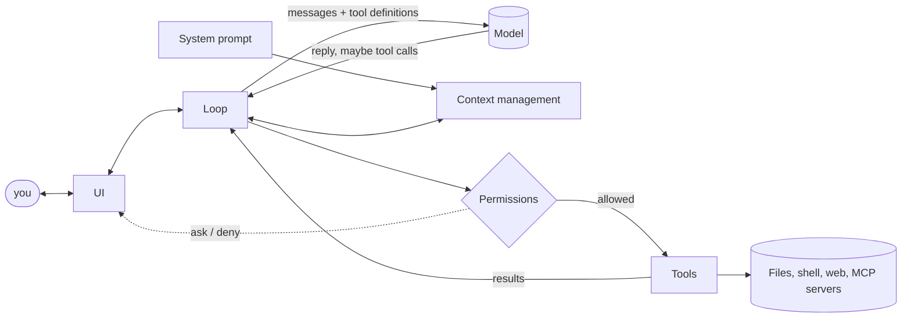

# What a harness is

## Why this matters

You have already built one. The loop from [3.2](/part-03-agents/3.2-agent-loop), plus the tools from [3.3](/part-03-agents/3.3-tool-design), plus the context handling from [3.4](/part-03-agents/3.4-context-engineering), is a harness. Part 5 gives that thing a name, because a name lets you ask a useful question about any agent product: *which of these pieces did the vendor build, and how?*

The reason to care is that "which model?" is only half of what decides how an agent behaves. The same model can look sharp in one program and clumsy in another, and a lot of the difference lives in the code around it: which tools it was given, what the system prompt says, what gets dropped from context, what it is allowed to do without asking. If you only compare models, you will misattribute those differences, and you will not know where to look when your own agent misbehaves.

**Learning goals**

- List the components of a harness
- Explain why harness choice changes results
- Map your own project onto those components

## Explanation

### A definition

A **harness** is everything around the model that turns it into an agent: the program that calls the model, runs the tools it asks for, decides what the model sees next, and decides what it may do. The model supplies the reasoning; the harness supplies the loop, the hands and the guard rails.

Anthropic's Claude Code docs say it almost in those words. The agentic loop "is powered by two components: models that reason and tools that act," and "Claude Code is the layer around the model that provides the tools and manages the context the model sees. This surrounding layer is what the term agentic harness refers to" ([How Claude Code works](https://code.claude.com/docs/en/how-claude-code-works)). A second definition, from the engineers who built Anthropic's hosted agent service, is narrower and more mechanical: the harness is "the loop that calls Claude and routes Claude's tool calls to the relevant infrastructure" ([Scaling Managed Agents](https://www.anthropic.com/engineering/managed-agents)). Both are useful: the first is the product view, the second the code view.

Two clarifications keep the word from turning into mush.

- **A harness is not a framework.** An SDK such as the ones in [3.11](/part-03-agents/3.11-agent-sdks) is a library you build a harness *with*. Claude Code is a finished harness. Anthropic's own article on the Agent SDK calls the Claude Code engine "the agent harness that powers Claude Code" and says it can power other kinds of agents too, which is why the Claude Code SDK was renamed the Claude Agent SDK ([Building agents with the Claude Agent SDK](https://claude.com/blog/building-agents-with-the-claude-agent-sdk)).
- **Not every harness is a coding agent.** A *coding agent* is a harness specialised for software work. Part 5 mostly looks at coding harnesses because they are the best documented and the ones you use daily, but the components below apply to a support bot too.

### The components

Here is the anatomy. Each row names a component, what it does, and what Claude Code's docs show for it, so you can see each one in a real product.

| Component | Job | In Claude Code (from its docs) |
|---|---|---|
| **Loop** | Call the model, run the requested tools, feed results back, stop. | Three blended phases: "gather context, take action, and verify results", repeated until done; you can interrupt at any point. |
| **Tools** | The model's hands: what it can read, change and run. | Five categories: file operations, search, execution, web, code intelligence; plus tools for subagents and for asking you questions. |
| **System prompt** | The standing instructions and context placed in front of every request. | Includes your `CLAUDE.md`, auto memory, loaded skills and output-style instructions, and notes Claude Code adds itself (for example the commit and pull request attribution lines). |
| **Context management** | Decides what is in the window each turn, and what happens as it fills. | Automatic compaction into a summary near the limit, `/compact`, `/context`, skills loaded on demand, subagents with their own window. |
| **Permissions** | Decides what the agent may do without asking you, and how to undo it. | Permission modes (auto, manual, accept edits, plan), allow rules in settings, file checkpoints you can rewind to. |
| **UI** | How a human watches, interrupts and steers. | Terminal, desktop app, IDE extensions, web, Slack and CI, all over the same loop. |

All the quoted details are from [How Claude Code works](https://code.claude.com/docs/en/how-claude-code-works). Read it as a tour of one harness's component list, which is how the next chapter uses it.

Read the diagram with these two things in mind.

1. **The model never touches the world.** Everything it does goes through the harness, so the permission check sits between "the model asked" and "the tool ran". That one fact is why [Part 8](/part-08-production/8.3-sandboxing) puts security in the harness and not in the prompt.
2. **The model only sees what the harness puts in front of it.** Context management and the system prompt are not extras; they decide the model's entire view of the task. The context-engineering techniques from [3.4](/part-03-agents/3.4-context-engineering) are harness features.

Two more pieces appear in real harnesses and are worth listing even though they are not in the six above: **persistent state** (session history written to disk so you can resume or rewind, which Claude Code does under `~/.claude/projects/` per the same docs), and **extension points** (skills, hooks, MCP servers and subagents, which let users add tools and rules without changing the harness). You will see both again in [Part 6](/part-06-claude-code/6.1-how-claude-code-works).

::: info 📖 Read now
[Claude Code docs: How Claude Code works](https://code.claude.com/docs/en/how-claude-code-works) · docs · ~15 min · **essential**

Look for: the sentence that defines "agentic harness", the five tool categories, what the context window contains and what happens when it fills, and the split between checkpoints (undo file edits) and permissions (limit what runs without asking). Use the component table above as a checklist: for each row, find the paragraph that describes it. Notice what is *not* said: the docs describe behaviour, not the system prompt text, so some components you can read about but not inspect.
:::

### Why the harness changes results

If the model were the whole story, running the same model in two products would give the same results. It does not, for reasons you can read off the component list.

- **Tools shape what is possible, and what is easy.** An agent with an exact-match edit tool and one that rewrites whole files fail in different ways ([3.3](/part-03-agents/3.3-tool-design)). An agent that can only read files cannot run the tests, so it cannot verify.
- **The system prompt and loop steer behaviour.** Do you tell the model to plan first, to run tests after edits, to stop and ask? That is harness text, and the model follows it.
- **Context management decides what the model remembers.** Anthropic's long-running-agents article builds on the observation that each new session "begins with no memory of what came before", and shows two failure patterns that appeared even with compaction: the agent trying to do too much at once, and a later agent declaring the project finished too early. The fixes were harness-level: a feature list file, a progress file next to the git history, and a startup script ([Effective harnesses for long-running agents](https://www.anthropic.com/research/effective-harnesses-for-long-running-agents), 2025-11-26). Notably, the article says the two "agents" there differ only in their first user prompt: the system prompt, tools and harness are identical. [5.6](/part-05-harnesses/5.6-long-running-agents) covers this in full.
- **Permissions decide how often it stalls.** A harness that asks about every shell command gets different work done in an hour than one that asks about none.

How large is the effect? Treat the evidence as suggestive, not settled. One preprint (Lewis, 2026-08-26) compares two configurations of one harness on three coding benchmarks: the control passes the full conversation, the treatment mechanically shortens older tool results as context fills. Under a tight context window on SWE-bench Verified (169 tasks, a 20,480-token window), the mean per-task fail-to-pass fraction rose from 28% to 49% and complete solutions from 43 to 72; with a wide window the two were close on two of the three benchmarks. The author's conclusion is that the model and harness should be evaluated together ([Same Model, Different Harness](https://arxiv.org/abs/2608.26218)). That is one author, one harness pair and one locally served Qwen model, so read it as a demonstration that harness changes *can* move results, especially when context is tight, and not as a general number. The practical consequence is for [Part 4](/part-04-evals-observability/4.1-error-analysis): when you compare models, hold the harness fixed and say so, and when you compare harnesses, hold the model fixed.

::: info 📖 Read now
[Anthropic: Effective harnesses for long-running agents](https://www.anthropic.com/research/effective-harnesses-for-long-running-agents) · article · ~20 min · **essential**

Look for: the two failure modes (doing too much at once, declaring victory early), the initializer-agent versus coding-agent split and the point that the two differ only in their first prompt, why the feature list is JSON and not Markdown, and the "getting bearings" routine at the start of each session. Ask of each fix: which harness component is it really changing (prompt, tools, context, loop)? You will implement a small version in 5.6, so skim now, and read closely then.
:::

::: info 📖 Read now
[Lewis: Same Model, Different Harness: Different Coding-Agent Results](https://arxiv.org/abs/2608.26218) · paper · ~10 min (abstract and the tight-window results) · optional

Look for: what exactly changed between the two configurations (only how old tool results are carried), under which context window the effect appeared, and where it did not. Judge the evidence yourself: how many tasks, how many models, what is missing.
:::

### Model-harness co-design

The model and the harness are not independent. They are built and tuned for each other, in two directions.

**The model is trained on the harness's tool shapes.** Anthropic's tool docs list "Anthropic-schema client tools" (memory, bash, text editor, computer use, browser use) and say: "Anthropic publishes the schema and trains Claude on it. Your application still runs each call and returns the `tool_result`" ([Tool use with Claude](https://platform.claude.com/docs/en/agents-and-tools/tool-use/overview)). So a `bash` tool defined with Anthropic's schema is not the same, for Claude, as a tool you invented with a similar description: the model has practised that exact interface. The practical reading is cautious: a harness built around a model's native tool shapes is on well-trodden ground, and a harness that swaps in a different model has to translate, which is one reason a harness can behave worse with a model it was not built for. How much that costs is an empirical question you can measure ([5.5](/part-05-harnesses/5.5-harnesses-local-qwen) runs harnesses against local Qwen).

**The harness bakes in assumptions about the model, and models move.** The Managed Agents article says harnesses "encode assumptions about what Claude can't do on its own," and that those assumptions "can go stale as models improve". Its example: Sonnet 4.5 would "wrap up tasks prematurely as it sensed its context limit approaching", which the authors call "context anxiety", and they added context resets to the harness to handle it; on Opus 4.5 the behaviour had gone, so the resets were dead weight ([Scaling Managed Agents](https://www.anthropic.com/engineering/managed-agents), 2026-04-08). The lesson goes beyond that one case: every piece of scaffolding in your harness is a bet about a model weakness, and when the model improves, the bet may become a cost (extra tokens, extra complexity, behaviour that fights the model). Keep a note of *why* each piece exists, so you know what to test when you switch models.

::: info 📖 Read now
[Anthropic: Scaling Managed Agents: Decoupling the brain from the hands](https://www.anthropic.com/engineering/managed-agents) · article · ~20 min · optional

Look for: the three-way split (brain = model plus harness, hands = sandboxes and tools, session = the durable event log), the "context anxiety" example of an assumption going stale, and why keeping the harness separate from the container let each part fail or be replaced on its own. This is the production view; you will meet it again in [8.5](/part-08-production/8.5-durable-agents).
:::

### Harness engineering as a discipline

Put the two ideas together and you get a job description. If results depend on the harness, and the harness encodes bets that go stale, then someone has to design, measure and revise the harness deliberately. That activity is what people mean by **harness engineering**: choosing tools, writing prompts and rules, managing context, setting permissions, and checking, with evals, that each choice earns its place.

It is a young label and its edges are loose, so be wary of anyone who sells it as a settled field. What is solid is the set of practices the primary sources above already show:

1. **Treat tool design as interface design** ([3.3](/part-03-agents/3.3-tool-design)).
2. **Manage the context budget on purpose** ([3.4](/part-03-agents/3.4-context-engineering)).
3. **Put durable state outside the context window**: files, git, progress logs (the long-running-agents article).
4. **Give the agent a way to verify its work**: the loop's "verify results" phase in Claude Code's docs, and browser-based end-to-end testing in the long-running-agents article.
5. **Evaluate changes**: change one component at a time and compare on the same tasks ([Part 4](/part-04-evals-observability/4.1-error-analysis)).
6. **Re-test scaffolding when the model changes**, because it may have become unnecessary.

This is also the right way to read your own `project/`. It is not a toy; it is a small harness, and the rest of Part 5 asks you to compare it with real ones.

The current list of harnesses worth knowing is on [Landscape → Coding agents and harnesses](/landscape#coding-agents-and-harnesses). [5.2](/part-05-harnesses/5.2-harness-anatomy) takes one of them apart in depth, and [5.3](/part-05-harnesses/5.3-harness-comparison) compares several along the components in this chapter.

## Practice

**Brief:** Make a table of harness components and check off which ones `project/` already has. This becomes the checklist for 5.4.

**Where:** Notes only, no code (`notes/`). Create `notes/harness-components.md`. This chapter has no experiment folder and adds no code to `project/`.

**Steps:**

1. **Make the table.** One row per component from this chapter: loop, tools, system prompt, context management, permissions, UI, persistent state, extension points. Add a row for "verification" (any way the agent checks its own work) and one for "sandboxing" (any limit on where tools can act), because 5.4 and Part 8 will ask about them.
2. **Fill it from your code.** Open `project/` and, for each row, write one of: **have** (name the file and function), **partial** (say what is missing), or **missing**. Be literal: "the system prompt is one hard-coded string in `agent.ts`" is a good entry; "kind of there" is not.
3. **Add a "why / what for" column** with one sentence on what the component does in your project. If you cannot write it, you have found a gap in your understanding, not in your code: reread the relevant part of 3.2 to 3.4.
4. **Map one real harness.** Open [How Claude Code works](https://code.claude.com/docs/en/how-claude-code-works) and add a column "Claude Code" with one line per row (what it does there). Mark every place where it does something yours does not.
5. **Pick the 5.4 checklist.** At the bottom, list the missing and partial rows in the order you would fix them, and for each say what the smallest useful version would be. Keep it short: the next steps are in [5.4](/part-05-harnesses/5.4-mini-harness) (exact-match edit tool, permission prompts, streaming output).
6. **One assumption.** Pick a piece of your harness that exists to work around a weakness of a specific local model (for example, a retry on malformed tool calls, or a hard turn cap). Write down which model weakness it assumes and how you would test whether a different model still needs it.

**Done when:**

- `notes/harness-components.md` exists with a row for every component above, each marked have, partial or missing with a file or a reason.
- At least one row says "missing" or "partial", and the bottom of the file is an ordered checklist for 5.4.
- The Claude Code column exists and names at least one component where it differs from `project/`.
- The assumption note (step 6) names a model and a test.

## Check questions

1. Name the six components of a harness and say, in one sentence each, what job they do.

   

Answer

   Loop: call the model, run requested tools, feed results back, stop. Tools: what the agent can read, change and run. System prompt: the standing instructions and context in front of every request. Context management: what is in the window each turn and what happens when it fills (compaction, clearing, subagents). Permissions: what it may do without asking, plus undo. UI: how a human watches, interrupts and steers.

   

2. A friend says "Model X is bad at coding; I tried it in tool Y and it kept failing." Give two harness-side explanations to rule out before agreeing, and one way to test each.

   

Answer

   For example: (a) the tools are poorly shaped for that model (a rewrite-whole-file edit tool, vague descriptions, huge outputs); test by running the same tasks with a different tool surface and reading transcripts. (b) Context management drops information the model needs, or the context window setting is small (a local default can be small); test by logging tokens per turn and comparing with a wider window. Other valid answers: missing verification in the loop, permission prompts stalling the run, or a system prompt tuned for a different model. The method is the same: hold the model fixed, change one harness component, and compare on the same tasks.

   

3. What does "co-design" mean here, and why does it make scaffolding a liability over time?

   

Answer

   Models are trained on particular tool shapes (Anthropic publishes the schemas of its bash and text editor tools and trains Claude on them), and harnesses are built around known model behaviours. A piece of scaffolding encodes an assumption about a model weakness, such as context resets for a model that wraps up early. When a newer model no longer has the weakness, the scaffolding costs tokens and complexity for nothing. Record why each piece exists, and re-test it when you change models.

   

4. The permission check sits between the model's tool call and the tool's execution. Why is that placement important, and what would break if the check were only a line in the system prompt?

   

Answer

   The model only requests actions; the harness executes them, so a check in the harness is enforced by code and cannot be talked around. A prompt line is a request to the model, which can ignore it, misread it, or be steered by injected text in a file or web page. The prompt can shape behaviour, but a limit you rely on has to be enforced where the action runs. ([Part 8](/part-08-production/8.3-sandboxing) develops this.)

   

5. Which components of your own `project/` are strongest and weakest, and what is the first one you would add?

   

Answer

   No single answer; check yours against your notes. A typical result after 3.2 to 3.4 is a solid loop, tools and some context management, with a thin system prompt, no permission prompts, a plain-text UI, and little verification. The first thing to add is usually the one that makes mistakes recoverable (permissions or an exact-match edit tool), which is where 5.4 starts.

   

## My understanding

<!-- Written by the learner, in their own words. Agents never fill this in. -->
