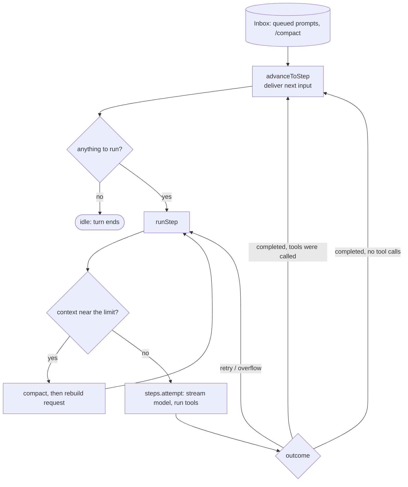
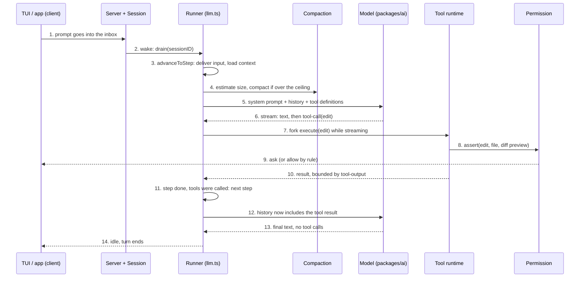

# Anatomy: reading opencode's source

## Why this matters

[5.1](/part-05-harnesses/5.1-what-is-a-harness) gave you a component list: loop, tools, system prompt, context management, permissions. A list is easy to nod at. What you actually need is to have *seen* each component as code, with its ugly edge cases, once. Then every other harness stops being a black box, because you know where to look and what questions to ask.

opencode is a good specimen for three reasons. It is open source (MIT, per the [repository's LICENSE](https://github.com/anomalyco/opencode/blob/135d46cea78eb9cc6ff2c6b77f318dfa8e1ffe26/LICENSE)). It is TypeScript, your most comfortable language. And it is a production harness with real users, so its code has the scars that tutorials leave out: retries, interrupted tools, cache-aware compaction, CRLF line endings.

**Learning goals**

- Find the loop, tools, prompts and context management in opencode's source
- Explain one non-obvious design decision
- Borrow ideas for your own harness

::: warning The code moves, so read at a pinned commit
This chapter was written against commit [`135d46c`](https://github.com/anomalyco/opencode/tree/135d46cea78eb9cc6ff2c6b77f318dfa8e1ffe26) of `anomalyco/opencode` (2026-11-11, root `package.json` says version 2.2.7). Every source link below is a permalink to that commit, with line numbers that match it. On the default branch (`dev`, per the repo's own `AGENTS.md`) lines will have moved and some files may be gone. Read the permalinks first; wander on `dev` afterwards.
:::

## Explanation

### How to read this codebase

Two things will save you an hour.

**The code is written with Effect.** opencode's core uses the [Effect](https://effect.website/) library. For reading purposes: `Effect.gen(function* () { ... })` is an `async` function, `yield*` is `await`, and the type `Effect<A, E, R>` is a promise-like value that also tracks its error type `E` and the services `R` it needs. A `Service` is a dependency-injected interface and `Layer.effect(Service, ...)` is its constructor. You do not need to learn Effect to follow the flow; read `yield*` as `await` and move on.

**It is a rewrite, and the names reflect that.** The tree has a `v1/` leftover and a lot of "Location", "Session", "inbox" and "plugin" vocabulary. A *Location* is the working directory (project) a session runs in, with its own services (tools, permissions, filesystem). A *Session* is one conversation with its durable message history in SQLite. The *inbox* holds things waiting to be delivered into a session (your prompt, a `/compact` request).

::: info 📖 Read now
[opencode repository: `packages/core/src/tool/AGENTS.md`](https://github.com/anomalyco/opencode/blob/135d46cea78eb9cc6ff2c6b77f318dfa8e1ffe26/packages/core/src/tool/AGENTS.md) · repo · ~10 min · **essential**

Look for: the architecture notes written for agents working on the repo, not for users. It states in one page how tools are registered (a transform per source, last registration wins), why the registry does *no* authorization ("Tool filtering is catalog visibility, not execution authorization"), and where output bounding happens. Notice the rules phrased as "do not add X": each one is a past mistake.
:::

### Repo tour

The repository is a monorepo of packages under `packages/`. The ones that matter for a harness reader:

| Package / path | What lives there |
|---|---|
| [`packages/core/src/session/`](https://github.com/anomalyco/opencode/tree/135d46cea78eb9cc6ff2c6b77f318dfa8e1ffe26/packages/core/src/session) | The session: message history, the runner (the loop), model requests, compaction, system prompt |
| [`packages/core/src/tool/`](https://github.com/anomalyco/opencode/tree/135d46cea78eb9cc6ff2c6b77f318dfa8e1ffe26/packages/core/src/tool) and `tool.ts` | The tool registry and runtime; built-in tools are in `tool/plugin/` (`edit`, `shell`, `grep`, `glob`, `read`, `patch`, `webfetch`, `subagent`, `todo`, `question` and more) |
| [`packages/core/src/permission.ts`](https://github.com/anomalyco/opencode/blob/135d46cea78eb9cc6ff2c6b77f318dfa8e1ffe26/packages/core/src/permission.ts) | Permission rules, asking the user |
| [`packages/core/src/agent.ts`](https://github.com/anomalyco/opencode/blob/135d46cea78eb9cc6ff2c6b77f318dfa8e1ffe26/packages/core/src/agent.ts) and `plugin/agent.ts` | Agent definitions (name, system prompt override, permission rules, step limit) |
| `packages/core/src/plugin/` | Built-in behaviour implemented as plugins, including the per-model prompts |
| `packages/ai/` | The provider-agnostic LLM client (streaming events, tool calls) |
| `packages/server/`, `packages/cli/`, `packages/tui/`, `packages/app/`, `packages/desktop/` | The HTTP server, terminal UI and other front ends. The UI is a client; the harness lives in `core` |
| `packages/plugin/`, `packages/sdk/` | The public plugin API and SDK |

Two observations on the layout. First, the front ends are *clients of a server*: the TUI, the desktop app and the web app all talk to the same core, which is how the same sessions can be driven from several places. Second, built-in features such as the edit tool, the agent list and the per-model prompts are registered through the same plugin mechanism a third party would use. That is a deliberate design: the harness's extension points are exercised by its own features.

Map back to 5.1's components:

| 5.1 component | Where it is in opencode (at the pinned commit) |
|---|---|
| Loop | `session/runner/llm.ts` (turn and step policy) and `session/runner/step.ts` (one model call plus its tools) |
| Tools | `tool.ts`, `tool/runtime.ts`, `tool/plugin/*.ts` |
| System prompt | `session/system-prompt.ts`, `session/runner/prompt/system.txt`, `plugin/optimize.ts`, `plugin/system-prompt/*.txt` |
| Context management | `session/compaction.ts`, `tool-output.ts`, `session/history.ts` |
| Permissions | `permission.ts`, agent `permissions` in `plugin/agent.ts` |
| UI | `packages/tui`, `packages/app`, `packages/desktop` |

### The agent loop

You wrote this loop in [3.2](/part-03-agents/3.2-agent-loop) in about thirty lines. Here it is in production, in [`session/runner/llm.ts`](https://github.com/anomalyco/opencode/blob/135d46cea78eb9cc6ff2c6b77f318dfa8e1ffe26/packages/core/src/session/runner/llm.ts). Find the skeleton first and ignore everything else.

There are two nested loops, with a clean split of responsibility.

1. **`drain`** ([lines 63 to 225](https://github.com/anomalyco/opencode/blob/135d46cea78eb9cc6ff2c6b77f318dfa8e1ffe26/packages/core/src/session/runner/llm.ts#L63-L225)) is one *turn*: it runs from "there is input waiting" to "the session is idle". Its core is a `while (true)` at [lines 216 to 224](https://github.com/anomalyco/opencode/blob/135d46cea78eb9cc6ff2c6b77f318dfa8e1ffe26/packages/core/src/session/runner/llm.ts#L216-L224): get the next ready context, run one step, increment the step counter, repeat. Everything before that (about 140 lines of `advanceToStep`) is about *what to deliver into the session next*: queued user messages, manual compaction requests, moving the session to another directory.
2. **`runStep`** ([lines 237 to 387](https://github.com/anomalyco/opencode/blob/135d46cea78eb9cc6ff2c6b77f318dfa8e1ffe26/packages/core/src/session/runner/llm.ts#L237-L387)) is one *step*: one model call plus the tools it requested. It has its own `while (true)` that exists only for *recovery*: compact first if the context is nearly full, build the request, run the attempt, and then match on the outcome (completed, retry, output-limit hit, compacted, recover).

Your 3.2 loop is the part of `runStep` that says "call the model, run the tools, go around again if it asked for tools". The `needsContinuation` flag returned by a completed step is exactly your "did the model request a tool call?" test.



Now the inside of one step, [`runner/step.ts`](https://github.com/anomalyco/opencode/blob/135d46cea78eb9cc6ff2c6b77f318dfa8e1ffe26/packages/core/src/session/runner/step.ts). The part to find is [lines 135 to 163](https://github.com/anomalyco/opencode/blob/135d46cea78eb9cc6ff2c6b77f318dfa8e1ffe26/packages/core/src/session/runner/step.ts#L135-L163): the model's reply is a *stream* of events, and **as soon as a `tool-call` event arrives, a fiber is forked to execute that tool** while the model is still streaming. Tool calls from one response therefore run concurrently, and the step waits for all of them at the end. Your 3.2 loop probably waited for the whole response, then ran tools in a `for` loop. Starting tools early is a latency win the streaming API makes possible.

A handful of production details are worth naming, because they are what a 30-line loop lacks:

- **A hard step limit that degrades gracefully.** If the agent has a `steps` limit and it is reached, the runner does not just stop. It appends an assistant message from [`max-steps.ts`](https://github.com/anomalyco/opencode/blob/135d46cea78eb9cc6ff2c6b77f318dfa8e1ffe26/packages/core/src/session/runner/max-steps.ts) ("CRITICAL - MAXIMUM STEPS REACHED ... Respond with text only") and sets `toolChoice: "none"` ([`llm.ts` lines 261 to 283](https://github.com/anomalyco/opencode/blob/135d46cea78eb9cc6ff2c6b77f318dfa8e1ffe26/packages/core/src/session/runner/llm.ts#L261-L283)), so the user gets a summary of where the agent got to. A comment there notes the tool definitions stay on the final request "to preserve the provider's cached prefix".
- **Output-limit recovery.** If a reply is cut off by the output token limit, the runner injects a synthetic message telling the model to break the work into smaller pieces, and gives up after two such continuations ([lines 346 to 376](https://github.com/anomalyco/opencode/blob/135d46cea78eb9cc6ff2c6b77f318dfa8e1ffe26/packages/core/src/session/runner/llm.ts#L346-L376)).
- **Crash repair.** At the start of every drain, `settleStaleToolCalls` ([lines 419 to 442](https://github.com/anomalyco/opencode/blob/135d46cea78eb9cc6ff2c6b77f318dfa8e1ffe26/packages/core/src/session/runner/llm.ts#L419-L442)) marks any tool still "running" from a dead process as failed with "Tool execution interrupted". The history is durable, so a crash mid-tool must not leave the transcript in a state the API would reject (a tool call with no result).
- **Interruption protocol.** When the user hits stop, tools that opted in get a chance to settle their own call before being killed ([`step.ts` lines 106 to 117](https://github.com/anomalyco/opencode/blob/135d46cea78eb9cc6ff2c6b77f318dfa8e1ffe26/packages/core/src/session/runner/step.ts#L106-L117)).

None of this is exotic. It is the same loop, plus an answer to "what if" for every line.

### Tool implementations

Tools are registered, not hard-coded. Each built-in is a small plugin that calls `ctx.tool.transform((editor) => editor.add({ name, description, input, output, execute }))`. The input and output are schemas; the `description` is the text the model sees. Read three of them, and read them as *interface design*, the lens from [3.3](/part-03-agents/3.3-tool-design).

#### edit: exact match, then forgiving

[`tool/plugin/edit.ts`](https://github.com/anomalyco/opencode/blob/135d46cea78eb9cc6ff2c6b77f318dfa8e1ffe26/packages/core/src/tool/plugin/edit.ts) is the tool the learner will rebuild in [5.4](/part-05-harnesses/5.4-mini-harness). The interface ([lines 24 to 34](https://github.com/anomalyco/opencode/blob/135d46cea78eb9cc6ff2c6b77f318dfa8e1ffe26/packages/core/src/tool/plugin/edit.ts#L24-L34)) is `path`, `oldString`, `newString`, `replaceAll`. By default `oldString` must match exactly once. The interesting part is what happens when it does not.

- **Matching tiers** ([`matchView`, lines 168 to 188](https://github.com/anomalyco/opencode/blob/135d46cea78eb9cc6ff2c6b77f318dfa8e1ffe26/packages/core/src/tool/plugin/edit.ts#L168-L188)). Try an exact match. If there is none, retry with typographic quotes, dashes and odd spaces normalised (models love to "fix" a straight quote into a curly one). If there is still none, retry ignoring trailing whitespace per line. Each tier runs only if the previous one found nothing.
- **Line endings are preserved.** Matching runs on a view with CRLF turned into LF (the same view the `read` tool shows the model), then offsets are mapped back to the real file, and replacement lines reuse the file's own line endings ([`withRegionEndings`, lines 112 to 125](https://github.com/anomalyco/opencode/blob/135d46cea78eb9cc6ff2c6b77f318dfa8e1ffe26/packages/core/src/tool/plugin/edit.ts#L112-L125)). A Windows file stays a Windows file.
- **Failure messages teach.** A miss does not just say "not found". `missHint` ([lines 199 to 241](https://github.com/anomalyco/opencode/blob/135d46cea78eb9cc6ff2c6b77f318dfa8e1ffe26/packages/core/src/tool/plugin/edit.ts#L199-L241)) tells the model either "newString is already in the file, so this edit may already be applied" or shows the closest lines with line numbers, so the next attempt can succeed without re-reading the file. Multiple matches say how many and what to do about it ([lines 335 to 339](https://github.com/anomalyco/opencode/blob/135d46cea78eb9cc6ff2c6b77f318dfa8e1ffe26/packages/core/src/tool/plugin/edit.ts#L335-L339)).
- **Writes are serialised per file** by `fileMutation.withLock` ([line 355](https://github.com/anomalyco/opencode/blob/135d46cea78eb9cc6ff2c6b77f318dfa8e1ffe26/packages/core/src/tool/plugin/edit.ts#L355)), which matters when several tool calls from one response run in parallel, as the previous section showed.

#### shell: output goes to a file, long commands go to the background

[`tool/plugin/shell.ts`](https://github.com/anomalyco/opencode/blob/135d46cea78eb9cc6ff2c6b77f318dfa8e1ffe26/packages/core/src/tool/plugin/shell.ts) shows the problems a `bash` tool has that an edit tool does not: commands can run forever, print gigabytes, and do anything.

- The input has `timeout` (default two minutes, [line 26](https://github.com/anomalyco/opencode/blob/135d46cea78eb9cc6ff2c6b77f318dfa8e1ffe26/packages/core/src/tool/plugin/shell.ts#L26)) and `background` ([lines 54 to 67](https://github.com/anomalyco/opencode/blob/135d46cea78eb9cc6ff2c6b77f318dfa8e1ffe26/packages/core/src/tool/plugin/shell.ts#L54-L67)). A background command returns at once and the harness *notifies the session when it ends*. The tool description and the notice text tell the model not to poll ([`BACKGROUND_INSTRUCTION`, line 31](https://github.com/anomalyco/opencode/blob/135d46cea78eb9cc6ff2c6b77f318dfa8e1ffe26/packages/core/src/tool/plugin/shell.ts#L30-L31)). A model that sleeps and re-reads an output file in a loop wastes turns, so the harness removes the need.
- The command string is *parsed* before it runs ([`prepare`, lines 263 to 291](https://github.com/anomalyco/opencode/blob/135d46cea78eb9cc6ff2c6b77f318dfa8e1ffe26/packages/core/src/tool/plugin/shell.ts#L263-L291)): `ShellParse.scan` extracts the individual commands and the directories they touch, and the permission request is made per command, so a rule can allow `git status` and still ask about `git push`. This is the permission section's main example.
- Output limits are not in the shell tool at all. Every tool result passes through [`tool-output.ts`](https://github.com/anomalyco/opencode/blob/135d46cea78eb9cc6ff2c6b77f318dfa8e1ffe26/packages/core/src/tool-output.ts), which caps results at 2,000 lines or 50 KiB ([lines 13 to 14](https://github.com/anomalyco/opencode/blob/135d46cea78eb9cc6ff2c6b77f318dfa8e1ffe26/packages/core/src/tool-output.ts#L13-L14)), writes the full text to a file under the data directory (kept 7 days), and returns a preview plus the path. The model can then `grep` or `read` that file if it needs more. The `step.ts` consumer calls it on every result ([line 152](https://github.com/anomalyco/opencode/blob/135d46cea78eb9cc6ff2c6b77f318dfa8e1ffe26/packages/core/src/session/runner/step.ts#L152)). This is "context engineering" from [3.4](/part-03-agents/3.4-context-engineering) as a single chokepoint: no tool can accidentally flood the window.

#### grep and glob: search without a vector index

[`tool/plugin/grep.ts`](https://github.com/anomalyco/opencode/blob/135d46cea78eb9cc6ff2c6b77f318dfa8e1ffe26/packages/core/src/tool/plugin/grep.ts) wraps ripgrep. There is no embedding index anywhere: this is the "agentic search" from [2.11](/part-02-programming-with-llms/2.11-agentic-search), where the model searches with `grep` and `glob` and then reads files. Two small design points:

- Results are formatted for a model, grouped by file with `Line N: text` ([`toModelContent`, lines 45 to 62](https://github.com/anomalyco/opencode/blob/135d46cea78eb9cc6ff2c6b77f318dfa8e1ffe26/packages/core/src/tool/plugin/grep.ts#L45-L62)), and truncation says how to narrow the query.
- `ToolSearch.bounded` ([`tool/search.ts`, lines 15 to 28](https://github.com/anomalyco/opencode/blob/135d46cea78eb9cc6ff2c6b77f318dfa8e1ffe26/packages/core/src/tool/search.ts#L15-L28)) asks for `limit + 1` results, so it can tell the model "results are truncated" without running a second search. It also enforces a timeout.

::: info 📖 Read now
[opencode repository: `tool/plugin/edit.ts`](https://github.com/anomalyco/opencode/blob/135d46cea78eb9cc6ff2c6b77f318dfa8e1ffe26/packages/core/src/tool/plugin/edit.ts) · repo · ~20 min · **essential**

Look for: the tool `description` string at line 275 (this is the model-facing manual; compare it with what you wrote in 3.3), the three matching tiers, and the `missHint` function. Ask of each branch: which real failure of a model does this exist for? You do not need to follow the line-alignment algorithm (`alignLines`) in detail.
:::

### System prompts per model

Here the code and the planned outline disagree, and the code is more interesting. In older opencode versions, each model family had its own prompt file in one directory. The repository history shows that: [commit `44b6938`](https://github.com/anomalyco/opencode/commit/44b6938b2ad2895bdd89d5d5cf753fb01ca8e3dd) (2026-07-20) deleted `packages/opencode/src/session/prompt/` with files named `anthropic.txt`, `beast.txt`, `codex.txt`, `gemini.txt`, `gpt.txt`, `kimi.txt` and others. In the current code, the base prompt is **one** template and the per-model variation is added by plugins.

**The base prompt.** [`session/runner/prompt/system.txt`](https://github.com/anomalyco/opencode/blob/135d46cea78eb9cc6ff2c6b77f318dfa8e1ffe26/packages/core/src/session/runner/prompt/system.txt) is only 15 lines: a one-line role, a "Harness" block (responses render as Markdown, `<system-reminder>` blocks are harness instructions, parallelise independent tool calls), communication rules and codebase-working rules. It contains a placeholder, `${OPENCODE_TOOL_GUIDANCE}`.

**Tool-conditional guidance.** [`session/system-prompt.ts`](https://github.com/anomalyco/opencode/blob/135d46cea78eb9cc6ff2c6b77f318dfa8e1ffe26/packages/core/src/session/system-prompt.ts) fills that placeholder from the *list of tools actually available* ([lines 9 to 28](https://github.com/anomalyco/opencode/blob/135d46cea78eb9cc6ff2c6b77f318dfa8e1ffe26/packages/core/src/session/system-prompt.ts#L9-L28)). If `edit` is present, the prompt explains how `oldString` matching works; if `shell` is present, it says to prefer dedicated tools. A prompt that describes a tool the agent does not have is a bug, so the prompt is generated from the tool set. Write that down for your own harness.

**Per-model plugins.** [`plugin/optimize.ts`](https://github.com/anomalyco/opencode/blob/135d46cea78eb9cc6ff2c6b77f318dfa8e1ffe26/packages/core/src/plugin/optimize.ts) registers one plugin per model family ([lines 16 to 62](https://github.com/anomalyco/opencode/blob/135d46cea78eb9cc6ff2c6b77f318dfa8e1ffe26/packages/core/src/plugin/optimize.ts#L16-L62)). Each one inspects the model id (`gpt`, `claude`, `kimi`, `trinity`, `muse`) and returns a prompt template or nothing. A plugin hooks the `context` event of the session, replaces the first system part with its template (or, for Claude, *appends* a short section), and skips agents that define their own `system` prompt ([lines 78 to 104](https://github.com/anomalyco/opencode/blob/135d46cea78eb9cc6ff2c6b77f318dfa8e1ffe26/packages/core/src/plugin/optimize.ts#L78-L104)). The per-model texts live in [`plugin/system-prompt/`](https://github.com/anomalyco/opencode/tree/135d46cea78eb9cc6ff2c6b77f318dfa8e1ffe26/packages/core/src/plugin/system-prompt); the Claude one is only two lines, about matching comment density, while the Kimi and Trinity ones are about 95 lines each. A second plugin, [`identity.ts`](https://github.com/anomalyco/opencode/blob/135d46cea78eb9cc6ff2c6b77f318dfa8e1ffe26/packages/core/src/plugin/identity.ts), inserts a "Your Model" block (name, provider id, model id) as the second system part.

The history shows the direction of travel. The 53-line Anthropic prompt file was deleted on 2026-09-05 ([commit `4306c07`](https://github.com/anomalyco/opencode/commit/4306c07b340b9a0504e65785f366d2793cd1b169)) and a two-line appended note about code comments was added on 2026-09-11 ([commit `9dd7149`](https://github.com/anomalyco/opencode/commit/9dd7149e75335c630b6e49584f94a5137dca60c3)); the Gemini prompt was removed on 2026-08-20 ([commit `ea43a16`](https://github.com/anomalyco/opencode/commit/ea43a16b7dc63039c9afcbba7ed05efaa094ab8c)). My reading, not stated by the project: as models improve at following generic instructions, prompts tuned to a model's quirks become dead weight, which is the "scaffolding goes stale" point from 5.1 seen in a diff. Check that interpretation against the commit messages yourself.

There is also a tool-side counterpart: `OpenAIToolsPlugin` and `AnthropicToolsPlugin` in the same file (lines 35 to 49) delete the `grep` and `glob` tools for GPT and Claude models so they search through the shell, with a comment that they are "disabled intentionally" for now because of a UX problem. They are defined but not in the exported `Plugins` list ([line 62](https://github.com/anomalyco/opencode/blob/135d46cea78eb9cc6ff2c6b77f318dfa8e1ffe26/packages/core/src/plugin/optimize.ts#L62)). That is a model-harness co-design bet written as code: these models are trained to use a shell, so a dedicated search tool might be redundant.

For comparison, Codex CLI (OpenAI's open-source harness, Apache-2.0 per its [repository](https://github.com/openai/codex)) keeps per-model prompts as plain Markdown files next to the core crate, such as [`gpt_5_2_prompt.md`](https://github.com/openai/codex/blob/392ced7d3a9160fd35d40c606359869215f50522/codex-rs/core/gpt_5_2_prompt.md), which opens "You are GPT-5.2 running in the Codex CLI". It is written in Rust, so the structure differs, but the component list from 5.1 applies unchanged: [`session/turn.rs`](https://github.com/openai/codex/blob/392ced7d3a9160fd35d40c606359869215f50522/codex-rs/core/src/session/turn.rs) holds the turn loop (`run_turn`, line 217), `compact*.rs` files handle compaction, and a separate [`sandboxing`](https://github.com/openai/codex/tree/392ced7d3a9160fd35d40c606359869215f50522/codex-rs/sandboxing/src) crate contains the macOS Seatbelt and Linux sandbox code. That last one is the notable contrast with opencode: a search of `packages/core/src` for `seatbelt`, `bwrap`, `landlock` and `sandbox-exec` found nothing, so at this commit it appears to rely on permission rules alone (I did not check the other packages). Part 8 returns to that difference.

### Context management and compaction

Three mechanisms keep the window under control. You have met one already (the output cap in `tool-output.ts`). The other two are in [`session/compaction.ts`](https://github.com/anomalyco/opencode/blob/135d46cea78eb9cc6ff2c6b77f318dfa8e1ffe26/packages/core/src/session/compaction.ts), a 1,274-line file. Read its constants block ([lines 127 to 171](https://github.com/anomalyco/opencode/blob/135d46cea78eb9cc6ff2c6b77f318dfa8e1ffe26/packages/core/src/session/compaction.ts#L127-L171)) first; the comments are unusually good.

**When to compact.** Before every step, `runStep` estimates the prompt size and asks `compaction.compact({ reason: "auto" })` ([`llm.ts` lines 253 to 255](https://github.com/anomalyco/opencode/blob/135d46cea78eb9cc6ff2c6b77f318dfa8e1ffe26/packages/core/src/session/runner/llm.ts#L253-L255)). The ceiling is the model's input window minus a reserve: at least 15% of the window and at least 16,000 tokens (when the window is big enough), unless the user configured a buffer ([`calculateCeiling`, lines 1163 to 1171](https://github.com/anomalyco/opencode/blob/135d46cea78eb9cc6ff2c6b77f318dfa8e1ffe26/packages/core/src/session/compaction.ts#L1163-L1171)). The size estimate combines what the provider *measured* on the latest response with an *estimate* for text added since. There are three triggers: `auto` (the estimate crossed the ceiling), `overflow` (the provider rejected the request as too long, so shrink more aggressively: the retry aims at 85%, then 70%, 50%, 35% of the rejected size, `SHRINK_STEPS`), and `manual` (the user typed `/compact`).

**What compaction produces.** The model is asked to write a structured summary using a fixed template ([`SUMMARY_TEMPLATE`, lines 173 to 204](https://github.com/anomalyco/opencode/blob/135d46cea78eb9cc6ff2c6b77f318dfa8e1ffe26/packages/core/src/session/compaction.ts#L173-L204)): Objective, Requirements, Decisions, Work State (Completed, Active, Blocked), Next Move, Relevant Files (at most 15), Important Context. Rules beside it say: terse bullets, preserve exact paths and error strings, do not re-summarise `AGENTS.md` conventions because "the next agent receives current versions of all of these separately". If the model replies without the template, a `NUDGE` message asks again. A recent tail of the conversation is kept verbatim beside the summary (`keep` setting), and a later compaction *updates* the earlier checkpoint instead of summarising a summary of a summary ([`buildPrompt`, lines 214 to 245](https://github.com/anomalyco/opencode/blob/135d46cea78eb9cc6ff2c6b77f318dfa8e1ffe26/packages/core/src/session/compaction.ts#L214-L245)).

Compare this template with the "what to preserve" advice in [3.4](/part-03-agents/3.4-context-engineering) and [3.5](/part-03-agents/3.5-memory). The Work State and Next Move sections are the same idea as the progress file in Anthropic's long-running-agents article from 5.1, written by the model at compaction time instead of by the agent during work.

**The non-obvious part: cache-aware compaction.** Provider prompt caches reward an unchanged prefix. Compacting rewrites the prefix, so it throws the cache away. opencode's authors work around this in two ways, both visible in comments:

- The summary request is sent as *the normal conversation plus a summary prompt at the end*, so the summarisation call itself reads the existing cache (the ASCII diagram at [lines 450 to 460](https://github.com/anomalyco/opencode/blob/135d46cea78eb9cc6ff2c6b77f318dfa8e1ffe26/packages/core/src/session/compaction.ts#L450-L460) draws it).
- `precompute` starts a summary in the **background** when the context is within 60,000 tokens of the ceiling (`PRECOMPUTE_LEAD`), only while the last response's cache is still warm (`CACHE_LIFETIME` is 5 minutes). The finished summary is *held* and swapped in only when compaction is actually due, "because swapping it in now would rewrite the prefix and throw away the cache for every step until compaction is actually due" ([the comment at lines 341 to 346](https://github.com/anomalyco/opencode/blob/135d46cea78eb9cc6ff2c6b77f318dfa8e1ffe26/packages/core/src/session/compaction.ts#L341-L346)). The constants' comment also says why 60,000: writing a summary takes 30 to 60 seconds, and in real sessions the context can grow 25,000 tokens or more in that time about one step in twenty. Those are the authors' own measurements from their comments, not something this book has verified.

This is a good example of a design decision that looks like over-engineering until you see the cost model: the user waits for compaction, and a cache miss on a 150,000-token prompt is both slower and more expensive than a hit. Where cache prices and ratios stand today is on [Landscape](/landscape); the mechanism is covered in [2.9](/part-02-programming-with-llms/2.7-prompt-caching).

### Permissions

[`permission.ts`](https://github.com/anomalyco/opencode/blob/135d46cea78eb9cc6ff2c6b77f318dfa8e1ffe26/packages/core/src/permission.ts) is the shortest of the big components and the one most worth stealing from.

**The model.** A rule is `{ action, resource, effect }` with `effect` one of `allow`, `deny`, `ask`. Actions are tool names (`shell`, `edit`, `read`, `grep`, `external_directory`, ...); resources are what the action touches (a command, a path, a pattern). [`evaluate`](https://github.com/anomalyco/opencode/blob/135d46cea78eb9cc6ff2c6b77f318dfa8e1ffe26/packages/core/src/permission.ts#L94-L104) uses wildcard matching and takes the **last matching rule** (`findLast`); if nothing matches, the answer is `ask`. The user-facing docs say the same: rules are checked in order, the final match wins, no match means ask ([opencode docs: Permissions](https://opencode.ai/docs/permissions/)).

::: info 📖 Read now
[opencode docs: Permissions](https://opencode.ai/docs/permissions/) · docs · ~10 min · **essential**

Look for: the three effects, how rule order decides precedence, and how a config rule for one tool looks. Then read `evaluate` and `evaluateInput` in `permission.ts` and check that the code does what the docs promise.
:::

**Where tools ask.** Each tool calls `permission.assert` itself, inside its own `execute`, and passes the invocation context (session, agent, message and tool-call ids) via `Permission.invocation` (see [`grep.ts` lines 87 to 100](https://github.com/anomalyco/opencode/blob/135d46cea78eb9cc6ff2c6b77f318dfa8e1ffe26/packages/core/src/tool/plugin/grep.ts#L87-L100) and the shell's per-command request above). The registry does not authorize anything. Putting the check in the leaf means the tool decides *what the resource is*: the shell tool asks about parsed commands, the edit tool about a file and a diff preview, `grep` about the pattern.

**Where rules come from.** [`configured`](https://github.com/anomalyco/opencode/blob/135d46cea78eb9cc6ff2c6b77f318dfa8e1ffe26/packages/core/src/permission.ts#L169-L174) merges the *agent's* permissions with the *session's*. An agent with no permissions gets a default `deny *`. Agents are where least privilege lives: the built-in `explore` subagent starts with `deny *` and then allows only `shell`, `grep`, `glob`, `read` (asking for `.env` files), web fetch and search, and forbids spawning further subagents ([`plugin/agent.ts` lines 74 to 94](https://github.com/anomalyco/opencode/blob/135d46cea78eb9cc6ff2c6b77f318dfa8e1ffe26/packages/core/src/plugin/agent.ts#L74-L94)). Title and summary agents are `deny *` with no tools at all. A narrower agent is a permission set plus a prompt, nothing more.

**Two non-obvious decisions.**

1. **Deny beats a saved approval.** `evaluateInput` ([lines 184 to 210](https://github.com/anomalyco/opencode/blob/135d46cea78eb9cc6ff2c6b77f318dfa8e1ffe26/packages/core/src/permission.ts#L184-L210)) checks the configured rules for a `deny` *first* and returns immediately. Only then does it merge in the rules saved from earlier "always allow" answers (which are all `allow`) and look for `ask`. So clicking "always allow" in a prompt can never override a deny that the config or agent declares. Without that ordering, rule order alone would let a saved approval defeat a ban.
2. **A "no" cannot be talked around by the tool.** The comment at [lines 273 to 277](https://github.com/anomalyco/opencode/blob/135d46cea78eb9cc6ff2c6b77f318dfa8e1ffe26/packages/core/src/permission.ts#L273-L277) explains the "deliberate defect tunnel". Tools wrap their body in blanket error handlers that turn failures into text for the model. If a user's decline were an ordinary failure, a tool would convert it to "the user said no, try something else" and the model would keep going. So a plain decline is thrown as a *defect* that tool code does not catch, and is turned back into a clean failure at [`model-request.ts` lines 422 to 440](https://github.com/anomalyco/opencode/blob/135d46cea78eb9cc6ff2c6b77f318dfa8e1ffe26/packages/core/src/session/model-request.ts#L422-L440). A decline *with feedback* is the exception: it stays a typed error so the model sees the user's words and adjusts. The `AGENTS.md` you read earlier states the same rule for tool authors.

It also supports unattended runs: when nobody is present to answer (a scheduled job), a request that would ask is denied unless an explicit "unattended" ruleset allows it ([lines 59 to 65 and 199 to 209](https://github.com/anomalyco/opencode/blob/135d46cea78eb9cc6ff2c6b77f318dfa8e1ffe26/packages/core/src/permission.ts#L199-L209)). Compare that with Claude Code's permission modes from 5.1.

A last point connects to Part 8. These permission rules are policy enforced *inside the harness process*. They stop the agent from calling a tool without approval; they do not stop an approved `shell` command from doing anything the user's OS account can do. Whether that is enough is a sandboxing question ([8.3](/part-08-production/8.3-sandboxing)), and the Codex comparison above shows a harness that answers it differently.

::: info 📖 Read now
[opencode docs: Agents](https://opencode.ai/docs/agents/) · docs · ~10 min · optional

Look for: the difference between primary agents and subagents, what the built-in Build and Plan agents are, and how a custom agent is defined. Then find those same agents in `plugin/agent.ts`.
:::

### Putting it together: one request, end to end

Trace a prompt such as "rename `foo` to `bar` in `src/util.ts`". The numbers match the diagram.



1. The client posts the prompt. It is stored durably in the session's inbox ([`session/inbox.ts`](https://github.com/anomalyco/opencode/blob/135d46cea78eb9cc6ff2c6b77f318dfa8e1ffe26/packages/core/src/session/inbox.ts)), not handled in the UI process.
2. A *run coordinator* ([`run-coordinator.ts`](https://github.com/anomalyco/opencode/blob/135d46cea78eb9cc6ff2c6b77f318dfa8e1ffe26/packages/core/src/session/run-coordinator.ts)) makes sure there is at most one execution per session and rings a "doorbell" if work arrives while one is running, so the loop drains again instead of ending.
3. to 5. `drain` and `runStep`, as above: select the agent, instructions (project `AGENTS.md`-style files) and tool snapshot; resolve the model; compact if needed; build the system prompt (base template, tool guidance, per-model plugin, identity).
6. to 8. The model streams. The tool call arrives, a fiber starts, and the `edit` leaf resolves the path, finds the match, builds a diff and asks permission.
9. to 10. The user approves (or a rule does). The edit commits; the result is truncated if large and stored as a tool message.
11. to 14. Another step, now with the tool result in history; the model says it is done; no tool calls, so the turn ends.

If any of this seems like a lot for "call the model in a loop", that is the point of the chapter. The loop is thirty lines. The other six thousand are everything that happens when a stream stalls, a file has CRLF endings, the user presses stop, the window fills, or a command prints a gigabyte.

### What to borrow

For your own harness in [5.4](/part-05-harnesses/5.4-mini-harness) and [Part 8](/part-08-production/8.3-sandboxing), each of these is cheap to copy and each came from a real failure:

| Idea | Where | Cost to copy |
|---|---|---|
| Generate the system prompt from the tool list, so it never describes a missing tool | `system-prompt.ts` | A few lines |
| Exact-match edit, with a hint on a miss ("already applied" or closest lines) | `edit.ts` | An afternoon, mostly tests |
| One chokepoint that caps every tool result and saves the full text to a file | `tool-output.ts` | Small |
| Start tools while the model is still streaming | `step.ts` | Only if you stream |
| Background commands that notify the session, instead of making the model poll | `shell.ts` | Moderate |
| Deny rules checked before any saved approval; last matching rule wins; default ask | `permission.ts` | Small |
| Step limit that forces a text summary instead of cutting the agent off | `max-steps.ts` | A few lines |
| Mark stale "running" tool calls as failed when resuming a session | `llm.ts` | Small, needed once you persist history |

And some things to *not* copy early: cache-aware background compaction, the plugin hook system and the durable event-sourced session store. They solve problems you will not have for a long time.

## Practice

**Brief:** Write `notes/opencode-anatomy.md`: a diagram of the main modules and how one request flows through them, with links to source lines.

**Where:** Notes only, no code (`notes/`). This chapter has no experiment folder and adds nothing to `project/`. The practice is reading and writing.

**Steps:**

1. **Get the source at the pinned commit.** Either browse the permalinks in this chapter, or clone it and check the commit out so line numbers match:

   ```sh
   git clone https://github.com/anomalyco/opencode.git /tmp/opencode-src
   cd /tmp/opencode-src && git checkout 135d46cea78eb9cc6ff2c6b77f318dfa8e1ffe26
   ```

   Keep the clone out of your study repo. Treat it as untrusted code: read it, do not run it.
2. **Find the five components yourself.** Without re-reading the chapter's links, locate in the tree: the loop (the `while (true)` that runs steps), one tool's `execute`, the system prompt text, the compaction trigger, and a `permission.assert` call. Write down each file path and line number. If you get lost, the tour table above is the map.
3. **Draw the diagram.** In `notes/opencode-anatomy.md`, draw a Mermaid or ASCII diagram of the main modules and the path of one request through them. Do your own, not a copy of the chapter's, and include the module names you actually opened. Mark where the model is called, where tools run and where the user can be asked.
4. **Link to source.** Every box in your diagram gets a link to the file and line range, as a permalink to the pinned commit.
5. **Trace one real request.** Pick a concrete prompt and walk it through your diagram step by step in prose, naming the function at each step. Include one failure path: what happens if the tool call is declined, or if the context is too long.
6. **One decision.** Pick one non-obvious design decision (the chapter names several: the defect tunnel, deny before saved approvals, cache-aware precompute, the edit-miss hint, `limit + 1` search). In a paragraph, explain what problem it solves, what you would have done naively, and what that would have broken.
7. **What you would borrow.** List three ideas for your own harness and, for each, where in `project/` it would go.

**Done when:**

- `notes/opencode-anatomy.md` exists with a diagram of modules and the path of one request.
- Each box in the diagram links to a source file and line range at the pinned commit.
- The file contains a traced request including one failure path, and one explained design decision.
- The borrow list has three items, each tied to a place in `project/`.

## Check questions

1. In opencode's runner, what is the difference between `drain` and `runStep`, and which one contains the loop you wrote in 3.2?

   <details><summary>Answer</summary>

   `drain` is one turn: it decides what input to deliver next and loops over steps until the session is idle. `runStep` is one step: one model call plus its tools, with its own inner loop only for recovery (compacting, retrying, output-limit continuation). Your 3.2 loop (call the model, run requested tools, go round again if tools were called) is spread across both: the `runStep` attempt does the call and the tools, and `drain`'s `while (true)` goes round for the next step when a step reports it needs continuation.

   </details>

2. The edit tool tries several matching strategies instead of one exact match. Name them in order, and say why that helps a model, and what the tool does when nothing matches.

   <details><summary>Answer</summary>

   Exact match; then a match ignoring typographic quote, dash and space variants; then a match ignoring trailing whitespace on each line. It helps because models often reproduce text with small differences (curly quotes, trailing spaces) that are not the intent. When nothing matches, it fails with a message that includes a hint: either that `newString` is already present (the edit may have been applied) or the closest lines in the file with line numbers, so the next attempt does not need a fresh read. The hint is shown only if reading that file is already allowed.

   </details>

3. Explain why permission rules are evaluated so that a configured `deny` beats a saved "always allow", and say what bug the opposite ordering would allow.

   <details><summary>Answer</summary>

   `evaluateInput` first checks only the configured (agent and session) rules and returns `deny` immediately if any resource is denied; only afterwards does it add the saved approvals, which are all `allow` rules, and look for `ask`. With the last-matching-rule-wins semantics, if saved approvals were merged in before checking denies, a user clicking "always allow" once could override a deny that the config or an agent definition declares (for example a read-only subagent), so a ban would not be a ban.

   </details>

4. Why does opencode throw a plain user decline as a defect instead of returning it as a tool failure, and what is the exception?

   <details><summary>Answer</summary>

   Tools wrap their work in blanket error handlers that turn failures into text for the model. A decline treated like any other failure would be turned into a tool result, and the model could try another route to the same action. As a defect it passes through those handlers and is converted into a clean stop at the model-request boundary. The exception is a decline with written feedback, which stays a typed error so the tool reports the user's words to the model and the model continues with that guidance.

   </details>

5. Compacting the conversation rewrites the prompt prefix. Why is that costly, and how does opencode reduce the cost?

   <details><summary>Answer</summary>

   Provider prompt caches reward an unchanged prefix, so rewriting the history discards the cache and the next requests pay full price and latency. opencode sends the summary request as the normal conversation plus a summary prompt at the end, so the summarisation call reads the existing cache. It also starts a summary in the background when the context is close to the ceiling, while the cache is still warm, holds it, and swaps it in only when compaction is actually due, so the prefix is not rewritten earlier than necessary.

   </details>

## My understanding

<!-- Written by the learner, in their own words. Agents never fill this in. -->
