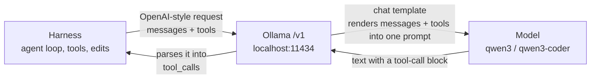

# Harnesses on local Qwen

## Why this matters

A local model costs nothing per token and keeps your code on your machine. A harness is where that promise meets reality, because an agent loop is the hardest thing you can ask of a small model: dozens of turns, a context that keeps growing, and every tool call has to be well-formed or the loop stalls. A chat answer that is slightly off is a nuisance. A tool call with broken JSON, or a prompt silently truncated at turn six, ends the run.

This chapter is about wiring harnesses to Ollama, and then about the failures that appear when you do. It follows [5.3](/part-05-harnesses/5.3-harness-comparison): there you learned to compare harnesses on a fair footing. Here the model is the thing you vary, and the question is which jobs a local model can own. The answer comes from your tasks and your Mac, so the practice is where most of the value is.

**Learning goals**

- Configure opencode, Aider and your harness for Ollama
- Find the failure modes of local models in agent loops
- Decide which tasks local models can own

## Explanation

### Pointing a harness at Ollama

Ollama serves two kinds of API. Its own (`/api/chat`) and an OpenAI-compatible one under `/v1`. Most harnesses either know Ollama specifically or accept any OpenAI-compatible endpoint, so the setup is always some version of three values: a base URL, an API key and a model name.

- **Base URL:** `http://localhost:11434/v1/`.
- **API key:** the client libraries insist on one, and a local Ollama ignores the value. The docs' own example uses the string `ollama` with the comment "required but ignored" ([OpenAI compatibility](https://docs.ollama.com/api/openai-compatibility)).
- **Model name:** exactly what `ollama list` prints, for example `qwen3:14b`.

What the `/v1` endpoint covers matters for harnesses. The compatibility page marks chat completions, streaming, JSON mode, tools and reasoning control as supported; it marks logprobs as not supported, and leaves `tool_choice` unchecked in its list of supported request fields (same page). That last one is easy to miss: a harness that forces the model to call a specific tool with `tool_choice` gets no such guarantee from a local Ollama.

The diagram shows where the two failures in this chapter live. The server renders the conversation into a prompt with the model's chat template, so what the model sees is decided partly by Ollama and the template, not by the harness. And on the way back the server has to find the tool call in free text and turn it into structured JSON. Either step can go wrong without any error message.

#### opencode

opencode needs the least. It "probes `http://127.0.0.1:11434`, discovers completion models, and adds them to `/models` without an account connection". For a remote server you set `settings.baseURL` (including `/v1`) in the config ([Providers](https://opencode.ai/docs/providers/)). The models page says opencode "reads context, vision, and tool-use capabilities from Ollama" ([Models](https://opencode.ai/docs/models/)), but neither page says whether that is the model's maximum window or the one Ollama actually loaded, so do not assume it matches what you loaded.

For a model you want to describe yourself, or a server that is not Ollama, a custom provider declares the endpoint and each model. The models page shows a `limit` with `context` and `output` and a `capabilities.tools` flag, and warns that opencode "cannot detect whether the custom-model fallback values are accurate" ([Models](https://opencode.ai/docs/models/)). Its fallback for models not in its catalog is a 200,000-token context limit (same page), far above what a 24 GB Mac will run, so set `limit.context` to what you really loaded. Select a model as `provider/model`, for example `ollama/qwen3:14b`, with `--model` or `/models`. The config lives in `opencode.json(c)` in the project or `~/.config/opencode/` ([Config](https://opencode.ai/docs/config/)).

#### Aider

Aider talks through LiteLLM and its docs give the Ollama recipe: set `OLLAMA_API_BASE=http://127.0.0.1:11434`, start the server, and run `aider --model ollama_chat/<model>`; the page says `ollama_chat/` is recommended over `ollama/` ([Ollama](https://aider.chat/docs/llms/ollama.html)). Any other OpenAI-compatible server uses `OPENAI_API_BASE` and `OPENAI_API_KEY` and a model prefixed `openai/` ([OpenAI-compatible](https://aider.chat/docs/llms/openai-compat.html)).

Per-model settings go in `.aider.model.settings.yml`: `edit_format` picks how the model returns edits (the formats from [5.3](/part-05-harnesses/5.3-harness-comparison#aider)), and `extra_params` are passed straight to the underlying completion call ([Advanced model settings](https://aider.chat/docs/config/adv-model-settings.html)). The Ollama page's example uses exactly that to fix `num_ctx`.

#### Cline, Continue and your own harness

Cline's Ollama setup is a provider choice plus the base URL `http://localhost:11434` ([Local models](https://docs.cline.bot/provider-config/ollama.md)). Its page does not mention `num_ctx`; a second page says Cline Desktop saves a recommended context window per model and that to change a model's settings you build your own version of it from a Modelfile with `ollama create` ([Cline Desktop local models](https://docs.cline.bot/usage/cline-desktop-local-models.md)). The mini harness from [5.4](/part-05-harnesses/5.4-mini-harness) needs only the three values above: if its model client takes a base URL, pointing it at Ollama is a configuration change, and that is a good test of how cleanly you separated the loop from the provider.

Ollama also has its own integrations section, with a page per tool and an `ollama launch` command that lets you "choose a coding agent" ([integrations](https://docs.ollama.com/integrations)). That index lists Claude Code, opencode and a handful of others; when checked on 2026-11-13 it had no Aider, Cline or Continue page, so for those the harness's own docs above are the source.

### Context size: the silent failure

Ollama loads a model with a fixed context length, and the KV cache for the whole window is reserved at load time ([1.9](/part-01-how-llms-work/1.9-kv-cache-context-window)). The default is small. Ollama's context-length page gives defaults that depend on your VRAM (4k below 24 GiB, 32k from 24 to 48 GiB, 256k from 48 GiB), and says that tasks needing large context, "agents, and coding tools should be set to at least 64000 tokens" ([Context length](https://docs.ollama.com/context-length)). Aider's page, by contrast, says Ollama "uses a 2k context window by default" and "silently discards context that exceeds the window" ([Aider: Ollama](https://aider.chat/docs/llms/ollama.html)). The two statements are from different pages and probably different Ollama versions. Do not trust either: read the `CONTEXT` column of `ollama ps` for the model you actually loaded.

Why this is the first thing to fix in an agent loop: an agent's prompt is the system prompt, the tool definitions, the instruction file, and the whole history, and every file it reads lands in that history. A single coding turn can be several thousand tokens before the model has said anything. If the window is smaller than the prompt, the oldest part is dropped, and the oldest part is the system prompt and the task. The model does not fail loudly. It just starts behaving as if it had never been told what to do.

You have three ways to set the size, and they interact with the harness:

| Where | How | Notes |
|---|---|---|
| Server-wide | `OLLAMA_CONTEXT_LENGTH=64000 ollama serve`, or the slider in the Ollama app | Applies to every model the harness loads. The context-length page presents this as the fallback if you cannot edit it elsewhere. |
| Per model, baked in | A Modelfile with `PARAMETER num_ctx <size>`, then `ollama create` | The route the OpenAI-compatibility page recommends, since "the OpenAI API does not have a way of setting the context size for a model". Harnesses that only speak `/v1` cannot override it per request. |
| Per request | Harness sends an option (Aider's `extra_params: num_ctx`, or its automatic sizing) | Aider says it sets the window to "large enough for each request you send plus 8k tokens for the reply" by default. A changing `num_ctx` can make Ollama reload the model, which costs seconds; check for that in your timing. |

The trade-off is memory. A bigger window uses more memory even when the prompt is short, and the docs warn that it "will increase the amount of memory required" (context-length page). On 24 GB the budget in [Landscape](/landscape#what-fits-in-24-gb-of-unified-memory) already leaves `qwen3:14b` with about a fifth free at 8k; push to 64k and you will watch `ollama ps` for the `PROCESSOR` column, because a model that spills partly to the CPU gets much slower. Measure it with your own numbers rather than mine: that is what your `num_ctx` experiment was for ([1.9](/part-01-how-llms-work/1.9-kv-cache-context-window#practice)).

A related setting is the harness's own idea of the window. opencode keeps a configurable share of the window free before compaction starts (`compaction.buffer`, per the config page), and Aider only reports limit errors it gets from the provider and never enforces limits itself (Aider's model-settings page). If the harness thinks the window is 200k and Ollama loaded 8k, the harness will not compact in time. Make the two agree.

### Tool-call format problems

A model emits a tool call as text in some trained format; the server must recognise and parse it. For Qwen3 the Qwen documentation recommends "Hermes-style tool use" to "maximize function calling performance" and says its chat template already supports it ([Qwen function calling](https://qwen.readthedocs.io/en/latest/framework/function_call.html)). Ollama applies the model's template and returns the result in `message.tool_calls`, with `function.arguments` as an already-parsed object, whereas OpenAI-style clients get arguments as a JSON string ([Ollama tool calling](https://docs.ollama.com/capabilities/tool-calling), Qwen page for the string form with vLLM). You do not see the raw text, which is both the convenience and the problem: when parsing fails, the model's call shows up as ordinary content, and the harness sees a model that "answered" instead of acting.

Failures to look for, roughly from most to least common in practice (my ordering from experience with small models; test it yourself):

1. **No call at all.** The model describes what it would do, or answers from memory. More tools in the prompt make it worse for small models.
2. **Call written as content.** The right text, but the server did not parse it into `tool_calls` (a template or parser mismatch for this model and version). The harness treats it as a final answer and stops.
3. **Wrong or invented arguments.** Valid JSON, wrong path, or a parameter the tool does not have. The tool's error message goes back and a weak model repeats the mistake.
4. **Malformed JSON,** or a tool name that does not exist.
5. **Streaming gaps.** When streaming, tool calls arrive in chunks you must accumulate together with `thinking` and `content` before the follow-up request (Ollama tool calling page). A harness that handles OpenAI streaming but not this will drop calls.
6. **Edit-format failures.** Not a tool call, but the same class: Aider's `diff` format needs exact search blocks and a small model mangles them. Falling back to `whole` costs more tokens but is easier to follow ([5.3](/part-05-harnesses/5.3-harness-comparison#aider)).
7. **Repetition loops.** The same failing call over and over until the turn limit.

Your harness can defend against most of these, and the defences are small: validate arguments against the schema before running, return a precise error that names the field, cap identical consecutive calls, and treat "no tool call and no final answer" as a recoverable state rather than success. The tool-design rules from [3.3](/part-03-agents/3.3-tool-design) matter more for small models: fewer tools, flat arguments, unambiguous names.

#### Thinking and tool calls

Qwen3 models have a thinking mode, and Ollama exposes it as a `think` parameter; reasoning comes back in a separate `message.thinking` field, apart from `message.content` ([Thinking](https://docs.ollama.com/capabilities/thinking)). Two consequences for harnesses. First, a harness that does not know about the field may show it as content, or drop it, or send it back in the history and bloat the context on every turn. Second, thinking is slow: your own benchmark in the 2026-11-06 setup found that on `qwen3:14b` it made a simple answer about 20 times slower, 2 s to 45 s ([experiment 00](https://github.com/hsavovski/ai-engineering/tree/main/experiments/00-speed-check)). Qwen's docs say that in thinking mode the model "will first generate a thought and then generate the tool call(s)" (Qwen page), so every turn of the loop pays the cost. Decide per task: thinking off for mechanical edits, on for planning turns. The Ollama pages I read do not say how the `/v1` endpoint exposes this field, so check the response of your harness's raw requests before relying on it.

### Choosing a local model for coding

Candidates on the Ollama library page for Qwen3-Coder are `qwen3-coder:30b` and `qwen3-coder:480b`; the 30B is a mixture-of-experts with "30B total parameters with only 3.3B activated", 19 GB, a 256K window and the `tools` tag ([qwen3-coder](https://ollama.com/library/qwen3-coder)). The general `qwen3` page lists sizes from 0.6b to 235b with `tools` and `thinking` tags, with 40K windows for `8b`, `14b` and several other sizes and 256K for `4b`, `30b` and `235b` ([qwen3](https://ollama.com/library/qwen3)). The 480B coder needs "a minimum of 250GB" of memory (qwen3-coder page), so it is out. Selection criteria, in order:

1. **Tool-calling support.** The `tools` tag on the library page is the floor. `qwen2.5-coder:14b`, which you have pulled, is good at completing code but check whether your Ollama version reports tool support for it before putting it in an agent loop: you can read capabilities from `ollama show`.
2. **Fits with headroom for context.** Weights plus a 32k to 64k KV cache. At 19 GB the 30B MoE is tight on 24 GB (see the Landscape table), and the same size applies to `qwen3-coder:30b`. A 14B model leaves room for a longer window.
3. **Speed.** An MoE activates few parameters per token, so it generates fast, but your measurement of the memory spill (6% on CPU for `qwen3:30b-a3b`, [Landscape](/landscape#what-fits-in-24-gb-of-unified-memory)) is the thing that decides. Agents amplify slowness: a 30-turn loop at a slow prefill speed is minutes of waiting.
4. **Task fit.** Leaderboards test specific tasks and setups; see [4.9](/part-04-evals-observability/4.9-benchmarks) before taking one as a prediction. Your eval tasks are the only measurement that matches your work.

Current model names and sizes change every few months; [Landscape](/landscape#qwen-alibaba) is where they get refreshed, and the Ollama library pages above are the source for what is actually runnable.

### What a local model can own

Treat this as a hypothesis for your experiment, not a finding. Small models do best on tasks with a narrow scope, a few tools and a quick mechanical check. A reasonable starting split:

| Likely fine locally | Likely needs a stronger model |
|---|---|
| One-file edits with a clear spec and a test to run | Changes that span many files and need a plan |
| Boilerplate, renames, small refactors, docs and commit messages | Debugging from a vague symptom |
| Summarising or explaining a file | Long sessions that outgrow the context |
| Anything private you cannot send to an API | Tasks where one wrong autonomous action is expensive |

The routing rules for mixing local and paid models belong to the cost chapters; this chapter's job is to give you the pass rates that feed them. Every experiment run on a paid model costs money, so record spend in `costs.md`, and use the [cost-per-successful-task](/part-04-evals-observability/4.8-cost-latency) idea: a free model that passes a third of the time is not free if you spend your own time rerunning it.

::: info 📖 Read now
[Ollama: Context length](https://docs.ollama.com/context-length) · docs · ~5 min · essential

Look for: the default by memory size, the 64000-token recommendation for agents and coding tools, `OLLAMA_CONTEXT_LENGTH`, and what `ollama ps` shows in the `CONTEXT` and `PROCESSOR` columns. You will check these against your own Mac in the experiment.
:::

::: info 📖 Read now
[Aider: Ollama](https://aider.chat/docs/llms/ollama.html) · docs · ~5 min · essential

Look for: the `ollama_chat/` prefix, the statement about silently discarded context, how Aider sizes the window by default, and the `extra_params` example that fixes `num_ctx`.
:::

::: info 📖 Read now
[opencode docs: Models](https://opencode.ai/docs/models/) · docs · ~10 min · essential

Look for: `provider/model` selectors, the custom OpenAI-compatible provider example, the `limit.context` and `capabilities.tools` fields, and why the page says to give real values instead of trusting fallbacks.
:::

::: info 📖 Read now
[Ollama: OpenAI compatibility](https://docs.ollama.com/api/openai-compatibility) · docs · ~10 min · optional

Look for: the base URL and the placeholder key, the request fields left unchecked as unsupported (including `tool_choice`), and the Modelfile workaround for context size.
:::

::: info 📖 Read now
[Ollama: Tool calling](https://docs.ollama.com/capabilities/tool-calling) · docs · ~10 min · optional

Look for: where tool calls appear in the response, how a tool result goes back, and what streaming requires you to accumulate.
:::

::: info 📖 Read now
[Qwen docs: Function calling](https://qwen.readthedocs.io/en/latest/framework/function_call.html) · docs · ~10 min · optional

Look for: the recommendation of Hermes-style tool use, the warning against stop-word-based templates such as ReAct for reasoning models, and how thinking mode interacts with tool calls.
:::

## Practice

**Brief:** Run your eval tasks through opencode, Aider and one more harness (Cline or Continue, or your mini harness from 5.4) with local Qwen, then through a paid model for reference. Record pass rate, speed and failure modes.

**Where:** `experiments/26-local-harnesses/` (README with a results template, written up by you) and, if you like, a section in `notes/harnesses.md`. Standalone: no change to `project/`. You write any scripts; there is no starter code. TypeScript is fine for helpers.

**Steps:**

1. **Reuse your tasks.** Take the three tasks and check commands from [experiment 25](/part-05-harnesses/5.3-harness-comparison#practice), which came from your eval set ([4.2](/part-04-evals-observability/4.2-eval-sets)). Same repo, same starting commit, a fresh worktree per run.
2. **Pick the local model.** Start with `qwen3:14b`. Optionally add one more (`qwen3:8b`, or `qwen3-coder:30b` if you pull it and your memory allows). Check `ollama show <model>` for capabilities, and write the quantization and size into the README.
3. **Fix the context first.** Choose a window (start at 32k, try 64k if memory allows), set it by one of the three routes in the table above, and confirm it with `ollama ps`: `CONTEXT` must match and `PROCESSOR` should be all GPU. Write down the number and how you set it. Make each harness agree (opencode `limit.context`, Aider `extra_params` or its default sizing).
4. **Configure each harness for Ollama,** following the pages above. Write into the README the exact config you ended with, and the first error you hit for each. Dead ends are data.
5. **Hold everything else equal** the way [5.3](/part-05-harnesses/5.3-harness-comparison#method-comparing-fairly) says: identical task text, same instruction content, comparable permissions, no network, run on a clean branch.
6. **Run headless:** `opencode run --model ollama/<model> "..."`, `aider --model ollama_chat/<model> --message "..." --yes <files>`, and your third harness's headless mode. Run each task twice. Save the transcripts and, for the server side, `ollama ps` and the Ollama log.
7. **Run the same tasks once or twice with a paid model** in one of the harnesses (cheap model first, prices in [Landscape](/landscape)). Add the cost to `costs.md`.
8. **Grade by your check commands,** not impressions. Record pass or fail, wall-clock time, and the model's output speed if the harness reports it.
9. **Classify every failure** from the transcript using the list in "Tool-call format problems" (no call, call as content, wrong arguments, malformed JSON, streaming gap, edit-format failure, loop), plus "context truncated" and "thinking too slow" where they apply. Add a row for any failure that does not fit.
10. **Run one deliberate context test:** repeat one task with `num_ctx` at 4096 and see what happens. Predict first.
11. **Write the verdict:** a table of tasks by (harness, model) with pass rate and time, a failure-mode tally, and a "local model owns / paid model owns" list in your own words.

**Done when:**

- `experiments/26-local-harnesses/README.md` states the model and quantization, the loaded context (shown by `ollama ps`) and how you set it, the config used for each harness, and a results table with at least two runs per cell.
- Every run has a pass/fail from a command, plus time, and every paid run's cost appears in `costs.md`.
- Each failure is labelled with a mode from the list, with an excerpt from a transcript for at least three of them.
- The small-context run is recorded with your prediction beside the result.
- You can name at least one task type the local model passed reliably and one it did not, with the evidence.

## Check questions

1. Why does a harness pointed at Ollama's `/v1` endpoint often run with a context far smaller than the harness assumes, and what happens to the prompt when it overflows?

   

Answer

   The `/v1` API has no way to set the context size, so the model runs with whatever Ollama loaded it with (a server default, `OLLAMA_CONTEXT_LENGTH`, or a Modelfile `num_ctx`). Aider's docs say Ollama silently discards context beyond the window, which means the oldest content goes first: the system prompt and the task. The model does not error, it just behaves as if uninstructed. Check `ollama ps` for the real value and make the harness's configured limit match it.

   

2. A run ends after one turn with the model "answering" in plain text that looks like a correct tool call. Where might the fault be, and how do you tell?

   

Answer

   Likely the server did not parse the model's tool-call block into `tool_calls` (template or parser mismatch for that model and version), so the harness got ordinary content and treated it as a final answer. Tell by sending the same request directly to Ollama and looking at whether `message.tool_calls` is populated. Also check that the model carries the `tools` capability.

   

3. Why is thinking mode a particular cost in an agent loop, and how would you handle it?

   

Answer

   The model thinks before every tool call, so the added latency is paid on each turn, and the reasoning also has to be carried or discarded by the harness (it arrives in a separate `thinking` field). Turn thinking off for mechanical steps and on for planning, and make sure the harness does not resend thinking text in the history. Measure it on your tasks.

   

4. Your local model passes 2 of 6 runs and the paid model 6 of 6. What would you need to know before concluding "local models cannot do this task"?

   

Answer

   Whether the failures were the model's capability or setup problems: truncated context, an unparsed tool call, a mismatched edit format, or thinking time-outs. Classify each failure from the transcripts. If most are setup failures, fix them and re-run. If the model repeatedly made wrong decisions with a correct setup, that is a capability limit for this task. Also note the number of runs is small, so treat the rate as rough.

   

5. You have 24 GB and want to run a 30B mixture-of-experts coding model with a 64k window. What do you check before trusting the numbers?

   

Answer

   That it actually fits: the weights alone are about 19 GB and the KV cache for 64k adds more, so look at `ollama ps` for size and for the `PROCESSOR` split. If part of the model spills to the CPU, speed drops sharply and timing results do not represent the model. Then compare against a smaller model with the same window, such as `qwen3:14b`, on pass rate and time.

   

## My understanding

<!-- Written by the learner, in their own words. Agents never fill this in. -->
