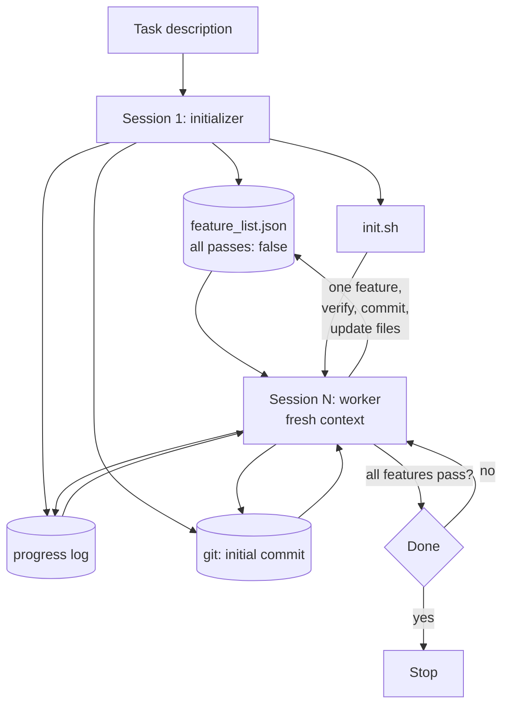
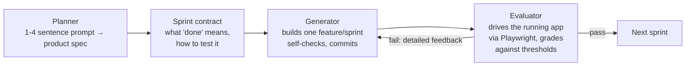

# Long-running agents

## Why this matters

Everything you have built so far finishes inside one context window, or survives a few [compactions](/part-03-agents/3.4-context-engineering). The tasks people now hand to agents do not fit: "build this app", "migrate this codebase", "work through these 40 tickets". They take hours, and the window fills long before they finish.

What breaks is not capability but continuity. Every new session starts knowing nothing, and a model that cannot tell what is done will either redo work, leave a half-finished mess, or look around, see progress, and declare victory. The fixes are not model tricks. They are harness features, the kind [5.1](/part-05-harnesses/5.1-what-is-a-harness) said you would recognise: files that carry state across sessions, a rule for what one session may attempt, and a way to check that "done" means done. This chapter covers those features, the failure modes they answer, and a second pattern, a separate evaluator agent, for when the work can't be checked by a test suite alone.

**Learning goals**

- Explain the patterns for multi-context-window work
- Implement progress tracking and handoff
- Know the failure modes (premature completion, drift)

## Explanation

### Why one context isn't enough

The window is finite and, as [3.4](/part-03-agents/3.4-context-engineering) showed, it degrades before it is full. A long task adds three more problems on top.

1. **Work outlives the window.** A real project needs more tokens of reading, editing and test output than any window holds. Something has to carry state from one window to the next.
2. **Compaction is lossy.** Summarising in place keeps the same agent going, but the summary doesn't always pass clear instructions on. Anthropic reports that even with compaction, an agent in a loop across windows, given only a high-level prompt like "build a clone of claude.ai", fell short of a production-quality app ([Effective harnesses for long-running agents](https://www.anthropic.com/research/effective-harnesses-for-long-running-agents)).
3. **The model's own behaviour changes as the window fills.** Anthropic describes models losing coherence on long tasks, and some showing "context anxiety": wrapping work up early as they approach what they believe is their limit ([Harness design for long-running application development](https://www.anthropic.com/research/harness-design-long-running-apps)). The same article distinguishes the two remedies. Compaction summarises earlier turns so the same agent continues, which keeps continuity but gives no clean slate. A **context reset** clears the window completely and starts a fresh agent with a structured handoff, which gives the clean slate but only works if the handoff artifact carries enough state. In their earlier testing, Claude Sonnet 4.5 showed context anxiety strongly enough that compaction alone was not sufficient, so resets became essential; the article adds that resets cost orchestration complexity, token overhead and latency.

The first article names two failure patterns you will meet in your own runs ([same source](https://www.anthropic.com/research/effective-harnesses-for-long-running-agents)):

- **One-shotting.** The agent tries to do too much at once, runs out of context mid-implementation, and the next session inherits a feature that is half built and undocumented. It has to guess what happened and spends time getting the basics working again.
- **Premature completion.** Later in the project, a new session looks around, sees that progress has been made, and declares the job done.

Add a third that the same article reports: **marking a feature complete without proper testing**. The agent writes code, even runs unit tests or `curl` against a dev server, and still misses that the feature doesn't work end to end.

Think of engineers working in shifts where each arrives with no memory of the last. The article uses exactly this picture. What do good shift workers do? They read the handover notes, check the state of the repo, make one change, leave the code clean, and write a note. The rest of the chapter is that routine, mechanised.

### Initializer and worker

The pattern Anthropic describes has two kinds of session ([source](https://www.anthropic.com/research/effective-harnesses-for-long-running-agents)):

- An **initializer** session runs once, with a specialised prompt. It sets up the environment: an `init.sh` script that starts the app, a progress file (`claude-progress.txt`), a feature list, and an initial git commit.
- A **coding** (worker) session runs many times. Each makes incremental progress on one feature, then leaves structured updates for the next.

Footnote in the article: these are "separate agents" only because they have different first prompts. The system prompt, tools and harness are identical. That is worth internalising. You are not building two programs; you are building one loop with two entry prompts and a rule about what state is allowed to persist.



The arrows going through files are the point: **the files are the memory, the context window is scratch space.** This is the [file-based memory](/part-03-agents/3.5-memory) idea from Part 3, applied to the harness itself rather than left to the model.

### Progress files and feature lists

**The feature list.** The initializer expands the user's prompt into a comprehensive list of feature requirements. For the claude.ai clone this meant over 200 features, each initially marked failing so later sessions have a clear picture of what "complete" looks like. The article's entry has a category, a description, a list of verification steps and a `passes` boolean ([source](https://www.anthropic.com/research/effective-harnesses-for-long-running-agents)). Shape, not code:

```json
{
  "category": "functional",
  "description": "New chat button creates a fresh conversation",
  "steps": ["Navigate to main interface", "Click 'New Chat'", "Verify a new conversation exists"],
  "passes": false
}
```

Three design decisions in that article are worth copying and questioning:

- **Workers may only flip `passes`.** The prompt says to edit the file only by changing that field, in strong language: it is unacceptable to remove or edit tests. Otherwise an agent that cannot make a feature work has an easy way out: delete the feature.
- **JSON, not Markdown.** After some experimentation they used JSON because the model was less likely to inappropriately change or overwrite JSON than Markdown. That is their observation on their setup; test it on yours.
- **One feature at a time.** This was critical against the tendency to do too much at once.

**The progress log.** A plain file the worker appends to at the end of each session: what it did, what state it left, what to do next. Together with the git history it lets a fresh session get oriented quickly; the article calls that the key insight. Git also gives you rollback: the model can revert bad changes and recover a working state, which is why the article has workers commit with descriptive messages.

**The init script.** A script that starts the development server and runs a basic smoke test. The article credits it with saving tokens each session, because the worker does not have to work out how to run the app.

**The start-of-session routine.** Every worker is prompted to get its bearings the same way, which the article lists as: confirm the working directory with `pwd`, read the git log and progress file, read the feature list and pick the highest-priority feature not yet done, then run `init.sh` and a basic end-to-end check before touching anything new. If that check fails, fix it first: starting a new feature on a broken app makes the problem worse.

::: info 📖 Read now
[Effective harnesses for long-running agents](https://www.anthropic.com/research/effective-harnesses-for-long-running-agents) · article · ~15 min · **essential**

Look for: the two failure patterns and which artifact answers each (the table near the middle of the article maps problem → initializer behaviour → worker behaviour), the "clean state" definition (code you could merge to a main branch), why the feature list is JSON, and the sample opening transcript of a worker session. Then ask what the harness does *not* solve: the article's own list of open questions includes whether a single general agent or specialised agents (testing, QA, cleanup) work better.
:::

The article links a runnable example: the [autonomous-coding quickstart](https://github.com/anthropics/claude-quickstarts/tree/main/autonomous-coding), whose README describes the same two-agent pattern (initializer produces `feature_list.json` with 200 test cases; coding agent sessions pick features and mark them passing). It is Python and built on the Claude Agent SDK, so treat it as something to read, not to copy into your TypeScript project.

::: info 📖 Read now
[claude-quickstarts: autonomous-coding](https://github.com/anthropics/claude-quickstarts/tree/main/autonomous-coding) · repo · ~10 min · optional

Look for: how the harness decides when a session ends and the next starts (a loop with a maximum iteration count), where the prompts live (`prompts/`), and the README's warning about run time. You are reading the shape of the outer loop, not the Python.
:::

### Verification and testing in the loop

Progress files fix handoff. They do not fix a worker that says "done" too soon. The first article's answer is to make verification part of every session:

- **Test like a user, not like the code.** Absent explicit prompting, Claude would make changes and test with unit tests or `curl`, but miss that a feature didn't work end to end. Once prompted to use browser automation (Puppeteer MCP in their case) and test as a human user would, it did much better, finding bugs not obvious from the code ([source](https://www.anthropic.com/research/effective-harnesses-for-long-running-agents)). Verification tools are part of the harness, just like the edit tool.
- **Only flip `passes` after testing.** The pass flag is the harness's definition of progress, so a worker that sets it without evidence corrupts every later session's picture. The article's prompt: self-verify all features, mark passing only after careful testing.
- **Regression check first.** The start-of-session smoke test catches the previous session's undocumented bugs before they compound.
- **Know the blind spots.** The article notes that the model's vision and the browser tooling have limits: Claude couldn't see browser-native alert modals through the Puppeteer MCP, and features relying on them tended to be buggier. A verification step that can't see a class of bug will silently pass it.

A harness-side complement, not from the article: don't rely on the worker's word. Let the harness run the verification command itself (tests, a script that exercises the feature) and set `passes` from the exit code. That moves the trust boundary from the model to your code. You will do this in the practice.

### Drift

"Drift" here means the run slowly leaving the intent of the task. Sources of it, all visible in the material above:

- **The goal blurs across handoffs.** Each summary is a lossy copy of the last. A feature list written once and re-read every session is the antidote: the original definition of done never gets paraphrased.
- **The agent edits the yardstick.** If it can change the tests or the list, it can make "done" easier. Hence the field-only write rule.
- **Scope creep inside a session.** "While I'm here" changes that aren't on the list. One feature per session, one commit per feature, makes them visible in the diff.
- **Self-grading inflates.** Covered next.

None of these is detected by the agent itself. They are detected by something outside the session reading the files: your harness, a checker script, or you.

### Generator–evaluator harnesses

The second Anthropic article ([Harness design for long-running application development](https://www.anthropic.com/research/harness-design-long-running-apps)) starts from a problem the first doesn't solve: **self-evaluation**. Asked to judge work they produced, agents tend to respond by confidently praising it, even when a human would find it mediocre, and more so on subjective work such as design where no binary test exists. The article's lever is separating the agent that does the work from the agent that judges it. It is explicit that this doesn't remove the leniency (the evaluator is still an LLM inclined to be generous to LLM output), but tuning a standalone evaluator to be skeptical is far more tractable than making a generator critical of its own work, and once external feedback exists the generator has something concrete to iterate against. The author names GANs as the inspiration. Note this is an analogy to the structure of two roles pushing on each other, not a training procedure.



The full-stack version in that article has three roles ([same article](https://www.anthropic.com/research/harness-design-long-running-apps)):

- **Planner** expands a one-to-four sentence prompt into a full product spec, deliberately focused on product context and high-level design rather than granular implementation, because errors in a detailed upfront spec would cascade downstream.
- **Generator** works in sprints, one feature at a time, and self-evaluates at the end of each sprint before handing off to QA.
- **Evaluator** uses the Playwright MCP to click through the running application like a user, testing UI features, API endpoints and database state, and grades each sprint against criteria with hard thresholds: if any criterion falls below its threshold, the sprint fails and the generator gets detailed feedback.

Before each sprint, generator and evaluator negotiate a **sprint contract** that fixes what "done" looks like before any code is written, because the spec is intentionally high-level and something has to bridge from user stories to testable behaviour. They communicate through files: one agent writes, the other reads and responds in the file or a new one. The same files-as-handoff idea as above, now between roles instead of between sessions.

**What the evaluator costs and buys.** The article compares a solo run of 20 minutes and $9 against a full-harness run of 6 hours and $200 on one prompt (a 2D retro game maker), and describes the solo run's central feature, playing the game, as broken, while the harness run's worked. It also calls the harness over 20 times more expensive. These are one author's runs on one prompt with Claude Opus 4.5, so read them as an illustration of the trade-off, not a rate. For current model prices, see [Landscape](/landscape).

**An evaluator needs tuning too.** Out of the box, the article says, Claude is a poor QA agent: it identified legitimate issues, then talked itself into deciding they weren't a big deal, and tested superficially rather than probing edge cases. The tuning loop was to read the evaluator's logs, find where its judgment diverged from the author's, and update its prompt, over several rounds. For design work the author also gave it a written set of grading criteria and calibrated it with few-shot examples that included detailed score breakdowns, to reduce score drift across iterations. This is the same discipline as validating an LLM judge against human labels ([4.4](/part-04-evals-observability/4.4-llm-as-judge)): an uncalibrated judge is a source of confident noise.

**Every component encodes an assumption.** The article's most reusable idea: each part of a harness encodes an assumption about what the model can't do alone, and those assumptions go stale. When the author moved to a newer model (Opus 4.6), they removed the sprint construct and moved the evaluator to a single pass at the end, and context resets had already been dropped on Opus 4.5, which largely removed the context-anxiety behaviour. The conclusion on the evaluator: it is not a fixed yes-or-no decision. It is worth the cost when the task sits beyond what the current model does reliably solo. The method is to remove one component at a time and see what changes; the author's first attempt to cut everything at once left it unclear which pieces were load-bearing.

::: info 📖 Read now
[Harness design for long-running application development](https://www.anthropic.com/research/harness-design-long-running-apps) · article · ~25 min · **essential**

Look for: the two failure modes (context anxiety and self-evaluation) and the compaction versus reset distinction; the four frontend grading criteria and why weights matter; the sprint contract; the evaluator findings table, where each failure points at a file, a line or a route (that specificity is what makes feedback actionable); and the section "Iterating on the harness", about removing components as models improve. Skim the appendix spec and the cost tables.
:::

### Choosing a setup

| Situation | Reach for | Why |
|---|---|---|
| Task fits one window | Nothing: a plain loop | Every added file and session costs tokens and time |
| Task spans windows, mostly checkable by tests | Feature list + progress log + fresh session per feature | Handoff and a definition of done; the tests are the verifier |
| Success is subjective, or tests don't cover it | Add a separate evaluator with explicit criteria | Self-grading skews positive |
| Newer model, same harness | Remove one component and re-measure | Scaffolding encodes bets about weaknesses that may be gone ([5.1](/part-05-harnesses/5.1-what-is-a-harness)) |

Each step up costs money and latency. You will see the same point from the cost side in [4.8](/part-04-evals-observability/4.8-cost-latency); put a run budget around anything you leave running unattended.

## Practice

**Brief:** Add a long-running mode to `project/`: a feature list file, a progress log, and a fresh context per feature that reads them. Run it on a small multi-feature task. You write all the code; no solution is provided.

**Where:** A step in the growing `project/` (see `project/ROADMAP.md`, step 20). It builds on the mini coding harness from 5.4 (step 19); the cost and budget flags from 4.8 are useful but not required.

**Steps**

1. **Pick the task first.** Choose something with 5 to 8 independent, checkable features that a small model can build in a scratch directory, for example a tiny CLI such as a todo manager (add, list, complete, delete, persist to a file, filter by status). Write the one-paragraph prompt you would give a user. Decide what "passes" means for each feature as a command you can run (a script, `node --test`, a CLI invocation with expected output), not a judgment.
2. **Design the state files.** Decide the schema of the feature list (id, description, verification steps or command, `passes`) and of the progress log (one entry per session: what was attempted, the result, the state left, the next step). Write down which fields a worker may change and which only the harness may. Keep both in the target project directory, committed with the code.
3. **Write the initializer prompt and mode.** `--init "<task>"` runs a session whose only job is to produce the feature list (all `passes: false`), an `init.sh` (or equivalent) that starts or tests the app, the progress log's first entry, and a first git commit. Run it and read the list: are the features small, ordered, independently checkable? Edit by hand if not, and note what you changed.
4. **Write the worker prompt and mode.** `--work` runs one session with a brand-new message history. The prompt must tell it to follow a start-of-session routine (orient from the git log, progress log and feature list, run the smoke check), pick exactly one unfinished feature, implement it, verify it, commit with a descriptive message, and append to the progress log. Do not pass the previous session's messages: the files are the only channel.
5. **Move the verdict into the harness.** After the worker stops, your code runs the feature's verification command and sets `passes` itself. Decide what happens if the worker also edited the feature list, and check it with a diff: reject or revert any change other than the status field you allowed.
6. **Write the outer loop.** `--run` repeats: if every feature passes, stop; otherwise start a worker. Add stop conditions: a maximum number of sessions, a per-session turn or token limit, and a rule for a feature that fails N times in a row (mark it blocked in the progress log and move on, or stop and say so).
7. **Run it twice.** Once on local Qwen and once on a paid model (record spend in `costs.md`). Keep every session's transcript. Count: sessions used, features passed, features the worker claimed done but your verification rejected, and tokens or cost per feature.
8. **Break it on purpose.** Kill a session halfway through a feature (Ctrl-C), then start the next one. Does the worker notice the dirty working tree or half-done feature from the files and git alone? Fix the routine or the log format until the answer is yes. Then try the premature-completion case: pre-mark the last feature as passing without implementing it, and see whether your harness or the worker catches it.
9. **Compare with one window.** Give the same task, same model, to a plain single-session run of your 5.4 harness. Write up in `notes/long-running.md`: what the single run did differently, where it lost track (if it did), and one change to the state files that you would make after this experiment.

**Done when**

- `--init` produces a committed feature list, progress log and start script from a one-paragraph task, and every feature has a runnable verification.
- `--work` starts with an empty message history, reads only the files and git state, completes one feature, commits, and updates the progress log; two consecutive sessions do not repeat or skip work.
- `passes` is set by your harness from the verification result, not by the model's claim, and a worker edit to anything but the allowed field is rejected or reverted.
- `--run` stops when all features pass, and also stops on your session limit or repeated failure instead of looping forever.
- You can show the session where you killed a run mid-feature and the next session recovered from the files, plus your own counts from step 7 (claimed done but rejected).
- `notes/long-running.md` has the single-window comparison and one concrete change you would make.

## Check questions

1. A long-running run on a 40-feature task ends after nine sessions with the agent saying the project is complete, but 22 features in the list still fail. Which failure pattern is this, which artifact should have prevented it, and what must the start-of-session routine include?

   <details><summary>Answer</summary>

   Premature completion: a later session looked around, saw progress, and declared the job done. The feature list (every item failing until verified) is the artifact that prevents it, because "done" is defined by the list, not by the agent's impression. The routine should have the worker read the feature list at the start, pick the highest-priority failing feature, and the harness should refuse to stop while any feature has `passes: false`. Better still, let the harness, not the model, decide when the run is finished.

   </details>

2. What is the difference between compaction and a context reset, and when might you pick a reset?

   <details><summary>Answer</summary>

   Compaction summarises earlier parts of the conversation in place, so the same agent continues on a shorter history: continuity, but no clean slate. A reset clears the window and starts a fresh agent that gets a structured handoff (state and next steps): a clean slate, but the handoff artifact must carry enough state, and it adds orchestration, token overhead and latency. Anthropic found resets essential when a model showed context anxiety strongly enough that compaction alone didn't work (Sonnet 4.5 in their testing); a model that doesn't show that behaviour may manage a continuous session with compaction. Which applies to yours is something to measure.

   </details>

3. Why does the worker prompt restrict the feature list to changing the `passes` field, and why is it still not enough on its own to keep the verdicts honest?

   <details><summary>Answer</summary>

   Without the restriction, an agent that can't get a feature working can delete or rewrite the feature, or weaken its steps, and make "done" easier. It is a prompt instruction, though, and the agent can still set `passes: true` without having tested properly (Anthropic observed features marked complete without end-to-end testing). Making the harness run the verification and set the flag itself, and diffing the file for other changes, moves the check from a request to the model into code.

   </details>

4. When would you add a separate evaluator agent to a long-running harness, and what do you have to do to make it useful?

   <details><summary>Answer</summary>

   When success can't be established by tests alone (subjective quality, or behaviour you can only see by using the running app) or when the generator's self-assessment is too generous, as it tends to be. Make it useful by giving it tools to exercise the real thing (Playwright in the article), explicit criteria with thresholds, and calibration: read its logs, find where its verdicts diverge from yours, and fix the prompt, as it is by default a lenient QA. Also expect to re-test its worth as models improve: the article found the evaluator was worth the cost when the task sat beyond what the current model did reliably solo.

   </details>

5. Your worker session crashes midway through a feature. What should the next session find, and where?

   <details><summary>Answer</summary>

   From git: either a clean tree at the last good commit (if the previous work was committed per feature) or uncommitted changes the routine can see with `git status` and diff and revert or finish. From the progress log: the last entry and what it said was next; the crash itself won't be logged unless the harness writes it, so have the harness append "session ended without a clean finish" itself. From the feature list: the feature is still failing. The start-of-session smoke check then tells the new worker whether the app is in a working state before it starts anything new.

   </details>

## My understanding

<!-- Written by the learner, in their own words. Agents never fill this in. -->
