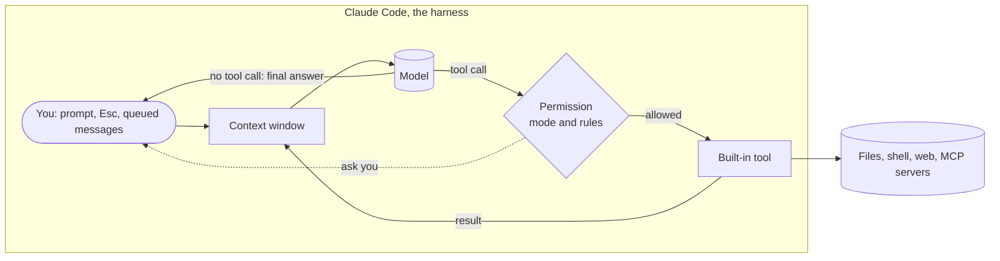
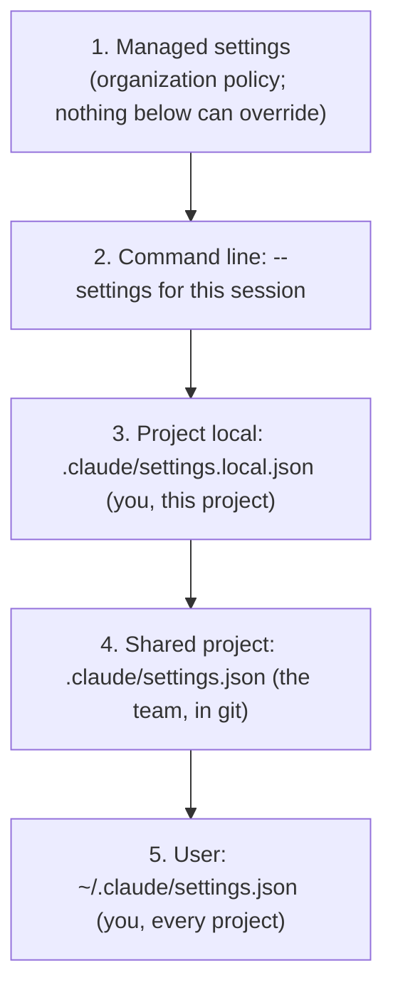

# How Claude Code works

## Why this matters

Claude Code's features change monthly: new commands, new modes, new settings keys. Its core changes slowly: a loop, a set of tools, a context window that fills up, and a permission system that decides what runs without you. If you hold that core in your head, every new feature becomes easy to place ("that is another way to put text into context", "that is another permission rule"), and every confusing behaviour becomes a question you can answer: *what is in the context right now, and which setting decided that?*

You already know the pieces. [5.1](/part-05-harnesses/5.1-what-is-a-harness) gave you the components of a harness and used Claude Code's docs as the worked example. This chapter goes one level down, into the parts you touch every day: what is in the window, where configuration lives, and what the permission modes mean. Parts of Part 6 build on it: [6.2](/part-06-claude-code/6.2-claude-md-and-memory) on the instruction files, [6.3](/part-06-claude-code/6.3-skills) on skills, [6.4](/part-06-claude-code/6.4-hooks-permissions) on hooks and permissions in depth.

**Learning goals**

- Describe Claude Code's loop, tools and context window
- Read what's in your context and why
- Know where configuration lives (`.claude/`, settings precedence)

## Explanation

### The loop and the tools

Claude Code's docs describe the loop as three phases that "blend together": gather context, take action, verify results. You interrupt at any point. A question about the code may need only the first phase; a bug fix cycles through all three. The model decides what each step needs "based on what it learned from the previous step" ([How Claude Code works](https://code.claude.com/docs/en/how-claude-code-works), "The agentic loop"). This is the loop you built in [3.2](/part-03-agents/3.2-agent-loop): call the model, run the tool calls it asks for, append the results, repeat until it answers without a tool call. The three phases are not separate code paths; they are what the model tends to do with the tools it has.

The built-in tools fall into five categories, per the same page: file operations, search, execution, web, and code intelligence (type errors and go-to-definition; this needs a plugin). There are also tools for spawning subagents and asking you questions, and the [tools reference](https://code.claude.com/docs/en/tools-reference) lists them all. Two practical consequences.

1. **Every tool result lands in the context.** A search that returns 300 lines, a test run that prints 2,000 lines of logs, a file read: all of it is now part of what the model re-reads on every later turn. The tool-design lesson from [3.3](/part-03-agents/3.3-tool-design) applies from the user side too: what you ask Claude to run decides what fills the window.
2. **Extensions are layered on top, not part of the loop.** Skills, MCP servers, hooks and subagents add knowledge, tools, automation and delegation around the same loop ([How Claude Code works](https://code.claude.com/docs/en/how-claude-code-works), "Tools"). Each has its own chapter in Part 6.

### The context window

The docs list what the window holds: "your conversation history, file contents, command outputs, CLAUDE.md, auto memory, loaded skills, and system instructions" ([How Claude Code works](https://code.claude.com/docs/en/how-claude-code-works), "The context window"). Read that sentence as a bill of materials. Some of it is there before you type; some of it you cause; some of it Claude Code adds on its own.

| Source | When it enters | What to know |
|---|---|---|
| System prompt, tool definitions, output style | Session start | Not published as text ([Settings](https://code.claude.com/docs/en/settings), "Change a setting"); you can see its cost in `/context`. |
| `CLAUDE.md`, unscoped rules, auto memory | Session start | The first 200 lines or 25 KB of the auto-memory index `MEMORY.md` load at start ([How Claude Code works](https://code.claude.com/docs/en/how-claude-code-works), "What Claude can access"). See [6.2](/part-06-claude-code/6.2-claude-md-and-memory). |
| MCP tool names, skill descriptions | Session start | Only names and descriptions, not full definitions or bodies: MCP tool definitions are deferred and loaded on demand, and a skill's full text loads only when it is used ([How Claude Code works](https://code.claude.com/docs/en/how-claude-code-works), "When context fills up" and "Manage context with skills and subagents"). |
| Files read, command output, your messages, Claude's replies | As you work | The part that grows. |
| Path-scoped rules, nested `CLAUDE.md` files | When Claude touches a matching file | Loaded on demand, not at start ([Explore the context window](https://code.claude.com/docs/en/context-window), "What survives compaction"). |
| System reminders | Throughout | Claude Code injects its own text: your `CLAUDE.md` files, output-style instructions, a note when a file Claude read changes on disk, commit and pull-request attribution lines ([How Claude Code works](https://code.claude.com/docs/en/how-claude-code-works), "Context Claude Code adds on its own"). |

The last row explains a common surprise. If Claude follows a rule you never wrote (a `Co-Authored-By` trailer on a commit, say), it probably came from a system reminder; the `attribution` setting controls it.

How big is the window? That is a model property and it changes, so it lives on [Landscape](/landscape#anthropic), not here. What matters for this chapter is the mechanism: the window is finite, everything above competes for it, and a model that has to re-read a bloated window is slower, costlier and (as [3.4](/part-03-agents/3.4-context-engineering) argued) often worse.

::: info 📖 Read now
[Explore the context window](https://code.claude.com/docs/en/context-window) · docs · ~15 min · **essential**

You may already have read this for [3.4](/part-03-agents/3.4-context-engineering); read it again as a user of Claude Code. Look for: the list of what loads "before you type anything", and the table "What survives compaction". Pick three rows of that table and predict, for your own repo, what you would lose. Then note the paragraph on path-scoped rules and nested `CLAUDE.md` files: they load when a matching file is touched, so compaction summarises them away.
:::

### Compaction

When the window nears its limit, Claude Code compacts: it replaces the conversation with a summary. The docs say the summary "keeps your requests and key code snippets, but detailed instructions from early in the conversation may be lost" ([How Claude Code works](https://code.claude.com/docs/en/how-claude-code-works), "When context fills up"). So compaction is lossy, and the loss is not random: it hits *conversation*, not *files on disk*.

The docs' table of what survives is worth knowing as a rule of thumb ([Explore the context window](https://code.claude.com/docs/en/context-window), "What survives compaction"):

- **Re-injected from disk**: the project-root `CLAUDE.md` and unscoped rules, auto memory, the plan written in plan mode.
- **Rebuilt or re-read**: skill descriptions; a fresh git status; up to five recently read or edited files (a file over 5,000 tokens comes back as a path reference only).
- **Re-injected with a cap**: invoked skill bodies, at 5,000 tokens per skill and 25,000 total, oldest dropped first.
- **Summarised away with the rest of the conversation**: your spoken instructions, path-scoped rules and nested `CLAUDE.md` content loaded earlier, and context that hooks added.

The design rule that falls out: **anything that must survive goes in a file that Claude Code re-reads, not in the chat.** That is the docs' own advice: "Put persistent rules in CLAUDE.md rather than relying on conversation history." The same idea drove the notes-file pattern in [3.5](/part-03-agents/3.5-memory), and it is why a rule that matters should not sit behind a `paths:` filter.

You have levers before and instead of automatic compaction (all from the same context-window page):

- `/compact focus on the auth bug` compacts now and tells the summariser what to keep; a "Compact Instructions" section in `CLAUDE.md` does the same permanently.
- `/clear` between unrelated tasks, because old conversation "crowds out the files you need next and costs tokens on every message".
- `/rewind` then "Summarize from here" compacts only part of the conversation.
- Delegating large reads to a subagent, which works in its own window and returns a summary ([Subagents](https://code.claude.com/docs/en/sub-agents)).

Two failure modes to recognise. If one file or tool output is so large that the window refills right after each summary, Claude Code stops auto-compacting after a few attempts and shows an error instead of looping ([How Claude Code works](https://code.claude.com/docs/en/how-claude-code-works), "When context fills up"). And a long session that never gets `/clear`ed carries stale detail forward, a theme [3.4](/part-03-agents/3.4-context-engineering) calls context rot.

### Seeing your own context

`/context` shows a live breakdown by category with optimisation suggestions, including which `CLAUDE.md` and auto-memory files loaded; `/memory` opens those files for editing ([Explore the context window](https://code.claude.com/docs/en/context-window), "Check your own session"). Treat `/context` like a profiler: run it at the start of a session (what is the fixed cost of your setup?), again after a big read (what did that cost?), and after `/compact` (what came back?). The docs say commands may be renamed; if `/context` is missing in your version, the docs index at <https://code.claude.com/docs/llms.txt> lists the current pages.

### The `.claude` directory

Configuration is files, in two places: the project and your home directory. The docs' summary: commit project files to share them with your team; files in `~/.claude` are personal and apply across all projects ([Explore the .claude directory](https://code.claude.com/docs/en/claude-directory)). The ones to know now:

| File | Scope | Commit? | What it does |
|---|---|---|---|
| `CLAUDE.md` | project and global | yes | Instructions loaded every session. |
| `rules/*.md` | project and global | yes | Topic-scoped instructions, optionally gated by `paths:`. |
| `settings.json` | project and global | yes | Permissions, hooks, env vars, model defaults. |
| `settings.local.json` | project only | no | Your personal overrides; Claude Code gitignores it when it writes the file. |
| `.mcp.json` (project root) | project only | yes | Team-shared MCP servers. |
| `skills/<name>/SKILL.md` | project and global | yes | Reusable prompts, invoked with `/name` or auto-invoked. |
| `agents/*.md` | project and global | yes | Subagent definitions with their own prompt and tools. |
| `commands/*.md` | project and global | yes | Single-file prompts; same mechanism as skills. |
| `~/.claude.json` | global only | no | App state, account details, personal MCP servers. |
| `~/.claude/projects/<project>/memory/` | global only | no | Auto memory: Claude's notes to itself. |

Source for the table: the docs' file reference ([Explore the .claude directory](https://code.claude.com/docs/en/claude-directory), "File reference"). Two things the table hides.

- **Your session is on disk, in plaintext.** Each message, tool use and result is written to a JSONL file under `~/.claude/projects/`, which is what makes resuming, forking and rewinding work ([How Claude Code works](https://code.claude.com/docs/en/how-claude-code-works), "Work with sessions"). The docs warn that if a tool reads a `.env` file, that value lands in the transcript, and that transcripts are deleted after a retention period (default 30 days, `cleanupPeriodDays`) ([Explore the .claude directory](https://code.claude.com/docs/en/claude-directory), "Application data"). Know this before you let an agent near secrets; Part 8 returns to it.
- **Checkpoints are not git.** Before editing, Claude snapshots the file; press `Esc` twice to rewind. They cover file edits only: database writes, API calls and deployments cannot be rolled back this way, which is why the permission system exists ([How Claude Code works](https://code.claude.com/docs/en/how-claude-code-works), "Undo changes with checkpoints").

### Settings precedence

Settings are JSON keys: the default model, what may run without asking, which files may not be read, hooks. Claude Code reads four scopes, and when the same key is set in several, it uses the highest one ([Settings files and precedence](https://code.claude.com/docs/en/settings), "Settings precedence"):

Four details that cause most of the confusion.

1. **Lists merge; scalars override.** For list keys such as `permissions.allow`, "Claude Code combines the lists instead of picking one", so each file can add entries. A few model-list keys have their own rules. This is why a team `allow` rule and your personal one both apply.
2. **A personal override beats the team's.** Project local sits above shared project, so you can override a committed key for yourself without a commit. Example from the docs: a team file sets one model and your local file sets another; only your sessions change.
3. **Some values are refused from some files.** `permissions.defaultMode` set to `auto` or `bypassPermissions` "don't take effect from project or local settings"; set them in user or managed settings, or use the `--permission-mode` flag. The point is that cloning a repo must not be able to switch your safety mode off.
4. **Environment variables are not a level.** For some keys a shell variable or a flag wins (the docs' example: `ANTHROPIC_MODEL` over the `model` key), decided key by key. Look the key up on the [settings reference](https://code.claude.com/docs/en/settings-reference).

To debug a setting that does not apply: run `/status`, whose `Setting sources` line lists each settings file loaded for the session. It tells you which files were read, not which file supplied each key; `claude doctor` lists entries that were rejected ([Settings files and precedence](https://code.claude.com/docs/en/settings), "Confirm what loaded"). Settings files are watched and most edits (including `permissions` and `hooks`) apply without a restart.

::: info 📖 Read now
[Settings files and precedence](https://code.claude.com/docs/en/settings) · docs · ~20 min · **essential**

Read "Settings files and who they affect" and "Settings precedence", then skim "Troubleshoot a setting that doesn't apply". Look for: the exact order of the five levels, the three scenarios (team overrides personal, organization overrides everything, `--settings` for one session), and the list of keys that never apply from a repository file. Then open your own `.claude/settings.json` and `~/.claude/settings.json` and say which key would win if both set it.
:::

::: info 📖 Read now
[Explore the .claude directory](https://code.claude.com/docs/en/claude-directory) · docs · ~15 min · **essential**

The top half is an interactive tree; use the "File reference" table as the text version. Look for: which files are committed and which are personal, what is *not* shown (`managed-settings.json`, `CLAUDE.local.md`), and the "Application data" section: what Claude Code writes to disk as you work and how long it keeps it.
:::

### Permission modes

The permission mode decides what Claude may do without asking you. Press `Shift+Tab` to cycle modes in the terminal; start in one with `claude --permission-mode <name>`; set a default with `permissions.defaultMode` ([Permission modes](https://code.claude.com/docs/en/permission-modes)). The docs' table, shortened:

| Mode (`defaultMode` value) | Runs without asking | Use it for |
|---|---|---|
| Manual (`default`) | Reads only | Reviewing every action |
| `acceptEdits` | Reads, file edits, common filesystem commands (`mkdir`, `mv`, `cp`) | Iterating on code you will review in `git diff` |
| `plan` | Reads; Claude explores and writes a plan but "does not edit your source" until you approve | Exploring before changing |
| `auto` | Everything, but a separate classifier model reviews actions first and blocks risky ones | Long tasks, fewer prompts |
| `dontAsk` | Pre-approved tools only; anything that would prompt is denied | Locked-down CI and scripts |
| `bypassPermissions` | Everything, no checks | Isolated containers and VMs only |

Three things to take from it, all from the same page.

- **Which mode you start in changed.** As of Claude Code v2.1.283, auto is the built-in starting mode for interactive terminal and VS Code sessions; on earlier versions it applied only on some plans. Check what your session says rather than assuming Manual.
- **`auto` is a classifier, not a guarantee.** The docs say it "reduces permission prompts but does not guarantee safety". `bypassPermissions` "offers no protection against prompt injection or unintended actions". The lethal-trifecta argument from [8.1](/part-08-production/8.1-prompt-injection) is why.
- **Protected paths are special.** Writes to `.git`, `.claude`, `.mcp.json` and a few more are prompted in `default` and `acceptEdits`, routed to the classifier in `auto`, and denied in `dontAsk`; `allow` rules do not pre-approve them. Claude Code's own configuration is not something the agent can quietly rewrite.

Modes are the coarse control. The fine control is **rules** in settings: `allow`, `ask` and `deny` entries naming a tool and what it may do, such as `Bash(npm run test *)` or `Read(./.env)`, as in the settings page's own example. Rules are merged across scopes like any other list. Their evaluation order, hooks and the sandbox are [6.4](/part-06-claude-code/6.4-hooks-permissions) and [8.3](/part-08-production/8.3-sandboxing).

::: info 📖 Read now
[Permission modes](https://code.claude.com/docs/en/permission-modes) · docs · ~15 min · **essential**

Look for: the mode table and the Shift+Tab cycle (which mode is not in it?), the "protected paths" table, and what auto mode blocks by default. Notice what each mode costs you in attention versus risk, and decide which you would use for a refactor in this repo and which for a script that touches your home directory.
:::

::: info 📖 Read now
[Configure permissions](https://code.claude.com/docs/en/permissions) · docs · ~15 min · optional

Read the opening "Permission system" table (which tool types ask in Manual mode, and what "Yes, and don't ask again" saves). Skip the rest until [6.4](/part-06-claude-code/6.4-hooks-permissions).
:::

::: info 📖 Read now
[Best practices for Claude Code](https://code.claude.com/docs/en/best-practices) · docs · ~20 min · optional

This is the maintained successor of Anthropic's 2025 engineering post "Claude Code: Best practices for agentic coding", which now carries a notice that it is no longer maintained and points here. Look for: how the page frames what the defaults already do (auto mode, subagents, automatic compaction) and what is left for you to configure. You will use it more in 6.2 and 6.7.
:::

### Putting it together

Debugging Claude Code behaviour is almost always one of three questions.

1. **What did the model see?** Run `/context`. Is the instruction in a file that loaded? Was it summarised away? Was it behind a `paths:` filter that never triggered?
2. **Which setting decided that?** Run `/status`, then walk the precedence list from the top. Is a managed or command-line value above yours?
3. **Which permission path did the action take?** Mode, then allow/ask/deny rules, then protected paths.

## Practice

**Brief:** Use `/context` (or the current equivalent) during a real session in this repo and explain each part of your context in `notes/claude-code.md`.

**Where:** Notes only, no code (`notes/`). Create `notes/claude-code.md`. This chapter has no experiment folder and adds nothing to `project/`.

**Steps:**

1. **Baseline.** Start a fresh `claude` session in this repo (not a resumed one), type nothing, and run `/context`. Copy the breakdown into the notes (a screenshot or pasted text is fine) and date it.
2. **Explain every row.** For each category shown, write one or two sentences: what it is, who put it there (you, Claude Code, an extension), when it entered, and whether it survives compaction according to the context-window page. If a category is unfamiliar, find it in the docs rather than guessing. Mark any row you cannot explain.
3. **Trace the files.** `/context` lists which `CLAUDE.md` and auto-memory files loaded. For each, say where it lives on disk and whether it is project, user or auto memory. Open one with `/memory`.
4. **Measure a read.** Ask Claude to read one large file or run one noisy command. Run `/context` again and note how many tokens it added. Then say how you would have kept that out of the window (a narrower command, a subagent).
5. **Compact and compare.** Run `/compact` with a focus of your choice, then `/context` once more. Write down what shrank, what stayed the same and what you expected to survive but did not (test it by asking Claude about an instruction you gave early in the chat).
6. **Locate your settings.** List which of the following exist on your machine: `~/.claude/settings.json`, `.claude/settings.json`, `.claude/settings.local.json`, a managed policy. Run `/status` and copy the `Setting sources` line. Pick one key that is set in two files, or set a harmless one yourself, and predict which value wins before you check.
7. **Modes.** Note which permission mode your session started in, cycle through the modes with `Shift+Tab`, and write one line per mode on what you would use it for in this repo.

**Done when:**

- `notes/claude-code.md` has a dated `/context` baseline and one explanation per category, with unexplained rows flagged.
- It records the token cost of one real read and the before/after of one `/compact`.
- It lists your settings files, the `/status` `Setting sources` line, and one precedence prediction with the result.
- It names the permission mode you started in and one use for each mode.

## Check questions

1. Name the three phases of Claude Code's loop and the five categories of built-in tools. What ends the loop?

   

Answer

   Gather context, take action, verify results; the phases blend and you can interrupt at any point. Tool categories: file operations, search, execution, web, code intelligence. As in the loop from 3.2, it continues while the model asks for tools and ends when it answers without a tool call (or you stop it).

   

2. You told Claude "always run the linter before committing" early in a very long session, and an hour later it stopped doing so. Give the likely cause and two fixes.

   

Answer

   Compaction summarised the early conversation; the docs say detailed instructions from early on "may be lost". Fixes: put the rule in `CLAUDE.md` (re-injected from disk after compaction), or enforce it with a hook or permission rule instead of prose (6.4); also `/compact` with a focus that names the rule, or start a fresh session per task. A rule in a path-scoped file would not be a good fix, because path-scoped rules are summarised away too.

   

3. The team's `.claude/settings.json` allows `Bash(npm run test *)`, your `~/.claude/settings.json` denies `Read(./.env)`, and your `.claude/settings.local.json` sets a different model than the team file. What applies?

   

Answer

   Both permission rules apply, because list keys such as `permissions.allow` and `deny` merge across scopes rather than override. The model is a scalar: project local sits above shared project, so your local file's model wins in your sessions and teammates are unaffected. `/status` shows which files were loaded.

   

4. Why can you not set `permissions.defaultMode` to `bypassPermissions` in a committed `.claude/settings.json`, and where can you set it instead?

   

Answer

   A repository file is controlled by whoever wrote the repository; if it could turn off your safety mode, cloning an untrusted repo would be enough to disable your prompts. The docs say `auto` and `bypassPermissions` do not take effect from project or local settings; set them in user or managed settings, or pass `--permission-mode` for one session. Even then, use `bypassPermissions` only in isolated containers or VMs.

   

5. Checkpoints let you press `Esc` twice to undo. Why is that not enough, and what covers the rest?

   

Answer

   Checkpoints snapshot file edits only. Actions on remote systems (databases, APIs, deployments) cannot be rolled back, and they are separate from git. Permission modes and rules control what runs without asking, so they are the guard for irreversible actions; sandboxing (Part 8) adds a hard limit on where tools can act.

   

## My understanding

<!-- Written by the learner, in their own words. Agents never fill this in. -->
