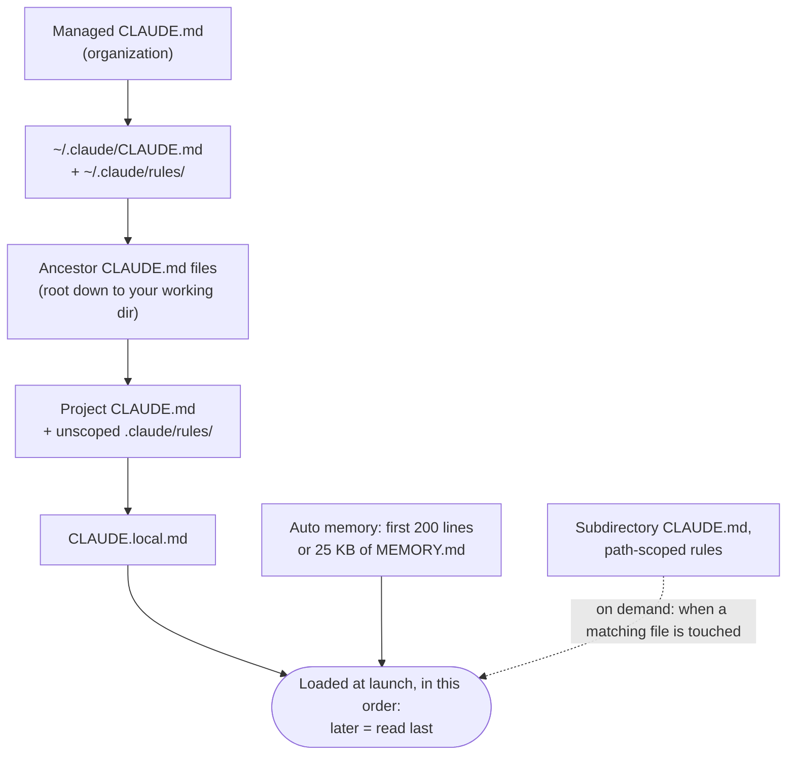

# CLAUDE.md and memory

## Why this matters

CLAUDE.md and memory are the cheapest way to make Claude Code better at your project: a few lines of text, read at the start of every session, can replace the same correction typed into chat fifty times. They are also the easiest way to make it worse. Every line you add is loaded on every task, whether or not the task needs it, and it competes for the same finite window you met in [6.1](/part-06-claude-code/6.1-how-claude-code-works). A 600-line CLAUDE.md that nobody has pruned for six months is a tax on every prompt you send.

This chapter is about the discipline: what earns a place in always-loaded text, where each kind of instruction lives, what Claude writes down by itself, and how to see and trim the bill. It is the user-side counterpart to the memory theory in [3.5](/part-03-agents/3.5-memory) (CLAUDE.md is "procedural memory" there) and to the file-format questions in [3.8](/part-03-agents/3.8-agents-md-and-skills) (the AGENTS.md standard). Here the subject is one tool's behaviour, in detail, because that is the tool you use daily.

**Learning goals**

- Write a lean, effective CLAUDE.md
- Use the memory hierarchy (user, project, local, auto memory)
- Audit what memory costs in context

## Explanation

### Two systems, one job

Each Claude Code session starts with a fresh context window. Two mechanisms carry knowledge across sessions ([How Claude remembers your project](https://code.claude.com/docs/en/memory), opening and "CLAUDE.md vs auto memory"):

| | CLAUDE.md files | Auto memory |
|---|---|---|
| Who writes it | You | Claude |
| What it contains | Instructions and rules | Learnings and patterns |
| Scope | Project, user or organization | Per repository, shared across worktrees |
| Loaded | Every session | Every session (first 200 lines or 25 KB of the index) |
| Use for | Coding standards, workflows, project architecture | Your preferences, corrections, project context Claude can't derive from the code |

Both are plain markdown files on disk. Both end up in the context window, which is the part to hold onto: *memory is not free storage, it is a permanent line item in every session's context*.

Two properties follow from how they are delivered, and they decide how you should write them.

1. **They are context, not configuration.** The docs say it twice: Claude "treats them as context, not enforced configuration", and CLAUDE.md content "is delivered as a user message after the system prompt, not as part of the system prompt itself", so "there's no guarantee of strict compliance, especially for vague or conflicting instructions" ([memory docs](https://code.claude.com/docs/en/memory), "CLAUDE.md vs auto memory" and "Claude isn't following my CLAUDE.md"). A line in CLAUDE.md is a strong suggestion. If a rule has no exceptions, such as "never edit `src/gen/`" or "always run the formatter after a file is created", it belongs in a hook, which the harness executes whatever the model decides. That is [6.4](/part-06-claude-code/6.4-hooks-permissions). The best-practices page gives a diagnostic: if you keep adding emphasis to a line and Claude still misses it, the line belongs in a hook ([Best practices](https://code.claude.com/docs/en/best-practices), "Deterministic and non-deterministic instructions").
2. **They are re-read from disk.** Project-root CLAUDE.md survives compaction: after `/compact`, Claude re-reads it from disk and re-injects it ([memory docs](https://code.claude.com/docs/en/memory), "Instructions seem lost after `/compact`"). This is the mechanism behind the design rule from 6.1: anything that must outlive a long session goes in a file Claude Code re-reads, not in the chat.

### What belongs in CLAUDE.md

The docs' test for an entry is whether it is something you would otherwise re-explain: add to CLAUDE.md when Claude makes the same mistake a second time, when a code review catches something Claude should have known about the codebase, when you type the same correction you typed last session, or when a new teammate would need the same context ([memory docs](https://code.claude.com/docs/en/memory), "When to add to CLAUDE.md"). The best-practices page sharpens this into a two-question filter before you write anything down: could Claude find this by reading the code, and would it actually go and look? If both answers are yes, leave it out ([Best practices](https://code.claude.com/docs/en/best-practices), "Tell Claude what it can't see").

Applying the filter gives a short list of what earns a line:

- **How to confirm work in this repo.** The exact test, typecheck and lint commands, and how to run a single test file. These are the commands Claude needs to check its own work.
- **Places where the code is misleading.** An old pattern that is everywhere but new code must not copy; a directory that looks unused but is live.
- **Decisions that aren't in the repo.** Which error helper the team settled on, how deploys work, what needs a migration review.
- **Anything you have had to correct twice.**

(All four are from the "Keep CLAUDE.md short" section of the [Best practices](https://code.claude.com/docs/en/best-practices) page.)

And a list of what does not:

| Do not write | Why | Put it here instead |
|---|---|---|
| Directory layouts, dependency lists, architecture tours | Claude reads the repo faster than you can describe it; `/doctor` cuts exactly these as derivable content ([memory docs](https://code.claude.com/docs/en/memory), "My CLAUDE.md is too large") | Nowhere |
| "Write clean code", "test your changes", "keep files organized" | Not concrete enough to verify; the docs prefer "Use 2-space indentation" to "Format code properly" ([memory docs](https://code.claude.com/docs/en/memory), "Write effective instructions") | A concrete version, or nowhere |
| A multi-step procedure (release, incident runbook, how to write API docs) | Loads on every task. A skill's description is always visible but its body loads only when used ([Best practices](https://code.claude.com/docs/en/best-practices), "Put team procedures in skills") | A skill: [6.3](/part-06-claude-code/6.3-skills) |
| Rules that only matter in one part of the codebase | Cost tokens everywhere else | A path-scoped rule in `.claude/rules/` (below) |
| A rule with no exceptions | Claude may skip it on any given turn | A hook or permission rule: [6.4](/part-06-claude-code/6.4-hooks-permissions) |
| Your personal preferences in a shared repo | Clutters the team's file | `CLAUDE.local.md` or `~/.claude/CLAUDE.md` (below) |

The same pattern applies to the form of each line. Use markdown headers and bullets, because organised sections are easier to follow than dense paragraphs, and avoid contradictions: "if two instructions contradict each other, Claude may pick one arbitrarily" ([memory docs](https://code.claude.com/docs/en/memory), "Write effective instructions"). Matt Pocock's *writing-for-agents* skill makes complementary points about any document an agent reads: keep one source of truth per meaning, delete lines that are no-ops or stale (unpruned documents accumulate "sediment"), state the behaviour you want instead of what to avoid, and define any term you coined, because a made-up word "recruits no priors" ([writing-for-agents](https://github.com/mattpocock/skills/blob/main/skills/productivity/writing-for-agents/SKILL.md)).

::: info 📖 Read now
[Best practices for Claude Code](https://code.claude.com/docs/en/best-practices) · docs · ~10 min (the "Keep CLAUDE.md short" section and the box above it) · **essential**

You met this page in 6.1 for permissions and modes; this time read it for the sections "Deterministic and non-deterministic instructions", "Tell Claude what it can't see" and "Keep CLAUDE.md short". Look for: the table that splits each lever into a model-decides side and a harness-enforces side, the short example CLAUDE.md, and the note on IMPORTANT. Then take your own CLAUDE.md and mark each line with the two-question filter.
:::

A worked example makes the filter concrete. Below is an invented "before", the kind `/init` followed by months of additions produces, annotated with its verdict.

```markdown
# Project: Acme dashboard                               # keep: one line of orientation
This is a React app using TypeScript and Vite.          # cut: package.json says so
## Structure
- src/components: React components                      # cut: derivable, and wrong next month
- src/lib: utilities                                    # cut: same
## Style
- Write clean, readable code                            # cut: unverifiable
- Always use 2-space indentation                        # cut: the formatter enforces it
## Testing
- Run tests with pnpm test                              # keep, but add single-file form
## Deploying
1. Merge to main  2. Tag  3. Run deploy.sh  4. ...      # move to a skill (procedure, side effects)
## IMPORTANT: never edit src/gen/                       # move to a hook or deny rule
```

And the "after":

```markdown
# Commands
- Run one test file: pnpm vitest run path/to/file.test.ts
- Typecheck: pnpm tsc --noEmit

# Gotchas
- src/legacy/ is still live; do not copy its patterns into new code
- Integration tests need DATABASE_URL, see .env.example
```

Thirteen lines became six, and every surviving line is something Claude could not have inferred. The two moved items did not vanish: one became a skill (a procedure that only loads when needed), the other a deterministic guard.

### The memory hierarchy

CLAUDE.md files live in several places, and they stack. The docs list the locations in load order, broadest first, "so a project instruction appears in context after a user instruction" ([memory docs](https://code.claude.com/docs/en/memory), "Choose where to put CLAUDE.md files").

| Scope | Location | Shared with | Use for |
|---|---|---|---|
| Managed policy | macOS `/Library/Application Support/ClaudeCode/CLAUDE.md`; Linux `/etc/claude-code/CLAUDE.md` | Everyone in the organization | Company standards, compliance reminders |
| User | `~/.claude/CLAUDE.md` | Only you, all projects | Personal style and tooling preferences |
| Project | `./CLAUDE.md` or `./.claude/CLAUDE.md` | The team, via git | Build commands, conventions, project gotchas |
| Local | `./CLAUDE.local.md` (gitignore it) | Only you, this project | Sandbox URLs, personal test data |

There is a fifth place that is not a CLAUDE.md: **auto memory**, covered below, which lives at `~/.claude/projects/<project>/memory/`. And a sixth: `.claude/rules/`, for modular and path-scoped instructions.

Four rules decide what actually loads. All are from the "How CLAUDE.md files load" section of the [memory docs](https://code.claude.com/docs/en/memory):

1. **Files are concatenated, not overridden.** Claude Code loads CLAUDE.md and CLAUDE.local.md from your working directory and every directory above it. Content is ordered from the filesystem root down to your working directory, so the instructions closest to where you launched Claude are read last. Within one directory, `CLAUDE.local.md` is appended after `CLAUDE.md`.
2. **Ancestors count.** This repo's own `CLAUDE.md` is short, but the study folder sits inside `learning/`, which has another `CLAUDE.md`. A session started in `ai-engineering/` loads both, in that order. That is why `/context` can list more memory files than you wrote for the project, and why a rule in an ancestor can contradict one in the project. In a monorepo, `claudeMdExcludes` skips the ones that aren't yours.
3. **Descendants load on demand.** CLAUDE.md files in subdirectories under your working directory are not loaded at launch. Claude Code loads each one once Claude reads, writes or edits a file in that subdirectory. Combined with 6.1's compaction table, a nested file can be summarised away and reload on the next touch.
4. **Conflicts are not resolved for you.** If a user rule and a project rule disagree, "Claude may follow either one, so keep the two consistent" ([memory docs](https://code.claude.com/docs/en/memory), "User-level rules").



The diagram is the loading order from the docs, drawn as a flow; in the real context the later entries sit lower. The solid arrows are what you pay for at the start of every session. The dotted arrow is the lever for saving that cost: put the instruction where it loads only when it is relevant.

#### Imports

A CLAUDE.md can pull in other files with `@path/to/file` syntax: `See @README for the overview and @package.json for npm commands`. Relative paths resolve against the file that contains the import, imports can nest to a maximum depth of four hops, and parsing skips code spans and fenced blocks, so writing `` `@README` `` in backticks keeps the text literal ([memory docs](https://code.claude.com/docs/en/memory), "Import additional files").

The thing to get right is what imports do *not* do. They organise a long file; they do not shrink it. The docs: imports "help you organize a long file but don't reduce its context cost, because imported files load together with the CLAUDE.md that imports them" ([memory docs](https://code.claude.com/docs/en/memory), "Write effective instructions"). An `@docs/architecture.md` at the top of your CLAUDE.md puts that whole document in every session. To keep something out of the window until it is needed, use a path-scoped rule or a skill, or write a plain-text pointer ("architecture notes are in docs/architecture.md; read them before changing the pipeline") and let Claude read the file when the task calls for it. That trade is the "pointer" idea from the writing-for-agents skill: the wording of the pointer decides whether the material gets reached.

Imports earn their place in two cases the docs describe:

- **Sharing one file with other tools.** If your repo has an `AGENTS.md` for other coding agents, a one-line `@AGENTS.md` in `CLAUDE.md`, followed by Claude-specific instructions, keeps a single source of truth. Claude Code also reads `AGENTS.md` directly when no `CLAUDE.md` exists in the working directory or above it. When both exist, by default it reads only `CLAUDE.md`, so the import is what ties them together (or set **Project instructions** in `/config` to read both) ([memory docs](https://code.claude.com/docs/en/memory), "AGENTS.md"). The standard itself is covered in [3.8](/part-03-agents/3.8-agents-md-and-skills).
- **Personal preferences across worktrees.** A gitignored `CLAUDE.local.md` exists only in the worktree where you created it. This study uses one worktree per issue, so the docs' fix applies directly: keep the personal file in your home directory and import it with `@~/.claude/my-project-instructions.md`. In a project file, an import that resolves outside the working directory triggers a one-time approval dialog, a guard against instructions other people committed to a shared repo ([memory docs](https://code.claude.com/docs/en/memory), "Import additional files").

#### Rules and path scoping

For larger projects, `.claude/rules/` holds one markdown file per topic (`testing.md`, `api-design.md`). A rule file with no frontmatter loads at launch, with the same priority as `.claude/CLAUDE.md`, so splitting alone saves nothing. The saving comes from a `paths:` frontmatter field:

```markdown
---
paths:
  - "src/api/**/*.ts"
---
- Validate request bodies with the zod schemas in src/api/schemas/
- Every new endpoint needs an entry in openapi.yaml
```

That rule loads only when Claude reads, writes or edits a matching file ([memory docs](https://code.claude.com/docs/en/memory), "Path-specific rules"). `paths` is the only field Claude Code reads from a rule's frontmatter. Personal rules in `~/.claude/rules/` apply to every project. Note the 6.1 caveat: a path-scoped rule is loaded on demand, so compaction can drop it until the next matching file is touched. If a rule must hold for the whole session, it is not a path-scoped rule.

A rough decision order for any new instruction:

1. Must it hold with no exceptions? A hook or permission rule ([6.4](/part-06-claude-code/6.4-hooks-permissions)).
2. Is it a multi-step procedure or only sometimes relevant? A skill ([6.3](/part-06-claude-code/6.3-skills)).
3. Only relevant to some files? A path-scoped rule.
4. Needed on nearly every task? CLAUDE.md, in the shortest concrete form.
5. Personal? `~/.claude/CLAUDE.md` or `CLAUDE.local.md`, not the shared file.

### Auto memory

CLAUDE.md is what you tell Claude. Auto memory is what Claude tells itself. As it works, Claude saves notes in four kinds, recorded as a `type` field in each memory file's frontmatter: `user` (your role, expertise, working preferences), `feedback` (corrections you give and approaches you confirm), `project` (ongoing work and decisions it can't derive from the code or git history) and `reference` (where to find things outside the project, such as a tracker or dashboard). It skips what it can derive from the codebase and what your CLAUDE.md already says, and it does not save something every session ([memory docs](https://code.claude.com/docs/en/memory), "Auto memory").

The mechanics matter more than the categories:

- **Where it lives.** `~/.claude/projects/<project>/memory/`, with a `MEMORY.md` index (one line per memory) and one topic file per memory. `<project>` is derived from the git repository, so "all worktrees and subdirectories within the same repo share one auto memory directory". It is machine-local: not shared across machines or cloud environments ([memory docs](https://code.claude.com/docs/en/memory), "Storage location"). It sits under your home directory, outside the repo, so it never enters git.
- **What loads.** At the start of every conversation: "the first 200 lines of `MEMORY.md`, or the first 25KB, whichever comes first". Anything beyond is not loaded at start. Topic files are not loaded at startup either; Claude reads them on demand with its normal file tools. After each write, Claude Code checks the index against both limits and tells Claude to shorten it if it is near them ([memory docs](https://code.claude.com/docs/en/memory), "How it works"). So the auto-memory bill is bounded, unlike a CLAUDE.md, which loads in full (up to 4 MiB) with only a recommendation to stay under 200 lines.
- **How it is written.** Mostly implicitly. When you ask Claude to "remember that the API tests need a local Redis", it goes to auto memory; to put something in CLAUDE.md you have to say "add this to CLAUDE.md" or edit the file ([memory docs](https://code.claude.com/docs/en/memory), "View and edit with `/memory`"). Which store it lands in is a judgment call worth making deliberately: team-relevant facts that every contributor needs belong in the committed CLAUDE.md, because auto memory is yours alone.
- **How you control it.** `/memory` lists the memory files, toggles auto memory (saved as `autoMemoryEnabled` in your user settings) and opens the memory folder. You can disable it per project in that project's settings, or globally with `CLAUDE_CODE_DISABLE_AUTO_MEMORY=1`. Memory files are plain markdown you can edit or delete at any time. Claude Code doesn't sweep them in its transcript cleanup, so they stay until you or Claude change them ([memory docs](https://code.claude.com/docs/en/memory), "Enable or disable auto memory" and "Storage location").
- **Who sees it.** Not subagents: the main conversation's auto memory isn't loaded into them, except forks. A subagent can keep its own separate auto memory ([memory docs](https://code.claude.com/docs/en/memory), "How it works").

Compare this with the Memory tool you saw in [3.5](/part-03-agents/3.5-memory): the same idea (files the model reads and writes), but a managed one. The design question from 3.5 returns as maintenance: what Claude wrote about you in March is still loaded in November unless someone prunes it. Treat the memory folder like a config directory: read it occasionally, delete what is stale or wrong, and move anything that turned out to be a team rule into the project CLAUDE.md. A wrong or stale memory is a worse failure than a missing one, because it is loaded as if it were true. The `modified` timestamp Claude Code adds to memory files with frontmatter exists to show how current a fact is, to you and to Claude ([memory docs](https://code.claude.com/docs/en/memory), "How it works").

::: info 📖 Read now
[How Claude remembers your project](https://code.claude.com/docs/en/memory) · docs · ~20 min · **essential**

This is the primary source for the whole chapter. Read "CLAUDE.md vs auto memory", "Choose where to put CLAUDE.md files", "Write effective instructions", "How CLAUDE.md files load" and "Auto memory" in full; skim the rest. Look for: the 200-line recommendation and what the docs say imports do and don't save; the AGENTS.md table (which file wins when both exist); the exact 200-line / 25 KB limit on `MEMORY.md` and the separate on-demand size limit for subdirectory files; and the troubleshooting list under "Claude isn't following my CLAUDE.md". Skip the managed-policy section unless you administer a team.
:::

### Keeping it short and current

Size is the visible symptom; the underlying problem is decay. A CLAUDE.md written for last quarter's model, last quarter's directory layout, or a tool you no longer use is worse than none, because Claude follows it. The docs and tooling give you several levers.

- **A line budget.** "Target under 200 lines per CLAUDE.md file. Longer files consume more context and reduce adherence." Claude Code warns at startup and in `/status` when an instruction file is over the recommended length, or when files that are each short add up past a combined limit; each CLAUDE.md, rules file and `@path` import counts as a separate file ([memory docs](https://code.claude.com/docs/en/memory), "My CLAUDE.md is too large"). Treat 200 as a ceiling, not a target; the best-practices example is about ten lines.
- **Generate, then delete.** `/init` writes a starting CLAUDE.md from your codebase; if one exists it suggests improvements instead of overwriting it. The best-practices page says it plainly: from there "the work is mostly removing lines".
- **Ask Claude to audit it.** `/doctor` proposes trims for a checked-in CLAUDE.md, cutting what is derivable from the code and keeping pitfalls, rationale and non-default conventions. `/doctor prompt-audit` looks for instructions written for older models, references to files or commands that no longer exist, and files that contradict each other; it reports findings with proposed edits and changes nothing until you say so ([memory docs](https://code.claude.com/docs/en/memory), "Audit your instruction files"). The audit needs a recent Claude Code version (the docs name the minimum), so if the command is missing, update first. These are model judgments: read each proposed cut, because it cannot know a rule exists for a reason that is not in the repo.
- **Comments for humans.** Block-level HTML comments (`<!-- maintainer notes -->`) are stripped before the file is injected, so you can leave notes for the next maintainer without spending tokens ([memory docs](https://code.claude.com/docs/en/memory), "How CLAUDE.md files load"). Use them for *why* a rule exists, which is exactly what makes a rule safe to delete later.
- **Treat a recurring miss as a signal.** If Claude ignores a line that is in the file, the cause is one of two things: the file has grown long enough that the line is lost, or the line is a rule that can't have exceptions and should be a hook ([Best practices](https://code.claude.com/docs/en/best-practices), "Keep CLAUDE.md short"). Adding IMPORTANT is not the fix.
- **Add to the file only on evidence.** The "same mistake twice" trigger is a budget rule in disguise: it keeps speculative lines out.

For a file you own, a cheap routine is to review it whenever you finish a milestone: for each line ask "did a mistake this line prevents happen in the last month, or would it?", and cut those where the answer is no.

### Measuring what memory costs

You cannot prune what you cannot see, so measure before and after. Three instruments, from most to least precise for *this session*:

1. **`/context`.** The live breakdown from 6.1. In a session, `/context all` lists the memory files that loaded under **Memory files**; in fullscreen mode, `/context` alone collapses that list ([memory docs](https://code.claude.com/docs/en/memory), "Set up a project CLAUDE.md"). Subdirectory CLAUDE.md files never appear in that list, since they load on demand; when one loads, a `Loaded` line with its path appears in the terminal instead ([memory docs](https://code.claude.com/docs/en/memory), "Claude isn't following my CLAUDE.md"). This is the number that matters, because it counts what the model actually received, including imports and ancestors.
2. **`/memory`.** Lists the files and opens them, including ones that do not exist yet. Use it to find out which files *can* load before you measure.
3. **The token counting endpoint.** To count a file outside a session (say, a draft rewrite), send its text to the Messages API `count_tokens` endpoint. It is free, it takes the same input as a message, and the count is "an **estimate**" ([Token counting](https://platform.claude.com/docs/en/build-with-claude/token-counting)). Count against the model you actually use: the docs warn that newer tokenizers produce roughly 30 percent more tokens for the same text, so a number measured against an older model understates the bill. A character count is a usable proxy when you only need a ranking of your files; use `wc -m`, which is also what the docs use for the size limit on on-demand files ([memory docs](https://code.claude.com/docs/en/memory), "Claude ignores the end of my subdirectory CLAUDE.md").

Two accounting points. First, the cost has two parts: *window space* (tokens occupying the context on every turn) and *attention* (the adherence the docs say drops as files grow). Only the first is measurable in tokens. Second, prices belong on [Landscape](/landscape#anthropic), not here; what this chapter can give you is the shape: a fixed per-session overhead that you pay for every conversation you start, which is why a lean file compounds across a month of sessions. How much of that repeated prefix is billed at a reduced rate depends on prompt caching, which is [2.7](/part-02-programming-with-llms/2.7-prompt-caching) material; either way the tokens still occupy the window.

::: info 📖 Read now
[Matt Pocock: writing-for-agents](https://github.com/mattpocock/skills/blob/main/skills/productivity/writing-for-agents/SKILL.md) · repo · ~10 min · optional

A skill about writing the documents agents read, including CLAUDE.md and AGENTS.md, from the author whose skills you will adapt in [6.3](/part-06-claude-code/6.3-skills). Look for: context load versus cognitive load, the advice to sharpen a pointer's wording before inlining its content, positive framing, and "sediment". Compare its rules with the Claude Code docs: where do they agree, and where would you apply one and not the other?
:::

::: info 📖 Read now
[Token counting](https://platform.claude.com/docs/en/build-with-claude/token-counting) · docs · ~10 min · optional

Look for: the statement that counts are estimates, the tokenizer note under "Supported models", and that counting is free but rate-limited. You only need the first example (basic messages) to measure a file's text against your model.
:::

## Practice

**Brief:** Audit and rewrite this repo's `CLAUDE.md` and your user memory. Measure their token cost before and after.

**Where:** Notes only, no code (`notes/`). Create `notes/memory-audit.md`. This chapter has no experiment folder and adds nothing to `project/`.

"User memory" here means everything that follows you into this repo besides the repo's own `CLAUDE.md`: your `~/.claude/CLAUDE.md` and `~/.claude/rules/` if they exist, any ancestor `CLAUDE.md` above the repo (this study sits inside `learning/`, which has one), and the auto-memory folder for the project. If you have no `~/.claude/CLAUDE.md`, say so; the audit then covers the ancestor and auto memory.

**Steps:**

1. **Baseline.** In a fresh session in this repo (a worktree is fine), run `/context all` and copy the **Memory files** list and the token figure for each into the notes, dated. (Unverified: the docs describe a per-item breakdown but not its exact columns; if no per-file figure appears, record the memory total and rely on `wc -m` per file.) Also record the grand total of the window used before you type anything. Run `wc -m` on each file as a second, tool-independent measure.
2. **Inventory.** For each file that loaded, record: where it lives on disk, which scope it is (managed, user, ancestor, project, local, auto), and who maintains it (you or Claude). Open `/memory` and find at least one file that exists but did not load, and one that could exist and does not.
3. **Audit every line.** For `CLAUDE.md` (the project's and each ancestor's), the auto-memory `MEMORY.md` and its topic files, and your user memory, give each line one verdict: keep, cut (derivable or vague), move to a skill, move to a path-scoped rule, move to a hook or deny rule, or move to another scope (for example from project to user, or from auto memory into the team file). Write the reason in one clause. Use the two-question filter from the chapter. Run `/doctor` and `/doctor prompt-audit` and note where you disagree with it.
4. **Find a conflict or a stale item.** Look for two instructions in different files that point in different directions (ancestor versus project is the likeliest place), or a line about a file or command that is gone. If you find none, say how you looked.
5. **Rewrite.** Apply your verdicts. Keep the project `CLAUDE.md` concrete and short (it is already small; the point may be to find what is worth *adding*, or to confirm nothing should change). Add a `<!-- ... -->` comment for any rule whose reason is not obvious. Prune the auto-memory folder by hand where an entry is stale or wrong. Do not delete anything you cannot explain.
6. **Measure again.** Start a new session, run `/context all` and compare against the baseline: per-file tokens, the memory total, and the share of the window. Do one behavioural spot-check: give Claude a task that depends on a rule you kept or moved, and note whether it behaved as before.
7. **Reflect.** In a few sentences: which cut surprised you, which item you moved instead of deleting, and what you would put in place so the files do not decay again (a review routine, a rule for when to add a line).

**Done when:**

- `notes/memory-audit.md` has a dated before and after `/context all` memory listing with token figures (and `wc -m` counts) for every loaded file.
- Every line of your project and user memory has a verdict and a reason; at least one line moved to a different mechanism or scope instead of being deleted.
- The rewritten files are in place and the "after" numbers come from a fresh session, not from an estimate.
- It records one behavioural spot-check and one thing you would not trim even though it is long.

## Check questions

1. A teammate's CLAUDE.md starts with `@docs/architecture.md`, `@docs/api.md` and `@docs/testing.md`, "to keep the file short". Does it? What would you do instead?

   <details><summary>Answer</summary>

   No. Imports organise a long file but do not reduce its context cost, because imported files load together with the CLAUDE.md that imports them; the three documents are in every session, and each import also counts as a file against the length warnings. Better: move topic-specific material into path-scoped rules or skills that load on demand, or replace the imports with plain pointers ("API rules are in docs/api.md; read before changing handlers") so Claude reads them only when the task needs them. Keep an import where you genuinely want the content always loaded, for example `@AGENTS.md`.

   </details>

2. Your `.claude/CLAUDE.md` says "never modify files under `src/gen/`" and Claude edits one anyway. List two reasons, and what you would change.

   <details><summary>Answer</summary>

   CLAUDE.md is delivered as context after the system prompt, not as enforced configuration, so compliance is likely but not guaranteed; and the file may be long enough that the line gets lost, or contradicted by another file (an ancestor CLAUDE.md, a user rule). A rule with no exceptions belongs in a deterministic mechanism: a `PreToolUse` hook or a `permissions.deny` rule (6.4). Keep a one-line note in CLAUDE.md only if the reason helps Claude choose a different approach, for example "src/gen is generated by `pnpm codegen`; change the schema instead".

   </details>

3. You start Claude Code in `~/study/ai-engineering/` and `/context` lists a `CLAUDE.md` you did not write for that project. Where might it come from, and in what order do the files load?

   <details><summary>Answer</summary>

   Claude Code loads CLAUDE.md and CLAUDE.local.md from the working directory and every directory above it, so an ancestor such as `~/study/CLAUDE.md` is included, along with a user-level `~/.claude/CLAUDE.md` and any managed-policy file. Order: managed, then user, then ancestors from the filesystem root down to the working directory, then the project file, with `CLAUDE.local.md` after `CLAUDE.md` at each level; later is read last. Rules in subdirectories load only when Claude touches a file there. If the ancestor's rules conflict with the project's, Claude may follow either, so fix the conflict or exclude the file with `claudeMdExcludes`.

   </details>

4. Name two differences between how a 300-line CLAUDE.md and a 300-line `MEMORY.md` index affect the context at session start. Which one would you worry about more?

   <details><summary>Answer</summary>

   The CLAUDE.md loads in full (the docs only recommend staying under 200 lines, and warn that longer files cost context and reduce adherence). `MEMORY.md` is cut at 200 lines or 25 KB, whichever comes first, so at least the last 100 lines never load at launch; topic files are read on demand. Also, you wrote and own the CLAUDE.md; Claude wrote the index, and it is machine-local. For the cost per session the CLAUDE.md is the bigger concern because nothing caps it; for correctness the index deserves a review, because lines past the cap are silently missing and stale entries are loaded as if they were true.

   </details>

5. You keep telling Claude the same thing in chat: "run `pnpm test:changed` before you commit". Where should it go, given that you want it done every time, and what changes if it only needs to be a convention?

   <details><summary>Answer</summary>

   If it must happen every time, enforce it with a hook at the right lifecycle point (6.4), because instructions in memory are not guaranteed to be followed. If it is a convention that Claude can usually be trusted with, write the exact command in the project CLAUDE.md, since it is a decision-and-command pair Claude cannot infer and a teammate needs too. Do not leave it only in chat (it is lost at compaction), and do not rely on auto memory for a shared rule, because auto memory is yours alone and not in git.

   </details>

## My understanding

<!-- Written by the learner, in their own words. Agents never fill this in. -->
