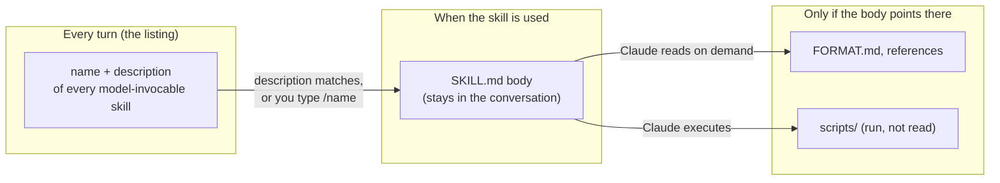
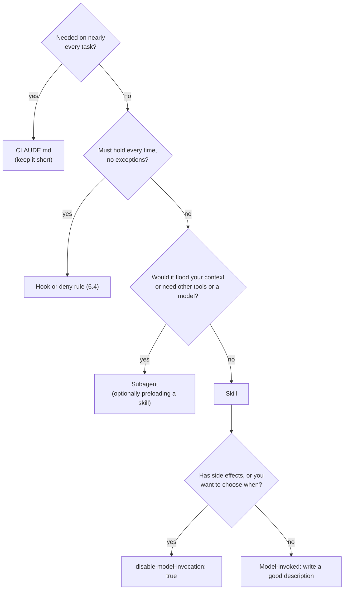

# Skills

## Why this matters

[6.2](/part-06-claude-code/6.2-claude-md-and-memory) ended on a rule: anything that is a *procedure* rather than a *fact* does not belong in CLAUDE.md, because CLAUDE.md is paid for on every task. Skills are where that procedure goes. A skill is a folder whose short description is always visible and whose body loads only when the task calls for it, so a 300-line release checklist costs almost nothing until the day you cut a release.

This study already runs on skills: the grilling, issue-tracker and domain-docs conventions that `CLAUDE.md` points to come from Matt Pocock's skill set (below). Much of the leverage in Claude Code is in learning to read those skills critically, change them, and write your own.

The format itself, the `SKILL.md` file and the three levels of loading, was introduced in [3.8](/part-03-agents/3.8-agents-md-and-skills) as a general agent-building concern (how *you* would implement skills in your own harness). This chapter is the Claude Code side: where it looks for skills, what it puts in context, how it differs from the other extension points, and how to tell whether a skill you wrote actually works.

**Learning goals**

- Explain how Claude Code discovers and loads skills
- Read and adapt Matt Pocock's skills
- Write and test your own skill

## Explanation

### Anatomy of a skill

A skill is a directory with a `SKILL.md` in it. The file has YAML frontmatter between `---` markers, then markdown instructions. Everything else in the directory is optional supporting material ([Extend Claude with skills](https://code.claude.com/docs/en/skills), "Create your first skill" and "Add supporting files").

```text
.claude/skills/write-chapter/
├── SKILL.md          # required: frontmatter + the instructions
├── FORMAT.md         # optional reference, read only when needed
└── scripts/check.sh  # optional code, run rather than read
```

Here is a complete small one, in the shape the docs use for their first example:

```yaml
---
description: Summarizes uncommitted changes and flags anything risky. Use when the user asks what changed, wants a commit message, or asks to review their diff.
---

## Current changes

!`git diff HEAD`

## Instructions

Summarize the changes above in two or three bullet points, then list any risks you notice.
```

Four things in it are worth noticing, all from the docs' [frontmatter reference](https://code.claude.com/docs/en/skills#frontmatter-reference) and "Create your first skill":

- **The `description` does the routing.** The docs call it "what the skill does and when to use it" and say Claude uses it to decide when to apply the skill. Only `description` is recommended; every field is optional, and `name` defaults to the directory name. This one is written in two halves: what it does, then *when to use* it in the words a user would say.
- **The directory name is the command.** The skill above becomes `/summarize-changes` if the directory has that name. You can type it, or Claude can load it when your message matches the description.
- **The `` !`git diff HEAD` `` line is dynamic context injection.** Claude Code runs the command and replaces the line with its output *before* Claude sees the skill, so the instructions arrive with the live diff already inlined.
- **Typos are silent.** Claude Code ignores a field name it does not recognise without reporting an error, and if the YAML does not parse the skill still loads, but with no fields set, so `/skill-name` works while Claude can no longer match it by description ([frontmatter reference](https://code.claude.com/docs/en/skills#frontmatter-reference); "Skill not triggering" under Troubleshooting). Run with `--debug` to see a parse error.

The fields you will touch most:

| Field | What it does |
|---|---|
| `description`, `when_to_use` | Routing text. Combined, they are cut at 1,536 characters in the listing, so put the key use case first |
| `disable-model-invocation: true` | Only you can invoke it, by typing `/name`. For workflows with side effects such as `/commit` or `/deploy` |
| `user-invocable: false` | Only Claude can invoke it. For background knowledge that is not an action |
| `allowed-tools` | Tools Claude may use without asking while this skill runs; the grant clears at your next message |
| `context: fork` (+ `agent`) | Run the skill in a separate subagent that does not see your conversation |
| `$ARGUMENTS`, `$1`, ... | Placeholders filled from what you type after the name, as in `/fix-issue 123` |

All of these are from the [frontmatter reference](https://code.claude.com/docs/en/skills#frontmatter-reference) and "Pass arguments to skills" in the same page. Two further distinctions on that page are worth a sentence each. Skill content comes in two flavours: *reference* content (conventions Claude applies to whatever it is doing) and *task* content (step-by-step instructions for an action you usually trigger yourself) ("Types of skill content"). And Claude Code follows the open [Agent Skills](https://agentskills.io) standard, extending it with features such as invocation control and subagent execution, so a skill you write is portable in its core and Claude-specific in its extras.

### Where skills live, and how Claude Code finds them

Where you save a skill decides which sessions see it ([Choose where skills load](https://code.claude.com/docs/en/skills#choose-where-skills-load)):

| Location | Path | Loads in |
|---|---|---|
| Enterprise | managed settings directory | All users the organization deploys it to |
| Personal | `~/.claude/skills/<name>/SKILL.md` | All your projects on this machine |
| Project | `.claude/skills/<name>/SKILL.md` | Sessions in this repo; commit it to share |
| Nested | `<subdir>/.claude/skills/<name>/SKILL.md` | Sessions started in or below that subdirectory; from above it, once Claude works on files there |
| Plugin | `<plugin>/skills/<name>/SKILL.md` | Wherever the plugin is enabled, as `/plugin-name:skill-name` |

(The docs list more, such as `--add-dir` directories and skills synced from a claude.ai account.) Four lookup rules matter for how you work, all from the same section:

1. **Parents are searched up to the repo root.** Starting in `packages/frontend/` still picks up skills at the root. Skills in a `.claude/skills/` *below* where you started do not load at startup; they load the first time Claude reads or edits a file in that subdirectory.
2. **Worktrees.** This study runs every task in a git worktree. In a linked worktree Claude Code searches parent directories only up to the worktree root, and when the worktree has no `.claude/skills` directory at its root it loads the main checkout's project skills instead (on Claude Code v2.1.277 or later, per the same section). A skill you commit to the repo is therefore visible in `.worktrees/issue-NN` either way.
3. **Name clashes have an order.** Enterprise beats personal, personal beats project. Your own skill replaces a bundled command of the same name but not its aliases. Plugin skills are namespaced, so they never clash.
4. **Edits are live.** Claude Code watches the skill directories, so adding, editing or removing a skill takes effect in the current session. If you create a top-level skills directory that did not exist when the session started, run `/reload-skills` ([Edit a skill during a session](https://code.claude.com/docs/en/skills#edit-a-skill-during-a-session)).

::: info 📖 Read now
[Extend Claude with skills](https://code.claude.com/docs/en/skills) · docs · ~25 min (skip the bundled-skill tables and the visual-output example) · **essential**

Look for: the frontmatter table and which fields change who can invoke the skill; "Skill content lifecycle"; "Evaluate and iterate on a skill"; and the Troubleshooting entries "Skill not triggering" and "Claude stops following a skill". Keep the page open while you do the practice: it is the reference for everything below.
:::

### Progressive disclosure: what is in context, and when

The loading model is the part of skills that decides how you write them. The [Anthropic article that introduced the idea](https://www.anthropic.com/research/equipping-agents-for-the-real-world-with-agent-skills) (published 2025-10-16, per the page) describes three levels: the agent preloads the `name` and `description` of every installed skill into its system prompt; if the skill looks relevant, it reads the full `SKILL.md`; and a skill can bundle further files that Claude opens only if needed, the third level "and beyond". Its analogy is a manual with a table of contents, then chapters, then an appendix, and its claim is that for an agent with filesystem access the amount of context a skill can bundle is "effectively unbounded", because most of it is never read.

Claude Code's docs make that concrete with a table of what is in context under each invocation setting ([Control who invokes a skill](https://code.claude.com/docs/en/skills#control-who-invokes-a-skill)):

| Frontmatter | You can invoke | Claude can invoke | In context |
|---|---|---|---|
| (default) | Yes | Yes | Description always; full skill when invoked |
| `disable-model-invocation: true` | Yes | Not on its own | Description *not* in context; full skill when invoked |
| `user-invocable: false` | No | Yes | Description always; full skill when invoked |



Four consequences, each from the docs:

- **The listing has a budget.** Every skill in the listing costs context on every turn, used or not. The listing always contains every name, but with many skills Claude Code drops descriptions to fit a budget that scales at 1% of the model's context window, starting with the skills you invoke least ([Skill descriptions are cut short](https://code.claude.com/docs/en/skills#skill-descriptions-are-cut-short)). A dropped description removes the very keywords Claude needs to match your request. `/doctor` estimates the listing's cost; `/skill-doctor` shows what each skill costs and how often it is used ([Find unused skills](https://code.claude.com/docs/en/skills#find-unused-skills)). Treat that like the `/context` audit you did in 6.2.
- **A loaded body stays loaded.** The rendered `SKILL.md` enters the conversation as a single message and stays across later turns; Claude Code does not re-read the file ([Skill content lifecycle](https://code.claude.com/docs/en/skills#skill-content-lifecycle)). So "every line is a recurring token cost", and guidance should be phrased as standing instructions ("run the tests after every edit") rather than one-off steps ("run the tests").
- **Compaction keeps only the top.** After auto-compaction, Claude Code re-attaches the most recent invocation of each skill, keeping only the first 5,000 tokens of each, within a shared 25,000-token budget; older skills can be dropped entirely (same section). Put the instructions that matter most at the top of the file.
- **Disabling model invocation is a context optimisation, not just a safety switch.** A skill you only ever fire by hand costs no listing space at all. Pocock's *writing-for-agents* makes the same trade explicit: a model-invoked skill buys discoverability with permanent context load; a user-invoked one spends your memory instead of the window ([SKILL-MECHANICS.md](https://github.com/mattpocock/skills/blob/main/skills/productivity/writing-for-agents/SKILL-MECHANICS.md), "Invocation").

The third level is also where *scripts* fit. The article's PDF skill ships a Python script that extracts form fields; Claude runs it without loading the script or the PDF into context, and because code is deterministic the result is repeatable (same article, "Skills and code execution"). The docs' file-layout example marks the same split: `reference.md` is "loaded when needed", `scripts/helper.py` is "executed, not loaded".

### Skills, CLAUDE.md, subagents, slash commands

Four mechanisms overlap enough to be confused. They differ in *when they load*, *what context they run in*, and *who decides to use them*.

| | When it loads | Runs in | Who triggers it | Use for |
|---|---|---|---|---|
| **CLAUDE.md** | Every session, delivered as a user message ([6.2](/part-06-claude-code/6.2-claude-md-and-memory)) | Main conversation | Always on | Facts and rules Claude can't derive, needed on most tasks |
| **Skill** | Description always (unless disabled); body when used | Main conversation by default; a subagent with `context: fork` | You (`/name`) or Claude (by description) | A procedure or reference needed on *some* tasks |
| **Subagent** | Description always; its own system prompt when it runs | Its own context window, with its own tools and permissions | Claude delegates, or you ask | Side work that would flood your context, or work that needs different tools or a different model |
| **Slash command** | When you type it | Main conversation | You | Now just a skill: "Custom commands have been merged into skills" |

Sources: [skills docs](https://code.claude.com/docs/en/skills) (the note near the top about merged commands, and the invocation table), [subagents docs](https://code.claude.com/docs/en/sub-agents) (opening paragraphs). Three points sharpen the table:

- **Custom slash commands are not a separate thing any more.** A file at `.claude/commands/deploy.md` and a skill at `.claude/skills/deploy/SKILL.md` both create `/deploy`. Old command files keep working; skills add a directory for supporting files, invocation control and automatic loading. If an older tutorial tells you to put a prompt in `.claude/commands/`, write a skill instead. (Built-in commands like `/compact` are different: they run fixed logic rather than giving Claude instructions; see the [commands reference](https://code.claude.com/docs/en/commands).)
- **Skills and subagents compose in both directions.** `context: fork` in a skill runs its body as the prompt of a fresh subagent that "doesn't see your conversation history", so the instructions have to stand alone ([Run skills in a subagent](https://code.claude.com/docs/en/skills#run-skills-in-a-subagent)). In the other direction, a subagent's `skills` field preloads full skill content into the subagent at startup, and you cannot preload a skill that sets `disable-model-invocation: true` ([Preload skills into subagents](https://code.claude.com/docs/en/sub-agents#preload-skills-into-subagents)). Rule of thumb: a skill is *what to do*, a subagent is *who does it, in which window*.
- **Skills are context, not enforcement.** Like CLAUDE.md, a skill is a request. The docs' advice for a rule that must hold every time is a hook, and a skill can carry its own hook in its frontmatter ([Claude stops following a skill](https://code.claude.com/docs/en/skills#claude-stops-following-a-skill)); that is [6.4](/part-06-claude-code/6.4-hooks-permissions).

A decision flow that falls out of the table:



### Matt Pocock's skills as case studies

Matt Pocock's [skills repository](https://github.com/mattpocock/skills) is a public set of skills built for exactly the failure modes of coding agents: the README's first failure mode is "The Agent Didn't Do What I Want", and it describes the skills as "small, easy to adapt, and composable". Installation for Claude Code is a plugin: `claude plugin install mattpocock-skills@claude-plugins-official` (README, "Installation"), then `/setup-matt-pocock-skills` once per repo, which asks which issue tracker you use, what triage labels you apply and where docs go. This study's `CLAUDE.md` has an "Agent skills" section naming the issue tracker, labels and domain docs, which is the block that setup step writes, with the details in `docs/agents/` ([setup-matt-pocock-skills](https://github.com/mattpocock/skills/blob/main/skills/engineering/setup-matt-pocock-skills/SKILL.md)); the other skills then read those conventions.

Treat the repo as a library of worked examples. Four skills, four design lessons. The behaviour descriptions below come from reading the files on 2026-11-12 (re-checked 2026-11-13); the repo changes often, so re-read before you rely on a detail.

**`grilling`: the minimal skill.** [The whole skill](https://github.com/mattpocock/skills/blob/main/skills/productivity/grilling/SKILL.md) is a description, seven short paragraphs and an output template. The description has the two halves: what ("grill the user relentlessly about a plan, decision, or idea") and when ("use when the user wants to stress-test their thinking, or uses any 'grill' trigger phrases"), including the literal phrases you will type. The body defines its own working model (a *design tree* and its *frontier*), a precise output format for each question including the recommended answer, and a stopping condition (the frontier is empty). Notice what is missing: no background on interviews, no examples of good questions, nothing the model already does by default. Every sentence changes behaviour.

**`grill-with-docs`: a skill that is only composition.** [Its body](https://github.com/mattpocock/skills/blob/main/skills/engineering/grill-with-docs/SKILL.md) is one sentence: call the Skill tool twice, for "grilling" and "domain-modeling". It sets `disable-model-invocation: true`, so it has no listing cost and only fires when you type it. Two lessons: skills can invoke other skills, which is how shared material lives in one place; and a user-invoked "macro" skill is nearly free. The study's single-context `GLOSSARY.md` and `docs/adr/` layout is the one `domain-modeling` describes.

**`tdd`: a skill that stays short by splitting.** [`tdd/SKILL.md`](https://github.com/mattpocock/skills/blob/main/skills/engineering/tdd/SKILL.md) states the rules of the red-green loop and points to `tests.md` and `mocking.md` for examples and mocking guidelines. This is level three in the flesh: the body holds what every cycle needs; the bulky examples load only if Claude follows the link. It also shows how a skill can *require a human checkpoint*: tests are written only at seams the user has confirmed first. And it reads the project's `GLOSSARY.md` so test names use your domain vocabulary, which is why a [domain-modeling](https://github.com/mattpocock/skills/blob/main/skills/engineering/domain-modeling/SKILL.md) habit pays off across skills.

**`writing-for-agents`: the skill about writing skills.** You met it in 6.2 for pruning advice. Its [`SKILL-MECHANICS.md`](https://github.com/mattpocock/skills/blob/main/skills/productivity/writing-for-agents/SKILL-MECHANICS.md) covers skill-specific choices: model-invoked versus user-invoked (above), splitting by invocation, and **router skills**. When user-invoked skills pile up past what you can remember, one user-invoked skill can name the others and say when to reach for each; it can only hint, since the others have no description to fire from. If you ever find yourself with thirty `/commands` you never use, that is the pattern, and `/skill-doctor` will tell you which ones those are.

What to take from reading them: short bodies, a description written for the trigger you actually type, exact output formats where the shape matters, dependencies on other files named explicitly, and a clear choice for each skill between "the agent may fire this" and "only I fire this".

Adapting one is a normal workflow. Copy the skill folder into your own `.claude/skills/` (plugin skills are namespaced as `/plugin-name:skill-name`, so your copy and the plugin's both load; give yours a distinct name to avoid confusing the two). Then change the parts that encode someone else's decisions: the issue tracker, the labels, the vocabulary, the output format. Keep a note of where you diverged, so a later upstream change is a diff you can read rather than a surprise. The README says it too: "Hack around with them. Make them your own."

::: info 📖 Read now
[Matt Pocock: skills](https://github.com/mattpocock/skills) · repo · ~30 min (the README, then the `grilling`, `grill-with-docs`, `tdd` and `writing-for-agents` SKILL.md files) · **essential**

Look for: how each description is worded and whether it names words you would actually say; which skills set `disable-model-invocation`; how long each body is; and where a body points at a second file instead of inlining it. Pick one skill you use and write down one line you would change for this repo.
:::

### Testing skills

A skill that triggers is not a skill that works. The docs separate two questions: does Claude invoke it on the prompts it should, and does the output match what you expect when it does ([Evaluate and iterate on a skill](https://code.claude.com/docs/en/skills#evaluate-and-iterate-on-a-skill))? The method for both is a **baseline comparison**: collect a few realistic prompts, run each in a *fresh session* with the skill available and again with it turned off, and compare. The fresh session matters because "leftover context from authoring the skill will mask gaps in the written instructions". To turn a personal or project skill off for the baseline run, set it to `"off"` in `skillOverrides`.

This is the eval discipline from [Part 4](/part-04-evals-observability/4.1-error-analysis), scaled down to one file. The Anthropic article's authoring advice lines up with it: start with evaluation, finding gaps by running the agent on representative tasks before writing the skill; watch how Claude actually uses the skill and iterate; and ask Claude to capture its own successful approaches into a skill rather than predicting what it will need ([article](https://www.anthropic.com/research/equipping-agents-for-the-real-world-with-agent-skills), "Developing and evaluating skills").

A working test routine for a skill you wrote:

1. **Trigger test.** Write five prompts that *should* fire it, in different wordings, and three that should *not* (neighbouring tasks). In a fresh session, ask each and check whether the skill loaded. A miss means the description lacks the words you used. A false positive means it is too broad, or the skill needs `disable-model-invocation: true` ([Skill triggers too often](https://code.claude.com/docs/en/skills#skill-triggers-too-often)).
2. **Direct invocation.** Type `/name` with realistic arguments. If it is not recognised, the problem is the name, the location or the frontmatter, not the description. `claude plugin validate .claude/skills` flags `SKILL.md` files whose frontmatter does not parse (same Troubleshooting section).
3. **Output test against a baseline.** Run the same task with the skill on and off, in fresh sessions. Compare against concrete criteria you wrote down first (for a chapter writer: the five sections in order, resource tags, no stub text), not against a vibe.
4. **Longevity test.** Run a longer task and check the skill is still followed late; then `/compact` and check again. If it drifts, apply the three fixes in "Claude stops following a skill": a hook for hard rules, whole-task phrasing for judgment rules, and important instructions near the top of the file.
5. **Cost check.** `/skill-doctor` or `/context` for the listing cost; is this skill worth its description line?

Tooling exists for the loop. The [`skill-creator` plugin](https://github.com/anthropics/claude-plugins-official/tree/main/plugins/skill-creator) automates it inside Claude Code: it stores test prompts and expectations in `evals/evals.json`, runs each case in a subagent, grades assertions, benchmarks with-skill against without-skill, and can tune the description with should-trigger and should-not-trigger prompts (skills docs, "Run evals with skill-creator"). For a skill that ships in a plugin, `claude plugin eval` does a similar comparison and can gate CI. Both are optional for a first skill; the manual routine above teaches you what they automate.

::: info 📖 Read now
[Evaluating skill output quality](https://agentskills.io/skill-creation/evaluating-skills) · docs · ~15 min · optional

The tool-neutral version of the baseline-comparison method, from the Agent Skills site. Look for the eval file format and how it decides what to assert; compare it with the manual routine above.
:::

#### Security

A skill is instructions plus possibly code. The Anthropic article's advice is to install skills only from trusted sources, and to audit an untrusted one before use: read every bundled file, with particular attention to code dependencies, bundled scripts, and instructions that make Claude connect to untrusted network sources ("Security considerations when using Skills"). Reading a skill is cheap because the format is plain text; do it for third-party skills, including the ones from the repo above.

## Practice

**Brief:** Write a skill for this study, `write-chapter`, that makes Claude follow the book's chapter format, and use it on one chapter task. Test it with the baseline comparison from the chapter.

**Where:** `experiments/27-my-skill/`: a standalone experiment, not a `project/` step. The folder holds your skill source (`write-chapter/SKILL.md` and anything it bundles), your test prompts, and `README.md` for the results. Install it for use by copying or symlinking `write-chapter/` into `.claude/skills/` (project) or `~/.claude/skills/` (personal); `README.md` says which you chose and why. No Python is needed.

You write the skill. The brief gives the shape, not the content.

**Steps:**

1. **Start from a failure, not from the template.** Take an issue that is not yet written (any `.scratch/ai-engineering-book/issues/NN-write-*.md`) and have Claude write the chapter *without* your skill. Note in the README, with the date, three concrete ways the result missed the spec's chapter format (for example a section out of order, a resource without a tag, a hard-coded price). These are your acceptance criteria. Throw the chapter away.
2. **Decide the invocation.** Write down whether `write-chapter` should be model-invoked or user-invoked, using the table in this chapter and the cost of the listing. State the choice and the reason in the README.
3. **Write `SKILL.md`.** Frontmatter with a description in two halves (what, and when, with the words you would type). Body: the instructions that address your three failures, phrased as standing instructions. Decide what stays in `SKILL.md` and what moves to a second file the body points to, and whether anything should be a script (`npm run check -- <id>` already exists and is deterministic: call it, don't describe it). Use `$ARGUMENTS` or a named argument for the issue number if you make it user-invoked.
4. **Trigger test.** Write at least five prompts that should load the skill and three that should not (put them in `experiments/27-my-skill/prompts.md`). Run each in a fresh session and record loaded or not. Fix the description until the results match, or switch invocation mode and say why.
5. **Baseline comparison.** In a fresh session, with the skill turned off (`skillOverrides` set to `"off"` for it), run a *different* chapter task and score the result against your step-1 criteria. Then repeat in a fresh session with the skill on. Record both scores, and the token and time cost if you can see them.
6. **Longevity.** On the skill-on run, run `/compact` partway through and note whether the rest of the task still follows the skill. If it drifts, apply one fix from the chapter and re-run.
7. **Adapt one of Pocock's.** Copy one skill from the repo you read (`grilling` is the shortest) into `experiments/27-my-skill/adapted/`, change at least two lines to fit this study, and write one sentence on each change. Do not install both the original and your copy without checking `/` shows what you expect.
8. **Reflect.** In the README: which line of your skill made the biggest difference, which line you would delete, and what you learned from the failure of the skill (if it failed) or the baseline (if it did not).

**Done when:**

- `experiments/27-my-skill/README.md` records the three step-1 failures, the invocation decision, the trigger-test table (at least eight prompts with loaded / not-loaded), the baseline scores with and without the skill, and the `/compact` result.
- `write-chapter/SKILL.md` has a description that fires on at least four of your five should-trigger prompts and none of the three should-not, or an explicit note that it is user-invoked and why.
- The skill-on run scores better than the skill-off run on your criteria, or the README explains why not and what you changed.
- At least one thing moved out of `SKILL.md` into a referenced file or a script call.
- `adapted/` holds a copy of one Pocock skill with two or more annotated changes.

## Check questions

1. You wrote a skill called `deploy` that pushes to production. Claude ran it by itself once because your code "looked ready". What do you change, and what happens to its context cost?

   <details><summary>Answer</summary>

   Add `disable-model-invocation: true`. Claude can no longer invoke the skill on its own (if it tries, Claude Code blocks the call and tells it to leave the deploy to you), and only you can run it by typing `/deploy`. As a side effect the description is no longer loaded into context at all, so it costs nothing until you invoke it, at which point the full body loads. For a skill with side effects, this is both the safety switch and the cheapest configuration.

   </details>

2. Your skill's description says "Helps with chapters." It never fires on "write chapter 6.3 following the spec". Why, and how do you fix and verify it?

   <details><summary>Answer</summary>

   Claude decides from the description whether a skill applies, and this one lacks both what it does and the words a user would say. Rewrite it in two halves, naming the action and the triggers ("Writes a chapter of the study book in the spec's six-section format. Use when asked to write, draft or finish a chapter task or issue"), with the key use case first because the combined description is truncated in the listing. Verify with the trigger test: several differently worded prompts that should fire it and a few that should not, each in a fresh session; also check the skill appears when you ask "What skills are available?". If the YAML itself is malformed the skill still loads with empty metadata, so `/name` works but matching fails; run with `--debug` or `claude plugin validate`.

   </details>

3. Claude follows your 400-line skill for the first ten minutes, then ignores its checklist after a compaction. Give two causes and two fixes.

   <details><summary>Answer</summary>

   The skill body enters the conversation once and is not re-read from disk on later turns, and compaction re-attaches only the first 5,000 tokens of each invoked skill within a shared 25,000-token budget, so the end of a long skill (or a skill invoked long ago) may be gone. Fixes: put the most important instructions at the top; shorten the body by moving bulk to files Claude reads on demand; invoke the skill again to restore it; phrase judgment rules as whole-task standing instructions; and move any rule that must hold every time into a hook, which runs whether or not Claude is following the skill.

   </details>

4. You have 40 skills installed and Claude stops picking the one you wrote last week. Name a likely cause and two ways to investigate or fix it.

   <details><summary>Answer</summary>

   The skill listing has a character budget (1% of the context window by default). When it overflows, Claude Code drops descriptions starting with the skills you invoke least, and a new skill has no usage history, so its description may be cut and the keywords Claude needs are gone. Investigate with `/doctor` (listing cost and biggest contributors) and `/skill-doctor` (cost and usage per skill). Fix by disabling or setting `"name-only"` for skills you do not need, making manual-only skills `disable-model-invocation: true`, trimming long descriptions with the key use case first, or raising the budget setting.

   </details>

5. A teammate wants to put "how to write our API docs", a 200-line procedure, in CLAUDE.md. Another wants a subagent for it. Which do you pick and when would the other be right?

   <details><summary>Answer</summary>

   A skill, probably. A procedure used on some tasks should not load on every one (CLAUDE.md), and the work does not need a separate context window or different tools (subagent). The skill's description is always visible but the 200 lines load only when documenting. A subagent becomes right if writing the docs involves reading large amounts of code you do not want in your main conversation, or needs a different tool set or model; even then the subagent can preload the skill via its `skills` field, or the skill can run with `context: fork`. CLAUDE.md would keep one line at most: a pointer or the single fact needed on every task.

   </details>

## My understanding

<!-- Written by the learner, in their own words. Agents never fill this in. -->
