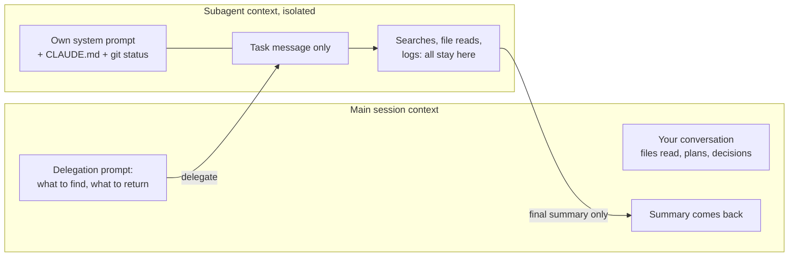
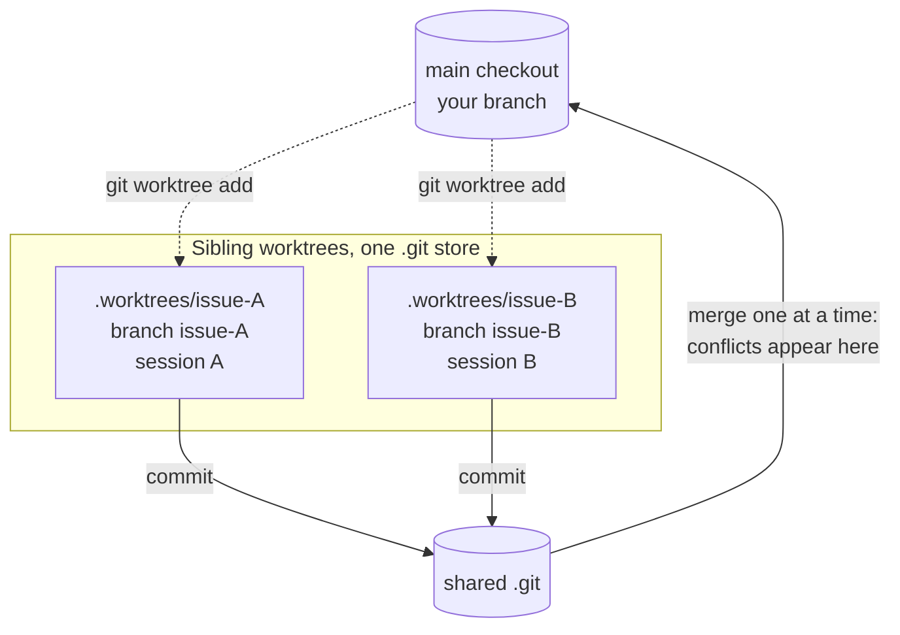
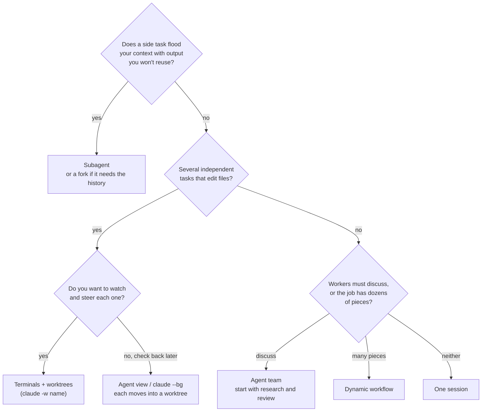

# Subagents, worktrees and parallel work

## Why this matters

One Claude Code session is one stream of attention: a context window, a working directory, a single thing happening at a time. Most of the leverage beyond that comes from running more than one, and it comes in two different shapes that people mix up. The first is **delegation**: a side task goes to a worker with its own context window, and only a summary comes back. The second is **concurrency**: several tasks run at once, each on its own copy of the files. Delegation protects your context. Concurrency saves your wall-clock time. Neither is free: every extra context window is more tokens, and every extra writer is a chance of a merge conflict.

You already know the mechanism underneath. [6.1](/part-06-claude-code/6.1-how-claude-code-works) said that the context window is finite and that "delegating large reads to a subagent" is one of the levers for keeping it small. This chapter is that lever in full, plus the git feature that makes parallel writers safe, plus an honest look at what it all costs on a Pro plan. The chapter after next, [6.8](/part-06-claude-code/6.8-pro-limits), goes deeper on limits; here the point is to recognise which parallel pattern costs what.

**Learning goals**

- Create custom subagents
- Run parallel sessions in worktrees
- Know the token cost and when it pays off

## Explanation

### Five ways to do several things at once

Claude Code's docs list five ways to work on several tasks at once, and they differ in how involved you stay ([Run agents in parallel](https://code.claude.com/docs/en/agents)):

| Approach | What it is | You stay involved by |
|---|---|---|
| Subagents | Workers inside one session, each with its own context window, returning a summary | Nothing: Claude delegates and collects |
| Agent view (background sessions) | Full sessions running without a terminal, listed on one screen (`claude agents`); research preview | Dispatching tasks and replying when a row needs you |
| Agent teams | A lead plus teammate sessions with a shared task list and direct messaging; experimental, off by default | Steering the lead |
| Dynamic workflows | A script that runs many subagents and cross-checks their results | Approving the plan, then waiting |
| Projects | One conversation that starts parallel cloud sessions; public beta | Describing the work once |

The docs also name three supporting tools that are not ways to run agents themselves: worktrees, cross-session messaging, and the `/batch` skill. Two things in that page are worth carrying around. First, "in every approach the workers are Claude sessions"; to involve a different tool, expose it to Claude as an MCP server (that is [6.6](/part-06-claude-code/6.6-mcp-plugins) territory). Second, the page gives three questions that choose the approach: *who coordinates* (Claude inside one conversation, you, a lead agent, or a script), *do the workers need to talk to each other*, and *do the tasks touch the same files* ([Run agents in parallel](https://code.claude.com/docs/en/agents), "Choose an approach").

This chapter covers the first two rows in depth, the file-isolation tool they rely on, and then the other three at the level of "when would I reach for it".

### Subagents and their context

A subagent is a delegated worker. The docs' framing: use one "when a side task would flood your main conversation with search results, logs, or file contents you won't reference again: the subagent does that work in its own context and returns only the summary" ([Create custom subagents](https://code.claude.com/docs/en/sub-agents)). It has its own context window, a custom system prompt, specific tool access and independent permissions.

What is in that fresh window decides whether the delegation works, so read the list. A non-fork subagent starts with ([Create custom subagents](https://code.claude.com/docs/en/sub-agents), "What loads at startup"):

- its own system prompt plus environment details (not the Claude Code system prompt);
- the **task message**: the delegation prompt Claude writes when it hands off the work;
- the `CLAUDE.md` hierarchy the main conversation loads, with the built-in Explore and Plan agents skipping it;
- a git-status snapshot (Explore and Plan skip it too);
- the full content of any skills named in its `skills` field.

And it does *not* get your conversation history, the skills you already invoked, or the files Claude has already read. Auto memory and your output style do not reach it either. Its context window is sized by its own model, not the parent's.



The consequence is the single most important rule of delegation: **the delegation prompt is the whole interface.** If the subagent needs to know that `vendor/` must be ignored, or which failing test you are chasing, that has to be in the task message. The docs say so directly: restate a rule that must reach the subagent in the prompt you give Claude when delegating. Treat the prompt like a ticket for a contractor who has never seen your repo. Whatever the subagent learns that is not in its final summary is gone when it finishes.

This is why subagents appear in the cost table in a good light and a bad light at once. They keep your main window small (good for every later turn), but each one "sends its own requests, which count toward the same usage limits as your main conversation" ([Create custom subagents](https://code.claude.com/docs/en/sub-agents)). You are trading main-context size for extra total tokens.

**Built-in subagents.** Claude Code ships a few and uses them without being asked: **Explore** (read-only, for searching and understanding a codebase, with a thoroughness level of quick, medium or very thorough), **Plan** (read-only research during plan mode), and **general-purpose** (every tool, for work that needs exploration and action). The docs list a few more helpers (a catch-all `claude` agent, `statusline-setup`, `claude-code-guide`). The model each uses depends on your setup and changes; the page states the current rules ([Create custom subagents](https://code.claude.com/docs/en/sub-agents), "Built-in subagents").

**Forks.** A fork is a subagent that inherits the entire conversation instead of starting fresh: same system prompt, tools, model and history. That drops the input isolation, so you can hand it a side task without re-explaining. Its tool calls still stay out of your window and only its result comes back. You start one yourself with `/subtask` (with agent view turned off the command is `/fork` instead), and Claude can start one on its own while fork mode is on ([Create custom subagents](https://code.claude.com/docs/en/sub-agents), "Fork the current conversation"). Use a fork when a fresh subagent would need a long briefing; use a fresh subagent when you want the isolation.

**Foreground, background and limits.** A subagent that Claude spawns from your main conversation starts in the background by default, so you keep working; if it needs a permission, the prompt surfaces in your main session and names the subagent. By default a subagent can spawn its own subagents, up to three layers below the main conversation, and when 20 subagents are running at once the next spawn fails ([Create custom subagents](https://code.claude.com/docs/en/sub-agents), "Let subagents spawn their own subagents" and "Concurrent subagent limit"). Those are defaults with environment-variable overrides; you rarely need to touch them, but a runaway tree of nested subagents is a cost problem as well as a clutter problem.

**When not to delegate.** The docs' own checklist favours the main conversation for frequent back-and-forth, for phases that share a lot of context (plan, implement, test), for quick targeted changes, and when latency matters, because a non-fork subagent starts cold. Subagents win when the task produces verbose output you do not need, when you want tool restrictions, or when the work is self-contained and can return a summary ([Create custom subagents](https://code.claude.com/docs/en/sub-agents), "Choose between subagents and main conversation"). For a question about something already in the conversation, `/btw` is cheaper than a subagent.

### Custom subagents

Claude uses each subagent's `description` to decide when to delegate, so a custom subagent is a markdown file with YAML frontmatter and a body that becomes its system prompt. It lives in `.claude/agents/` (project, commit it) or `~/.claude/agents/` (yours, every project); you saw the file location in the `.claude` table in [6.1](/part-06-claude-code/6.1-how-claude-code-works). The docs' own minimal example:

```markdown
---
name: code-reviewer
description: Reviews code for quality and best practices
tools: Read, Glob, Grep
model: sonnet
---

You are a code reviewer. When invoked, analyze the code and provide
specific, actionable feedback on quality, security, and best practices.
```

Only `name` and `description` are required. The fields you will use most ([Create custom subagents](https://code.claude.com/docs/en/sub-agents), "Frontmatter reference"):

| Field | Why you would set it |
|---|---|
| `description` | The trigger. Claude reads it to decide whether to delegate, so say *what* and *when*, in the words you would use. Same rule as skill descriptions in [6.3](/part-06-claude-code/6.3-skills). |
| `tools` / `disallowedTools` | Least privilege: a reviewer that cannot edit cannot "fix" things you only asked it to look at. |
| `model` | `sonnet`, `opus`, `haiku`, `fable`, a full model ID, or `inherit`. A cheaper model for mechanical work is the main cost lever (see [Landscape](/landscape#anthropic) for the current lineup). |
| `isolation: worktree` | Run in a temporary git worktree, so its edits cannot collide with yours. |
| `skills` | Preload a skill's full content into the subagent. |
| `memory` | Give the subagent persistent memory of its own (scopes `user`, `project`, `local`). |
| `maxTurns` | Stop a worker that is looping. |
| `permissionMode`, `hooks`, `mcpServers` | Scope permissions, lifecycle hooks and MCP servers to this one worker (see [6.4](/part-06-claude-code/6.4-hooks-permissions), [6.6](/part-06-claude-code/6.6-mcp-plugins)). |

Two details matter in practice. Claude Code watches the two `agents` directories and picks up edits within a few seconds, but a scope's *first* agent file in a directory that did not exist at session start needs a restart. And field names are exact: Claude Code "ignores a field it doesn't recognize without reporting an error", so a misspelled `disallowedtools` fails silently. The docs show how to find it with `claude --debug` (same page, "Frontmatter reference").

You do not have to write these by hand: ask Claude to write one for you, or edit the file directly. The `/agents` command in the current docs only points you at the file locations; do not confuse it with `claude agents`, which opens agent view ([Run agents in parallel](https://code.claude.com/docs/en/agents), "Check on running work").

**What makes a good custom subagent.** It is a *role with a contract*, not a persona:

1. **One job, one return shape.** "Review the diff and return findings as a list with file, line and severity" beats "be a careful reviewer". The return shape is what lands in your window.
2. **Narrow tools.** Start read-only and add tools when a real task needs them.
3. **A description that fires.** If Claude never delegates to it, the description is the first suspect; you can also invoke it explicitly with an `@`-mention (which guarantees that subagent runs) or by naming it in plain words, which is the quickest test of the prompt itself.
4. **Created from a repeated need.** The docs' wording is "define a custom subagent when you keep spawning the same kind of worker with the same instructions". The first time you write a reviewer prompt, it is a prompt; the third time, it is an agent file.

Skill or subagent? The test from [6.3](/part-06-claude-code/6.3-skills) still applies: a skill is instructions that run *in* your context; a subagent runs *outside* it. If the work is mostly reading and the output is a summary, you want a subagent. If it is a procedure you want to follow in the conversation, you want a skill. A skill can also run in a fork (`context: fork`), which is the bridge between the two.

::: info 📖 Read now
[Create custom subagents](https://code.claude.com/docs/en/sub-agents) · docs · ~30 min · **essential**

A long page; read "Built-in subagents", "Quickstart", "Write subagent files", the frontmatter table, and "Manage subagent context", and skim the rest. Look for: the list of what a subagent's context starts with (and what it does not get), the difference between a fork and a normal subagent, and the `isolation` field. Then write down which of your own repeated tasks (a review, a test run, a log summary) would be a subagent, and which tools it would need.
:::

### Git worktrees

Subagents isolate *context*. They do not, by themselves, isolate *files*: a subagent starts in the main conversation's working directory, so two writers in one checkout step on each other (the table row "Same checkout, no worktrees" in [experiment 06](/experiments/06-parallel-tasks) says it flatly: edits and commits collide). The tool for file isolation is the git worktree.

A worktree is a second checkout of the same repository: its own directory, its own branch and its own working files, sharing one `.git` object store. Cheap to create, because nothing is cloned. You have been using them for this book: every chapter task runs in `.worktrees/issue-NN` on branch `issue-NN`, created with `git worktree add`, and the batch workflow's merge step brings the branches back.

Claude Code has built-in support, so you do not have to create them by hand. `claude --worktree <name>` (or `-w`) creates a worktree under `.claude/worktrees/<name>/` on a new branch named `worktree-<name>` and starts Claude in it; run it again with another name in another terminal for a second isolated session. Add `.claude/worktrees/` to `.gitignore` so the contents do not show as untracked ([Run parallel sessions with worktrees](https://code.claude.com/docs/en/worktrees), "Start Claude in a worktree"). Four things to know.

1. **A worktree is a fresh checkout, so untracked files are missing.** `.env` is the classic one. A `.worktreeinclude` file at the project root, in `.gitignore` syntax, names gitignored files to copy in automatically. Only files that match *and* are gitignored are copied ([Run parallel sessions with worktrees](https://code.claude.com/docs/en/worktrees), "Copy gitignored files into worktrees"). Compare with the spec's `ln -s ../../node_modules` step for this book, which solves the same problem for a directory.
2. **Some things are shared with the main checkout.** The `.git` directory; project-scope plugins; and, easy to miss, **permission approvals**: choosing "Yes, and don't ask again" in a worktree session saves the rule to the main checkout's `.claude/settings.local.json`, so it applies in every worktree and survives the worktree's removal ([same page](https://code.claude.com/docs/en/worktrees), "What worktrees share with the main checkout"). Auto memory is also shared across a repo's worktrees ([6.2](/part-06-claude-code/6.2-claude-md-and-memory)).
3. **Isolation is enforced, not just conventional.** While a session is in a worktree, Claude Code blocks edits that target a path in the main checkout, shell commands whose working directory is the main checkout, and git commands redirected into it. The docs are candid about the limit: none of these checks tracks what a shell command *writes*, so `cp` or a redirect into the main checkout is not refused by them and falls under your normal permissions and sandbox ([same page](https://code.claude.com/docs/en/worktrees), "How Claude Code enforces isolation"). Isolation is a guard rail, not a sandbox ([Part 8](/part-08-production/8.1-prompt-injection) returns to sandboxing).
4. **Cleanup is automatic only for what Claude created.** A worktree that a subagent created is removed when it finishes without changes; one with changes stays until a periodic sweep can remove it without losing work. A worktree you made with `git worktree add` is never swept, whatever its age, and a worktree holding changed files or unpushed commits is left alone ([same page](https://code.claude.com/docs/en/worktrees), "Clean up subagent and background-session worktrees").

Subagents get worktrees too: ask Claude to "use worktrees for your agents", or put `isolation: worktree` in a custom subagent's frontmatter. By default these branch from your repository's default branch rather than the parent session's `HEAD` unless `worktree.baseRef` is set to `"head"`, which matters if the work builds on an uncommitted or unmerged branch ([same page](https://code.claude.com/docs/en/worktrees), "Isolate subagents with worktrees" and "Choose the base branch").

::: tip The part that git does not solve
A worktree stops two sessions from editing the same *file on disk*. It does not stop two branches from editing the same *lines*. The conflict shows up later, at merge time, and the usual places are the files every task touches: an index, a changelog, a glossary. The cheap defences are all about the plan, not the tooling: pick tasks that touch different files; for the shared files, have every task only *append*; merge one branch at a time and resolve as you go. This study's own spec says exactly that for `GLOSSARY.md`, `book/resources.md` and `BUILD-LOG.md`.
:::



::: info 📖 Read now
[Run parallel sessions with worktrees](https://code.claude.com/docs/en/worktrees) · docs · ~20 min · **essential**

Read "Start Claude in a worktree", "How Claude Code enforces isolation", "Isolate subagents with worktrees", "What worktrees share with the main checkout" and "Manage worktrees manually". Look for: where a `--worktree` session's branch and directory end up, which four checks Claude Code applies and what they do not cover, and the exact conditions under which cleanup leaves a worktree alone. Then check `git worktree list` in this repo: which of those are Claude-created and which you made by hand?
:::

### Background sessions

A subagent is a worker inside a session. A **background session** is a whole session that keeps running without a terminal attached. `claude agents` opens **agent view**, "one screen for all your background sessions: what's running, what needs your input, and what's done"; each background session is a full Claude Code conversation you can open, reply to and leave. The feature is in research preview, so the interface and keys may change ([Manage multiple agents with agent view](https://code.claude.com/docs/en/agent-view)).

You dispatch from agent view, or from your shell with `claude --bg "<prompt>"`. The detail that matters for this chapter is how file edits are isolated: a dispatched background session starts in your working directory, and **before it edits files it moves itself into a git worktree** under `.claude/worktrees/`, so parallel sessions read the same checkout but each writes to its own. The exceptions are listed: a session you backgrounded after already working in it keeps editing where it was, a session already inside a linked worktree stays there, and a non-git directory is not isolated at all. When a background session has made changes in a worktree, Claude Code instructs it to commit (and push the branch if there is a remote), and the docs list what it will never do: push to `main`, force-push, or merge ([Manage multiple agents with agent view](https://code.claude.com/docs/en/agent-view), "How file edits are isolated"). Your own `CLAUDE.md` can override that if it says you handle git yourself.

Two other things sit near this feature and are easy to blur:

- A **background bash command** runs one shell command without blocking the conversation. It is not an agent.
- `/tasks` lists everything running in the background of the *current* session; `claude agents` is the cross-session view. Despite the similar name, `/agents` is neither: it points to subagent file locations ([Run agents in parallel](https://code.claude.com/docs/en/agents), "Check on running work").

For work that should keep running while your machine is off, the docs' answer is the cloud (Projects, or Claude Code in the cloud; see [Run agents in parallel](https://code.claude.com/docs/en/agents)); this chapter stays on your own machine.

### Agent teams and workflows

**Agent teams** are the heaviest option. A lead session spawns teammate sessions, each with its own context window; teammates share a task list and message each other directly. The comparison the docs give is the one to memorise ([Orchestrate teams of Claude Code sessions](https://code.claude.com/docs/en/agent-teams), "Compare with subagents"):

| | Subagents | Agent teams |
|---|---|---|
| Communication | Report results to the caller | Teammates message each other |
| Coordination | The main agent manages everything | Shared task list, self-coordination |
| Best for | Focused tasks where only the result matters | Work needing discussion: competing hypotheses, cross-layer changes, parallel review |
| Token cost | Lower: results are summarised back | Higher: each teammate is a separate Claude instance |

They are experimental and off by default (enabled with the `CLAUDE_CODE_EXPERIMENTAL_AGENT_TEAMS` environment variable). The limitations section is worth reading before you rely on them: no session resumption for in-process teammates, task status can lag, one team per session, no nested teams. Pay particular attention to file conflicts. The agents overview says agent teams "don't isolate teammates in worktrees", so you must "partition the work" so each teammate owns different files ([Run agents in parallel](https://code.claude.com/docs/en/agents), "Choose an approach"; [Orchestrate teams of Claude Code sessions](https://code.claude.com/docs/en/agent-teams), "Avoid file conflicts"). The docs recommend starting with research and review tasks, where several readers cannot conflict.

**Dynamic workflows** change who holds the plan. With subagents and teams, Claude is the orchestrator and every result enters a context window. A workflow is a JavaScript script, written by Claude for the task you describe, run by a runtime in the background; the script holds the loop, the branching and the intermediate results, so Claude's context holds only the final answer ([Orchestrate subagents at scale with dynamic workflows](https://code.claude.com/docs/en/workflows), "When to use a workflow"). They suit jobs that outgrow a handful of subagents (a codebase-wide audit, a large migration) or need findings cross-checked. You can already see one in this repo: `scripts/workflows/book-batch.workflow.js` is exactly that, one writer agent per chapter issue in its own worktree, then a merge agent, and [experiment 06](/experiments/06-parallel-tasks) measured it against separate terminals. On Pro, workflows have to be turned on in `/config` ([same page](https://code.claude.com/docs/en/workflows), note at the top).

Your decision rule for choosing:



### Cost under a Pro plan

Every approach above is "more Claude sessions", so the cost rule is blunt: *usage scales with the number of context windows you keep busy, and with how long each one runs.* The docs say it in three places.

- **Subagents:** each "sends its own requests, which count toward the same usage limits as your main conversation" ([Create custom subagents](https://code.claude.com/docs/en/sub-agents)). The saving is in the main window, not in the total.
- **Agent teams:** "approximately 7x more tokens than standard sessions when teammates run in plan mode", because each has its own window ([Manage costs effectively](https://code.claude.com/docs/en/costs), "Manage agent team costs"). Treat that as an order of magnitude from the docs, not a measurement of your workload.
- **Workflows:** "a single run can use meaningfully more tokens than working through the same task in conversation"; the docs suggest running on a small slice first, and Claude Code warns when a workflow schedules more than 25 agents or projects more than 1.5 million tokens ([Orchestrate subagents at scale with dynamic workflows](https://code.claude.com/docs/en/workflows), "Cost").

The reason it is not simply "N times one session" is the context-length effect from [6.1](/part-06-claude-code/6.1-how-claude-code-works): "Claude Code sends your full conversation with every request", so a long-lived session pays for its whole history each turn, at the cached-token rate when the prompt cache is warm ([Manage costs effectively](https://code.claude.com/docs/en/costs), "Why usage climbs in a long session"). A subagent starts with a small window, so its early turns are cheap. That is the other half of the delegation case: a 3,000-line search that happens in a fresh window costs less per turn than the same search appended to a 100,000-token main conversation, and it does not make every later turn more expensive. Teammates and background sessions keep consuming tokens until they exit or the session ends, which is why the docs advise shutting them down when done.

On a Pro plan the budget is not dollars but your plan's usage limits (the docs' wording; how limits are windowed and shared is the subject of [6.8](/part-06-claude-code/6.8-pro-limits)). Three practical consequences:

1. **Measure rather than guess.** `/usage` shows, on Pro, Max, Team and Enterprise plans, a breakdown of recent usage attributed to skills, subagents, plugins and MCP servers, with recommendations ([Manage costs effectively](https://code.claude.com/docs/en/costs), "Plan usage breakdown"). Run it before and after a parallel batch. Your own earlier measurement is in [experiment 06](/experiments/06-parallel-tasks): two chapters in separate terminals cost about 6% of a 5-hour window together; four chapters written and fact-checked by a workflow cost 44%, roughly three to four times as much per chapter. Those are single observations on one account in November 2026, not rates.
2. **Pick the cheapest tool that fits.** Mechanical or read-heavy delegation can use a smaller model via the `model` field (the docs list "control costs by routing tasks to faster, lower-cost models like Haiku" among subagents' benefits). Keep teams small, keep spawn prompts focused, and for sequential or same-file work do not parallelise at all: the agent-teams page itself says a single session or subagents are more effective there.
3. **Parallelism pays when the tasks are independent and the waiting is real.** Two independent chapter tasks finish in about the time of one, and you pay roughly for two. Two tasks that edit the same file finish no faster and cost a merge conflict on top. The break-even is less about tokens than about *your* attention: the wall-clock win only exists if you have something else to do, or are happy to leave and come back.

::: warning Don't parallelise what you cannot review
Parallel sessions produce parallel diffs, and you are the only sequential part. Three sessions each handing back a 500-line change leave you with three reviews and three merges. The practical limit is usually how many results you can read carefully, not how many sessions the machine can run.
:::

::: info 📖 Read now
[Run agents in parallel](https://code.claude.com/docs/en/agents) · docs · ~10 min · **essential**

Read the comparison table and "Choose an approach". Look for: the three questions (who coordinates, do workers need to talk, do tasks touch the same files), the note that agent teams do not isolate teammates in worktrees, and the commands for checking on running work (`claude agents`, `/tasks`, `/workflows`). Then take the next three tasks on your own list and assign each an approach.
:::

::: info 📖 Read now
[Manage costs effectively](https://code.claude.com/docs/en/costs) · docs · ~20 min · **essential**

Read "Using the `/usage` command", "Plan usage breakdown", "Agent team token costs", "Delegate verbose operations to subagents" and "Why usage climbs in a long session". Look for: which parallel patterns the page names as multipliers, and the list of reasons a long session costs more than your activity suggests. Then run `/usage` in your own session and find the subagent share.
:::

::: info 📖 Read now
[Orchestrate teams of Claude Code sessions](https://code.claude.com/docs/en/agent-teams) · docs · ~20 min · optional

Skim "When to use agent teams", the subagents-versus-teams table, "Token usage", "Avoid file conflicts" and "Limitations". Look for: what teammates inherit (project context but not the lead's conversation), and which limitations would hurt a long unattended run.
:::

::: info 📖 Read now
[Orchestrate subagents at scale with dynamic workflows](https://code.claude.com/docs/en/workflows) · docs · ~20 min · optional

Read "When to use a workflow" and "Cost". Look for: the table of who decides what runs next, and the size at which Claude Code warns you. Then open `scripts/workflows/book-batch.workflow.js` in this repo and map its two phases to what the page describes.
:::

::: info 📖 Read now
[Manage multiple agents with agent view](https://code.claude.com/docs/en/agent-view) · docs · ~20 min · optional

Read the quick start and "How file edits are isolated". Look for: when a dispatched session does *not* move into a worktree, and what it will never do to git (push to `main`, force-push, merge).
:::

## Practice

**Brief:** Run two chapter tasks from this repo in parallel worktrees, merge both, and note the token usage and any conflicts. Then repeat one of them with a custom subagent doing the part that floods your window, and compare.

**Where:** `experiments/29-parallel/`: a standalone experiment, not a `project/` step. It holds a `README.md` for the results and your subagent definition (`reviewer.md`, which you copy into `.claude/agents/` to use). The learner writes the subagent and runs the tasks; there is no code to write beyond the agent file.

This is a different experiment from [experiment 06](/experiments/06-parallel-tasks), which compared ways of running batches on earlier chapters. Read it first so you do not repeat its question: here the point is *you* operating the machinery, on two tasks you choose, with the cost recorded as you go.

**Steps:**

1. **Choose two tasks that should not conflict.** Two unwritten chapter issues from `.scratch/ai-engineering-book/issues/` whose `needs` are written and that do not share an experiment folder (check the issue files). Write down, before starting, which shared files both will touch (`GLOSSARY.md`, `book/resources.md`, `BUILD-LOG.md`) and what you expect to conflict.
2. **Record a baseline.** In your main checkout run `/usage` and note the numbers you can see (window percentage, the plan breakdown). Do the same at the end.
3. **Create two worktrees.** Either by hand as in the spec's working agreements, or with `claude --worktree <name>` once per terminal. Note which you used and what you had to fix up (the `node_modules` symlink, a `.worktreeinclude`, an `.env`).
4. **Run both sessions at once** with the prompt `run issue N`, one terminal each. Watch one; leave the other. Record wall time, how often each needed you (permission prompts, questions), and whether the sessions behaved differently.
5. **Merge both** into your integration branch, one at a time, and run `npm run check -- <id>` and `npm run build` after the second. For each conflict, record the file, the cause, and how you resolved it. Compare with your step-1 prediction.
6. **Write a custom subagent** `reviewer.md` with a narrow read-only `tools` list, a description that says when to use it, and a body with a fixed return shape (for example: findings as `file: problem`, nothing else). Put it in `.claude/agents/` and check that it shows up and that Claude delegates to it when you ask for a review of one of the two chapters. Then test it by name, and with a prompt that should *not* trigger it.
7. **Compare costs.** Review the second chapter once in the main conversation and once through the subagent (fresh session each time, same prompt). Record what `/usage` and the token count by the spinner show, and what landed in your main context (`/context`).
8. **Reflect** in the README (below).

**Done when:**

- `experiments/29-parallel/README.md` records the two tasks, the predicted and actual conflicts (file, cause, resolution), the wall time, and the `/usage` before and after the two-session run.
- Both branches are merged and `npm run build` passes on the result.
- `reviewer.md` exists in the experiment folder, with `tools` restricted, and the README records one prompt where it was used and one where it was not.
- The README compares the review done in the main conversation with the review done by the subagent, with a number for each (tokens or usage) and a sentence on what was in your main context afterwards.
- The reflection has at least three bullets: which approach you would use next time for this kind of task, what the shared files cost you, and whether the parallel run was worth it in usage terms.

## Check questions

1. A subagent you wrote keeps asking "which test is failing?" even though you told Claude about the failing test ten minutes earlier in the main conversation. Why, and what are two fixes?

   <details><summary>Answer</summary>

   A normal subagent starts with a fresh context window and does not see your conversation history; its only task input is the delegation prompt Claude writes when it hands off the work. Fixes: ask Claude to put the failing test and the relevant detail in the delegation prompt (the prompt is the whole interface), or use a fork (`/subtask`), which inherits the whole conversation. A third option is to put the standing information in `CLAUDE.md`, which subagents do load (the built-in Explore and Plan agents excepted).

   </details>

2. Two background sessions edit different files in your repo, yet you get a conflict when you merge them. A teammate says "I thought worktrees prevent that." What do worktrees prevent, and what happened?

   <details><summary>Answer</summary>

   Worktrees stop two sessions from writing the same files *on disk*, because each has its own checkout and branch. They do not stop two branches from changing the same lines, so the conflict surfaces at merge time. Typical causes are shared files every task touches (an index, glossary, changelog) or two tasks that both touched a file you did not expect. Defences: choose tasks that touch different files, make shared files append-only, merge one branch at a time.

   </details>

3. You want a read-only code reviewer that Claude uses automatically, cheaply, without being able to modify files. Which frontmatter fields do you set, and why might Claude never use it?

   <details><summary>Answer</summary>

   `name` and `description` (required), `tools` limited to read tools such as `Read, Glob, Grep`, and `model` set to a smaller model if the review is mechanical. Claude decides when to delegate from the `description`, so a vague description ("reviews stuff") is the usual reason it never fires: say what it does and when to use it. Also check the file is in `.claude/agents/` and that a field name is not misspelled, since unknown fields are ignored without an error.

   </details>

4. Your team lead suggests an agent team for a refactor where every change touches the same three files. Your response?

   <details><summary>Answer</summary>

   Don't. Agent teams use significantly more tokens, and the docs say they work best when teammates can operate independently; for sequential tasks or same-file edits a single session or subagents are more effective. Teammates are not isolated in worktrees, so two teammates editing the same file overwrite each other. If the work can be partitioned (each teammate owns different files) or is research or review, a team becomes reasonable; otherwise stay with one session.

   </details>

5. On a Pro plan, you split a task across three parallel sessions and hit your usage limit sooner than usual. Name two reasons the parallel run cost more than one session, and the command you use to see where it went.

   <details><summary>Answer</summary>

   Each session or subagent has its own context window and sends its own requests, all counted against the same plan limits, and sessions that keep running (teammates, background sessions) keep consuming tokens until they exit. Long-lived sessions also resend their whole history each turn. Run `/usage`: on Pro it breaks recent usage down by skills, subagents, plugins and MCP servers and gives recommendations.

   </details>

## My understanding

<!-- Written by the learner, in their own words. Agents never fill this in. -->
