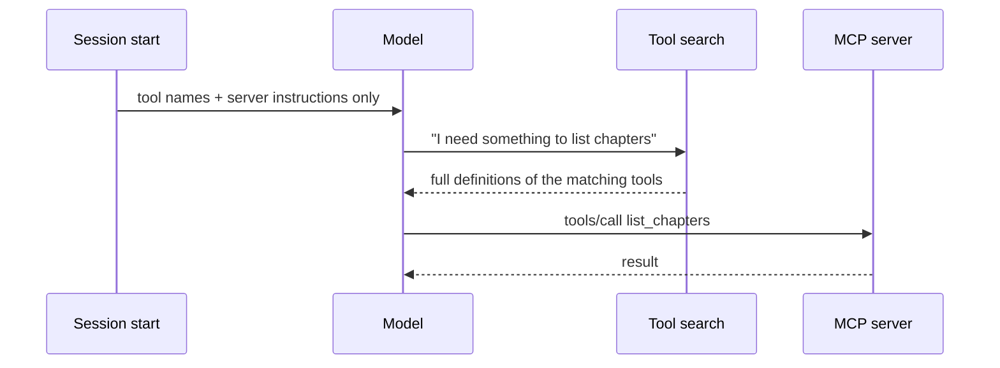

# MCP and plugins in Claude Code

## Why this matters

[3.6](/part-03-agents/3.6-mcp-using) taught you what an MCP server is and [3.7](/part-03-agents/3.7-mcp-building) had you build one. [6.3](/part-06-claude-code/6.3-skills) did the same for skills. This chapter is about the layer above: how Claude Code *loads* those things, how to share them, and what they cost.

Every extension you enable is part of every session, including the ones where you never use it. The docs say so about plugins ("An enabled plugin is part of every session, not only the sessions where you use it", [Plugins overview](https://code.claude.com/docs/en/plugins/overview)), and the same holds for MCP servers and skill listings. A setup with fifteen servers and ten plugins can spend a large part of the window before you type a word, and a stranger's plugin can run code as you. So two skills matter more than any single command: **knowing what loads when**, and **knowing whom you are trusting**.

Part of this chapter is about machinery that changes quickly (flags, marketplace names, the plugin manifest). Learn the model and look up the flags. The concrete details below were read from the docs on 2026-11-12 and re-checked on 2026-11-13.

**Learning goals**

- Add and scope MCP servers
- Install and build a plugin
- Measure the context cost of extensions

## Explanation

### Adding MCP servers, and where the config lives

You met the commands in [3.6](/part-03-agents/3.6-mcp-using#using-servers-from-claude-code). Here is the model behind them, from the [MCP in Claude Code](https://code.claude.com/docs/en/mcp) docs.

```sh
# remote server over HTTP (the transport the docs recommend)
claude mcp add --transport http shared-server --scope project https://example.com/mcp
# local stdio server; everything after -- is the server's own command line
claude mcp add --env API_KEY=... my-server -- node /abs/path/server.js
claude mcp list          # also: get <name>, remove <name>, add-json <name> '<json>'
```

Inside a session, `/mcp` shows server status and is where you log in to OAuth servers. The docs mark the SSE transport as deprecated in favour of HTTP, and list stdio as the local option. WebSocket servers can be configured in `.mcp.json` or with `add-json`, but not with `claude mcp add --transport` ([MCP in Claude Code](https://code.claude.com/docs/en/mcp), "Installing MCP servers").

**Scopes** decide who sees a server and where its definition is stored ([MCP in Claude Code](https://code.claude.com/docs/en/mcp), "MCP installation scopes"):

| Scope | Loads in | Shared with team | Stored in |
|---|---|---|---|
| Local (default) | the current project only | no | `~/.claude.json`, under the project's path |
| Project | the current project only | yes, via version control | `.mcp.json` in the project root |
| User | all your projects | no | `~/.claude.json` |

`--scope local|project|user` (short `-s`) picks one. When the same name exists in several places, the docs give the order: local, then project, then user, then plugin-provided servers, then claude.ai connectors, and "fields are not merged across scopes": the winner's definition is used whole.

A project `.mcp.json` looks like this, and supports environment variable expansion in `command`, `args`, `env`, `url` and `headers`:

```json
{
  "mcpServers": {
    "study": {
      "command": "npx",
      "args": ["tsx", "${STUDY_ROOT:-.}/project/mcp-study/server.ts"],
      "env": { "NOTES_DIR": "${NOTES_DIR}" }
    }
  }
}
```

`${VAR}` expands to the variable's value and `${VAR:-default}` falls back to `default` when it is unset. An unset variable with no default does not fail: the server still loads, with a warning and the literal `${VAR}` text ([MCP in Claude Code](https://code.claude.com/docs/en/mcp), "Environment variable expansion in `.mcp.json`"). Use this to keep secrets out of a committed file, and expect that a typo in a variable name shows up as a server that starts but cannot authenticate.

Which scope when? A rule of thumb that follows from the table:

- **Project** for servers the repo's work depends on and that a teammate should get with `git clone`. It is also the scope that carries risk, see below.
- **Local** for experiments, and for a server with credentials that only you have. It is the default, which is the right default.
- **User** for servers you want everywhere (a docs-search server, say). Each one is context you pay for in every project.

::: warning Project-scoped servers run code from a repository
Claude Code asks for approval in interactive sessions before using servers from a project `.mcp.json`, and `claude mcp reset-project-choices` resets those answers. But in `claude -p` runs, Agent SDK sessions and cloud sessions (outside a project's threads), Claude Code "can't show that prompt: it loads project-scoped servers without asking" (docs, same section). A repository you cloned can therefore start a process on your machine in non-interactive use. Read a `.mcp.json` before you run an agent in a checkout you did not write; `disabledMcpjsonServers` and `--strict-mcp-config` exist to keep servers out.
:::

### Tool search: why many servers no longer cost many tokens

In [3.4](/part-03-agents/3.4-context-engineering) and [3.6](/part-03-agents/3.6-mcp-using) the problem was that every tool definition is context. The old behaviour, loading every definition of every server at session start, made a large server a real tax. Claude Code's answer is **tool search**: "Tool search keeps MCP context usage low by deferring tool definitions until Claude needs them. Only tool names and server instructions load at session start." It is on by default, and "Claude Code doesn't impose a fixed per-server tool cap" ([MCP in Claude Code](https://code.claude.com/docs/en/mcp), "Scale with MCP Tool Search").



What this changes, and what it doesn't:

- **The standing cost shifts from definitions to names and instructions.** This is why 6.1's context table lists "MCP tool names" and not "MCP tool definitions" as a start-of-session cost ([6.1](/part-06-claude-code/6.1-how-claude-code-works#the-context-window)). Your server's *instructions* field and tool *names* are the part that is always paid; a good name and a one-sentence instruction now matter more than ever, because they are what the model searches over.
- **Discovery is now part of reliability.** If the model does not think of looking for a tool, it will not find it. A server whose tool names say what they do (the 3.3 advice) is found; one named `run` is not.
- **You can opt out per setting.** `ENABLE_TOOL_SEARCH` accepts `true`, `auto` (load definitions upfront while they total under 10% of the context window), `auto:N` (a percentage from 0 to 100) and `false` (everything upfront). A single server can opt out with `"alwaysLoad": true`; the docs add that each upfront tool "consumes context", and that this makes startup wait for the tools, up to the standard 5-second connect timeout (all from the same section).
- **Models matter.** The docs say Claude Code uses tool search on Claude Opus 4, Sonnet 4, Haiku 4.5 and later models (Opus 4.5, Sonnet 4.5, Haiku 4.5 and later on Google Cloud's Agent Platform); earlier models load all tools upfront, and setting `ENABLE_TOOL_SEARCH=true` does not override that ([MCP in Claude Code](https://code.claude.com/docs/en/mcp), same section).
- **Results are still not free.** The docs warn when any MCP tool output exceeds 10,000 tokens, and the default limit is 25,000 tokens, adjustable with `MAX_MCP_OUTPUT_TOKENS` ([MCP in Claude Code](https://code.claude.com/docs/en/mcp), "Output limits"). Tool search shrinks the menu, not the plate: a server that returns 20,000 tokens per call still fills the window.

The docs give no per-tool token figure, so do not trust a number you read elsewhere. Measure it, which the next section shows.

::: info 📖 Read now
[Claude Code: Connect to tools via MCP](https://code.claude.com/docs/en/mcp) · docs · ~20 min · **essential**

You skimmed this in 3.6; now read the parts for operating servers. Look for: the scope precedence list, the `${VAR:-default}` rules, "Scale with MCP Tool Search" (the `ENABLE_TOOL_SEARCH` values and `alwaysLoad`), the output-limit section, the lines on plugin-provided servers and their `mcp__plugin_<plugin>_<server>__<tool>` names, and the managed-configuration pointer. Write down which setting you would change first if your `/context` showed MCP tools eating the window.
:::

### What an extension costs: measure it

[6.1](/part-06-claude-code/6.1-how-claude-code-works#seeing-your-own-context) gave you `/context` as a profiler. Use it as one for extensions: run it in a fresh session with the extension off, then on, and compare. For plugins there is a second instrument: the docs say that in a plugin's details "the `Always-on` line is the number of tokens the plugin adds to every session where it's enabled", shown by `claude plugin details <name>` after install, and that plugins from Anthropic's official marketplace show estimates called **Every turn** and **When invoked** in the `/plugin` panel before you install them ([Install and manage plugins](https://code.claude.com/docs/en/plugins/install), "See what an installed plugin adds to your sessions" and "Install a plugin").

The costs have a shape worth memorising ([Plugins overview](https://code.claude.com/docs/en/plugins/overview), "What an enabled plugin adds to your sessions"):

| Component | Standing cost (every turn) | Cost when used |
|---|---|---|
| Skill, agent or command Claude can invoke on its own | its name and description | the full text, loaded on use |
| Skill with model invocation off (`disable-model-invocation`, see [6.3](/part-06-claude-code/6.3-skills)) | none: "Description not in context" | full text when you run it |
| MCP server | tool names and server instructions (with tool search) | definitions of the tools searched for, plus every result |
| Hook | none: "harness-only — no model context cost" | whatever the hook returns into context, plus its runtime |

The first row is quoted from the docs ("the name and description are in Claude's context on every turn… The full text of a skill or agent loads only when it's used"); the second from the skills page's invocation table ([Skills](https://code.claude.com/docs/en/skills), "Control who invokes a skill"); the third from the MCP section above; the fourth from the sample `claude plugin details` output, which labels a hook "harness-only — no model context cost" ([Measure plugin cost and usage](https://code.claude.com/docs/en/plugins/measure)). See [6.4](/part-06-claude-code/6.4-hooks-permissions) for what hooks return.

The practical routine:

1. Start a session in a scratch directory and run `/context`. Note the totals for MCP tools, skills and memory files.
2. Add one extension. Start a *new* session (some changes need `/reload-plugins` or a restart), run `/context` again, and subtract.
3. Decide per extension: keep always on, turn it on only for projects that need it (project or local scope), or remove it. The Installed tab of `/plugin` has a "Not used recently" group that lists candidates ([Install and manage plugins](https://code.claude.com/docs/en/plugins/install)).

### Plugins: a package for the things you already know

A **plugin** is "a directory of skills, agents, hooks, MCP servers, or other components that Claude Code installs and loads as one unit" ([Plugins overview](https://code.claude.com/docs/en/plugins/overview)). Everything in Part 6 so far (a skill from 6.3, hooks from 6.4, subagents) and your MCP server from 3.7 can live in one directory and be installed with one command. What plugins add over a bare `.claude/` folder:

- **Sharing and versioning.** A teammate installs it by name instead of copying files.
- **Namespacing.** Skills are invoked as `/<plugin>:<skill>`, and the docs say Claude Code namespaces every component under the plugin name, so two plugins cannot collide ([Plugin manifest reference](https://code.claude.com/docs/en/plugins/manifest-reference), `name`).
- **One switch.** Enable or disable the whole bundle, at user, project or local scope.

The standard layout, from the reference ([Plugin manifest reference](https://code.claude.com/docs/en/plugins/manifest-reference), "Standard layout"):

```text
study-plugin/
├── .claude-plugin/
│   └── plugin.json        # manifest; only "name" is required
├── skills/
│   └── write-chapter/
│       └── SKILL.md       # one <name>/SKILL.md per skill
├── .mcp.json              # MCP servers the plugin starts
├── hooks/hooks.json       # optional
├── agents/                # optional subagents
└── server/                # your server code
```

Two rules trip everyone. First: "Put every other plugin file at the plugin root, not inside `.claude-plugin/`": only the manifest goes in that folder. Second: the manifest itself is optional, and `name` is the only required key (kebab-case, no spaces; `claude plugin validate` reports an error for names that pass as Anthropic's own, such as ones starting with `claude-` or `anthropic-`). A minimal one:

```json
{
  "name": "study-tools",
  "version": "0.1.0",
  "description": "My study MCP server and the write-chapter skill"
}
```

Setting `version` pins users to it until you change it, per the manifest table; leave it out while developing so a changed file is a changed plugin. Component paths in a manifest must start with `./` and stay inside the plugin root.

Two details matter for your MCP server in particular:

- **A plugin's MCP servers start automatically** when the plugin is enabled, and you add or remove them by installing or uninstalling the plugin, not with `/mcp` ([MCP in Claude Code](https://code.claude.com/docs/en/mcp), "Plugin-provided MCP servers"). Their tools show up as `mcp__plugin_<plugin-name>_<server-name>__<tool-name>`.
- **Paths use placeholders, not your checkout.** `${CLAUDE_PLUGIN_ROOT}` is "the absolute path of the plugin's installed version" and **changes when the plugin updates, so don't write state there**. `${CLAUDE_PLUGIN_DATA}` (`~/.claude/plugins/data/<id>/`) survives updates and is meant for "installed dependencies such as `node_modules`, generated code, and caches". Both resolve in an MCP stdio server's `command`, `args` and `env`, and in skill bodies, but not in the Bash tool's environment ([Plugin manifest reference](https://code.claude.com/docs/en/plugins/manifest-reference), "Environment variables").

So a server that, in 3.7, found the repo by walking up from `server.ts` has a design question to answer: once installed, it is a *copy* in a plugin directory, not your checkout. Where does it read `notes/` and `PROGRESS.md` from now? That is the central design decision of the practice, and the environment placeholders (and `${CLAUDE_PROJECT_DIR}`, the project root) are how you answer it.

### Trying a plugin locally

Three tools, from the docs ([Create a Claude Code plugin](https://code.claude.com/docs/en/plugins/create), [Plugin manifest reference](https://code.claude.com/docs/en/plugins/manifest-reference)):

- `claude --plugin-dir <path>` loads a plugin for one session instead of installing it ([Install and manage plugins](https://code.claude.com/docs/en/plugins/install)). Quick for iteration.
- `claude plugin validate ./study-plugin` checks the manifest and component files; `--strict` turns warnings into failures. Results are "Validation passed", "passed with warnings" or "failed". Run it before you debug anything else.
- `/reload-plugins` applies changes in a running session. After an install the panel tells you "Run /reload-plugins to apply."

### Marketplaces

A **marketplace** is "a repository or directory with a `.claude-plugin/marketplace.json` file that lists plugins and where to fetch each one. It's a catalog, not a hosted store" ([Plugins overview](https://code.claude.com/docs/en/plugins/overview)). The file needs a `name`, an `owner` and a `plugins` array; each entry needs a `name` and a `source`. A source can be a relative path inside the marketplace, a GitHub repo, a subdirectory of a git repo, a git URL, an archive, an npm package, or a command (same page, "Choose a plugin source"). The entry name is the install ID (`<plugin>@<marketplace>`).

```json
{
  "name": "my-study",
  "owner": { "name": "Your Name" },
  "plugins": [
    { "name": "study-tools", "source": "./plugins/study-tools", "description": "Study MCP server and skill" }
  ]
}
```

You add a marketplace with `/plugin marketplace add` (or `claude plugin marketplace add`) and a source: `owner/repo` for GitHub (with an optional `#ref`), a full git URL, a local path starting with `./` or `../`, or an `https://` URL to the JSON file. Then `claude plugin install study-tools@my-study`. In a session, `/plugin install ...` does not install straight away: it opens the panel on the plugin's details so you can review it and choose a scope first ([Install and manage plugins](https://code.claude.com/docs/en/plugins/install)).

Install scopes mirror the MCP ones: user (`~/.claude/settings.json`), project (`.claude/settings.json`, committed) and local (`.claude/settings.local.json`), with local overriding project overriding user. For a project install, collaborators still run the install command themselves per clone (same page, "Choose an install scope").

Anthropic runs an official marketplace, `claude-plugins-official`, which Claude Code adds the first time you start an interactive terminal session unless a managed policy blocks it. A community marketplace exists but is not added automatically. Plugin-marketplace names such as these are reserved: they are accepted only for marketplaces sourced from `github.com/anthropics/` repositories ([Plugins overview](https://code.claude.com/docs/en/plugins/overview)). This is the "Claude Code plugin marketplace", a different thing from the Claude Marketplace website, which the docs say "isn't a marketplace you add with `/plugin marketplace add`".

Updates matter for trust, covered next: plugins update automatically when their marketplace has auto-update on. That is the default for `claude-plugins-official` and most other official marketplace names, and off by default for community, third-party and local development ones, and you can toggle it in the `/plugin` Marketplaces tab. There is "no command that updates every plugin at once" (same page, "Updates").

### Plugin security and trust

The docs are direct: "**Permissions**: what the plugin runs, it runs as you" and "Whatever the tier, a plugin you install can run code with your user privileges" ([Plugins overview](https://code.claude.com/docs/en/plugins/overview)); "A plugin can run hooks and MCP servers, so read the pane before you install" ([Install and manage plugins](https://code.claude.com/docs/en/plugins/install)). Connect that to what you already know:

| What a plugin can bundle | What it can do to you |
|---|---|
| Hooks | Run shell commands at every event (6.4): on every prompt, before every tool call. |
| MCP servers | Start a process alongside every session; its tool results go straight into the model's context, which is the prompt-injection channel from [3.6](/part-03-agents/3.6-mcp-using#security-you-are-running-other-peoples-code). |
| Skills and agents | Put instructions in front of the model. A hostile skill needs no code: it can tell Claude to do things. |
| `bin/` executables | Add commands to the Bash tool's `PATH` while the plugin is enabled. |

So the trust model is that of installing an npm package with a post-install script, plus a text channel into your agent. A checklist, drawing on the docs and on 3.6:

1. **Know the tier.** Official marketplace, then everything else. A marketplace a coworker or your organisation publishes is, in the docs' terms, third-party.
2. **Read before you enable**: the manifest, `hooks/hooks.json`, `.mcp.json` (what command does it start?), and any `bin/`. It is a small directory.
3. **Pin if you can.** An unpinned plugin from an auto-updating marketplace can change under you. Auto-update is off for third-party marketplaces by default; a deliberate `claude plugin update <name>@<marketplace>` is a review point.
4. **Scope narrowly.** Install at project or local scope for work that needs it; every user-scope plugin is in every project.
5. **Check the credentials it touches.** A stdio server inherits what you give it. Do not export tokens into a shell that launches Claude Code just in case.
6. **For organisations:** the docs say managed settings let an organisation "allowlist or block marketplaces, force-install plugins, and turn off session-only loading", with the details on the organisation page, which I did not read for this chapter ([Plugins overview](https://code.claude.com/docs/en/plugins/overview), "Tell Anthropic's marketplaces from third-party ones"; see the linked "Manage plugins for your organization").

::: info 📖 Read now
[Create a Claude Code plugin](https://code.claude.com/docs/en/plugins/create) · docs · ~25 min · **essential**

Work through it with your own plugin in mind. Look for: the plugin layout, the manifest and what `name` does to skill names, how to test with `--plugin-dir` and `claude plugin validate`. Then skim the short [Plugins overview](https://code.claude.com/docs/en/plugins/overview), which holds the "What an enabled plugin adds to your sessions" section and the security wording quoted above. Skip the sections on components you will not ship.
:::

::: info 📖 Read now
[Install and manage plugins](https://code.claude.com/docs/en/plugins/install) · docs · ~20 min · **essential**

Look for: the three install scopes, the "See what an installed plugin adds to your sessions" section (the `Always-on` figure) and the **Context cost** estimates, how `/plugin install` differs in a session from the shell command, and the auto-update defaults per kind of marketplace.
:::

::: info 📖 Read now
[Plugin manifest reference](https://code.claude.com/docs/en/plugins/manifest-reference) · docs · ~25 min · optional

Look for: the manifest field table, the path rules (relative to the plugin root, starting with `./`), the environment variables table, and the validation messages. Use it as a lookup page when `claude plugin validate` complains.
:::

::: info 📖 Read now
[Create a marketplace](https://code.claude.com/docs/en/plugins/create-marketplace) · docs · ~20 min · optional

Look for: the `marketplace.json` required fields, relative-path sources, and the local test loop (validate the plugin, validate the marketplace, add it by path, install it, list it). That loop is the one you will run in the practice.
:::

## Practice

**Brief:** Package your 3.7 MCP server and your 6.3 skill as a local Claude Code plugin, install it from a local marketplace, and measure what it costs in context.

**Where:** `experiments/30-plugin/`: a standalone experiment, not a `project/` step. The folder holds a local marketplace (`marketplace/.claude-plugin/marketplace.json`) with your plugin under `marketplace/plugins/study-tools/`, and `README.md` for the results. You write the plugin; the brief gives the shape, not the contents. There is no Python.

**Steps:**

1. **Baseline.** In a fresh session in a scratch directory (not this repo), run `/context` and write the totals into the README: MCP tools, skills, memory files, everything. If the 3.7 server and your 6.3 `write-chapter` skill are installed from earlier practice, remove or disable them for this run (note how) so the baseline is clean.
2. **Decide the shape before you copy.** In the README, answer in writing: which files of the 3.7 server the plugin needs; where the server will find `notes/` and `PROGRESS.md` once it runs from a plugin copy rather than your checkout (hint: placeholders, environment variables and `${CLAUDE_PROJECT_DIR}`; decide how it fails if the variable is missing); where its `node_modules` will live (`${CLAUDE_PLUGIN_DATA}` or bundled); and whether the skill should stay model-invoked now that it will be namespaced.
3. **Write the plugin.** `.claude-plugin/plugin.json` (no `version` yet), `skills/write-chapter/SKILL.md` (copy, then adjust paths), `.mcp.json` using `${CLAUDE_PLUGIN_ROOT}` for the server command. Run `claude plugin validate` on it and fix every warning, or explain it.
4. **Load it for one session** with `--plugin-dir`. Confirm the skill appears as `/study-tools:write-chapter`, the server is listed in `/mcp`, and its tool names carry the `mcp__plugin_...` prefix. Ask a question that needs one tool and note what Claude called.
5. **Install it for real.** Write `marketplace.json`, then `claude plugin validate` on the marketplace, `claude plugin marketplace add ./experiments/30-plugin/marketplace`, `claude plugin install study-tools@<marketplace-name>`, `claude plugin list`. Choose a scope and justify it in the README.
6. **Measure.** In a fresh scratch-directory session run `/context` again and subtract your baseline: the delta for tools, skills and anything else. Also run `claude plugin details study-tools` and compare its `Always-on` number with your `/context` delta. Then run with `ENABLE_TOOL_SEARCH=false` and record how much the server's definitions cost when loaded upfront (this is the number tool search saves you).
7. **Exercise the failure paths.** (a) Edit the server or skill, run `/reload-plugins`, and see whether the change appears without bumping `version`; (b) disable the plugin and confirm both the skill and the tools disappear; (c) start Claude Code in a *different* project and see whether the server still works, and what it does with the project path.
8. **Read it as a stranger would.** Open your own `plugin.json`, `.mcp.json` and the server's launch line and write down what each can do to someone who installs the plugin: what process starts, with which environment, with access to which folders. Fix at least one thing you would not accept from a plugin you did not write (for example a tool that can write outside its folder).
9. **Write down** what the plugin gives you over the two separate installs, and what it costs. Commit.

**Done when:**

- `claude plugin validate` passes for the plugin and for the marketplace (warnings explained in the README).
- The plugin is installed from your local marketplace; `/study-tools:write-chapter` runs and the server's tools answer a real question in a session started in another project.
- `experiments/30-plugin/README.md` contains the baseline and after `/context` totals, the delta, the `claude plugin details` `Always-on` figure beside it, and the delta with `ENABLE_TOOL_SEARCH=false`.
- The README records how the server finds its data when running from a plugin copy, what happens when the variable is missing, and the stranger-review result with at least one change.
- Disabling the plugin removes the skill and the tools, which you saw in `/context`.

## Check questions

1. You added a server with `claude mcp add` and a teammate says it is not in their Claude Code after pulling. What was the likely scope, and what do you change?

   <details><summary>Answer</summary>

   The default scope is local: stored in `~/.claude.json` under your project path, visible to you only. For a server the repo needs, add it with `--scope project` so it is written to a committed `.mcp.json`, with secrets as `${VAR}` references instead of values. Your teammate will then be asked to approve it the first time in an interactive session. A server only you need can stay local.

   </details>

2. With tool search on, a 40-tool server adds little at session start. Name what it still costs, and one situation where you would set `alwaysLoad` or `ENABLE_TOOL_SEARCH=false`.

   <details><summary>Answer</summary>

   Still paid every session: tool names and the server's instructions. Paid when used: the full definitions of the tools the model searches for, and every tool result (warned at 10,000 tokens, limited to 25,000 by default). You would load a server's tools upfront when the model must reliably use them without discovering them first, for example a small server it needs in almost every task, accepting that each upfront tool consumes context and that startup waits for its tools. Measure the difference with `/context`.

   </details>

3. A plugin's MCP server reads `../../notes/` relative to its own file. It works from your checkout and fails once installed. Why, and what are two ways to fix it?

   <details><summary>Answer</summary>

   An installed plugin runs from a copy; the docs describe `${CLAUDE_PLUGIN_ROOT}` as the installed version's path and say it changes on update. Paths relative to the server file no longer reach your repo. Fixes: take the data directory from the project root (`${CLAUDE_PROJECT_DIR}`) or an environment variable set in `.mcp.json` `env`, and fail with a clear error when it is missing. State and installed dependencies that must survive updates belong in `${CLAUDE_PLUGIN_DATA}`, not in the root.

   </details>

4. A colleague sends you a link to a marketplace and says "just install it, it's useful". What do you check before enabling, and why does installing differ from reading a README?

   <details><summary>Answer</summary>

   A plugin "can run code with your user privileges": hooks run shell commands at events, MCP servers start as processes alongside every session, skills and agents instruct the model, and `bin/` entries land on the Bash `PATH`. Read the manifest, `hooks/hooks.json`, `.mcp.json` and any `bin/` before enabling; check which tier the marketplace is (third-party marketplaces have auto-update off by default, so updates are a deliberate review point); and install at the narrowest scope. Unlike a README, the contents execute without you running anything.

   </details>

5. You enabled five plugins and `/context` shows more skill and MCP overhead than you expected, though you used none of them today. Where does that cost come from and what do you do?

   <details><summary>Answer</summary>

   Enabled plugins are in every session: the name and description of each skill, agent or command Claude can invoke on its own, plus MCP tool names and server instructions, on every turn. Use `claude plugin details <name>` (the `Always-on` line) and `/context` to find the expensive ones, then disable plugins you do not use, move their scope to project or local, or turn off model invocation for skills only you should trigger.

   </details>

## My understanding

<!-- Written by the learner, in their own words. Agents never fill this in. -->
