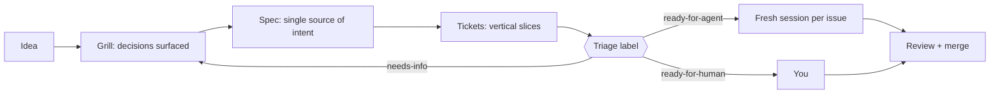
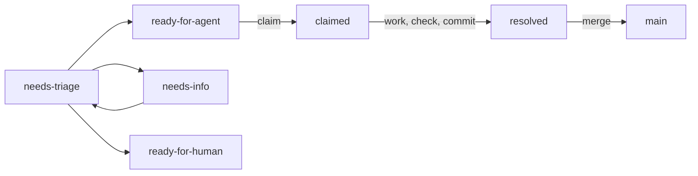

# Issue workflows: plan, grill, spec

## Why this matters

A coding agent's output is limited less by how well it codes than by how well it knows what you want. The usual failure is not a syntax error: it is a correct implementation of the wrong thing, delivered after twenty minutes of unattended work. Matt Pocock opens his skills repo with that diagnosis: the most common failure mode is misalignment, and the fix is a "grilling session" in which the agent asks you detailed questions before it builds anything ([skills README](https://github.com/mattpocock/skills), "Why These Skills Exist").

This chapter is the workflow around that idea: think (plan mode, grilling), write the intent down once (a spec), cut it into self-contained issues, and let agents take issues one at a time in fresh sessions. It is how this study was built. The spec, the roughly hundred issue files and the worktrees you are reading about are the case study, and the last section of the explanation walks through them.

The chapter builds on [6.2](/part-06-claude-code/6.2-claude-md-and-memory): everything an issue-running session knows about your repo comes from CLAUDE.md, memory and the files the issue points at, because the session itself starts empty.

**Learning goals**

- Explain why fresh-session, self-contained tasks work
- Use plan mode, grilling and specs at the right moments
- Run a kanban-style flow of issues with agents

## Explanation

### The shape of the workflow

Each arrow replaces a conversation with a file. That is the point: a conversation is expensive to carry (it fills the window, see [6.1](/part-06-claude-code/6.1-how-claude-code-works)) and dies with the session, while a file is read again at no loss. The rest of the chapter takes the boxes in turn: when plan mode earns its keep, what grilling does that plain prompting does not, what a spec must and must not contain, what makes an issue runnable by an agent that has never met you, and how to keep several of them moving.

### Plan mode

Plan mode tells Claude to research and propose changes without making them: it reads files, runs exploratory commands and writes a plan, but does not edit your source, and edits stay blocked until you approve the plan ([Permission modes](https://code.claude.com/docs/en/permission-modes), "Analyze before you edit with plan mode"). You enter it with `Shift+Tab`, by prefixing one prompt with `/plan`, or by starting with `claude --permission-mode plan`. When the plan is ready you choose between approving it (with a choice of how edits are then handled), or "No, keep planning" and telling Claude what to change (same section, "Review and approve a plan").

What plan mode gives you is a **review point before anything touches disk**. What it does not give you is an interview. The plan is Claude's best guess at what you meant, built from the code it read; if your request was ambiguous, the plan resolves the ambiguity silently, in whichever direction looked most likely. You will only notice if you read the plan for decisions rather than for steps.

Use plan mode when:

- the change spans several files and you want to see the approach before it exists;
- you are in unfamiliar code and the plan doubles as a tour of it;
- you can state the goal precisely but not the route.

Skip it when the diff is one you could describe in a sentence: the plan would only restate your prompt. (That cut-off is my rule of thumb, not the docs'.)

::: info 📖 Read now
[Claude Code docs: Permission modes](https://code.claude.com/docs/en/permission-modes) · docs · ~5 min (only "Analyze before you edit with plan mode") · **essential**

Look for: what happens to shell commands during planning (it depends on your session, and the first matching case applies), the three options when a plan is presented, and how to leave plan mode without approving. Then try it once on a real task of yours and read the plan asking "which choice here did I not make?".
:::

### Grilling: surfacing decisions before they are made for you

Plan mode answers "what will you do?". Grilling answers "what have we not decided?". Pocock's `grilling` skill defines the method: interview the user until you reach a shared understanding, modelled as a **design tree** where every decision branches into the decisions that hang off it. The agent asks, in rounds, every question whose prerequisites are already settled (the **frontier**), numbers them, gives its own recommended answer to each, and phrases them so that "yes" accepts the recommendation. Facts that can be looked up in the repo are the agent's job to find; only decisions go to you. The session ends when the frontier is empty and you confirm ([grilling SKILL.md](https://github.com/mattpocock/skills/blob/main/skills/productivity/grilling/SKILL.md)).

Three properties are worth copying even if you never install the skill:

1. **A recommended answer per question.** You are reviewing proposals, not generating them from nothing. Most answers are one word, and the interesting questions stand out because you want to argue.
2. **Decisions, not facts, go to the human.** Asking "which test runner do you use?" wastes your attention; the agent can read `package.json`.
3. **A stopping rule.** "Every branch visited, nothing silently assumed" is a checkable condition, which a vague "ask me some questions" is not.

The built-in route is lighter. The best-practices page suggests asking Claude to "interview me until you could write the spec, then write it to SPEC.md", and then starting a fresh session to build from that file ([Best practices](https://code.claude.com/docs/en/best-practices), "Brainstorm with Claude first"). The skill version is stricter about rounds and recommendations; the built-in prompt is enough for a small feature. A variant, `grill-with-docs`, also sharpens vocabulary and writes it into `GLOSSARY.md` and ADRs as decisions land (it is described in the repo's README and covered in [6.3](/part-06-claude-code/6.3-skills)).

When to grill instead of plan: when the request contains a word like "should", "somehow" or "probably" in your own head, when several designs would all satisfy the sentence you typed, or when the cost of building the wrong one is a day rather than a minute. Grilling costs you ten minutes of answering and saves the rebuild.

::: info 📖 Read now
[Matt Pocock: grilling SKILL.md](https://github.com/mattpocock/skills/blob/main/skills/productivity/grilling/SKILL.md) · repo · ~5 min · **essential**

It is short. Look for: the definition of the frontier, the rule about who finds facts, and the exact formatting of a question. Then compare it with the one-sentence interview prompt above and decide which you would use for a half-day feature.
:::

### Specs: one source of intent

A grilling session ends with a conversation full of decisions. Left there, they vanish when the window is cleared. A **spec** is where they are written down: one document that states the problem, the solution from the user's point of view, the decisions that were made, what is out of scope, and how the result will be tested.

Pocock's `to-spec` skill turns the conversation into a spec without a second interview, and its template shows what a spec carries: Problem Statement, Solution, a long list of user stories, Implementation Decisions, Testing Decisions, Out of Scope and Further Notes. Two rules in it are worth lifting. First, the implementation decisions must not include file paths or code snippets, "they may end up being outdated very quickly" (with a narrow exception for a prototype snippet that encodes a decision more precisely than prose). Second, it asks you to agree the **seams** you will test at (the points where behaviour can be checked from outside), preferring existing seams ([to-spec SKILL.md](https://github.com/mattpocock/skills/blob/main/skills/engineering/to-spec/SKILL.md)).

Why "single source"? Because every later artifact derives from it. If issues restate intent, two issues will disagree after the first edit. If the spec is the only place intent lives and each issue points to it, a change is made once. This study's spec says so directly: it is "the single source of context for every task", and "when something here conflicts with a task file, this spec wins unless the task says otherwise" ([spec.md](https://github.com/hsavovski/ai-engineering/blob/main/.scratch/ai-engineering-book/spec.md), opening paragraph).

A spec is not a contract with a signature and not a design document for its own sake. Write it to answer a question the agent will otherwise guess: *what would a stranger get wrong if they read only the issue?*

### Self-contained issues and triage labels

Why do fresh sessions work? Because a model's only input is its context. A session that starts empty knows exactly what you gave it: CLAUDE.md, the issue, and whatever it reads. There is no half-remembered earlier discussion to contradict the spec, and no accumulated wrong turns for it to keep re-reading. The best-practices page puts the same thing as a rule of thumb: after correcting the same thing twice, `/clear` and write one better prompt that folds in what you learned, because a third correction just adds to a conversation that already holds two failed attempts ([Best practices](https://code.claude.com/docs/en/best-practices), "Steer the session", the `/clear` bullet). The long-running-agent work in [5.6](/part-05-harnesses/5.6-long-running-agents) reaches the same conclusion from the harness side: durable state belongs in files that every new session re-reads.

The corollary is the discipline that makes the approach work: **an issue must be self-contained**, meaning an agent that has seen nothing else can finish it. Pocock's triage skill has a reference for writing such an "agent brief". Its principles are a good checklist ([AGENT-BRIEF.md](https://github.com/mattpocock/skills/blob/main/skills/engineering/triage/AGENT-BRIEF.md)):

| Principle | What it asks | Failure it prevents |
|---|---|---|
| Durability over precision | Describe interfaces and behaviour, not file paths or line numbers; the issue may sit for weeks | A brief that points at renamed files |
| Behavioural, not procedural | Say what the system should do, not how to implement it | The agent copying your guess about the implementation |
| Complete acceptance criteria | Concrete, independently verifiable "done" conditions | "Triage should work correctly" |
| Explicit scope boundaries | State what is out of scope | Gold-plating and adjacent changes |

The template for a brief has these headings: category and summary, current behaviour, desired behaviour, key interfaces, acceptance criteria, out of scope. In this repo each issue adds a "Read first" list (the spec sections and sibling chapters to open) and a `Blocked by:` line.

**Size matters as much as content.** The `to-tickets` skill cuts a plan into **tracer-bullet** slices: each cuts a narrow but complete path through every layer, can be verified on its own, and is "sized to fit in a single fresh context window". Each ticket declares the tickets that block it ([to-tickets SKILL.md](https://github.com/mattpocock/skills/blob/main/skills/engineering/to-tickets/SKILL.md)). Horizontal slices ("do all the schema first") fail the verify-on-its-own test: nothing works until the last one lands.

**Triage labels** are the state machine on top. The skill defines five state roles: `needs-triage` (a maintainer must evaluate), `needs-info` (waiting on the reporter), `ready-for-agent` (fully specified, for an AFK agent), `ready-for-human` (needs a human) and `wontfix`; an issue normally goes from `needs-triage` to one of the others, and `needs-info` returns to `needs-triage` when the reporter replies ([triage SKILL.md](https://github.com/mattpocock/skills/blob/main/skills/engineering/triage/SKILL.md), "Roles"). This repo's [`docs/agents/triage-labels.md`](https://github.com/hsavovski/ai-engineering/blob/main/docs/agents/triage-labels.md) maps them one-to-one onto the same strings. The label that matters most is the boundary between the last two: **`ready-for-agent` is a promise that the issue passes the self-contained test**; `ready-for-human` marks work that needs judgment, external access or manual testing.

### Kanban with agents

Kanban here means one thing: **work flows through visible columns, and a card moves only when its entry condition is true.** The columns are the triage labels plus the tracker's own claimed and resolved states. In this repo's tracker, a ticket is "unblocked when every file it lists is `resolved`", the frontier is the set of tickets that are open, unblocked and unclaimed, and an agent claims one by setting `Status: claimed` before any work ([docs/agents/issue-tracker.md](https://github.com/hsavovski/ai-engineering/blob/main/docs/agents/issue-tracker.md), "Wayfinding operations").

Four rules turn that into something several agents can run at once.

1. **Claim before you start.** The claim is the lock. Two agents never take the same card because the second one sees `claimed`.
2. **Isolate each card.** Each issue runs in its own git worktree and branch, so parallel agents never share a checkout. Claude Code can create one with `claude -w <name>`, and the best-practices page describes worktrees as the way to keep separate pieces of work from colliding ([Best practices](https://code.claude.com/docs/en/best-practices), "Run sessions in parallel", and [Worktrees](https://code.claude.com/docs/en/worktrees)). The mechanics belong to [6.5](/part-06-claude-code/6.5-parallel-work).
3. **Limit work in progress.** Kanban's old rule applies unchanged: finishing beats starting. With agents the limit is not people, it is your attention for review, plus your usage allowance (see [6.8](/part-06-claude-code/6.8-pro-limits)). Four in flight that you cannot review are worse than two you can.
4. **Make "done" mechanical.** A card moves to resolved only when its acceptance check passes. An agent's claim that it is done is not evidence; a failing `npm run check` is.

Pocock's `implement-spec` skill automates the same loop on a single integration branch: it works the tickets as a task graph, runs implementer subagents across the ready frontier, and closes with `/code-review` ([README](https://github.com/mattpocock/skills), "Engineering"). You do not need it to run the flow: a file per ticket, a `Status:` line and a worktree per ticket is enough.

Where do humans stay? At the boundaries. You decide in the grilling session, you review at merge, and you do the issues labelled `ready-for-human`. This is the same division [7.6](/part-07-ai-native-development/7.6-humans-in-the-loop) develops.

### This repo as a case study

This study is the example, built exactly this way. The sequence, with sources:

1. **Grill.** The spec says it was "agreed with the learner on 2026-11-08 in a grilling session" ([spec.md](https://github.com/hsavovski/ai-engineering/blob/main/.scratch/ai-engineering-book/spec.md), first paragraph). Audience, hardware, budget, languages and the outline were all decisions surfaced and recorded there.
2. **Spec.** That file is the single source. Sections like "Accuracy rules" and "Working agreements for agents executing tasks" are the standing instructions every task reads.
3. **Issues.** Each chapter is a file under `.scratch/ai-engineering-book/issues/`, with a `Status:` line, `Blocked by:` and a "Read first" list that points at the spec and at the sibling chapters whose terms it must reuse. Open the issue for this very chapter (`71-write-6.7-issue-workflows.md`) and check it against the table above: goal, "the explanation must cover", acceptance criteria. What it leaves out on purpose is the intent, which lives in the spec.
4. **Fresh session per issue.** Every issue runs in its own worktree (`.worktrees/issue-NN` on branch `issue-NN`), claims by setting `Status`, resolves it, adds a dated line to `BUILD-LOG.md` and commits. Because the spec insists "tasks run in fresh sessions without that conversation, so everything a task needs to know about intent lives here", the session that wrote this chapter never saw the grilling.
5. **Kanban automation.** `scripts/workflows/book-batch.workflow.js` runs a writer per issue in parallel worktrees and then one agent that merges the branches, and `scripts/book-auto.mjs` runs the same steps unattended, checking its weekly usage cap before each batch. These live in the repo, not in a published source, so read them rather than trust this paragraph.

Look for the weak points too, because they are the lesson. Issues that share an experiment folder cannot run in the same batch (the spec says so), because worktree isolation does not stop two branches from editing the same new directory. Shared files (`GLOSSARY.md`, `resources.md`, `BUILD-LOG.md`) are append-only for the same reason: parallel branches would otherwise conflict on them. Both rules exist because something went wrong or would have, and both are the kind of line you add to CLAUDE.md or a spec after the second time ([6.2](/part-06-claude-code/6.2-claude-md-and-memory)).

::: info 📖 Read now
[This study's spec.md](https://github.com/hsavovski/ai-engineering/blob/main/.scratch/ai-engineering-book/spec.md) · repo · ~15 min · **essential**

Read "Working agreements for agents executing tasks" first, then skim the rest. Look for: which decisions are stated as facts (the learner, hardware, languages), which rules exist to prevent a specific parallel-work failure, and what the spec delegates to the issue. Then open any one issue and list what it would have to restate if the spec did not exist.
:::

::: info 📖 Read now
[Matt Pocock: to-spec](https://github.com/mattpocock/skills/blob/main/skills/engineering/to-spec/SKILL.md) and [to-tickets](https://github.com/mattpocock/skills/blob/main/skills/engineering/to-tickets/SKILL.md) · repo · ~10 min · optional

Look for: the spec template headings, the "no file paths" rule, the vertical-slice rules, and the step where the user is quizzed on granularity and blocking edges before anything is published.
:::

### Choosing the tool for the moment

| Situation | Reach for | Output |
|---|---|---|
| One-sentence change | Just prompt | A diff |
| Clear goal, unfamiliar code, several files | Plan mode | A plan you approve |
| Goal clear in your head, decisions not | Grilling | Decisions, in rounds |
| Decisions made, work bigger than one session | Spec, then tickets | A spec and self-contained issues |
| Many tickets ready | Worktree per ticket, fresh session each | Branches to review and merge |

These are not stages every task passes through. Most of your work should be the first row. The rest of the table exists so that when a task turns out to be the fourth row, you notice before the context window fills with the wrong design.

## Practice

**Brief:** Plan a small side feature for `project/` using the full flow: grill → spec → issues → run one issue in a fresh session. Reflect on what the spec was missing.

**Where:** Notes only, no code (`notes/`). Put everything in `notes/issue-workflow.md`. The feature itself is not built by you in this chapter beyond the one issue you run, and you pick the feature: it should be small enough that its spec fits a page. Ideas: a `--max-steps` flag, a log file of tool calls, a `/clear`-like command for the agent's history. Pick one that the current `project/` code does not already do.

**Steps:**

1. **Choose and state the feature in one sentence.** Write it at the top of the notes, with the date.
2. **Grill.** In a fresh session with Plan mode off, use the `grilling` skill (or the one-sentence interview prompt from this chapter) to be interviewed about the feature. Paste the questions where you changed the agent's recommended answer into the notes, with your reason, and list at least one decision you would not have made yourself unprompted.
3. **Spec.** Write `notes/issue-workflow-spec.md` using the template headings from `to-spec` (Problem Statement, Solution, Implementation Decisions, Testing Decisions, Out of Scope). No file paths, no code.
4. **Issues.** Cut the spec into two or three tracer-bullet issues as files under `notes/issue-workflow-issues/` (`01-...md`, `02-...md`), each with `Status:`, `Blocked by:`, "What to build", acceptance criteria and "Out of scope". Give each a triage label, and say why it is `ready-for-agent` or `ready-for-human`.
5. **Run one.** Take the first unblocked issue, create a worktree for it (`git worktree add` or `claude -w`), start a fresh session there, and give the agent only the issue file and the spec path. Do not paste anything from the grilling conversation. Review the diff.
6. **Reflect.** In the notes, answer: what did the agent ask or guess that the spec or issue should have said? What did it do that was in scope but not what you wanted? Which one-line addition to the spec would have prevented each? Apply those additions to the spec file.

**Done when:**

- `notes/issue-workflow.md` has the feature sentence, the grilling decisions and your reflection, and each reflection item names a concrete spec change.
- The spec has no file paths or code, and states what is out of scope.
- Every issue passes the self-contained test: you can show it was run with no other context than the issue and the spec.
- One issue was run in its own worktree and fresh session, and you reviewed the diff before merging or discarding it.

## Check questions

1. Why does a fresh session usually beat continuing a long one for a well-specified task?

   

Answer

   A session's only input is its context. A fresh session holds exactly the CLAUDE.md, the issue and the files it reads, so nothing earlier can contradict the spec, and it is not re-reading failed attempts. Intent lives in files that are read again rather than in a conversation that has to be carried. The condition is that the issue is self-contained: if it depends on something said in an earlier chat, a fresh session lacks it and will guess.

   

2. You type "add rate limiting to the API". Do you reach for plan mode or a grilling session, and why?

   

Answer

   Grilling. The sentence leaves open decisions (per user or per key, what happens over the limit, what is out of scope), and plan mode would resolve them silently in whatever direction looked likely. Plan mode shows you how Claude will do what you said; grilling surfaces what you have not said. After the decisions are settled and written down, plan mode can still be useful for the implementation route.

   

3. Name two things a spec should not contain, and say why.

   

Answer

   File paths and code snippets, because they go stale quickly and the agent explores the code fresh anyway (the exception is a prototype snippet that encodes a decision more precisely than prose). Also implementation steps that restate what the agent can read in the repo, and anything duplicated in an issue: if two documents carry the same intent they will diverge after the first edit.

   

4. An issue is labelled `ready-for-agent` but the agent comes back asking what "the existing config" means. What went wrong, and what is the fix?

   

Answer

   The label promised the issue was self-contained, and it was not: the brief relied on context the fresh session lacks. The fix is to put the missing information into the issue or the spec (and not into chat), describing behaviour and interfaces rather than a location that may move, and to treat the question as a triage failure: the issue returns to `needs-info`, or its brief gets repaired and it goes back to `ready-for-agent`. If the same gap shows up in several issues, it belongs in CLAUDE.md or the spec.

   

5. Why does this repo's batch runner never run two issues that share an experiment folder at once, even though each has its own worktree?

   

Answer

   A worktree isolates a checkout, not intent. Two branches that both create or edit the same folder will conflict when merged, and the second agent builds on assumptions the first is changing. The same reasoning is why shared files are append-only. Kanban's answer is to model the dependency: either one issue is blocked by the other, or they do not run in the same batch.

   

## My understanding

<!-- Written by the learner, in their own words. Agents never fill this in. -->
