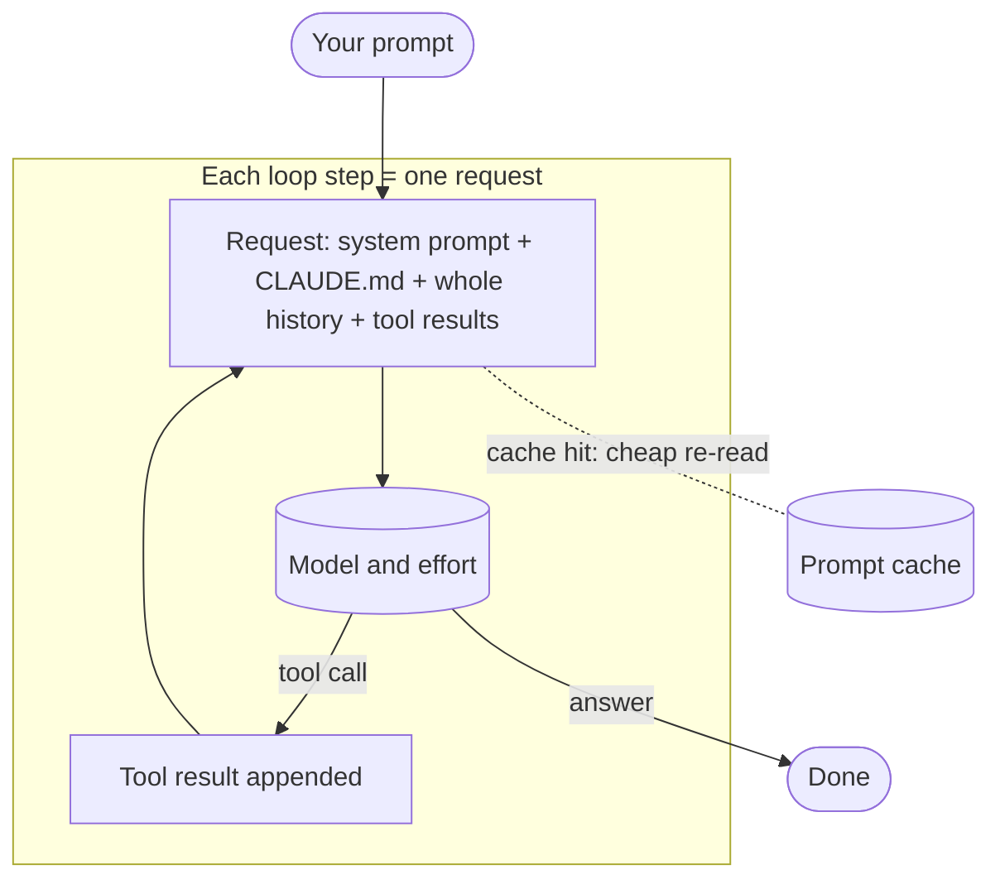
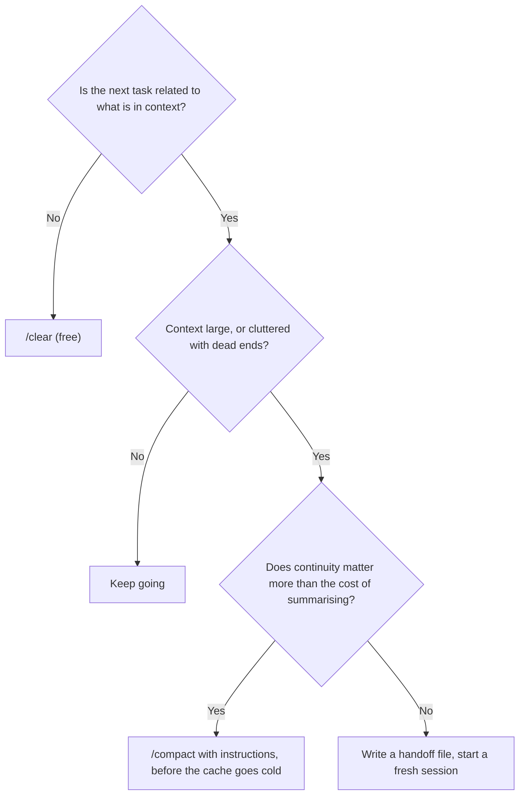

# Working within Pro limits

## Why this matters

On a Pro plan, usage limits are the real budget. You will not see a bill, you will see a message that says you are done until the window resets, usually in the middle of something. Every other chapter in Part 6 made Claude Code more capable; this one is about getting more of that capability out of a fixed allowance.

The good news for an engineer is that the mechanics are simple and you already know them. Usage follows tokens processed, tokens processed follow context size times the number of requests, and both are things you control. This chapter turns [6.1](/part-06-claude-code/6.1-how-claude-code-works)'s picture of the context window into habits.

**Learning goals**

- Explain what drives usage (context size, model, subagents)
- Pick models and effort per task
- Build habits that keep context small

## Explanation

### What the limits are, and what they are not

Read the Claude Help Center's article on using Claude Code with a Pro, Max or Ultra plan for the rules as of writing: Pro and Max plans have a five-hour session limit and a weekly limit, and the limits are shared across Claude (web, desktop, mobile) and Claude Code, so a long chat in the app spends the same allowance as a coding session ([Use Claude Code with your Pro, Max, or Ultra plan](https://support.claude.com/en/articles/11145838-using-claude-code-with-your-pro-or-max-plan)). The same article lists what you can do at a limit: wait for the reset, enable usage credits, switch to a Console account with API credits, or upgrade. Limits and plan tiers change, so treat that page as the source of truth, not this chapter.

::: info 📖 Read now
[Claude Help Center: Use Claude Code with your Pro, Max, or Ultra plan](https://support.claude.com/en/articles/11145838-using-claude-code-with-your-pro-or-max-plan) · article · ~5 min · **essential**

Look for: which limits apply to your plan, that Claude and Claude Code share them, what "wrapping up" means when a limit hits mid-response, and the warning about `ANTHROPIC_API_KEY`: if that variable is set, Claude Code uses it instead of your subscription and you pay API prices. Check your own shell for it before anything else.
:::

Two things the limits are not. They are not a count of messages: the same help center's [usage limit best practices](https://support.claude.com/en/articles/9797557-usage-limit-best-practices) lists the factors, including message length, current conversation length, tool use, model choice and effort level, and says caching makes reused content count less. And they are not a dollar figure: the Claude Code costs page says the `Total cost` in `/usage` is computed locally at list price and that subscribers' usage is included in the subscription, so for a Pro user it is a gauge, not a bill ([Manage costs effectively](https://code.claude.com/docs/en/costs), "Using the `/usage` command"). Anthropic does not publish a token budget for Pro, so the working unit is relative: *what share of my five-hour window did that cost?*

### How usage is counted

The unit is tokens processed, weighted by model and effort. Three multipliers do almost all the work.

1. **Context size, paid on every request.** Claude Code sends the whole conversation with each request, and every tool call is another request carrying the tool results so far. Prompt caching means that history is re-read at the cached rate rather than reprocessed in full, but it is still read: "a one-line question in a session that has been open all day still draws usage for the whole conversation" ([Manage costs effectively](https://code.claude.com/docs/en/costs), "Why usage climbs in a long session"). A 150k-token context makes every step of an agent loop expensive; a 15k-token one makes it cheap. This is the same loop as [3.2](/part-03-agents/3.2-agent-loop), seen from the billing side.
2. **Cache misses.** The cache expires after a period of inactivity. Claude Code can request a five-minute or a one-hour lifetime; per the docs it asks for the one-hour TTL on the main conversation when you are on a subscription within your plan's included usage, and a first message after a longer break reprocesses the full context ([Prompt caching in Claude Code](https://code.claude.com/docs/en/prompt-caching), "Cache lifetime"). A coffee break inside the hour is cheap, a lunch break is not.
3. **Number of requests.** Anything that makes more model calls multiplies the first two: subagents, scheduled `/loop` tasks that fire while the session sits idle, agent teams, and extended thinking, whose tokens are billed as output ([Manage costs effectively](https://code.claude.com/docs/en/costs), "Adjust extended thinking" and "Why usage climbs in a long session").

So the cost of a task is roughly **(context size at each step) × (steps) × (model and effort weight)**. Every habit below attacks one factor.

::: info 📖 Read now
[Claude Code docs: Manage costs effectively](https://code.claude.com/docs/en/costs) · docs · ~20 min (skip the Team and Enterprise spend-limit parts) · **essential**

Look for: the **Plan usage breakdown** section (what `/usage` attributes your usage to: skills, subagents, plugins, MCP servers, plus recommendations), the **Reduce token usage** section, and the **Why usage climbs in a long session** list. The page is the primary source for most of this chapter, and it changes often, so read the live version.
:::

### Measure before you optimise

You do not need to guess. Three commands, all covered on the costs page:

| Command | What it tells you |
|---|---|
| `/usage` | On a subscription: plan usage bars, and a breakdown attributing recent usage to skills, subagents, plugins and individual MCP servers, with recommendations. Figures are approximate and computed from local history on this machine, so usage from other devices or claude.ai is not included. |
| `/context` | What is in the window right now and how much each part takes. |
| `/insights` | An HTML report on how you work (friction, misunderstood requests), over recent sessions on this machine. Its own tokens count against your plan. |

Your status line can also show context use continuously ([Manage costs effectively](https://code.claude.com/docs/en/costs), "Manage context proactively"). Make a habit of one `/usage` check at the end of a heavy day; the first time you do, expect surprises. That is the point of this chapter's practice.

### Model and effort choice

The costs page recommends Sonnet for most coding tasks and Opus for complex architectural decisions or multi-step reasoning, switching with `/model` mid-session ([Manage costs effectively](https://code.claude.com/docs/en/costs), "Choose the right model"). Which model IDs exist and what they cost live on [Landscape](/landscape#anthropic), not here, and the aliases `opus`, `sonnet` and `haiku` resolve to the newest version on the Anthropic API ([Model configuration](https://code.claude.com/docs/en/model-config), "Model aliases"). Which models your Pro plan includes is a plan question: check it in `/model` and on the [pricing page](https://claude.com/pricing) rather than here.

*Effort* is the second dial, and it is separate from model. Effort levels control adaptive reasoning: how much the model thinks per step. Lower effort is faster and cheaper for straightforward tasks ([Model configuration](https://code.claude.com/docs/en/model-config), "Adjust effort level"; platform docs on [effort](https://platform.claude.com/docs/en/build-with-claude/effort)). You set it with `/effort` or in `/model`. Thinking tokens are billed as output, and on the current models you cannot turn thinking off entirely, so effort is the lever ([Manage costs effectively](https://code.claude.com/docs/en/costs), "Adjust extended thinking"). Don't hard-code the list of levels into your habits; the set differs per model and `/effort` shows what yours offers.

A decision rule that follows from the cost formula (my synthesis, not the docs'):

| Task | Start with | Why |
|---|---|---|
| Rename, small edit, "what does this do?", formatting | Smaller model or low effort | Few steps, little reasoning needed |
| Feature in a known codebase with tests | Default model, default effort | The ordinary case; the tests catch mistakes |
| Design decision, hard debugging, cross-cutting refactor | Stronger model or higher effort, ideally in [plan mode](/part-06-claude-code/6.7-issue-workflows) | A wrong plan costs more than the extra thinking |
| Verbose, mechanical work (run tests, summarise logs, fetch docs) | Subagent on a small model | Keeps output out of the main context |

Escalate when a cheaper setting fails, rather than starting at the top: a stronger model that gets it right in one pass can still be cheaper than three failed attempts, but you only know after the first failure. The docs' `opusplan` alias is this idea built in: it uses Opus in plan mode and Sonnet to execute ([Model configuration](https://code.claude.com/docs/en/model-config), "Model aliases").

::: info 📖 Read now
[Claude Code docs: Model configuration](https://code.claude.com/docs/en/model-config) · docs · ~10 min (aliases, "Adjust effort level") · **optional**

Look for: the alias table, what each effort level is for, and the order in which an effort setting is resolved (environment variable, then session choice, then `--effort`, then settings, then the model default), so you know why a level you set "didn't stick".
:::

### /clear, /compact and fresh sessions

Three tools, each with a different cost profile. All three come from the same costs page.

- **`/clear`** starts a new conversation with an empty history. It "costs nothing" and is the right move between unrelated tasks, because stale context "wastes tokens on every subsequent message". Run `/rename` first so you can `/resume` it later ([Manage costs effectively](https://code.claude.com/docs/en/costs), "Manage context proactively" and "Why usage climbs in a long session").
- **`/compact`** replaces the history with a summary and keeps continuity. It is not free: it reads the whole conversation to summarise it, so compacting a large context is itself a large request, and the docs say it costs the most when run on an old session after the cache has expired ([Prompt caching in Claude Code](https://code.claude.com/docs/en/prompt-caching), "Compacting the conversation"). Give it instructions (`/compact Focus on code samples and API usage`), or put a "Compact instructions" section in `CLAUDE.md`, so the summary keeps what matters. Auto-compaction does the same when you approach the limit, so compact earlier and on purpose.
- **A fresh session with a written handoff** is the strongest reset. Put what matters in a file (a spec, an issue, a `NOTES.md`) and start clean. This is why [6.7](/part-06-claude-code/6.7-issue-workflows) insists on self-contained issues: a fresh session on a good issue costs far less than session number nine of a conversation that has absorbed three false starts.

Other context habits from the same page that pay off immediately:

- **Specific prompts.** "Add input validation to the login function in `auth.ts`" avoids the broad scanning that "improve this codebase" triggers.
- **Plan mode and early course-correction.** Press Escape as soon as the direction is wrong; `/rewind` restores conversation and code to an earlier checkpoint. A wrong turn you stop after 20 seconds costs 20 seconds of tokens.
- **A short `CLAUDE.md`.** It is loaded every session, so the docs suggest moving workflow-specific instructions into skills, which load only when invoked, and keeping `CLAUDE.md` under about 200 lines ([6.2](/part-06-claude-code/6.2-claude-md-and-memory), [6.3](/part-06-claude-code/6.3-skills)).
- **Trim the extensions.** Unused MCP servers cost context every session: the docs advise disabling the ones you are not using and preferring CLIs such as `gh` over MCP servers where possible ([6.6](/part-06-claude-code/6.6-mcp-plugins)).
- **Hooks that filter output.** A hook can return the matching `ERROR` lines instead of a 10,000-line log, so the tool result that enters context is hundreds of tokens, not tens of thousands ([6.4](/part-06-claude-code/6.4-hooks-permissions)).

### Subagent and parallel cost

Subagents are a context tool and a cost multiplier at the same time. Delegating a verbose job (tests, docs, logs) keeps the output in the subagent's window and returns only a summary, so your main context stays small. But "the subagent's own requests still draw on your usage" ([Manage costs effectively](https://code.claude.com/docs/en/costs), "Delegate verbose operations to subagents"). You are not saving tokens; you are moving them somewhere your main loop doesn't re-read every step.

That gives you the rule: **delegate when output volume is high and the result is small; don't delegate small jobs**, because each subagent pays its own startup context and requests. Two levers reduce the price. Subagents inherit your session's model unless told otherwise, so switching to Opus also switches the subagents you start afterwards; give simple custom subagents `model: haiku` ([Model configuration](https://code.claude.com/docs/en/model-config), "Setting your model"; [Subagents](https://code.claude.com/docs/en/sub-agents), "Choose a model"). The details of defining subagents are in [6.5](/part-06-claude-code/6.5-parallel-work).

Parallel work scales the same way. Agent teams are described on the costs page as using approximately 7× more tokens than standard sessions when teammates run in plan mode, because each teammate has its own context window ([Manage costs effectively](https://code.claude.com/docs/en/costs), "Manage agent team costs"). Parallel worktrees, background sessions and workflows each draw on the same weekly allowance, and a session-scoped `/loop` keeps sending your full context each time it fires, even when you are away. On Pro, parallelism buys wall-clock time, not tokens: four agents burn the window roughly four times as fast. The `/usage` attribution breakdown shows the subagent share, so check it before deciding whether to keep a subagent habit.

### Offloading to local models or OpenRouter

Some work does not need a frontier model, and your Mac mini has idle capacity (see [Landscape](/landscape#what-fits-in-24-gb-of-unified-memory) for which models fit). There are two honest ways to offload, and one trap.

**Route Claude Code itself elsewhere.** Claude Code reads `ANTHROPIC_BASE_URL`, and both Ollama and OpenRouter publish instructions for pointing it at them: Ollama through its Anthropic-compatible API (`ollama launch claude`, and a local model with a context window of 64k or more) ([Ollama: Claude Code](https://docs.ollama.com/integrations/claude-code)), OpenRouter with an auth token ([OpenRouter: Claude Code integration](https://openrouter.ai/docs/guides/coding-agents/claude-code-integration)). Two cautions from the docs. OpenRouter says the integration "is only guaranteed to work with the Anthropic first-party provider". And Claude Code's gateway docs say that setting only the base URL, without a gateway credential, does not replace the subscription: requests are routed through the gateway but your saved claude.ai login stays the active credential, so its limits and billing still apply ([Other LLM gateways](https://code.claude.com/docs/en/llm-gateway)). A routed session is a *separate* session with a separate bill or with local compute; it does not stretch your Pro allowance. A small local model will also be much weaker at the multi-step tool use Claude Code leans on, which [5.5](/part-05-harnesses/5.5-harnesses-local-qwen) is about.

**Move the cheap, bulk work out of Claude Code.** The better split is by task, not by session: summarising 200 log files, classifying issues, drafting boilerplate, bulk renames, first-pass reviews. Run those through a script or the harness you built in Part 5 against a local Qwen or a cheap OpenRouter model, and bring only the results back to Claude Code. The tradeoffs of local against paid, and the routing rules, are the subject of [9.3](/part-09-model-landscape-cost/9.3-local-vs-paid) and [9.4](/part-09-model-landscape-cost/9.4-routing-rules); prices stay on [Landscape](/landscape#access-routes).

The trap: *offloading is not free if it fails*. A cheap model that gets a task wrong three times costs you the retries plus the Claude Code session that fixes it. Offload tasks that are easy to verify.

::: info 📖 Read now
[Ollama docs: Claude Code](https://docs.ollama.com/integrations/claude-code) · docs · ~5 min · **optional**

Look for: how `ollama launch claude` sets things up, the note about choosing a context window of 64k or more, and what capabilities (subagents, tool calling) depend on "compatible models". Treat the tool as an experiment: compare one task on a local model against your normal session before you trust it.
:::

### When you hit the limit anyway

The help center article lists the options (wait, usage credits, API credits through a Console account, upgrade). Usage credits are managed with `/usage-credits` ([Manage costs effectively](https://code.claude.com/docs/en/costs), "Add usage credits to your subscription"). Whether to pay is your call; the cheaper first step is to read what `/usage` blames and fix that.

## Practice

**Brief:** Track one week of Claude Code use: what hit limits, what didn't. Write three rules for yourself in `notes/claude-code.md`.

**Where:** Notes only, no code (`notes/`). Put everything in `notes/claude-code.md`.

**Steps:**

1. **Baseline (day 1).** Run `/usage` and note the plan bars and the attribution breakdown (skills, subagents, plugins, MCP servers) and any recommendations. Check that `ANTHROPIC_API_KEY` is unset in the shell you start Claude Code from (`echo "${ANTHROPIC_API_KEY:+set}"` prints `set` if it is).
2. **Keep a log, one line per work block.** In the notes, record: date, task, model and effort, roughly how long the session ran before you cleared or compacted, whether you used subagents or parallel sessions, and the plan bar reading before and after (`/usage`).
3. **Mark the limit events.** Each time you saw a limit warning or "Usage limit reached", write what was running and what the context looked like (`/context`).
4. **Run one controlled comparison.** Pick a task you do often and do it twice: once in a long, messy session; once in a fresh session with a specific prompt. Note the difference in the `/usage` bar. Do not use the dollar `Total cost` as your measure: on a subscription the plan bars are what matters.
5. **End of week.** Run `/usage` (use `w` for the week view) and `/insights`. Compare them with your log: what hit limits and what didn't, and what did the breakdown blame that you did not expect?
6. **Write three rules.** Each rule is concrete, testable and names the habit, the trigger and the reason, for example "Before starting an unrelated task, `/clear`; trigger: topic change; reason: stale context re-read on every step". Put them at the top of `notes/claude-code.md`.

**Done when:**

- `notes/claude-code.md` has a dated log covering at least one week, with at least one limit event or an explicit "none hit" note.
- The controlled comparison has both readings.
- Three rules are written, each with a trigger and a reason that traces to something in your own log, not only to this chapter.
- You can say which single habit would have saved most of your week's usage, and why you believe it.

## Check questions

1. Why does a one-line question in a session that has been open for hours use far more of your allowance than the same question in a new session?

   

Answer

   Claude Code sends the full conversation with every request, and every tool call inside the loop is another request carrying the tool results. Prompt caching makes re-reading that history cheaper, not free, so the cost scales with context size. If the cache has also expired (longer than its lifetime), the first message reprocesses the whole context. A new session starts with a small context, so each request is small.

   

2. When is `/clear` better than `/compact`, and when is the reverse true?

   

Answer

   `/clear` is free and right when the next task is unrelated: nothing in the old context helps. `/compact` keeps continuity (decisions, state) but is itself a large request, because it reads the whole conversation to summarise it, and most expensive after a cache has expired. Use it when the work is related and you need the thread, preferably with instructions about what to keep, and before the context is huge. If the important state can be written to a file, a fresh session on that file beats both.

   

3. A subagent "keeps output out of your main context". Does that make it free? When does delegating still cost more than it saves?

   

Answer

   No. The subagent's own requests still draw on your usage; you only avoid your main loop re-reading the verbose output on every later step. Delegation pays off when the output is large and the returned result is small (running tests, reading docs, scanning logs). For a small job it costs more, because the subagent adds its own startup context and requests. Subagents inherit your session's model, so choose a smaller one for simple tasks.

   

4. You set `ANTHROPIC_BASE_URL` to a local Ollama endpoint hoping to make your Pro allowance last longer. Why is that the wrong mental model, and what is a better split?

   

Answer

   Routing a session elsewhere creates a separate session billed to (or powered by) the other provider; it does not stretch the subscription's allowance, and without a gateway credential your saved claude.ai login can remain the active credential. A small local model is also weaker at multi-step tool use. A better split is by task: do bulk, easy-to-verify work (summaries, classification, boilerplate) with a script or your own harness against a local or cheap model, and keep Claude Code for work that needs its tools and model quality.

   

5. Which two dials choose how "expensive" a given step is, apart from how many steps there are, and how do you set each?

   

Answer

   The model (`/model`, or `model:` in a subagent's definition) and the effort level (`/effort`, or in `/model`). A stronger model costs more per token, and higher effort means more thinking tokens, which are billed as output. Start with the cheaper setting for easy tasks and escalate on failure; use a stronger model or higher effort for design and hard debugging, where a wrong plan costs more than the thinking.

   

## My understanding

<!-- Written by the learner, in their own words. Agents never fill this in. -->
