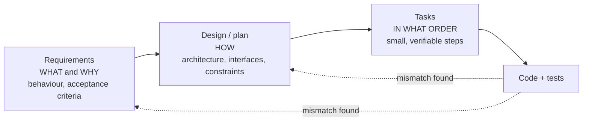

# Spec-driven development

## Why this matters

When an agent writes most of the code, the most valuable thing you type is no longer code: it is the description of what the code must do. Chapter [6.7](/part-06-claude-code/6.7-issue-workflows) showed one workflow built around that fact (grill, write a spec, cut tickets, run each in a fresh session). **Spec-driven development** (SDD) is the name the tooling world has given to the same bet, and in the last year it has acquired products, templates and slash commands.

The idea is easy to like and easy to over-apply. The GitHub team that released Spec Kit puts the diagnosis well: the problem with vibe-coded output is not the agent's coding ability but the approach, because we treat coding agents like search engines when we should treat them like literal-minded pair programmers ([GitHub blog, "Spec-driven development with AI"](https://github.blog/ai-and-ml/generative-ai/spec-driven-development-with-ai-get-started-with-a-new-open-source-toolkit/)). The same ecosystem also produces ceremony: a sceptical review of the tools found that a small bug fix could turn into pages of user stories ([Böckeler on martinfowler.com](https://martinfowler.com/articles/exploring-gen-ai/sdd-3-tools.html)). This chapter gives you the shared structure under all the tools, so you can use the idea at the size where it pays and drop it where it does not.

**Learning goals**

- Write specs agents can execute
- Compare spec-driven tools and approaches
- Keep specs and code in sync

## Explanation

### What a spec is, and what "source of truth" can mean

A spec is a written description of intended behaviour that a human reviews and an agent implements. Böckeler's working definition: a structured, behaviour-oriented artifact, in natural language, that guides coding agents. She separates it from the *general context* of a repo (rules files, product and codebase descriptions): that context applies to every session, while a spec applies only to the work that creates or changes one piece of functionality ([martinfowler.com](https://martinfowler.com/articles/exploring-gen-ai/sdd-3-tools.html)). In Claude Code terms, CLAUDE.md ([6.2](/part-06-claude-code/6.2-claude-md-and-memory)) is the general context and the spec is the per-feature document.

"The spec is the source of truth" is a claim with three different strengths. The same article names them:

| Level | What it means | After the feature ships |
|---|---|---|
| **Spec-first** | A well-thought-out spec is written before the AI-assisted work and used for that task | Often discarded or left to rot |
| **Spec-anchored** | The spec is kept and used to evolve and maintain the feature | Updated with every change |
| **Spec-as-source** | Only the spec is edited by a human; code is generated and never touched | The code is a build artifact |

Böckeler found that all the approaches she looked at are spec-first, and that not all aim higher; the maintenance strategy is "often left vague or totally open". Only one of the three tools she examined (Tessl, then in private beta) explicitly aimed at spec-as-source, with generated files marked as not to be edited. Be honest with yourself about which level you are practising. Spec-first is cheap and almost always worth it. Spec-anchored costs discipline every time the code changes. Spec-as-source asks you to trust regeneration, and the same article reports that generating from the same spec repeatedly gave different code, which is the central weakness: natural language is not a compiler's input.

### The three-document shape: requirements, design, tasks

Every mainstream tool converges on the same three layers, because they answer three different questions:



- **Requirements** describe behaviour from the outside: who does what, what counts as success, what is out of scope. Kiro writes them as user stories with acceptance criteria in **EARS** notation, one line per behaviour of the form `WHEN [condition] THE SYSTEM SHALL [behaviour]` ([Kiro docs: Feature specs](https://kiro.dev/docs/specs/feature-specs/)). EARS is worth borrowing without Kiro: every line has a trigger and an observable result, so every line can become a test.
- **Design** holds the decisions you are imposing: stack, module boundaries, data shapes, error handling, what to reuse. GitHub's walkthrough keeps this out of the first document on purpose: the specify phase is "about user journeys, experiences, and what success looks like", and the stack, architecture and constraints go in the plan ([GitHub blog](https://github.blog/ai-and-ml/generative-ai/spec-driven-development-with-ai-get-started-with-a-new-open-source-toolkit/)). Keeping them apart is harder than it sounds. Böckeler reports being repeatedly unsure, while using Spec Kit, which level a given detail belonged on.
- **Tasks** cut the design into pieces that can be implemented and checked alone. GitHub's reasoning is that a task you can test in isolation gives the agent a way to validate its own work, "almost like a test-driven development process for your AI agent". This is the tracer-bullet idea from [6.7](/part-06-claude-code/6.7-issue-workflows) at a smaller grain.

Two rules from earlier chapters apply unchanged. Don't copy intent into two places (a design that restates the requirements will diverge from them on the first edit), and don't put file paths and code into the requirements (the agent will explore the code itself; a path in a spec is a future lie).

### What makes a spec executable

An agent can only execute what it can check. Before you hand a spec over, read each requirement and ask whether a stranger could write a test for it. A practical checklist:

1. **Behaviour, not mechanism.** "The CLI prints the total token count after each turn" beats "add a counter variable".
2. **Observable acceptance criteria.** An exit code, a printed line, a file that exists, a failing test that now passes. If the only check is "looks right", the agent will report success, and so will its self-review.
3. **Edge cases named.** Empty input, a tool that fails, a second run. These are exactly the cases agents fill in silently, in whichever direction looked most likely (the plan-mode failure from 6.7).
4. **Out of scope, explicitly.** Agents are eager. A list of things not to build is as important as the things to build, and it stops the over-eager execution Böckeler also observed (an agent taking a constitution article too literally and going "way overboard").
5. **Constraints with reasons.** "Reuse the existing `run_shell` tool; do not add a dependency, because the project must stay dependency-light" lets the agent make a good call in a situation you did not foresee. Bare rules do not.
6. **Open questions marked as open.** Written down as questions, not guesses. An invented answer in a spec is read as a decision.

A fragment in the style the chapter recommends (no paths, no code, every line testable):

```markdown
## Requirements
- WHEN the agent finishes a turn THE SYSTEM SHALL append one JSON line to the session log containing the turn number, the tool names called and the token counts.
- WHEN the log file cannot be written THE SYSTEM SHALL print a warning once and continue the session.
- WHEN started with `--no-log` THE SYSTEM SHALL write nothing to disk.

## Out of scope
- Rotating or compressing logs. Viewing logs.

## Open questions
- Should a resumed session append to the old log or start a new one? (Decide before design.)
```

### The tools

The tooling is moving quickly, so treat this as a map of *approaches*, verified on the date at the top of the chapter. Prices and the wider list of coding agents live on [Landscape](/landscape#coding-agents-and-harnesses).

**GitHub Spec Kit** is an open-source toolkit: you install a `specify` CLI, initialise a project for your coding agent (Claude Code is one of the supported ones), and then drive the process with slash commands inside the agent. Its README lists the flow as constitution, specify, plan, tasks, implement, converge, with optional clarify, checklist and analyze steps, and says to run them one at a time and review each result before continuing ([Spec Kit README](https://github.com/github/spec-kit)). Two things distinguish it. The **constitution** is a project-level set of principles applied to every feature (Böckeler calls it a very powerful rules file). And **converge**, a newer command, assesses the codebase against the spec, plan and tasks after implementation: it never edits code, only appends missing tasks to `tasks.md`, and you repeat implement and converge until it reports "Converged" ([command reference](https://github.github.io/spec-kit/reference/agentic-sdd.html)). That loop is Spec Kit's built-in answer to "did the code do everything the spec said?". Spec Kit also bundles a bug-fixing process and an idea-assessment process as extensions, which is a sign that one workflow does not fit every task size ([README](https://github.com/github/spec-kit)).

**Kiro** is AWS's agentic IDE and CLI built around specs. Each spec is three files, `requirements.md` (or `bugfix.md`), `design.md` and `tasks.md`, produced in a three-phase workflow, with requirements-first and design-first variants and a Quick Spec mode that generates all three without approval gates. When you run all tasks, Kiro builds a dependency graph and runs independent tasks concurrently in "waves" ([Kiro docs: Specs](https://kiro.dev/docs/specs/)). Its equivalent of a constitution is *steering*, a set of files giving the agent standing context ([Kiro docs](https://kiro.dev/docs/steering/)).

**OpenSpec** takes the lightest, change-oriented route: each change gets a folder with a proposal, spec deltas, a design and a task list, and an archive step moves the finished change aside and updates the long-lived specs. Its README states the philosophy as fluid not rigid, iterative not waterfall, built for brownfield ([OpenSpec README](https://github.com/Fission-AI/OpenSpec)). Of the three it is the one whose structure directly supports spec-anchored use, since the archive step is where the delta lands in the standing spec.

**Claude Code without a tool.** Nothing above requires a product. The workflow in 6.7 (grill, `to-spec`, tickets) is spec-driven development with three markdown files and your own conventions, and plan mode ([Permission modes](https://code.claude.com/docs/en/permission-modes)) covers the "review before anything touches disk" checkpoint. A tool earns its place when you want templates, a consistent file layout across a team, or the checklists and the converge loop without writing them yourself.

| Approach | Documents | Standing context | Aims at |
|---|---|---|---|
| Spec Kit | spec, plan, tasks (many files per feature) | constitution | spec-first; spec per change |
| Kiro | requirements, design, tasks | steering | spec-first |
| OpenSpec | proposal, spec deltas, design, tasks; archive | project spec library | spec-anchored |
| Plain Claude Code (6.7) | spec, issues | CLAUDE.md | what you make it |

(The "aims at" column is my reading of the sources, not the vendors' own classification; Böckeler's article is the source for Kiro and Spec Kit, written in October 2025, and these tools change fast.)

::: info 📖 Read now
[Böckeler: Understanding Spec-Driven-Development: Kiro, spec-kit, and Tessl](https://martinfowler.com/articles/exploring-gen-ai/sdd-3-tools.html) · article · ~25 min · **essential**

Look for: the three levels (spec-first, anchored, as-source) and which one each tool actually reaches; the section "Observations and questions", especially "One workflow to fit all sizes?" and "False sense of control?". The article is a field report from September 2025 and the tools have changed since, so take the *questions* as durable and the feature descriptions as dated.
:::

::: info 📖 Read now
[GitHub blog: Spec-driven development with AI](https://github.blog/ai-and-ml/generative-ai/spec-driven-development-with-ai-get-started-with-a-new-open-source-toolkit/) · article · ~10 min · **essential**

Look for: the four phases and what each one is forbidden to contain, and the line that your role is "not just to steer" but "to verify". That is the checkpoint structure you will reproduce by hand in the practice.
:::

::: info 📖 Read now
[Kiro docs: Specs](https://kiro.dev/docs/specs/) and [Feature specs](https://kiro.dev/docs/specs/feature-specs/) · docs · ~15 min · optional

Look for: the EARS pattern, the difference between requirements-first and design-first, and how tasks trace back to requirements.
:::

::: info 📖 Read now
[Spec Kit: README](https://github.com/github/spec-kit) and [command reference](https://github.github.io/spec-kit/reference/agentic-sdd.html) · repo · ~15 min · optional

Look for: what each command writes to disk, and what `converge` is allowed and not allowed to change.
:::

::: info 📖 Read now
[OpenSpec: README](https://github.com/Fission-AI/OpenSpec) · repo · ~10 min · optional

Look for: how a change folder differs from a feature spec, and what the archive step does to the standing specs.
:::

### Spec drift

**Spec drift** is the gap that opens between what the spec says and what the code does. It is the SDD version of stale documentation, with one difference: the agent *reads* the stale spec as an instruction, so drift is not harmless. There are four common causes:

1. **Code changes without the spec.** You fix a bug or tweak behaviour in a chat session, never touching the spec. The next agent run implements the old behaviour again.
2. **The agent deviates silently.** It meets something the spec did not foresee and decides. The decision lives only in the diff.
3. **The agent ignores the spec.** Böckeler saw an agent treat descriptions of *existing* code in a research file as a new specification and generate duplicates, and saw instructions skipped despite large context windows. A longer spec raises the odds of both.
4. **The spec was never precise enough** to be checked, so nothing can say it was violated.

What keeps them in sync is mostly habit and a few mechanical checks:

- **Decide the maintenance policy up front.** For a one-off feature, spec-first is fine: write at the top of the spec "Status: shipped; not maintained" so nobody trusts it later. Keep a spec alive only where you will keep changing the feature.
- **Change the spec first.** A behaviour change starts as a spec edit, then a task, then code. Make the agent do the edit as the first step, and review it in the diff next to the code.
- **Make the agent report deviations.** Put in the implement prompt: "If you deviate from the spec or make a decision it does not cover, list it at the end and propose the spec change." You then turn the report into spec edits (the reflection step in the 6.7 practice does the same by hand).
- **Check mechanically where you can.** Turn acceptance criteria into tests, so a violated requirement fails CI instead of relying on anyone's memory. Chapter [7.2](/part-07-ai-native-development/7.2-tdd-with-agents) covers writing them first. A conformance pass (Spec Kit's `converge`, or a fresh-session "compare this diff to the spec and list mismatches" review, see [7.3](/part-07-ai-native-development/7.3-automated-review)) catches the omissions tests do not.
- **Keep the spec small.** Fewer, shorter documents are easier to keep true. If you are reviewing more markdown than the code would take, the process is too heavy for the task.

### When not to do this

Böckeler's strongest criticism is about size. Kiro turned a small bug into four user stories and sixteen acceptance criteria, and a feature she estimated at 3-5 story points under Spec Kit produced so many repetitive files that she judged plain AI-assisted coding would have been faster and left her more in control ([martinfowler.com](https://martinfowler.com/articles/exploring-gen-ai/sdd-3-tools.html)). A rule of thumb (mine, not a vendor's):

| Change | Right amount of spec |
|---|---|
| A diff you can say in one sentence | None. Prompt it, review the diff |
| A feature with a few decisions in it | A one-page requirements list with acceptance criteria; plan mode for the approach |
| A multi-day feature, or one several agents will share | Requirements, design, tasks, and a conformance check at the end |
| Behaviour you must keep stable for years | A spec-anchored approach, with the spec under test |

The failure to avoid is mistaking a heavy artifact for control. Her phrase is "false sense of control": more files and checklists do not guarantee the agent follows them. What gives you control is a short spec, small tasks, and a verification step you do not delegate to the same agent.

## Practice

**Brief:** Write a spec for the next `project/` feature, generate tasks, and implement it with Claude Code. Note where the spec helped and where it was ignored.

**Where:** A step in the growing `project/` (see `project/ROADMAP.md`, step 21). It builds on the mini harness from 5.4 (step 19). You write the spec and review everything; Claude Code writes the code from it.

You can do this with plain Claude Code and the 6.7 skills, or by trying Spec Kit, Kiro or OpenSpec. If you try a tool, spend your first ten minutes reading what it writes to disk, and use the same feature for the comparison in step 7.

**Steps:**

1. **Pick the feature.** One that takes a few hours of agent work, touches at least two modules of `project/`, and has behaviour you can observe from outside. Examples to choose from: a persistent per-session log of turns and token counts, a `--resume` flag that reloads the previous session, a per-tool timeout with a clear error, or a read-only mode that refuses write tools. Write the one-sentence goal and today's date at the top of `notes/spec-driven-development.md`.
2. **Write the requirements** in `project/specs/<feature>/requirements.md`: the behaviour in EARS-style lines (`WHEN ... THE SYSTEM SHALL ...`), an Out of scope list and an Open questions list. No file paths, no code. You write the first draft yourself; an agent may only critique it.
3. **Critique, then freeze.** In a fresh session, ask Claude to review the requirements for lines that cannot be tested, missing edge cases and hidden decisions, and to list questions instead of editing. Resolve each question in the file. Decide whether this spec is spec-first (marked "not maintained" once shipped) or spec-anchored, and write that policy at the top.
4. **Design and tasks.** Ask Claude Code (plan mode is a good fit) for `design.md` and `tasks.md` from the requirements. Review them for the things 6.7 warned about: decisions made silently, tasks that are not independently verifiable, anything the requirements did not ask for. Edit the files. Each task needs a check you can run (a test, a command and its expected output).
5. **Implement in a fresh session**, one task at a time, giving the agent only the spec folder path. Use the deviation-report line from the drift section in the prompt. Review each diff before the next task.
6. **Check conformance.** In another fresh session, give it the requirements and the final diff and ask it to list every requirement with where it is satisfied and every place the code does something the spec did not ask for. Then walk the requirements yourself and run the acceptance checks.
7. **Reflect** in the notes, with a table whose rows are specific items (not impressions): *where the spec helped* (a decision the agent got right that a plain prompt would not have specified), *where it was ignored or overridden* (quote the requirement and the diff), *what the spec lacked* (an edge case, a constraint), and *what was overhead* (a document you wrote that nobody used). For each ignored or lacking item, apply the one-line spec change that would have prevented it.

**Done when:**

- The feature works and every requirement has a check you ran (test or command), with the result recorded in the notes.
- The requirements have no file paths or code, state what is out of scope, and have no unmarked guesses.
- At least one table row for "ignored or overridden" names a real requirement and the real diff hunk, or you state that nothing was ignored and show the conformance review that confirms it.
- The spec states its maintenance policy, and the reflection table's changes are applied to it.
- You can say, for this feature, whether the spec cost more than it saved, and which document you would drop next time.

## Check questions

1. What are the three levels of "the spec is the source of truth", and which one does a spec you delete after merging belong to?

   <details><summary>Answer</summary>

   Spec-first (written before the work and used for that task), spec-anchored (kept and updated to evolve the feature), and spec-as-source (only the spec is edited by a human; code is generated). A spec you delete after merging is spec-first. Most tools and most practice are spec-first; spec-anchored needs a policy for updating the spec on every change, and spec-as-source needs generation to be reliable, which the source article found it was not (the same spec gave different code on repeated runs).

   </details>

2. Why are requirements, design and tasks separate documents rather than one long spec?

   <details><summary>Answer</summary>

   They answer different questions and change at different rates: requirements say what and why (behaviour, acceptance criteria, scope), the design says how (architecture, interfaces, constraints you are imposing), and tasks say in what order, in pieces that can be verified alone. Separating them lets you review each for its own kind of mistake, lets the design change without rewriting the behaviour, and keeps intent from being duplicated in two places where it will diverge. The boundary between requirements and design is hard to hold, so the test is: a requirement that names a library or a file belongs in the design.

   </details>

3. Rewrite "the app should handle errors gracefully" as an executable requirement. What did you have to add?

   <details><summary>Answer</summary>

   For example: "WHEN a tool call throws THE SYSTEM SHALL return the error message to the model as the tool result and continue the loop, and SHALL print one warning line to the user." You had to name a trigger, the observable behaviour (what the model sees, what the user sees) and what happens next. "Gracefully" has no test, so the agent would pick a meaning for you. Any version works as long as a stranger could write a test for it.

   </details>

4. Name three causes of spec drift and one mechanical check that catches each family of drift.

   <details><summary>Answer</summary>

   Code changed without the spec (fix: change the spec first, and have the agent do the spec edit as its first step), the agent deviated silently (fix: have it report deviations and propose spec changes in its final message), the agent ignored part of the spec (fix: acceptance criteria as tests, plus a conformance pass such as Spec Kit's converge or a fresh-session review of diff against spec), or the spec was never checkable (fix: apply the "could a stranger write a test for this line" check before handing it over). Any three, with a check that does not depend on memory.

   </details>

5. Your change is a one-line fix to an off-by-one in the agent's step counter. Do you write a spec? What would be a sign you chose the wrong amount of process?

   <details><summary>Answer</summary>

   No: prompt it, add a regression test, review the diff. A sign of too much process is that you spend longer reviewing generated markdown than the code would take to write, or that the documents restate each other (the source article's example: a small bug turned into four user stories with sixteen acceptance criteria). A spec is justified where there are decisions to record or several tasks to coordinate.

   </details>

## My understanding

<!-- Written by the learner, in their own words. Agents never fill this in. -->
