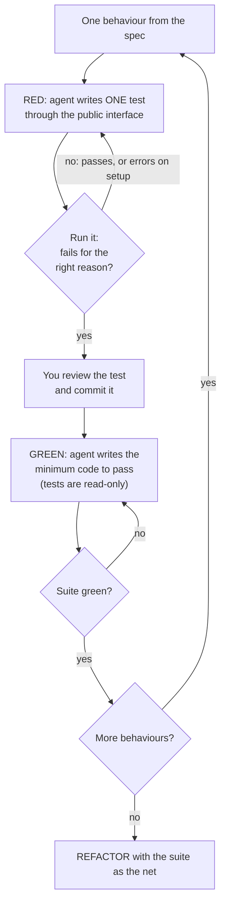

# TDD with agents

## Why this matters

An agent stops when the work *looks* done. Claude Code's own best-practices page says so plainly: if it has nothing to run that tells it whether the work is done, "looks done" is all it has to go on, and "in practice that makes you the test suite" ([Best practices](https://code.claude.com/docs/en/best-practices), "Give Claude a check to run"). A failing test written before the code is the cheapest check there is: it states the goal in a form the agent can run, read and loop on without you.

The catch is that an agent optimises for the signal you gave it. Hand it a red test and it can turn it green by fixing the code, or by editing the test, special-casing the input, or mocking the thing under test. This chapter is about getting the first and preventing the other three.

You met the agent loop in [3.2](/part-03-agents/3.2-agent-loop) and Claude Code's version of it in [6.1](/part-06-claude-code/6.1-how-claude-code-works): gather context, act, verify. TDD is a way of making the *verify* phase mechanical. [7.1](/part-07-ai-native-development/7.1-spec-driven-development) wrote down *what* to build; this chapter turns that into executable checks before any code exists.

**Learning goals**

- Run red-green-refactor with an agent
- Prevent agents from weakening tests
- Use tests as the verification step in long tasks

## Explanation

### Why TDD fits agents

Three properties of agents make test-first unusually effective.

1. **The loop needs a pass/fail signal.** The loop you built in 3.2 runs until the model stops calling tools. What it does between those points is only as good as the feedback in the tool results. A test run returns something unambiguous (which test, expected value, actual value, stack trace), and the model can read that output and act on it. The docs list what counts as a "check": a test file, a build's exit code, a linter, a script that diffs output against a fixture ([Best practices](https://code.claude.com/docs/en/best-practices), "Give Claude a check to run"). Tests are the richest of these.
2. **Agents are bad at stopping honestly.** A model that wrote the code also wrote the explanation of why it is correct. A test written *before* the code, and not edited since, does not share that bias. The docs make the same point about review: a fresh subagent "never saw your conversation" and "isn't swayed by the reasoning that produced the code" (same page).
3. **Tests survive the context window.** Per [6.1](/part-06-claude-code/6.1-how-claude-code-works), compaction summarises conversation but not files on disk. A requirement that lives in a committed test file is still there after `/compact` or `/clear`; a requirement you stated at message 3 may not be. This is what makes tests the verification step of *long* tasks, the third learning goal: after each compaction or fresh session the agent can re-run the suite and rediscover where it stands.

A fourth, softer benefit: writing the test first forces a decision about the public interface (function name, arguments, return shape) before the implementation shapes it. That decision is exactly what you want to make yourself, not delegate.

None of this is new to TDD. What changes with an agent is the *failure mode*. A human who is tempted to weaken a test has to type it and feel a little bad. An agent has no such friction, and it is not being malicious: it is following the instruction "make the tests pass" down the shortest path. Anthropic's prompting guide acknowledges the tendency: Claude "can sometimes focus too heavily on making tests pass at the expense of more general solutions" ([Prompting best practices](https://platform.claude.com/docs/en/build-with-claude/prompt-engineering/claude-prompting-best-practices), "Avoid focusing on passing tests and hardcoding"). The rest of the chapter is a defence against that sentence.

### The workflow: test first, confirm failure, implement

Anthropic's engineering article describes TDD as "an Anthropic-favorite workflow for changes that are easily verifiable with unit, integration, or end-to-end tests" ([Claude Code: Best practices for agentic coding](https://www.anthropic.com/research/claude-code-best-practices), "Write tests, commit; code, iterate, commit"). The steps, in the article's order:

1. Ask Claude to write tests from expected input/output pairs, and say explicitly that you are doing TDD, "so that it avoids creating mock implementations, even for functionality that doesn't exist yet".
2. Tell it to run the tests and confirm they fail, and not to write implementation code at this stage.
3. Commit the tests once you are satisfied with them.
4. Ask for code that passes the tests, "instructing it not to modify the tests", and to keep going until they pass. It usually takes a few iterations.
5. Optionally, have independent subagents check that the implementation is not overfitting to the tests.



Each step earns its place, and the order is the point.

**Confirm the failure.** Step 2 is the one people skip, and it is the one that makes the test mean something. A test that has never failed has not shown it can. Look at *how* it fails. "Cannot find module" or a syntax error is a different red from "expected 15, received undefined": the first means the test never reached the behaviour. You want the second kind. If the agent's new test passes immediately, either the behaviour already exists or the test asserts nothing; both are worth knowing before you write code.

**Commit the tests.** The commit is a checkpoint you can diff against. Any later change to a test file shows up in `git diff <test-commit> -- '*.test.ts'`, which is how you detect weakening (next section). It is also what makes the tests durable across sessions.

**One slice at a time.** Matt Pocock's TDD skill, which is the version of this workflow used in this study's own tooling, is firm about it: "Horizontal slicing: writing all tests first, then all implementation" produces bulk tests that "verify *imagined* behavior", and he wants **vertical slices** instead: "one test → one implementation → repeat, each test a tracer bullet that responds to what the last cycle taught you" ([TDD skill](https://github.com/mattpocock/skills/blob/main/skills/engineering/tdd/SKILL.md), "Anti-patterns"). Its rules of the loop: red before green, "only enough code to pass", one seam, one test and one minimal implementation per cycle. The Anthropic article's step 1 ("write tests based on expected input/output pairs") can be read either way; the skill's version is the stricter one, and it is the one to follow when the interface is not yet settled, because the first implementation teaches you things the first test could not know.

**Refactor.** The classic cycle is red, green, refactor. The Pocock skill treats refactoring as a separate review stage ("Refactoring is not part of the loop"), not something to do inside the red-to-green cycle. For agent work that is a good default: the green step says "minimum code", and a separate prompt (or the review in [7.3](/part-07-ai-native-development/7.3-automated-review)) says "now clean this up; the suite must stay green and the tests must not change". Two small steps are easier to verify than one big one.

::: info 📖 Read now
[Claude Code: Best practices for agentic coding](https://www.anthropic.com/research/claude-code-best-practices) · article · ~10 min · **essential**

Look for the section "Write tests, commit; code, iterate, commit" (inside the workflows part, under "Try common workflows"). Note three instructions that each block a specific failure: say you are doing TDD (no mock implementations), say not to write implementation yet (the agent cannot go straight to code), and say not to modify the tests (the subject of the next section). The article is from April 2025 and was updated since; the older "headless mode" and slash-command details have been superseded by the docs, so read it for the workflow, not the flags.
:::

::: info 📖 Read now
[Matt Pocock: TDD skill](https://github.com/mattpocock/skills/blob/main/skills/engineering/tdd/SKILL.md) · repo · ~10 min · **essential**

Read the skill and its two companion files, [tests.md](https://github.com/mattpocock/skills/blob/main/skills/engineering/tdd/tests.md) and [mocking.md](https://github.com/mattpocock/skills/blob/main/skills/engineering/tdd/mocking.md). Look for: the definition of a *seam* and the rule that tests are written only at seams you agreed beforehand; the three anti-patterns (implementation-coupled, tautological, horizontal slicing); and the mocking list (system boundaries only: external APIs, time and randomness, sometimes the database or file system). Ask of each rule: which agent failure does it prevent?
:::

### Guarding tests

The failure to design against: the agent is told "make the tests pass", the code is hard, and a shorter path exists. The shorter paths are known and few:

| Shortcut | What the diff looks like | What blocks it |
|---|---|---|
| Edit the assertion | Expected value changed to the actual value | Read-only tests, test-file diff check |
| Delete or skip the test | `it.skip`, `test.todo`, removed file | Same; also counting tests |
| Special-case the input | `if (input === 'the test value') return 15` | Independent expected values, more than one case, a review pass |
| Mock the unit under test | The test passes against a fake of the thing it claims to test | Mock only boundaries; read the test, not the result |
| Loosen the check | `toBe(15)` becomes `toBeDefined()` | Test-file diff check, human review of tests |

These are patterns to expect, not a measured rate. The practice at the end of this chapter has you measure how often it happens *with your agent on your project*; do not take a number from anyone else's.

There are four layers of defence, from soft to hard. Use the cheapest one that holds for your task.

**1. Say it in the prompt.** "Do not modify the tests" is step 4 of Anthropic's workflow. If the test seems wrong, say you want to hear about it instead of a workaround. Anthropic's prompting guide offers wording for this: "If the task is unreasonable or infeasible, or if any of the tests are incorrect, please inform me rather than working around them" ([Prompting best practices](https://platform.claude.com/docs/en/build-with-claude/prompt-engineering/claude-prompting-best-practices), "Avoid focusing on passing tests and hardcoding"). Cost: one line. Strength: a guideline. The docs' own framing of `CLAUDE.md` applies: it is "for guidelines, and Claude is allowed to decide a guideline doesn't apply" ([Best practices](https://code.claude.com/docs/en/best-practices), "Enforce the rules that can't have exceptions").

**2. Make the tests structurally hard to edit.** Permission rules can deny edits to paths. A deny rule such as `Edit(**/*.test.ts)` in project settings stops Claude's edit and write tools from touching matching files; deny wins over every allow, as in [6.4](/part-06-claude-code/6.4-hooks-permissions). Two caveats from the permissions docs ([Configure permissions](https://code.claude.com/docs/en/permissions)):

- `Edit` rules apply to the built-in file tools and to file commands Claude Code recognises in Bash, such as `sed` and `tee` and redirections, but not to "arbitrary subprocesses that read or write files indirectly, like a Python or Node script that opens files itself". An agent that cannot edit the test with the edit tool *can* write a script that does. For OS-level enforcement the docs point to the sandbox.
- A rule on a path name also blocks *you* from asking the agent to write the next test. In practice this means switching rules between phases (red: tests writable; green: tests denied), or doing the red phase in one session and the green phase in a second with the rule enabled.

**3. Check, don't trust: a diff gate.** A script that answers "did any test file change since the tests were committed?" is simple and independent of how the agent made the change (edit tool, shell, script). A `Stop` hook runs a command when Claude tries to finish its turn, and "sends Claude back to work if the script exits with code 2"; stderr goes back to Claude as the reason ([Best practices](https://code.claude.com/docs/en/best-practices), "Enforce the check with a Stop hook"). So the shape is:

```sh
# Stop hook command (sketch, untested): fail if tests moved since the red commit
git diff --quiet "$RED_COMMIT" -- '*.test.ts' || { echo "Test files changed since $RED_COMMIT. Revert them and fix the code." >&2; exit 2; }
```

(`RED_COMMIT` is whatever you use to name the commit that froze the tests; a tag works. Hook details are in [6.4](/part-06-claude-code/6.4-hooks-permissions); the pattern above is this book's suggestion, not a documented recipe.) Two documented limits: Claude Code stops blocking after eight consecutive blocked stops with no tool call between them, and a hook that keeps failing for a reason the agent cannot fix burns turns ([Hooks reference](https://code.claude.com/docs/en/hooks), "Stop input"). A hook can also check `stop_hook_active` to avoid blocking forever on a condition that will never resolve.

Add the same check to CI and you have a guard that does not depend on Claude Code at all: a pull request that changes both a test and the code it tests needs a human to read the test change first. That connects to [7.4](/part-07-ai-native-development/7.4-ci-background-agents).

**4. Let a different reader judge.** Some weakening is invisible to a diff gate: a test written *weak from the start*, or an implementation that special-cases the examples. Anthropic's workflow suggests asking independent subagents to verify "the implementation isn't overfitting to the tests" ([Claude Code: Best practices for agentic coding](https://www.anthropic.com/research/claude-code-best-practices), step on subagents). A subagent that starts with a fresh context, the spec and the diff, and is asked "which behaviours in the spec have no test, and what input would make this code fail while the tests stay green?", does the job a mutation-minded human reviewer would. The docs add a caution that applies here: a reviewer asked to find problems "will always find *something*", so scope it ("report gaps that affect correctness and skip style") or you get tests for cases that cannot happen ([Best practices](https://code.claude.com/docs/en/best-practices), "Review against your spec").

None of the four layers replaces your own reading of the test. The whole scheme rests on the tests being *correct*, and nothing automated can establish that for you, because the agent that wrote them shares the blind spot of the agent that passes them. Reading the red tests before you commit them is the highest-leverage minute in the loop.

### What a good agent-facing test looks like

A test that guides an agent well is also a test that cannot be passed dishonestly. The Pocock skill's list translates directly:

- **Through the public interface.** "Tests verify behavior through public interfaces, not implementation details. Code can change entirely; tests shouldn't." A test of internals pins the implementation, so the agent must edit the test whenever it refactors, and you have taught it that editing tests is normal.
- **Expected values from an independent source.** The skill's *tautological* anti-pattern: the assertion recomputes the expected value the way the code does, so "it passes by construction and can never disagree with the code". Use a literal you worked out by hand or took from the spec: `expect(total([{price: 10}, {price: 5}])).toBe(15)`.
- **Several examples per behaviour.** One example invites `return 15`. Three examples chosen to differ (empty input, one item, many items; a boundary) make the general implementation the cheapest one.
- **Mock only at the boundary.** Per the skill: "Mock at system boundaries only": external APIs, time and randomness, sometimes the database. Not "your own classes/modules". Mocks of your own code let the agent satisfy the test without the behaviour.

([TDD skill](https://github.com/mattpocock/skills/blob/main/skills/engineering/tdd/SKILL.md), "What a good test is" and "Anti-patterns"; [tests.md](https://github.com/mattpocock/skills/blob/main/skills/engineering/tdd/tests.md); [mocking.md](https://github.com/mattpocock/skills/blob/main/skills/engineering/tdd/mocking.md).)

### Integration vs unit tests for agents

Which level of test? The answer for agents leans toward the integration end, for reasons that come from the failure modes above.

| | Unit test (one function, collaborators faked) | Integration test (several real parts through a public seam) |
|---|---|---|
| Speed | Milliseconds | Slower, still usually seconds |
| Pinpoints failure | Yes: the output names the function | Less: output names the scenario, the agent must dig |
| Survives refactors | Only if it tests behaviour, not call structure | Mostly yes: it only knows the seam |
| Easy to pass dishonestly | Yes: mock the neighbours and assert on the mock | Harder: the real neighbours have to work |
| Catches wiring bugs (wrong argument order, missing registration) | No | Yes |
| Good for | Pure logic with many cases: parsers, matchers, calculators | Features that cross modules: "the agent calls the tool, the file changes" |

The Pocock skill says to prefer "integration-style" tests: "Test through real interfaces, not mocks of internal parts" ([tests.md](https://github.com/mattpocock/skills/blob/main/skills/engineering/tdd/tests.md), "Good Tests"). Anthropic's article lists "unit, integration, or end-to-end tests" as all valid for the workflow, as long as the change is "easily verifiable" ([Claude Code: Best practices for agentic coding](https://www.anthropic.com/research/claude-code-best-practices)). Put together, a workable rule:

- **Pure logic with many edge cases:** unit tests, each with a literal expected value. Cheap and fast, so the agent can run them after every edit.
- **A feature that crosses modules:** at least one integration test through the seam you and the agent agreed on. It is the test that tells you the pieces actually fit.
- **The agent's own behaviour** (does the model pick the right tool, does the loop stop?): this is not a TDD test, it is an eval. A test that calls a live model is slow, costs money and is not deterministic. For the harness in `project/`, test the *harness* with a fake model that returns scripted tool calls (a system boundary, so a legitimate mock), and use [Part 4](/part-04-evals-observability/4.3-code-based-checks) evals for the model.

**Seams, agreed up front.** The skill's strongest rule is procedural: before writing any test, "write down the seams under test and confirm them with the user. No test is written at an unconfirmed seam." For agent work this answers "which tests?" without letting the agent write a hundred unit tests of its own internal helpers. Spend your attention here: choosing the seams and the first few examples is the design step, and everything after that is the agent's execution.

**Make the suite fast and quiet.** [6.1](/part-06-claude-code/6.1-how-claude-code-works) noted that every tool result lands in the context. A test run that prints thousands of lines of logs on every iteration fills the window and costs tokens on every later turn. Prefer a runner invocation with terse output on pass and full detail on fail, and tell the agent in `CLAUDE.md` the exact commands: the docs' advice is that "the single most useful line in your `CLAUDE.md` is the command that runs it" ([Best practices](https://code.claude.com/docs/en/best-practices), "Give Claude a check to run"), including how to run a single test file.

### Tests as the verification step in long tasks

For a task that takes many turns, or runs while you are away, the suite becomes the agent's progress meter and its memory.

- **Define done as a command.** "Done" is "`npm test` exits 0 and `npm run typecheck` passes", not "the feature works". Claude Code has several strengths of enforcement for this: say it in the prompt; set a `/goal` condition that a separate model checks after each turn; enforce it with a `Stop` hook; or have a fresh subagent review the diff ([Best practices](https://code.claude.com/docs/en/best-practices), "Give Claude a check to run"). The docs point out that `/goal` matters "for long background runs, where Claude sometimes ends a turn with a progress summary while items are still open".
- **Ask for evidence, not a claim.** The docs: "'All tests pass' on its own tells you very little"; ask for the command it ran and its output (same section). In an unattended run, that is the only evidence you will have.
- **Commit per green slice.** Each green commit is a restore point. If the agent goes off the rails at slice seven, you reset to slice six instead of untangling. It also gives each fresh session a clean starting state.
- **Treat the suite as the handoff.** For tasks long enough to need multiple sessions (see [5.6](/part-05-harnesses/5.6-long-running-agents)), the pattern is a list of behaviours, each with a test, plus a progress file; a new session reads the list, runs the suite and picks the first red test.
- **Watch for the stall.** When the agent loops on the same failing test, more attempts do not help. After two or three failed fixes, stop and ask: is the test wrong, is the spec ambiguous, or is the approach wrong? That decision is yours. The prompt wording from the guide covers it: "if any of the tests are incorrect, please inform me rather than working around them."

What tests cannot verify is the part nobody wrote a test for: UI that looks wrong, a behaviour you forgot to specify, a security hole. The docs recommend running the app and looking at it as well ([Best practices](https://code.claude.com/docs/en/best-practices), the `/verify` note), and that is the bridge to [7.3](/part-07-ai-native-development/7.3-automated-review).

::: info 📖 Read now
[Claude Code docs: Best practices, "Give Claude a check to run"](https://code.claude.com/docs/en/best-practices) · docs · ~10 min · **essential**

You have probably read this page for [6.1](/part-06-claude-code/6.1-how-claude-code-works) or [6.7](/part-06-claude-code/6.7-issue-workflows); this time read two sections only: "Give Claude a check to run" and "Enforce the check with a Stop hook". Look for the four strengths of enforcement (prompt, `/goal`, `Stop` hook, a reviewer that did not write the code) and the block limit on the hook. Then decide which strength you would use for a three-minute task, and which for an overnight run.
:::

::: info 📖 Read now
[Prompting best practices: Avoid focusing on passing tests and hardcoding](https://platform.claude.com/docs/en/build-with-claude/prompt-engineering/claude-prompting-best-practices) · docs · ~3 min · optional

One section, a sample prompt you can paste into `CLAUDE.md` or a task. Look for the clause about *incorrect tests*: it gives the agent a legitimate exit (tell me) so that "edit the test" is not the only way out.
:::

## Practice

**Brief:** Build one `project/` feature strictly test-first with Claude Code. Log every time the agent tried to change a test.

**Where:** a step in the growing `project/` (see `project/ROADMAP.md`, step 22, which builds on the mini coding harness from [5.4](/part-05-harnesses/5.4-mini-harness)). Keep your log in `project/TDD-LOG.md`. You write the tests' *seams* and review every test; Claude Code writes the code. Python is not needed.

**Pick the feature** (one with pure, checkable logic and at least one cross-module path). Suggestions, in order of how well they suit this exercise; use your own if you prefer:

- **Permission-rule matcher** for the harness's tools: given a list of allow/deny patterns and a tool call, return allow, deny or ask (deny first, as in [6.4](/part-06-claude-code/6.4-hooks-permissions)). Pure logic, many edge cases, and an integration test where the harness actually refuses a call.
- **A context-budget trimmer**: given a message history and a token limit, drop or summarise the oldest tool results. Pure logic, boundary cases.
- **An `apply_patch`-style edit tool**: exact-match replacement with clear errors for no match and for several matches.

**Steps:**

1. **Choose seams before anything else.** Write in `TDD-LOG.md` the public interface (function signature or tool call) and the one or two seams you will test through. For each, one line: what it catches, what it misses. Do not ask Claude to propose the tests until you have done this.
2. **Set up the checks.** Add to `CLAUDE.md` the exact commands to run all tests and one test file. Make sure the suite output is short when green. Run it once on the empty project and note what green looks like.
3. **Write a short guard prompt** and put it in `CLAUDE.md` or your task prompt. It should say: you are doing TDD, no mock implementations of your own modules, do not modify committed tests, and tell me if a test looks wrong. Use the three instructions from the Anthropic article as a base, and the "incorrect tests" clause from the prompting guide.
4. **Red, one slice at a time.** For each behaviour, ask for *one* test. Read it before it runs. Check that the expected value is a literal you can verify yourself, not something computed. Run it and confirm it fails *for the right reason*. If it fails on a typo or a missing import, fix the test setup until it fails on the behaviour. Commit the test.
5. **Freeze the tests.** Before the green phase, turn on a guard from "Guarding tests": at least a deny rule or the diff gate. Choose and note which, and what it cannot stop.
6. **Green.** Ask for the minimum code to pass, with the tests read-only. Keep a count: every time Claude tries to edit, skip, loosen or delete a test (including through a script or by mocking the unit under test), add a line to `TDD-LOG.md` with: the slice, what it tried, how the guard responded (blocked, caught later by the diff, or got through), and what you did. A block you saw in the permission prompt counts; so does a hook message.
7. **Repeat** until you have at least five slices, including at least one integration test through a seam, and one slice where the *first* test you reviewed was weak and you rewrote it.
8. **Refactor separately.** In a final prompt, ask Claude to clean up the implementation with the suite green and tests unchanged. Check the diff gate stays quiet.
9. **Independent check.** In a fresh subagent or `/code-review`, ask which spec behaviours have no test and what input would break the code while the tests pass. Fix one finding test-first.
10. **Reflect** in `TDD-LOG.md`: how many attempts to touch a test, which defence caught each one, and which shortcut from the table you saw most. Which guard would you keep? What would you now put in `CLAUDE.md`?

**Done when:**

- The feature works and `npm test` (or your project's command) is green, with at least five tests committed *before* the code that satisfied each.
- `git log` shows the order: test commit, then implementation commit, for every slice, and `git diff <first test commit> -- <tests>` shows only additions apart from changes you made yourself (say which).
- `project/TDD-LOG.md` contains the seams, the guard you used with its known gap, one line per attempt to change a test (zero is a legitimate result, say so and say how you know), and the reflection.
- At least one test goes through a real seam with no mock of your own code, and any mock you used sits at a boundary and is justified in the log.
- You can state what the suite would *not* catch in this feature.

## Check questions

1. Your agent's first test for a new feature passes the moment it is written, before any implementation exists. What are the possible explanations, and what do you do?

   <details><summary>Answer</summary>

   Either the behaviour already exists, or the test does not assert what you think (an always-true assertion, a mock of the unit under test, an `async` test that never awaits). A test that has never failed has not shown it can. Check the behaviour by hand or by temporarily breaking the code, fix the test until it fails for the *right* reason (the expected value, not a missing import), and only then commit it.

   </details>

2. The agent is stuck on a hard test and edits the assertion to match its output. You told it "don't modify the tests" in the prompt. Why did that not hold, and name two stronger defences with a limit each.

   <details><summary>Answer</summary>

   A prompt instruction is a guideline the model can decide not to follow when the shortest path to "tests pass" is the edit. Stronger: a deny rule on test paths (limit: it covers the edit tools and the Bash commands Claude Code recognises, not an arbitrary script that writes the file; and it also blocks you asking for new tests unless you switch rules by phase), or a `Stop` hook / CI check that fails when test files differ from the commit that froze them (limit: it catches changes, not tests that were weak from the start; and the hook stops blocking after eight consecutive blocked stops). A reviewer subagent covers the weak-test case but has its own limits (it finds *something* unless scoped).

   </details>

3. Why does the guide prefer a test through a public seam with a literal expected value over a test that mocks the module's collaborators and recomputes the expected total?

   <details><summary>Answer</summary>

   A mock of your own collaborators pins the implementation (the test breaks on refactor, so the agent learns to edit tests) and lets the agent satisfy the test without the behaviour existing. A recomputed expected value is tautological: it passes by construction and can never disagree with the code. A literal from the spec or worked by hand is an independent source of truth, and a test through a real seam only passes if the real pieces work together.

   </details>

4. You ask for all twelve tests of a feature first and then the implementation. What goes wrong, and what do you do instead?

   <details><summary>Answer</summary>

   Horizontal slicing: the tests verify imagined behaviour and the shape of the interface before anyone has learnt from an implementation, so they are insensitive to real changes and likely to need rewriting, which invites the agent to edit them. Work in vertical slices: one test, one minimal implementation, commit, repeat, each test informed by the previous cycle. Agree the seams first so effort goes to critical paths.

   </details>

5. An overnight task ends with "All tests pass" in the agent's last message. What would you want to see before trusting it, and what would the suite still not tell you?

   <details><summary>Answer</summary>

   The command that was run and its output (ideally the exit code), the test-file diff against the frozen commit (empty or explained), and the commit history showing a green commit per slice. A `/goal` or `Stop` hook makes "done" a command rather than a claim. The suite does not tell you about behaviours nobody specified, how the UI looks, security issues, or whether the tests themselves are correct. Those need your reading of the tests, a review pass and running the app.

   </details>

## My understanding

<!-- Written by the learner, in their own words. Agents never fill this in. -->
