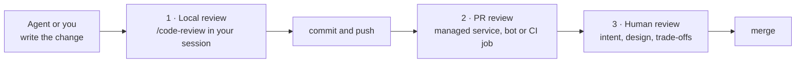
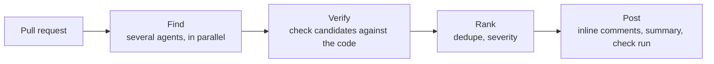
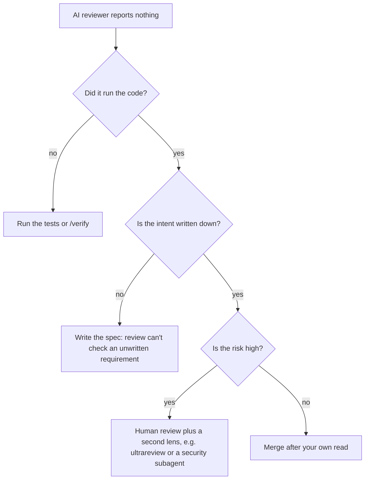

# Automated code review

## Why this matters

When an agent writes the code, the bottleneck moves: producing a diff is cheap, and reading it carefully is not. A reviewer that never gets tired and reads the surrounding code, not just the changed lines, catches the bugs a human skims past: an off-by-one in a loop bound, a missing `await`, a null path nobody tested. That frees your own attention for the questions only you can answer: is this the right change, does it match the intent, does it fit the design.

The other half of the skill is knowing what an AI reviewer cannot do. The docs for Anthropic's own review service say it plainly: a review "may miss bugs, security vulnerabilities, or other issues," and a review with no findings "doesn't mean your code is error-free or secure" ([Code Review](https://code.claude.com/docs/en/code-review)). Treat automated review as a second pair of eyes, never as the approval.

This chapter builds on [6.1](/part-06-claude-code/6.1-how-claude-code-works): a review is just another Claude Code session (or subagent) reading your repository, so what it knows about your standards comes from the same CLAUDE.md files, and it costs context and usage like everything else.

**Learning goals**

- Use local and PR-level AI review
- Customize review for your standards
- Know what AI review misses

## Explanation

### Three places a review can run

A change can be reviewed at three moments, and they trade off differently:

- **Local review** runs before anything leaves your machine. It is the cheapest place to find a bug: nobody else has seen the change, no CI minutes were spent, and the agent that wrote the code is still in context to fix it.
- **PR review** runs where the team already looks. Its output is comments on the pull request, so it is visible to every reviewer and leaves a record.
- **Human review** is still the last gate. The point of the first two is that you arrive at it with the mechanical bugs already removed.

### Local review with /code-review

`/code-review` is a command you type in a Claude Code session. With no target it reviews your branch's commits ahead of its upstream branch plus your uncommitted changes (and compares against `main`, or the previous commit, if the branch has no upstream). It works on any plan, and the review runs in your own session, so it counts against your plan usage like the rest of the session ([Review locally with /code-review](https://code.claude.com/docs/en/code-review-local)). `/review` is an alias.

Things worth knowing, all from that page:

- **It runs as a background subagent** in a terminal session, with its own context window, so a large diff does not fill your conversation. The findings arrive as text in your conversation when it finishes. The mechanism is the one from [6.5](/part-06-claude-code/6.5-parallel-work): fresh context, one job, a report back.
- **The target is flexible.** A pull request number (`/code-review 1234`), a branch range (`/code-review main...my-feature`), a path (`/code-review src/auth`) or a commit range (`/code-review HEAD~15..HEAD`).
- **Flags.** `--fix` also asks Claude to apply the findings to your working tree (edits still go through your permission mode, see [6.4](/part-06-claude-code/6.4-hooks-permissions)). `--comment` posts the findings on a GitHub pull request as inline comments.
- **Effort trades coverage for confidence.** At `low` the review reports only what it is most confident in, so you see fewer false positives; from `medium` to `max` it broadens coverage. If you do not type a level, it reuses the last one you typed, even from an earlier session. That is a surprise worth remembering: a review you thought was thorough may be running at `low`.
- **It reads your CLAUDE.md**, including in a non-interactive `-p` run, but not `REVIEW.md` (next section).
- **Edits are not fully covered by `/rewind`.** A background review's `--fix` edits fall outside the session's checkpoints, so use git to undo them. This is one reason to commit before running `--fix`.

Review is also something you can build yourself. The docs list the options side by side: the managed service, `/code-review`, the cloud-based ultrareview, Claude in your own CI, and "your own reviewer, as a subagent or skill" ([Code Review](https://code.claude.com/docs/en/code-review), "Compare ways to get a review"). A custom reviewer subagent, like the one in experiment 29, is the right tool when you want a narrow lens (security only, API compatibility only) rather than a general bug hunt.

::: info 📖 Read now
[Claude Code docs: Review locally with /code-review](https://code.claude.com/docs/en/code-review-local) · docs · ~10 min · **essential**

Look for: the table of targets, what `--fix` does and does not let you rewind, how effort level changes the number of findings, and the note that the command reads `CLAUDE.md` but not `REVIEW.md`. Then run it once on your latest branch and read the findings before opening the next section.
:::

### Pull-request review

On a pull request, review comes in three forms.

**1. Anthropic's managed Code Review service.** An Owner of a Claude Team or Enterprise organization turns it on for GitHub repositories. Per the docs, several agents read each change alongside the surrounding code, a verification step checks the candidates against the code and drops false positives, and the rest are deduplicated, ranked and posted as inline comments, a summary and a check run ([Code Review](https://code.claude.com/docs/en/code-review)).

Some properties that matter for how you use it:

- **It never approves or blocks.** The check run does not conclude as a failure, so the merge decision stays with your team.
- **Three severities**: 🔴 Important (a bug that should be fixed before merging), 🟡 Nit, and 🟣 Pre-existing (a bug the PR did not introduce) ([Read and request reviews](https://code.claude.com/docs/en/code-review-pull-requests)).
- **It reads, it does not run.** The docs say a review "works from reading the diff and the surrounding code, without building or running your code", with read-only repository access.
- **When it runs is a per-repository setting**: once after the PR opens, after every push, or only on request with an `@claude review` comment. More runs cost more, so "after every push" multiplies the cost by the number of pushes ([costs](https://code.claude.com/docs/en/code-review-costs)). It is billed on token usage through usage credits, not on your plan's included usage.
- **Responding.** Resolve the thread to dismiss a finding; replying alone does not. If you disagree, reply: the next review reads replies on its earlier findings. If the same kind of finding keeps coming back, the fix is a rule in `REVIEW.md`, not repeated arguing in threads.

It needs a Team or Enterprise plan, so you may not have it. The study's practice works without it.

**2. Claude in your own CI.** The Claude Code GitHub Action can run a review skill on every pull request in a workflow you control: you choose the prompt, the triggers and the model, and pay through your own API key ([GitHub Actions docs](https://code.claude.com/docs/en/github-actions), "Run a skill"). Chapter [7.4](/part-07-ai-native-development/7.4-ci-background-agents) covers CI and background agents in depth; here, note only that this is the do-it-yourself version of the same idea, and it is the one open to a Pro-plan learner with an API key.

**3. Other vendors' review bots.** Several products do the same job (a bot that comments on every PR). This chapter does not survey them: they change quickly, and the questions to ask are the same ones below for any of them. What does it read besides the diff? Can you give it your standards? Does it verify before it posts? Does it block merges, or only comment? Where does your code go?

**A deeper pass: ultrareview.** `/code-review ultra` runs a fleet of reviewer agents in a cloud sandbox and independently reproduces each finding. The docs describe it as a research preview that needs a claude.ai login and has its own cost, shown in a confirmation dialog before it starts ([Ultrareview](https://code.claude.com/docs/en/ultrareview)). Use it for a change that is large or risky; use plain `/code-review` as the everyday check.

### Review against your standards and specs

A generic reviewer looks for generic bugs. The review that earns its keep also knows what *this* repository considers wrong, and what *this* change was supposed to do. Three levers, from cheapest to most work:

**CLAUDE.md for rules that apply everywhere.** Both the local command and the managed service read your `CLAUDE.md` files. The service reads the root file and the files in the parent directories of each changed file, and treats a violation as a finding ([Customize Code Review](https://code.claude.com/docs/en/code-review-customize)). So "never import from `src/internal` outside its package" written once in CLAUDE.md (see [6.2](/part-06-claude-code/6.2-claude-md-and-memory)) steers the agent that writes code *and* the one that reviews it.

**REVIEW.md for rules that exist only for review.** This is a freeform Markdown file at the repository root that the managed service reads (and that the local command does **not** read). The docs' suggestions map the problem you see to the instruction to write:

| Problem | Instruction that addresses it |
|---|---|
| The wrong things are marked Important | Redefine what Important means in your repo: breaks behaviour, leaks data, and so on; style is Nit at most |
| Too many nits | Cap them: "report at most five Nits per review" |
| Comments on generated files, or on what CI already checks | List paths and categories to skip (lockfiles, generated code, lint) |
| A team rule isn't being checked | State it: "new API routes must have an integration test" |
| Findings that turn out to be wrong | Require evidence: "behaviour claims need a `file:line` citation, not an inference from naming" |

Two details save you a debugging session. First, the service reads `REVIEW.md` from the base or default branch, "never from the pull request's own changes", so you must merge the file before it takes effect, and the severity-lowering, exclusion and nit-cap instructions are honoured only when it is read from a protected branch. Second, the review can include other files and a skill's `SKILL.md` by an `@` line, but only under rules about location, size and count; if an include is silently ignored, read the docs' checklist before assuming the reviewer is ignoring you ([Customize Code Review](https://code.claude.com/docs/en/code-review-customize)).

::: info 📖 Read now
[Claude Code docs: Customize Code Review](https://code.claude.com/docs/en/code-review-customize) · docs · ~15 min · **essential**

Look for: the example `REVIEW.md` and the five problem-to-instruction pairs (read them as a checklist for your own repo), which branch the file is read from and why, and the difference between what the service and the local command read. Skip the sections on includes and skill files until you need them.
:::

**Specs and tests for "was this the right change?".** CLAUDE.md captures standards; it cannot capture intent for one particular change. For that you give the reviewer the spec the change was built from ([7.1](/part-07-ai-native-development/7.1-spec-driven-development)) and ask for a comparison: which acceptance criteria does the diff satisfy, which does it miss, and what does it do that nobody asked for. With the local command, ask in plain language after the review (the text after the flags is read as the review target, so it is not the place for instructions); with a custom reviewer subagent you can put the spec path in its prompt. The tests from [7.2](/part-07-ai-native-development/7.2-tdd-with-agents) matter here too: a reviewer that sees a failing or missing test for a stated requirement has something concrete to point at.

A caution, labelled as my own reasoning, not the docs': the more of your standards you can express as *mechanical* checks (lint rules, type checks, tests in CI, [hooks](/part-06-claude-code/6.4-hooks-permissions)), the better. A linter never has a bad day and never gets talked out of a finding. Keep the AI reviewer for judgment calls that a rule cannot express, and tell it (in `REVIEW.md`: "anything CI already enforces") not to duplicate the machines.

### False positives and blind spots

There are two different failure modes and they need different responses.

**False positives: the reviewer reports something that is not a bug.** They cost attention, and enough of them teach the team to ignore the bot. The mitigations are mostly the ones above: low effort for fewer findings, a verification step (built into the managed service and ultrareview), requiring evidence in `REVIEW.md`, nit caps, and excluding generated code. When you disagree with a finding, answer in the thread or add a rule, so the correction is stored where the next review reads it.

**False negatives: the reviewer reports nothing and the bug is there.** These are the dangerous ones because silence looks like approval. Why they happen follows from how the reviewer works:

- **It reads; it does not run.** The managed service reads the diff and surrounding code without building or running it. A reviewer that has not executed the code can reason about a race condition or a performance problem, but it cannot observe one. This is the argument for tests ([7.2](/part-07-ai-native-development/7.2-tdd-with-agents)) and for actually running the change (Claude Code's `/verify` command does this: it builds and runs your app and observes the result, per the [commands reference](https://code.claude.com/docs/en/commands)).
- **It sees what it is shown.** A review reads the diff plus nearby code. Problems caused by something far from the change (a caller in another service, a database constraint, a deployment setting, a feature flag's current value) are outside what it can see. Whole-system behaviour and production data are not in the repository.
- **It judges code against the intent it can infer.** If the spec is wrong or missing, the code can be a faithful implementation of the wrong thing and look fine. Review can check consistency with a stated requirement; it cannot know a requirement nobody wrote down.
- **It shares the author's blind spots, in part.** When the same model family wrote the change and reviews it, a misconception can be repeated on both sides. I am stating this as a hazard to plan for, not as a measured rate: I have no source for how often it happens. Mitigations are cheap: use a fresh context (the local command's subagent has one), vary the lens (a security-only reviewer next to a general one), and keep tests that were written from the spec, not from the code.
- **Coverage is probabilistic.** Reviews are not exhaustive: a second run on the same code can report different things, and the effort level changes how much gets reported. "No findings" at `low` effort means "nothing it was highly confident in", not "clean".
- **The review does not follow policy by itself.** Security-sensitive changes, migrations and public API changes need a human decision on trade-offs. What stays with humans is the subject of [7.6](/part-07-ai-native-development/7.6-humans-in-the-loop).

A practical stance follows from these: use the AI reviewer to remove the mechanical bugs and to ask "did you consider X?"; keep the merge decision, the intent check and anything irreversible with a person; and measure the reviewer on your own repo (see the practice) instead of trusting a vendor's claims or this chapter's.

::: info 📖 Read now
[Claude Code docs: Code Review](https://code.claude.com/docs/en/code-review) · docs · ~10 min · optional

Look for: the four stages (find, verify, rank, post) and what each is for; the line that a review never approves or blocks; the "what a review can access" section (read-only, no building or running); and the options table at the end, which is a menu of review setups from lightest to heaviest.
:::

::: info 📖 Read now
[Claude Code docs: Read and request reviews on a pull request](https://code.claude.com/docs/en/code-review-pull-requests) · docs · ~10 min · optional

Look for: the three severity levels, how to dismiss versus fix versus dispute a finding, and why a later automatic review posts fewer nits (it focuses on what changed since the last one). Useful if your team has the managed service; skim otherwise.
:::

## Practice

**Brief:** Review your last `project/` change with an AI reviewer and by yourself. Compare the findings.

**Where:** A step in the growing `project/` (see `project/ROADMAP.md`). Put your notes in `project/REVIEW-NOTES.md`; any fixes you make go in `project/` as ordinary commits. The step builds on the project's most recent change (roadmap step 22, the test-first feature from [7.2](/part-07-ai-native-development/7.2-tdd-with-agents)). If you have not done 7.2 yet, use whichever commit last touched `project/`: any change of 30 lines or more will do.

**Steps:**

1. **Pick the change.** Find the commit or branch range for your last `project/` change (`git log --oneline -- project/`). Note its range in `project/REVIEW-NOTES.md`. Skim the original spec or issue for it so you know the intent.
2. **Review it yourself first, without AI.** Read the diff as a reviewer would, with a timer, and write every concern down in the notes as you go: file and line, what you think is wrong, and your confidence (high, medium or low). Do this before step 3 so the AI's findings do not steer you.
3. **Run the AI review.** In a fresh Claude Code session at the project root, run `/code-review` against that range (for example `/code-review HEAD~3..HEAD`), at `medium` effort. Do not pass `--fix`. Copy the findings into the notes verbatim.
4. **Classify every finding, from both lists.** For each item: *real bug*, *real but trivial*, *false positive*, or *not sure*. To decide, reproduce it: write a failing test, run the code, or read the lines again. Put the evidence in the notes. A classification without evidence does not count.
5. **Compare.** In a small table, mark which findings only you found, which only the AI found, and which both found. Write two or three sentences: what kind of problem did each side catch? What did neither catch (if you know of a defect that was missed, add it)?
6. **Teach the reviewer your standards.** From the false positives and misses, write two or three concrete lines for your project's `CLAUDE.md` (the local review reads that file, and `REVIEW.md` too if you adopt the managed service). Re-run `/code-review` on the same range and record whether the findings changed. Keep the rules that helped and delete the rest.
7. **Optional, once:** run the same range with `/code-review low` and again at `high`, and record how the number of findings and the false-positive rate change. If you want a PR-level setup, add a GitHub Actions review workflow (see [7.4](/part-07-ai-native-development/7.4-ci-background-agents)) on a throwaway repo and compare its output with the local one.

**Done when:**

- `project/REVIEW-NOTES.md` has your own review (written before the AI's), the AI's findings, and every finding classified with evidence.
- There is a comparison table and a short written conclusion naming one thing each side missed or caught best.
- At least one real bug or improvement found in the review is fixed in `project/` in its own commit.
- `CLAUDE.md` has at least one new review rule justified by a specific false positive or miss, and you re-ran the review to see its effect.
- You can state the AI reviewer's false-positive count on this change, and whether you would trust its silence on a change like it.

## Check questions

1. A teammate says "the AI review found nothing, so it's safe to merge". Give two reasons this is not enough.

   

Answer

   Any two of: the review is not exhaustive and can miss bugs and security issues (the service's own docs say a review with no findings does not mean the code is error-free); it reads the diff and surrounding code without building or running it, so behaviour that only shows at runtime is invisible; it can only judge against intent it can infer, so a wrong or missing spec passes; and at low effort it reports only high-confidence findings, so silence means "nothing it was sure of". The managed service also never approves or blocks, by design: the merge decision is the team's.

   

2. What is the difference between `CLAUDE.md` and `REVIEW.md` for review, and where would you put the rule "never log user email addresses"?

   

Answer

   `CLAUDE.md` is project guidance read by the writing agent, the local `/code-review` command and the managed review service. `REVIEW.md` is read only by the managed service and holds review-only instructions: severity calibration, nit caps, paths to skip. A rule that should shape how code is written *and* reviewed belongs in `CLAUDE.md`, and "never log email addresses" is such a rule, so it goes there; then the local review sees it as well. The managed service also reads a `REVIEW.md` rule, but the local command does not, so a rule only in `REVIEW.md` would not apply to local reviews.

   

3. Your AI reviewer posts ten comments per PR and eight are style nits. What are two changes that reduce this without losing real bugs?

   

Answer

   In `REVIEW.md`: cap nits ("report at most five Nits"), define Important as bugs that break behaviour or leak data with style as Nit at most, and list what CI already enforces so it is not repeated. Better still, move the style rules into a linter so a machine enforces them. On the local command, use a lower effort level to get only high-confidence findings. Remember that `REVIEW.md` changes only take effect once merged to the protected default branch, not from the PR that adds them.

   

4. Why does a reviewer that never executes the code have a structural blind spot, and what do you add to cover it?

   

Answer

   It can reason about what the code would do, but it cannot observe it: races, performance, integration behaviour and anything that depends on configuration or data outside the repository only show up when something runs. Cover it with executable checks: tests that were written from the spec (7.2), CI, and running the change (for example with Claude Code's `/verify`), so the reviewer's reading and the machine's execution cover different failure classes.

   

5. When would you reach for ultrareview or a custom reviewer subagent instead of the plain `/code-review` command?

   

Answer

   Ultrareview for a large or risky change where extra cost is worth broader, independently verified coverage (it runs in the cloud, needs a claude.ai login, and is a research preview with its own cost). A custom reviewer subagent when you want a narrow, repeatable lens, such as security only or compatibility of a public API, or a second reviewer with a different prompt than the one that wrote the code. Plain `/code-review` stays the everyday, cheap local check before you commit or push.

   

## My understanding

<!-- Written by the learner, in their own words. Agents never fill this in. -->
