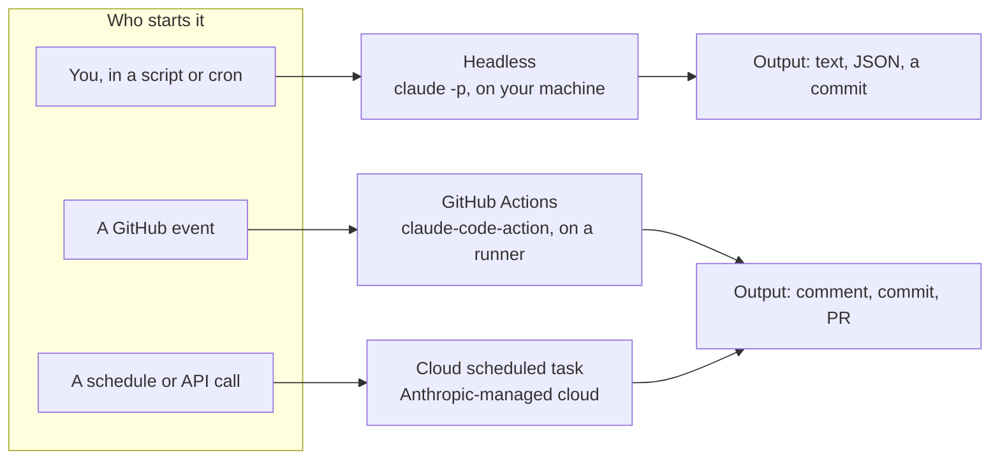
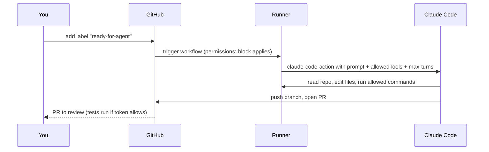
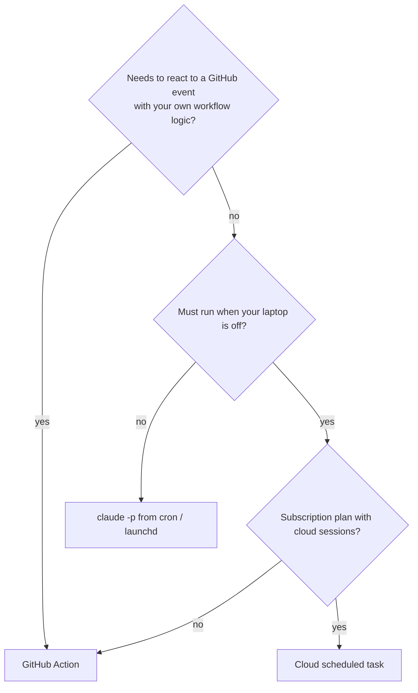

# CI and background agents

## Why this matters

Everything so far in this part ran with you at the keyboard: you answered permission prompts, read the diff, steered. Much of the value of an agent comes from the opposite case: a labeled issue becomes a pull request while you do something else, a review runs on every PR, a weekly job checks that a document is still true. None of that needs a terminal session of yours. It needs the same agent, started by an event instead of by you.

The price is that nobody is there to say no. An unattended agent has no one to answer a permission prompt, can be steered by text it reads (an issue body, a PR comment), holds credentials, and spends money on a clock. So this chapter is half "how to start an agent from CI or a schedule" and half "what you must decide in advance, because no one will be present to decide it": which tools it may call, which secrets it holds, what it can push to, and when it must stop.

It builds on [7.3](/part-07-ai-native-development/7.3-automated-review), which already put Claude into a PR workflow, and on [6.4](/part-06-claude-code/6.4-hooks-permissions) for permission rules.

**Learning goals**

- Run Claude Code headless and in GitHub Actions
- Set up a scheduled or background agent
- Control cost and permissions for unattended runs

## Explanation

### One agent, four launchers

Every setup in this chapter runs the same Claude Code agent loop ([3.1](/part-03-agents/3.2-agent-loop)). What differs is who starts it, where it runs, and who answers its questions:



| Launcher | Runs on | Started by | Billed to |
|---|---|---|---|
| `claude -p` (headless) | your machine, or any machine with the CLI | a script, cron, another program | your API key, or your subscription login |
| GitHub Action | a GitHub-hosted (or self-hosted) runner | a workflow trigger: comment, label, PR, cron | API key or OAuth token, plus Actions minutes |
| Cloud scheduled task | Anthropic-managed cloud | a schedule, an HTTP call, a GitHub event | your subscription usage |

### Headless mode: `claude -p`

Headless mode is the CLI without the interactive screen. `claude -p "<prompt>"` runs the agent loop once, prints the result and exits, with a zero exit code on success and non-zero on failure ([Run Claude Code programmatically](https://code.claude.com/docs/en/headless)). That makes the agent an ordinary Unix program you can put in a script, a git hook or a CI step.

The flags that matter for unattended use, all from that page:

- **`--output-format`**: `text` (default), `json` or `stream-json`. The JSON result carries fields such as `total_cost_usd` and a `session_id`, so a wrapper script can log cost per run, or chain a second call with `--resume <session_id>`.
- **`--json-schema`** with `--output-format json`: the final answer arrives in a `structured_output` field that matches your schema. If a run ends without valid structured output, the field is absent, so check for it rather than assume.
- **`--allowedTools`**: pre-approve tools with the same rule syntax as permission rules: `--allowedTools "Bash(git diff *),Bash(git status *)"`. Mind the space: per the docs, `Bash(git diff*)` without it would also match `git diff-index`.
- **`--permission-mode`**: sets the mode for the run. Without one, `claude -p` starts in the default (Manual) mode, where a call that needs approval is simply denied because no one can approve it.
- **`--permission-prompts none`**: "when nobody is available to answer permission prompts, for example in a scheduled job." The docs give a minimum Claude Code version for it, so check the page against your installed version.
- **`--bare`**: skips auto-discovery of hooks, skills, plugins, MCP servers, auto memory and `CLAUDE.md`, for faster and more reproducible starts. It does not use your subscription login (you must set `ANTHROPIC_API_KEY`), and the docs call it the recommended mode for scripted calls that will become the default for `-p` in a future release. The trade-off for you: a bare run does not read your `CLAUDE.md`, so any rule you need must be in the prompt or in `--append-system-prompt`.
- **`--max-budget-usd`**: a spend cap, mentioned on that page only in passing, so confirm it in `claude --help` or the [CLI reference](https://code.claude.com/docs/en/cli-reference) before relying on it.

A minimal unattended call looks like this:

```sh
claude -p "Run the test suite and fix any failures" \
  --allowedTools "Bash,Read,Edit" --output-format json
```

::: info 📖 Read now
[Claude Code docs: Run Claude Code programmatically](https://code.claude.com/docs/en/headless) · docs · ~15 min · **essential**

Look for: the `--output-format json` fields, the `--allowedTools` rule syntax and its trailing-space warning, what `-p` does when a call needs approval (it is denied), `--bare` and its login caveat, and the exit-code and SIGTERM notes. Then run one `claude -p` command with `--output-format json` and read `total_cost_usd` in the result.
:::

### Permissions when nobody is watching

The central design question for any unattended run is: *what happens when the agent wants to do something you did not pre-approve?* In an interactive session it asks you. Headless, there are three answers, and picking one is the main decision ([Permission modes](https://code.claude.com/docs/en/permission-modes)):

| Mode | What it does with an un-approved call | Fits |
|---|---|---|
| `dontAsk` | Denies everything that would otherwise prompt; only pre-approved tools run | Locked-down CI with an exact allowlist: "the most predictable choice" |
| `auto` | A background classifier reviews calls and blocks risky ones | Longer tasks where listing every command is impractical; blocked actions are denied silently, so a run may stop short |
| `bypassPermissions` | Runs everything | "Isolated containers and VMs only" |

My recommendation, labeled as my own judgment: start with `dontAsk` plus a short `--allowedTools` list, run it, read what was denied, and widen the list one rule at a time. This is slower than `--dangerously-skip-permissions` and it is the only version where you can state in one line what the agent is able to do. If you do need full permissions, the container or VM is the control, not the flag: the permission-modes page says deny rules still apply in bypass mode, but "isolated" is what makes the rest safe. Sandboxing is the subject of Part 8; the point to take now is that *the amount of trust you extend should match what the environment can lose*.

A second angle: what the agent reads is as important as what it can do. In CI the input is often text written by someone else: an issue body, a PR description, a code comment. An agent that holds write access and reads untrusted text can be talked into using that access. The GitHub Action's own check is a first line: for comment-driven runs the triggering user needs write access, bot actors are rejected unless listed, and fork PRs on public repositories get no secrets ([GitHub Actions docs](https://code.claude.com/docs/en/github-actions)). Treat those as a floor. The rest is yours: a read-only default, a small tool list, no secrets in the job beyond what it needs, and a human reading the PR before it merges. (The full threat model, including prompt injection, is in Part 8.)

### GitHub Actions

The official integration is the `anthropics/claude-code-action` GitHub Action. Per the docs there are two ways to set it up: run `/install-github-app` inside Claude Code (needs the `gh` CLI logged in), or install the [Claude GitHub App](https://github.com/apps/claude), add a secret and copy a workflow file by hand, which needs admin access to the repository ([Claude Code GitHub Actions](https://code.claude.com/docs/en/github-actions)). The workflow references `anthropics/claude-code-action@v1`; the page tells anyone still on `@beta` to update to `v1`.

It has two modes, chosen by one input:

- **Interactive** (no `prompt` input): someone writes `@claude` in a PR or issue comment, and the action analyzes, implements and pushes. The trigger word is configurable (`trigger_phrase`).
- **Automation** (a `prompt` input): the workflow runs on any event with a fixed instruction: a label, a PR opening, a cron schedule.

Here is the docs' interactive example, trimmed to what matters:

```yaml
on:
  issue_comment:
    types: [created]
jobs:
  claude:
    if: contains(github.event.comment.body, '@claude')
    runs-on: ubuntu-latest
    permissions:
      contents: write
      pull-requests: write
      issues: write
    steps:
      - uses: actions/checkout@v6
        with:
          fetch-depth: 1
      - uses: anthropics/claude-code-action@v1
        with:
          anthropic_api_key: ${{ secrets.ANTHROPIC_API_KEY }}
```

The docs' example also lists `id-token: write` and `actions: read` and a `pull_request_review_comment` trigger; copy the full file from the page rather than from here. Points worth understanding, each from that page:

- **Secrets.** `ANTHROPIC_API_KEY` (an API key, billed per token) or `CLAUDE_CODE_OAUTH_TOKEN` (generated with `claude setup-token`, for subscription plans; runs then use your subscription instead of API billing). Both live in repository secrets and are referenced as the `secrets` context, never written in the file. Alternatively the action can authenticate to Bedrock, Vertex or Foundry through OIDC federation, so no static cloud key exists at all.
- **A plain-text prompt gives the agent no tools.** The docs say that with a plain-text prompt "Claude has no shell or GitHub API access until you grant the tools the prompt needs", via `--allowedTools` in the `claude_args` input or a `permissions.allow` rule in the `settings` input. So the allowlist is not optional polish, it is how the job works. `claude_args` takes ordinary CLI flags: `--max-turns`, `--model`, `--allowedTools`, `--mcp-config`.
- **Two permission systems.** The `permissions:` block at the top of the job limits what the *GitHub token* can do (write contents? comment on PRs?). `--allowedTools` limits what the *agent* can run. They guard different things; set both as tightly as the task allows.
- **Schedules have sharp edges.** GitHub runs scheduled workflows only from the default branch, and in public repositories disables the schedule after 60 days without repository activity. Events with no human author, such as a `schedule`, skip the write-access check, and the run is attributed to whoever last changed the cron.
- **CI will not run on the agent's commits by default.** Workflows do not trigger on commits made with the default `GITHUB_TOKEN`, so if you want your test workflow to run on the agent's PR, do not pass the `github_token` input set to the default token (the docs say to omit it so the action acts as the Claude app).
- **Cost has two meters:** Actions minutes and API tokens. The docs list the levers: `--max-turns`, workflow-level timeouts, concurrency controls and a concise `CLAUDE.md`.



The review workflow from [7.3](/part-07-ai-native-development/7.3-automated-review) is the same machinery with a different prompt. And the same idea scales down: a headless script in a pre-push hook is "CI on your laptop".

::: info 📖 Read now
[Claude Code docs: Claude Code GitHub Actions](https://code.claude.com/docs/en/github-actions) · docs · ~20 min · **essential**

Look for: the two setup paths, the interactive versus automation example, the `claude_args` table, the sentence about plain-text prompts having no shell access, the cost section, and who is allowed to trigger a run. Copy the example workflow into your throwaway repo as the starting point for the practice.
:::

### Cloud sessions and scheduled tasks

GitHub Actions makes you own the runner and the workflow file. Claude Code on the web offers the same agent on Anthropic-managed infrastructure ([Claude Code on the web](https://code.claude.com/docs/en/claude-code-on-the-web)). A *cloud session* clones your GitHub repository into a VM; you can start one from the CLI with `claude --cloud "<task>"` (the VM clones the remote at your current branch, so push first), follow up with `claude -p "<message>" --cloud <session-id>`, or pull it back to your machine with `claude --teleport <session-id>`. It is available on Pro, Max, Ultra and Team plans (and some Enterprise seats), and it shares rate limits with the rest of your Claude usage. Two limits worth noting: it is not available through Bedrock, Vertex or other third-party providers, and "Bypass permissions isn't available", so cloud runs use Accept edits, Plan or Auto.

A **scheduled task** (the docs say "formerly a routine") packages a prompt, one or more repositories and connectors, and runs it as a full cloud session with no one present ([Scheduled tasks](https://code.claude.com/docs/en/routines)). The page marks scheduled tasks as a research preview, so details may change; treat the specifics below as a snapshot of 2026-11-12. It has three trigger types, and one task can combine them:

| Trigger | What starts it | Note |
|---|---|---|
| Schedule | Hourly, nightly, weekly or once at a time | Five-field cron in UTC; expressions that run more often than hourly are rejected; avoid the top of the hour, which can start late |
| API | An HTTP POST to the task's own endpoint with a bearer token | Sent under an experimental beta header per the docs; claude.ai users only, not part of the Claude Platform API |
| GitHub | Pull request, release or issue events | Filters on author, title, labels, branches and more; excess events are dropped when hourly caps are hit |

Facts about permissions and blast radius, from the same page, are exactly the questions from the previous section answered by the platform:

- You do not choose a permission mode when you create a task; a new run begins in auto mode where available, and still stops for prompts in some cases (an action matching an `ask` rule).
- Claude pushes to a branch prefixed `claude/` unless the prompt says otherwise, and "To control which branches a run can push to, use branch protection rules or rulesets on GitHub." Control lives in GitHub, not in the prompt.
- Tasks belong to your individual claude.ai account, and commits and PRs carry your GitHub user.
- The fired prompt "is not live user input and can't act as approval or consent". A trigger cannot be used to pre-approve a risky action.
- Network access defaults to limited, with package managers allowed; blocked hosts return a 403.
- If the GitHub connection breaks, runs skip for up to 72 hours and then the task turns off.

The page also states hourly caps on runs. I did not verify the exact numbers against the rendered page (my fetch of that section was truncated and summarized), so look them up there when you need them. Runs also count against your subscription usage; see [6.8](/part-06-claude-code/6.8-pro-limits) for what that means on Pro.

Two other ways to schedule exist and are only worth naming: scheduled tasks and `/loop` that run on your own machine (the routines page points to them), and plain cron or launchd calling `claude -p`. This book's own release pipeline is the latter: a launchd job runs every 15 minutes and drives headless sessions (see the root `CLAUDE.md`).

::: info 📖 Read now
[Claude Code docs: Scheduled tasks (cloud)](https://code.claude.com/docs/en/routines) · docs · ~15 min · **essential**

Look for: the three trigger types, the cron limits, how permissions and the `claude/` branch prefix work, what a run can and cannot do without a prompt, and the "research preview" banner. Decide for each task of your own whether it needs your laptop on (headless, launchd) or not (cloud).
:::

::: info 📖 Read now
[Claude Code docs: Permission modes](https://code.claude.com/docs/en/permission-modes) · docs · ~10 min · optional

Look for: the table of six modes with "best for", the line on `dontAsk` for CI, and the caution on `bypassPermissions`. It is the reference for choosing a mode for any unattended run.
:::

### Choosing a launcher, and keeping it cheap



Whichever you pick, the same controls decide whether an unattended agent is safe and affordable. A checklist in order of effect:

1. **A narrow trigger.** A label that only you can apply beats "any issue comment". Anything the agent reads from an untrusted author is an input it can be steered by.
2. **A narrow allowlist.** Name the commands: `Bash(npm test)`, not `Bash`. In a plain-text-prompt Action the allowlist is also what gives it any tools.
3. **Least-privilege tokens.** The job's `permissions:` block, a repository-scoped credential, and no secrets the task does not need.
4. **Output goes to a branch and a PR, not to `main`.** Branch protection is the control that stays true whatever the prompt says.
5. **A hard stop.** `--max-turns`, a `timeout-minutes` on the job and a `concurrency` group so one label flurry does not start ten runs.
6. **A measured cost.** Log `total_cost_usd` from `--output-format json`, and compare it across runs. Prices belong in [Landscape](/landscape#access-routes), not here.
7. **A human reads the diff.** Where humans stay in the loop is [7.6](/part-07-ai-native-development/7.6-humans-in-the-loop).

## Practice

**Brief:** Set up a workflow that runs an agent on a labeled issue in this repo (or a scheduled weekly `landscape.md` freshness check) and opens a PR.

**Where:** `experiments/31-background-agent/` (a standalone experiment, not a `project/` step). The folder has a README with tables to fill. You write the workflow; this chapter does not give it to you beyond the docs' example.

**Steps:**

1. **Pick the brief and the repo.** Option A: when an issue gets the label `ready-for-agent`, the agent implements it and opens a PR. Option B: every week, the agent checks `book/landscape.md` for entries whose `last_verified`-style date is old or whose links no longer load, and opens a PR with proposed edits. Use a throwaway GitHub repository first (copy a small piece of this one) so a mistake costs nothing. Record the choice and the auth method (API key secret or OAuth token) in the README.
2. **Dry-run headless on your machine.** Write the prompt as a file and run it with `claude -p` using `--output-format json`, `--permission-mode dontAsk` and an `--allowedTools` list you build up one denied call at a time. Note `total_cost_usd` and the final allowlist.
3. **Write the workflow.** Start from the docs' example. Trigger on the label (`issues: types: [labeled]`, with an `if:` on the label name) or on `schedule`. Set the job's `permissions:` to the minimum, put the key in a repository secret, give the prompt tools via `claude_args`, and add `--max-turns`, `timeout-minutes` and a `concurrency` group.
4. **Decide how it opens a PR.** The agent needs to push a branch and open a PR; work out which tools and which token permissions that takes (the `gh` CLI under `Bash(gh pr create *)`, or the action's built-in behaviour) and record your choice and why.
5. **Run it.** Apply the label to a small, well-specified issue (or trigger the schedule manually with `workflow_dispatch` while testing). Read the Actions log, then the PR. Record minutes, cost and outcome in the README table. Did your test workflow run on the agent's PR, and if not, why?
6. **Break it on purpose, twice.** Remove one tool from the allowlist and observe how the run fails (denied call, no change, or a PR without a result). Then set `--max-turns` to 2 and see what a run that is cut off leaves behind.
7. **Untrusted input.** Put an instruction in the issue body that the agent should not follow (for example, to print an environment variable or edit a file outside the task). Record what happened and which control prevented it, or write what you would add if nothing did.
8. **Optional:** repeat the Option A or B run as a cloud scheduled task from `/schedule`, and compare setup effort, cost visibility and the branch it pushed to.

**Done when:**

- A workflow file exists in the throwaway repo with a narrow trigger, a minimal `permissions:` block, a repository secret, an allowlist, `--max-turns`, a timeout and a concurrency group.
- At least one run produced a pull request, and you reviewed its diff before merging or closing it.
- `experiments/31-background-agent/README.md` records the dry-run cost, the Actions minutes and cost of each real run, and what the two deliberate failures looked like.
- You can say what the injected instruction in step 7 did, and which control would stop a hostile version of it.
- Any spend is in `costs.md`.

## Check questions

1. In headless mode, a run needs to call `git push` and nothing in your configuration approves it. What happens, and how do you fix it without opening everything?

   <details><summary>Answer</summary>

   With no one to approve it, a call that needs approval is denied (per the headless docs, in the default mode). The run does not hang for input. Fix it by pre-approving exactly that command with `--allowedTools "Bash(git push *)"` (or a `permissions.allow` rule), not by switching to `--dangerously-skip-permissions`. Use `dontAsk` so anything else you forgot is also denied rather than prompting.

   </details>

2. Your workflow sets `prompt:` with a plain-text instruction and no `claude_args`. Why does it do nothing useful, and what are the two permission systems you must configure?

   <details><summary>Answer</summary>

   With a plain-text prompt the agent has no shell or GitHub API access until you grant tools, via `--allowedTools` in `claude_args` or a `permissions.allow` rule in `settings`. The two systems are the job's `permissions:` block (what the GitHub token may do) and the agent's tool allowlist (what the agent may run); they guard different things.

   </details>

3. Name three controls that limit the damage if an issue body contains a prompt-injection attack, and say which of them does not depend on the model behaving.

   <details><summary>Answer</summary>

   Any three of: a trigger only trusted users can fire (a label), a narrow tool allowlist, a least-privilege token, no unneeded secrets in the job, output to a branch and PR, and human review of the diff. The ones that do not depend on the model are the mechanical ones: the allowlist, token permissions, secret scoping and branch protection. The prompt wording is the only control that does.

   </details>

4. A scheduled GitHub Actions workflow in a public repo stops running after two months. What are the likely causes, and how does a cloud scheduled task differ in where it runs?

   <details><summary>Answer</summary>

   GitHub disables scheduled workflows in public repositories after 60 days without repository activity, and runs them only from the default branch (so the workflow must be merged). A cloud scheduled task runs on Anthropic-managed infrastructure from a saved prompt and repositories, billed to your subscription usage, and has its own failure modes (for example turning off after a broken GitHub connection).

   </details>

5. The agent's PR from your workflow shows no CI checks. Why might that be?

   <details><summary>Answer</summary>

   Workflows do not trigger on commits or PRs made with the default `GITHUB_TOKEN`. If you passed the `github_token` input set to the default token to the action, remove it so the action acts as the Claude app, whose pushes do trigger workflows (per the docs).

   </details>

## My understanding

<!-- Written by the learner, in their own words. Agents never fill this in. -->
