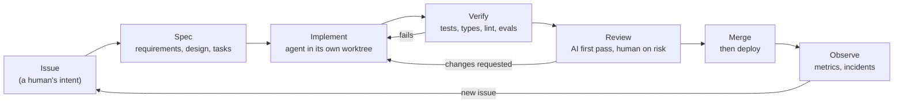

# Automating the whole lifecycle

## Why this matters

The earlier chapters of this part each automated one stage: a spec an agent can implement ([7.1](/part-07-ai-native-development/7.1-spec-driven-development)), tests written first ([7.2](/part-07-ai-native-development/7.2-tdd-with-agents)), a review on every pull request ([7.3](/part-07-ai-native-development/7.3-automated-review)) and agents started by events instead of by you ([7.4](/part-07-ai-native-development/7.4-ci-background-agents)). Chained together, you get a pipeline in which a human writes down what is wanted and decides what ships, and agents do the stages between. This chapter is about the shape of that pipeline and about the two questions that decide whether it is worth having: where does it jam, and how would you know it helps?

The answer to the first is nearly always the same: producing code gets cheap, and *trusting* code does not. The answer to the second is less comfortable than most vendor posts suggest, because "it feels faster" is exactly the feeling that has been shown to be unreliable.

**Learning goals**

- Design an end-to-end agent-driven workflow
- Find the bottlenecks (usually review and verification)
- Measure whether it helps

## Explanation

### The pipeline: issue → spec → implement → review → merge

Every stage has the same anatomy: an input artifact, an agent (or a person) that transforms it, an output artifact, and a **gate** that decides whether the output may move on. Automating a stage means replacing the person with an agent. Automating the *lifecycle* means deciding, for each gate, what checks it and what happens when it says no.



| Stage | Input → output | What automates it | The gate | Chapter |
|---|---|---|---|---|
| Issue | an idea → a written, scoped request | you (the one step that stays human); an agent may *triage* | "Is this specified enough to hand off?" | [6.7](/part-06-claude-code/6.7-issue-workflows) |
| Spec | issue → requirements, design, tasks | an agent drafts, you edit | you approve the spec; each task has a check you can run | [7.1](/part-07-ai-native-development/7.1-spec-driven-development) |
| Implement | one task → a branch | a coding agent, started by a label, a schedule or a script | the task's own tests pass | [7.2](/part-07-ai-native-development/7.2-tdd-with-agents), [7.4](/part-07-ai-native-development/7.4-ci-background-agents) |
| Verify | branch → pass/fail + evidence | CI: tests, type check, lint, regression evals | all required checks green | [4.6](/part-04-evals-observability/4.6-regression-evals-ci) |
| Review | diff → approve / request changes | a review agent, then a human where risk is high | no unresolved findings; human sign-off by risk tier | [7.3](/part-07-ai-native-development/7.3-automated-review), [7.6](/part-07-ai-native-development/7.6-humans-in-the-loop) |
| Merge | approved branch → `main` | branch protection, merge automation | up to date, checks green | [6.5](/part-06-claude-code/6.5-parallel-work) |

Three design rules fall out of that table.

**1. Each stage hands over a file, not a conversation.** A fresh agent session has none of the previous session's context ([3.4](/part-03-agents/3.4-context-engineering)). The spec, the task list, the progress notes and the diff are what carry intent from stage to stage, so they must be written down where the next stage will read them. This is the same reason long-running agents keep a progress file ([5.6](/part-05-harnesses/5.6-long-running-agents)).

**2. Isolate the work.** Parallel agents need their own checkout so they do not overwrite each other: one git worktree and one branch per task ([6.5](/part-06-claude-code/6.5-parallel-work)). Two agents also must not take the same task, so something has to claim it. The simplest claim is a state change in the tracker (`Status: claimed`) or, in the compiler project below, a lock file committed to git.

**3. Make a failing gate send work *back*, not stop the line.** A red test or a "changes requested" review should become input to the next implementation attempt, with a cap on retries. After the cap, the task goes to a human with the failure attached. Without the cap, a stuck task burns money until something else stops it.

#### A pipeline you can read in this repo

This book is built with such a pipeline, so you can inspect one. The root `CLAUDE.md` and `.scratch/ai-engineering-book/spec.md` describe it:

- **Issue and spec.** Each chapter is an issue file under `.scratch/ai-engineering-book/issues/`, and every issue points at one spec that holds all shared intent. Tasks run in fresh sessions with no memory of how the spec was agreed, so, in the spec's own words, "everything a task needs to know about intent lives here".
- **Implement.** An agent claims the issue (`Status: claimed`), works in its own worktree `.worktrees/issue-NN` on branch `issue-NN`, and commits there only.
- **Verify.** `npm run check -- <id>` and `npm run build` must pass before the commit: a mechanical gate for format and links. Judgement the gate cannot make (are the claims true?) goes to a separate **fact-check pass** that runs later.
- **Merge.** A separate merge step combines branches into `main`. The release script (`scripts/book-auto.mjs`) runs every 15 minutes under launchd, stays within a weekly usage cap, and pushes `main` fast-forward only.

Notice what is *not* automated: deciding what the next chapter should say, and reading the result. The learner's own "My understanding" section is deliberately off-limits to agents. That is a gate drawn on purpose.

### Verification is the bottleneck

Suppose an agent can implement a task in ten minutes, and you need twenty to convince yourself the change is right. Making the agent twice as fast changes almost nothing; the slow stage is yours. This is Amdahl's law applied to a pipeline: the speed-up you get from automating one stage is capped by the stages you did not.

Anthropic describes the same shift from the inside. In a post about building its own source-control system, the authors write that "coding is no longer the bottleneck to building systems or doing research"; the bottleneck is "all of the developer infrastructure built for human scale: source control, builds, and CI". They report about 2,500 code changes merged per day in May 2026 and more than 30,000 per day by September, and that "every bottleneck we remove immediately leads to a further increase in the amount of code we produce" ([Redesigning source control at Anthropic](https://www.anthropic.com/research/redesigning-source-control), October 2026). Treat the numbers as one company's very unusual workload, which the post says openly, but the pattern is general: remove one jam and the next stage jams.

Why verification is hard to scale is worth stating precisely, because it points at what to do about it:

- **A passing test is evidence only as good as the test.** Nicholas Carlini, who had 16 agents write a C compiler, put it this way: Claude will work autonomously on whatever you give it, "so it's important that the task verifier is nearly perfect, otherwise Claude will solve the wrong problem". Most of his effort went into the tests and feedback around the agents, not the agents ([Building a C compiler with a team of parallel Claudes](https://www.anthropic.com/research/building-c-compiler), February 2026).
- **Agents find shortcuts.** In that project, Claude could not write the 16-bit x86 code generator Linux needs to boot, so, the post says, it "simply cheats" and calls out to GCC for that phase. A green result can hide a gap, which is why Carlini ends with unease: "it is easy to see tests pass and assume the job is done, when this is rarely the case."
- **Bigger diffs cost more to read.** DORA's research on generative AI found that, because AI lets developers produce code faster, it tends to produce larger batches that are slower to review and more prone to instability. Its headline association was a 1.5% fall in delivery throughput and a 7.2% fall in delivery stability for each 25% increase in AI adoption ([DORA: Impact of Generative AI in Software Development](https://dora.dev/ai/gen-ai-report/)). That is a statistical association from an earlier report (the PDF is dated March 2025), not a law, but the mechanism (batch size) is one you control.

So, a pipeline needs a **verification budget** designed like the rest of the system. A useful ladder, cheapest and most trustworthy first:

| Rung | What it checks | Cost to you | Weakness |
|---|---|---|---|
| Types, lint, build | The code is well-formed | near zero, runs in seconds | says nothing about behaviour |
| Tests written *before* the code ([7.2](/part-07-ai-native-development/7.2-tdd-with-agents)) | The behaviour you specified | low; the tests are the spec | only as good as the cases |
| A known-good oracle | Output matches a trusted reference | medium to build | needs a reference to exist |
| Regression evals ([4.6](/part-04-evals-observability/4.6-regression-evals-ci)) | Quality of non-deterministic behaviour did not drop | tokens per run | small sets are noisy |
| AI review ([7.3](/part-07-ai-native-development/7.3-automated-review)) | Bugs, missed requirements, style | tokens, no human time | shares blind spots with the author model; can over-engineer |
| Human review | Intent, risk, judgement | scarce, the thing to ration | slow, does not scale with output |

An example of the "oracle" rung from the compiler post: when all 16 agents kept hitting the same bug in the Linux kernel build, Carlini used GCC as an "online known-good compiler oracle". Most of the kernel was compiled with GCC and only some files with the agents' compiler, so a failure could be narrowed to a file and each agent could fix a different bug in parallel. The lesson generalises: when you cannot write a test, look for a trusted system whose output you can compare against.

The remaining rung, humans, is the one to ration deliberately. The Scion post describes review tooling that "can express complex semantic constraints on approvals, which lets us differentiate simple things like comment-only changes from sensitive logical changes, so that human reviewers can focus on the most consequential changes". It also describes dropping the classic merge queue, because "what does CI even mean when hundreds or even thousands of changes can merge while tests are running?", and investing in post-merge and pre-deploy automated testing instead, accepting that concurrent changes can conflict because Claude can usually fix conflicts faster than humans can notice them. Those are one organisation's choices at a scale you probably do not have; what transfers is the *principle* of risk-tiering: decide in advance which changes need a human, rather than reviewing everything equally or nothing at all. [7.6](/part-07-ai-native-development/7.6-humans-in-the-loop) develops that.

::: info 📖 Read now
[Building a C compiler with a team of parallel Claudes](https://www.anthropic.com/research/building-c-compiler) · article · ~25 min · **essential**

Look for: the `while true` loop that keeps an agent working; the lock files in `current_tasks/` and how git resolves a clash; the section "Write extremely high-quality tests" and the list of design-for-the-model rules (context pollution, time blindness); how GCC was used as an oracle; and the limitations list near the end, which is the honest accounting of what the tests did not catch. Ask of each lesson: which gate of my own pipeline would that be?
:::

### Metrics: throughput, defects, cost

"Did it help?" needs numbers taken *before and after*, on the same kind of work. Three families cover it. Pick a small number of each; a dashboard of twenty metrics will not be read.

| Family | Example measures | Watch out for |
|---|---|---|
| **Throughput** | changes merged per week; **lead time** (issue opened → merged); how long each stage waits | counting merged changes without their size or value |
| **Defects** | change fail rate; rework (fixes and reverts of merged work); review findings accepted vs rejected; bugs found after merge | measuring only what the pipeline itself catches |
| **Cost** | tokens and API spend per merged change; human minutes per merged change; cost of changes that were abandoned | leaving out the human time, which is usually the larger cost |

You do not have to invent the first two families. DORA defines five software-delivery metrics, split into throughput (change lead time, deployment frequency, failed deployment recovery time) and instability (change fail rate, deployment rework rate), and its research says speed and stability are not trade-offs ([DORA's software delivery performance metrics](https://dora.dev/guides/dora-metrics/)). Note that DORA's change lead time runs from commit to deployed in production, which is narrower than the issue-to-merge lead time in the table above; say which one you measure. Reusing them gives you definitions that other teams already share, and the pairing matters: a pipeline whose throughput rises while instability rises too has moved the cost, not removed it. The cost family is yours to add. A workable headline number is **cost per accepted change**:

```
cost per accepted change =
    (agent spend + human minutes × your hourly rate) ÷ changes still in main after N days
```

Counting only changes that survive N days (say 14) stops abandoned and reverted work from flattering the figure. A worked example with invented numbers, only to show the arithmetic: 12 changes were merged in a week, 2 of them reverted within 14 days, agents cost €6, and you spent 5 hours reading and fixing at €40 an hour. That is (6 + 200) ÷ 10 ≈ €20.6 per accepted change, and the human time is 97% of it. In that example the thing to optimise is your review time, not tokens, which is the usual outcome. For where to get per-run token cost, see [4.8](/part-04-evals-observability/4.8-cost-latency); for what a token costs today, the [Landscape](/landscape) page, not this chapter.

Two traps in measuring any of this:

- **Self-reports mislead.** METR ran a randomised controlled trial with experienced open-source developers working on their own repositories, using tools from early 2025: tasks took 19% *longer* with AI, with a confidence interval from +2% to +39% ([METR, July 2025](https://metr.org/blog/2025-07-10-early-2025-ai-experienced-os-dev-study/)). METR now labels that result out of date. In February 2026 it reported that its follow-up gave only weak evidence, because developers increasingly refused to work without AI and so selected themselves out of the study, and that it believed speed-ups were likely larger than in 2025 ([METR, February 2026](https://metr.org/blog/2026-02-24-uplift-update/)). Take two things from this: do not trust how fast it *felt*, and know that measuring this well is hard even for researchers.
- **A metric you reward becomes the target.** If agents are judged by merged changes, they will produce many small changes. Pair every volume metric with a quality metric, and re-check by sampling a few merged changes by hand.

A cheap way to start is a **stage log**: one row per issue with a timestamp when it entered each stage and the minutes of human attention spent there. After ten issues you can read the bottleneck straight off it. The practice below has you build one.

### Case studies

Read these as three different shapes of automation, not as targets.

| | Carlini's C compiler | Anthropic's Scion | This book |
|---|---|---|---|
| Shape | 16 agents, no orchestrator, run in a loop in containers | A small team using agents on a very large monorepo | One agent per issue in a worktree, then a merge step |
| What humans did | Designed tests, the harness and the oracle | Steered agents away from over-engineering; defined review rules | Wrote the spec and issue files; read results |
| Where it jammed | Tests that did not catch regressions; one giant task all agents collided on | Source control, builds and CI built for human scale | Judgement the mechanical check cannot make, so a fact-check pass exists |
| Reported cost or scale | Nearly 2,000 sessions and just under $20,000 over two weeks for a 100,000-line compiler | 30,000+ merged changes per day by September 2026 | Weekly usage cap, per `CLAUDE.md` |
| Caveat | The author calls it a capability benchmark; the output had known limits | One company's unusual scale, as the authors say | A single-learner project |

**The compiler** (figures from [Building a C compiler](https://www.anthropic.com/research/building-c-compiler)): the harness is a few lines of shell that restarts Claude forever; the work is in the environment. Agents claim tasks by committing a lock file, push to a shared upstream, and resolve merge conflicts themselves. Carlini also assigned *roles*: one agent coalescing duplicate code, another on performance, another critiquing the design from a Rust developer's point of view, another on documentation. The limits he reports (code that, even with all its optimisations on, is less efficient than GCC's with optimisations off, new features breaking old ones near the end) are the best evidence in the post about where verification stopped being enough.

**Scion** (from [Redesigning source control](https://www.anthropic.com/research/redesigning-source-control)): the interesting move is that the *surrounding system* had to change. Git assumes offline clients that each hold the whole history; the authors say nearly all their clients are now agents and jobs that are online by definition, and designed around that. They also use "superfans", Claude instances watching the health of one component through telemetry and logs. They describe adversarial review as effective but "myopic", needing skilled engineers to steer Claude away from over-engineering in response to hypothetical concerns. The general lesson for your own pipeline is that automation moves load onto whatever you built for human speed.

**This book** is a small, honest example of the "separate pass" pattern: writer agents are told to spend effort on writing, and a later fact-check pass reads the writer's log of what it could not verify. Splitting writing from checking is cheaper than making each agent both, and it makes the unverified list explicit instead of buried.

### Designing yours

A short procedure, in order:

1. **Write the pipeline as a table** like the one above for your own project: stage, input, output, gate. If a stage has no gate, that is the first thing to fix.
2. **Time a real task through it by hand** (a stage log), and mark where work waited for a person.
3. **Automate the stage with the longest wait that has a mechanical gate.** Skip stages whose gate is "a human thinks about it".
4. **Set caps before you scale:** retries per task, turns and spend per run ([7.4](/part-07-ai-native-development/7.4-ci-background-agents)), and concurrent tasks (on Pro, parallel agents all draw on the same usage allowance: [6.8](/part-06-claude-code/6.8-pro-limits)).
5. **Choose your human gates by risk**, in writing: what always needs you (security-sensitive paths, data migrations, anything that spends money or sends messages), what needs a glance, what can merge on green.
6. **Measure for a few weeks and compare to the hand-run baseline**, then change one thing.

Unattended runs inherit the permission, secret and prompt-injection concerns from [7.4](/part-07-ai-native-development/7.4-ci-background-agents); Part 8 treats them fully.

::: info 📖 Read now
[Redesigning source control at Anthropic](https://www.anthropic.com/research/redesigning-source-control) · article · ~20 min · **essential**

Look for: the opening claim about where the bottleneck moved, the merge-rate numbers and the caveat about how unusual the workload is, the "What we learned building Scion" section (small teams, review rules by risk, no merge queue, superfans), and the line on adversarial review being myopic. You can skim the data-structure sections; they are about version-control internals.
:::

::: info 📖 Read now
[DORA's software delivery performance metrics](https://dora.dev/guides/dora-metrics/) · docs · ~10 min · optional

Look for: the five metrics, how they split into throughput and instability, and the point that speed and stability are not trade-offs. Take the definitions and use them for your own stage log.
:::

::: info 📖 Read now
[METR: We are Changing our Developer Productivity Experiment Design](https://metr.org/blog/2026-02-24-uplift-update/) · article · ~10 min · optional

Look for: why the newer measurement became unreliable, the confidence intervals next to each estimate, and what METR says about measuring when developers run several agents at once. Use it as a calibration check on any productivity claim, including your own.
:::

## Practice

**Brief:** Run one `project/` feature through the full pipeline with as little hands-on work as you can. Time each stage.

**Where:** A step in the growing `project/` (see `project/ROADMAP.md`, step 24). It builds on 7.1's spec-driven step (21) and the regression evals in CI from 4.6 (step 16). You write the pipeline glue and review the result; agents write the feature.

**Steps:**

1. **Pick the feature and the baseline.** Choose a feature of a few hours of agent work that you have *not* built, with behaviour you can observe from outside (a `--budget` style flag, session export, a new tool). Create `notes/lifecycle-pipeline.md` and write the one-sentence goal and today's date at the top.
2. **Draw the pipeline** as a table (stage, input, output, gate, who does it, what you will automate). Mark every stage where a human must act, and say why.
3. **Create the stage log** in the same file: one row per stage with start time, end time, human minutes of attention, and agent cost. Fill it as you go, not afterwards. Prefer the `total_cost_usd` field from `claude -p --output-format json` over estimates ([7.4](/part-07-ai-native-development/7.4-ci-background-agents)).
4. **Issue and spec.** Write the issue yourself, then have an agent draft requirements and tasks from it ([7.1](/part-07-ai-native-development/7.1-spec-driven-development)). Review and freeze them. Each task needs a check you can run.
5. **Implement unattended.** Start the implementation from a script, label or schedule rather than an interactive session, in its own worktree, with an allowlist, a turn cap and a spend cap. Give it only the spec folder.
6. **Wire the gates.** CI runs tests, type check and your regression eval subset on the branch. A review agent ([7.3](/part-07-ai-native-development/7.3-automated-review)) comments on the diff. Decide the retry cap and what happens when it is reached.
7. **Review as a human, by risk.** Read the diff. Write down which findings you accepted and which you rejected, and one thing the automated gates missed, if any.
8. **Merge and observe.** Merge, then check the result by *using* the feature, not just by reading green checks.
9. **Compute and reflect.** From the stage log, compute lead time, human minutes per stage, total agent cost and cost per accepted change (with N set to however long you can wait; say so). Write which stage was the bottleneck and the single change you would make to the pipeline next. For the comparison, estimate how long you would have taken by hand and say how you got that number, treating it as a self-report.

**Done when:**

- The feature works, merged through the pipeline, and you used it.
- `notes/lifecycle-pipeline.md` has the pipeline table, the filled stage log with timings and spend, and the computed numbers.
- Every stage that needed you is listed with the reason, and the stage log shows which stage was the bottleneck.
- You can name one thing the gates missed (or show how you looked and found none) and the gate you would add.
- Any API spend is recorded in `costs.md`.

## Check questions

1. An agent now implements a typical task in ten minutes, but review takes you thirty and has not changed. You double the agent's speed. What happens to end-to-end time, and what would you change instead?

   <details><summary>Answer</summary>

   Almost nothing: the pipeline is limited by its slowest stage, so saving five minutes on a forty-minute path barely moves it (Amdahl's law). Work on the verification stage: smaller diffs, stronger tests written first so the gate does part of the reading, an AI review pass for the first read, and risk-tiered human review so you read only what needs you.

   </details>

2. Name the three families of metrics for an agent pipeline, one measure from each, and one way each can mislead.

   <details><summary>Answer</summary>

   Throughput (merged changes per week or lead time; misleads if changes differ in size or value), defects (change fail rate or rework; misleads if you only count what the pipeline itself catches), cost (spend plus human minutes per accepted change; misleads if you leave out human time or count work that was later reverted). Pair every volume metric with a quality metric.

   </details>

3. Carlini's agents passed the tests but the compiler still "cheated" for 16-bit x86 by calling GCC. What does that show about verification, and what practices from the post reduce the risk?

   <details><summary>Answer</summary>

   Passing tests only shows what the tests cover; an agent working to make a verifier pass can satisfy it in ways you did not intend, and the author warns that it is easy to see tests pass and assume the job is done. Practices from the post: invest most effort in a near-perfect verifier, add CI so new commits cannot break old behaviour, use a known-good oracle (GCC) to narrow failures, and check the output yourself, including a limitations list.

   </details>

4. Your pipeline's throughput doubled and so did the number of production incidents. Did automation help? What would you look at next?

   <details><summary>Answer</summary>

   Not necessarily: throughput and instability must be read together (DORA pairs them), and the cost has moved to incidents and rework. Compute change fail rate and rework per merged change before and after, check batch size (larger diffs are harder to review), and look at which gate should have caught the incidents.

   </details>

5. A colleague says "it feels like we ship twice as fast with agents". Why is that weak evidence, and what is a cheap way to get better evidence?

   <details><summary>Answer</summary>

   METR's 2025 randomised trial found experienced developers were 19% slower with AI tools, and its later work says self-reports and even task timings are unreliable when people use agents heavily. A cheap better method is a stage log on comparable tasks (timestamps, human minutes, spend) with a hand-run baseline, plus counting changes still in `main` after N days instead of how fast it felt.

   </details>

## My understanding

<!-- Written by the learner, in their own words. Agents never fill this in. -->
