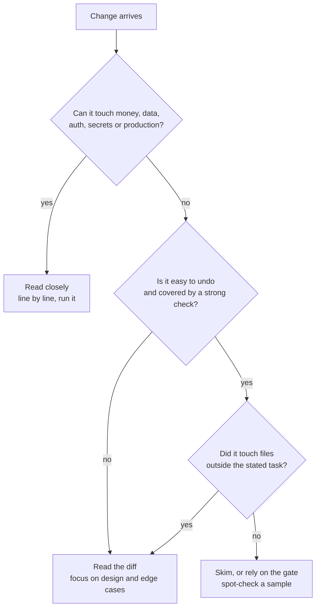

# Where humans stay in the loop

## Why this matters

[7.5](/part-07-ai-native-development/7.5-automating-lifecycle) ended on the observation that producing code got cheap and trusting it did not. Full automation is rarely the goal, and where it is, someone still chose the goal. So the design question is not "human or agent?" but "at which points does a person's judgment add something nothing else in the pipeline can, and how do I keep that judgment from decaying into a click?"

Two failure modes sit on either side of that question. Put humans at every step and they stop reading: the checkpoint exists on paper and not in practice. Put them nowhere and nobody owns intent, taste or risk. And there is a third, slower one: the more you delegate, the less you practice, and the people who are supposed to be the safety net lose the skill to be one.

**Learning goals**

- Identify the decisions that should stay human
- Design checkpoints that don't become rubber stamps
- Keep your own skills sharp while delegating

## Explanation

### What stays human: intent and taste

An agent can only optimise what you wrote down. Three kinds of decision are hard to write down completely, so they stay with a person:

- **Intent: what is wanted, and what is not.** The issue and the spec ([7.1](/part-07-ai-native-development/7.1-spec-driven-development)) are the human's contribution to the pipeline. An agent can draft requirements from a one-line issue, but whether those requirements describe the thing you need is something only you can check, because the knowledge lives outside the repo: users, deadlines, politics, what you tried last year.
- **Taste: which of several working solutions to keep.** Tests tell you a change works; they say nothing about whether it fits the codebase, the naming, the level of abstraction, or the direction you want the system to grow in. An agent's local choices accumulate into an architecture. Someone has to hold the picture of the whole and say "not like that".
- **Accountability: who answers when it goes wrong.** An agent cannot be paged, fired or sued. A person's name on the merge is the thing that makes the other two decisions real. If you could not explain a change to a colleague, you should not be the one who approved it.

A useful test for any step in your pipeline: *if the agent got this wrong, what would detect it?* If the answer is a test, a type check or an eval, the step can be automated and the human reviews the gate's design, not each output. If the answer is "nothing, until a user complains", the step needs a person.

### Risk-based review

"Review everything carefully" is not a policy; it is a wish, and it degrades under load (see the next section). A policy assigns attention by **blast radius** and **reversibility**, not by who or what wrote the code.

Questions that move a change up the ladder:

| Signal | Why it raises the risk |
|---|---|
| Touches authentication, permissions, payments, migrations, infrastructure | Mistakes are silent, wide and often irreversible |
| Changes tests, CI config or the checks themselves | The agent is editing its own gate; see "oracle" in 7.5 |
| New dependency, new network call, new secret | Expands what the system trusts |
| Diff much larger than the task suggests | Scope drift hides in volume |
| No test exercises the changed behaviour | The gate cannot catch it, so you are the gate |
| Hard to roll back (data, published packages, emails sent) | Reversibility is the cheapest safety net; when absent, spend attention instead |

And the ones that let a change move down: small diff, inside the stated task, behaviour covered by a test you trust, trivially reverted, and low consequence if wrong (documentation, a log message, a rename the compiler checks).

Two points that make this work in practice. First, **spot-check the skimmed pile**: read a random few of the changes you waved through and keep a count of what you found. If the count is not zero, your "skim" bucket is too wide. Second, **write the policy down before the diff arrives**. Deciding in the moment, with a green check mark glowing and a deadline close, is how everything ends up in the skim bucket. Your practice below is to write it.

### Approval fatigue

Asking a person to approve every action looks like the safest design. Measured in use, it is not. Anthropic's engineering post on sandboxing describes it directly: constantly clicking "approve" slows work down and can lead to *approval fatigue*, "where users might not pay close attention to what they're approving", which makes development less safe ([Anthropic, Oct 2025](https://www.anthropic.com/engineering/claude-code-sandboxing)). The same post reports that, in Anthropic's internal usage, sandboxing reduced permission prompts by 84%; that is an internal observation, not a controlled study, but the mechanism is what matters: draw a boundary the agent can move freely inside, and ask only at the boundary.

A later post on Claude Code's auto mode puts a number on the other side: "users accept 93% of" manual permission prompts anyway ([Anthropic, Mar 2026](https://www.anthropic.com/engineering/claude-code-auto-mode)). Again an internal figure from Anthropic's own usage. Read it as an engineer, not as a statistic about you: a prompt that is almost always accepted carries almost no information, and a reviewer who sees a hundred of them learns to press the key without reading. The rare dangerous one arrives looking exactly like the others.

The same post is also a useful model of what the alternative costs. Auto mode replaces the human approver with a classifier, and the authors report its error rates openly, including a 17% miss rate on a set of real overeager actions that they call the honest number; they also escalate to the human after repeated denials (3 in a row or 20 in total). Notice what that design does: it does not remove the person, it moves them from approving every action to handling the cases where the automation is unsure or has been refused repeatedly.

Design checkpoints so they stay informative:

- **Make the common case not need a human.** Allowlists, sandboxes, read-only defaults, scoped credentials. Every approval you delete is one fewer you will click blindly.
- **Make the prompt carry the decision, not the mechanics.** "Run `rm -rf build/`?" invites a reflex. "Delete 4,200 files outside the working tree?" does not. A good checkpoint shows consequence and a diff against what was asked for.
- **Make "no" cheap and "yes" slightly costly** when the stakes are high: a typed confirmation, a second person, a required note on why. Friction is a feature at the few places it is needed and a bug everywhere else.
- **Cap the volume.** If you review more than you can read, you are not reviewing. Reduce the size of what arrives (small diffs, one concern per change) before asking for more attention.
- **Measure the checkpoint.** Track how often reviewers change or reject something. A gate that has not rejected anything in months is either perfect or asleep, and you cannot tell which without injecting a known-bad change now and then.

::: info 📖 Read now
[Beyond permission prompts: making Claude Code more secure and autonomous](https://www.anthropic.com/engineering/claude-code-sandboxing) · article · ~10 min · **essential**

Look for: the definition of approval fatigue, the two isolation boundaries (filesystem and network) and why both are needed, and what the sandbox lets the agent do without asking. Ask of your own setup: which of your prompts could be replaced by a boundary?
:::

::: info 📖 Read now
[How we built Claude Code auto mode](https://www.anthropic.com/engineering/claude-code-auto-mode) · article · ~20 min · **essential**

Look for: the 93% acceptance figure and the argument built on it, the evaluation table with its false-positive and false-negative rates on different datasets, why the authors call 17% the honest number, and the rule that escalates to a human after repeated denials. The question to take away: when you automate an approval, what is the error rate of the replacement and who sees the errors?
:::

### Skill atrophy and deliberate practice

Delegation has a cost that does not show up in your cycle time: the skills you stop exercising. This matters for this chapter's whole argument, because everything above (reading a diff, spotting a design flaw, debugging an agent's mess) *is* a skill, and the people who must exercise it are the ones using the agent most.

The best controlled evidence so far is an Anthropic randomised trial. 52 mostly junior software engineers, all using Python at least weekly for over a year, were asked to learn Trio, an asynchronous Python library none of them knew; one group had an AI assistant during the task and the other did not, and then everyone took a quiz without AI. The AI group averaged 50% on the quiz against 67% for the hand-coding group (Cohen's d = 0.738, p = 0.01), with the largest gap on debugging questions; the AI group was only about two minutes faster, a difference that was not statistically significant ([Shen and Tamkin, Anthropic, Jan 2026](https://www.anthropic.com/research/AI-assistance-coding-skills); the preprint is [arXiv:2601.20245](https://arxiv.org/abs/2601.20245)).

What is more useful than the headline is the breakdown by how people used the assistant. The authors describe six interaction patterns. The low scorers (under 40% on average) *delegated* the code to the AI, relied on it more and more as the task went on, or kept handing debugging back to it. The high scorers (65% or more) generated code and then worked to understand it, asked for explanations alongside the code, or asked conceptual questions and wrote the code themselves. The authors say outright that this qualitative analysis does not establish that the pattern causes the outcome, and the groups behind each pattern are tiny (between 2 and 7 people), so treat it as a hypothesis for your own habits, not a result.

Limits to hold in mind before quoting this study: the sample is small, the quiz was taken right after the task so it does not show long-term skill, one library was involved, and the authors note that agentic tools such as Claude Code differ from the chat-style setup they tested and that they expect the effects there to be, if anything, more pronounced.

The study measures learning a *new* library, not erosion of a skill you already have. For that, see the METR result summarised in [7.5](/part-07-ai-native-development/7.5-automating-lifecycle): it concerns speed, not skill, but it shares the lesson that your sense of how well AI is serving you is a poor instrument.

::: info 📖 Read now
[How AI assistance impacts the formation of coding skills](https://www.anthropic.com/research/AI-assistance-coding-skills) · article · ~15 min · **essential**

Look for: the study design (who, what task, when AI was available), the quiz result and which question type showed the biggest gap, the six interaction patterns with their scores, and the limitations paragraph. Decide which of the patterns you recognise in your own use of Claude Code.
:::

::: info 📖 Read now
[How AI Impacts Skill Formation](https://arxiv.org/abs/2601.20245) · paper · ~10 min · optional

Look for: the abstract's claim about conceptual understanding, code reading and debugging, and its closing sentence. Skim the rest; the blog post above carries the same findings in plainer form.
:::

**Deliberate practice** is the standard remedy, from the psychology of expertise: practice with a specific target at the edge of your ability, with immediate feedback, not just more hours of doing the thing you can already do. The term comes from Ericsson, Krampe and Tesch-Römer, who argue that without informative feedback "mere repetition of an activity will not automatically lead to improvement" ([Psychological Review, 1993](https://doi.org/10.1037/0033-295X.100.3.363)). Applied to an engineer who delegates:

1. **Predict before you look.** Before the agent finishes, write down what you expect the diff to do. Compare afterwards. The gap is your feedback.
2. **Generate, then comprehend.** The pattern that kept scores high in the study was to get the code and then work to understand it: explain it back, change it, break it. If you cannot explain a change, you have not reviewed it.
3. **Ask for explanations, not only answers.** "Why this approach over X?" costs one message and keeps your model of the system current.
4. **Keep a hands-on slice.** Pick a category (debugging a failing test from the stack trace, a small feature, a refactor) and do it without the agent on a schedule. This is exercise, not nostalgia; choose the skill you would need on the day the agent is wrong.
5. **Debug without the agent first.** The largest gap in the study was on debugging, which is also the skill you need to supervise agents. Form your own hypothesis before asking.
6. **Rotate the unfamiliar.** Use the agent most where you are expert (you can judge the output) and least where you want to become expert (you cannot yet).

None of this says to stop delegating; the evidence in 7.5 and the trial both say speed is real for some patterns. It says the review skill is a muscle, and checkpoints are only as good as the person behind them.

## Practice

**Brief:** Write your own policy in `notes/human-in-the-loop.md`: which changes you always review closely, which you skim, and why.

**Where:** Notes only, no code (`notes/`).

**Steps:**

1. **Collect evidence.** Look at the last 10 to 20 changes an agent made for you (commits, PRs or `git log`). For each, write one line: what it touched, how long you spent reading it, and whether you found anything.
2. **Write three buckets** in `notes/human-in-the-loop.md`: *Always review closely*, *Read the diff*, *Skim or rely on the gate*. For each bucket give the criteria (use blast radius, reversibility, strength of the check and scope drift) and, for every criterion, the reason in a sentence. Include at least one example from your own repos per bucket.
3. **Name your gates.** For each bucket, list what other than you checks the change (tests, types, CI, review agent) and one thing that gate cannot see.
4. **Reduce approval prompts.** List the permission prompts you actually clicked through in your last few Claude Code sessions. For each: could a sandbox, allowlist or scoped credential have removed it? Write the settings change you would make.
5. **Add a spot-check rule.** Decide how many skimmed changes per week you will read in full and what count of findings makes you widen the closely-reviewed bucket.
6. **Add a skills section.** Choose one hands-on slice and one "predict before you look" habit; say when you will do each and how you will know it is working.
7. **Date it** and schedule a revisit after a month, with the numbers from step 5.

**Done when:**

- The note has three buckets with criteria and a reason for each criterion.
- Each bucket names its gates and what they cannot see.
- There is a concrete list of prompts you would remove and how.
- There is a spot-check rule with a threshold, and a skills section with a schedule.
- You can apply the policy to a change you have not seen yet and say which bucket it lands in within a minute.

## Check questions

1. A reviewer approves 93 of every 100 permission prompts. What does that rate suggest about the checkpoint, and what would you change?

   

Answer

   A prompt that is nearly always accepted carries little information, and people stop reading it: approval fatigue. Don't ask for more diligence; remove the common prompts with a boundary (sandbox, allowlist, scoped credentials) so the remaining ones are rare and meaningful, and make them show the consequence. Anthropic's 93% figure is an internal observation, not a law, but the mechanism is general.

   

2. Give three signals that should push a change into "read closely", and explain why "an agent wrote it" is not one of them.

   

Answer

   Examples: it touches auth, payments, migrations or secrets; it edits tests or CI (the agent changing its own gate); it is hard to reverse; it is far larger than the task; no test covers the changed behaviour. Risk is set by blast radius, reversibility and the strength of the checks, which are the same whoever wrote the code; the author only changes how likely a mistake is, and a policy by author cannot tell a typo fix from a schema migration.

   

3. Which decisions stay human, and what is the test for whether a step needs a person?

   

Answer

   Intent (what is wanted), taste (which working solution fits the system) and accountability (who answers). The test: if the agent got this wrong, what would detect it? If a test, type check or eval would, automate it and review the gate; if nothing would until a user complains, a person needs to be there.

   

4. In the Anthropic skill-formation trial, what differed between the low-scoring and high-scoring groups, and what should you not conclude?

   

Answer

   Low scorers delegated code generation, relied on the AI increasingly, or kept offloading debugging to it; high scorers generated code and then worked to understand it, or asked conceptual or explanatory questions. Do not conclude that the pattern causes the score: the authors say the analysis is not causal, the pattern groups had 2 to 7 people, the quiz was taken immediately after the task, and it tested learning a new library, not erosion of an existing skill.

   

5. Your "skim" bucket has had no findings in three months. Is that good news?

   

Answer

   Not necessarily: either the bucket is correctly drawn or the review is too shallow to find anything. Check by spot-reading a random sample of what you skimmed and by injecting a known-bad change to see whether the gate or you notice. Only then is "zero findings" evidence.

   

## My understanding

<!-- Written by the learner, in their own words. Agents never fill this in. -->
