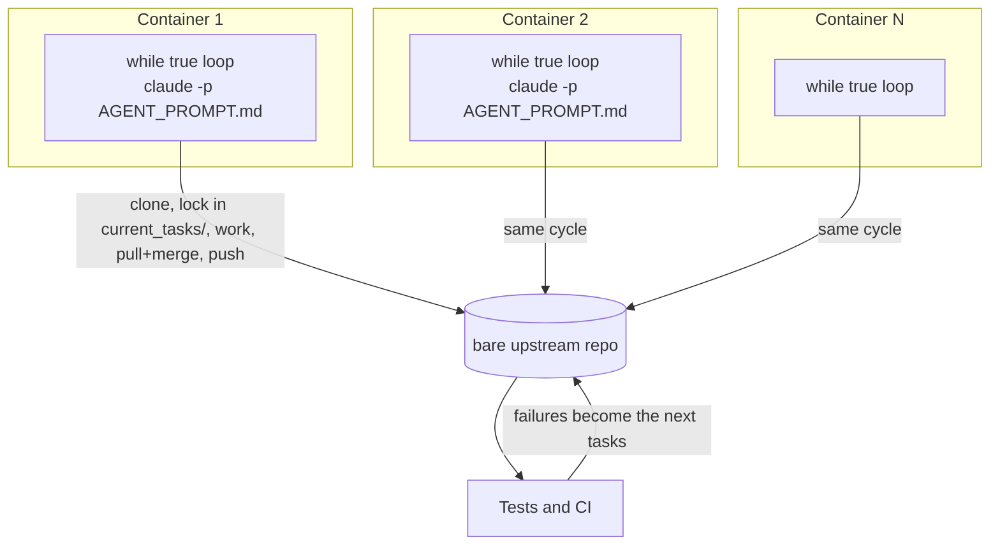

# Large codebases and agent teams

## Why this matters

Everything so far in this part assumed a repository that fits in an agent's head, or at least in a few of its searches. Two things break that assumption. The first is **size**: in a repository with millions of lines, the defaults that serve a small project (one root `CLAUDE.md`, grep everywhere, read whatever looks relevant) fill the context window with material unrelated to the task. The second is **headcount**: once you run several agents at once ([6.5](/part-06-claude-code/6.5-parallel-work)) and let them run without you ([7.4](/part-07-ai-native-development/7.4-ci-background-agents), [7.5](/part-07-ai-native-development/7.5-automating-lifecycle)), the hard problems stop being about any single agent and become about the *system*: who works on what, how they avoid overwriting each other, and how anyone knows the result is right.

This chapter takes both in turn and ends on the best-documented case of the second problem: sixteen Claude agents that wrote a C compiler. The recurring theme is that **the environment does the coordinating**. The directory layout, the task locks and, above all, the test suite are what keep many agents pointed in one direction.

**Learning goals**

- Set up agents for a large codebase
- Coordinate many agents on one goal
- Learn from published case studies

## Explanation

### Navigating a large codebase

Claude Code does not index your repository. Anthropic's description of it is that it "navigates a codebase the way a software engineer would": it walks the file system, reads files, greps, and follows references, locally and without an embedding pipeline. Anthropic argues that this is the right trade at scale because an index built from embeddings can be stale by the time it is queried, returning, for example, "a function the team renamed two weeks ago". The cost of the approach is stated in the same article: it "works best when Claude has enough starting context to know where to look", and a vague request against a huge tree can hit context limits "before the work begins" ([How Claude Code works in large codebases](https://claude.com/blog/how-claude-code-works-in-large-codebases-best-practices-and-where-to-start), May 2026). This is the agentic-search side of the trade-off from [2.9](/part-02-programming-with-llms/2.9-rag-fundamentals): no index to maintain, but quality depends on how well you point the search.

So the job in a large codebase is to *aim the search* and *keep noise out of context*. There are four levers, each already known to you in smaller form.

| Lever | What it does | Where it lives |
|---|---|---|
| Layered `CLAUDE.md` files | Repository-wide rules at the root, local conventions beside the code they describe; a subdirectory's file loads on demand | a `CLAUDE.md` per package or subsystem ([6.2](/part-06-claude-code/6.2-claude-md-and-memory)) |
| Reads you block | `Read` deny rules for checked-in generated or vendored code; `claudeMdExcludes` for other teams' instructions | `.claude/settings.json` (shared) or `.claude/settings.local.json` (yours) |
| Symbol lookup | A code-intelligence plugin lets Claude ask a language server for definitions and references instead of scanning files | a plugin per language |
| Scoped skills | Procedures for one area, loaded only when relevant | `.claude/skills/` inside that area, or a `paths:` glob ([6.3](/part-06-claude-code/6.3-skills)) |

The details below are from Anthropic's setup guide ([Set up Claude Code in a monorepo or large codebase](https://code.claude.com/docs/en/large-codebases)); read it in full when you do the practice, because it also carries the exact settings syntax, which changes faster than this chapter will.

**Where you start matters.** Launched from the repository root, Claude can touch every file and loads only the root `CLAUDE.md` up front, with subdirectory files loading on demand. Launched from a subdirectory, it can touch only that subtree until you grant more, and it loads that directory's `CLAUDE.md` plus every ancestor's. The guide's advice: start at the root when a task spans packages, in a subdirectory when the work is scoped to one. Project settings such as `.claude/settings.json` are *not* inherited from parent directories the way `CLAUDE.md` files are, which is a common source of "why did my deny rule not apply" confusion.

**Layer the instructions.** The guide's example root file is three lines: run scripts from the package directory, prefix commit subjects with the package name, never edit generated files. The package file adds what only that package needs ("Copy `.env.example` to `.env` before running anything", "Never edit a migration after it has merged"). The point is not the content but the *loading rule*: an agent in `packages/api/` pays context for the root rules and the API rules and nothing from `packages/web/`. Keep each file to what applies broadly in its scope, because it loads in every session that touches it, and revisit the files after a major model release, since a workaround for an old model's weakness may now be pure overhead.

**Read less.** Claude's content searches already respect `.gitignore`, so `node_modules/` and `dist/` stay out of results. For *committed* generated code or a vendored SDK, add `Read` deny rules. Two limits are worth knowing, both from the guide: deny rules cover Claude's built-in file tools and the file commands it recognises in Bash, but "don't cover subprocesses that open files themselves", and a Bash `grep -r` over a directory still prints matches from denied files. So a deny rule reduces noise and accidents; it is not a security boundary (that is [Part 8](/part-08-production/8.3-sandboxing)).

**Look up symbols, don't scan.** Finding "who calls this" by grep costs many reads and can land on the wrong function when names repeat. A language-server plugin gives definitions and references directly. Anthropic's article calls this "one of the highest-value investments" for multi-language codebases, and notes that one enterprise deployed it org-wide before rollout specifically to make C and C++ navigation reliable.

**Scope the skills.** A skill's name and description are always in the list Claude chooses from, so hundreds of skills across directories dilute that list. The guide's advice is to keep descriptions short and lead with words a request would contain, and to put the skills that every area shares at the root.

::: info 📖 Read now
[Set up Claude Code in a monorepo or large codebase](https://code.claude.com/docs/en/large-codebases) · docs · ~20 min · **essential**

Look for: the table "Start from … / File access / CLAUDE.md loaded"; the difference between a per-directory `CLAUDE.md` and a path-scoped rule in `.claude/rules/`; what `additionalDirectories` does *not* load compared with `--add-dir`; and the closing "Put it together" section, where a worktree session reads settings from the worktree root rather than the subdirectory you launched from.
:::

### Monorepo setup

A monorepo adds one problem to everything above: many teams' code, conventions and build commands in one tree, and agents that must not wander across the boundaries. The guide's example is three packages (`api`, `web`, `shared`), each with its own `CLAUDE.md`, skills and settings, and a root with the shared rules. Four decisions matter.

1. **Unit of work.** Decide whether an agent session is scoped to one package (start in it) or to a change that crosses packages (start at the root, or grant sibling access with `--add-dir`). Cross-package changes, such as altering a shared type and its call sites, go best in one session; the guide says handing over the shared edit and its call sites together "keeps the decisions behind each edit consistent". Plan first so the plan survives context compaction: Claude Code writes the plan to a file and re-injects it after each compaction.
2. **Worktrees without the whole tree.** Each parallel agent wants its own worktree ([6.5](/part-06-claude-code/6.5-parallel-work)), and in a big repository a full checkout per agent is slow and heavy. The `worktree.sparsePaths` setting checks out only the directories you list, plus root-level files, and `symlinkDirectories` shares `node_modules` rather than copying it. Give each sparse worktree what its task needs: if one agent works in `packages/api` and another in `packages/web`, both are listed.
3. **One owner per area.** The same ownership idea appears in the agent-teams docs: "Two teammates editing the same file leads to overwrites. Break the work so each teammate owns a different set of files" ([Orchestrate teams of Claude Code sessions](https://code.claude.com/docs/en/agent-teams), "Avoid file conflicts"). A monorepo's package boundaries are a ready-made ownership map: assign agents to packages, not to the whole tree.
4. **Who maintains the setup.** Per-directory files drift. The guide suggests treating `CLAUDE.md` edits like documentation in pull requests, using a `Stop` hook to propose updates while the gap is fresh, and, when layering stops scaling, moving conventions into skills and a plugin a platform team owns ([6.6](/part-06-claude-code/6.6-mcp-plugins)). That is a repository-owner job, not each developer's.

::: tip Your own repo is a small monorepo
This book's repository already does a version of this: a study-level `CLAUDE.md`, one spec every task points at, and one worktree per issue. It is small, but the pattern (shared intent in one file, isolation per task) is the same one scaled up here.
:::

### Parallel agent teams

"Parallel agents" covers two designs that are easy to blur. In both, each worker is a separate Claude session with its own context window; they differ in who decides what each one does.

| | **Planned team** (Claude Code agent teams) | **Self-organising loop** (the compiler project) |
|---|---|---|
| Coordinator | A lead session creates and assigns tasks | None: each agent picks the "next most obvious" problem |
| Task state | Shared task list (pending, in progress, completed, with dependencies) | Lock files committed to git |
| Claim mechanism | File locking in the task list, so two teammates cannot claim one task | Writing `current_tasks/<name>.txt`; git rejects a clash |
| Isolation | Teammates share the working tree unless you arrange otherwise, so avoid shared files | One container and one clone per agent, pushing to a shared upstream |
| Status | Experimental, off by default | A research prototype, not a product |

The agent-teams docs set out when the planned design pays: tasks where "parallel exploration adds real value" (research and review, new modules that each teammate owns, debugging with competing hypotheses, changes across layers) and not "sequential tasks, same-file edits, or work with many dependencies". They recommend starting with three to five teammates, five or six tasks per teammate, tasks sized as "self-contained units that produce a clear deliverable, such as a function, a test file, or a review", and starting with research and review before parallel implementation. Token cost scales roughly with the number of teammates, since each is a full session ([Orchestrate teams of Claude Code sessions](https://code.claude.com/docs/en/agent-teams)). For the Claude Code mechanics (subagents versus teams versus dynamic workflows) see [6.5](/part-06-claude-code/6.5-parallel-work).

Whatever the design, three problems recur, and each has a standard answer.

1. **Two agents on one task.** Answer: an atomic claim. Either a lock the platform provides, or a file whose creation git (or the filesystem) serialises. Release the claim when the work is pushed.
2. **Two agents editing one file.** Answer: partition by files or modules *up front*, and keep tasks small enough that the merge at the end is mechanical. When conflicts happen anyway, they are cheap if an agent resolves them; the compiler post says merge conflicts were "frequent, but Claude is smart enough to figure that out".
3. **Many agents, one indivisible problem.** Answer: change the problem. This is the interesting failure, and the case study below shows it.

The cost side deserves honesty. N agents are not N times faster: coordination overhead grows with N, the tasks have dependencies, and a team that drifts burns tokens. Parallelism pays when work is *independent*, which is a property of the codebase and the task, not of the tooling.

### Test suites as coordination

Look at what the claim and partition mechanisms above do *not* do: they do not tell an agent what to work on, or whether what it did is right. In an autonomous team, that is the test suite's job. A suite is three things at once:

- **The to-do list.** Each failing test is a unit of work. Many independent failures means trivial parallelism: each agent takes a different failing test.
- **The definition of done.** An agent stops when its test passes, so a weak test means a wrong stop. Carlini's rule: "it's important that the task verifier is nearly perfect, otherwise Claude will solve the wrong problem" ([Building a C compiler with a team of parallel Claudes](https://www.anthropic.com/research/building-c-compiler), February 2026).
- **The guard rail between agents.** When agents merge into one trunk, a regression one agent introduces is invisible to the others until CI runs. In the same project, once Claude was "frequently" breaking existing functionality with each new feature, Carlini built a CI pipeline with stricter enforcement so new commits could not break existing code.

The same post gives design rules for a harness *written for the model*, and they are the most transferable part of the article:

| Rule | Why | What to do |
|---|---|---|
| Don't pollute the context | A harness that prints thousands of lines wastes the window | Print a few lines; log the rest to a file; put `ERROR` and the reason on one line so `grep` finds it; precompute summary statistics |
| Account for time blindness | A model cannot tell time and "will happily spend hours running tests" | Print progress rarely; offer a `--fast` mode that runs a 1% or 10% random sample, deterministic per agent but different across agents, so together they cover everything |
| Write for a cold start | Each agent starts in a fresh container with no memory and spends time orienting | Keep READMEs and progress files that agents update as they go |

Compare these with [3.3](/part-03-agents/3.3-tool-design) (tool output design) and [3.4](/part-03-agents/3.4-context-engineering): the harness is just a tool whose caller is a model. A test runner whose output you would find noisy is a worse tool for an agent than for you.

### Case study: a C compiler built by parallel Claudes

In February 2026, Nicholas Carlini of Anthropic's Safeguards team published an experiment: 16 agents wrote a Rust C compiler from scratch, intended to compile the Linux kernel. By the post's account the run took nearly 2,000 Claude Code sessions over about two weeks and cost just under $20,000 in API spend, and produced a roughly 100,000-line compiler that builds a bootable Linux 6.9 on x86, ARM and RISC-V ([Building a C compiler with a team of parallel Claudes](https://www.anthropic.com/research/building-c-compiler)). The post says it was designed as a capability benchmark, not a cost-efficient way to get a compiler, and the source is public ([anthropics/claudes-c-compiler](https://github.com/anthropics/claudes-c-compiler)). Read as a systems design, it has five parts:

1. **The loop.** A shell `while true` loop starts a fresh Claude Code session with the same prompt file, over and over, so an agent never stops to wait for a human; the post notes it should run in a container, not on your machine. This is the long-running pattern from [5.6](/part-05-harnesses/5.6-long-running-agents) taken to its limit.
2. **The claim.** Each agent writes a lock file such as `current_tasks/parse_if_statement.txt`; if two agents pick the same task, git forces the second to choose another. When done, it pulls, merges, pushes and removes the lock.
3. **No orchestrator.** There is no lead agent and no other communication channel. Each agent decides what to do; "in most cases, Claude picks up the 'next most obvious' problem", and when stuck it keeps a running document of failed approaches. The state of the project lives in the repository and its history.
4. **Roles.** Parallelism enabled specialists: one agent coalesced duplicate code (the post notes that LLM-written code often re-implements existing functionality), others improved compiler performance, the efficiency of the output, the design from a Rust developer's viewpoint, and the documentation.
5. **The tests.** Most of the effort went into the environment (high-quality test suites, verifiers and build scripts for open-source packages, and new tests designed from the mistakes the agents were seen to make).

#### The failure and the fix

The most useful episode is where parallelism *stopped working*. With a test suite of many independent tests, "each agent picks a different failing test". The same held later when each agent was given a different open-source project to compile (the post names SQLite, Redis, libjpeg, MQuickJS and Lua). But compiling the Linux kernel is one giant task: every agent hit the same bug, fixed the same bug, and overwrote the others' changes. Sixteen agents were no faster than one.

The fix was a better *test*, not a better agent. Carlini used GCC as an "online known-good compiler oracle": a harness compiled most kernel files with GCC and only a random remainder with the new compiler. If the kernel still worked, the fault was not in the agents' subset; if it broke, the subset could be narrowed further. Each agent could then be given different files and fix different bugs at once. Delta debugging was still needed to find pairs of files that failed together but worked alone. This is the general technique, which is worth naming: **turn an indivisible failure into many divisible ones by using a trusted reference to localise the fault**. Whenever you have a reference implementation, a previous version, or a slower-but-correct algorithm, you have an oracle ([7.5](/part-07-ai-native-development/7.5-automating-lifecycle) used the same idea for its verification ladder).

#### What it did not do

The post is candid about the ceiling, and a reader should be too. By the author's account, the compiler lacked the 16-bit x86 code generator needed to boot Linux in real mode and, instead of failing, "simply cheats" and calls GCC for that phase on x86; it had no working assembler and linker of its own (the demo used GCC's); the code it generated was less efficient than GCC with all optimisations off; and "new features and bugfixes frequently broke existing functionality" near the end, which Carlini took to be near the limit of what that model could do. The conclusion is a warning, not a victory lap: "it is easy to see tests pass and assume the job is done, when this is rarely the case."

::: info 📖 Read now
[Building a C compiler with a team of parallel Claudes](https://www.anthropic.com/research/building-c-compiler) · article · ~25 min · **essential**

You may have met this article in [7.5](/part-07-ai-native-development/7.5-automating-lifecycle) as a verification story; read it again here as a *coordination* story. Look for: the lock-file algorithm and what git does on a clash; the paragraph on "Make parallelism easy", where the kernel task defeats 16 agents; how the oracle harness splits the kernel; the "Multiple agent roles" list; and the limitations list. Ask of each part: which problem from this chapter (claim, partition, indivisible task) does it solve, and what would it look like in a codebase I know?
:::

::: info 📖 Read now
[Orchestrate teams of Claude Code sessions](https://code.claude.com/docs/en/agent-teams) · docs · ~15 min · optional

Look for: the comparison table with subagents; "Choose an appropriate team size" and "Size tasks appropriately"; the limitations section (experimental, session resumption, task status lag). Compare its shared task list with the compiler's lock files: same job, different substrate.
:::

::: info 📖 Read now
[How Claude Code works in large codebases](https://claude.com/blog/how-claude-code-works-in-large-codebases-best-practices-and-where-to-start) · article · ~18 min · optional

Look for: why agentic search is preferred to an embedding index at scale, and the ordering in which teams build `CLAUDE.md`, hooks, skills, plugins and MCP servers. It is a vendor article, so weigh its claims about "successful deployments" accordingly; the practical advice is more reliable than the framing.
:::

::: info 📖 Read now
[anthropics/claudes-c-compiler](https://github.com/anthropics/claudes-c-compiler) · repo · ~20 min · optional

Look for the project's own notes and commit history: the post says you can read the history and watch the agents take out locks on tasks. Reading a few commits shows what real agent-written merge and lock traffic looks like.
:::

### Putting the pieces together

Before you point a team at a large codebase, answer these in order. They are the chapter in checklist form.

1. **Can it be partitioned?** List the units of work and who touches which files. If most tasks share files, run fewer agents or change the decomposition before you add agents.
2. **Is there a verifier an agent can run?** Without one, you have parallel guessing. Make it quiet, fast (a sample mode) and precise. If you cannot write tests, look for an oracle.
3. **Does a cold agent know where to start?** Layered `CLAUDE.md`, a progress file, and a way to find "the next task". Aim the search; do not rely on it to find the way.
4. **What stops two agents doing the same thing?** A claim mechanism, and a rule for what happens on a clash.
5. **How are agents isolated?** Worktrees or containers, sparse where the tree is big, with an allowlist, a turn cap and a spend cap ([7.4](/part-07-ai-native-development/7.4-ci-background-agents)).
6. **Where does a human look?** Decide which merges need eyes by risk ([7.6](/part-07-ai-native-development/7.6-humans-in-the-loop)); the compiler experiment's own author remained uneasy about shipping code nobody had verified.
7. **What does it cost?** Count tokens for every agent, including those that duplicated work. Model prices and plan limits are on [Landscape](/landscape) and in [6.8](/part-06-claude-code/6.8-pro-limits).

## Practice

**Brief:** Point Claude Code at a large open-source repo you know and plan (don't run) a parallel-agent approach for one feature. Note what the agents would need.

**Where:** Notes only, no code: `notes/parallel-agent-plan.md`. There is no experiment folder and no change to `project/`. Do not start the parallel run; the deliverable is the plan, and you may use Claude Code to explore the repo (in plan mode, or read-only) to write it.

**Steps:**

1. **Choose the repository and the feature.** Pick an open-source repository of at least several hundred thousand lines that you have used or read, and a feature that touches several parts of it (for example a new option that needs changes in the core, the CLI and the docs). Clone it somewhere outside this study repo. Write the repo, its approximate size and the one-sentence feature at the top of your notes.
2. **Explore with the agent, read-only.** Start Claude Code in the repo (plan mode, or with edit tools denied) and ask where the feature would live, which modules it touches and how the tests are organised. Record the three most useful answers, and one place where it searched poorly. Note which of the four navigation levers (layered `CLAUDE.md`, blocked reads, symbol lookup, scoped skills) would have helped.
3. **Sketch the setup.** In your notes, write the files you would add: the root and per-directory `CLAUDE.md` outlines (a few lines each, not full files), any `Read` deny rules for generated or vendored code, and the `sparsePaths` a worktree for each task would need.
4. **Decompose the feature.** List the tasks, the files each touches, and the dependencies between them (a table works). Mark which tasks can run in parallel without sharing a file. State how many agents you would use and why that number, quoting the sizing advice you are following.
5. **Choose the coordination design.** Planned team or self-organising loop, and why. Say how an agent claims a task, how the work is isolated, and how results get merged.
6. **Name the verifier.** Which existing tests tell an agent a task is done? Which behaviour of the feature is *not* covered, and which test would you write first? If there is a reference implementation or earlier version to compare against, say how it would serve as an oracle.
7. **Predict the failure.** Write the two ways you expect it to go wrong (for example a shared file, a flaky test, a task that cannot be split), and the check that would reveal each one early.
8. **Estimate the cost.** Roughly how many agent sessions and how long each might run, and how you would cap spend. Label it as a guess; do not add a price you have not looked up on [Landscape](/landscape).

**Done when:**

- `notes/parallel-agent-plan.md` exists with the repo, the feature, the setup sketch, the task table with parallel and sequential tasks marked, and the coordination design.
- The plan names the verifier, the one gap in it, and the first test you would add.
- It lists two predicted failures, each with an early check.
- Nothing was run in parallel, no code was written, and no API spend was incurred.

## Check questions

1. You start Claude Code from `packages/api/` in a monorepo. Which `CLAUDE.md` files load at launch, which files can it edit, and why might a `Read` deny rule in the repository root's `.claude/settings.json` not apply?

   

Answer

   The root `CLAUDE.md` and `packages/api/CLAUDE.md` load; `packages/web/CLAUDE.md` does not. Claude can read and edit only that subtree until you grant more access (for example `--add-dir` or `additionalDirectories`). Project settings are not inherited from parent directories the way `CLAUDE.md` files are, so a settings file must be placed where the session reads it (and a worktree session reads the worktree root's copy).

   

2. Sixteen agents work on a compiler test suite and make fast progress, then all stall on compiling the Linux kernel. Why did parallelism stop helping, and what fixed it?

   

Answer

   With many independent failing tests each agent can take a different one. The kernel build was one big task, so every agent hit the same bug, fixed it, and overwrote the others' changes. The fix was a new test harness that used GCC as a known-good oracle: compile most files with GCC and a random remainder with the new compiler, so a failure is localised to a subset of files and each agent can be given different files and different bugs.

   

3. Give three roles a test suite plays in an autonomous agent team, and one design rule for a test harness written for a model rather than a person.

   

Answer

   It is the to-do list (failing tests are tasks), the definition of done (agents stop when their test passes, so a weak test causes a wrong stop) and the guard rail between agents (CI stops one agent's commit from breaking another's work). Design rules: print little and log the rest to a file with grep-able `ERROR` lines (context pollution); offer a deterministic per-agent sample mode so runs are short (time blindness); keep progress files for cold starts.

   

4. Compare a lock file in `current_tasks/` with an agent-teams shared task list. What problem do both solve, and what does neither solve?

   

Answer

   Both stop two agents claiming the same task (git serialises the lock file; the task list uses file locking). Neither stops two agents editing the same file in different tasks, nor tells you whether the finished work is correct. Those need up-front partitioning by files or modules, and a verifier.

   

5. Your task has twelve subtasks but nine of them edit the same two files. Should you run twelve agents? What would you do instead?

   

Answer

   No. Agents editing the same files overwrite each other and the merge cost grows with the number of agents, so the speed-up is capped by the shared files. Either restructure the work so each agent owns different files (split the files first, or sequence the shared edits through one agent) and run parallel agents only on the independent subtasks, or use one agent or a small team with subagents for read-only research.

   

## My understanding

<!-- Written by the learner, in their own words. Agents never fill this in. -->
