# OWASP Top 10 for LLM and agentic apps

## Why this matters

[8.1](/part-08-production/8.1-prompt-injection) gave you one attack and one design rule. Real systems get hit from more directions: a leaked secret in a system prompt, a poisoned dependency, a model whose output is pasted into a shell, a bill nobody capped. The OWASP lists are the field's shared checklist of those directions. Their value is not novelty. They give you a vocabulary that your team, your auditors and your future self already know, and a way to ask "have I considered this class of failure at all?" before you ask "how do I fix it?".

There are two lists, and since 2026 they are explicitly meant to be used together. One covers the model as a component in an application. The other covers the model as an actor with tools, memory and delegated authority. Your `project/` agent is the second kind, so you need both.

**Learning goals**

- Know the items on both lists
- Map each to your project
- Prioritize mitigations

## Explanation

### Two lists, one boundary

The OWASP GenAI Security Project ([genai.owasp.org](https://genai.owasp.org)) publishes two Top 10s that matter here:

- **OWASP Top 10 for LLM Applications.** The 2025 edition used IDs `LLM01:2025` to `LLM10:2025`. A 2026 edition was published on 3 August 2026 ([OWASP GenAI LLM Top 10 2026](https://genai.owasp.org/resource/owasp-genai-llm-top-10-2026/)), with IDs `LLM01:2026` to `LLM10:2026`.
- **OWASP Top 10 for Agentic Applications 2026.** Published on 9 December 2025, IDs `ASI01` to `ASI10` ([resource page](https://genai.owasp.org/resource/owasp-top-10-for-agentic-applications-for-2026/)).

The 2026 LLM document draws the boundary between them itself: the LLM list "owns the risk when the model is a component inside your application"; once the model "becomes an actor, with tools it can call, memory it carries between sessions, and consequences it sets in motion downstream, the risk moves to the OWASP Agentic Top 10" ([2026 LLM Top 10, "What's New"](https://genai.owasp.org/resource/owasp-genai-llm-top-10-2026/)). Its advice for agents is to read both.

::: warning Version trap
Most blog posts, courses and older notes still quote the **2025** LLM list, and its numbers differ from 2026 (Excessive Agency is `LLM06` in 2025 and `LLM03` in 2026). Always write the year with the ID (`LLM03:2026`), and when someone says "LLM06" ask which edition they mean. This chapter uses the 2026 numbering and notes the 2025 one where it changed.
:::

### The LLM Top 10 (2026), in order

The ten entries below are from the table of contents of the 2026 document ([OWASP GenAI LLM Top 10 2026](https://genai.owasp.org/resource/owasp-genai-llm-top-10-2026/)). The one-line glosses are my own paraphrase of each entry, written for a TypeScript agent builder. "Your project" says where it shows up in a small agent like the one you have been growing.

| ID | Entry | In one line | Where it bites in `project/` |
|---|---|---|---|
| LLM01 | Prompt Injection | Text the model reads changes what it does. Now also covers images, audio, memory and tool output | Every file, web page and tool result your loop feeds back ([8.1](/part-08-production/8.1-prompt-injection)) |
| LLM02 | Sensitive Information Disclosure | Private data leaves through the model's output | Secrets in files the agent reads; trace and step logs that store full prompts |
| LLM03 | Excessive Agency | The model can do more than the task needs: too many functions, too many permissions, too much autonomy | `run_shell`, file write, any tool that is not scoped |
| LLM04 | Supply Chain | Models, packages, datasets and tools you did not write are not what they claim | npm dependencies, model files pulled into Ollama, MCP servers |
| LLM05 | Data and Model Poisoning | Tampered training, fine-tuning or embedding data corrupts behavior | Mostly later, in a RAG index or a fine-tune ([10.3](/part-10-modifying-serving-models/10.3-lora-mlx)) |
| LLM06 | Unbounded Consumption | Uncontrolled use of tokens, calls or compute causes outage or cost blowup | A loop with no step cap or token budget; your own API key and the budget in `costs.md` |
| LLM07 | Misinformation | Fluent wrong output drives a decision or a tool call | An agent that acts on a hallucinated file path or command |
| LLM08 | Hidden Context Exposure | Extraction of system prompts and other hidden context | Anything you put in the system prompt or tool descriptions that you would mind showing |
| LLM09 | Vector and Embedding Weaknesses | Weak access control or poisoned content in vector stores | Only if you built RAG ([2.9](/part-02-programming-with-llms/2.9-rag-fundamentals)) |
| LLM10 | Improper Output Handling | Model output passed downstream without validation | Model-written shell commands, code or HTML that something executes or renders |

**What changed from 2025.** The 2026 document says Excessive Agency "climbed to third, the most consequential move on the list"; Unbounded Consumption rose four places; Improper Output Handling fell from fifth to tenth; and System Prompt Leakage became Hidden Context Exposure, "a broader framework for the same failure". It also folded newer risks into existing entries instead of adding categories: cross-modal injection into Prompt Injection, fine-tuning subversion into Data and Model Poisoning. The same document explains the method: a community vote carries three-quarters of the weight and an analysis of 6,639 sortable real incidents carries the remaining quarter ([2026 LLM Top 10, letter from the project leads](https://genai.owasp.org/resource/owasp-genai-llm-top-10-2026/)). So the ranking is partly evidence-based now, and the leads explicitly note where belief and evidence disagree (Prompt Injection ranks low in raw public incident data, which they attribute to defenders working hard on it; Misinformation ranks higher in the data than in the vote).

The 2025 list, for reference when you read older material, is on the [LLM Top 10 page](https://genai.owasp.org/llm-top-10/) with one page per entry, for example [LLM06:2025 Excessive Agency](https://genai.owasp.org/llmrisk/llm062025-excessive-agency/).

#### The entry worth slowing down on: Excessive Agency

For an agent builder, this entry is the one that turns a model mistake into an incident. The 2026 text defines it as the vulnerability that enables damaging actions "in response to unexpected, ambiguous or manipulated outputs from an LLM, regardless of what is causing the LLM to malfunction", and gives three root causes: excessive functionality, excessive permissions and excessive autonomy ([2026 LLM Top 10, LLM03:2026](https://genai.owasp.org/resource/owasp-genai-llm-top-10-2026/)). Note the "regardless of what is causing": a hallucination and an injection are the same bug from this entry's point of view. You can't fix the cause (the model will sometimes be wrong), so you shrink the consequence.

Map the three roots to code you have already written:

| Root cause | Example in a small agent | Code-level fix |
|---|---|---|
| Excessive functionality | A general `run_shell` when the task needs `git diff` and `npm test` | Replace it with specific tools, or an allowlist of commands ([3.3](/part-03-agents/3.3-tool-design)) |
| Excessive permissions | The agent runs as you, with your home directory and credentials | Run in a sandbox with a scoped working directory and a scoped credential ([8.3](/part-08-production/8.3-sandboxing)) |
| Excessive autonomy | Destructive tool calls execute without a human seeing them | Approval for the few consequential actions, showing the real arguments |

### The Agentic Top 10 (2026)

The agentic list exists because an agent changes the shape of the risk. Its own foreword says agents "plan, decide, and act across multiple steps and systems", and it introduces a principle worth keeping: **least agency**, "avoid unnecessary autonomy; deploying agentic behavior where it is not needed expands the attack surface without adding value". It pairs it with an observability demand: without visibility into what agents do and which tools they call, unnecessary autonomy "can quietly expand the attack surface" ([OWASP Top 10 for Agentic Applications 2026, letter from the leaders](https://genai.owasp.org/resource/owasp-top-10-for-agentic-applications-for-2026/)). Least agency is least privilege applied to decisions, not only to access.

The ten entries, with titles from the document's table of contents and my own one-line summaries:

| ID | Entry | In one line | Where it bites in `project/` |
|---|---|---|---|
| ASI01 | Agent Goal Hijack | Injected content redirects the agent's objective or plan, across multiple steps | The agentic version of LLM01: a file or tool result changes what the loop does |
| ASI02 | Tool Misuse and Exploitation | The agent uses a legitimate, authorized tool in an unsafe way | `run_shell` used to `curl` something; a file tool used to overwrite |
| ASI03 | Identity and Privilege Abuse | Inherited or cached credentials and delegation chains are exploited to escalate access | The agent using your API keys, your git credentials, your cloud login |
| ASI04 | Agentic Supply Chain Vulnerabilities | Tools, plug-ins, models, MCP servers and other agents come from third parties and may be malicious or tampered with | MCP servers you connect, skills you install, packages in `project/` |
| ASI05 | Unexpected Code Execution (RCE) | Generated code or tool access escalates into remote code execution | Any tool that evals, runs generated scripts or shells out |
| ASI06 | Memory & Context Poisoning | Stored context (memory, summaries, RAG stores) is corrupted so future sessions go wrong | A memory or notes file the agent writes and reloads ([3.5](/part-03-agents/3.5-memory)) |
| ASI07 | Insecure Inter-Agent Communication | Messages between agents lack authentication, integrity or confidentiality | Subagents and any agent-to-agent hand-off ([3.10](/part-03-agents/3.10-multi-agent)) |
| ASI08 | Cascading Failures | One fault (a hallucination, a bad tool, a poisoned memory) propagates and compounds across agents and steps | A retry or delegation loop that amplifies one wrong output |
| ASI09 | Human-Agent Trust Exploitation | Humans over-trust fluent agents and approve actions without checking | Your own approval prompts, if you click through them |
| ASI10 | Rogue Agents | An agent drifts outside its intended scope, with individually plausible actions | Long-running or background agents ([5.6](/part-05-harnesses/5.6-long-running-agents)) |

Titles and descriptions: [OWASP Top 10 for Agentic Applications 2026](https://genai.owasp.org/resource/owasp-top-10-for-agentic-applications-for-2026/).

**How the two lists overlap.** Several entries are the same failure at two altitudes, and the documents say so. The agentic text states that ASI02 builds on the Excessive Agency entry by extending it to multi-step workflows, and the 2026 LLM text says Excessive Agency "can manifest as" ASI02, ASI03 and ASI08 in agentic systems. ASI01 differs from LLM01 in scope: LLM01 is about altering one model response, ASI01 about redirecting goals, planning and multi-step behavior. ASI06 covers persistent context and excludes one-time prompts, which stay with LLM01 ([OWASP Agentic Top 10 2026, ASI01, ASI02 and ASI06 entries](https://genai.owasp.org/resource/owasp-top-10-for-agentic-applications-for-2026/)). In practice you won't have 20 separate problems. You will have maybe a dozen distinct weaknesses, each tagged with one or two IDs.

```mermaid
flowchart TB
  subgraph LLM[LLM Top 10: the model as a component]
    L1[LLM01 Prompt Injection]
    L3[LLM03 Excessive Agency]
    L4[LLM04 Supply Chain]
    L5[LLM05 Poisoning]
    L10[LLM10 Improper Output Handling]
  end
  subgraph ASI[Agentic Top 10: the model as an actor]
    A1[ASI01 Goal Hijack]
    A2[ASI02 Tool Misuse]
    A3[ASI03 Identity and Privilege]
    A4[ASI04 Agentic Supply Chain]
    A5[ASI05 Code Execution]
    A6[ASI06 Memory Poisoning]
  end
  L1 --- A1
  L3 --- A2
  L3 --- A3
  L4 --- A4
  L5 --- A6
  L10 --- A5
```

The pairing lines are my own reading of the cross-references, not an official table. The 2026 LLM document does publish an official mapping to the agentic list in its Appendix A, which is the place to look if you need the authoritative version.

### Mapping risks to a real system

A checklist does nothing until you walk it against something concrete. The method is the same one 8.1 used for the trifecta, widened to twenty entries.

1. **Draw the system as a data-flow, not a file tree.** Boxes: user, the agent loop, the model endpoint (local Ollama, a paid API), each tool, each data store (files, memory, an index), each external server. Arrows: what crosses between them. Mark where untrusted text enters and where actions leave. The 2026 LLM document ends with an appendix on LLM application architecture and threat modeling for the same reason.
2. **Take each entry and ask three questions.** *Does this apply* (is there a RAG index? subagents? If not, mark it "not applicable" with the reason). *If it applies, where is the concrete entry point* (which tool, which file, which credential)? *What happens if it is exploited* (what is the worst reachable outcome)?
3. **Assign a status with evidence.** Three states, and each needs a reason you could show someone:
   - **Mitigated**: a control exists and you have shown it works. Evidence is a test, a re-run of an 8.1 payload, a config line, not "I added a sentence to the prompt".
   - **Accepted**: you understand the risk and choose to live with it, with the reasoning and who decided (here, you). Accepting a risk is a legitimate result, but only if the cost of being wrong is small, such as a throwaway study project with a fake secret.
   - **Open**: not handled yet. Open items get an owner and a next action.
4. **Prioritize.** Not all ten-plus-ten are equal for your system. Rank open items by a rough product of *impact if exploited* and *how reachable the entry point is*, then break ties with structural controls first, because they hold when the model's judgment fails (the 8.1 lesson). The same document that ranks prompt injection first tells you why: you cannot close that surface, "so you build for the day it is used against you" ([2026 LLM Top 10, letter from the project leads](https://genai.owasp.org/resource/owasp-genai-llm-top-10-2026/)).

A sketch of a prioritized finding, to show the shape (made up for this chapter):

| Entry | Entry point | Worst case | Likelihood | Control | Status |
|---|---|---|---|---|---|
| LLM03:2026 / ASI02 | `run_shell` with network | Secret copied to an attacker host | High | Sandbox with no network | Open |
| LLM06:2026 | Loop with no step cap | Runaway spend on a paid model | Medium | Max steps and a token budget in the loop | Mitigated (test: forced loop stops at step 20) |
| ASI09 | Approval prompt on file writes | I approve a harmful write without reading | Medium | Show the full diff in the prompt | Accepted for now |

Prioritization heuristics that usually hold for small agents, as my own rules of thumb: first cut the exfiltration channel and the reachable secrets (they bound the damage of everything else); then bound consumption (a budget is cheap and the failure is real money); then validate outputs that are executed; then handle supply chain hygiene; leave poisoning and inter-agent entries for when you actually build memory or multi-agent features. A "not applicable" today becomes "open" the day you add the feature, so record the trigger ("revisit when I add a memory file").

#### What the lists do not do

They are catalogs of risk classes, not standards you can pass. The agentic list itself says it aims for a concise "compass" and points to a longer set of OWASP guidance for threat modeling and architecture. A completed threat model is a snapshot of a design, so it goes stale when you add a tool. Treat `SECURITY.md` as a file that changes in the same pull request as the feature that changes the risk. The numbers, rankings and edition dates also change: the LLM list reordered several entries between 2025 and 2026, so re-check the current edition when you revisit this.

::: info 📖 Read now
[OWASP GenAI LLM Top 10 2026](https://genai.owasp.org/resource/owasp-genai-llm-top-10-2026/) · docs · ~60 min (the letter and "What's New", then all ten entries' descriptions and mitigations; skip the appendices) · **essential**

Look for: the incident-weighted methodology, what moved and why, the Excessive Agency entry's three roots, and for each entry the mitigation list. The download is a PDF (122 pages); you will not read all of it. Read the first ten pages closely and skim the rest.
:::

::: info 📖 Read now
[OWASP Top 10 for Agentic Applications 2026](https://genai.owasp.org/resource/owasp-top-10-for-agentic-applications-for-2026/) · docs · ~45 min (letter, at-a-glance page, then each entry's description, example scenarios and mitigations) · **essential**

Look for: the "least agency" idea, the example attack scenarios close to a coding agent (ASI01, ASI02, ASI05), the mitigations that are architectural rather than prompt-based, and the incidents tracker in Appendix D.
:::

::: info 📖 Read now
[OWASP Top 10 for LLM Applications 2025](https://genai.owasp.org/llm-top-10/) · docs · ~15 min (one page per entry, start with Excessive Agency) · optional

Look for: the ten 2025 entries and their numbering, so older material you meet makes sense, and how each short entry page structures description, examples, prevention and attack scenarios.
:::

## Practice

**Brief:** Threat-model `project/` against both lists in `project/SECURITY.md`. Mark each item as mitigated, accepted or open. You write the document and any fixes; I haven't provided any.

**Where:** a step in the growing `project/` (see `project/ROADMAP.md`, step 26, built on step 25). Your 8.1 notes in `notes/prompt-injection.md` are the input. No experiment folder: the deliverable is `project/SECURITY.md`.

**Steps:**

1. **Inventory the project as it is today.** List its tools, data stores (files, memory, anything indexed), model endpoints, MCP servers, dependencies and credentials. Draw a data-flow diagram (Mermaid is fine) with arrows showing where untrusted text enters and where actions leave.
2. **Create `project/SECURITY.md`** with the diagram and a table with one row for every item on both lists: 10 from the LLM Top 10 2026 and 10 from the Agentic Top 10 2026. Columns: ID, applicable (yes or no, and why), entry point in your project, worst case, status (mitigated, accepted, open), evidence or reason.
3. **Fill it in honestly.** For each applicable entry, name a concrete entry point (a tool, a file, a credential). For "not applicable", name the feature that would make it applicable. Reuse your 8.1 findings for LLM01 and ASI01 instead of redoing them.
4. **Verify one "mitigated" claim.** Pick a row you marked mitigated and prove it with a test, a re-run of an injection payload, or a deliberate trigger (for example, force a runaway loop and show the cap stops it). If it doesn't hold, change the status.
5. **Prioritize.** Rank your open items using impact and reachability, and write the top three as next actions, each with the single structural change you would make.
6. **Fix one.** Implement the cheapest high-impact open item (the step cap, a tool allowlist, or moving a secret out of reach), update its row to mitigated with evidence.
7. **Note the triggers.** Under the table, list the features that would reopen "not applicable" rows (adding memory, RAG, subagents, a new MCP server).
8. **Commit.**

**Done when:**

- `project/SECURITY.md` has all twenty rows, each with a status and a reason, and a data-flow diagram.
- No row says mitigated without evidence you could show (a test, a log, a config line).
- At least one open item was fixed in `project/` and its row updated.
- The top three open items are ranked with a one-line justification each.
- You can explain, for one entry pair (for example LLM03:2026 and ASI02), how the two lists describe the same weakness at different altitudes.

## Check questions

1. A blog post tells you to "fix LLM06 Excessive Agency". Which edition might it mean, and how do you avoid the ambiguity in your own documents?

   

Answer

   In the 2025 edition Excessive Agency is `LLM06:2025`; in the 2026 edition it is `LLM03:2026` (and `LLM06:2026` is Unbounded Consumption). A blog post using the bare number could mean either, so always write the year with the ID. In your own `SECURITY.md`, write the full `LLM03:2026` form and name the entry too.

   

2. According to the 2026 LLM Top 10, when does a risk move from that list to the Agentic Top 10? Give an example from your own project.

   

Answer

   The LLM list covers the model as a component inside an application. When the model becomes an actor, with tools it can call, memory carried between sessions and downstream consequences, the risk moves to the agentic list, and the document says to read both when your model acts on its own. Example: a model whose answer is shown to a user is in LLM-list territory; the same model calling `run_shell` is an ASI02 (tool misuse) and ASI05 (code execution) concern as well.

   

3. Name the three root causes of Excessive Agency and one code-level control for each.

   

Answer

   Excessive functionality (more tools than the task needs): replace a general shell tool with narrow tools or an allowlist. Excessive permissions (the agent runs with your access): sandbox it with a scoped directory and a scoped, short-lived credential. Excessive autonomy (consequential actions run unseen): require human approval for the few dangerous actions, showing the real arguments. The point is that all three bound the consequence of a model error regardless of whether the cause was a hallucination or an injection.

   

4. You marked "LLM06:2026 Unbounded Consumption" as mitigated because "the model usually stops on its own". What is wrong with that, and what would count as evidence?

   

Answer

   A mitigation has to hold when the model misbehaves, and "usually stops" is the model's judgment, not a control. Evidence would be a hard cap in your loop code (maximum steps, token or cost budget, per-call timeout) plus a test that forces a loop and shows the cap stops it. Status without evidence should be open, or accepted with a stated reason if the cost of being wrong is small.

   

5. Your agent has no memory, no RAG and a single process. Is it correct to mark ASI06, ASI07 and LLM09:2026 as "not applicable", and what else should the row contain?

   

Answer

   Yes, provided each row says why (no persistent store, no other agents, no vector index) and names the trigger that would reopen it: adding a notes or memory file, subagents or an A2A link, or a RAG index. Without the trigger, the row silently goes stale the day you add the feature. Also double-check hidden stores: a step log or conversation file that is reloaded into context behaves like memory.

   

## My understanding

<!-- Written by the learner, in their own words. Agents never fill this in. -->
