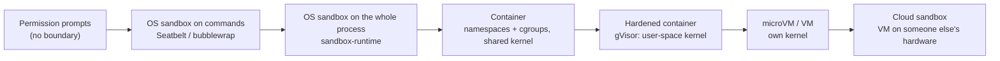

# Sandboxing and least privilege

## Why this matters

[8.1](/part-08-production/8.1-prompt-injection) ended on an uncomfortable result: nobody can reliably stop an agent from being tricked, so the design question becomes *what can a tricked agent do?* A sandbox answers it with a boundary the operating system or a hypervisor enforces, which no sentence in the context window can talk its way past. Least privilege answers the other half: whatever is inside the boundary should hold only what the task needs.

Anthropic's own summary of its experience is the case for this chapter. Model-layer defenses are strong but probabilistic, and "protection in the model layer will never be 100% effective, which is why it can't stand alone"; their advice is to design containment at the environment layer first, then steer behavior at the model layer ([How we contain Claude across products](https://www.anthropic.com/research/how-we-contain-claude)). In trifecta terms ([8.1](/part-08-production/8.1-prompt-injection#the-lethal-trifecta)): a sandbox cuts the exfiltration leg (network) and shrinks the private-data leg (filesystem, credentials) in code, without asking the model to behave.

By the end you should be able to pick an isolation level for a coding agent, write down what it does and does not cover, and run your `project/` shell tool inside one.

**Learning goals**

- Compare sandbox options (OS sandboxes, containers, VMs, cloud sandboxes)
- Apply filesystem and network restrictions
- Scope credentials to the task

## Explanation

### Threat model for a coding agent

A threat model starts from who can make the agent do something harmful. Anthropic sorts agent risks into three kinds ([How we contain Claude](https://www.anthropic.com/research/how-we-contain-claude)), and they map directly onto a coding agent:

| Risk | What it looks like | Example |
|---|---|---|
| **User misuse** | The person at the keyboard directs something harmful, on purpose or by carelessness | Approving a command they don't understand; pasting a "run this prompt" from a phishing email |
| **Model misbehavior** | The agent does something nobody asked for | A "helpful" shortcut: deleting a directory to fix a build, or routing around a restriction nobody wrote down. The same post says Anthropic has seen Claude models "helpfully" escape a sandbox to finish a task |
| **External attackers** | Hostile text or traffic reaches the agent through a tool, file or network | The [8.1](/part-08-production/8.1-prompt-injection) `NOTES.md` payload; a malicious repo you cloned to review |

The useful property of an environment boundary is that it does not care which of the three caused the action. The same post says that if credentials never enter the sandbox, "they can't be exfiltrated, regardless of whether the cause is a user, a model finding a 'creative' path, or an attacker".

Concretely, ask three questions about a coding agent that runs shell commands:

1. **What can it read?** Your home directory holds `~/.ssh`, `~/.aws/credentials`, browser profiles and every repository you own. The default for most agent shells is "everything you can read".
2. **What can it write?** Beyond the project: shell startup files (`~/.zshrc`), `$PATH` directories, git hooks, editor and agent configuration. A write to any of these is code execution later, in a different context. Claude Code's sandbox docs call this "filesystem permission escalation" ([Sandboxing: security limitations](https://code.claude.com/docs/en/sandboxing#security-limitations)).
3. **Where can bytes go?** Any outbound connection is an exfiltration channel ([8.1](/part-08-production/8.1-prompt-injection#the-lethal-trifecta)).

Anthropic's launch post for the Claude Code sandbox says the two boundaries only work as a pair: "Without network isolation, a compromised agent could exfiltrate sensitive files like SSH keys; without filesystem isolation, a compromised agent could easily escape the sandbox and gain network access" ([Making Claude Code safer with sandboxing](https://www.anthropic.com/research/claude-code-sandboxing)). The second half is the less obvious one: if the agent can rewrite `~/.zshrc` or a hook that something unsandboxed later runs, the network rule does not matter.

#### Permission prompts are not a boundary

A prompt asks a human to judge each action; a sandbox removes the need to judge. Anthropic reports that users approved roughly 93% of Claude Code's permission prompts, and that attention drops as approvals pile up ("approval fatigue", also covered in [6.4](/part-06-claude-code/6.4-hooks-permissions)). They say the OS-level sandbox cut permission prompts by 84% in internal usage, and that a tight perimeter is what allows relaxing oversight ([How we contain Claude](https://www.anthropic.com/research/how-we-contain-claude); [sandboxing launch post](https://www.anthropic.com/research/claude-code-sandboxing)). Read that the right way round: the boundary is what makes fewer prompts safe, and it is not a replacement for thinking about what is inside it.

### The isolation ladder

Options differ in what they wrap and how strong the wall is. Claude Code's docs list them from lightest to heaviest ([Choose a sandbox environment](https://code.claude.com/docs/en/sandbox-environments)); the rest of this section fills in the mechanism, and the strength ordering is my summary of those docs.

| Option | What is wrapped | Kernel | Startup and friction | Typical use |
|---|---|---|---|---|
| **OS sandbox on the shell tool** (Seatbelt on macOS, bubblewrap on Linux) | Only the commands the agent runs, and their child processes | Host kernel, policy-restricted | Near zero; no Docker | Everyday local work; fewer prompts |
| **OS sandbox around the whole process** (`srt`) | The agent process itself: file tools, hooks, local MCP servers too | Host kernel | Low | Unattended runs without Docker |
| **Container** (Docker, dev container) | A whole dev environment | Shared host kernel | Medium: image, mounts, firewall | Team-standard environment, CI |
| **VM / microVM** (Firecracker, Docker Sandboxes, Apple Virtualization) | A full OS | Its own guest kernel | Higher: boot time, file sharing | Untrusted code; when policy demands kernel-level separation |
| **Cloud sandbox** (Claude Code on the web, claude.ai code execution) | A VM or gVisor container on the provider's infrastructure | Provider's | None for you; code leaves your machine | Delegating work; no local setup |

#### OS sandboxes: Seatbelt and bubblewrap

These use primitives the kernel already has, with no image to build. Claude Code's sandbox uses "Linux bubblewrap and MacOS seatbelt to enforce these restrictions at the OS level", and the restrictions cover "any scripts, programs, or subprocesses that are spawned by the command" ([sandboxing launch post](https://www.anthropic.com/research/claude-code-sandboxing)). That last part is the point: a rule applied to the model's *tool call* is bypassed by a script the call writes and runs; a rule applied to the *process tree* is not.

- **macOS**: Seatbelt. You can try it directly with `sandbox-exec` and a small profile; Apple's man page marks `sandbox-exec` as deprecated in favour of App Sandbox, so treat it as a lab tool and not a product foundation. (I ran the profile in the practice section on macOS 27.2.)
- **Linux**: [bubblewrap](https://github.com/containers/bubblewrap), an unprivileged tool that builds the filesystem view and, in Claude Code's setup, a separate network namespace with no connection to your network ([Sandboxing: network isolation](https://code.claude.com/docs/en/sandboxing#network-isolation)).
- **What it costs you**: the sandbox covers shell commands only. Per the docs, Claude's file tools, MCP servers and hooks "run outside it", and so do commands you type yourself at the `!` prompt ([Sandboxing: what runs outside the sandbox](https://code.claude.com/docs/en/sandboxing#what-runs-outside-the-sandbox)). To cover those too, run the whole process under the [sandbox runtime](https://github.com/anthropics/sandbox-runtime) (`srt claude`), a beta research preview that wraps any process in the same Seatbelt or bubblewrap boundary.
- **Known sharp edges** from the docs' own limitations list: allowing a Unix socket such as `/var/run/docker.sock` "effectively grants access to the host system"; broad write access to `$PATH` directories or shell rc files lets the agent plant code that runs elsewhere; the Linux `enableWeakerNestedSandbox` mode, which makes it work inside Docker, "considerably weakens security" ([Sandboxing: security limitations](https://code.claude.com/docs/en/sandboxing#security-limitations)).

The OS sandbox shares the host kernel, so a kernel bug is also a sandbox escape. For code you actively distrust, that matters; for "a helpful agent that might get prompt-injected", it is usually the right trade.

#### Containers

A container uses kernel namespaces and cgroups to give a process its own filesystem view, process table and network, on the *shared* host kernel. It is familiar to every full-stack engineer, which is its main advantage. Three habits make it a sandbox and not just packaging:

- **Mount only what the task needs**, read-only where possible: `-v "$PWD/work:/work"`, never `-v ~:/home`. Mounting `/var/run/docker.sock` inside is the same mistake as the Unix-socket warning above.
- **Cut the network**, or route it through a policy point. Docker's `none` network driver gives the container no outside connectivity ([Docker: none network driver](https://docs.docker.com/engine/network/drivers/none/)). Claude Code's reference dev container instead uses a default-deny iptables firewall with an allowlist ([Choose a sandbox environment: dev containers](https://code.claude.com/docs/en/sandbox-environments#dev-containers)).
- **Don't run as root, and don't pass `--privileged`**; drop what you don't need. A privileged container is close to no container.

Because the kernel is shared, a hardened runtime adds a layer. claude.ai runs code "in a gVisor container on isolated infrastructure" ([How we contain Claude](https://www.anthropic.com/research/how-we-contain-claude)); gVisor interposes a user-space kernel between the workload and the host ([gVisor docs](https://gvisor.dev/docs/)).

#### VMs and microVMs

A VM gives the agent its own kernel, so escaping it needs a hypervisor bug, not a kernel bug. Claude Cowork runs agent code inside a full VM using the platform's hypervisor (Apple's Virtualization framework on macOS); the VM "has its own Linux kernel, its own filesystem, and its own process table", only the user's workspace is mounted, and credentials stay in the host's keychain ([How we contain Claude](https://www.anthropic.com/research/how-we-contain-claude)). **MicroVMs** such as [Firecracker](https://firecracker-microvm.github.io/) keep the separate kernel but strip the machine down to boot fast; Claude Code's docs list Firecracker among the options and point to [Docker Sandboxes](https://docs.docker.com/ai/sandboxes/), a microVM with its own Docker daemon, for running Claude Code locally ([Choose a sandbox environment: virtual machine](https://code.claude.com/docs/en/sandbox-environments#virtual-machine)).

The cost is operational: boot time, shared-folder friction, and visibility. Anthropic notes the same isolation that kept Claude contained also kept enterprise endpoint-detection software out of the guest, and their mitigation is log export after the fact, not live monitoring ([How we contain Claude](https://www.anthropic.com/research/how-we-contain-claude)).

#### Cloud sandboxes

Run the agent somewhere that isn't your machine. Claude Code on the web runs each session "in an isolated sandbox in the cloud" designed so that "sensitive credentials (such as git credentials or signing keys) are never inside the sandbox" ([sandboxing launch post](https://www.anthropic.com/research/claude-code-sandboxing)). The blast radius of a compromised session is the sandbox plus whatever you gave it, so the lever left to you is what you hand over: the repo, the secrets, the network allowlist. This is also the idea behind the hosted agents in [8.7](/part-08-production/8.7-managed-agents).

#### Choosing

Anthropic's heuristic is to match isolation strength to the user's capacity for oversight, and not to pick the strongest thing by default: a developer who can read bash can handle an approval dialog backed by an OS sandbox, while a knowledge worker who can't needs a boundary that is "absolute and always-on" ([How we contain Claude](https://www.anthropic.com/research/how-we-contain-claude)). My rule of thumb on top of that, for your situation:

| You are... | Start with |
|---|---|
| Running Claude Code interactively on your own repos | The built-in OS sandbox on the shell tool |
| Running an agent unattended (no prompts), or with `--dangerously-skip-permissions` | A container, VM or `srt` around the *whole* process; Claude Code's docs say sessions with that flag should always run in one of these ([Choose a sandbox environment](https://code.claude.com/docs/en/sandbox-environments#how-isolation-relates-to-permission-modes)) |
| Running code you don't trust at all (a stranger's repo, model-written code from a weak model) | A VM or microVM, or a cloud sandbox, with no secrets inside |
| Building your own agent (this chapter's practice) | Container with `--network none`, or an OS sandbox profile, around the shell tool |

Layering is allowed and usually wise: the docs say the sandboxed Bash tool alone is "not sufficient for fully unattended runs", and running it inside a container or VM gives command-level limits on top of the outer boundary.

### Network egress control

Network is the exfiltration leg, so it gets its own section. There are three levels of strictness.

1. **No network.** The container has `--network none`; the sandbox profile denies `network*`. The agent cannot call an API either, which means no hosted model from *inside* the box. That is fine when the model runs outside and only the shell tool is boxed, which is exactly the shape of your `project/`.
2. **Allowlist through a proxy.** Claude Code's sandbox gives commands no direct route out; connections go through a proxy outside the sandbox that checks each host against allowed domains, and the list starts empty ([Sandboxing: what the sandbox restricts](https://code.claude.com/docs/en/sandboxing#what-the-sandbox-restricts)). Tools that don't honour the proxy variables, such as plain `ssh` or most database drivers, can't connect at all, and neither can non-TCP traffic.
3. **Allowlist plus inspection.** Add a proxy that terminates TLS and checks content. Claude Code's docs say the built-in proxy does *not* inspect TLS contents by default and recommend a custom proxy if your threat model needs more.

Two lessons from Anthropic's incidents are worth keeping, because they show why "allowlist" is weaker than it sounds:

- **An allowed domain is a capability grant, not just a destination.** Cowork's egress rules correctly allowed `api.anthropic.com`. A malicious file in a workspace told Claude to read other files and upload them through Anthropic's Files API using an attacker's API key; the proxy saw an allowed host and passed it, and the files landed in the attacker's account. "The sandbox worked perfectly, and yet the data was exfiltrated." The fix was a proxy inside the VM that only passes requests carrying the VM's own session token. Anthropic's reframing: every function reachable through an allowlisted domain is an attack surface ([How we contain Claude](https://www.anthropic.com/research/how-we-contain-claude)).
- **Broad domains leak.** The Claude Code docs warn that allowing something like `github.com` can create exfiltration paths, and that because the proxy decides from the client-supplied hostname, code in the sandbox can potentially use domain fronting to reach hosts outside the list ([Sandboxing: security limitations](https://code.claude.com/docs/en/sandboxing#security-limitations)).

So the practical order is: no network if the task allows it; a short allowlist of exact hosts (a package registry, not "the internet") if not; and an honest note about what each allowed host can *do* for an attacker. Anthropic's phishing test makes the same point for the other direction: when a user was tricked into launching Claude with a malicious prompt asking to read `~/.aws/credentials` and POST it, Claude completed the exfiltration in 24 of 25 retries, and "the only defense that holds in this situation is the environment", meaning egress controls that block the POST and filesystem boundaries that keep `~/.aws` out of reach.

### Least-privilege credentials

Sandboxing decides what the agent can *reach*; least privilege decides what is worth reaching. OWASP's "Excessive Agency" risk (LLM06) is the same idea from the vulnerability side: it lists excessive functionality, permissions and autonomy as the root causes, and it is the entry to read alongside this chapter ([OWASP LLM06:2025 Excessive Agency](https://genai.owasp.org/llmrisk/llm062025-excessive-agency/)). Four habits:

1. **Keep credentials out of the box.** Best case, the agent never sees the secret. Claude Code on the web does git through a proxy: the git client inside the sandbox authenticates with a custom scoped credential, and the proxy "verifies this credential and the contents of the git interaction (e.g. ensuring it is only pushing to the configured branch), then attaches the right authentication token" ([sandboxing launch post](https://www.anthropic.com/research/claude-code-sandboxing)). Cowork keeps credentials in the host keychain and gives the VM "a per-session scoped-down token" that can be revoked independently of the user's ([How we contain Claude](https://www.anthropic.com/research/how-we-contain-claude)). The pattern: the real secret lives with a deterministic broker; the agent holds a token that only works for one narrow thing.
2. **Scrub the environment.** Environment variables are inherited by default. Claude Code's sandbox settings can unset named variables before each sandboxed command and deny reads of named credential files (`~/.aws/credentials`, `~/.ssh`), but the docs are explicit that "there is no built-in credential deny list, so only the files and variables you list are restricted" ([Sandboxing: protect credentials](https://code.claude.com/docs/en/sandboxing#protect-credentials)). Same shape in your own harness: build the child process's environment from an allowlist, never from `process.env`.
3. **Make tokens narrow, short-lived and revocable.** Task-scoped means: one repository, read-only unless the task writes, an expiry measured in hours, and its own identity so you can revoke it without touching yours. A fine-grained token that can only open pull requests on one repo turns "hijacked agent" into "hijacked agent that can open a bad pull request on one repo".
4. **Scope tools too.** Anthropic's example: an agent with read-only database access "can be deployed far more broadly than one that writes to prod" ([How we contain Claude](https://www.anthropic.com/research/how-we-contain-claude)). A `run_shell` tool is the widest tool you can give; a `run_tests` tool that executes one fixed command is a much smaller grant. Prefer the narrow tool when the task allows.

The mount mode is a credential-like decision as well. Cowork offers read-only, read-write and read-write-no-delete mounts, and notes a gotcha worth borrowing: resolve symlinks *before* validating a path, or a symlink inside an authorized folder can point outside it ([How we contain Claude](https://www.anthropic.com/research/how-we-contain-claude)).

### How Claude is contained across products

Anthropic's May 2026 write-up describes three products with three architectures, and it is the best worked comparison available for this chapter. Read it in full ([How we contain Claude across products](https://www.anthropic.com/research/how-we-contain-claude)); the summary table is mine, built from that article.

| Product | Where it runs | Boundary | What the user must do | Weak spot Anthropic reported |
|---|---|---|---|---|
| **claude.ai** code execution | Server-side, per-session ephemeral filesystem | gVisor container on isolated infrastructure | Nothing | The custom proxy and surrounding services, not gVisor or seccomp |
| **Claude Code** | Your machine | Permission prompts, plus an OS sandbox (Seatbelt / bubblewrap): writes in the workspace, network off by default | Judge approvals; configure the sandbox | Config parsed before the trust dialog; the user as injection vector (the phished prompt) |
| **Claude Cowork** | Your desktop | A VM with its own kernel; workspace mounted, credentials stay on the host | Pick which folders to mount | An allowlisted domain used for exfiltration; the VM hid the guest from EDR tools |

Three observations from it that generalize:

- **The standard primitives held; the custom parts broke.** Anthropic says hypervisors, seccomp and gVisor were dependable and the custom allowlist proxy "was the piece that failed", and advises being wary of custom components. For you: prefer an off-the-shelf boundary (Docker, `sandbox-exec`, `srt`) over a hand-rolled path filter in your TypeScript.
- **Trust prompts and startup are part of the attack surface.** Three reported vulnerabilities targeted code that ran before the user consented, e.g. a hook defined in a cloned repo's `.claude/settings.json` executing at startup. Anthropic's fix was to defer project-local configuration until after the trust dialog. For your harness: do not load config from the directory the agent is about to work on before you've decided to trust it.
- **Where the escape hatch sits matters.** In Claude Code, a privileged process outside the sandbox decides per command whether to enforce it, so "a persuasive injected prompt or a fatigued approval click" can get something run unsandboxed. In Cowork's original full-VM mode there was no such outer process to grant exceptions. The Claude Code docs describe the equivalent knob: `allowUnsandboxedCommands` lets Claude ask to retry a failed command outside the sandbox, and you can turn it off ([Sandboxing: get started](https://code.claude.com/docs/en/sandboxing#get-started)). If you build your own, decide up front whether your harness has an escape hatch at all.

#### What a sandbox does not fix

Be exact about the limits, because overconfidence is its own vulnerability:

- It does not stop data leaving through the *model channel*. The files the agent reads are sent to the model provider regardless of isolation ([Choose a sandbox environment](https://code.claude.com/docs/en/sandbox-environments)).
- Anything you mount writable can still be damaged, including your project. Anything the agent can read and any allowed network path can still leak. A sandbox shrinks the blast radius; it doesn't zero it.
- It does not help against prompt injection's *non-shell* effects: a poisoned tool result that makes the agent write a subtly backdoored file into your repo still lands in your repo. That is why review ([7.3](/part-07-ai-native-development/7.3-automated-review)) and the other 8.1 patterns stay.
- Sandboxing the shell tool does not sandbox your harness's *other* tools. If `read_file` takes any path, a filesystem rule on `run_shell` leaves a hole. Apply the same scoping in every tool, or sandbox the whole process.

::: info 📖 Read now
[Anthropic: How we contain Claude across products](https://www.anthropic.com/research/how-we-contain-claude) · article · ~25 min · **essential**

Look for: the three risk categories and three defense layers, the three isolation patterns and why each product got its own, and the "risk we missed" boxes (config before the trust dialog, the phished prompt, the allowlisted `api.anthropic.com`). For each incident, ask which of the three environment controls (filesystem, network, credentials) would have stopped it, and note that it was never the model layer.
:::

::: info 📖 Read now
[Anthropic: Making Claude Code safer with sandboxing](https://www.anthropic.com/research/claude-code-sandboxing) · article · ~8 min · **essential**

Look for: why filesystem and network isolation are only useful together, how the proxy handles domains, and the cloud-session design where git credentials never enter the sandbox.
:::

::: info 📖 Read now
[Claude Code docs: Configure the sandboxed Bash tool](https://code.claude.com/docs/en/sandboxing) · docs · ~25 min · **essential**

Look for: the table of defaults (reads are wide open, writes are narrow, network starts empty), "What runs outside the sandbox", the credentials settings, and the "Security limitations" list. Write down three things this sandbox does *not* protect against.
:::

::: info 📖 Read now
[Claude Code docs: Choose a sandbox environment](https://code.claude.com/docs/en/sandbox-environments) · docs · ~15 min · **essential**

Look for: the comparison table of approaches, the section "How isolation relates to permission modes", and why the whole process, not only Bash, must sit inside the boundary for unattended runs.
:::

::: info 📖 Read now
[OWASP LLM06:2025 Excessive Agency](https://genai.owasp.org/llmrisk/llm062025-excessive-agency/) · docs · ~10 min · optional

Look for: the root causes (functionality, permissions, autonomy) and which prevention items are least-privilege design versus human approval.
:::

::: info 📖 Read now
[anthropics/sandbox-runtime](https://github.com/anthropics/sandbox-runtime) · repo · ~15 min (README) · optional

Look for: the settings schema for allowed domains and filesystem paths, and what the runtime denies by default. It is the open-source piece behind Claude Code's sandbox and a good model for your own policy file.
:::

::: info 📖 Read now
[Docker Sandboxes](https://docs.docker.com/ai/sandboxes/) · docs · ~10 min · optional

Look for: how a microVM differs from a container for running coding agents, and what is synced between host and sandbox.
:::

## Practice

**Brief:** Run `project/`'s shell tool inside a sandbox (container or OS sandbox) with no network and a scoped filesystem. Repeat the 8.1 attack.

**Where:** A step in the growing `project/` (see `project/ROADMAP.md`, step 27, built on step 25). You write the code and the sandbox policy; I haven't provided either. Write your findings in `notes/sandboxing.md`.

**Safety rules for the lab.** Same as 8.1: the secret is fake, the "attacker server" is a process on `localhost` you started, and nothing leaves your machine. Never mount your real home directory or `.env`. Run the lab from a scratch directory.

**Which sandbox.** Pick one as your main implementation and, if time allows, do the other as a comparison:

- **Container.** Docker is installed on this Mac. Run each command with something like `docker run --rm --network none -v <scratch>/work:/work -w /work <image> sh -c "<cmd>"`, with the work mount read-write only if the task needs writes. Note that a fresh `docker run` per command is slow and stateless; decide whether you want that or one long-lived container you `exec` into.
- **macOS Seatbelt.** `sandbox-exec -f <profile> sh -c "<cmd>"` with a profile that denies `network*`, denies writes outside the work directory and denies reads of the secret. A trap I hit while checking this chapter: Seatbelt matches **resolved** paths, so a rule for `/tmp/lab/...` silently does nothing because `/tmp` is a symlink to `/private/tmp`; write the profile with `/private/tmp/...` (or whatever `realpath` returns). Claude Code's sandbox docs describe the same behaviour for `/private/tmp` ([Sandbox runtime](https://code.claude.com/docs/en/sandbox-environments#sandbox-runtime)). The tool is deprecated and I found no official reference for the profile language, so expect trial and error and treat this as a learning lab.

**Steps:**

1. **Write the policy first**, in `notes/sandboxing.md`, as three lines: what the shell tool may read, what it may write, where it may connect. Then predict, per the 8.1 payloads, which attacks the policy stops and which it doesn't.
2. **Rebuild the lab from 8.1** (fake `.env`, ordinary files, a local listener that logs every request). Put the fake secret *both* inside and outside the directory you intend to expose, so you can tell filesystem scoping apart from network blocking.
3. **Run the baseline** unsandboxed with your 8.1 payloads and confirm the attack still works, using the same model as before. This is your control: no baseline, no evidence.
4. **Put the shell tool in the sandbox.** Change `run_shell` so the command executes under your chosen sandbox. The agent loop and the model call stay outside; only command execution is boxed. Build the child's environment from an explicit allowlist instead of inheriting `process.env`.
5. **Probe the boundary directly, without the model**, so you know the sandbox works before you test the agent: from inside it, try to read the secret outside the scope, write outside the work directory, resolve a hostname, connect to your listener on `localhost`, and read an environment variable you did not allow. Record each result. (`localhost` deserves its own row: with a container on `--network none` it is the container's own loopback, not your host's.)
6. **Repeat the 8.1 attack** with the same payloads and runs. Per run record: did the agent attempt the exfiltration, did a request arrive at the listener, did the agent read the secret, what did the tool result look like to the model, and did the agent adapt (try another route) or give up?
7. **Find a gap.** Look for something the sandbox does not cover and exploit it on purpose: does `read_file` still read the secret outside the work directory? Can the agent write a file the user later runs (a script, a `Makefile`, a shell rc)? Does any other tool carry network access? Fix the one you find, or document why you accept it.
8. **Check usability.** Run an ordinary task with a real dependency (for example `npm install` plus tests). What breaks with no network, and what is the smallest allowlist (one registry host, through a proxy) that fixes it? You don't have to build the proxy; write down what it would need to enforce and what an allowed host could still be used for.
9. **Write the notes:** the three-line policy, the boundary-probe table, the before/after run table, the gap you found and the one line of code or config that changed because of it, and your answer to "what would I need to see before trusting this to run unattended?"
10. **Commit.**

**Done when:**

- Your `run_shell` runs inside a sandbox with no network and a filesystem scope you can state in one sentence, and the direct probes (step 5) show each restriction holding, with output pasted in the notes.
- The same 8.1 payloads that exfiltrated the fake secret in the baseline produce no request at the listener now, in at least five runs per payload, and `notes/sandboxing.md` says what the agent did instead.
- You found at least one thing the sandbox doesn't protect, demonstrated or reasoned from your code, and the notes say how you closed it or why you left it.
- Your child process environment is built from an allowlist, and a probe shows a non-allowlisted variable is absent.

## Check questions

1. Your agent's sandbox blocks all network access but mounts your whole home directory read-write. Name two ways a prompt-injected agent can still hurt you.

   

Answer

   It can read anything in your home (SSH keys, cloud credentials), and a later step may leak them through some channel the sandbox doesn't cover, for example the model channel itself or a file you later upload. And it can write: planting code in `~/.zshrc`, a `$PATH` directory or a git hook gives later code execution in an unsandboxed context, which is the "filesystem permission escalation" the Claude Code docs warn about. Network isolation without filesystem isolation (and vice versa) is incomplete; Anthropic says effective sandboxing needs both.

   

2. Your egress allowlist contains only `api.anthropic.com` and your package registry, yet data still leaves. How?

   

Answer

   An allowed domain is a capability grant: every function reachable through it is an attack surface. Anthropic's Cowork case: injected instructions made Claude upload workspace files to Anthropic's Files API using an attacker-supplied key; the proxy only checked the host. The same logic applies to a registry that accepts publishes, or to broad hosts like `github.com`. Mitigations are to allow exact hosts, to bind allowed traffic to your own credentials (the Cowork fix passed only requests carrying the VM's own session token), and to inspect or constrain what an allowed host can be asked to do.

   

3. When would you pick a microVM over a container, and when is that overkill?

   

Answer

   A container shares the host kernel, so a kernel vulnerability is an escape; a microVM has its own guest kernel, so the attacker needs a hypervisor bug as well. Choose the VM when the code is actively untrusted, when policy requires kernel-level separation, or when no one will supervise. For an interactive agent on your own repos where the risk is prompt injection and the wall only needs to stop a command from reading your SSH keys or opening a socket, an OS sandbox or a locked-down container is usually enough, and the VM's boot time and file-sharing friction buy little. Anthropic's heuristic is to match isolation strength to the user's ability to oversee the agent, not to maximize it.

   

4. Why is "give the agent a read-only, repo-scoped, expiring token" better than "put the secret in a variable the agent promises not to print"?

   

Answer

   The second relies on the model behaving, and a prompt-injected model won't. The first limits the damage by construction: a leaked token can't reach other repositories, can't write, and expires. Even better is the broker pattern from Claude Code on the web: the real credential never enters the sandbox, and a proxy checks each request (for instance that a push goes only to the configured branch) before attaching it. The secret that isn't there can't be exfiltrated, whoever caused the request.

   

5. You sandboxed `run_shell` and the 8.1 attack now fails. Your colleague says the agent is "secure". What do you check first?

   

Answer

   What else the agent can do that isn't `run_shell`. Claude Code's own docs note that its sandbox covers shell commands only: file tools, MCP servers and hooks run outside it. In your harness, a `read_file` tool with no path scope, a fetch tool with network access, or any tool that writes to a place something unsandboxed later executes is a second door. Also check whether a successful injection can still do damage inside the boundary (edit the repo), and whether the baseline attack was really working before you added the sandbox, so you know the sandbox, and not luck, made it fail.

   

## My understanding

<!-- Written by the learner, in their own words. Agents never fill this in. -->
