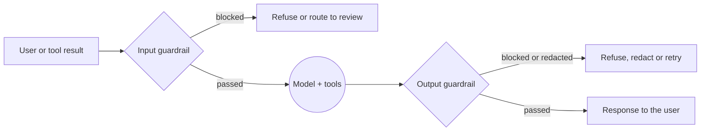

# Guardrails

## Why this matters

A **guardrail** is a check that runs on what goes into your model or what comes out of it: is this request allowed, does this answer leak an email address, is this JSON what the caller expects. Every production LLM feature ends up with some, because the model's own training is not a policy you control. They are useful. They are also routinely oversold, so this chapter holds two ideas together: guardrails are the cheapest way to catch the *common* bad cases, and they are a **filter, not a security boundary**. [8.1](/part-08-production/8.1-prompt-injection) argued the second half; this chapter builds the first half and measures it, so you can say "this guardrail blocks 9 of 10 of my attacks and wrongly blocks 1 in 20 normal requests" instead of "it works".

**Learning goals**

- Implement input and output guardrails
- Measure their false positive/negative rates
- Know where guardrails help and where they don't

## Explanation

### Where a guardrail sits



Two positions, and each answers a different question:

- **Input guardrail**: "should the model see this at all?" It runs before the model call, so a block costs almost nothing downstream.
- **Output guardrail**: "should the user (or the next tool) receive this?" It sees what the model actually produced, including the effects of an injection the input check missed.

Agents add a third and fourth position: **tool results** (untrusted content on its way into the context) and **tool calls** (the model's proposed action, before it executes). NVIDIA's NeMo Guardrails library names the same stages as input, retrieval, dialog, execution and output "rails" ([NeMo Guardrails overview](https://docs.nvidia.com/nemo/guardrails/latest/index.html)). Anthropic's guidance applies its screening pattern both to user input and to tool output before Claude acts on it ([Mitigate jailbreaks and prompt injections](https://platform.claude.com/docs/en/test-and-evaluate/strengthen-guardrails/mitigate-jailbreaks)).

A guardrail is any function with this shape, and keeping it that small is what makes it testable:

```ts
type Verdict = { allow: boolean; reason?: string; redacted?: string }
type Guardrail = (text: string) => Promise<Verdict>
```

### Input classification

An input guardrail decides *allow* or *block* (sometimes *flag for review*) from the incoming text. Four implementations, cheapest first:

| Kind | How it decides | Strength | Weakness |
|---|---|---|---|
| **Rules** | Length caps, character checks, regex or keyword lists, a topic allowlist | Instant, free, predictable, explainable | A paraphrase, translation or encoding walks past it |
| **Small classifier** | A trained model (BERT-sized) with a fixed label set | Fast, runs locally | Only knows the labels and data it was trained on |
| **Guard LLM** | A language model fine-tuned to emit a verdict and a category | Reads context and phrasing; handles more languages | Slower, a model call per check; its verdicts are probabilistic |
| **General LLM as classifier** | Your own prompt to a small general model, with a constrained output | Policy is whatever you write; no new model to host | You must measure it, and it can itself be injected |

Anthropic's docs describe the last row concretely: pre-screen the input with a lightweight model and use structured output to constrain the answer to a simple classification, for example `{"is_harmful": boolean}`. The same page lists **input validation** (filtering for known injection patterns, optionally with an LLM given known jailbreak phrasing as examples) next to hardened system prompts, and says to **respond to repeat offenders** by throttling or banning users who keep triggering refusals ([Mitigate jailbreaks and prompt injections](https://platform.claude.com/docs/en/test-and-evaluate/strengthen-guardrails/mitigate-jailbreaks)). Note that the last advice is not a classifier at all: a guardrail's *verdict history* is also a signal.

**What to classify for** depends on the product. Three different jobs get lumped under "input guardrails":

1. **Content policy**: hate, self-harm, illegal activity. Standard taxonomies exist (see the models below).
2. **Scope**: "this support bot answers questions about billing only". This one is yours to write; no off-the-shelf model knows your product.
3. **Injection and jailbreak attempts**: the subject of 8.1. This is the job where classifiers are weakest, because the attacker is adapting to your check. Expect it to lower the rate of casual attacks, and do not expect it to stop a determined one.

The same classifier idea also applies to **tool results** before the model reads them. A fetched web page is where indirect injection arrives, so a screen there catches a different set of attacks than the one on the user's message.

### Output validation

An output guardrail looks at what the model produced. Split it into two kinds of check, because they behave differently:

**Deterministic checks** are code, so they are reliable at what they check:

- **Format and schema.** The response must parse as JSON and match a schema; an enum field must hold one of the allowed values. Constrained decoding ([2.5](/part-02-programming-with-llms/2.5-structured-output)) makes this mostly automatic, but validate anyway: it is one function call.
- **Secrets.** Your own API-key patterns, a known fake canary string planted in the system prompt or in a file, private key headers. A canary that shows up in an output is a near-certain leak, which makes it a very low-false-positive check.
- **Links and markup.** Strip or allowlist URLs and rendered images in a UI that auto-loads them. Auto-loaded image URLs are one of the exfiltration channels listed in 8.1, and OWASP's LLM05 entry on improper output handling is about the same family of problem: treating model output as trusted when it feeds a browser, a shell or a query ([OWASP LLM05:2025 Improper Output Handling](https://genai.owasp.org/llmrisk/llm052025-improper-output-handling/)).
- **Business rules.** A refund amount under the limit, a recipient on the allowed list, a file path under the working directory. These belong in the tool, in code, not only in an output filter.

**Judged checks** use another model: is the answer on-topic, grounded in the retrieved documents, free of harmful content, consistent with a policy? They catch what no regex can, and cost a model call and carry error rates. The LLM-judge discipline from [4.4](/part-04-evals-observability/4.4-llm-as-judge) applies in full: a judge you haven't compared to human labels is a guess.

When an output check fails you have options other than refusing: **redact** the offending span, **retry** with the failure message fed back (the same validate-and-reprompt loop that structured output libraries use), **fall back** to a canned answer, or **route to a human**. Which is right depends on the cost of a wrong block, which is why you measure.

For **streaming** responses there is a wrinkle: by the time you validate the whole text, the user has seen it. Either buffer and validate before showing (more latency), validate in chunks, or use a monitor that works on partial text. Qwen's Qwen3Guard-Stream variant exists for exactly that: it adds a token-level classification head for real-time monitoring while text is being generated ([Qwen3Guard README](https://github.com/QwenLM/Qwen3Guard)).

### PII handling

**PII** (personally identifiable information: names, emails, phone numbers, card numbers, national IDs, addresses) turns up at three places, and each needs its own decision:

| Where | Question | Typical action |
|---|---|---|
| In the user's input | Should this go to a third-party model provider at all? | Detect and **redact or pseudonymize** before the call; keep the mapping locally to restore afterwards |
| In retrieved or tool data | Does this user have the right to see it? | That is an *authorization* problem. Fix it at the data layer (scoped queries), because no output filter knows who is allowed to see what |
| In the model's output | Did it repeat or invent something it shouldn't? | Detect and redact before display or logging |

Also include **logs and traces** ([4.7](/part-04-evals-observability/4.7-tracing)): redact before you store, not after.

PII detection is its own problem, and the standard open-source tool is Microsoft's Presidio: an analyzer that finds PII with named-entity recognition, regular expressions, rule-based logic and checksums, and an anonymizer that de-identifies the findings with configurable operators (its docs include encryption and decryption). Its own front page carries the caveat to remember: because detection is automated, "there is no guarantee that Presidio will find all sensitive information", so additional protections should be employed ([Presidio docs](https://data-privacy-stack.github.io/presidio/)). That is the general guardrail truth in one sentence. Presidio is a Python package; from TypeScript you either run it as a small service (it ships a REST API and Docker images) or, for a short list of formats with a fixed shape (emails, phone numbers, card numbers with a Luhn check), write the regexes yourself. Regexes find structured identifiers well and names badly.

**Redaction is a design choice with a cost.** Replacing `maria@example.com` with `<EMAIL_1>` keeps the sentence usable for the model and lets you swap the real value back into the answer. Dropping it outright can break the task. Test both on your own cases.

### Guardrail models and libraries

There are two different things on offer, and they get confused:

- **Models** that judge a piece of text. You call them like any model.
- **Frameworks** that orchestrate checks: where they run, what happens on failure, how they are configured.

**Safety classifier models.** A first group are language models fine-tuned to output a verdict plus a category:

- **Llama Guard 3** (Meta) classifies LLM inputs and responses as safe or unsafe and lists the violated categories from the MLCommons hazard taxonomy (13 categories, such as violent crimes, privacy and intellectual property). It comes in 1B and 8B sizes, and runs under Ollama as `llama-guard3` ([Ollama library page](https://ollama.com/library/llama-guard3)).
- **ShieldGemma** (Google) is a set of Gemma 2-based models in 2B, 9B and 27B sizes that answer Yes or No on whether an input or output violates its policies, over four harm categories (sexually explicit, dangerous content, hate, harassment). Also on Ollama ([library page](https://ollama.com/library/shieldgemma)).
- **Qwen3Guard** (Alibaba) comes in 0.6B, 4B and 8B sizes, in a generative variant (Qwen3Guard-Gen) and the streaming variant mentioned above. It labels text safe, controversial or unsafe, so the middle "controversial" band lets you choose the threshold that suits your product instead of a hard yes/no ([Qwen3Guard README](https://github.com/QwenLM/Qwen3Guard)). When I checked, there was no `qwen3guard` page in the Ollama library; the weights are on Hugging Face.
- **Hosted moderation endpoints**, such as OpenAI's Moderation API, classify text and images and return per-category scores that you threshold yourself. OpenAI notes that the underlying model can change, so thresholds on those scores may need recalibration over time ([OpenAI moderation guide](https://developers.openai.com/api/docs/guides/moderation)).

Two caveats that matter for the practice. These models are trained on **content-safety taxonomies** (violence, hate, self-harm). That is not the same as "someone is trying to steer my agent". A model may call a polite injection "safe" because the text is not harmful content. Check what a classifier was trained to do before trusting it for injection. And a verdict model is itself an LLM reading attacker-controlled text.

**Frameworks.**

- **NeMo Guardrails** (NVIDIA) is an open-source Python library built around "rails" at several stages, configured with YAML and a flow language called Colang, with custom Python actions for your own checks ([overview](https://docs.nvidia.com/nemo/guardrails/latest/index.html)).
- **Guardrails AI** is an open-source Python framework of validators run on LLM inputs and outputs. At the time of writing its README says validators are moving to standard PyPI packages you install directly, and that its hosted remote inferencing is being discontinued, a reminder that this area changes quickly ([repo](https://github.com/guardrails-ai/guardrails)).
- **Presidio** (above) for PII specifically.

Everything above is Python-first. For a TypeScript project the practical options are a call to a guard model over HTTP (Ollama exposes one), a Python sidecar service, or a few functions of your own like the `Guardrail` type above. For the two checks in the practice, writing your own is the right size: you learn what a verdict is, and you avoid taking a framework's opinions on a problem you haven't measured yet. Reach for a framework when you have many checks, many apps, or a compliance reason to want a standard configuration.

**Training-level classifiers.** Anthropic's Constitutional Classifiers are the high end of the same idea: input and output classifiers trained on synthetically generated data to catch universal jailbreaks. The first prototype withstood thousands of hours of human red teaming but with high over-refusal and compute overhead; an updated version reached similar robustness on synthetic evaluations with a 0.38% increase in refusal rate ([Constitutional Classifiers](https://www.anthropic.com/research/constitutional-classifiers)). Even that team's page is a lesson about trade-offs: the same three numbers (attack success, over-refusal, extra compute) are what you will measure on your own, smaller scale.

### Measuring a guardrail

"It blocks attacks" is not a measurement. A guardrail is a binary classifier, so treat it like one. Build a labelled set of inputs and count four outcomes, taking "block" as the positive class:

| | Guardrail blocks | Guardrail allows |
|---|---|---|
| **Truly bad input** | true positive (TP) | **false negative (FN)**: an attack got through |
| **Truly fine input** | **false positive (FP)**: a legitimate user was blocked | true negative (TN) |

- **False negative rate** (miss rate) = FN / (TP + FN). What fraction of attacks passed.
- **False positive rate** = FP / (FP + TN). What fraction of normal use was blocked.

The two trade against each other: a stricter rule or lower threshold catches more attacks and blocks more real users. A single "accuracy" number hides this, especially when the set is mostly benign. There is also a result worth knowing: on 20 benign and 10 adversarial inputs, "blocked everything" scores 33% accuracy and "blocked nothing" scores 67%, so report the two rates separately.

Which error costs more depends on where the guardrail sits. A false positive in a customer-facing chat loses a user and trust; a false negative before a tool that moves money may cost far more. Choose the threshold on purpose.

**What a small test set can and can't tell you.** With 10 adversarial inputs, each miss moves the miss rate by 10 points, and if you see 0 misses the rate could plausibly still be around 25 to 30%: a quick rule of thumb (the "rule of three") is that after *n* trials with no failures the 95% upper bound on the failure rate is about 3/n, so 3/10. Thirty inputs is enough to compare two guardrails against each other and to catch gross failures. It is not a certificate. The set is also a sample of attacks *you thought of*: it tells you how the guardrail does against your own imagination, and an adaptive attacker has more. This is the same lesson as the "Attacker Moves Second" result cited in 8.1.

**Build the set the way [4.2](/part-04-evals-observability/4.2-eval-sets) tells you to:** benign inputs drawn from realistic traffic (including awkward-but-legitimate ones, like a user quoting an attack in a question, or a security student asking how injection works), and adversarial inputs from several families: direct instruction override, role-play framing, encoded or translated payloads, indirect injection inside a document, and attempts to extract the system prompt. Keep the cases and labels in a file; run it with the harness you built in [4.3](/part-04-evals-observability/4.3-code-based-checks).

**Measure cost alongside accuracy**: added latency per request (median and slowest), and tokens or compute per check. See the next section.

### Latency and cost

A guardrail on the request path adds its own time to every request, so a check is not free just because it's "small".

- **Rules**: microseconds. Run them first, always.
- **Local small classifier or guard model**: tens to hundreds of milliseconds on a laptop, depending on hardware and size. You will measure it in the practice; don't trust a number from a blog about someone else's machine.
- **API call to a small model**: a full network round trip plus generation. Constrain the output to a tiny structured verdict so it generates a handful of tokens. Prices and model choices go stale quickly, so look them up on [Landscape](/landscape) rather than here.

Ways to keep it cheap, in rough order of payoff:

1. **Stage the checks.** Cheap deterministic checks first; call the model only if they pass. Most traffic never reaches the expensive check.
2. **Run in parallel with the main call** and cancel or discard the response if the guardrail blocks. You trade some wasted spend on blocked requests for no added latency on allowed ones. Beware of *side effects*: don't let the main call execute tools before the input check finishes.
3. **Check only what matters.** A guard LLM on every tool result in a long agent run multiplies cost per step. Put the expensive checks at the boundaries where the damage is (before a tool with side effects, before output reaches a user).
4. **Cache verdicts** for identical inputs, where the policy doesn't change.
5. **Pick the smallest model that meets your measured error rates**, which is why you measured them.

For streaming apps, the trade is time-to-first-token against safety: buffering to validate delays the stream. Decide per feature.

### Where guardrails help, and where they don't

Help:

- **Known, repetitive failure modes**: PII in logs, secrets in outputs, malformed JSON, off-topic requests, content-policy violations from casual misuse.
- **Defense in depth**: they raise the cost of low-effort attacks and give you logs of *attempts*, which is information a pure-structural defense doesn't produce.
- **Cheap tripwires**: a canary secret appearing in an output tells you an injection worked even if you didn't block it.

Don't:

- **Against an adaptive attacker.** A filter is a fixed function an attacker can probe by trial. 8.1 shows how defenses that reported near-zero attack success were beaten above 90% by adaptive attacks, and how one major vendor's best browser-agent defenses still left a nonzero rate. Don't rely on a guardrail where one miss is catastrophic.
- **For authorization.** "The model shouldn't show this user someone else's data" is enforced by the query, not by a filter on the answer.
- **For capabilities.** An agent with a network-capable shell and your `.env` is protected by [8.3](/part-08-production/8.3-sandboxing), not by a classifier in front of it.
- **When it replaces the structure.** The failure mode is a team that adds a guardrail and then marks the lethal trifecta as handled. If a design needs the guardrail to be perfect to be safe, the design is unsafe.

The working rule: **use a guardrail to lower the odds, a structural control to bound the damage, and a measurement to know how much each is worth.** OWASP's LLM02 entry on sensitive information disclosure is a good checklist of what leaks and which controls belong at which layer ([OWASP LLM02:2025](https://genai.owasp.org/llmrisk/llm022025-sensitive-information-disclosure/)).

::: info 📖 Read now
[Anthropic: Mitigate jailbreaks and prompt injections](https://platform.claude.com/docs/en/test-and-evaluate/strengthen-guardrails/mitigate-jailbreaks) · docs · ~10 min · **essential**

Look for: the split between the two threat models (the user as adversary vs. untrusted third-party content), the screening pattern with structured output, and the advice to screen tool output. Notice which items are guardrails and which are structure (least privilege, sandboxing).
:::

::: info 📖 Read now
[NVIDIA NeMo Guardrails: overview](https://docs.nvidia.com/nemo/guardrails/latest/index.html) · docs · ~10 min · **essential**

Look for: the five kinds of rails and where each sits in the request, and what "custom actions" let you add. Compare the stages with the diagram above, and with your own `project/` loop.
:::

::: info 📖 Read now
[Presidio documentation: home page](https://data-privacy-stack.github.io/presidio/) · docs · ~15 min · **optional**

Look for: the analyzer/anonymizer split, the recognizer types (NER, regex, checksum), and the warning on the front page about what automated detection can't promise.
:::

::: info 📖 Read now
[Ollama: llama-guard3](https://ollama.com/library/llama-guard3) · docs · ~5 min · **optional**

Look for: the hazard categories, how an input check and a response check differ in the `messages` you send, and what the model replies with. This is the one you can try on your Mac today.
:::

::: info 📖 Read now
[Anthropic: Constitutional Classifiers](https://www.anthropic.com/research/constitutional-classifiers) · article · ~15 min · **optional**

Look for: the three numbers the team trades off (robustness, over-refusal rate, compute overhead) and the limitations section. It is a strong guardrail built by people who say it is not a guarantee.
:::

::: info 📖 Read now
[OWASP LLM05:2025 Improper Output Handling](https://genai.owasp.org/llmrisk/llm052025-improper-output-handling/) · docs · ~10 min · **optional**

Look for: the examples where model output reaches a browser, shell or database unchecked, and how the prevention list treats the model like any other untrusted user.
:::

## Practice

**Brief:** Add one input and one output guardrail to `project/` and measure them on 20 benign and 10 adversarial inputs. You write the code and the test sets; I provide none.

**Where:** a step in the growing `project/` (see `project/ROADMAP.md`, step 28, built on step 25). Write findings in `notes/guardrails.md`.

**Steps:**

1. **Decide what each guardrail is for.** Pick one input guardrail and one output guardrail, each with a job you can state in one sentence ("blocks requests that try to override the agent's instructions", "blocks any answer containing the fake secret or an email address"). Predict, in the notes, its miss rate and false positive rate.
2. **Write the input guardrail** against the `Guardrail` shape above. Start with a rule-based version. Then add one model-based check of your choice: a general model (`qwen3:8b` with a constrained JSON verdict) or `llama-guard3:1b` through Ollama. Note which jobs it was *not* built for.
3. **Write the output guardrail.** At least one deterministic check (a regex for the fake secret from [8.1](/part-08-production/8.1-prompt-injection)'s lab and for email-shaped strings, plus a schema check if the agent returns structured output). Decide what happens on a failure: block, redact or retry.
4. **Wire both into the agent loop** from [3.2](/part-03-agents/3.2-agent-loop): input before the first model call, output before the final answer is shown. Log each verdict and its reason in the step log. Decide where tool results go, and note that decision even if you leave tool results unchecked.
5. **Build the test set** in a file with labels: 20 benign inputs (include at least 5 awkward-but-legitimate ones, such as a question *about* prompt injection or a message containing an email address the user owns) and 10 adversarial inputs from at least four families (instruction override, role-play, encoded or translated, injection inside a document, system-prompt extraction). Write them before you run anything, and don't tune on them afterwards without saying so.
6. **Measure.** Run the set through each guardrail separately and through both together. Fill the confusion matrix and report false positive and false negative rates for each. For the output guardrail, you need outputs to check: write a small list of model answers (some leaking the fake secret or PII, some clean), or run adversarial inputs with the input guardrail turned off and check what the agent says.
7. **Time it.** Record median and slowest added latency per check on your machine, for the rule check and the model check separately.
8. **Look at the errors.** For every false positive and false negative, write one line: why it happened, and what you'd change. Change one thing and re-measure. Was it a fix or just tuning to your own test set?
9. **Add a structural comparison.** Re-run one attack that got past the guardrail against the code-level control you added in 8.1 (or the sandbox from [8.3](/part-08-production/8.3-sandboxing), if done). Does the structural control catch it?
10. **Write `notes/guardrails.md`:** the two guardrails and what each is for, predictions vs. results, the confusion matrices, latency figures, the error list, and your answer to "what would I need to see before I trusted this in production, and what would I still not rely on it for?" Commit.

**Done when:**

- Both guardrails run inside the agent loop and log their verdicts.
- `notes/guardrails.md` has a confusion matrix, false positive and false negative rates and added latency for each guardrail, on 20 benign and 10 adversarial inputs.
- Every miss and every wrong block has a one-line explanation.
- You can state, from your own numbers, one case where the guardrail helped and one where a structural control was the only thing that would have.

## Check questions

1. Your input guardrail scores 20 of 30 correct on a set of 20 benign and 10 adversarial inputs. Why is that number not enough, and what do you report instead?

   <details><summary>Answer</summary>

   Accuracy hides which kind of error happened. A guardrail that blocks nothing scores 20 of 30 on this set, because 20 inputs are benign. Report the false negative rate (attacks that got through, out of the 10) and the false positive rate (benign inputs blocked, out of the 20), as separate numbers, along with the counts. With only 10 attacks, state that each miss is 10 percentage points and that the set is a sample of the attacks you thought of.

   </details>

2. A teammate adds a classifier that blocks most injection attempts in tests and writes "lethal trifecta: mitigated" in the threat model. What do you say?

   <details><summary>Answer</summary>

   The classifier lowers the probability that an injection succeeds; it removes none of the three legs (private data, untrusted content, exfiltration channel). Attackers adapt to a fixed filter, and test attacks are the ones you already thought of. Mark the risk as reduced, not mitigated, and remove a leg in code (no network in the shell, no secrets in reach, human approval for outbound actions), as 8.1 and 8.3 describe.

   </details>

3. Where does an output guardrail catch things an input guardrail can't, and what does it still miss?

   <details><summary>Answer</summary>

   It sees what the model actually produced, so it catches a secret or PII leaking into the answer, malformed or out-of-policy output, and the results of an injection that got past the input check (including a planted canary appearing in the text). It misses exfiltration that doesn't go through the displayed answer (a tool call that makes a network request, a file written somewhere), and leaks the detector can't recognize, such as a paraphrased secret or a name no pattern matches. Checks on tool calls and the sandbox cover the rest.

   </details>

4. A user's message contains someone else's address, which the retrieval step fetched from a database because of a loose query. Is a PII output filter the right fix?

   <details><summary>Answer</summary>

   Only as a backstop. The real fault is authorization: the query returned data this user isn't entitled to, so the model had it in context and could leak it in ways a filter won't recognize (a summary, a paraphrase, a tool argument). Scope the query to the user's own records. The output filter then catches the stray identifiers that still appear.

   </details>

5. Name two ways to keep a model-based input guardrail from doubling your latency.

   <details><summary>Answer</summary>

   Run cheap deterministic rules first so only the traffic that passes them reaches the model check; run the guardrail in parallel with the main model call and discard the answer on a block (while not letting the main call run side-effecting tools before the check finishes); constrain the verdict to a few output tokens; use the smallest model whose measured error rates are acceptable; cache verdicts for repeated inputs.

   </details>

## My understanding

<!-- Written by the learner, in their own words. Agents never fill this in. -->
