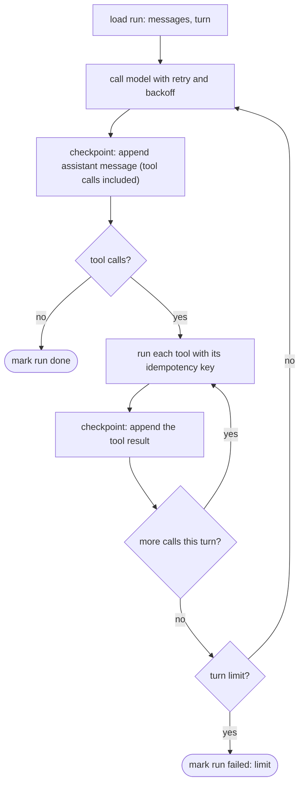
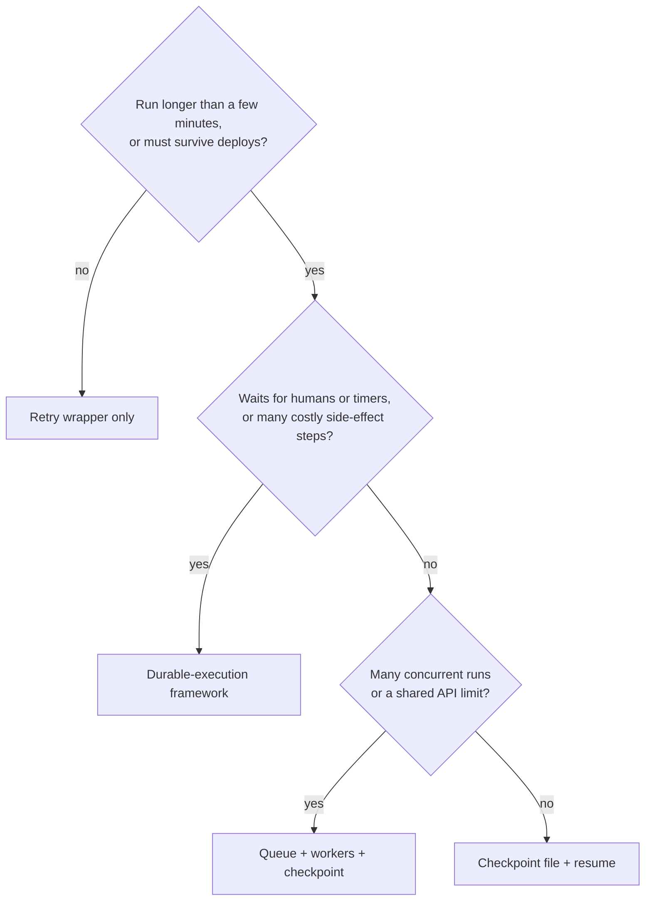

# Durable agents: queues, retries, rate limits

## Why this matters

On your laptop, an agent run is a process you watch. In production it is minutes or hours of work with no one watching, spread over dozens of model calls and tool calls, and any of them can fail: the API answers 429 because three agents share one organization limit, the process is killed by a deploy at turn 31, a tool charged a card and the connection dropped before the result came back. If your only recovery is "run it again from the start", you pay for the whole run twice, and for tools with side effects you do the side effect twice.

Three techniques cover almost everything: **retry with backoff** for transient errors, **checkpointing** so a run can resume where it stopped, and **idempotent tools** so resuming (or retrying) is safe. **Queues** and **durable-execution frameworks** are two ways to run those techniques for you instead of writing them by hand. This chapter builds the hand-written version first, because you need to understand what the frameworks automate before you can judge whether you need one.

It assumes the loop from [3.2](/part-03-agents/3.2-agent-loop): a `messages` array, a model call, tool execution, a turn limit. Security (what a retried tool may be *allowed* to do) is in [8.1](/part-08-production/8.1-prompt-injection) to [8.3](/part-08-production/8.3-sandboxing); this chapter is about what happens when things fail, not when things are attacked.

**Learning goals**

- Handle rate limits and retries correctly
- Make an agent resumable after a crash
- Choose between queues and durable-execution frameworks

## Explanation

### What goes wrong in a long run

Name the failures before choosing tools, because each one needs a different defence:

| Failure | Example | Defence |
|---|---|---|
| Transient API error | 429 rate limit, 500, 529 overloaded, connection reset | Retry with backoff and jitter |
| Permanent API error | 400 invalid request, 401 bad key, spend cap reached | Do **not** retry; fail the run with a clear reason |
| Process death | Deploy, OOM kill, `kill -9`, laptop lid | Checkpoint after each step; resume from it |
| Duplicate side effect | Retried or resumed run sends the email twice | Idempotent tools |
| Overload you cause | Ten agents start at once and exhaust the org's limit | A queue with a concurrency limit |
| Long waits | Waiting hours for a human approval or a scheduled time | Durable timers (a framework) or a queue with delays |

The rest of the chapter takes these in order.

### Rate limits and backoff

**What the limits are.** Anthropic limits an organization by requests per minute, input tokens per minute and output tokens per minute per model class, and enforces them with a token bucket: capacity "is continuously replenished up to your maximum limit, rather than being reset at fixed intervals". A stated per-minute rate can also be enforced over shorter intervals, so a burst can trip a limit that the per-minute average would not ([Rate limits](https://platform.claude.com/docs/en/api/rate-limits)). Specific numbers depend on your usage tier and change, so look them up in the Console rather than in a book.

Why agents hit this harder than chat apps: a loop makes many sequential calls, each resending a growing `messages` array, so *input tokens per minute* is usually the limit you hit first, and every agent in the organization draws from the same bucket. The limit is shared, which is what makes the queue section below necessary.

**What the error tells you.** A 429 has type `rate_limit_error`, and the response can carry a `retry-after` header (seconds to wait; "earlier retries might fail") plus `anthropic-ratelimit-*` headers showing the limit, what remains and when it resets, per requests, tokens, input tokens and output tokens. Not every 429 is the same problem, and the docs name three:

- **A normal rate limit.** Retry after the header's delay.
- **The monthly spend cap.** Same status and error type, but *no* `retry-after`, and "retrying, including the SDK's automatic retries, fails until access resumes". Tell it apart by `error.details.error_code` being `enforced_spend_limit_reached`.
- **A ramp limit** on a sudden traffic increase, with `error_code` `ramp_limit_exceeded`: wait at least `retry-after`, then increase traffic gradually (the docs say by at most one step per minute).

The [Errors](https://platform.claude.com/docs/en/api/errors) page lists the rest: 500 `api_error` (retry with exponential backoff) and 529 `overloaded_error`. The official SDK already "automatically retries transient failures (such as connection errors, rate limits, and 5xx server errors) with exponential backoff, twice by default, honoring the retry-after header when present", configurable with `max_retries`. One more detail from that page: when streaming, an error can arrive *after* a 200 response has started, so mid-stream errors are outside the standard HTTP handling and need their own handling ([2.2](/part-02-programming-with-llms/2.2-streaming)).

So the first question when you write your own wrapper is whether you need one. Two retries inside the SDK is a good default for a chat request; for an agent that has spent twenty minutes and a few dollars reaching turn 40, you want a longer, observable policy of your own, and you want to *record* retries (4.7 tracing, 4.8 cost) rather than have them vanish inside a client library. If you write your own, set the SDK's retries to a small number so the two layers do not multiply (three attempts inside five attempts is fifteen calls).

**Backoff with jitter.** Exponential backoff doubles the wait after each failure. Alone it has a flaw that the AWS Builders' Library puts plainly: when failures come from overload or contention, "all the failed calls back off to the same time, they cause contention or overload again when they are retried". The fix is **jitter**, a random amount of extra or reduced delay "to spread the retries around in time" ([Timeouts, retries, and backoff with jitter](https://aws.amazon.com/builders-library/timeouts-retries-and-backoff-with-jitter/)). The AWS Architecture Blog compares variants and calls the simplest "Full Jitter", where the sleep is a random value between zero and the exponential cap ([Exponential Backoff And Jitter](https://aws.amazon.com/blogs/architecture/exponential-backoff-and-jitter/)).

```ts
// Shape of a retry wrapper: classify, then wait, then try again.
async function withRetry<T>(call: () => Promise<T>, opts: { maxAttempts: number; baseMs: number; capMs: number }): Promise<T> {
  for (let attempt = 1; ; attempt++) {
    try {
      return await call()
    } catch (err) {
      if (!isRetryable(err) || attempt >= opts.maxAttempts) throw err
      const cap = Math.min(opts.capMs, opts.baseMs * 2 ** (attempt - 1))
      const jittered = Math.random() * cap                    // full jitter
      const wait = Math.max(jittered, retryAfterMs(err) ?? 0) // never sooner than the server said
      await sleep(wait)
    }
  }
}
```

`isRetryable` and `retryAfterMs` are the parts that matter, and they are yours to write: retry connection errors, 429 (but not the spend-cap one), 500 and 529; never retry other 4xx, which will fail the same way every time. Honour `retry-after` as a floor. Log every retry with the attempt number and the wait.

Three more rules that apply to agents specifically:

1. **Retry the call, not the run.** A retry wraps one model request. Restarting the whole run on a 429 throws away the work the checkpoint below exists to keep.
2. **Bound it.** A maximum attempt count and a maximum total time. An agent stuck behind a permanent outage should fail visibly, not sleep forever.
3. **Do not retry what you caused.** If a 429 comes from your own concurrency, backoff just makes every worker retry later. Limit concurrency at the source (see "Queues and workers").

::: info 📖 Read now
[Anthropic: Rate limits](https://platform.claude.com/docs/en/api/rate-limits) · docs · ~15 min · **essential**

Look for: the token bucket explanation, the response headers table, and the two 429 cases that are *not* ordinary rate limits (spend cap, ramp limit). Note which header you would read to decide how long to wait, and which error code tells you not to retry at all.
:::

::: info 📖 Read now
[Anthropic: Errors](https://platform.claude.com/docs/en/api/errors) · docs · ~10 min · **essential**

Look for: the list of HTTP codes and which ones are worth retrying, the `request_id` you should log with every failure, and the paragraph about errors arriving mid-stream after a 200.
:::

::: info 📖 Read now
[AWS Builders' Library: Timeouts, retries, and backoff with jitter](https://aws.amazon.com/builders-library/timeouts-retries-and-backoff-with-jitter/) · article · ~15 min · **essential**

Look for: why retries can make an outage worse (amplification across layers), why a timeout belongs on every remote call, and the jitter argument. Then ask which of its warnings apply to a loop that calls a model API, and which only matter at Amazon scale.
:::

### Idempotent tools

Every recovery mechanism in this chapter, whether your retry loop, a queue or a framework, is **at-least-once**: after a failure it may run a step again, because it cannot know whether the first attempt finished. Exactly-once is not something you get by configuration; you get it by making the repeated step harmless. An operation is **idempotent** if doing it several times has the same result as doing it once. Temporal's docs say the same about their own retried steps: "Temporal recommends that Activities be idempotent" ([Activity definition](https://docs.temporal.io/activity-definition)).

Sort your tools into three groups:

| Kind | Examples | On retry or resume |
|---|---|---|
| Read-only | `read_file`, `search`, `git status` | Safe. Just run it again. |
| Naturally idempotent write | "Set the file's content to X", "set the label to `ready`", `PUT` | Safe: the second run leaves the same state. |
| Not idempotent | "Append a line", "send an email", "create a charge", `INSERT` with no unique key | Dangerous. Needs a key, a check, or a human. |

You can often turn the third kind into the second by changing the tool's *contract*: `write_file(path, content)` instead of `append_to_file`, "ensure label present" instead of "add label". Where you cannot, use an **idempotency key**. Stripe's API is the standard example: the client generates a unique key, and the server "uses to recognize subsequent retries of the same request"; a retry with the same key returns the saved response instead of repeating the operation ([Stripe: Idempotent requests](https://docs.stripe.com/api/idempotent_requests)). The tool receives the key, passes it to the downstream API, and a retry becomes a lookup.

For agents, the key has an obvious source: the model's tool call has an `id` (in Claude's API, the `tool_use` block's `id`). Derive the key from the run id and that call id. This only works if the id is the *same* after a crash, which means you must persist the assistant message containing the call **before** executing it. That ordering is the heart of the next section.

Even then a crash window remains: the tool ran, the process died before the result was saved. On resume you see a tool call with no result. What to do depends on the tool's kind: re-run a read or idempotent write; for a non-idempotent one with no key, record a result that says "outcome unknown, verify before retrying" and let the model (or a human) check. The model is quite good at that when the error is explicit, the same instructive-error idea as in [3.3](/part-03-agents/3.3-tool-design).

::: info 📖 Read now
[Stripe: Idempotent requests](https://docs.stripe.com/api/idempotent_requests) · docs · ~8 min · optional

Look for: who generates the key, what the server stores against it (the first request's status and body) and for how long, and what happens if the same key arrives with different parameters. Then write down what your equivalent would be for a tool of your own that sends a message.
:::

### Checkpointing agent state

A **checkpoint** is a saved copy of everything needed to continue a run in a fresh process. For the loop from 3.2 that is a short list:

- a **run id** and the original goal and configuration (model, tool set, system prompt version, limits),
- the **`messages` array**, which is nearly all of the state, since the model has no memory beyond it,
- the **turn counter** and any budget used so far (tokens, cost, retries),
- the status: `running`, `waiting`, `done`, `failed`.

Anything that lives only in a variable (a cache, a half-built plan) is lost on a crash, so either put it in the messages or save it too.

**When to write.** After every step that cost something or changed the world, and in a deliberate order:



The order is the point. Checkpoint the model's reply *before* running its tools, so the call ids exist on disk and a resumed run derives the same idempotency keys. Checkpoint after *each* tool result, not once per turn, so a crash during the third of five parallel calls does not re-run the first two. (Re-running them is fine if they are idempotent; it is expensive and risky if they are not.)

**Resuming.** On start, load the run. The invariant you must restore is the one the APIs enforce: every tool call in an assistant message needs a result in the next user message. After a crash, the last message may be an assistant message with calls that have no results, or results for only some of the calls. Walk the calls, keep the stored results, and for each missing one apply the tool-kind rule above (re-run, or insert an "outcome unknown" result). Then continue the loop from the model call. A resumed run is the normal loop plus a "repair the tail" step at the start.

**How to store it.** For one process and a study project, a JSON file per run written atomically (write a temporary file in the same directory, then rename it over the old one, so a crash never leaves half a file) is enough. Beyond that, a database row per run with the messages in a JSON column, or an append-only table with one row per step, is easier to inspect and to query ("which runs are stuck?"). Append-only has one more advantage: the log of what happened *is* the history you need for debugging and tracing. Whatever you pick, store a **schema version** with the state, because you will change the shape and have old runs in flight.

Two honest limits. A checkpoint restores *your* state, not the world's: if the agent changed files in a working directory or a sandbox ([8.3](/part-08-production/8.3-sandboxing)), that directory must survive too, or be rebuilt from the recorded steps. And a long run's `messages` array grows, so checkpoints grow; compaction ([3.4](/part-03-agents/3.4-context-engineering)) shrinks the live context, but decide whether the checkpoint keeps the full history for audit or only the compacted one. [5.6](/part-05-harnesses/5.6-long-running-agents) covers a different problem that sounds similar, carrying progress across *fresh context windows*; here the context is intact and the *process* is what died.

### Queues and workers

If agent runs are started by users, webhooks or schedules, do not run them inside the request handler. The standard shape is a **queue** of jobs and a pool of **workers**: the web process writes a job (just the run id and input) and returns immediately; a worker takes jobs and runs the loop. What the queue gives you:

- **A place to apply the rate limit.** The workers' concurrency *is* your limit on parallel agents. Set it below what your organization's API limits allow instead of letting the API reject you. BullMQ, a Redis-based Node.js queue, has both concurrency and rate-limit settings per queue ([BullMQ docs](https://docs.bullmq.io/)).
- **Retries of the job**, with attempts and a backoff delay. BullMQ's `attempts` plus a `backoff` option (fixed or exponential, with an optional `jitter`) is the same idea as `withRetry` above, one level up ([Retrying failing jobs](https://docs.bullmq.io/guide/retrying-failing-jobs)).
- **Crash detection.** A worker holds a lock or lease on a job while it works and renews it. In BullMQ, if the worker stops renewing, the job is "stalled": it is "moved back to the waiting status and will be processed again by another worker", or to the failed set once it has stalled too many times ([Stalled jobs](https://docs.bullmq.io/guide/workers/stalled-jobs)). That is at-least-once delivery in one sentence.
- **Backpressure and visibility.** How many runs are waiting, how long they have waited, which failed. A dead-letter set (failed jobs kept for inspection) is where runs go that retrying cannot fix.

What a queue does **not** give you is resumability. When a stalled job is picked up by another worker, it starts your function again from the top. If that function is the loop from 3.2 with no checkpointing, the run starts over. The pattern is therefore queue **plus** checkpoint: the job payload is the run id, and the worker's first action is "load the run's checkpoint; if there is one, resume". The job's retry then costs one repaired tail instead of a whole run, and idempotent tools make the repeated step safe. Choose lease and timeout settings with the loop in mind: one model call can take a minute, and a worker that is busy in a long synchronous step and fails to renew its lease will have the job taken from it while it is still running. BullMQ's docs warn about exactly that for CPU-heavy work. Two workers running the same agent is the failure this design must survive, which is one more reason for idempotent tools.

You are building, piece by piece, what a durable-execution framework offers as a package. That is the next section.

::: info 📖 Read now
[BullMQ: Retrying failing jobs](https://docs.bullmq.io/guide/retrying-failing-jobs) and [Stalled jobs](https://docs.bullmq.io/guide/workers/stalled-jobs) · docs · ~10 min · optional

Look for: how attempts and backoff are configured per job, what makes a job "stalled" and what happens to it. Map each setting onto something you wrote by hand in this chapter. You do not need to install Redis to read them.
:::

### Durable execution frameworks

**Durable execution** means your function's progress is recorded as it runs, so if the process dies the system can continue the function elsewhere without redoing finished work. You write ordinary code in a general-purpose language; the platform supplies the retries, the checkpoints, the timers and the queue. Temporal's introduction describes the pitch as replacing "retry logic, a state table, a message queue, a scheduler, and a reconciliation job" ([Why Temporal?](https://docs.temporal.io/evaluate/why-temporal)): everything in the previous four sections.

The mechanisms differ, and the differences decide what you must be careful about.

**Temporal** records an *Event History* for each Workflow Execution. When a Worker crashes, another Worker "replays the Event History and resumes at the line where execution stopped". Replay does not restore a memory snapshot: it "starts the Workflow code from the beginning, replays the Event History step by step", and finished steps return their recorded results instead of running again. Two consequences. First, the Workflow code must be **deterministic**: the docs warn that a direct `Date.now()`, a random number or a network call outside an Activity "could return something new" on replay, so the code takes a different path from the recorded history and fails. Second, anything that touches the outside world (API calls, database queries, LLM calls, file I/O) goes into an **Activity**, which runs once and has its result recorded ([Workflows](https://docs.temporal.io/workflows)). Activities get a **Retry Policy**; the defaults are an initial interval of 1 second, a backoff coefficient of 2.0, a maximum interval of 100 times the initial one and unlimited attempts ([Retry Policies](https://docs.temporal.io/encyclopedia/retry-policies)). Temporal also runs a lone Activity as a job queue, with a "Standalone Activity" needing no Workflow ([Why Temporal?](https://docs.temporal.io/evaluate/why-temporal)). It has a TypeScript SDK, an AI cookbook for LLM and agent-loop recipes ([AI Cookbook](https://docs.temporal.io/ai-cookbook)), and you either run the Temporal service yourself or use their cloud.

Mapped onto an agent: the **loop is the Workflow** (control flow, turn counter, `messages`), each **model call is an Activity** (retries with backoff come from the policy, not your wrapper) and each **tool call is an Activity**. The Workflow's history is your checkpoint, and you do not write the "repair the tail" code. Idempotency does not go away: an Activity can still run twice if the Worker dies between finishing the work and reporting it, which is why the docs recommend idempotent Activities.

**Inngest** gets a similar result by a different route. You write a function whose pieces are `step.run("name", ...)` calls. On the first request the SDK runs a step, sends the result to Inngest, which saves it, and stops the handler. On the next request Inngest "calls your handler again" with the saved results of earlier steps, the SDK "skips the callback and returns the saved result", and execution moves on to the next step. If a step throws, only that step is retried ([How functions are executed](https://www.inngest.com/docs/learn/how-functions-are-executed)). Your code runs behind an HTTP endpoint, so it works in serverless environments. The same rule follows from the mechanism: code *between* steps runs again on every invocation, so side effects belong inside steps. The docs also state limits on steps per function, step result size and so on; check the current numbers before you design around them ([Steps](https://www.inngest.com/docs/features/inngest-functions/steps-workflows)).

**Others**, from their own sites, to know the options exist: [Restate](https://docs.restate.dev/), described as a lightweight runtime that turns AI agents, workflows and backend services into durable processes (it lists per-scope concurrency limits under flow control); [DBOS](https://docs.dbos.dev/), a library of annotations that makes a program durable, available for TypeScript among other languages; and Vercel's open-source [Workflow SDK](https://workflow-sdk.dev/), where a `"use workflow"` directive makes a TypeScript function durable. I have read the front pages of these three, not tried them. The category moves fast, so verify what is current before choosing, and note each project's date of last release.

::: info 📖 Read now
[Temporal: Workflows](https://docs.temporal.io/workflows) · docs · ~15 min · **essential**

Look for: the section "How Workflow replay works". Make sure you can explain, in your own words, why the Workflow must be deterministic and why a model call has to be in an Activity. This is the one idea that distinguishes replay-based durable execution from a database of checkpoints.
:::

::: info 📖 Read now
[Temporal: Why Temporal?](https://docs.temporal.io/evaluate/why-temporal) · docs · ~10 min · **essential**

Look for: the table of "what Temporal replaces", as a checklist of everything you wrote by hand in this chapter. It is a vendor's page, so read it as a description of the category and discount the pitch.
:::

::: info 📖 Read now
[Inngest: How functions are executed](https://www.inngest.com/docs/learn/how-functions-are-executed) · docs · ~15 min · optional

Look for: the step-by-step walk-through of a run (run a step, save, stop, call again with the saved state) and the "Compared to Temporal" section at the end: the same goal reached by memoizing step results instead of replaying an event history.
:::

### Choosing: your own checkpoints, a queue or a framework

These are not exclusive. A framework replaces the queue and the checkpoint code; a queue runs your hand-written checkpointed loop; or you use all three layers (a queue triggers a framework workflow). This table is my own synthesis, not a vendor's claim:

| Your situation | Start with |
|---|---|
| Runs of a few minutes, one process, rare crashes, you are learning | Hand-written checkpoint file plus `withRetry`. Nothing to deploy. |
| Many runs started by users or events, runs under an hour, you already run Redis or a database | Queue with a concurrency limit **plus** checkpoint-and-resume in the worker |
| Runs of hours or days, waits for people or timers, several steps with real side effects, failures cost money | A durable-execution framework: it records every step, runs timers durably and retries per step |
| Serverless host with short function time limits | A framework built for it (the Inngest model fits; check each product's limits), not a long-lived worker |
| You must keep everything inside your own infrastructure with minimal moving parts | A library that stores state in a database you already run (DBOS describes itself this way), or your own checkpoints |



What you pay for a framework: a new programming model (determinism rules for replay, step boundaries for memoization), a service to run or a vendor to depend on, and a learning curve that is not worth it for a ten-minute job. What you pay for doing it yourself: the "repair the tail" code, lease handling, timers and the dashboard, which are all small until the day they are wrong. A sensible path for this study: build the hand-written version in the practice below, feel which parts hurt, then read one framework's agent example with that list in hand.

Where this sits among its neighbours: [8.6](/part-08-production/8.6-streaming-ui-auth) deals with streaming and reconnecting a *user's* view of a running agent; [8.7](/part-08-production/8.7-managed-agents) covers hosted agent runtimes that provide long-running execution for you; and [4.7](/part-04-evals-observability/4.7-tracing) and [4.8](/part-04-evals-observability/4.8-cost-latency) are where retries and per-run cost become visible.

## Practice

**Brief:** Make `project/` resumable: persist state after each step and resume after a killed process. Add retry with backoff on rate-limit errors.

**Where:** A step in the growing `project/` (see `project/ROADMAP.md`, step 29, which builds on step 1, the loop from [3.2](/part-03-agents/3.2-agent-loop)). TypeScript only. You write the code; this is the brief and the acceptance check. Keep notes in `project/DURABLE.md`.

**Steps:**

1. **Define the state.** In `DURABLE.md`, list exactly what a resumed process needs (use the checkpoint list above and add anything your loop keeps outside `messages`). Pick a store: one JSON file per run under `runs/<runId>.json`, or SQLite. Say why. Include a schema version field.
2. **Write the run store.** `saveRun`, `loadRun`, atomic (temporary file plus rename, or a transaction). Add a `--run-id` flag (or generate one and print it) and a `--resume <runId>` flag to the CLI.
3. **Checkpoint in the right order.** After the model reply *before* running its tools; after each tool result. Log each checkpoint so you can see them.
4. **Repair the tail on resume.** Handle a last assistant message whose calls have no results, or only some. Decide per tool: re-run, or insert an explicit "outcome unknown" result. Write the rule per tool in `DURABLE.md`.
5. **Make one tool idempotent.** Take the tool with the worst side effect (a `write_file`/`edit_file` that appends, a shell command with effects). Change its contract or add an idempotency key derived from the run id and the call id, and show it is harmless when run twice with the same call.
6. **Add `withRetry`** around the model call: full jitter, an attempt limit and total time limit, `retry-after` as a floor, an `isRetryable` that distinguishes a normal 429 from the spend-cap and other 4xx. Set the SDK's own retries low (or off) if you use an SDK, so layers do not multiply. Log attempt number and wait for every retry.
7. **Test the retry without spending quota.** Wrap the model client in a fake that throws a 429 (with a `retry-after`) for the first two calls and then succeeds, and another that throws a spend-cap-style 429 and a 400. Check the first is retried and the other two fail at once with a clear message.
8. **Kill it.** Start a run that takes at least five turns. When the log shows a checkpoint after turn 3, run `kill -9` on the process. Start it with `--resume <runId>`.
9. **Kill it at the worst moment.** Make a tool pause for 10 seconds *after* its side effect and *before* returning. Kill the process during the pause. Resume and see what your repair rule does: is the side effect repeated?
10. **Reflect** in `DURABLE.md`: what was the hardest ordering mistake you made, what would break if two processes resumed the same run, and which part of your code a framework such as Temporal or Inngest would have replaced.

**Done when:**

- A run killed with `kill -9` after turn 3 resumes with `--resume` and finishes, with the same `messages` as an uninterrupted run up to the kill (compare the saved files), and does not repeat the turns already done.
- The log shows the checkpoint order: assistant message saved before the tools run, result saved after each tool.
- The fake-429 test passes: two retries with growing, jittered waits that are at least the `retry-after`; the spend-cap-style error and a 400 are not retried.
- The "kill during a side effect" test (step 9) ends with the side effect done exactly once, or with an explicit "outcome unknown" result the model handled; say which, and which tools can still do it twice.
- `DURABLE.md` lists the per-tool re-run rule, the store choice and your reflection.

## Check questions

1. Your agent gets HTTP 429 and the wrapper retries five times at 1, 2, 4, 8 and 16 seconds, and all five fail. A colleague says "add more retries". What do you check first?

   <details><summary>Answer</summary>

   Which 429 it is. If `error.details.error_code` is `enforced_spend_limit_reached`, there is no `retry-after` and retries fail until the next billing month or a higher limit, so retrying is pointless and the run should fail with a clear message. If it is a ramp limit, you need to ramp traffic gradually. If it is an ordinary rate limit, read `retry-after` and the `anthropic-ratelimit-*` headers: fixed 1-2-4-8-16 waits without jitter also line up with other workers' retries, and if the cause is your own concurrency, the fix is a queue with a lower concurrency limit rather than more retries.

   </details>

2. Why add jitter to exponential backoff?

   <details><summary>Answer</summary>

   Without it, every client that failed at the same moment waits the same time and retries together, recreating the overload. Jitter randomizes the waits so the retries spread out. (Source: the AWS Builders' Library article: failed calls "back off to the same time" and "cause contention or overload again when they are retried".)

   </details>

3. A resumed run finds an assistant message with a `send_email` tool call and no result. The process died somewhere during the call. What are your options, and which would you choose?

   <details><summary>Answer</summary>

   Re-run it (risks a duplicate email), skip it (risks the email never being sent), or insert a result that says the outcome is unknown. Best: make the tool idempotent with a key derived from the run id and the call id and pass it to the email provider, so re-running is a lookup. Without a key, insert "outcome unknown: check the sent folder before retrying" and let the model or a person decide. This only works because the assistant message, with its call id, was saved before the tool ran.

   </details>

4. You put your agent loop in a BullMQ worker with three attempts. A deploy kills a worker at turn 30 of 40, and the job is picked up by another worker. What happens to the 30 turns, and what must you add?

   <details><summary>Answer</summary>

   The stalled job is moved back to waiting and another worker runs your job function again from the top. Nothing in the queue knows about turns, so unless your function loads a checkpoint, the run starts again at turn 1: you pay for 30 turns twice, and non-idempotent tools run twice. The queue gives at-least-once delivery, not resumability. Add checkpointing (job payload = run id, first action = load and resume) and idempotent tools.

   </details>

5. Why must Temporal Workflow code be deterministic, and where does a model call go?

   <details><summary>Answer</summary>

   Temporal resumes a Workflow by running the code again from the start and replaying the recorded Event History to steer it back to the same state. If the code reads the clock, a random number or the network directly, replay can see different values, take a different path and not match the history. Anything that touches the outside world, a model call included, goes in an Activity, which runs once and whose result is recorded, so on replay it returns the recorded result without calling the API again.

   </details>

6. A teammate wants Temporal for an agent that takes eight minutes, runs on one server, and is started a few times a day. Make the case for and against.

   <details><summary>Answer</summary>

   Against: one process and short runs mean a checkpoint file plus a retry wrapper covers the failures, with nothing new to deploy or learn; Temporal adds a service and determinism rules. For: if each run has costly or irreversible side effects, if runs will get longer or need human approval or timers, or if the team already runs Temporal, the framework removes code that is easy to get subtly wrong. The decision follows from run length, failure cost and what you already operate, not from run count.

   </details>

## My understanding

<!-- Written by the learner, in their own words. Agents never fill this in. -->
