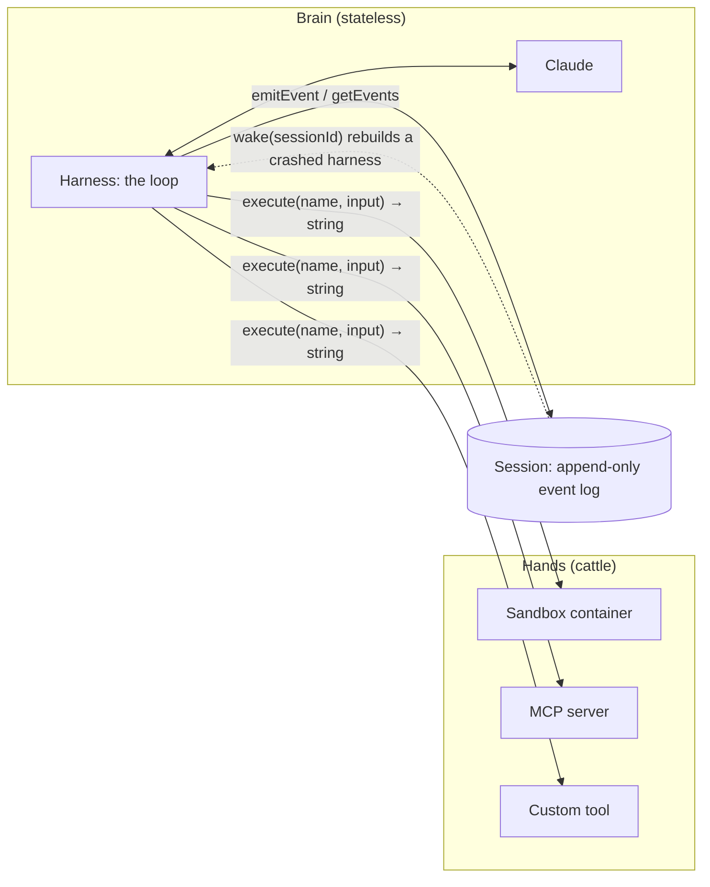
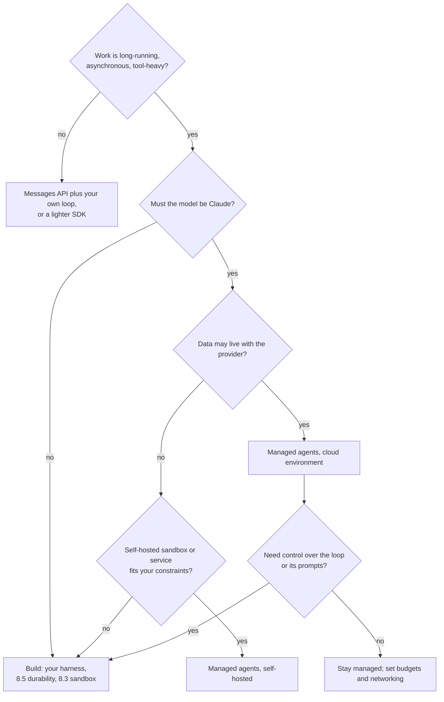

# Managed agents

## Why this matters

[8.5](/part-08-production/8.5-durable-agents) was about making your own agent survive failure: checkpoints, retries, queues, a sandbox you configured in [8.3](/part-08-production/8.3-sandboxing). That is a lot of infrastructure around a loop of a few dozen lines. Providers now sell that whole layer: you describe the agent, they run the loop, the sandbox and the session log. Knowing what that buys you, what it costs and what it ties you to is how you decide when to build and when to rent.

Anthropic's version is Claude Managed Agents, and this chapter uses it as the worked example. The platform is in beta and its API changes, so the chapter teaches the *architecture* and the decision, and sends you to the docs for field names. The same shape (hosted loop, hosted or self-run sandbox, durable session) is what other vendors' hosted agents converge on, but this chapter only makes claims about Anthropic's.

**Learning goals**

- Explain the managed-agent architecture (brain vs hands)
- Compare with self-hosted agents
- Run one task on a managed agent platform

## Explanation

### What a managed agent platform provides

Compare it with what you built. Anthropic's [Managed Agents overview](https://platform.claude.com/docs/en/managed-agents/overview) puts the two options side by side: the Messages API is "direct model prompting access", best for "custom agent loops and fine-grained control"; Managed Agents is a "pre-built, configurable agent harness that runs in managed infrastructure", best for "long-running tasks and asynchronous work". Instead of building your own agent loop, tool execution and runtime, you get an environment where Claude can read files, run commands, browse the web and run code, with prompt caching and compaction built into the harness.

Map that onto the earlier chapters:

| You built it yourself in | The managed platform's version |
|---|---|
| The loop ([3.2](/part-03-agents/3.2-agent-loop)) | The harness: a loop that calls Claude and routes its tool calls |
| Built-in tools ([3.3](/part-03-agents/3.3-tool-design)) | A built-in toolset: bash, file operations, web search and fetch, plus MCP servers ([overview](https://platform.claude.com/docs/en/managed-agents/overview)) |
| The sandbox ([8.3](/part-08-production/8.3-sandboxing)) | An environment: a fresh container per session, with network rules you set |
| Checkpoint and resume ([8.5](/part-08-production/8.5-durable-agents)) | The session: a server-side event history you can fetch in full |
| Context compaction ([3.4](/part-03-agents/3.4-context-engineering)) | Built into the harness |

What you keep: the agent's definition (model, system prompt, tools, MCP servers, skills), the task, and the decision about what the agent may reach. The overview lists four concepts, and the rest of the chapter is built on them:

| Concept | What it is |
|---|---|
| **Agent** | The model, system prompt, tools, MCP servers and skills. Created once, referenced by ID. |
| **Environment** | Where sessions run: an Anthropic-managed cloud sandbox, or a self-hosted one on your infrastructure. |
| **Session** | A running agent instance in an environment, doing one task. |
| **Events** | The messages exchanged between your application and the agent: user turns, tool results, status updates. |

You drive it as a client: create the agent, create the environment, start a session, send a user event, then stream server-sent events back while "Claude autonomously runs tools". You can send further events to steer the agent, or interrupt it ([overview](https://platform.claude.com/docs/en/managed-agents/overview)). The shape is asynchronous: you start work and watch it, which is why it suits long tasks and is a poor fit for a request that must answer in a second.

::: info 📖 Read now
[Claude Managed Agents overview](https://platform.claude.com/docs/en/managed-agents/overview) · docs · ~10 min · **essential**

Look for: the four core concepts, the "How it works" steps, the list of workloads it is "best for", and the Beta access section. Note the data-handling table: what it says about zero data retention, and why statefulness is the reason.
:::

### Separating the model loop from execution environments

The interesting part is *why* the platform is shaped this way, and Anthropic's engineering team explains it in [Scaling Managed Agents: Decoupling the brain from the hands](https://www.anthropic.com/research/managed-agents) (published 8 April 2026). Read the argument before reading the diagram.

**The starting point was one container.** They first put every part of the agent in one container: the session, the harness and the sandbox. That was simple (file edits are direct syscalls, no service boundaries to design) but it made the server a "pet": a named, hand-tended machine you cannot afford to lose. If the container failed, the session was lost; if it hung, someone had to nurse it. Debugging was hard because the only window in was the event stream, which could not distinguish a harness bug, a dropped packet or a dead container, and opening a shell in the container to look meant touching user data. A second problem: the harness assumed that whatever Claude worked on lived next to it, so connecting Claude to a customer's private network meant peering networks or running the harness there.

**The fix was to split three things.** They separated the **brain** (Claude and its harness) from the **hands** (sandboxes and tools that act) and from the **session** (the log of events), and made each an interface that assumes little about the others, so each can fail or be replaced independently.

The post's interface names show how small the contract is (these are the post's illustrations of the design, not the public API you call):

- **Hands are tools.** The harness calls a container like any other tool: `execute(name, input) → string`. If the container dies, the harness sees a tool-call error and passes it to Claude; if Claude retries, a new container is started with `provision({resources})`. The harness "doesn't know whether the sandbox is a container, a phone, or a Pokémon emulator".
- **The brain is replaceable too.** The session log lives outside the harness, so nothing in the harness has to survive a crash: a new one is started with `wake(sessionId)`, reads the log with `getSession(id)` and resumes from the last event. During the loop the harness records each event with `emitEvent(id, event)`.

This is the 8.5 checkpointing rule, built into the platform: "the log is the state, the process is disposable". The difference is that the platform owns the log, the replay and the replacement, where in 8.5 you wrote them.

**Three consequences the post spells out.**

1. **Credentials stay out of reach.** In the coupled design, code Claude generated ran in the same container as credentials, so a prompt injection "only had to convince Claude to read its own environment". The fix was structural: tokens are never reachable from the sandbox. For Git, the repository token is used to clone during setup and wired into the git remote, so push and pull work without the agent handling the token; for MCP tools, OAuth tokens sit in a vault behind a proxy that fetches them per call. This is the broker pattern from [8.3](/part-08-production/8.3-sandboxing), implemented by the platform.
2. **The session is not the context window.** Compaction, memory files and trimming all make irreversible choices about what to keep. Keeping the full event log outside the window means the harness can re-read slices of it (`getEvents()`) and decide, per turn, what goes into Claude's context. The platform guarantees the log is durable; what to show Claude stays the harness's job ([3.4](/part-03-agents/3.4-context-engineering)).
3. **Many brains, many hands.** A container is only provisioned when a tool call needs one, so a session that does not need a sandbox does not wait for one. The post reports that p50 time-to-first-token dropped roughly 60% and p95 over 90% (their numbers, from their system, not independently measured). Scaling to many brains means starting many stateless harnesses.

::: info 📖 Read now
[Anthropic Engineering: Scaling Managed Agents: Decoupling the brain from the hands](https://www.anthropic.com/research/managed-agents) · article · ~20 min · **essential**

Look for: the pet-versus-cattle argument, what moved out of the container and why, the two credential patterns, and the operating-system analogy (stable abstractions over changing implementations). Then compare its `wake` / `getSession` / `emitEvent` recovery with the resume code you wrote or planned in 8.5: which of your steps did it remove, and which did it not?
:::

The post's closing claim is worth pausing on: Managed Agents is a "meta-harness", "unopinionated about the specific harness that Claude will need in the future", opinionated only about the interfaces around Claude. That is a design bet: harnesses encode assumptions about what a model cannot do, and those go stale as models improve. The post's example is a context-reset workaround for Claude Sonnet 4.5's "context anxiety" that became dead weight on Claude Opus 4.5 ([5.1](/part-05-harnesses/5.1-what-is-a-harness) covers this). If you rent the harness, someone else updates those assumptions; if you build it, you do.

### Sessions, environments and outcomes

**Environments.** An environment sets where the agent's tools and code run. [Choosing an environment](https://platform.claude.com/docs/en/managed-agents/choosing-an-environment) gives two options: a **cloud environment**, where Anthropic runs a fresh Linux container per session with common languages and tools preinstalled, or a **self-hosted sandbox**, where "Claude still runs on Anthropic's side and determines which tool to call next" while a worker program you run executes the bash and file tool calls on your machines and sends results back. The agent definition is the same either way. Environments are configured with packages and networking, and the [environments page](https://platform.claude.com/docs/en/managed-agents/environments) says two things you should act on: networking is `limited` (a host allowlist, with optional package-manager and MCP access) or `unrestricted`, **a create request that omits `networking` gets `unrestricted`**, so set it explicitly; and each session gets its own sandbox instance, even when sessions share an environment, with no shared filesystem. That is the 8.3 egress lesson again: an allowed domain is a capability you grant.

**Sessions.** A session is the running instance. Per [Session statuses](https://platform.claude.com/docs/en/managed-agents/session-operations#session-statuses) it moves between `idle` (waiting for input, including a tool confirmation), `running`, `rescheduling` (a transient error, retrying automatically) and `terminated`. Note that a session that completes its work goes `idle`, not `terminated`: finishing is "waiting for the next message", which is what makes a session resumable and multi-turn. Everything is delivered as typed [events](https://platform.claude.com/docs/en/managed-agents/reference#event-types) (`agent.message`, `agent.tool_use`, `agent.tool_result`, `session.status_idle` with a stop reason, `session.usage`, `span.model_request_end` with token counts, and others), and the service keeps the history. Two controls to know about from the [sessions page](https://platform.claude.com/docs/en/managed-agents/sessions): you can create a session and send its first events in one call, and you can attach a **budget**, a hard ceiling on the session's list cost, set at creation in US cents. When it is reached the session goes idle with the stop reason `budget_reached`; the cap is checked between model requests, so the request that crosses it still completes and the final cost can land a little past it. It cannot be added to a session created without one.

**Outcomes.** Instead of judging a run yourself, you can give the session a target. [Define outcomes](https://platform.claude.com/docs/en/managed-agents/define-outcomes) works like this: you send a `user.define_outcome` event with a markdown **rubric** of gradeable criteria; the harness provisions a **grader** that evaluates the result against the rubric in a *separate context window*, so it is not swayed by the agent's own choices; the grader's explanation goes back to the agent for another iteration. Each evaluation ends with a result: `satisfied`, `needs_revision`, `max_iterations_reached` (default 3 iterations, maximum 20) or `failed`, `interrupted`. The docs advise explicit criteria ("The CSV contains a price column with numeric values", not "The data looks good"), because the grader scores each criterion independently. This is the LLM-as-judge pattern from Part 4 running inside the loop: the same caution applies, because a judge you have not checked against your own labels is only an opinion ([4.4](/part-04-evals-observability/4.4-llm-as-judge)).

::: info 📖 Read now
[Claude Managed Agents: Define outcomes](https://platform.claude.com/docs/en/managed-agents/define-outcomes) · docs · ~15 min · optional

Look for: how the rubric is supplied, why the grader has its own context window, and the table of evaluation results. Ask what would make a rubric pass while the artifact is still wrong.
:::

### Cost and lock-in

**Cost.** Anthropic's [pricing page](https://platform.claude.com/docs/en/about-claude/pricing#claude-managed-agents-pricing) says Managed Agents is billed on two dimensions: **tokens**, at the normal model rates (prompt caching multipliers apply too), and **session runtime**, a per-hour rate that accrues only while the session's status is `running`, not while it is `idle`, `rescheduling` or `terminated`. Runtime replaces the code-execution container-hour charge, so you are not billed for both. The Batch API discount does not apply, because sessions are stateful and interactive. Current rates are on [Landscape](/landscape#anthropic); the pricing page also has a worked example of one hour of coding.

Two things follow. First, for a token-heavy agent the model tokens usually dominate and the runtime fee is small; for a mostly-waiting agent (idle time is free) the fee is small too. The worked example on the pricing page makes the point with numbers, so work it through for your own task rather than trusting a general rule. Second, "managed" does not mean "cheaper than yours": your own loop pays tokens too, plus your hosting and your time; what you are comparing is that engineering and operations time against the platform's per-hour fee and the loss of control. Use a **budget** on every session you run while experimenting.

**Lock-in.** Be concrete about what you commit to:

| Dependency | What it means |
|---|---|
| Beta API | All endpoints need the `managed-agents-2026-04-01` beta header, and "Anthropic might refine behaviors between releases" ([overview](https://platform.claude.com/docs/en/managed-agents/overview)). |
| One vendor's models | The platform runs Claude; your agent definition lists Claude models. Routing to other vendors ([Part 9](/part-09-model-landscape-cost/9.1-paid-apis)) is not what it is for. |
| Data held by the provider | Sessions are stateful, so history, sandbox state and outputs are stored server-side. The overview says Managed Agents is not eligible for zero data retention or HIPAA coverage, except self-hosted Managed Agents for the ZDR case; you can delete sessions and files through the API. |
| The harness is theirs | You choose model, prompt, tools and skills, but not the loop. Behaviours you tuned in your own harness ([Part 5](/part-05-harnesses/5.1-what-is-a-harness)) are not yours to change. |
| Event and API shapes | Your client code and any dashboards depend on its events and endpoints. |

What reduces the risk: the interfaces (agent, environment, session, events) are plain HTTP resources, so the *definition* of an agent (prompt, tools, MCP servers, skills) is portable thinking even if the runtime is not; MCP servers and skills you write work in your own harness too ([3.6](/part-03-agents/3.6-mcp-using), [6.3](/part-06-claude-code/6.3-skills)); and the docs describe options for running the sandbox on your infrastructure ([self-hosted sandboxes](https://platform.claude.com/docs/en/managed-agents/self-hosted-sandboxes)) or the whole service ([self-hosted Managed Agents](https://platform.claude.com/docs/en/managed-agents/self-hosted)), for compliance or data-residency needs. Whether those options fit your constraints is a question for the docs and, for pricing, Anthropic's account team (the pricing page says so for the self-hosted service).

### Build or rent?

This is my own framing of the trade-offs above, not an Anthropic recommendation. The questions to ask in order: does the workload suit an asynchronous, long-running shape; is Claude the model you want; may the data (history, files) live with the provider; and do you need control over the loop. A good use of the platform is the work you would otherwise build durable infrastructure for (8.5) and a sandbox for (8.3), where the loop itself is not your product.

## Practice

**Brief:** If budget allows, run one small task on Anthropic's managed agents and compare cost and setup effort with `project/`. Log the cost.

**Where:** `experiments/33-managed-agent/` (a standalone experiment, not a `project/` step). TypeScript only: use `@anthropic-ai/sdk` (the quickstart has TypeScript examples), or the `ant` CLI for setup. You write the code; this is the brief and the acceptance check. Record everything in `experiments/33-managed-agent/README.md`, which already has the table to fill in. Budget: a few cents; the point is the comparison, not the task.

**Steps:**

1. **Read and decide the task.** Read the [quickstart](https://platform.claude.com/docs/en/managed-agents/quickstart). Pick a small task that needs a sandbox but no internet, for example "write a script that computes the first 100 primes, run it, and write a short summary of the result". Write it, plus a one-line acceptance check, in the README. You will run the *same* task on `project/` in step 6, so do not pick something `project/` cannot do.
2. **Set up before you spend.** Create or check your Anthropic API key (it is already in `.env` if you ran experiment 01) and note the date and time you start, to measure setup effort honestly. Pick the cheapest model that can do the task from [Landscape](/landscape#anthropic).
3. **Create an agent and an environment.** Define the agent (model, a one-paragraph system prompt, the built-in toolset). Define the environment with **explicit** `networking` set to `limited` and nothing allowed. Write down what you chose for each setting and why.
4. **Start a session with a budget.** Create the session with a small `budget` (say 50 US cents; check the sessions page for the exact fields) and send your task as the first user event. Stream the events. Print each event's `type`, and for `agent.tool_use` / `agent.tool_result` a one-line summary.
5. **Read the evidence.** When the session goes idle, check the `stop_reason`, fetch the history, and take the token counts from `span.model_request_end` (or `session.usage`). Compute the cost yourself: tokens at the model's [Landscape](/landscape#anthropic) rate plus the runtime. Measure the `running` time from the status events. Then compare your number with the Console's [Usage page](https://platform.claude.com/usage) and note the difference.
6. **Run the same task on `project/`.** Use the same model, and record tokens, cost, wall-clock time and the steps you took. If `project/` has no sandbox yet ([8.3](/part-08-production/8.3-sandboxing) is where it gets one), say which parts of the task it did *unsandboxed* and what that means.
7. **Add an outcome (optional, a few cents more).** Re-run with a `user.define_outcome` and a rubric of three gradeable criteria. Note how many iterations it took, and whether the grader's verdict matched your own judgement of the result.
8. **Break something on purpose.** Set a budget lower than the task needs (say 1 US cent) and watch what happens: which `stop_reason`, how far past the cap the cost landed, and whether the work so far can still be read. Then send a follow-up user event to the same session and see whether it continues.
9. **Log the spend** in `costs.md` with the experiment number, model, tokens and cost, and update the running total.
10. **Write the comparison** in the README: setup effort (time and number of concepts), run cost, what you could observe in each, what you could not control on the managed side, and one concrete case where you would still build your own.

**Done when:**

- One session ran your task to `idle` with a `stop_reason` you can explain, and the output meets your acceptance check.
- The README states the environment's `networking` setting and why, and the session's budget.
- Your computed cost for the managed run is in `costs.md`, next to the Console's figure, with the gap explained or called out as unexplained.
- The same task has numbers for `project/` (tokens, cost, time) and the README compares setup effort, cost and observability between the two.
- Step 8's low-budget test produced a stop reason you can name, and you recorded how far past the cap the cost landed.
- If you skipped the run for budget reasons, say so in the README and instead complete steps 1 to 3 as a written design with the exact requests you would send, so the comparison still has your reasoning.

## Check questions

1. What did Anthropic's engineers mean by "adopting a pet", and what change fixed it?

   

Answer

   They first ran the session, the harness and the sandbox in one container, so that container was a named server that could not be lost: if it failed, the session was lost, and an unresponsive one had to be nursed back to health and debugged from inside, near user data. The fix was to split the **brain** (Claude and its harness), the **hands** (sandboxes and tools) and the **session** (the event log) into separate interfaces. The harness calls a container as a tool, so a dead container becomes a tool error and a fresh one can be provisioned; a dead harness is replaced by a new one that reads the session log and resumes.

   

2. A session ends its task. Is its status `terminated`? What does that imply for a follow-up message?

   

Answer

   No, it goes `idle`. `terminated` is for an unrecoverable error or an archived session. An idle session is waiting for input, so you can send another user event to continue the same session, with its history and sandbox state. Runtime is also not billed while idle, only while `running`.

   

3. You create an environment through the API and leave out `networking`. What do you get, and why does it matter for security?

   

Answer

   `unrestricted`, which is full outbound network access except for a general safety blocklist. That is the opposite of the least-privilege default from 8.3: the sandbox can reach any site, which is a path for exfiltration or for fetching injected instructions. Set `networking` explicitly, usually `limited` with only the hosts the task needs.

   

4. Your session finishes, but the result is wrong. Name two ways the platform helps you catch that, and one limit of each.

   

Answer

   An **outcome** with a rubric: a grader in a separate context window checks the artifact and sends feedback for another iteration; the limit is that it is only as good as the rubric, and an unvalidated LLM judge can pass wrong work (check it against your own judgement, as in Part 4). The **event history**: you can fetch every tool call and result and inspect what the agent did; the limit is that it shows what happened, not whether it was right, so you still need your own acceptance check. A budget is not a quality check, only a spend cap.

   

5. Your team wants a long-running research agent. Give two reasons to use managed agents and two to build your own.

   

Answer

   For managed: you avoid building and operating the durable loop, session store and sandbox (8.5, 8.3), and the sandbox, credential vault and event history come with it. For your own: the platform is a beta Claude-only service, so you cannot route to other models, and the provider stores session data (no zero data retention outside self-hosting), so data constraints or a need to tune the loop itself point to building. Cost also needs working out: tokens are billed the same either way, so the difference is the runtime fee against your engineering and hosting.

   

## My understanding

<!-- Written by the learner, in their own words. Agents never fill this in. -->
