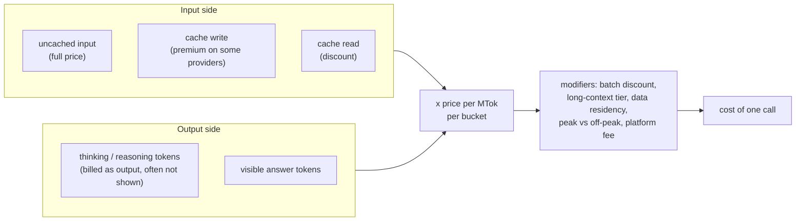

# Paid APIs: Claude, GPT, Gemini, Kimi, DeepSeek

## Why this matters

By now you can call a model from TypeScript ([2.1](/part-02-programming-with-llms/2.1-calling-models)) and you have met the cost levers one at a time: thinking ([2.4](/part-02-programming-with-llms/2.4-reasoning-via-api)) and prompt caching ([2.7](/part-02-programming-with-llms/2.7-prompt-caching)). This chapter puts them side by side across five providers. Each one sells a different mix of quality, price, speed and quirks, and each one counts and bills tokens slightly differently. A price per million tokens is only comparable between two models once you know what is inside the number.

There is a second reason to read this before choosing: **where your prompt goes.** The same open-weight model can be served by its maker or by a third party, under different data rules. For a study project that matters little. The first time you point an agent at a private repository it matters a lot.

This chapter does not rank the models. Rankings and prices go stale within weeks, so they live on [Landscape](/landscape) and this chapter links there. What stays true for longer is how to read a price, what each API does differently, and how to compare models on your own tasks.

**Learning goals**

- Compare the main paid model families on your own tasks
- Read pricing correctly (input, output, cache, thinking)
- Know each provider's API quirks

## Explanation

### Families and tiers

Every provider in this book sells the same shape of catalogue, and [Landscape](/landscape) lists the current members:

- **A flagship**: the most capable (and most expensive) model, for hard, high-value work.
- **A mid tier**: usually the default for coding and agents.
- **A small, cheap tier**: for high volume, routing, classification and sub-agents.
- **Specialised variants**: a "high-speed" serving of the same model at a higher price, a coding model, a model with vision.

Inside one family, tier changes the price by a large factor (the tables on [Landscape](/landscape) show it). That is the first reason to compare *tiers* rather than *brands*: your cheapest viable model for a task is usually a small tier from some provider, and the flagship is the exception you reach for.

A second axis cuts across tiers: **how much the model thinks.** Today's models are reasoning models ([1.10](/part-01-how-llms-work/1.10-reasoning-models)), and every provider exposes a dial (`effort`, `reasoning_effort`, `thinking_level`) that trades answer quality against tokens and latency. One model at two dial settings behaves like two different models on your bill. So "model X vs model Y" is really "model X at setting a vs model Y at setting b". The comparison in the practice below fixes this deliberately.

A third axis is **who serves it.** Claude and GPT are served by their makers (and by cloud resellers, outside this chapter). Open-weight models (the [glossary](/glossary) lists DeepSeek and Qwen as examples) can be served by their maker's first-party API and by other hosts, which you can reach through [OpenRouter](/part-09-model-landscape-cost/9.2-openrouter-litellm). Landscape marks which models are open-weight only where a source says so.

### What you pay for

A request is billed by token counts in several buckets. Read the usage object, not the invoice, when you want to know why a call cost what it did.



**Input** is split into up to three buckets. Uncached input is the base price. Cached input is discounted on read, and some providers charge a premium to write the cache, others nothing; that mechanism is chapter [2.7](/part-02-programming-with-llms/2.7-prompt-caching), and the per-provider numbers are on Landscape.

**Output** includes thinking. This is the item that surprises people. All of these treat reasoning tokens as output tokens, billed at the output price:

- Anthropic: "Tokens Claude uses while thinking (billed as output tokens)", and you pay for the full thinking, not for the summary you see. `usage.output_tokens_details.thinking_tokens` tells you how much of `output_tokens` was reasoning ([Anthropic: Steering thinking, Pricing](https://platform.claude.com/docs/en/build-with-claude/thinking-steering-and-cost)).
- OpenAI: reasoning tokens "are billed as" output tokens, take space in the context window, and are reported in `output_tokens_details.reasoning_tokens`. The reasoning itself is not visible through the API; you can request a summary ([OpenAI: Reasoning](https://developers.openai.com/api/docs/guides/reasoning)).
- Gemini: "response pricing is the sum of output tokens and thinking tokens", billed on the full thought tokens even though only a summary is returned ([Gemini: Thinking](https://aistudio.google.com/docs/thinking)).
- Through OpenRouter: reasoning tokens are billed as output tokens and reported in `completion_tokens_details.reasoning_tokens` on Chat Completions ([OpenRouter: Usage accounting](https://openrouter.ai/docs/guides/guides/usage-accounting), [Reasoning tokens](https://openrouter.ai/docs/guides/best-practices/reasoning-tokens)).
- DeepSeek's pricing page doesn't mention reasoning tokens separately; it says billing is on "the total number of input and output tokens". I did not find a page that states how `reasoning_content` is counted, so measure it: compare `completion_tokens` with the length of the visible answer ([DeepSeek: Models & pricing](https://api-docs.deepseek.com/quick_start/pricing/)).
- Kimi's pricing page covers caching, context and batch, but not reasoning-token billing ([Kimi: Pricing](https://platform.kimi.ai/docs/pricing/chat)). Same advice: measure.

Two consequences follow, and both cause real bugs:

1. **`max_tokens` is a budget for thinking plus answer.** On OpenAI, if the cap is hit during reasoning the response comes back `incomplete` with no visible output, and you still pay for the input and the reasoning; OpenAI suggests reserving at least 25,000 tokens for reasoning and output when you start ([OpenAI: Reasoning](https://developers.openai.com/api/docs/guides/reasoning)). Gemini documents the same behaviour for `max_output_tokens` and suggests lowering the thinking level instead of shrinking the cap ([Gemini: Thinking](https://aistudio.google.com/docs/thinking)). Anthropic's advice for `stop_reason: "max_tokens"` is the same pair: raise the cap, or lower effort ([Anthropic: Steering thinking](https://platform.claude.com/docs/en/build-with-claude/thinking-steering-and-cost)).
2. **Thinking history can cost input tokens later.** Anthropic bills prior-turn thinking blocks that stay in context as input tokens; how many turns are kept depends on the model ([Anthropic: Steering thinking, Pricing](https://platform.claude.com/docs/en/build-with-claude/thinking-steering-and-cost)). In an agent loop that adds up.

**Modifiers** scale those buckets. The ones to look for on any pricing page:

| Modifier | Example from a primary source |
|---|---|
| Batch discount | Anthropic batch: 50% off input and output ([Anthropic: Pricing](https://platform.claude.com/docs/en/about-claude/pricing#batch-processing)). Gemini paid tier lists a Batch API with a "50% cost reduction" ([Gemini: Pricing](https://aistudio.google.com/docs/pricing)). Kimi K3.1 Pro and K3: batch inference at 60% of the standard price ([Kimi: Pricing](https://platform.kimi.ai/docs/pricing/chat)). |
| Long-context tier | Claude Haiku 5.5 is priced by prompt length; a request over 100,000 prompt tokens pays higher prices, counting cache reads and writes ([Anthropic: Pricing](https://platform.claude.com/docs/en/about-claude/pricing#long-context-pricing)). Other families put the threshold elsewhere; see the footnotes on [Landscape](/landscape). |
| Data residency | Anthropic: `inference_geo: "us"` applies a 1.1x multiplier to all token categories on Claude 4.6 and later ([Anthropic: Pricing](https://platform.claude.com/docs/en/about-claude/pricing#data-residency-pricing)). |
| Time of day | DeepSeek lists peak and off-peak prices ([DeepSeek: Models & pricing](https://api-docs.deepseek.com/quick_start/pricing/)); Landscape records the hours. |
| Promotional price with an end date | Landscape marks them; a price that doubles next month changes your plan. |
| Platform fee | OpenRouter charges a fee when you buy credits, not per request ([Landscape](/landscape#access-routes)). |

One more trap hides inside "per token": **a token is not a fixed unit across models.** Anthropic's pricing FAQ says Claude 4.7 and later use a newer tokenizer that produces "approximately 30 percent more tokens for the same text" than earlier models, and that how many tokens a text makes depends on the model's tokenizer ([Anthropic: Pricing, FAQ](https://platform.claude.com/docs/en/about-claude/pricing#how-is-token-usage-calculated)). Two models with the same price per token can therefore have different prices per document. The only reliable unit is **cost per completed task**, which you measure.

#### A worked example with made-up numbers

Say model P costs `$1` per MTok input and `$5` per MTok output (made up, so the arithmetic is easy), and a task sends 2,000 input tokens and gets 1,500 output tokens, of which 1,200 are thinking. Output is 1,500 tokens, not the 300 you see:

```text
input   2,000 tokens x $1 / 1,000,000 = $0.0020
output  1,500 tokens x $5 / 1,000,000 = $0.0075   (1,200 of those were thinking)
cost per call                         = $0.0095
```

Reading only the visible answer, you would estimate `$0.0020 + 300 x $5 / 1,000,000 = $0.0035`, a 2.7x underestimate. Now suppose model Q is five times cheaper per token but fails the task 40% of the time and you retry until it passes. The *expected* cost per solved task is its per-call cost divided by its pass rate, so a cheap model that fails often can cost more than a dear one that doesn't. That is the quantity the practice asks you to compute: **cost per task** and **cost per passed task**.

### Provider quirks

Each API has a handful of behaviours that cost you an hour the first time. Each row below is from a doc page I opened; ones I could not confirm are said so.

| Provider | Quirks worth knowing |
|---|---|
| **Anthropic** | Thinking is **adaptive**: `thinking: {type: "adaptive"}` plus `output_config.effort`, with no token budget. On Claude 4.7 and later, the old `thinking: {type: "enabled", budget_tokens}` returns a 400 ([Anthropic: Extended thinking](https://platform.claude.com/docs/en/build-with-claude/extended-thinking)). Effort defaults to `medium` on Opus 5.5 and Haiku 5.5, and `high` on most others. **Changing effort between requests invalidates the prompt cache**, and a turn may have no thinking block at all ([Anthropic: Steering thinking](https://platform.claude.com/docs/en/build-with-claude/thinking-steering-and-cost)). |
| **OpenAI** | Reasoning is set with `reasoning.effort`; supported values depend on the model, and some models reject some values (GPT-6 Astra returns 400 for `none`). Responses API data is stored for at least 30 days when `store` is true *or omitted* ([OpenAI: Reasoning](https://developers.openai.com/api/docs/guides/reasoning), [OpenAI: Data controls](https://developers.openai.com/api/docs/guides/your-data)). |
| **Gemini** | Thinking is **on by default**, controlled by `thinking_level` (levels depend on the model; one Flash model defaults to medium); thought summaries are off unless you ask. The docs have moved from `ai.google.dev` to `aistudio.google.com`, and the old links redirect ([Gemini: Thinking](https://aistudio.google.com/docs/thinking)). |
| **DeepSeek** | Thinking mode is **on by default** (effort `high`). In OpenAI format you switch it with `{"thinking": {"type": "disabled"}}` in the body, and reasoning arrives in `reasoning_content`. `temperature`, `presence_penalty` and `frequency_penalty` **have no effect and raise no error**. With `tools`, you must pass `reasoning_content` from earlier turns back in every later request or get a 400 ([DeepSeek: Thinking mode](https://api-docs.deepseek.com/guides/thinking_mode)). Both OpenAI and Anthropic base URLs exist ([DeepSeek: Models & pricing](https://api-docs.deepseek.com/quick_start/pricing/)). |
| **Kimi** | OpenAI- and Anthropic-compatible; the examples use `https://api.moonshot.ai/v1`. `reasoning_effort` accepts `low`, `high`, `max`, and defaults to `max` on K3.1 Pro ([Kimi: Overview](https://platform.kimi.ai/docs/overview)). Temperature runs 0 to 1 rather than OpenAI's 0 to 2; for kimi-k2.6 thinking and non-thinking modes each require a fixed temperature, so the docs recommend leaving it unset; `tool_choice: "required"` is not supported on kimi-k2.7-code and kimi-k2.6 ([Kimi: Migrating from OpenAI](https://platform.kimi.ai/docs/guide/migrating-from-openai-to-kimi)). Landscape notes the K2 series retires by the end of December 2026. |
| **OpenRouter** | Request reasoning with a `reasoning` object (`effort`, `max_tokens`, `enabled`); it comes back in a `reasoning` field and `reasoning_details` ([OpenRouter: Reasoning tokens](https://openrouter.ai/docs/guides/best-practices/reasoning-tokens)). `provider.require_parameters` defaults to `false`, so a provider that doesn't support a parameter in your request may receive it and ignore it. `allow_fallbacks` defaults to `true`, so a failed request can be retried on another provider ([OpenRouter: Provider routing](https://openrouter.ai/docs/guides/routing/provider-selection)). |

Two patterns repeat. **Silent ignoring** (DeepSeek's sampling parameters, OpenRouter's unsupported parameters) means "no error" is not evidence that a setting worked: if your experiment varies temperature, check the model accepts it. **State you must carry** (DeepSeek's `reasoning_content`, Anthropic's thinking blocks during tool use) means swapping providers inside an agent loop is not just a base-URL change; conversation history has provider-specific parts.

::: info 📖 Read now
[Anthropic: Pricing](https://platform.claude.com/docs/en/about-claude/pricing) · docs · ~15 min · **essential**

This page is the model for a good pricing page; read the layout, not the numbers (those are on [Landscape](/landscape)). Look for: the columns for cache writes and cache hits, the batch table, the long-context section, the data-residency multiplier, how the multipliers stack, and the FAQ on how tokens are counted. Then open the pricing page of one other provider from Landscape and list which of these dimensions it has and which it hides.
:::

::: info 📖 Read now
[OpenAI: Reasoning models](https://developers.openai.com/api/docs/guides/reasoning) · docs · ~15 min · **essential**

Look for: how reasoning tokens are reported (`output_tokens_details.reasoning_tokens`), what happens when `max_output_tokens` is reached mid-reasoning, the `reasoning.effort` values, and the advice on how many tokens to reserve.
:::

::: info 📖 Read now
[DeepSeek: Thinking mode](https://api-docs.deepseek.com/guides/thinking_mode) · docs · ~10 min · **essential**

The shortest page of the quirks above and a good example of "thinking is not free state". Look for: the default, which sampling parameters are ignored, and the tool-call rule about passing `reasoning_content` back.
:::

::: tip 📖 Skim: other providers' thinking controls
[Gemini: Thinking](https://aistudio.google.com/docs/thinking) · docs · ~15 min · optional

Look for: `thinking_level`, the default level, what summaries are, and how `max_output_tokens` interacts with thinking. Then skim [Kimi: Migrating from OpenAI](https://platform.kimi.ai/docs/guide/migrating-from-openai-to-kimi) (docs, ~10 min, optional) for the list of differences from the OpenAI API.
:::

### Strengths per provider

I am not going to tell you which provider is best at what. The sources I could open and trust for that are each vendor's own marketing, and a ranking from a benchmark measures the benchmark's tasks, which are probably not yours ([4.9](/part-04-evals-observability/4.9-benchmarks) covers how to read them). What the primary sources *do* establish are properties you can build a hypothesis on, to test in the practice:

- **Price tier.** Landscape shows a wide spread in price per token across the five families, with DeepSeek and the small tiers at the low end and the flagships at the top. This is a fact about listings, not quality.
- **Cache economics.** DeepSeek and Kimi list a cache-hit price far below their miss price ([Landscape](/landscape#other-labs-including-open-weight)), which favours agents with a long stable prefix.
- **Context window.** Landscape lists the stated window per model, and "stated window" is not "window the model uses well" ([1.9](/part-01-how-llms-work/1.9-kv-cache-context-window)).
- **Ecosystem fit.** Anthropic-format endpoints from DeepSeek and Kimi mean you can try them from tools that speak the Anthropic API ([DeepSeek: Models & pricing](https://api-docs.deepseek.com/quick_start/pricing/), [Kimi: Overview](https://platform.kimi.ai/docs/overview)). Whether a coding harness works well with a model is a separate question, covered in Part 5.

Write your own strengths table from experiment 34, and date it.

### Data and privacy policies

The question to ask of every route is: **who processes my prompt, how long is it kept, and can it be used for training?** The answers differ more than prices do. Here is what the primary pages say, and what I could not confirm.

| Route | What the source says |
|---|---|
| **Anthropic API** | Retained data "is never used for model training without your express permission", and conversation content (prompts and outputs) is not retained by default, with an exception for "Covered Models", which require 30-day retention. Zero data retention (ZDR) is available by arrangement with sales ([Anthropic: API and data retention](https://platform.claude.com/docs/en/manage-claude/api-and-data-retention)). ZDR does not cover the Claude Console or the consumer plans (Free, Pro, Max), including Claude Code used on those plans. |
| **OpenAI API** | Data sent to the API is not used to train OpenAI models unless you opt in. Abuse-monitoring logs are kept for up to 30 days by default; approved customers can get ZDR or "modified abuse monitoring" ([OpenAI: Data controls](https://developers.openai.com/api/docs/guides/your-data)). |
| **Gemini API** | Depends on the tier. For **unpaid** services, Google uses submitted content to "provide, improve, and develop" products, and human reviewers may read it (disconnected from your account and key first). For **paid** services, it says it doesn't use prompts or responses to improve its products and logs them for a limited time for abuse and safety ([Gemini API terms](https://aistudio.google.com/docs/terms), [pricing page tiers](https://aistudio.google.com/docs/pricing)). The free tier is not a place for private data. |
| **DeepSeek** | The Open Platform terms don't say whether inputs are used to train DeepSeek's models, state no retention period, and don't mention server location; personal information is left to a separate privacy policy ([DeepSeek: Open Platform terms](https://cdn.deepseek.com/policies/en-US/deepseek-open-platform-terms-of-service.html)). I couldn't fetch that policy to read it, so I'm not summarising it. Read it yourself before sending anything private. |
| **Kimi** | I found no data-handling statement on the pages I opened ([Kimi: Overview](https://platform.kimi.ai/docs/overview), [Pricing](https://platform.kimi.ai/docs/pricing/chat)). Treat that as "unknown", not "safe". |
| **OpenRouter** | Each provider behind it sets its own policy, and OpenRouter shows it on each endpoint. Providers fall into zero retention, "Safety Retention" (kept only to prevent abuse), and other (kept for a stated period and possibly used for training). You can restrict routing per request (`provider.data_collection: "deny"`, `provider.zdr: true`) or account-wide. `data_collection` **defaults to `"allow"`**. Server tools such as search follow their own providers' policies ([OpenRouter: Logging](https://openrouter.ai/docs/guides/privacy/logging), [Provider routing](https://openrouter.ai/docs/guides/routing/provider-selection)). |

Two practical points from this table. First, **the first-party API and a reseller are different data routes**, even for the same weights: an open-weight model served through OpenRouter falls under the policy of whichever host serves them, not Moonshot's. Second, **your subscription is not your API.** Your Claude Pro plan (used by Claude Code) is a consumer plan and is outside the API's ZDR arrangement; API keys on a commercial organisation are the covered route ([Anthropic: API and data retention](https://platform.claude.com/docs/en/manage-claude/api-and-data-retention)). For this study the rule is simple: public code, toy data and your own eval prompts go to any provider; anything private waits until you've read the relevant policy and set the routing flags.

::: info 📖 Read now
[OpenRouter: Logging and data policies](https://openrouter.ai/docs/guides/privacy/logging) · docs · ~10 min · **essential**

Look for: the three retention tiers, the account-level training setting, and what stays outside it (OpenRouter's own policy for your prompts).
:::

::: info 📖 Read now
[OpenAI: Data controls in the OpenAI API](https://developers.openai.com/api/docs/guides/your-data) · docs · ~10 min · **essential**

Look for: default retention per endpoint, the difference between ZDR and modified abuse monitoring, and which endpoints are not ZDR-eligible.
:::

::: tip 📖 Skim: the other policies
[Anthropic: API and data retention](https://platform.claude.com/docs/en/manage-claude/api-and-data-retention) · docs · ~15 min · optional

Look for the ZDR scope and what it excludes. Then skim [Gemini API terms](https://aistudio.google.com/docs/terms) (docs, ~10 min, optional) for the paid versus unpaid split, and [OpenRouter: Provider routing](https://openrouter.ai/docs/guides/routing/provider-selection) (docs, ~15 min, optional) for `order`, `sort`, `quantizations` and the default load balancing.
:::

### How to compare them on your own tasks

Four rules make a comparison trustworthy; the practice applies each one.

1. **Same tasks, same checks, code-based where you can.** A pass/fail check you wrote ([4.3](/part-04-evals-observability/4.3-code-based-checks)) beats eyeballing, and doesn't need a judge model.
2. **Same dial.** Fix the thinking setting, or run each model at its default *and* record which that was. Compare on both cost and pass rate.
3. **Record the billed numbers, not estimates.** Through OpenRouter, the `cost` field is "the total amount charged to your account" ([OpenRouter: Usage accounting](https://openrouter.ai/docs/guides/guides/usage-accounting)). Store it together with the token counts and `reasoning_tokens` for each call.
4. **Repeat.** One run of ten tasks is a sample. Models are nondeterministic ([1.8](/part-01-how-llms-work/1.8-sampling)), so a 1-task difference between two models is noise. Run each task at least three times, or say your result is anecdotal.

Cost and latency tracking as a habit is chapter [4.8](/part-04-evals-observability/4.8-cost-latency); the routing rules you would extract from your table are [9.4](/part-09-model-landscape-cost/9.4-routing-rules).

## Practice

**Brief:** Run your eval set across 5 models via OpenRouter (Claude, GPT, Gemini, Kimi, DeepSeek). Record pass rate, latency and cost per task in `costs.md`.

**Where:** `experiments/34-model-mix/`: a standalone experiment, not a `project/` step. The folder has a README with the "What I tried / What happened / Why" skeleton. You write all the code; I haven't provided any.

**Steps:**

1. **Pick the task set.** Use your eval set from Part 4 if you have built one ([4.2](/part-04-evals-observability/4.2-eval-sets)). If not, take 10 to 15 tasks with a **code-checkable answer**, for example your 10 messy texts from experiment 18 (a field extraction with a schema check) or your `read_file` task from experiment 19. Write down why each task has a pass/fail rule that doesn't need a judge. Keep inputs under about 2,000 tokens so the run stays cheap.
2. **Pick the five models.** One from each family (Claude, GPT, Gemini, Kimi, DeepSeek), and **the same tier** across them (for example all small or all mid; the tiers are on [Landscape](/landscape)). Find each model's OpenRouter ID from the models list: `GET https://openrouter.ai/api/v1/models` returns `id`, `pricing` and `context_length` per model ([OpenRouter: Models](https://openrouter.ai/docs/guides/overview/models)). Don't guess slugs: IDs on OpenRouter are not always the vendor's own API IDs.
3. **Fix the dials.** Decide the thinking setting per model (off, low, or provider default) and write it in the README. Remember the OpenRouter `reasoning` object and that some providers silently ignore unsupported parameters; send `provider.require_parameters: true` if your settings matter ([OpenRouter: Provider routing](https://openrouter.ai/docs/guides/routing/provider-selection)). Decide `max_tokens` with thinking in mind.
4. **Predict.** Before running anything, write in the README: the ranking you expect by pass rate, by median latency and by cost per task, and which one you expect to win on cost per **passed** task.
5. **Write the runner in TypeScript.** One script, `node --env-file-if-exists=../../.env`, raw `fetch` to OpenRouter's Chat Completions endpoint like in experiment 01. For each (task, model, repeat): send the task, time the call, run your check, and save one JSON line with the model, the OpenRouter-reported `usage` (including `cost` and reasoning tokens), latency, pass/fail and the raw answer. Save raw outputs: you will want to read the failures.
6. **Dry run on one model first**, with 2 tasks, and estimate the full run's cost from the real `cost` field. Add a cap in the script that aborts when the running total passes your limit. Set a credit limit on the key too, as `costs.md` suggests. A reasonable ceiling for the whole experiment is a few dollars; if your estimate is higher, cut tasks or repeats.
7. **Run it**, at least 3 repeats per task and model if the budget allows. Don't change the tasks or checks midway; if you must, rerun everything.
8. **Compute per model:** pass rate, median and worst latency, mean tokens in and out, mean reasoning tokens, **cost per task** and **cost per passed task**.
9. **Look at the failures.** For each model, read at least 3 failing outputs and classify them: wrong answer, format failure, ran out of `max_tokens` while thinking, refused, error or timeout. A "model failure" that is really a truncated answer is a configuration bug.
10. **Log the spend.** Add one row per model to `costs.md` (use the real OpenRouter charge), and update the running total.
11. **Write the README** (skeleton is in the folder), including a table with the numbers from step 8 and a dated "my strengths table" with one sentence per model.

**Done when:**

- The README has predictions written before the run, a results table with all five models, and a note on which predictions were wrong.
- Each model row has pass rate, latency (median and worst), cost per task and cost per passed task, computed from recorded data, with the thinking setting noted.
- At least one failure per model is classified, and you state how many "failures" were really truncation or errors.
- `costs.md` has a row per model with the real charge and an updated total.
- You state, in one paragraph, which model you would use for this kind of task and what you would need to see to change your mind. (This feeds [9.4](/part-09-model-landscape-cost/9.4-routing-rules).)

## Check questions

1. A call returns `output_tokens: 1500` and a visible answer of about 300 tokens. What are the other tokens, how are they billed, and where can you see the split on Anthropic and on OpenAI?

   <details><summary>Answer</summary>

   They are reasoning (thinking) tokens. Every provider covered here bills them as output tokens at the output price, even when only a summary of the reasoning (or nothing) is returned. On Anthropic the split is `usage.output_tokens_details.thinking_tokens`; on OpenAI it's `output_tokens_details.reasoning_tokens`. Estimating cost from the visible answer alone would badly underestimate it.

   </details>

2. Model A costs a quarter of Model B per token but passes 50% of your tasks while B passes 95%. Which is cheaper for a task you must get right, and what number do you compute to decide?

   <details><summary>Answer</summary>

   Compute **cost per passed task**: per-call cost divided by pass rate (assuming you retry until pass, or discard failures). A at 0.25 / 0.5 = 0.5 units against B at 1 / 0.95, about 1.05 units, so A is cheaper under those assumptions, if retrying is acceptable and the failures are detectable. If failures are silent (a wrong answer you can't check), the pass rate matters more than the price, and B's reliability wins. The per-token price alone doesn't decide either way. Per-token price also isn't comparable across tokenizers.

   </details>

3. You set `max_tokens: 500` on a reasoning model and get an empty answer with `incomplete` status, and a bill. What happened and what do you change?

   <details><summary>Answer</summary>

   The cap covers thinking tokens as well as the answer. The model used the whole budget reasoning, so nothing visible was produced, and you still pay for the input and the reasoning tokens. Raise the cap (OpenAI suggests reserving at least 25,000 tokens for reasoning and output when starting out), or lower the effort/thinking level so the model leaves room for the answer. Check `reasoning_tokens` against `output_tokens` to confirm.

   </details>

4. Your agent loop works on a first-party DeepSeek call and returns a 400 after you add tools. Name the likely cause, and one other provider behaviour that makes "just change the base URL" risky.

   <details><summary>Answer</summary>

   With `tools` in thinking mode, DeepSeek requires the `reasoning_content` from all previous turns to be passed back in every later request; if you send only `content` it returns a 400. Other examples: Anthropic's thinking blocks must be passed back unmodified during tool use, and changing effort between requests invalidates its prompt cache; some providers silently ignore parameters such as `temperature`. Conversation history and request settings are provider-specific.

   </details>

5. You want to send a private codebase through OpenRouter to an open-weight model. Which two request settings would you check, what are their defaults, and what is still outside your control?

   <details><summary>Answer</summary>

   `provider.data_collection` (default `"allow"`; set `"deny"`) and `provider.zdr` (set `true` to route only to zero-data-retention endpoints), or the equivalent account-wide privacy settings. Even then, the policy of the specific provider that serves the model applies, not the model maker's, and OpenRouter's own handling of prompts is governed by its own policies, which these settings don't change. Server tools like search follow their own providers' policies. You should read the endpoint's policy on OpenRouter before sending anything private.

   </details>

## My understanding

<!-- Written by the learner, in their own words. Agents never fill this in. -->
