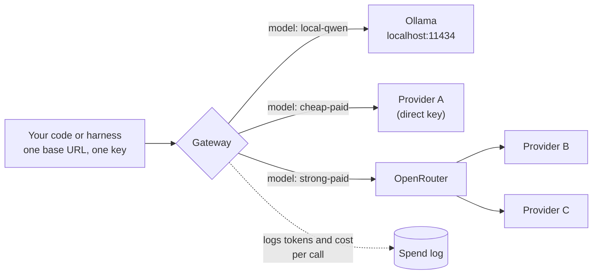

# OpenRouter and LiteLLM

## Why this matters

[Chapter 9.1](/part-09-model-landscape-cost/9.1-paid-apis) ended on an awkward fact: every provider has its own base URL, key, billing page, thinking dial and error behaviour. Comparing five models by hand means five accounts. Living with them in an agent means a `switch` statement that grows every time you try a new model.

A **gateway** (also called a router) removes that: your code talks to one endpoint in one request format, and a model name in the request decides where the call goes. Switching from a paid model to your local Qwen becomes a one-line config change, not a code change. That is the property the cost-routing rules in [9.4](/part-09-model-landscape-cost/9.4-routing-rules) depend on, and it is how you point a harness ([Part 5](/part-05-harnesses/)) at models it was never written for.

There are two common shapes, and this chapter covers both. **OpenRouter** is a hosted gateway: one account, hundreds of models, billing and fallbacks handled for you, but only models that live on the internet. **LiteLLM** is a gateway you run yourself: it can put your local Ollama models and paid APIs behind the same endpoint, and you own the config, the keys and the spend log. They are not exclusive, and LiteLLM can even use OpenRouter as one of its backends.

**Learning goals**

- Use OpenRouter's routing and provider options
- Run LiteLLM as a local gateway for Ollama and paid models
- Point a harness at the gateway

## Explanation

### What a gateway is, and what it is not

A gateway is a reverse proxy that speaks one dialect (here, the OpenAI-compatible API from [2.1](/part-02-programming-with-llms/2.1-calling-models)) on the front and translates to whatever each backend needs on the back.



What you gain: one client, one place to change a model, one place to count spend, and a place to add retries and fallbacks. What you do **not** gain, and what [9.1](/part-09-model-landscape-cost/9.1-paid-apis) already warned about:

- **The request shape is shared, the behaviour is not.** The front door is the same, but providers still differ in thinking parameters, ignored settings and state you must carry (`reasoning_content`, thinking blocks). A gateway translates what it knows how to translate; for the rest, "no error" is not evidence that a setting worked.
- **One more hop.** The gateway adds a network hop and a place to fail. The hosted one adds a company between you and the provider, which matters for data policy (see below).
- **You still choose the model.** A gateway makes switching cheap. Deciding *when* to switch is [9.4](/part-09-model-landscape-cost/9.4-routing-rules).

### Hosted vs. self-hosted

| | OpenRouter (hosted) | LiteLLM proxy (self-hosted) |
|---|---|---|
| What you run | Nothing. Call `https://openrouter.ai/api/v1` with a bearer key ([OpenRouter: Quickstart](https://openrouter.ai/docs/quickstart)). | A server on your machine or infrastructure, started with `litellm --config config.yaml` ([LiteLLM: Config](https://docs.litellm.ai/docs/proxy/configs)). |
| Your local models | No: it can't reach your `localhost`. | Yes: an Ollama entry in the config ([LiteLLM: Ollama](https://docs.litellm.ai/docs/providers/ollama)). |
| Accounts and keys | One OpenRouter key and one billing relationship for all hosted models. | One key per provider that you hold, kept in environment variables the config reads. |
| Routing between hosts of the same model | Built in (below). | You write it: several entries with the same `model_name` form a group the router picks from ([LiteLLM: Router](https://docs.litellm.ai/docs/routing)). |
| Spend tracking | Every response carries token counts and `cost` ([OpenRouter: Usage accounting](https://openrouter.ai/docs/guides/guides/usage-accounting)). | Needs a database for per-key tracking and budgets ([LiteLLM: Virtual keys](https://docs.litellm.ai/docs/proxy/virtual_keys)). |
| Prices and fees | See [Landscape](/landscape#access-routes) (the fee is on buying credits, not per request). | The software is open source ([Landscape](/landscape#access-routes)); you pay each provider directly. |
| Failure surface | Their uptime, plus the provider's. | Your process, plus the provider's. |
| Data path | Your prompt passes through OpenRouter and then a provider. | Direct to each provider (no middleman), or through OpenRouter if you configure that backend. |

The data row is the one that decides most real choices. In [9.1](/part-09-model-landscape-cost/9.1-paid-apis#data-and-privacy-policies) the question was *who processes my prompt*. A hosted gateway adds one party to that answer, and OpenRouter's own logging policy applies on top of the provider's ([OpenRouter: Logging](https://openrouter.ai/docs/guides/privacy/logging)). A self-hosted gateway adds none: it is your own process, and its logs are yours to secure.

A practical default for a learner: use **OpenRouter** for breadth (trying many models with one key), and **LiteLLM in front of everything** when you want local and paid models behind one endpoint, which is the practice below.

### OpenRouter: model IDs, usage and the two routing layers

The request is OpenAI-compatible: base URL `https://openrouter.ai/api/v1`, `Authorization: Bearer <key>`, and a `model` such as `<vendor>/<model>`. The Quickstart's optional `HTTP-Referer` and `X-OpenRouter-Title` headers only affect OpenRouter's public rankings ([OpenRouter: Quickstart](https://openrouter.ai/docs/quickstart)). You have already called it once in experiment 01.

Every response includes usage with `cost` and token details, including `reasoning_tokens`, "always included automatically" ([OpenRouter: Usage accounting](https://openrouter.ai/docs/guides/guides/usage-accounting)). That field is how experiment 34 recorded real charges, and it is the cheapest spend tracking there is.

OpenRouter has **two separate layers of routing**, and mixing them up is the common mistake.

**Layer 1: which provider serves this model.** The same model ID can be hosted by several providers. The `provider` object in the request controls that choice ([OpenRouter: Provider routing](https://openrouter.ai/docs/guides/routing/provider-selection)):

| Field | Default | What it does |
|---|---|---|
| `order` | none | Providers to try first, in sequence. |
| `allow_fallbacks` | `true` | Whether backup providers may be used when the primary is unavailable. |
| `only` / `ignore` | none | Allow-list and deny-list of providers for this request. |
| `require_parameters` | `false` | Route only to providers that support every parameter in the request. |
| `data_collection` | `"allow"` | `"deny"` limits routing to providers that do not collect user data. |
| `zdr` | none | `true` limits routing to Zero Data Retention endpoints. |
| `quantizations` | none | Filter by quantization level, such as `int4` or `fp8`. |
| `sort` | none | `"price"`, `"throughput"` or `"latency"`. |
| `max_price` | none | Hard ceiling; blocks the request if no provider fits. |

When you set none of this, the default is a weighted random choice. Per the docs, OpenRouter weighs price, throughput, latency, rate limits, reliability and tool-call quality; providers "close to the best share most of the traffic", failed requests retry on the remaining providers, and follow-up requests stay with one provider while its prompt cache is warm. Setting `sort`, `order`, `:nitro` or `:floor`, or using your own provider key, bypasses that default ([OpenRouter: Provider routing](https://openrouter.ai/docs/guides/routing/provider-selection)).

Two details matter for correctness. `:nitro` and `:floor` are suffixes on the model ID that sort by throughput and by price; they are routing variants, not separate models. And the docs separate *preferences* from *constraints*: `preferred_min_throughput` and `preferred_max_latency` do not guarantee a provider meets them, whereas `max_price` blocks the request when nothing fits. Treat a preference as a hint and a constraint as a rule. Remember from [9.1](/part-09-model-landscape-cost/9.1-paid-apis#provider-quirks) that `require_parameters` is `false` by default, so a provider may silently ignore a parameter you sent.

**Layer 2: which model serves this request.** Add a `models` array to the request body, in priority order. If the first model returns an error, OpenRouter tries the next. Errors that can trigger it include context-length validation errors, moderation flags, rate limits and downtime. You are billed for the model that actually handled the request, and the response's `model` field tells you which one that was ([OpenRouter: Model fallbacks](https://openrouter.ai/docs/guides/routing/model-fallbacks)).

```json
{
  "models": ["<primary-model-id>", "<cheaper-backup-model-id>"],
  "messages": [{ "role": "user", "content": "..." }],
  "provider": { "require_parameters": true, "data_collection": "deny" }
}
```

(The model IDs are placeholders on purpose: take real IDs from the models list, as in [9.1](/part-09-model-landscape-cost/9.1-paid-apis#practice) step 2. IDs change.)

Two layers means two different failure answers. A provider outage inside one model is Layer 1 (same model, other host, quality unchanged). A rate limit on the whole model is Layer 2 (a different model, quality changed). A fallback that silently swaps in a weaker model is a behaviour change, so log which model answered. Also note the pricing consequence from the docs: if a `:free` model falls back to a paid one, you pay the paid model's price ([OpenRouter: Model fallbacks](https://openrouter.ai/docs/guides/routing/model-fallbacks)).

::: info 📖 Read now
[OpenRouter: Provider routing](https://openrouter.ai/docs/guides/routing/provider-selection) · docs · ~15 min · **essential**

You met this page in [9.1](/part-09-model-landscape-cost/9.1-paid-apis) for its data options; read it again for routing. Look for: the default load balancing and what bypasses it, the difference between `order` with `allow_fallbacks: false` and `only`, why `sort` changes the default behaviour, and which fields are preferences rather than constraints.
:::

::: info 📖 Read now
[OpenRouter: Model fallbacks](https://openrouter.ai/docs/guides/routing/model-fallbacks) · docs · ~5 min · **essential**

Short. Look for: which errors trigger a fallback, what happens when the fallback also fails, and how the bill is decided.
:::

::: tip 📖 Skim: usage accounting
[OpenRouter: Usage accounting](https://openrouter.ai/docs/guides/guides/usage-accounting) · docs · ~10 min · optional

Look for: the `cost` and `cost_details` fields, where `reasoning_tokens` appears, and the fact that the usage block is always returned.
:::

### LiteLLM: the proxy and its config

LiteLLM is a Python library and, more usefully here, a proxy server that exposes an OpenAI-compatible endpoint. The docs' claim is simple: "If a client can use the OpenAI API, the client can also use the gateway" ([LiteLLM: Proxy](https://docs.litellm.ai/docs/simple_proxy)). So a harness, an SDK or a `fetch` script only needs a different base URL.

Everything lives in one YAML file with four parts ([LiteLLM: Config](https://docs.litellm.ai/docs/proxy/configs)):

- **`model_list`**: the models you offer. Each entry has a `model_name` (what clients send) and `litellm_params` (what LiteLLM does with it: the `model` string, `api_base`, `api_key`).
- **`general_settings`**: server settings, such as the `master_key` that clients must present.
- **`litellm_settings`**: behaviour such as `num_retries`, `request_timeout` and `fallbacks`.
- **`router_settings`**: how to choose among several deployments of one name, such as `routing_strategy`.

The part that makes this the control point is the split between the **public name** and the **backend string**. A minimal sketch with one local and one OpenRouter-backed model (structure from the docs; model IDs are placeholders you must fill in yourself):

```yaml
model_list:
  - model_name: local-qwen                 # what your client sends
    litellm_params:
      model: ollama_chat/<an-ollama-model> # prefix picks the provider
      api_base: http://localhost:11434
  - model_name: paid-mid
    litellm_params:
      model: openrouter/<vendor>/<model>   # an OpenRouter model ID
      api_key: os.environ/OPENROUTER_API_KEY

general_settings:
  master_key: os.environ/LITELLM_MASTER_KEY
```

Points the docs make that are easy to miss:

- **The prefix is the provider switch.** `ollama_chat/` calls Ollama's `/api/chat`; `ollama/` calls `/api/generate`, and the docs recommend `ollama_chat` "for better responses". The Ollama page shows `api_base` explicitly in every example, so set it ([LiteLLM: Ollama](https://docs.litellm.ai/docs/providers/ollama)). OpenRouter models are reached with `openrouter/<your-openrouter-model>` and `OPENROUTER_API_KEY` ([LiteLLM: OpenRouter](https://docs.litellm.ai/docs/providers/openrouter)).
- **Keys stay out of the file.** `os.environ/NAME` makes LiteLLM read the key from the environment, so the YAML can be committed ([LiteLLM: Config](https://docs.litellm.ai/docs/proxy/configs)). Your `.env` is already gitignored for that reason.
- **The master key is the gate.** Clients authenticate with it; the quickstart's Docker path says "Requests authenticate with the master key" and the proxy "refuses to start without it" on the compose path ([LiteLLM: Quickstart](https://docs.litellm.ai/docs/proxy/docker_quick_start)). Keep the proxy on `localhost` unless you mean to expose it, and don't use the master key in clients once virtual keys exist.
- **Start it** with `litellm --config /path/to/config.yaml` and call `http://localhost:4000/v1/chat/completions` with a `model` that is one of your `model_name` values ([LiteLLM: Config](https://docs.litellm.ai/docs/proxy/configs)). LiteLLM lists a one-line install script, Docker Compose and plain Docker as install paths ([LiteLLM: Quickstart](https://docs.litellm.ai/docs/proxy/docker_quick_start)); the PyPI package is another route, which I did not verify against the docs.

::: warning Local models through a gateway
LiteLLM's Ollama page has no section on thinking or reasoning output ([LiteLLM: Ollama](https://docs.litellm.ai/docs/providers/ollama)). The Qwen3 models you run locally think by default, as you measured in experiments 11 and 17. Through a gateway, check what comes back: is the reasoning in the answer text, in a separate field, or dropped? Don't assume the gateway preserves what Ollama's own API returns. This is one of the things the practice asks you to observe.
:::

#### Several deployments, retries and fallbacks

Two entries with the **same** `model_name` form a group. LiteLLM picks among them, by default with `simple-shuffle`, which respects `rpm`, `tpm` and `weight` and otherwise picks randomly. Other strategies are latency-based and least-busy; the docs advise against usage-based routing in production ([LiteLLM: Router](https://docs.litellm.ai/docs/routing)). Rate-limit errors back off exponentially, other errors retry immediately, and cooldowns apply to the failing deployment rather than the whole group ([LiteLLM: Router](https://docs.litellm.ai/docs/routing)). When retries are exhausted, `fallbacks` in `litellm_settings` maps one name to another, for example `fallbacks: [{"strong": ["cheap"]}]`, and `context_window_fallbacks` does the same for context-length errors ([LiteLLM: Config](https://docs.litellm.ai/docs/proxy/configs)).

This is the same two-layer split as OpenRouter's, under different names: **same model name, several deployments** (a load balancer) versus **fallback to a different model name** (a quality change). The difference is who owns it. On OpenRouter, Layer 1 is done for you. On LiteLLM you write both, which is more work and more control: you can fall back from a paid model to your local one when the budget is spent, which a hosted gateway cannot do.

### Spend tracking at the gateway

A gateway sees every call, so it is the natural place to count money. There are three levels, in order of effort:

1. **Per-response cost.** OpenRouter returns `cost` in every response ([OpenRouter: Usage accounting](https://openrouter.ai/docs/guides/guides/usage-accounting)). LiteLLM adds an `x-litellm-response-cost` response header ([LiteLLM: Spend tracking](https://docs.litellm.ai/docs/proxy/cost_tracking)). A client can log these with no extra setup.
2. **Per-key spend in a database.** For the proxy to attribute spend to keys, users and teams, "Virtual Keys & a database should be set up" ([LiteLLM: Spend tracking](https://docs.litellm.ai/docs/proxy/cost_tracking)). A virtual key is created by `POST /key/generate` with the master key as bearer token, and it can carry a model allow-list, `max_budget` (USD), `budget_duration`, an expiry and an owner. Virtual keys need a Postgres database; the docs set it with `DATABASE_URL` or `database_url` under `general_settings` ([LiteLLM: Virtual keys](https://docs.litellm.ai/docs/proxy/virtual_keys)). Logs are then queryable, for example through `/spend/logs/v2`, which the docs call the recommended endpoint for exports ([LiteLLM: Spend tracking](https://docs.litellm.ai/docs/proxy/cost_tracking)).
3. **Budgets that stop spending.** The quickstart warns that on the no-database path `litellm_settings.max_budget` "is not a spend cap" ([LiteLLM: Quickstart](https://docs.litellm.ai/docs/proxy/docker_quick_start)). A cap that works needs the database-backed keys. Read this as a rule: **a budget you have not seen refuse a request is not a budget.** Test it.

Two cautions about the numbers. First, a gateway's cost is *computed*: LiteLLM prices requests from its model cost map, and when an entry has no rates it logs a warning and the spend is recorded as zero, which you fix by setting the missing rates in the deployment's `model_info` ([LiteLLM: Spend tracking](https://docs.litellm.ai/docs/proxy/cost_tracking)). That matters for your local models, which cost money in electricity, not dollars: zero is the honest figure for the API bill, and says nothing about your hardware. Second, for anything that spent real money, the provider's own usage page is the authority. Reconcile the gateway's total against it once, before you trust the gateway.

::: info 📖 Read now
[LiteLLM: Config](https://docs.litellm.ai/docs/proxy/configs) · docs · ~20 min · **essential**

The reference for everything in the practice. Look for: the four top-level sections and which setting belongs in which, the `os.environ/` syntax, the Ollama entry, the `fallbacks` and `context_window_fallbacks` shape, and how to start the server and confirm the file loaded.
:::

::: info 📖 Read now
[LiteLLM: Virtual keys](https://docs.litellm.ai/docs/proxy/virtual_keys) · docs · ~15 min · **essential**

Look for: the two requirements (a database and a master key), the `/key/generate` request, and the parameters that limit a key (`models`, `max_budget`, `budget_duration`).
:::

::: tip 📖 Skim: the router and spend pages
[LiteLLM: Router, load balancing and fallbacks](https://docs.litellm.ai/docs/routing) · docs · ~15 min · optional

Look for: how same-name deployments are chosen, what a cooldown applies to, and the order retries, `order` levels and fallbacks run in. Then skim [LiteLLM: Spend tracking](https://docs.litellm.ai/docs/proxy/cost_tracking) (docs, ~10 min, optional) for the response-cost header, the spend-log endpoints and what happens when a model has no price.
:::

### Pointing a harness at the gateway

A harness ([5.1](/part-05-harnesses/5.1-what-is-a-harness)) needs three things from its model provider: a base URL, a key and a model name. A gateway supplies all three in the OpenAI-compatible form, so any harness that accepts a custom OpenAI-compatible provider can use it.

opencode's provider docs show the pattern: a custom provider keyed by an ID, with `baseURL` in its settings, a key from an environment variable, and a `models` map; the model is then referenced as `<provider-id>/<model>`, such as `acme/qwen3-coder` ([opencode: Providers](https://opencode.ai/docs/providers/)). The docs have no LiteLLM example, so the shape for your gateway is an adaptation, and you should check the page for the current field names, because harness config formats change often:

```jsonc
{
  "$schema": "https://opencode.ai/config.json",
  "providers": {
    "gateway": {
      "name": "Local gateway",
      "env": ["LITELLM_API_KEY"],
      "package": "@opencode/ai/providers/openai-compatible",
      "settings": { "baseURL": "http://localhost:4000/v1" },
      "models": { "local-qwen": { "name": "Local Qwen" }, "paid-mid": { "name": "Paid mid" } }
    }
  }
}
```

Then "switch models by config" has a concrete meaning: the harness config lists gateway model names, and the gateway config maps those names to backends. To change which backend serves `paid-mid` you edit the gateway's YAML and restart it; the harness doesn't change.

Whatever harness you use, expect these problems, which are the real content of the practice:

- **Tool calling and streaming through two translations.** A harness is a tool-calling agent ([2.6](/part-02-programming-with-llms/2.6-tool-calling)), and tool-call format is exactly where providers differ. A small local model may not call tools well at all ([5.5](/part-05-harnesses/5.5-harnesses-local-qwen) covers this); the gateway can't fix that.
- **Context size.** Ollama's `num_ctx` default is not the model's maximum ([1.9](/part-01-how-llms-work/1.9-kv-cache-context-window), experiment 10). A harness sends large prompts, and a gateway entry for a local model inherits whatever Ollama is set to.
- **Model names in the UI.** Harnesses may show or guess capabilities by model name. A friendly name like `local-qwen` hides which model is behind it; record the mapping in your README.

## Practice

**Brief:** Run LiteLLM with local Qwen and two paid models behind one endpoint. Point opencode or your harness at it and switch models by config.

**Where:** `experiments/35-gateway/`: a standalone experiment, not a `project/` step. The folder has a README with the "What I tried / What happened / Why" skeleton. The learner writes all the config and code; none is provided here. Python is not needed: LiteLLM runs as an installed tool and everything else is YAML and TypeScript.

**Cost:** local Ollama calls are free. The two paid models should be cheap-tier ones ([Landscape](/landscape)); a handful of short requests costs cents. Set a credit limit on the OpenRouter key first, and log any spend in `costs.md`.

**Steps:**

1. **Install and read.** Install LiteLLM's proxy in an isolated environment (`uv` is already on your machine; check the install instructions in [the quickstart](https://docs.litellm.ai/docs/proxy/docker_quick_start)). Read the Config page once before writing YAML.
2. **Choose the three backends.** One local model you already have in Ollama, and two paid models that differ on purpose (for example two providers, or a cheap and a strong tier). Find the OpenRouter ID of each from the models list, as in [9.1](/part-09-model-landscape-cost/9.1-paid-apis#practice). Write the three public names you will use (`local-...`, `paid-...`) in the README before you write the config.
3. **Write `config.yaml`.** Three `model_list` entries, keys through `os.environ/`, a `master_key` from the environment. Keep keys out of the file and out of git (check `git status` before you commit).
4. **Start it and test with `curl`.** Call each of the three names through `http://localhost:4000/v1/chat/completions`. Write down what comes back for the local model: where does Qwen's thinking appear? Compare with calling Ollama directly.
5. **Write a TypeScript client.** A short script that takes a model name from `argv`, calls the gateway with `fetch` or the `openai` package, and prints the answer, latency and usage. The same script must work against all three names without changes.
6. **Predict, then add a fallback.** Predict what happens if you stop Ollama and call `local-...`. Then add a `fallbacks` entry from the local name to one paid name, restart and test again. Find where the gateway tells you a fallback happened (response body, header or log), and record it.
7. **Look at spend.** Compare the cost the gateway reports for each paid call with the provider's own usage page. Note which of them gave a number for the local model and what it said. If you set up virtual keys and a database, create a key with a small `max_budget` and try to exceed it; if you don't, say in the README that you have no enforced budget.
8. **Point a harness at it.** Add the gateway as a custom provider in opencode (or the harness from [5.4](/part-05-harnesses/5.4-mini-harness)), run one small task on each of the three names, and switch by editing config only. Note any that fail and whether the failure is the model (bad tool calls), the gateway or the harness config.
9. **Write the README** (skeleton is in the folder), including the config with the keys removed.

**Done when:**

- One endpoint serves three named models (one local, two paid) and your TypeScript script reaches each by changing only the model name.
- The README records, for the local model, where the thinking text appears through the gateway compared with calling Ollama directly.
- You wrote a fallback, predicted its behaviour before testing, and recorded what you observed and how you could tell it fired.
- Gateway-reported cost for at least two paid calls is compared with the provider's usage page, with the difference noted, and any spend is in `costs.md`.
- A harness ran at least one task through the gateway on at least two of the three models, switching by config only, and the README says what broke on the third (or that nothing did).
- No key is committed.

## Check questions

1. Your agent works against OpenRouter's `models` fallback list, and one day the answers get worse though no request fails. Which feature could explain it, and what should you log to find out?

   <details><summary>Answer</summary>

   The `models` array: if the first model returns an error (rate limit, context-length error, downtime), OpenRouter tries the next one, so some requests are answered by a different, possibly weaker, model. The response's `model` field says which model handled each request, and you are billed for that one. Log it per call. (Compare with `provider.allow_fallbacks`, which changes only the host serving the same model.)

   </details>

2. What is the difference between OpenRouter's `provider.order` and its `models` array, and which one would you use for "same model, never send my prompts to providers that collect data"?

   <details><summary>Answer</summary>

   `provider` options choose which host serves a given model (Layer 1); `models` chooses among different models (Layer 2). For the data requirement, use the `provider` object with `data_collection: "deny"` (or `zdr: true` for zero-data-retention endpoints), possibly with `require_parameters: true` if settings matter. `order` only sets which providers are tried first.

   </details>

3. Why can't OpenRouter put your local `qwen3:14b` behind the same endpoint as a paid model, and what in a LiteLLM config does?

   <details><summary>Answer</summary>

   OpenRouter is a hosted service on the internet and cannot reach an Ollama server on your machine. LiteLLM runs on your machine, so a `model_list` entry with `model: ollama_chat/<model>` and `api_base: http://localhost:11434` makes the local model one more name behind the gateway, next to entries that use `openrouter/<id>` or a provider's own prefix.

   </details>

4. You set `max_budget` in `litellm_settings` and your paid calls keep going after the total passes it. Give two likely reasons and the way to be sure the cap works.

   <details><summary>Answer</summary>

   The docs say `litellm_settings.max_budget` is not a spend cap on the no-database quickstart path; enforced budgets belong to virtual keys, which require a Postgres database and a master key (`max_budget` and `budget_duration` on `/key/generate`). A second possible reason is that the model has no price in the cost map, so the recorded spend is zero and never reaches the cap; set the rates in `model_info`. To be sure, make a key with a tiny budget and confirm that a request is refused, and reconcile the gateway's total against the provider's usage page.

   </details>

5. A harness works against the gateway name `paid-mid` but loops on tool calls when you switch the same config entry to `local-qwen`. Is the gateway at fault? Why or why not?

   <details><summary>Answer</summary>

   Probably not. A gateway shares the request format, not the model's behaviour: a small local model may produce malformed or no tool calls, or hit Ollama's default context size, regardless of the proxy. Check by calling Ollama directly with the same request, and look at thinking output and `num_ctx`. If direct calls behave the same, the model or its settings are the cause; if only the gateway path differs, look at how the gateway translates tool calls or reasoning fields.

   </details>

## My understanding

<!-- Written by the learner, in their own words. Agents never fill this in. -->
