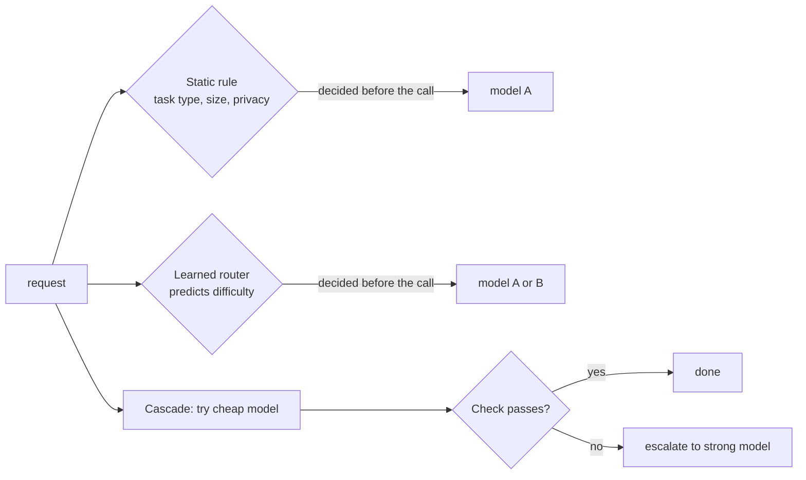

# Cost-effective routing rules

## Why this matters

The cheapest good setup sends each task to the cheapest model that passes it. [9.3](/part-09-model-landscape-cost/9.3-local-vs-paid) ended with a table of task types against models and a sentence per task type; [9.2](/part-09-model-landscape-cost/9.2-openrouter-litellm) gave you one endpoint that reaches local and paid models. This chapter connects them: turn the table into **routing rules**, run them, and check that the money you saved did not cost you quality.

The second half matters more than it sounds. A router that saves 70% and silently drops the pass rate from 90% to 60% is not cheaper, it is broken in a way that only shows up later. The discipline from [4.3](/part-04-evals-observability/4.3-code-based-checks) is what makes routing safe: without a pass rate you cannot tell a saving from a regression.

**Learning goals**

- Write routing rules backed by eval data
- Implement routing in your project
- Check the savings against the eval pass rate

## Explanation

### Three ways to choose a model

Every routing scheme answers one question: given this request, which model? There are three families, and they differ in *when* the decision is made and *what it knows*.



- **Static rules** are code you write: `if task is "extract" use local`, `if prompt is over N tokens use paid`, `if it contains private data never leave the machine`. They are predictable, free to run, easy to explain and easy to test. Their weakness is that they only see what you thought to write down.
- **Learned routers** are small models that read the request and predict which model should get it. RouteLLM trains routers on human preference data from Chatbot Arena to choose between one strong and one weak model, and reports that on its benchmarks they cut cost against always using GPT-4 by over 85% on MT Bench, 45% on MMLU and 35% on GSM8K while keeping 95% of GPT-4's performance ([LMSYS: RouteLLM](https://www.lmsys.org/blog/2024-07-01-routellm/); the paper is [arXiv 2406.18665](https://arxiv.org/abs/2406.18665)). Those numbers come from public benchmarks and one specific model pair, so they show that the idea works, not what you will save. A learned router is only as good as its training data resembles your traffic.
- **Cascades** (escalation) do not predict at all: run the cheap model, check the answer, and only call the strong model if the check fails. FrugalGPT proposed this as an "LLM cascade" and reports matching the best single model's accuracy at up to 98% lower cost in its experiments ([FrugalGPT, arXiv 2305.05176](https://arxiv.org/abs/2305.05176)); again, those are the paper's own tasks and the model prices of 2023.

They combine. The paper "A Unified Approach to Routing and Cascading for LLMs" calls the combination *cascade routing* and finds that the quality of the estimator that scores answers is the critical factor for any of these strategies to work ([arXiv 2410.10347](https://arxiv.org/abs/2410.10347)). That is useful for you: your estimator is the grader from 4.3, and a code-based grader is about as good an estimator as exists, because it is exact.

Hosted and self-hosted gateways now ship learned routing too. OpenRouter's Auto Router (`openrouter/auto`) rates each request with a fast decision model and picks both a model and a reasoning effort from the models your settings allow, at the chosen model's normal price with no extra fee ([OpenRouter: Auto Router](https://openrouter.ai/docs/guides/routing/routers/auto-router)). LiteLLM has a beta auto router that classifies each request with heuristics, an LLM classifier or keyword rules and routes to a model per tier ([LiteLLM: Auto Routing](https://docs.litellm.ai/docs/proxy/auto_routing)); both docs describe features that change between versions, so read the current page before relying on them. Note what neither can do for you: they cannot route by *your* pass rate, because they do not run your graders. And a hosted router cannot send a request to your local Ollama.

**A sensible order for a learner:** start with static rules plus a cascade, because you can build both in an afternoon, explain every decision they make, and measure them with the eval runner you already have. Reach for a learned router when you have thousands of requests with grades on them and the static rules have stopped improving.

### Static rules: what to route on

Three signals are cheap to read before any model call.

**Task type.** The strongest signal, and the one your 9.3 table already holds: extraction to a schema, commit messages and short summaries go to the local model; multi-file edits and long agent runs go to paid. This is the rule the data backs best, because you measured pass rate per task type.

**Size.** Input length decides two things. A prompt longer than the local model's usable context (`num_ctx` you configured, see [1.9](/part-01-how-llms-work/1.9-kv-cache-context-window)) cannot go local at all, and quality on long inputs often falls before the window is full. Expected output length matters too: local generation is slower per token than a paid API, so a long answer in an interactive loop is a latency cost.

**Privacy.** This one is a **hard constraint**, not a cost trade-off, and it must not be overridden by any escalation. A task labelled private (it touches customer data, credentials or a private repo) is allowed on local models only. If the local model fails, the rule is to return the failure, not to escalate it to a provider ([9.3](/part-09-model-landscape-cost/9.3-local-vs-paid#privacy-and-offline) explains why a provider policy is a different guarantee). Put the privacy check first in the rule list, so nothing later in the list can bypass it.

A routing table is then an ordered list where the first match wins:

| # | Condition | Route | Why |
|---|---|---|---|
| 1 | `private: true` | local only, no escalation | hard constraint |
| 2 | input over the local context cap | paid | cannot run locally |
| 3 | task type in the "paid only" list from your data | paid | local pass rate below your bar |
| 4 | everything else | local, escalate on failed check | cheap default |

The conditions are yours to fill in from your own numbers; the structure is what carries over. Keep the table in one place in code (a data structure, not scattered `if`s) so the eval can read it and you can change a rule without hunting.

### Escalation: try cheap, check, fall back

A cascade needs one thing static rules do not: a **check** that decides whether the cheap answer is good enough. That is the code-based grader from [4.3](/part-04-evals-observability/4.3-code-based-checks): JSON parses and matches the schema, tests pass, the file contains the expected change. When a grader exists, escalation is simple:

```ts
async function run(task: Task): Promise<Result> {
  const cheap = await call(task.localModel, task);
  if (await task.check(cheap)) return { ...cheap, tier: "local" };
  if (task.private) return { ...cheap, tier: "local", failed: true };
  const strong = await call(task.paidModel, task);
  return { ...strong, tier: "paid", escalated: true };
}
```

Three things to get right.

**The gateway's `fallbacks` are not this.** In [9.2](/part-09-model-landscape-cost/9.2-openrouter-litellm#several-deployments-retries-and-fallbacks) you added a LiteLLM `fallbacks` entry. LiteLLM describes fallbacks as failover: if a call fails after its retries, it tries another model group ([LiteLLM: Fallbacks](https://docs.litellm.ai/docs/proxy/reliability)). That is a response to **errors** (provider down, rate limit, context too long). A local model that answers fluently and wrongly raises no error, so no gateway fallback fires. Quality escalation has to live in your code, next to the grader. Keep both: gateway fallbacks for outages, your cascade for wrong answers.

**Escalation has a price.** A failed cheap attempt is wasted spend (small, if local) plus latency, then you pay for the paid call anyway. Whether cascading wins depends on the **local pass rate** `p`. With local cost near zero and paid cost `c` per call, a cascade costs about `(1 - p) × c` per task instead of `c`, plus the extra latency on the `1 - p` share that escalates. Remember from 9.3 that "near zero" still has your time in it; if a failed local attempt costs you review time, put that in.

**The check must be at least as trustworthy as the model.** A weak grader ("the output is non-empty") passes bad local answers, and the saving is fake. A task with no automatic check (open-ended writing, say) cannot be cascaded safely: route it by static rule instead, or use an LLM judge you validated against your own labels ([4.4](/part-04-evals-observability/4.4-llm-as-judge)).

Two refinements once the basic version works: retry the local model once before escalating (cheap, and some failures are sampling luck), and pass the failed attempt to the strong model only if you measured that this helps, because it can also anchor the strong model on the wrong answer.

### Measuring savings

You need three numbers per run of your eval set, for each policy you compare: **pass rate**, **total cost** and **cost per passed task**. Compare at least these policies on the same tasks:

| Policy | What it is |
|---|---|
| always-paid | every task to your paid model; the baseline for cost and the ceiling for quality |
| always-local | every task to local; the floor for cost |
| routed | your rules plus escalation |

The result to look for is routed cost well below always-paid with a pass rate close to it. Read the three together:

- If routed is **cheaper but the pass rate fell**, you saved money by failing tasks. Look at which task types failed and whether your check let bad answers through.
- If routed pass rate **matches always-paid but the cost barely moved**, nearly everything is escalating or being sent to paid by a rule. The local model is not pulling its weight on this workload.
- If routed **beats always-paid on pass rate**, believe it only after checking the sample: on a small set that can be noise.

Sample size is the trap. With 20 tasks, one flipped result moves the pass rate by 5 points, so a difference of a few points is not evidence. Say how many tasks each number rests on, report passed/attempted, and run the set more than once if the models are not deterministic ([4.1](/part-04-evals-observability/4.1-error-analysis) and 4.3 cover building and reading the set).

Do not hard-code prices. Cost per call is tokens times the current price, computed from the `usage` fields as in [4.8](/part-04-evals-observability/4.8-cost-latency), with prices read from [Landscape](/landscape) (or from the gateway's reported cost) and the date recorded next to the result. A routing result is only as current as the prices behind it: when the paid price or the best local model changes, rerun the eval, because the rule that was right last month may not be now. Count **all** of the cost of the routed policy: the failed local attempts' electricity (rough estimate, state it) and the paid calls made after escalation.

Finally, keep the routing decision in your trace: which rule matched, which model answered, whether it escalated and why. Without it, you cannot tell afterwards why a task went where it did.

### Resources

::: info 📖 Read now
[LMSYS: RouteLLM, an open-source framework for cost-effective LLM routing](https://www.lmsys.org/blog/2024-07-01-routellm/) (LMSYS blog) · article · ~15 min · essential

Look for: how the problem is set up (one strong, one weak model, a threshold on the router's score), the cost-versus-quality curves, and what the "95% of GPT-4 performance" claim is measured on. Then ask which of those conditions hold for your own tasks.
:::

::: tip 📖 Read (optional)
[RouteLLM: Learning to Route LLMs with Preference Data](https://arxiv.org/abs/2406.18665) (paper) · paper · ~20 min (abstract, introduction, results) · optional

Look for: how preference data is turned into a training signal, and the transfer result: routers keep working when the strong and weak models are swapped at test time.
:::

::: tip 📖 Read (optional)
[FrugalGPT: How to Use Large Language Models While Reducing Cost and Improving Performance](https://arxiv.org/abs/2305.05176) (paper) · paper · ~20 min (abstract, the three strategies, cascade section) · optional

Look for: the three families of cost reduction (prompt adaptation, model approximation, cascade) and how the cascade decides to stop. Prices in it are from 2023, so read the method, not the numbers.
:::

::: tip 📖 Read (optional)
[A Unified Approach to Routing and Cascading for LLMs](https://arxiv.org/abs/2410.10347) (paper) · paper · ~15 min (abstract and introduction) · optional

Look for: the claim that the quality estimator is the critical factor. Your code grader is a quality estimator, and this is why a good one is worth more than a clever router.
:::

::: info 📖 Read now
[OpenRouter: Auto Router](https://openrouter.ai/docs/guides/routing/routers/auto-router) (OpenRouter docs) · docs · ~10 min · essential

Look for: the steps it takes to pick a model, what you can restrict (allowed models, cost tier), the pricing note, and the metadata header that shows why it chose. Compare with your own rule table: what can it see that your rules cannot, and what can't it see?
:::

::: tip 📖 Read (optional)
[LiteLLM: Auto Routing (beta)](https://docs.litellm.ai/docs/proxy/auto_routing) (LiteLLM docs) · docs · ~10 min · optional

Look for: the classifier options (heuristics, an LLM, keyword rules), the "tier" idea, and the beta warning that config keys can change.
:::

::: info 📖 Read now
[LiteLLM: Fallbacks](https://docs.litellm.ai/docs/proxy/reliability) (LiteLLM docs) · docs · ~10 min · essential

Look for: what triggers a fallback ("a call fails after `num_retries`") and what does not. This is the line between gateway failover and your quality cascade.
:::

## Practice

**Brief:** Add routing to `project/`: local Qwen by default, escalate to a paid model on failure or by task type, all through the 9.2 gateway. Report eval pass rate and cost vs. always-paid.

**Where:** A step in the growing `project/` (roadmap step 30 in `project/ROADMAP.md`). It builds on the eval runner from [4.3](/part-04-evals-observability/4.3-code-based-checks) (`npm run eval`), the cost tracking from [4.8](/part-04-evals-observability/4.8-cost-latency) and the LiteLLM gateway from experiment 35 ([9.2](/part-09-model-landscape-cost/9.2-openrouter-litellm)). You write all the code; none is provided here.

**Cost:** the local runs are free. The paid runs repeat your eval set at least twice (always-paid, then routed), so estimate before you start: tasks x runs x average tokens x the price on [Landscape](/landscape), and use a cheap paid tier. Keep the credit limit on your OpenRouter key and log the spend in `costs.md`.

**Steps**

1. **Start from your data.** Open the table and rule candidates you wrote in `notes/routing.md` (9.3). Pick the eval set to use: your 4.3 set, extended if needed so it has at least three task types and, if you can, 8 or more tasks per type. Add a `private` flag to at least two tasks.
2. **Write the rule table first**, in `notes/routing.md` or the README, before any code: an ordered list of conditions and routes (privacy first), and for each rule the number from your table that justifies it. A rule with no number behind it gets marked "guess".
3. **Make the model a parameter.** Point the project at the gateway through its base URL and a model name from config, so the same agent code runs against `local-...` and `paid-...` names from experiment 35 with no other change.
4. **Implement the router** as one small module: input is a task (type, input size, private flag), output is a decision (model name, whether escalation is allowed, which rule matched). Keep the rule table as data.
5. **Implement escalation.** Run the local model, run the task's grader, and on failure call the paid model unless the task is private. Record the decision, the attempts, tokens and cost per attempt in the run log.
6. **Baselines first.** Run the full set with always-paid and with always-local through the same code path. Record pass rate (passed/attempted), total cost and cost per passed task for each.
7. **Run routed**, then compare. Predict before you run: write down the pass rate and cost you expect, and which task types you expect to escalate.
8. **Read the failures.** For every task that failed under routing and passed under always-paid (or the reverse), read the transcript. Was the grader too lenient, the rule wrong, or the local model just short of the task?
9. **Change one rule and rerun**, and say whether the numbers moved by more than the noise you would expect from the sample size.
10. **Write up** a short results table and the final rule table in the project README or `notes/routing.md`.

**Done when:**

- `npm run eval` (or your equivalent) can run the set under three policies (always-paid, always-local, routed) and print pass rate, total cost and cost per passed task for each.
- Switching a task's model needs only config, and all calls go through the gateway.
- Private tasks never reach a paid model, and you have a test or a run showing a private task whose local attempt failed and was returned as a failure.
- The run log shows, for each task, which rule matched, whether it escalated and why.
- Your write-up states routed cost against always-paid, routed pass rate against always-paid, how many tasks each number rests on, and the date of the prices you used.
- You wrote down one routing decision that your first prediction got wrong and what you changed.

## Check questions

1. Your local Qwen passes 60% of a task type. Escalating failures to a paid model costs `c` per call. Roughly how does the cascade's cost per task compare with always-paid, and what two things could make that estimate too optimistic?

   <details><summary>Answer</summary>

   About `0.4 × c` per task plus the local compute, against `c` for always-paid, so roughly a 60% saving on the paid spend. It is too optimistic if the check lets wrong local answers through (those tasks never escalate, so the saving is paid for in quality), or if failed local attempts cost you time or latency you did not count. It is also only as reliable as the 60%, which may rest on a small sample.

   </details>

2. A LiteLLM `fallbacks` entry from `local-qwen` to `paid-strong` is configured. The local model returns a well-formed but wrong answer. What happens, and where must the fix live?

   <details><summary>Answer</summary>

   Nothing: LiteLLM falls back when a call fails after its retries, and a wrong answer is not an error. Quality escalation belongs in your own code, which runs the grader on the answer and then calls the paid model name. The gateway fallback is still useful for outages and rate limits.

   </details>

3. Where in the rule list do you put the privacy rule, and what must it never do?

   <details><summary>Answer</summary>

   First, so no later rule can override it. It must never route to a paid model, including as an escalation after a failed local attempt: a private task whose local attempt fails is returned as a failure (or sent to a human), not sent to a provider.

   </details>

4. Routed cost is 70% below always-paid and the routed pass rate is 12 points lower. Is the router a success? What do you check next?

   <details><summary>Answer</summary>

   Not by itself: you may be saving by failing tasks. Check which task types lost pass rate, whether the check let bad local answers through or the rules sent hard tasks to local, and how many tasks the 12 points rest on. Then compare cost per passed task, and decide whether the lost pass rate is acceptable for those task types or they should go to a paid-only rule.

   </details>

5. Why might you build static rules plus a cascade before trying a learned router such as RouteLLM or `openrouter/auto`?

   <details><summary>Answer</summary>

   Static rules and cascades use signals you already have (task type, size, privacy, a grader), cost nothing to run, can be explained and tested with your eval set, and handle privacy as a hard rule. A learned router needs training data resembling your traffic, predicts difficulty rather than checking the result, and a hosted one cannot send requests to your local model or run your graders. It becomes worth trying once you have enough graded traffic that the static rules plateau.

   </details>

## My understanding

<!-- Written by the learner, in their own words. Agents never fill this in. -->
