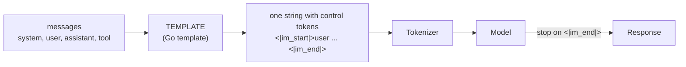

# Ollama Modelfiles

## Why this matters

Every time you typed `ollama run qwen3:14b` you used a **Modelfile** without seeing it. It's the recipe behind each model in Ollama's library: which weights, which sampling defaults, which system prompt, which prompt template. Writing your own is the cheapest customization there is. No training, no GPU hours, and the result is a first-class model that shows up in `ollama list`, works from every client and API, and starts with the behavior you want baked in.

It also teaches a lesson that outlives Ollama. A model is weights **plus** a bundle of conventions around them (the chat template, the stop tokens, the recommended sampling). Get the conventions wrong and a good model looks broken. That's exactly what happens when you import a GGUF file ([10.2](/part-10-modifying-serving-models/10.2-hf-to-gguf)) or attach a LoRA adapter ([10.3](/part-10-modifying-serving-models/10.3-lora-mlx)): the weights are fine and the packaging is what you have to get right. This chapter is the packaging chapter.

**Learning goals**

- Write a Modelfile with parameters and a system prompt
- Read and edit chat templates
- Create and share a custom model

## Explanation

### A Modelfile is a recipe, and a model is a stack of layers

The format is deliberately Dockerfile-like: `#` comments, then `INSTRUCTION arguments` lines. The docs describe it as a file with `# comment` lines and `INSTRUCTION arguments` lines, say the instructions are not case sensitive, and that they can appear in any order ([Ollama Modelfile reference](https://docs.ollama.com/modelfile)). You turn it into a model with `ollama create <name> -f ./Modelfile`.

The Docker analogy goes further than syntax. When I ran `ollama create` on a three-line Modelfile based on `qwen3:14b` (Ollama 0.40.14), the output was:

```
using existing layer sha256:a8cc1361...   <- the 9 GB of weights, not copied
using existing layer sha256:ae370d88...
using existing layer sha256:d18a5cc7...
creating new layer sha256:9dbef1e1...     <- my system prompt
creating new layer sha256:eaeac403...     <- my parameters
writing manifest
success
```

A model is a **manifest** that points at content-addressed blobs: the weights, the template, the parameters, the system prompt, the license. Your custom model shares the weights blob with its parent and adds a few small layers. That's why `ollama create` takes about a second and why a dozen variants of one base cost almost no disk.

The best way to learn the format is to read one that works. Ask Ollama to print a model's Modelfile:

```bash
ollama show qwen3:14b --modelfile
```

(`ollama show --modelfile` is in the reference page above.) Trimmed, what comes back for `qwen3:14b` looks like this:

```
FROM /Users/you/.ollama/models/blobs/sha256-a8cc1361...
TEMPLATE """ ...a 50-line Go template, read below... """
PARAMETER top_k 20
PARAMETER top_p 0.95
PARAMETER repeat_penalty 1
PARAMETER stop <|im_start|>
PARAMETER stop <|im_end|>
PARAMETER temperature 0.6
LICENSE """ Apache License ... """
```

Every instruction here is something you can set yourself. The rest of this section takes them one at a time.

### The instructions

| Instruction | What it does | Notes |
|---|---|---|
| `FROM` | The starting point. Required. | An existing model (`qwen3:14b`), a Safetensors directory, or a GGUF file. |
| `PARAMETER` | A run-time default such as `temperature` or `num_ctx`. | One per line. `stop` may repeat. |
| `SYSTEM` | The system message the template places at the top. | Triple quotes for multi-line. |
| `TEMPLATE` | The full prompt template, in Go template syntax. | The part that most often goes wrong. |
| `MESSAGE` | Example conversation turns baked into the model. | Roles `system`, `user`, `assistant`. |
| `ADAPTER` | A LoRA adapter to apply on top of the base. | Covered below. |
| `LICENSE` | License text stored with the model. | |

All of the rows except `ADAPTER` come from the [Modelfile reference](https://docs.ollama.com/modelfile). The reference also lists `REQUIRES` (a minimum Ollama version) and `CAPABILITY` (adds a capability to a GGUF or MLX model). `ADAPTER` is missing from that page today; see its section.

### PARAMETER: defaults you bake in

`PARAMETER` sets the **default** for a request. A request can still override it in the `options` object (the same mechanism 1.8 used for sampling experiments; see [1.8, provider defaults](/part-01-how-llms-work/1.8-sampling#provider-defaults-and-which-ones-you-can-change)). The valid parameters in the reference include `num_ctx`, `temperature`, `top_k`, `top_p`, `min_p`, `repeat_penalty`, `repeat_last_n`, `seed`, `num_predict` and `stop`, with server defaults such as `temperature` 0.8, `top_k` 40 and `top_p` 0.9 ([Modelfile reference, valid parameters](https://docs.ollama.com/modelfile#valid-parameters-and-values)). Chapter 1.8 explained what each one does to the distribution; this chapter is about where you can pin them.

Two things in the Modelfile you just printed are worth noticing.

**The packager already overrode the server defaults.** `qwen3:14b` ships `temperature 0.6`, `top_k 20`, `top_p 0.95`. Those match what the Qwen team recommends for thinking mode: `Temperature=0.6`, `TopP=0.95`, `TopK=20`, `MinP=0` ([Qwen3-14B model card](https://huggingface.co/Qwen/Qwen3-14B)). So "I didn't set anything" never means "I'm on the server defaults". The default you get is the one in the model's own Modelfile, and `ollama show <model> --modelfile` tells you what it is. This is the second hiding place for defaults that 1.8 warned about.

**`stop` is a parameter, not magic.** The two `stop` lines are the template's control tokens, `<|im_start|>` and `<|im_end|>`. A stop sequence tells the server to end generation when the model emits it. Without a matching stop, a model that doesn't emit its end-of-sequence token properly keeps writing a conversation with itself. Remember this for GGUF imports.

A trap worth knowing before the practice: `num_predict` caps **generated** tokens, and for a thinking model those include the thinking. Given `num_predict 30` on a request, `qwen3:14b` on my machine spent all 30 tokens inside its reasoning, returned an empty `content` and reported `done_reason: "length"`. If you want short answers, ask for them in the system prompt and use `num_predict` only as a safety net, sized for the thinking too.

### SYSTEM and MESSAGE

`SYSTEM """..."""` stores the system message. It lands wherever the template puts <code v-pre>{{ .System }}</code>. `MESSAGE` adds example turns (`MESSAGE user ...`, `MESSAGE assistant ...`), which is few-shot prompting baked into the model ([Modelfile reference](https://docs.ollama.com/modelfile)). Both are just prompt text in front of every conversation: they cost context tokens on each request (see 1.9) and they steer rather than guarantee. A "be terse" system prompt makes short answers likely, not certain. The Practice measures how well it works.

### TEMPLATE: the part that matters

A model sees one flat sequence of tokens. Your API call sees a list of messages with roles. The **chat template** is the function between them. Hugging Face's guide puts the key idea well: chat models "are still just language models that continue a sequence of tokens", and the list of role and content dictionaries "get converted to a token sequence, often with control tokens like `<|user|>` or `<|assistant|>`" ([Hugging Face: Chat templates](https://huggingface.co/docs/transformers/chat_templating)). Different models use different formats, "even if they were fine-tuned from the same base model", and "with the wrong control tokens, these models would have drastically worse performance" (same page).



On Hugging Face the template ships in the tokenizer as a Jinja template. Ollama stores a **Go template** in the model instead, which is what `TEMPLATE` is. It's Go's standard `text/template`: <code v-pre>{{ ... }}</code> actions, `if`/`range`/`else`, and <code v-pre>{{-</code> / `-}}` markers that trim whitespace on that side ([Go text/template](https://pkg.go.dev/text/template)). The Ollama template docs list the variables: `.System`, `.Prompt`, `.Response`, `.Suffix` (fill-in-middle), `.Messages` (each with `Role`, `Content`, `ToolCalls`) and `.Tools`; and note that tool support is added by putting a <code v-pre>{{ .Tools }}</code> node into the template ([Ollama template docs](https://github.com/ollama/ollama/blob/main/docs/template.mdx)). Modern templates loop over `.Messages`; the older `.System` / `.Prompt` / `.Response` trio only suits a single turn.

::: info 📖 Read now
[Ollama: Template docs](https://github.com/ollama/ollama/blob/main/docs/template.mdx) (Ollama) · docs · ~10 min · essential

Look for: the list of variables, how `range` changes what `.` means (and how `$.` reaches back to the root), and the sentence about the default template of imported models.
:::

#### Reading the real Qwen3 template

Here is the skeleton of the `qwen3:14b` template, which I read from `ollama show qwen3:14b --modelfile` on Ollama 0.40.14, with the tool-calling and thinking-history branches removed so the structure shows. Templates change between releases, so print yours before editing it.

```
{{- if .System }}<|im_start|>system
{{ .System }}<|im_end|>
{{ end }}
{{- range .Messages }}
  {{- if eq .Role "user" }}<|im_start|>user
{{ .Content }}<|im_end|>
  {{ else if eq .Role "assistant" }}<|im_start|>assistant
{{ .Content }}<|im_end|>
  {{ end }}
{{- end }}<|im_start|>assistant
```

For a system message `Be brief.` and one user message `Hi`, the model receives (whitespace simplified):

```
<|im_start|>system
Be brief.<|im_end|>
<|im_start|>user
Hi<|im_end|>
<|im_start|>assistant
```

The last line is the **generation prompt**: it opens the assistant turn and leaves the model to continue it. Hugging Face's guide explains why it's there: without those tokens the model may "do something strange, like **continuing** the user's message instead of replying to it" ([Hugging Face: Chat templates, add_generation_prompt](https://huggingface.co/docs/transformers/chat_templating#add_generation_prompt)). The model stops when it writes `<|im_end|>`, and the `stop` parameters catch that token.

The real template has three more branches worth finding in your own printout:

- **Tools.** When the request carries tools, the system block gains a `# Tools` section with each function signature and the instruction to answer with a `<tool_call>` JSON object. Tool calling in Ollama goes through this template, not a separate mechanism.
- **Tool results** are rendered as a `user` turn wrapping `<tool_response>`.
- **Thinking control.** The template checks `.IsThinkSet` and `.Think`. When you send `"think": true`, it appends ` /think` to the last user message, and for `false` it appends ` /no_think`, the soft switches the Qwen3 model card describes. When thinking is set to false the generation prompt also gains an empty `<think>` block, so the model starts from "I have already finished thinking".

That last branch is what makes Qwen3's thinking toggle work, and it's the cleanest example of why the template is part of the model. The model card calls the empty block the model's own behavior in non-thinking mode: it "will not include a `<think>...</think>` block" when thinking is hard-disabled, and the template emulates that by pre-filling the empty block ([Qwen3-14B model card](https://huggingface.co/Qwen/Qwen3-14B)). For the thinking concepts behind this, see [1.10](/part-01-how-llms-work/1.10-reasoning-models) and [Ollama: Thinking](https://docs.ollama.com/capabilities/thinking).

#### "Thinking off" is not a parameter

This is the snag the practice makes you solve. Ollama's thinking page documents `think` as a field on chat and generate **requests** (`true`, `false`, or a level string for models that have levels), and discovery through `/api/show` ([Ollama: Thinking](https://docs.ollama.com/capabilities/thinking)). Neither it nor the Modelfile reference mentions a Modelfile setting for it. I checked by building a model with only `PARAMETER` and `SYSTEM` lines on top of `qwen3:14b`: with no `think` field on the request, it still thought first, and `ollama show` still listed `thinking` as a capability with default `true`.

So if you want a model that never thinks, whoever calls it must remember to send `think: false`, **or** the template must do it. The template version is possible because of what you just read: the `false` branch is one conditional around an empty think block. Look at the tail of your printout, find the <code v-pre>{{ if and $.IsThinkSet (not $.Think) -}}</code> condition that guards the empty `<think></think>` pair, and ask what the template would render if that pair were emitted regardless. I tried that edit on 0.40.14. The answer came back without a `thinking` field whether or not the request set `think`. That's your first Practice step, and you'll find out what else it changes.

A trade-off to hold in mind: a template edit makes the behavior permanent and invisible to callers, which is convenient until someone expects the thinking model they pulled. Name your variant so the difference is obvious.

### ADAPTER: attaching a LoRA

`ADAPTER` points at a LoRA adapter file that should be applied on top of the `FROM` model. The Modelfile reference as of its v0.5.7 tag says the base in `FROM` "should be specified with a `FROM` instruction" and warns: "If the base model is not the same as the base model that the adapter was tuned from the behaviour will be erratic." It accepted Safetensors adapters for Llama, Mistral and Gemma families, or a GGUF adapter such as `ADAPTER ./ollama-lora.gguf` ([Modelfile reference at v0.5.7](https://github.com/ollama/ollama/blob/v0.5.7/docs/modelfile.md#adapter)). The current docs page no longer has an `ADAPTER` section, and I haven't tested adapters in this chapter, so treat that list of supported families as old. The rule that survives is the important one: the adapter is a delta against **specific** weights, so it has to sit on the exact base it was trained on, including the same quantization pipeline if you fine-tuned a quantized base. [10.3](/part-10-modifying-serving-models/10.3-lora-mlx) trains an adapter and [10.4](/part-10-modifying-serving-models/10.4-merge-and-serve) loads or merges it, so there you'll use this instruction for real.

### Importing a GGUF (or Safetensors) file

`FROM` can also name a file instead of a model. The import docs show a GGUF import as a Modelfile with `FROM /path/to/file.gguf` followed by `ollama create my-model`, and a split model as a wildcard `FROM /path/to/model-*.gguf`. For Safetensors the line is `FROM /path/to/safetensors/directory` ([Ollama: Importing a model](https://docs.ollama.com/import)). The same page is explicit that "Ollama does not quantize GGUF models during import", so quantizing happens before this step, with llama.cpp (see [1.12](/part-01-how-llms-work/1.12-quantization) and [10.2](/part-10-modifying-serving-models/10.2-hf-to-gguf)).

The part that bites is the template. Per the Ollama template docs, "models imported into Ollama have a default template of <code v-pre>{{ .Prompt }}</code>", which passes the user's text to the model unchanged ([Ollama template docs](https://github.com/ollama/ollama/blob/main/docs/template.mdx)). That works for a base model that just continues text, and it's wrong for an instruct model: no roles, no control tokens, no generation prompt. The symptoms are the ones the Hugging Face page predicted: replies that ramble, that continue your question, or that never stop. A correct import therefore has four parts:

1. `FROM` the file.
2. A `TEMPLATE` matching the format the model was post-trained on. The model's Hugging Face repo shows it in `tokenizer_config.json` as a Jinja `chat_template`, and the model card usually names the format (ChatML for Qwen, and so on). Often the quickest route is to copy a template from a library model of the same family (`ollama show <similar> --modelfile`) and check it against the Hugging Face one.
3. `PARAMETER stop` lines for the control tokens that end a turn.
4. The sampling `PARAMETER`s the model card recommends.

::: info 📖 Read now
[Ollama: Importing a model](https://docs.ollama.com/import) (Ollama) · docs · ~5 min · essential

Look for: the three import routes (Safetensors, GGUF, sharing), the quantization sentence, and what it says you need before pushing a model.
:::

### Creating, inspecting and sharing

The day-to-day commands, all part of the standard CLI:

```bash
ollama create my-model -f ./Modelfile   # build from a recipe
ollama show my-model --modelfile        # print the recipe it was built from
ollama run my-model                     # chat with it
ollama cp my-model myuser/my-model      # copy or rename
ollama rm my-model                      # delete the manifest (shared blobs stay while others use them)
```

To share on ollama.com the import docs list: create an account, add your Ollama public key under the keys settings page, name the model with your username (`ollama cp mymodel myuser/mymodel`), then `ollama push myuser/mymodel`; others run it with `ollama run myuser/mymodel` ([Ollama: Importing a model, sharing](https://docs.ollama.com/import)). The username becomes part of the model's name.

Two practical notes. First, the Modelfile is a small text file and the recipe is the valuable part, so for your own use **commit the Modelfile to git** and rebuild; you rarely need to push anything. Second, the base model's `LICENSE` layer is carried along with a derived model, so check that the license of what you derive from allows what you plan to do before you publish (the Qwen3 files in your Modelfile print are Apache 2.0, which permits redistribution with notices).

### Where Modelfiles stop

A Modelfile changes **packaging and defaults**, never the weights (except through `ADAPTER`, which adds a trained delta). A system prompt is an instruction the model may ignore; a lower temperature narrows sampling but doesn't make a weak model smarter. If the behavior you want can't be reached by prompt and sampling, that's the signal to look at fine-tuning ([10.3](/part-10-modifying-serving-models/10.3-lora-mlx)). Try the Modelfile first: it costs nothing and tells you how far prompting gets.

::: tip 📖 Read (optional)
[Hugging Face: Chat templates](https://huggingface.co/docs/transformers/chat_templating) (Hugging Face) · docs · ~20 min · optional

Look for: the Mistral vs. Zephyr comparison of the same chat, `add_generation_prompt`, and the warning about adding special tokens twice. The Jinja syntax differs from Go's but the ideas are identical, and it's the format you'll meet when reading a model's `tokenizer_config.json` for an import.
:::

::: tip 📖 Read (optional)
[Go: text/template](https://pkg.go.dev/text/template) (Go standard library) · docs · ~15 min (the "Text and spaces", "Actions" and "Variables" sections) · optional

Look for: the trim markers, `range` over a slice, and how `$` refers to the root.
:::

::: tip 📖 Read (optional)
[Qwen3-14B model card](https://huggingface.co/Qwen/Qwen3-14B) (Qwen team) · docs · ~10 min (the thinking-mode and best-practices sections) · optional

Look for: the hard switch versus the `/think` and `/no_think` soft switches, and the recommended sampling for each mode.
:::

::: tip 📖 Read (optional)
[Ollama Modelfile reference, ADAPTER section at v0.5.7](https://github.com/ollama/ollama/blob/v0.5.7/docs/modelfile.md#adapter) (Ollama) · docs · ~3 min · optional

Look for: the same-base requirement. It's an old version of the page, kept here because the current docs dropped the section.
:::

::: info 📖 Read now
[Ollama: Modelfile reference](https://docs.ollama.com/modelfile) (Ollama) · docs · ~10 min · essential

Look for: the full list of instructions, the parameter table, and `ollama show --modelfile`. You'll use it as the reference for the Practice.
:::

## Practice

**Brief:** Create `qwen3-coder-terse` from `qwen3:14b` with thinking off, a low temperature and a terse system prompt, then compare it with the base model on 5 prompts. All local, free.

**Where:** `experiments/36-modelfile/`: a standalone experiment (not a `project/` step). The README has the "What I tried / What happened / Why" skeleton and the tables to fill in. The code is TypeScript, and you write it.

**Steps:**

1. **Read the base.** Run `ollama show qwen3:14b --modelfile > experiments/36-modelfile/base.Modelfile`. Find the `TEMPLATE`, the `PARAMETER` lines and the branch that handles thinking. In the README, write down what the template renders for a system message plus one user message, and which line guards the empty `<think>` block.
2. **Predict.** Before building, write down what you expect from the custom model versus the base: how much shorter the answers, whether `thinking` will be empty, and whether the latency gap will be bigger or smaller than the answer-length gap. One sentence each.
3. **Write the Modelfile.** `FROM qwen3:14b`, `PARAMETER temperature 0.2`, and a `SYSTEM` prompt that asks for code first and at most two sentences of prose. Build it: `ollama create qwen3-coder-terse -f experiments/36-modelfile/Modelfile`. Check with `ollama show qwen3-coder-terse --modelfile` that your parameters are there next to the inherited ones. Careful with `num_predict`: see the trap above.
4. **Turn thinking off, in the template.** Add a `TEMPLATE` to the Modelfile, starting from the base template, so the empty think block is always part of the generation prompt. Rebuild. Prove it worked by calling `/api/chat` with no `think` field and checking that the response has no `thinking` text. (`think: false` on the request would also pass, so don't use it for this check.)
5. **Write `compare.ts`** (TypeScript, plain `fetch` against Ollama's `/api/chat`, `stream: false`). For each of 5 prompts, call the base and the custom model, and record from each response the answer text, the `thinking` length, `eval_count` and `total_duration` (nanoseconds). Pin `options.seed` for both. Choose prompts that need an answer, not a conversation: for example a one-line shell task, a short function with an obvious test, "explain what this regex does", a question where a detailed answer is tempting, and a request that needs a clarifying assumption.
6. **Add a third column** where the base runs with `think: false` on the request. The custom model changed three things at once (system prompt, temperature, thinking). This column separates how much of the speed-up is thinking and how much is the prompt.
7. **Judge.** For each prompt, did terse lose anything you needed? Count prompts where the terse answer was wrong or missing a necessary caveat.
8. **Optional stretch, share it.** Do the `ollama cp` and `ollama push` steps from the import docs under your own account, or stop before the push and only run the `cp`, then delete it. Alternatively commit the Modelfile and write a one-line `build.sh`.
9. **Optional stretch, request override.** Send a request with its own system message to `qwen3-coder-terse`. Does the Modelfile `SYSTEM` still apply, or does the request win? Test it and write down what you saw.

**Done when:** `node experiments/36-modelfile/compare.ts` prints a table with answer length, thinking length, tokens and seconds for the three columns on all 5 prompts; step 4's check shows no `thinking` text without a `think` field; the README holds your predictions from before the runs; and its Why section says which of the three changes (prompt, temperature, thinking) bought most of the speed-up, citing your numbers.

## Check questions

1. You build a model from `qwen3:14b` with `PARAMETER temperature 0.2`, but never set `top_p` or `top_k`. Which `top_p` and `top_k` does it use, and how do you find out?

   <details><summary>Answer</summary>

   The ones in the base model's Modelfile, not the server defaults: `qwen3:14b` ships `top_k 20` and `top_p 0.95`, and the derived model inherits them. The server defaults in the reference (`top_k` 40, `top_p` 0.9) only apply to parameters nobody set. Run `ollama show <model> --modelfile` and read the `PARAMETER` lines. Remember that a request's `options` can still override all of them.
   </details>

2. A friend imports an instruct-model GGUF with a two-line Modelfile (`FROM ./model.gguf`) and says the model rambles and never stops. What happened, and what do you add?

   <details><summary>Answer</summary>

   Imported models get a default template of <code v-pre>{{ .Prompt }}</code>, so no roles, control tokens or generation prompt reach the model, and without `stop` parameters nothing ends the turn. Add a `TEMPLATE` for the format the model was trained on (from its `tokenizer_config.json` chat template or a same-family Ollama model), `PARAMETER stop` lines for the end-of-turn tokens, and the model card's recommended sampling parameters.
   </details>

3. Why can't you turn Qwen3's thinking off with a `PARAMETER` line, and what are the two places where it can be turned off?

   <details><summary>Answer</summary>

   Thinking is controlled by the `think` field of the request, which the template reads (`.IsThinkSet`, `.Think`), and the Modelfile has no parameter for it. You can turn it off per request (`think: false`), or edit the `TEMPLATE` so the empty `<think></think>` block is always pre-filled, which makes it the default for every caller.
   </details>

4. You set `PARAMETER num_predict 200` on a thinking model to keep answers short, and get empty replies on hard prompts. Why?

   <details><summary>Answer</summary>

   `num_predict` counts all generated tokens, thinking included. On a hard prompt the model can spend the whole budget reasoning and be cut off (`done_reason: "length"`) before it writes any answer. Either disable thinking, give a larger cap, or ask for brevity in the system prompt instead.
   </details>

5. You apply a LoRA adapter trained on one 8B model to a different 8B model and get nonsense. Why, and what does the Ollama doc say?

   <details><summary>Answer</summary>

   An adapter is a set of small weight deltas computed against specific base weights, so on a different base they add noise in the wrong places. The Modelfile reference (v0.5.7) says that if the base model is not the one the adapter was tuned from, "the behaviour will be erratic". The `FROM` line has to name the exact base.
   </details>

## My understanding

<!-- Written by the learner, in their own words. Agents never fill this in. -->
