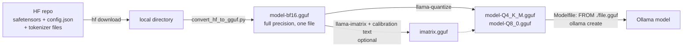

# From Hugging Face to GGUF

## Why this matters

Most models are published as Hugging Face safetensors, not ready for Ollama. Converting and quantizing yourself means you can run any model, including your own fine-tunes.

Everything you have pulled so far arrived already converted and already quantized by someone else. That works until you want a model nobody has packaged, a quantization nobody published, or the output of your own fine-tune ([10.3](/part-10-modifying-serving-models/10.3-lora-mlx) ends with exactly that problem). The pipeline is short: download the safetensors, convert to a full-precision GGUF, quantize that GGUF, hand it to Ollama. [1.12](/part-01-how-llms-work/1.12-quantization) explained what the quantization step does to the numbers. This chapter is the plumbing around it, and the experiment lets you measure the result on a real model.

**Learning goals**

- Convert a HF model to GGUF with llama.cpp
- Quantize it to Q4 and Q8
- Import it into Ollama and compare

## Explanation

### The pipeline at a glance



Two programs from llama.cpp do the work: a Python script that converts, and a compiled tool that quantizes. Ollama only imports. Keep that division in mind, because each step has its own failure modes.

### Safetensors and the config files

A Hugging Face model repository is a folder of files, and the converter reads three kinds of them. Look at the repo for [Qwen3-1.7B](https://huggingface.co/Qwen/Qwen3-1.7B), the model used in the practice. Its file list is `config.json`, `generation_config.json`, `tokenizer.json`, `tokenizer_config.json`, `vocab.json`, `merges.txt`, `model.safetensors.index.json` and two `model-0000N-of-00002.safetensors` shards (listed by the [Hub API](https://huggingface.co/api/models/Qwen/Qwen3-1.7B)).

**Safetensors** holds only the tensors. The [format](https://github.com/huggingface/safetensors) is an 8-byte little-endian integer giving the header size, then a UTF-8 JSON header that maps each tensor name to its `dtype`, `shape` and `data_offsets`, then one raw byte buffer. It was designed as a safe alternative to pickle, which can run arbitrary code when loaded, and a reader can fetch single tensors by offset without reading the whole file. Because the header is plain JSON you can inspect any shard yourself with a dozen lines of code, which the practice asks you to do. The `.index.json` file maps tensor names to shards, since big models are split across files.

The **config** files describe everything the tensors do not. `config.json` for this model says `"architectures": ["Qwen3ForCausalLM"]`, 28 layers, hidden size 2048, 16 attention heads over 8 key/value heads, `rope_theta` 1,000,000, `tie_word_embeddings: true` and `torch_dtype: bfloat16` ([config](https://huggingface.co/Qwen/Qwen3-1.7B/raw/main/config.json)). You met these numbers in [1.5](/part-01-how-llms-work/1.5-transformer-block): tensors are only weights, and the hyperparameters that give them meaning (how many layers, how the heads are split, which position encoding) live here. The tokenizer files carry the vocabulary and merge rules from [1.2](/part-01-how-llms-work/1.2-tokenization) and the chat template that wraps messages in special tokens. A converted file must contain all of it, or it cannot run on its own.

The size arithmetic is a good sanity check: the Hub reports 2,031,739,904 BF16 parameters for this repo, so the weights are about 2.03e9 × 2 bytes = 4.06 GB on disk.

### GGUF: one self-describing file

[GGUF](https://huggingface.co/docs/hub/gguf) is the format llama.cpp and Ollama load. Unlike a tensors-only format, it stores "both the tensors and a standardized set of metadata" in one binary file. The [format specification](https://github.com/ggml-org/ggml/blob/master/docs/gguf.md) says what that means in practice: a header with a magic number, a version, a tensor count and a metadata key-value count; typed key-value metadata (a required `general.architecture` string, hyperparameters, tokenizer data); a table of tensor infos (name, shape, type, offset); then aligned tensor data. Its stated goals include that "all information needed to load a model is contained in the model file" and "`mmap` compatibility: models can be loaded using `mmap` for fast loading and saving." The metadata keys are where `config.json` and the tokenizer end up, renamed, which is why a GGUF is self-contained and a safetensors folder is not. Each tensor also records its own type, so one file can mix, say, Q4_K and Q6_K tensors, which is what the `_M` in Q4_K_M means ([1.12](/part-01-how-llms-work/1.12-quantization)).

The Hub has a viewer that shows a GGUF's metadata and tensor list (name, shape, precision) on the model's files page, a quick way to see what a converted file contains ([GGUF docs](https://huggingface.co/docs/hub/gguf)).

### The conversion script

llama.cpp ships `convert_hf_to_gguf.py` at the root of the [repository](https://github.com/ggml-org/llama.cpp). Its [documented use](https://github.com/ggml-org/llama.cpp/blob/master/tools/quantize/README.md) is:

```sh
python convert_hf_to_gguf.py --outfile gemma-4-E2B-it-bf16.gguf --outtype bf16 --remote google/gemma-4-E2B-it
```

The positional argument is a local model directory (or a repo ID with `--remote`), `--outfile` is the output path and `--outtype` picks the precision of the tensors. In the script's argument parser `--outtype` accepts `f32`, `f16`, `bf16`, `q8_0`, `tq1_0`, `tq2_0` and `auto` ([script source](https://github.com/ggml-org/llama.cpp/blob/master/convert_hf_to_gguf.py)). Two points follow.

**The script is architecture-specific, not generic.** It reads `config.json`, finds the class named in `architectures`, and uses that class to rename tensors and write the right metadata. In the llama.cpp source, `Qwen3ForCausalLM` is registered to a `Qwen3Model` class ([conversion/qwen.py](https://github.com/ggml-org/llama.cpp/blob/master/conversion/qwen.py), as of the 2026-11-10 check). If your architecture is not registered, the script logs "Model ... is not supported" and exits with an error. This is the most common reason a brand-new model has no GGUF yet: someone has to teach llama.cpp the new architecture first. (The code layout moves between versions; the 2026 script delegates to a `conversion` package, so if you read it, expect to follow imports.)

**Convert at full precision, quantize afterwards.** Use `bf16` (or `f16`) for the first file, because it is faithful to the original weights, then derive every smaller file from it. Converting straight to `q8_0` is possible, but quantizing from an already-quantized file compounds rounding errors, and you lose the ability to run `llama-imatrix` on the full-precision model.

::: info 📖 Read now
[llama.cpp: quantize tool README](https://github.com/ggml-org/llama.cpp/blob/master/tools/quantize/README.md) (llama.cpp) · docs · ~15 min · essential

You read the type table for 1.12. This time read the example commands: convert, then quantize, then the `--imatrix` and tensor-override options. Look for: the exact argument order of `llama-quantize` (input file, output file, type), and which options exist for keeping a few tensors at higher precision.
:::

### Quantizing with `llama-quantize`

Building llama.cpp gives you the binaries. The [build guide](https://github.com/ggml-org/llama.cpp/blob/master/docs/build.md) shows `cmake -B build` then `cmake --build build --config Release`, and says "On MacOS, Metal is enabled by default"; its examples run tools from `./build/bin/`. The project README also lists a one-line installer and prebuilt binaries, but you need the repository checkout anyway for the Python converter and its requirements file. Quantizing is one command ([README](https://github.com/ggml-org/llama.cpp/blob/master/tools/quantize/README.md)):

```sh
./build/bin/llama-quantize gemma-4-E2B-it-bf16.gguf gemma-4-E2B-it-Q4_K_M.gguf Q4_K_M
```

Input, output, type. Run it twice with different types and you have your Q4 and Q8 files. The type names and their true bits per weight are the table in 1.12, and the prediction step in the practice reuses it. Those predictions for this model are simple arithmetic: 2.03e9 weights × 8.5 / 8 ≈ 2.2 GB for Q8_0 and × 4.89 / 8 ≈ 1.2 GB for Q4_K_M. They will be off by some margin, since this model ties its input and output embeddings and the `_M` recipe treats some tensors specially. Finding out by how much is part of the exercise.

### Importance matrices

Plain rounding treats every weight equally. An **importance matrix** (imatrix) tells the quantizer which weights deserve more care. The llama.cpp README says accuracy loss from quantization "can be minimized by using a suitable imatrix file", and the types whose Hugging Face descriptions mention an importance matrix are the IQ family ([GGUF docs](https://huggingface.co/docs/hub/gguf#quantization-types)).

How the matrix is computed is explained in [the pull request that added it](https://github.com/ggml-org/llama.cpp/pull/4861). The idea: a weight row `w` multiplies activations `a` produced by earlier layers, and quantization is good if the dot product `Σ w_j a_j` barely changes. A weight multiplied by a large activation matters more than one multiplied by a tiny activation. The tool therefore runs calibration text through the model, records activation statistics per tensor, and the quantizer weights its rounding error by them. The author notes that the approach ignores the off-diagonal terms of the full error expression and still gave good results in his tests. Two practical consequences:

1. You need **calibration text**: `llama-imatrix` takes the model and a text file, for example `./llama-imatrix -m ggml-model-f16.gguf -f calibration-data.txt -ngl 99`, and its [README](https://github.com/ggml-org/llama.cpp/blob/master/tools/imatrix/README.md) example uses `wiki.train.raw`. You then pass the result to the quantizer: `./llama-quantize --imatrix imatrix.gguf ggml-model-f16.gguf ./ggml-model-q4_k_m.gguf q4_k_m`. The README does not say how to choose calibration data; the PR's author guesses that instruct-tuned models may do better with instruction-style data, which is a guess and not a finding. Whatever text you use, the matrix reflects *that* text, so a code-heavy model calibrated on Wikipedia may be tuned to the wrong distribution.
2. By default `output.weight` and `token_embd.weight` are left out of the matrix, because it is typically better not to apply it to them ([imatrix README](https://github.com/ggml-org/llama.cpp/blob/master/tools/imatrix/README.md)).

Whether it helps a given model at Q4_K_M is an empirical question. It is an optional stretch in the practice.

::: info 📖 Read now
[llama.cpp: imatrix tool README](https://github.com/ggml-org/llama.cpp/blob/master/tools/imatrix/README.md) (llama.cpp) · docs · ~10 min · essential

Short page. Look for: the command shape, the calibration file you must supply, how often intermediate results are saved, and the note on which tensors are excluded by default.
:::

::: tip 📖 Read (optional)
[llama.cpp PR 4861: importance matrix](https://github.com/ggml-org/llama.cpp/pull/4861) (llama.cpp, 2024) · repo · ~15 min (the description's "Details" section, not the thread) · optional

Look for: why the author wanted something smaller than a gradient-based matrix, and the derivation that ends in "weight the error by the activation". It is the clearest explanation of what the file contains.
:::

### Importing into Ollama

Ollama's [import docs](https://docs.ollama.com/import) cover two inputs. For a GGUF file, write a `Modelfile` containing `FROM /path/to/file.gguf` (absolute, or relative to the Modelfile) and run `ollama create my-model`. For a safetensors directory, `FROM /path/to/safetensors/directory` works too, if the architecture is supported. The decisive sentence for this chapter: "Ollama does not quantize GGUF models during import". A GGUF goes in exactly as you quantized it, so the Q4 and Q8 choice is made here, in llama.cpp. (On this machine `ollama create --help` for version 0.40.14 also lists `-q, --quantize` and describes it as quantizing a *safetensors* model to a given level, with `nvfp4` as its example; it is a different route, and this chapter does not use it.)

Why bother with GGUF when Ollama can read safetensors? Because the llama.cpp route gives you the quantization types, the imatrix and control over every step, and because the same GGUF file also runs in llama.cpp, LM Studio and anything else that reads the format.

The `Modelfile` is also where you set what the GGUF cannot decide for you ([Modelfile reference](https://docs.ollama.com/modelfile)): `TEMPLATE` for the prompt format, `PARAMETER` for defaults and `SYSTEM`. The documented default for `num_ctx` is 2048, so a model you import answers with a small context unless you say otherwise ([10.1](/part-10-modifying-serving-models/10.1-ollama-modelfile) covers the Modelfile in full). On the template: Hugging Face's Ollama guide says that for GGUFs pulled with `ollama run hf.co/...`, a template "will be selected automatically from a list of commonly used templates" based on the GGUF's built-in `tokenizer.chat_template` ([Hugging Face: Ollama](https://huggingface.co/docs/hub/ollama)). That describes the Hub route; whether a local `FROM` import behaves the same for your file is something to verify in the practice by checking `ollama show --modelfile`, and by seeing whether the answers look well-formed or leak raw tokens.

That same page offers a shortcut worth knowing: `ollama run hf.co/{username}/{repository}:{quantization}` runs a community-made GGUF straight from the Hub, defaulting to `Q4_K_M` when the repo has it. Use it when someone has already done the work; do the pipeline yourself when no one has, or when the model is yours.

::: info 📖 Read now
[Ollama: Import](https://docs.ollama.com/import) (Ollama docs) · docs · ~5 min · essential

Look for: the two import routes (safetensors directory vs. GGUF file), the sentence about quantization, and the wildcard form for models split across several GGUF files.
:::

::: info 📖 Read now
[llama.cpp: Build](https://github.com/ggml-org/llama.cpp/blob/master/docs/build.md) (llama.cpp) · docs · ~10 min · essential

Read the CPU build section and the macOS note. Look for: the two cmake commands, that Metal is on by default, and where binaries appear.
:::

::: tip 📖 Read (optional)
[GGUF specification](https://github.com/ggml-org/ggml/blob/master/docs/gguf.md) (ggml) · docs · ~15 min · optional

Look for: the header layout, the metadata key conventions (`general.architecture`) and the design goals. Then open any GGUF in the Hugging Face viewer and match what you see to the spec.
:::

::: tip 📖 Read (optional)
[safetensors README](https://github.com/huggingface/safetensors) (Hugging Face) · repo · ~10 min · optional

Look for: the byte-level file format, and the honest caveat that "no format is really zero-copy in ML".
:::

::: tip 📖 Read (optional)
[Hugging Face: Use Ollama with any GGUF model on the Hub](https://huggingface.co/docs/hub/ollama) (Hugging Face Hub docs) · docs · ~8 min · optional

Look for: the `:{quantization}` tag syntax, the default quant it picks, and the template-selection paragraph.
:::

::: tip 📖 Read (optional)
[Ollama: Modelfile reference](https://docs.ollama.com/modelfile) (Ollama docs) · docs · ~10 min · optional

Look for: the three forms of `FROM`, `TEMPLATE` and its variables, and the documented `PARAMETER` defaults.
:::

### What can go wrong

- **Unsupported architecture.** The converter exits with an error. Check the architecture string in `config.json` before downloading 14 GB.
- **Missing tokenizer files.** The converter needs the tokenizer files beside the weights; a partial download gives a confusing failure or a wrong vocabulary.
- **Wrong template, odd output.** If the model rambles, repeats special tokens or ignores the system prompt, suspect the prompt template before suspecting the quantization.
- **Comparing unequal settings.** Ollama defaults (context, sampling) differ from llama.cpp's. Pin `num_ctx`, `temperature` and `seed` explicitly, as in the [1.12 experiment](/part-01-how-llms-work/1.12-quantization#practice), or your Q4-versus-Q8 difference is noise.
- **Disk.** The BF16 GGUF plus two quantized files, plus the safetensors, for a 1.7B model is about 4.1 + 4.1 + 2.2 + 1.2 GB (estimates from the arithmetic above). For a 14B model multiply by about eight.

Model sizes and what fits in memory belong on [Landscape](/landscape#what-fits-in-24-gb-of-unified-memory), not here.

## Practice

**Brief:** Python with `uv`: download a small HF model, convert it to GGUF, quantize to Q4_K_M and Q8_0, import both into Ollama, and compare size, speed and output.

**Where:** `experiments/37-gguf/`: a standalone experiment. It has a README skeleton (What I tried / What happened / Why, with the tables to fill in) and a commented `pipeline.py` skeleton with the steps stubbed out. This is not a `project/` step.

**Steps:**

1. **Inspect before converting.** Download `Qwen/Qwen3-1.7B` into `experiments/37-gguf/models/Qwen3-1.7B` (the Hugging Face CLI: `uvx hf download Qwen/Qwen3-1.7B --local-dir <dir>`; see its [CLI guide](https://huggingface.co/docs/huggingface_hub/guides/cli)). The `models/` folder is gitignored in the skeleton. Then read the safetensors header of the first shard in a few lines of Python (8 bytes of length, then JSON), and print five tensor names with dtype and shape. Add up the parameters and compare with the 2,031,739,904 the Hub reports. Note which config keys you would expect to find again in the GGUF metadata.
2. **Get llama.cpp.** Clone it into `experiments/37-gguf/llama.cpp` (gitignored), build with the two cmake commands above, and create a `uv` environment with `uv pip install -r requirements/requirements-convert_hf_to_gguf.txt` run from the clone (the requirements file pins a CPU build of PyTorch, so it is a large download).
3. **Predict.** In the README, write predicted file sizes for BF16, Q8_0 and Q4_K_M from the bits-per-weight table in 1.12, and predict whether Q8_0 will generate faster or slower than Q4_K_M in Ollama, with one sentence of reasoning.
4. **Convert.** Run `convert_hf_to_gguf.py` on the model directory with `--outtype bf16` and an explicit `--outfile`. Check the file size against your prediction, and open the file in a GGUF viewer (or print its metadata keys with the `gguf` Python package from the `gguf-py` folder of the llama.cpp clone) to find `general.architecture` and the tokenizer entries.
5. **Quantize twice.** Run `llama-quantize` from the BF16 file to `Q8_0` and `Q4_K_M`. Record both sizes and compute the actual bits per weight (file bytes × 8 / 2.03e9).
6. **Import both.** Write two Modelfiles (`FROM ./...gguf`, plus a `PARAMETER num_ctx 8192`), run `ollama create qwen3-1.7b-q8-local` and `ollama create qwen3-1.7b-q4-local`, and check each with `ollama show --modelfile`. Look at whether a `TEMPLATE` was filled in. If answers come back malformed, take the template from the stock `qwen3:1.7b` (`ollama show --modelfile qwen3:1.7b`) and say in the README what you changed.
7. **Compare.** For each of your two models, and for the stock Ollama `qwen3:1.7b` as a reference, record: size on disk (`ollama list`), memory once loaded (`ollama ps`), median tokens per second over three runs, and the answers to the same five prompts you used in experiment 12 (`think: false`, `temperature: 0`, `seed: 1`). You may reuse `quant.ts` from experiment 12 by changing the tag list. Judge the answers the same way: wrong facts, broken format or failing code count, wording does not.
8. **Write the verdict** in the README: where your numbers differed from your predictions, whether your Q4_K_M matches the stock tag's size, and whether Q8_0 is worth its extra disk at this model size.
9. **Optional stretch, imatrix:** write a few thousand tokens of calibration text (something close to your prompts), run `llama-imatrix` on the BF16 file, quantize a third file with `--imatrix` at Q4_K_M, and compare it against the plain Q4_K_M on the same prompts. Say honestly if five prompts cannot tell them apart.
10. **Optional stretch, perplexity:** run `llama-perplexity` ([README](https://github.com/ggml-org/llama.cpp/tree/master/tools/perplexity)) on BF16, Q8_0 and Q4_K_M over the same text and compare the gaps to the shape of the table in 1.12.

**Done when:** two imported Ollama models run and answer; the README holds your size and speed predictions from before the measurements; a table gives size, memory, tokens per second and answer verdicts for Q4_K_M, Q8_0 and the stock tag; and you can explain each file in the pipeline (safetensors, BF16 GGUF, quantized GGUF) and which command produced it.

Cost: free, local only. No paid API calls.

## Check questions

1. Why is the quantization step done from a BF16 GGUF rather than converting straight to a small type?

   <details><summary>Answer</summary>

   A BF16 GGUF is a faithful copy of the original weights, so each quantized file is rounded once, from the best source available. Rounding from an already-quantized file stacks one rounding error on another. A full-precision file is also what `llama-imatrix` should run on, and you can derive as many quantizations from it as you like without converting again.
   </details>

2. A safetensors folder contains tensors, but converting only the `.safetensors` files would not give a working model. What else is needed, and where does it end up in the GGUF?

   <details><summary>Answer</summary>

   The `config.json` (layer count, head counts, hidden size, position-encoding settings, the architecture name) and the tokenizer files (vocabulary, merges, chat template). Safetensors stores tensors only. GGUF stores tensors plus a standardized key-value metadata block, so these become metadata keys such as `general.architecture` and the tokenizer entries, making the file self-contained.
   </details>

3. You import a Q4_K_M GGUF into Ollama and want Q8_0 instead. Do you pass a flag to `ollama create`?

   <details><summary>Answer</summary>

   No. Ollama does not quantize GGUF files during import; it takes the file as it is. Produce a Q8_0 GGUF with `llama-quantize` from the full-precision file and import that as a second model. (The `-q` flag on `ollama create` in the version used here is for safetensors imports.)
   </details>

4. What does an importance matrix change about quantization, and what does it depend on?

   <details><summary>Answer</summary>

   It tells the quantizer how much each weight matters, so the rounding error is spent on weights that multiply small activations rather than large ones. It is computed by running calibration text through the full-precision model and recording activation statistics, so it depends on that text: a poorly matched calibration set can tune the quantization to the wrong data. It only affects how the file is quantized; the resulting GGUF is loaded like any other.
   </details>

5. Your converted model runs in Ollama but answers with stray special tokens and ignores the system prompt. What do you check first, and why not the quantization?

   <details><summary>Answer</summary>

   The prompt template (`ollama show --modelfile`), because a wrong template feeds the model a format it was not trained on, which produces exactly those symptoms. Quantization damage shows up as degraded accuracy, wrong facts and broken long reasoning, not as systematic formatting failures. Compare with the template of the stock model and fix it with `TEMPLATE` in the Modelfile.
   </details>

## My understanding

<!-- Written by the learner, in their own words. Agents never fill this in. -->
