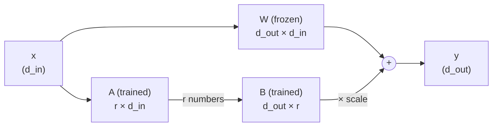

# LoRA fine-tuning with mlx-lm

## Why this matters

LoRA lets you fine-tune a model on a Mac in minutes to hours. Doing it once teaches you what fine-tuning can and can't fix, which most people get wrong.

The usual mistake runs in one direction: reaching for fine-tuning to teach a model *facts* (your docs, your codebase), then finding that it learned the *tone* of your documents and still invents the details. The opposite mistake is also common: writing a 2,000-word prompt to force a house style that 300 examples would have taught in ten minutes. This chapter gives you the machinery (the low-rank update, the dataset format, the `mlx_lm.lora` command) and, more usefully, a way to decide which of the two situations you are in. [1.7](/part-01-how-llms-work/1.7-post-training) said that SFT mostly teaches format and style. Here you test that claim on your own commits.

**Learning goals**

- Explain LoRA and QLoRA
- Prepare a dataset and fine-tune with mlx-lm
- Evaluate the fine-tune against the base model

## Explanation

### Fine-tune, prompt, or retrieve?

Three tools change what a model does, and they fix different things:

| Problem | Reach for | Why |
|---|---|---|
| The model lacks information (your docs, last week's data) | RAG or tools ([2.9](/part-02-programming-with-llms/2.9-rag-fundamentals), [2.11](/part-02-programming-with-llms/2.11-agentic-search)) | Facts change and need sources. Weights can't be cited, updated or deleted per document. |
| The model can do the task but not in your format or voice | Prompt first ([2.3](/part-02-programming-with-llms/2.3-prompting), [2.5](/part-02-programming-with-llms/2.5-structured-output)); fine-tune if the prompt gets long or brittle | Style and format are what SFT teaches well (1.7, LIMA). |
| A small model must do one narrow task as well as a big one, cheaper or locally | Fine-tune, often on outputs of a stronger model ([10.9](/part-10-modifying-serving-models/10.9-distillation-synthetic-data)) | You move behavior from tokens in every prompt into the weights. |
| The model's behavior is *inconsistent* on a task it mostly gets right | Fine-tune, after you have measured the inconsistency ([4.1](/part-04-evals-observability/4.1-error-analysis)) | Examples teach a distribution; instructions state a wish. |

Chip Huyen's chapter 7 has a section on exactly this, "When to Finetune" with "Reasons to Finetune", "Reasons Not to Finetune" and "Finetuning and RAG" subsections ([table of contents](https://github.com/chiphuyen/aie-book/blob/main/ToC.md)). Her book is the best single treatment of the decision, and the Read now callout at the end of this section sets it up.

A working order of operations: **write the eval first, try a good prompt (with a few examples in it), try retrieval if the gap is knowledge, and fine-tune only if a measured gap remains.** Fine-tuning has costs the others lack: you now own a dataset, a training recipe and a model artifact that must be re-trained when the base model is replaced, and every model generation arrives with better prompt-following than the last, so a gap that exists today may vanish with the next release.

Two more reasons not to fine-tune, from the research below: LoRA fine-tuning *forgets less* than full fine-tuning, but it still shifts the model, and it learns less than full fine-tuning on hard, large datasets. Both are covered in the next sections.

📖 **Read now:** [Chip Huyen, *AI Engineering*, ch. 7 "Finetuning"](https://github.com/chiphuyen/aie-book/blob/main/ToC.md) (book, ~1.5 h, essential). Read "When to Finetune", then "Memory Bottlenecks" and "Parameter-Efficient Finetuning". **Look for:** her list of reasons *not* to fine-tune, and the memory arithmetic (weights, gradients, optimizer states), because it explains why LoRA exists. The table of contents is public; the book is O'Reilly's. Come back here for the mlx-lm side.

### Why not update every weight?

Full fine-tuning is SFT's loss applied to all parameters. Training needs more memory than inference, because besides the weights you hold gradients and the optimizer's running statistics. A back-of-envelope for a 1.7-billion-parameter model such as Qwen3-1.7B ([model card](https://huggingface.co/Qwen/Qwen3-1.7B)), assuming a typical mixed-precision recipe (my assumption, not what any one tool does exactly):

```
weights    bf16   2 bytes × 1.7e9 =  3.4 GB
gradients  bf16   2 bytes × 1.7e9 =  3.4 GB
Adam m, v  fp32   8 bytes × 1.7e9 = 13.6 GB
                                    ------
                                    ~20 GB   + activations (grow with batch and sequence length)
```

That is for a *1.7B* model, on a 24 GB machine that is also running macOS. An 8B model is out of reach. The gradients and optimizer states exist only for trainable parameters. If you freeze the base and train a few million new parameters, the bulk of that table disappears. That is the whole motivation for **parameter-efficient fine-tuning** (PEFT), and LoRA is its dominant form.

### LoRA: the update is low-rank

A linear layer computes `y = W x`, with `W` a `d_out × d_in` matrix. Full fine-tuning learns an update `ΔW` of the same shape and uses `W + ΔW`. LoRA, from [Hu et al. (2021)](https://arxiv.org/abs/2106.09685), freezes `W` and *constrains* the update to be low-rank: `ΔW = B A`, where `A` is `r × d_in`, `B` is `d_out × r`, and the rank `r` is tiny (4, 8, 16) compared with `d`. In the paper's own words, it "freezes the pre-trained model weights and injects trainable rank decomposition matrices into each layer."



The data goes down through a bottleneck of width `r` and back up. A rank-`r` matrix can only move the output within an `r`-dimensional subspace of the possible directions, which is a strong restriction. The bet LoRA makes is that this is enough to *steer* a model that already knows the task's ingredients, because style and format adaptation need few degrees of freedom (the same observation as LIMA in 1.7).

**Worked example.** Take Qwen3-1.7B. Its [config](https://huggingface.co/Qwen/Qwen3-1.7B/blob/main/config.json) gives `hidden_size` 2048, `intermediate_size` 6144, 28 layers, 16 attention heads and 8 key/value heads of `head_dim` 128. The query projection maps 2048 to 16 × 128 = 2048. Its full weight matrix has 2048 × 2048 = 4,194,304 entries. With `r = 8`:

```
A: 8 × 2048    = 16,384
B: 2048 × 8    = 16,384
LoRA params    = 32,768   = 0.78 % of the matrix
```

Do this for all seven linear matrices in a block and sum over the layers (the shapes differ: `k` and `v` map 2048 to 1024, the MLP's gate and up go 2048 to 6144, down goes back):

| Matrix | in → out | `r × (in + out)` |
|---|---|---|
| q | 2048 → 2048 | 32,768 |
| k | 2048 → 1024 | 24,576 |
| v | 2048 → 1024 | 24,576 |
| o | 2048 → 2048 | 32,768 |
| gate | 2048 → 6144 | 65,536 |
| up | 2048 → 6144 | 65,536 |
| down | 6144 → 2048 | 65,536 |
| **per block** | | **311,296** |

Times 28 blocks is 8,716,288 trainable parameters. When you run `mlx_lm.lora` on this model with `num_layers: -1`, it prints `Trainable parameters: 0.507% (8.716M/1720.575M)`. The hand arithmetic matches what I got running the starter code from this chapter's experiment (mlx-lm 0.32.2). You will see the same line.

Three details worth knowing:

- **Initialization makes step 0 the base model.** `B` starts at zeros and `A` at small random values, so `B A = 0` and the adapted model is *identical* to the base model before the first update. The [PEFT guide](https://huggingface.co/docs/peft/main/en/conceptual_guides/lora) describes the same scheme; in mlx-lm's [`LoRALinear`](https://github.com/ml-explore/mlx-lm/blob/main/mlx_lm/tuner/lora.py), `lora_b` starts at zero and `lora_a` is random. A practical consequence: the first validation loss printed in a run *is the base model's loss* on your validation set. That's your baseline for free.
- **The scale factor.** The update is multiplied by a constant before being added. The original method uses `lora_alpha / r` (the PEFT guide says so, and notes that a rank-stabilized variant uses `lora_alpha / sqrt(r)`). mlx-lm exposes a single number instead, `scale`, defaulting to 20.0 in its source, which multiplies the update directly. Different tools, different knobs, same role: how loudly the adapter speaks relative to the frozen weights.
- **Merging is free.** After training, `W + scale · B A` is just another matrix of the original shape. The paper reports no extra inference latency compared with a fully fine-tuned model ([abstract](https://arxiv.org/abs/2106.09685)), and PEFT's `merge_and_unload()` does exactly this. [10.4](/part-10-modifying-serving-models/10.4-merge-and-serve) merges your adapter and serves it from Ollama.

The forward pass is short enough to write in TypeScript, to see there's nothing else to it (plain arrays, no library):

```ts
// y = W x + scale * B (A x), for one input vector.
// W: dOut×dIn (frozen). A: r×dIn and B: dOut×r (the only trained numbers).
const matvec = (M: number[][], v: number[]) =>
  M.map((row) => row.reduce((sum, w, j) => sum + w * v[j], 0));

function loraForward(W: number[][], A: number[][], B: number[][], x: number[], scale: number) {
  const base = matvec(W, x);              // what the pretrained layer does
  const low = matvec(B, matvec(A, x));    // squeeze to r numbers, expand to dOut
  return base.map((y, i) => y + scale * low[i]);
}
```

**Which matrices get adapters.** The original paper adapted only attention projections. Thinking Machines' [LoRA Without Regret](https://thinkingmachines.ai/blog/lora/) (Schulman et al., September 2025) found that LoRA works best when applied to all layers, especially the MLP (and MoE) layers that hold most of the parameters, and that attention-only LoRA underperforms even when parameter counts are matched. mlx-lm's current default agrees: unless told otherwise, it puts an adapter on every linear layer inside each block it touches, MLP included (I read this in the installed `tuner/utils.py`). What it also does by default is touch only the **last 16 blocks** (`num_layers`). For a 28-block model you'd set `num_layers: -1` to cover all of them, as the starter config does.

**Learning rate and rank.** The same post reports that the best LoRA learning rate is about 10× the best full fine-tuning rate, and that the optimum is roughly independent of rank. mlx-lm's default `learning_rate` is `1e-5`, a full-fine-tuning-sized number, and the starter config raises it to `1e-4` on this basis. Treat it as a starting point and watch the validation curve. The same post reports that LoRA matches full fine-tuning on small-to-medium SFT datasets and is *less sample-efficient* once the dataset exceeds what the adapter can store. A few hundred commits is the happy case.

📖 **Read now:** [LoRA Without Regret](https://thinkingmachines.ai/blog/lora/) (article, ~30 min, essential). **Look for:** the sentence on when LoRA matches full fine-tuning and the capacity argument for when it won't; the recommendation to adapt all layers; the learning-rate ratio. Skip the RL sections on a first pass.

📖 **Read now:** [LoRA: Low-Rank Adaptation of Large Language Models](https://arxiv.org/abs/2106.09685) (paper, ~30 min, essential). **Look for:** the `h = W₀x + BAx` formulation and the initialization, the part that asks what rank is actually needed, and how they handle merging for inference.

### What LoRA doesn't do: learns less, forgets less

Biderman et al.'s [LoRA Learns Less and Forgets Less](https://arxiv.org/abs/2405.09673) compared LoRA with full fine-tuning on code and math. In their standard settings, LoRA "substantially underperforms full finetuning" on the target domain, but preserves the base model's performance on other tasks better. They also report that full fine-tuning learns weight perturbations with a rank 10 to 100 times higher than typical LoRA configurations.

Read together with Thinking Machines' result, the picture is consistent: for *small, narrow, style-like* datasets LoRA is as good as updating everything, and for *large, hard* datasets (continued pretraining on 20B tokens, in the Biderman setting) it falls behind. Your commit-message task is firmly in the first group. A side benefit is the second finding: after a narrow LoRA the model is usually still a competent general assistant. You will check that rather than assume it.

📖 **Read now (optional):** [LoRA Learns Less and Forgets Less](https://arxiv.org/abs/2405.09673) (paper, ~20 min, optional). **Look for:** the "learns less" versus "forgets less" trade-off plot and their closing recommendations.

### QLoRA: the same adapter on a quantized base

[Dettmers et al. (2023)](https://arxiv.org/abs/2305.14314) asked what happens if the frozen base weights are stored in 4 bits ([1.12](/part-01-how-llms-work/1.12-quantization)) while the small adapter stays in higher precision and receives the gradients. Their abstract claims this lets them "finetune a 65B parameter model on a single 48GB GPU" while preserving 16-bit fine-tuning task performance, using three tricks: the 4-bit NormalFloat (NF4) data type, double quantization of the quantization constants, and paged optimizers for memory spikes.

In mlx-lm, QLoRA is not a separate mode. The [LoRA documentation](https://github.com/ml-explore/mlx-lm/blob/main/mlx_lm/LORA.md) says that if `--model` points to a quantized model, training uses QLoRA, otherwise regular LoRA. Mechanically it's the same code with quantized base matrices, and it is *mlx-lm's* 4-bit format (group quantization as in 1.12), not bitsandbytes' NF4. So:

- `Qwen/Qwen3-1.7B` (bf16 weights from the original repo) trains plain LoRA.
- [`mlx-community/Qwen3-1.7B-4bit`](https://huggingface.co/mlx-community/Qwen3-1.7B-4bit) trains QLoRA. The model repo lists 968 MB of MLX files, converted with mlx-lm 0.24.0.

The base model's rounding errors stay in the model, and the adapter learns on top of the *quantized* behavior, so a QLoRA adapter is best used with the same quantized base it was trained on. If memory is tight, QLoRA is the first lever. On a 24 GB Mac with a 1.7B model memory is not the constraint, and you will run both and compare (practice, step 8).

📖 **Read now (optional):** [QLoRA: Efficient Finetuning of Quantized LLMs](https://arxiv.org/abs/2305.14314) (paper, ~25 min, optional). **Look for:** what stays in 4 bits and what stays in higher precision, and the memory figures per technique. mlx-lm doesn't use NF4, so read it for the idea.

### Dataset formats

mlx-lm reads a directory of JSON Lines files. From the LoRA documentation:

- `train.jsonl` is required for training, `valid.jsonl` is optional (if present, validation loss is reported), `test.jsonl` is needed for `--test`.
- **One example per line.** The format is detected automatically.

| Format | One line looks like | Use it for |
|---|---|---|
| `chat` | `{"messages": [{"role": "system", ...}, {"role": "user", ...}, {"role": "assistant", ...}]}` | Almost everything. Matches the chat templates of instruct models. |
| `completions` | `{"prompt": "...", "completion": "..."}` | Single-turn tasks, with custom key names configurable (`prompt_feature`, `completion_feature`). |
| `text` | `{"text": "..."}` | Raw text; continued pretraining style. No prompt/answer split. |
| `tools` | a `messages` list plus a `tools` list, assistant turns carrying `tool_calls` | Teaching function calling ([2.6](/part-02-programming-with-llms/2.6-tool-calling)). Argument formats vary by model. |

For `chat`, `tools` and `completions`, the Hugging Face **chat template** of the model is applied for you, which ties back to 1.7: the template (special tokens, role markers) is part of what SFT teaches, so training must use the same template the model uses at inference time. Mismatched templates between training and serving are a classic reason a fine-tune "works in the notebook and fails in production".

Five decisions that matter more than any hyperparameter:

1. **Mask the prompt.** `--mask-prompt` (or `mask_prompt: true`) computes the loss only on the completion, which is the 1.7 rule: learn what to say *given* the input, not to predict the input. It works for `chat` and `completions` data. Without it, with diffs as inputs, most of your gradient would go to predicting diffs.
2. **Mind truncation.** Examples longer than `max_seq_length` are cut at the *end*. With prompt masking, the end is where the answer is. While testing this chapter's starter code on 3,000-character diffs and `max_seq_length: 512`, the loss was `nan`: the diff alone filled the window, no target token remained. The starter's `prepare_data.py` truncates the *diff* instead (about 3 characters per token is a rough guide for code), and mlx-lm prints a warning when it truncates.
3. **Split before you look.** Train / valid / test, with a fixed seed. Validation drives your choices (iterations, learning rate, early stopping), so it gets contaminated by use. Test is touched once, at the end.
4. **Check for leakage.** The same change cherry-picked into two repos puts one example in train and its twin in test, and your "held-out" score is memorization. Deduplicate before splitting.
5. **Read your data.** Twenty random examples, with your own eyes. If the targets contain `wip`, merge commits or generated changelog dumps, the model will faithfully learn to produce them. Data quality is the lever, as in 1.7 (LIMA: ~1,000 carefully curated examples) and in Huyen's chapter 8, "Dataset Engineering".

One Qwen3-specific note: Qwen3 models can emit a reasoning block before answering. Your examples have none, so at generation time switch thinking off (the starter's `compare.py` passes `enable_thinking=False` to the chat template; on the command line, `mlx_lm.generate --chat-template-config '{"enable_thinking": false}'`) or you compare a fine-tuned model that skips thinking with a base model that doesn't.

### Training with mlx-lm

mlx-lm is Apple's package for running and fine-tuning LLMs on Apple silicon with MLX ([repo](https://github.com/ml-explore/mlx-lm), MIT license). Install the training extras with `pip install "mlx-lm[train]"`; the experiment's `pyproject.toml` does that through `uv`. Training is one command, with options in a YAML file:

```bash
uv run mlx_lm.lora --config lora_config.yaml            # train
uv run mlx_lm.lora --model Qwen/Qwen3-1.7B --adapter-path adapters --data data --test   # test loss
uv run mlx_lm.generate --model Qwen/Qwen3-1.7B --adapter-path adapters \
    --prompt "..." --chat-template-config '{"enable_thinking": false}'
```

The knobs, with mlx-lm's defaults (from the LoRA documentation and the source of the version I tested, 0.32.2; check `mlx_lm.lora --help` on yours):

| Setting | Default | What it does and what to try |
|---|---|---|
| `fine_tune_type` | `lora` | `lora`, `dora` or `full`. Stay on `lora`. |
| `num_layers` | 16 | How many of the *last* blocks get adapters; `-1` means all. More layers means more capacity and more memory. |
| `lora_parameters.rank` | 8 | Width of the bottleneck. Higher means more capacity. |
| `lora_parameters.scale` | 20.0 | Multiplier on the update (see above). |
| `lora_parameters.dropout` | 0.0 | Regularization on the adapter input. Try 0.05 to 0.1 if you overfit. |
| `learning_rate` | `1e-5` | Raise toward `1e-4` for LoRA. |
| `batch_size` | 4 | Memory is roughly linear in it. |
| `iters` | 1000 | One iteration = one batch. Epochs = `iters × batch_size / n_train`. |
| `max_seq_length` | 2048 | Longer examples are truncated. |
| `mask_prompt` | false | Set to true for input-to-output tasks. |

**Reading the log.** Every `steps_per_report` iterations you get a training loss, every `steps_per_eval` a validation loss. What you want: training loss falling, validation loss falling *then flattening*. A validation loss that turns upward while training loss keeps dropping is overfitting. With a few hundred examples at a few hundred iterations (several epochs) this happens quickly, and `save_every` checkpoints let you pick the best iteration rather than the last. As a reference point only: I ran the starter code on this book's own 44-commit git history (36 training examples, `mlx-community/Qwen3-1.7B-4bit`, batch size 2, 40 iterations). The validation loss went from 6.02 at iteration 1 (the untouched base model, because `B = 0`) to 1.91 at iteration 40. A number that large at the start does not mean the base model is bad: it measures how surprised it is by *my* particular commit style, token by token.

**Memory.** On a 1.7B model on 24 GB you will not need these, but they are the levers when you scale up, in the order the documentation gives them: train a quantized model (QLoRA); lower `batch_size` to 2 or 1 and use `grad_accumulation_steps` to keep the effective batch size; lower `num_layers`; split long examples; enable `grad_checkpoint` (recompute activations instead of storing them). `qwen3:14b` at Q4 is already 9.7 GB ([Landscape](/landscape#what-fits-in-24-gb-of-unified-memory)) before any training state, so a 14B LoRA is a stretch goal, not a first run.

**Output.** The adapter lands in `adapters/` (set by `adapter_path`): an `adapter_config.json` and the weights as `adapters.safetensors`, plus numbered checkpoints. It is small: 8.7M parameters at 16 bits is about 17 MB (check with `ls -lh`). `mlx_lm.fuse` merges it into the base weights, which [10.4](/part-10-modifying-serving-models/10.4-merge-and-serve) covers, together with getting the result into Ollama.

📖 **Read now:** [mlx-lm LoRA documentation](https://github.com/ml-explore/mlx-lm/blob/main/mlx_lm/LORA.md) (docs, ~20 min, essential). **Look for:** the data-format section, the memory-saving list, and what `--model` pointing at a quantized model does. The page lists supported families and some options by name; where it disagrees with `mlx_lm.lora --help` on your machine, trust `--help`.

### Evaluating a fine-tune

"The loss went down" is the weakest evidence you can have. Evaluate in layers, cheapest first, with the base model as the thing to beat:

1. **Held-out loss.** `mlx_lm.lora ... --test` prints test loss and perplexity on `test.jsonl`. Compare the same model before and after, on the same data, as in 1.12 (perplexity compares a model only with itself or with variants that share a tokenizer). It tells you the fine-tune moved probability toward your targets; it doesn't tell you the *generations* got better.
2. **Task metrics on generated text.** Generate for every test input and score what you can measure automatically ([4.3](/part-04-evals-observability/4.3-code-based-checks)). For commit messages: does the first line follow your prefix convention, its length, overlap with the real message. Decide the metrics *before* looking at outputs. Greedy decoding (temperature 0) keeps sampling noise out of the comparison ([1.8](/part-01-how-llms-work/1.8-sampling)).
3. **Read them side by side.** Ten pairs, reference included. An automatic metric can't tell a sensible message from a well-formatted wrong one. If you want a model to do the reading, that's an LLM judge, which must be checked against your own labels ([4.4](/part-04-evals-observability/4.4-llm-as-judge)).
4. **Compare against the right baseline.** Not only the bare base model: also the base model with a *good prompt* and three of your real messages as examples. If the few-shot base model gets you 90% of the way, the adapter's marginal value is what's left, and you may not need it. This is the experiment that tells you which row of the decision table you are in.
5. **Check what it forgot.** Run a handful of unrelated prompts (a small code question, a summarization, a refusal) through base and tuned. LoRA forgets less than full fine-tuning (Biderman et al.), not zero.
6. **Mind the sample size.** With 30 test examples, a difference of two or three is noise. Say how many examples you used, and don't claim more than they support.

The thread through all six is the one from Part 4: the eval is a fixed instrument you build first, and the fine-tune is one of several interventions you point it at.

📖 **Read now (optional):** the [Hugging Face smol course](https://huggingface.co/learn/smol-course) (docs, ~1 h for unit 1, optional). **Look for:** the chat-template and evaluation material. It teaches the same ideas (instruction tuning, chat templates, evaluation) with TRL and Transformers on PyTorch instead of MLX. I couldn't confirm a LoRA-specific page in the course, so use it for the SFT and evaluation units rather than for LoRA itself. The course page lists the units; its GitHub repo is [huggingface/smol-course](https://github.com/huggingface/smol-course).

## Practice

**Brief:** Python with `uv`: fine-tune a small Qwen with LoRA on a narrow task (here: your commit-message style), with heavily commented starter code. Evaluate before and after on a held-out set.

**Where:** `experiments/38-lora/`: a standalone experiment. The folder has `pyproject.toml`, `prepare_data.py` (given, with TODOs for your data-quality rules), `lora_config.yaml` (given, annotated), `compare.py` (skeleton: you write the scoring and the aggregation) and a README skeleton. Issues 94 (10.4) and 99 (10.9) add to the same folder later.

**Steps:**

1. **Collect data.** You need a few hundred (diff, message) pairs from your own git history, ideally 300 or more, from several repos and *your* commits (`--author`). Run `cd experiments/38-lora && uv run prepare_data.py <repo> [<repo> ...] --author <you>`. The first run installs mlx-lm. Answer the TODOs in `example()`: what do you filter out? Then read 20 random lines of `data/train.jsonl` and note what you'd still remove.
2. **Predict** in the README: the base model's validation loss, how much it'll drop, which of your style rules the base model will break.
3. **Read `lora_config.yaml` line by line.** Check that you can say what every setting does. Run a 20-iteration smoke test first: `uv run mlx_lm.lora --config lora_config.yaml --iters 20`. Confirm the log prints the trainable-parameter line (compare it with the 8.716M from the chapter's arithmetic if you kept the defaults) and that no `nan` appears.
4. **Hand-check the parameter count** for your settings (rank, `num_layers`) with the table in this chapter, and match it with the printed line. Do it again for `rank: 16`.
5. **Train properly** (`uv run mlx_lm.lora --config lora_config.yaml`). Note the first validation loss (the base model's), the best, and the iteration where validation stops improving. Note peak memory and time (Activity Monitor is enough).
6. **Write the `score()` function and the aggregation in `compare.py`.** Pick two or three measurable properties of your style *before* you look at outputs. Run `uv run compare.py --adapter-path adapters`.
7. **Measure the three-way comparison:** base model, base model with a good prompt including three of your real messages as examples (you add that variant to `compare.py`), and tuned model. Report test loss for base vs. tuned with `--test`, the metrics, and ten side-by-side examples read by you.
8. **One variable at a time.** Re-run with (a) the 4-bit model `mlx-community/Qwen3-1.7B-4bit` (QLoRA) against plain LoRA: compare memory, speed and quality; (b) `rank: 2` vs. `rank: 32`; (c) `num_layers: 8` vs. `-1`; (d) learning rate `1e-5` vs. `1e-4` vs. `3e-4`. Predict first. Use a different `--adapter-path` for each run.
9. **Check forgetting.** Five prompts unrelated to commit messages, base vs. tuned, thinking disabled. Note any difference.
10. **Explain.** In the README's Why section: did validation loss and your metrics agree? Where did the few-shot prompt land? Would you use the adapter, and what does it buy you that the prompt doesn't?
11. **Optional stretch:** train with `fine_tune_type: dora` or `full` for a few hundred iterations and compare memory and quality; or use `mlx_lm.fuse` to merge the adapter and run the merged model directly (10.4 continues from there).

**Done when:**

- `data/` has train/valid/test files built from your own commits, with a written list of what you filtered out and no train/test duplicates.
- Your hand-computed trainable-parameter count matches the printed line for at least two rank settings.
- You have the base model's validation loss (iteration 1), the best validation loss and its iteration, and test loss for base vs. tuned.
- `compare.py` reports at least two metrics for base, few-shot base and tuned, and the README has ten side-by-side examples with your verdicts.
- At least two one-variable experiments (step 8) are recorded with predictions, one of them LoRA vs. QLoRA.
- The README's Why section answers step 10 honestly, including the case where the few-shot prompt was enough.

Everything runs locally and costs nothing; log it in `costs.md` as EUR 0 if you keep a line per experiment.

## Check questions

1. You fine-tune a model on 500 question-and-answer pairs taken from your company's internal wiki and it answers wiki questions fluently but gets details wrong. Why, and what do you build instead?

   <details><summary>Answer</summary>

   SFT teaches format and style much more reliably than new facts (1.7): the model learned what wiki answers *sound* like and produces plausible-sounding details it can't verify. Facts that change and need citations belong in retrieval (RAG or agentic search, 2.9 and 2.11), with the model answering from retrieved passages. You can still fine-tune afterwards for the answer format, but the knowledge should arrive through the context.
   </details>

2. A `q_proj` matrix is 2048 × 2048. How many trainable parameters does a rank-8 LoRA add to it, and what fraction of the matrix is that? What changes if you double the rank?

   <details><summary>Answer</summary>

   `A` is 8 × 2048 and `B` is 2048 × 8, so 2 × 16,384 = 32,768 parameters, which is 32,768 / 4,194,304 ≈ 0.78 %. Doubling the rank doubles the adapter parameters (65,536, about 1.6 %) and its capacity to represent a more complex update; the frozen matrix is unchanged. The count is `r × (d_in + d_out)`, linear in `r`.
   </details>

3. In the first training log line, the validation loss is 6.0, and your colleague says "the model is broken". What is that number, and why can you trust it as a baseline?

   <details><summary>Answer</summary>

   It's the validation loss of the *base* model on your data, measured before any update. `B` is initialized to zeros, so `B A = 0` and the adapted model is identical to the base. A high value only says your targets (here, a particular commit style) are unlikely under the base model's distribution, which is exactly the gap you want to close. What you watch is how far it falls and where validation loss flattens.
   </details>

4. With `mask_prompt: true`, your training loss prints `nan` right from the first iteration, and mlx-lm warned about truncated sequences. What happened and how do you fix it?

   <details><summary>Answer</summary>

   Sequences longer than `max_seq_length` are truncated at the end. If the prompt (the diff) alone fills the window, the completion is cut off entirely, the prompt is masked, and no target tokens remain to average over: the loss is `nan`. Fix it by shortening the *inputs* (truncate the diff when building the data) and/or raising `max_seq_length`, so every example keeps its full answer. Check the warning's longest-sequence length against your limit.
   </details>

5. Your tuned model beats the base model on every metric. Name two further comparisons you must make before concluding that fine-tuning was worth it.

   <details><summary>Answer</summary>

   (a) Against the base model with a good prompt and a few real examples in it: if few-shot prompting closes most of the gap, the fine-tune adds little for the cost of maintaining a dataset and an adapter. (b) A check for forgetting on unrelated prompts, because the fine-tune may have degraded general ability (LoRA forgets less than full fine-tuning, but not nothing). Also: the test set must be untouched by training and tuning decisions, large enough that the differences aren't noise, and free of duplicates of training examples.
   </details>

6. When would you choose QLoRA over LoRA in mlx-lm, and what does it change in the command?

   <details><summary>Answer</summary>

   When memory is the constraint (a bigger model than a bf16 LoRA run fits in): the frozen base is stored in 4 bits, which cuts the memory for the weights roughly by three to four, while the adapter stays in higher precision. In mlx-lm nothing changes in the command except `--model`: pointing it at a quantized model (such as an `mlx-community/...-4bit` repo) makes training use QLoRA automatically. The adapter is then tied to that quantized base's behavior.
   </details>

## My understanding

<!-- Written by the learner, in their own words. Agents never fill this in. -->
