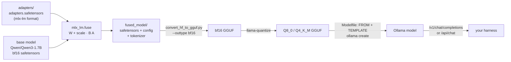

# Merge and serve in Ollama

## Why this matters

A fine-tune is only useful once you can serve it like any other model. This chapter closes the loop from training to your harness.

After [10.3](/part-10-modifying-serving-models/10.3-lora-mlx) you have a 17 MB folder called `adapters/` that only works inside mlx-lm, next to the exact base model it was trained against. Everything else you run (Ollama, your TypeScript agent, a harness, an editor plugin) wants a *model*: a name you pass in a request. Getting from one to the other is mostly plumbing, but the plumbing has three places where a fine-tune quietly stops being the model you evaluated: the merge rounds the weights, the quantizer rounds them again, and the serving layer builds the prompt with its own template, not the one you trained with. This chapter walks the pipeline and tells you where to look for each of those. The practice then asks you to prove, with numbers, that the model Ollama serves behaves like the one you measured in 10.3.

**Learning goals**

- Fuse LoRA adapters into the base model
- Convert and quantize the result
- Serve it in Ollama and use it from your harness

## Explanation

### The pipeline, and the fork at the start



Everything after `fused_model/` is the pipeline from [10.2](/part-10-modifying-serving-models/10.2-hf-to-gguf), unchanged. The new piece is the first box, and before using it you should know there is a second route that skips it.

### Fusing versus serving the adapter separately

LoRA gives you two ways to ship the result, and the choice is the first decision in this chapter.

| | **Fuse** (merge into the base) | **Serve the adapter separately** |
|---|---|---|
| What you ship | One ordinary model | The base model plus a small adapter file |
| Inference cost | Same as the base: no extra matrices | A small extra matmul per adapted layer, unless the server merges on load |
| Disk | A full copy of the model per fine-tune | One base, many tiny adapters |
| Swapping | Load a different model | Swap adapters on one loaded base |
| Failure mode | Rounding when the delta is added; a quantizer later rounds again | The adapter must match the base *exactly*, and the server must understand the adapter's format |
| Works with any engine | Yes, once it is a normal model | Only where the engine implements adapters |

The LoRA paper's argument for fusing is that the update is `W + BA`, which has the same shape as `W`, so merging adds no inference latency ([Hu et al.](https://arxiv.org/abs/2106.09685), abstract). Hugging Face's PEFT library offers exactly this as `merge_and_unload()` and says its point is to "eliminate latency" from loading the base model and adapter separately ([PEFT LoRA guide](https://huggingface.co/docs/peft/main/en/developer_guides/lora)). The same page warns that on a *quantized* base, merging re-quantizes the weight and repeated merge-and-unmerge cycles can accumulate rounding error. Remember that sentence; it comes back below.

Serving the adapter separately is the right call when you have many adapters over one base (one per customer or per task) and want to switch without keeping many copies of the weights in memory. Ollama has a hook for it, the `ADAPTER` instruction you met in [10.1](/part-10-modifying-serving-models/10.1-ollama-modelfile#adapter-attaching-a-lora). It has two problems for your case. The current Modelfile reference no longer documents `ADAPTER`; the last version of the page I could find that does is the [v0.5.7 tag](https://github.com/ollama/ollama/blob/v0.5.7/docs/modelfile.md#adapter), which listed Safetensors adapters for Llama, Mistral and Gemma families and GGUF adapters, and warned that a base other than the one the adapter was tuned from gives "erratic" behaviour. And the format does not line up with what mlx-lm writes. llama.cpp's [`convert_lora_to_gguf.py`](https://github.com/ggml-org/llama.cpp/blob/master/convert_lora_to_gguf.py) turns a Hugging Face PEFT adapter into a GGUF adapter, and its source looks for tensors named like `base_model.model.….lora_A.weight` next to an `adapter_model.safetensors`. mlx-lm's `LoRALinear` stores its factors under `lora_a` and `lora_b` and saves them as `adapters.safetensors` plus `adapter_config.json` ([lora.py](https://github.com/ml-explore/mlx-lm/blob/main/mlx_lm/tuner/lora.py), [tuner utils](https://github.com/ml-explore/mlx-lm/blob/main/mlx_lm/tuner/utils.py)). Those are different layouts (and, going by the class, different matrix orientations), and I found nothing in either project's documentation that translates between them. I read the sources but did not run this route, so treat "the mlx-lm adapter is not directly loadable by llama.cpp tooling" as my reading of the code, not as a tested fact.

For an adapter you trained on a Mac with mlx-lm, the practical route is therefore: **fuse in mlx-lm, then treat the result as an ordinary model.** That is what the rest of the chapter does.

(llama.cpp has its own merge tool, [`llama-export-lora`](https://github.com/ggml-org/llama.cpp/tree/master/tools/export-lora), which applies a GGUF adapter to a GGUF base. It is the right tool if you trained with PEFT/Transformers and converted the adapter, not for the mlx-lm adapters you have.)

### Fusing with `mlx_lm.fuse`

The command is short ([LoRA documentation, Fuse section](https://github.com/ml-explore/mlx-lm/blob/main/mlx_lm/LORA.md)):

```sh
uv run mlx_lm.fuse --model Qwen/Qwen3-1.7B --adapter-path adapters --save-path fused_model
```

It loads the base with the adapter attached and calls each adapted layer's `fuse()`. Reading [`fuse.py`](https://github.com/ml-explore/mlx-lm/blob/main/mlx_lm/fuse.py) and [`LoRALinear.fuse`](https://github.com/ml-explore/mlx-lm/blob/main/mlx_lm/tuner/lora.py) tells you exactly what happens, and it is the formula from 10.3:

```python
delta = ((self.scale * self.lora_b.T) @ self.lora_a.T).astype(weight.dtype)
fused_linear.weight = weight + delta
```

The delta is computed (in float32 or whatever the factors are stored in), **cast to the base weight's dtype**, then added. For a bf16 model the cast is the first rounding in this chapter: bf16 keeps 8 bits of significand precision, and when the delta is small relative to a weight, part of it disappears in the addition. The adapter you evaluated in 10.3 ran the *unfused* computation `W x + scale · B(A x)`, with no rounding of the sum into `W`. So "the fused model is the same model" is approximately true, and you will measure how approximately.

After the fuse, `fused_model/` holds the merged weights as safetensors, `config.json`, the tokenizer files, and a copy of `generation_config.json` and any `*.py` from the base ([`save`](https://github.com/ml-explore/mlx-lm/blob/main/mlx_lm/utils.py)). Note what is *not* in it: the adapter. Fusing is one-way.

Three details from the source worth knowing:

- **`--export-gguf` is not for you.** The fuse command can write a GGUF itself, but the documentation says support is "limited to Mistral, Mixtral, and Llama style models in fp16 precision", and the code raises an error for any `model_type` other than `llama`, `mixtral` or `mistral`. Qwen3 is none of those, so go through safetensors and llama.cpp's converter, which is the better-tested path anyway.
- **A quantized base stays quantized unless you say otherwise.** If the base is a 4-bit MLX model (the QLoRA setup in 10.3), `fuse()` dequantizes the weight, adds the delta, and then *re-quantizes* to the same bit width unless you pass `--dequantize`. That is the second rounding the PEFT page warned about, and the result is an MLX-format quantized checkpoint (`scales` and `biases` tensors) that llama.cpp's converter is not built to read. Even with `--dequantize`, the weights you get are "4-bit rounded base plus delta", so the 4-bit error of the base is baked in. And an adapter trained against a 4-bit base learned to compensate for *that* base's rounding, so fusing it into the original bf16 weights is a different model from the one you trained. Keep base and adapter paired. If you used the plain LoRA setup (bf16 base, as in the starter config), none of this applies.
- **`--model` must be the base you trained on.** The adapter's `adapter_config.json` records the rank, scale and which layers were adapted, but the command takes the base from `--model`. Pass a different checkpoint and you get a quiet mismatch, the same failure the Ollama doc calls "erratic".

📖 **Read now:** the **Fuse** section of the [mlx-lm LoRA documentation](https://github.com/ml-explore/mlx-lm/blob/main/mlx_lm/LORA.md) (docs, ~5 min, essential). **Look for:** the default adapter and output paths and the GGUF limitation. Then read [`mlx_lm/fuse.py`](https://github.com/ml-explore/mlx-lm/blob/main/mlx_lm/fuse.py) (repo, ~5 min, essential): about 100 lines, and the `--dequantize` and `--export-gguf` branches say what the documentation leaves out.

### Conversion after fine-tuning

`fused_model/` is, to llama.cpp, just another Hugging Face model directory. The conversion step is the one you ran in [10.2](/part-10-modifying-serving-models/10.2-hf-to-gguf#the-conversion-script):

```sh
python convert_hf_to_gguf.py fused_model --outtype bf16 --outfile qwen3-1.7b-commits-bf16.gguf
```

What can differ from converting a downloaded model:

- **Tensor names and shapes.** The converter renames tensors by architecture; it expects Hugging Face names. mlx-lm saves the model's parameters under the module paths of its own Qwen3 implementation, which for this family should match the Hugging Face layout, but you can verify instead of trusting: reuse your safetensors header reader from experiment 37 on `fused_model/model.safetensors` and compare five tensor names against the original shards. I did not run the conversion in this session, so this check is part of the practice.
- **The tokenizer and config come along.** `save` writes the tokenizer files and `config.json`, which is why the converter finds what it needs. If conversion complains about missing tokenizer files, that is where to look.
- **Do not skip the full-precision file.** Convert to `bf16`, quantize from that. This is the argument from 10.2, and it matters more here: the fused weights have already been rounded once.

If the converter reports an unsupported architecture the cause is the base model (as in 10.2), not the fine-tune. A LoRA fine-tune never changes the architecture.

### Quantizing a fine-tune

Quantizing is the same command as before: `llama-quantize qwen3-1.7b-commits-bf16.gguf qwen3-1.7b-commits-Q4_K_M.gguf Q4_K_M` (type names and their true bits per weight are in [1.12](/part-01-how-llms-work/1.12-quantization)). What is different about a *fine-tune* is what you are afraid of losing.

A LoRA delta is small by construction. It is a rank-8 correction added to matrices of rank up to 2048. Quantization is also a perturbation of every weight, of a size set by the block's scale (1.12). If the quantization error on a weight is of the same order as the delta you added, the quantizer can partly erase what the fine-tune learned. That is a hypothesis about *mechanism*, not a measured law: how much a given fine-tune survives depends on the model, the task, the rank and the quant type, and fine-tunes that change behaviour a lot (large `scale`, high learning rate) will survive better than subtle ones. This is why the right procedure is **measure the same thing at each precision**:

1. the tuned model unfused in mlx-lm (what you measured in 10.3),
2. the fused model in bf16 (checks the merge),
3. the Q8_0 GGUF in Ollama (checks conversion),
4. the Q4_K_M GGUF in Ollama (checks the quantizer).

Each step isolates one rounding. If the numbers fall between steps 1 and 2, the merge is lossier than you thought. If they fall between 3 and 4, the fine-tune does not survive 4 bits at this size and you ship Q8_0 or keep more precision. For measuring, your 10.3 `compare.py` metrics (first-line format, length, overlap with the real message) are the right instrument, since they target the behaviour you trained. Perplexity from `llama-perplexity` (10.2) on your `test.jsonl` text is a second, cheaper check, valid only for comparing files that share a tokenizer, which these do.

An importance matrix can help here, and your own data gives you a natural calibration set: `train.jsonl` rendered as text is on-distribution for what the model was tuned to do. Whether a matrix built from commit data improves the tuned model's behaviour at Q4_K_M is an empirical question and an optional stretch in the practice.

### Serving it in Ollama

Importing is the Modelfile route from 10.2: `FROM ./qwen3-1.7b-commits-Q8_0.gguf`, then `ollama create`. The import doc is explicit that "Ollama does not quantize GGUF models during import", so the precision you chose is the precision you serve ([Ollama: Importing a model](https://docs.ollama.com/import)).

The part specific to fine-tunes is the **template**, because a fine-tune is only good with the prompt format it was trained on.

- **At training time**, mlx-lm built each example with the tokenizer's Hugging Face chat template ([10.3](/part-10-modifying-serving-models/10.3-lora-mlx#dataset-formats)).
- **At serving time**, Ollama builds the prompt from the Go `TEMPLATE` in the Modelfile ([10.1](/part-10-modifying-serving-models/10.1-ollama-modelfile)), not from the Hugging Face one, even though the GGUF carries the Hugging Face template in its metadata.
- If you import with no `TEMPLATE`, whatever Ollama picks for your GGUF applies. The Hugging Face guide for pulling GGUFs from the Hub says a template is selected automatically from common ones where it can ([Hugging Face: Ollama](https://huggingface.co/docs/hub/ollama)); that covers a pulled model, and you should not assume the same for a local file. Look at the result with `ollama show --modelfile`.
- **Qwen3's thinking switch is where the two worlds meet.** In 10.3 you trained on examples with no reasoning block and generated with `enable_thinking=False`. In the stock `qwen3:14b` Modelfile on this machine (`ollama show --modelfile qwen3:14b`), the template appends an empty `<think>` block after the assistant header only when the request sets `think` to false: the branch is `if and $.IsThinkSet (not $.Think)`. A request that doesn't set `think` leaves the model free to start a reasoning block, which your fine-tune never saw. So the **harness has to send `think: false`** (the native API field, see the [chat API](https://docs.ollama.com/api/chat)) to reproduce the 10.3 setup, and the Modelfile's `TEMPLATE` has to come from the stock Qwen3 one, not a guess. How `think` behaves on the OpenAI-compatible endpoint is something to check on your Ollama version, not assume.

There is a check that removes the guesswork. Render one prompt yourself with the Hugging Face template (`tokenizer.apply_chat_template(messages, add_generation_prompt=True, enable_thinking=False)`), send that exact string to `/api/generate` with `raw: true`, which the [API reference](https://docs.ollama.com/api/generate) describes as returning the response "without any prompt templating", and compare it with the answer to the same messages through `/api/chat` with `think: false`. With `temperature: 0` and a fixed seed, equal prompts give equal text. If they differ, the Modelfile template does not reproduce your training format, and you have found the bug before blaming the quantization.

::: info 📖 Read now
[Ollama: Importing a model](https://docs.ollama.com/import) (Ollama docs) · docs · ~5 min · essential

You read it for 10.2. Read it again with this question: which of the two routes (Safetensors directory or GGUF) would let you skip llama.cpp for your fused model, and what do you give up? Look for: the sentence about quantization and the split-file wildcard.
:::

::: info 📖 Read now
[Ollama: API generate, the `raw` option](https://docs.ollama.com/api/generate) (Ollama docs) · docs · ~5 min · essential

Look for: the `raw` field, and the `think` field next to it. Together they let you bypass or control the template, which is what the template-parity check above needs.
:::

### Calling it from your harness

Once `ollama create` has succeeded, the model is a name like any other. Ollama exposes an OpenAI-compatible endpoint at `http://localhost:11434/v1/` ([OpenAI compatibility](https://docs.ollama.com/api/openai-compatibility)), so a harness that takes a base URL and a model name needs no code change: point it at the local server and pass your tag. The same is true of the agent loop you build in [3.2](/part-03-agents/3.2-agent-loop) and anything that follows it, if you wrote it against the same chat-completions shape.

Two cautions for a fine-tune.

- **It is a specialist.** Your 10.3 adapter learned a narrow task, and the tool-calling format that your harness's agent loop depends on is a different capability. Do not expect `qwen3:1.7b`-with-your-commit-style to drive tools better than the stock one; tool-call tokens come from the stock template, and a LoRA trained with none of them may or may not have kept the ability ([10.3](/part-10-modifying-serving-models/10.3-lora-mlx#what-lora-doesnt-do-learns-less-forgets-less) covers forgetting). Test it on the task it was built for, and test one unrelated prompt to see what you kept.
- **Serving parameters are part of the model.** Pin `num_ctx`, `temperature` and `seed` in the Modelfile or the request (the defaults differ from what your mlx-lm runs used), or you are again comparing noise. Context size is documented in [10.1](/part-10-modifying-serving-models/10.1-ollama-modelfile) and [1.9](/part-01-how-llms-work/1.9-kv-cache-context-window).

The evaluation habit from [Part 4](/part-04-evals-observability/4.3-code-based-checks) is what keeps this honest: the held-out `test.jsonl` and your scoring code from 10.3 are a fixed instrument, and the served model is one more thing to point it at. Which model to use for what, and what the whole local-versus-paid trade costs, belongs to [Landscape](/landscape#what-fits-in-24-gb-of-unified-memory) and Part 9, not here.

::: tip 📖 Read (optional)
[PEFT: LoRA developer guide, "Merge LoRA weights into the base model"](https://huggingface.co/docs/peft/main/en/developer_guides/lora) (Hugging Face) · docs · ~10 min · optional

Look for: `merge_and_unload()`, the note that it is not in-place, and the warning that merging into a quantized model re-quantizes. This is the PyTorch-side version of what `mlx_lm.fuse` does.
:::

::: tip 📖 Read (optional)
[llama.cpp: `convert_lora_to_gguf.py`](https://github.com/ggml-org/llama.cpp/blob/master/convert_lora_to_gguf.py) (llama.cpp) · repo · ~10 min · optional

Look for: the `lora_path` argument description (it names the PEFT files it expects), and the tensor-name rewriting near the top that strips `base_model.model.` and `.lora_A.weight`. It shows concretely why the mlx-lm adapter is a different format.
:::

::: tip 📖 Read (optional)
[llama.cpp: export-lora README](https://github.com/ggml-org/llama.cpp/tree/master/tools/export-lora) (llama.cpp) · docs · ~5 min · optional

Look for: `--lora-scaled`, which applies adapters with a user-chosen weight. That is the knob "serve adapters separately" gives you and a fused model cannot.
:::

::: info 📖 Read now
[Ollama: OpenAI compatibility](https://docs.ollama.com/api/openai-compatibility) (Ollama docs) · docs · ~5 min · essential

Look for: the base URL, which fields of chat completions are supported, and anything about tools and reasoning. You will point your harness at this.
:::

### What can go wrong

- **The fused model looks like the base.** The adapter wasn't loaded (wrong `--adapter-path`, or you fused into a differently named copy). Run the 10.3 generation once with the fused model and without the adapter, on a prompt where the adapter clearly mattered.
- **The fused model is gibberish.** Base and adapter don't match (a different checkpoint, or a QLoRA adapter fused into the bf16 weights).
- **Converter errors on `fused_model`.** Check for MLX-quantized tensors (`scales` and `biases`) from fusing a 4-bit base without `--dequantize`, then missing tokenizer files, then an unsupported architecture, in that order.
- **Ollama answers with stray tokens, ignores the system prompt, or starts "thinking".** Template and `think` (above). Not the quantization, as in 10.2.
- **Right style at bf16, drifted at Q4_K_M.** The fine-tune did not survive the quantizer. Try Q8_0, a larger rank or scale, or an imatrix, and measure each.
- **Disk.** Your original model, the fused safetensors, a bf16 GGUF and each quantized file are all separate copies. The sizes follow the arithmetic in 10.2, so delete intermediates once a stage is verified.

## Practice

**Brief:** Fuse the 10.3 adapter, convert to GGUF, quantize, import into Ollama with a Modelfile, and call it from `project/`.

**Where:** `experiments/38-lora/` (the folder from 10.3: your `adapters/`, `data/` and `compare.py` are the inputs). It is a standalone experiment, not a `project/` step, though the last step connects it to the agent you build in Part 3. The folder's README has a "10.4: merge and serve" section to fill in. There is no solution code here: the commands are in this chapter and the checks are yours to write. Reuse the llama.cpp clone and the `inspect` code from experiment 37 (`experiments/37-gguf/`) if you have them; if you do the experiments on separate machines, repeat 37's steps 1 and 2 first.

**Steps:**

1. **Predict.** In the README, before running anything: how many bytes will `fused_model/model.safetensors` take (shards count)? Will the fused bf16 model match the unfused tuned model on your `compare.py` metrics exactly, nearly, or visibly worse? Will Q4_K_M keep your style rules? Give a reason for each.
2. **Fuse.** `uv run mlx_lm.fuse --model Qwen/Qwen3-1.7B --adapter-path adapters --save-path fused_model`. Read the log, list the folder, and compare its size with the base model and with `adapters/`. Confirm the adapter is *not* in `fused_model/`.
3. **Check the merge in MLX first.** Generate with `mlx_lm.generate` (thinking disabled, as in 10.3) from the unfused setup (`--adapter-path adapters`) and from `fused_model` on at least ten test prompts at temperature 0. Count how many outputs are identical, and read the first difference in the rest. This is the cast-to-bf16 rounding made visible. Run your `compare.py` metrics on the fused model too (you may need to add a `--model` option; that code is yours).
4. **Inspect and convert.** Read the safetensors header of `fused_model/model.safetensors` with your 37 code and compare five tensor names and shapes with the original `Qwen/Qwen3-1.7B` shards. Then convert with `convert_hf_to_gguf.py --outtype bf16`. If the converter complains, say in the README what and why.
5. **Quantize twice.** `llama-quantize` to `Q8_0` and `Q4_K_M` from the bf16 file. Record file sizes and the true bits per weight.
6. **Import.** Write a Modelfile for each, taking `TEMPLATE`, `stop` and sampling `PARAMETER` lines from the stock `qwen3:1.7b` (`ollama show --modelfile qwen3:1.7b`; pull it first if you do not have it), and pin `num_ctx`. `ollama create commit-style-q8` and `commit-style-q4`. Check with `ollama show --modelfile` and `ollama run`.
7. **Template parity.** Take three test diffs. Render the prompt with the Hugging Face template (thinking disabled), send it with `raw: true` to `/api/generate`, and send the same messages to `/api/chat` with `think: false`. Compare at `temperature: 0`. Then send the chat request *without* `think` and see what changes. Record all three.
8. **Measure the four stages.** Run your 10.3 scoring over the whole test set for: unfused tuned (from 10.3), fused bf16 (step 3), Q8_0 in Ollama, Q4_K_M in Ollama, plus the stock `qwen3:1.7b` as the floor. One table, same prompts, thinking off, `temperature: 0`, fixed seed. For the Ollama models write the harness side in TypeScript: a small script (or a step in `project/` if you have built the Part 3 agent) that reads `test.jsonl`, calls `http://localhost:11434/v1/chat/completions` (or `/api/chat`), and feeds the answers to the same scoring logic. You may port the scoring to TypeScript or save the outputs as JSONL and score them with `compare.py`; either is fine, but say which in the README.
9. **Attribute the drop.** Say which step of the table, if any, costs the most, and whether that matches your step 1 prediction. State how many test examples you used and what difference you would count as noise.
10. **Use it.** Ask your fine-tune for a commit message for a real diff in a repo you are working on, from your agent or from `ollama run`. Then ask it one unrelated question and one question that needs a tool call (if your agent has tools). Write two sentences on what it kept and what it lost.
11. **Optional stretch, imatrix on your own data:** render `train.jsonl` as text, run `llama-imatrix` on the bf16 file, quantize a third `Q4_K_M` with `--imatrix`, and add it to the table.
12. **Optional stretch, serve the adapter separately:** convert your adapter's weights into PEFT naming and shape yourself, run `convert_lora_to_gguf.py`, and attach it with `ADAPTER` (or `llama-export-lora`) on top of the stock `qwen3:1.7b` GGUF. You are on your own for the weight conversion, since neither tool documents it. Report honestly whether it worked and whether `ollama show` reflects the adapter.

**Done when:**

- `fused_model/`, the bf16 GGUF, the Q8_0 and Q4_K_M GGUFs exist, and `ollama list` shows both imported models.
- The README holds your predictions from before step 2.
- Step 3 reports how many of the ten prompts produce identical text in fused and unfused form, and what the first difference looks like.
- Step 7 shows whether the Modelfile template reproduces the Hugging Face prompt, with the `think` behaviour recorded.
- One table has the five rows of step 8 and your metrics, with sample size stated.
- A script of yours calls the Ollama-served model over HTTP from TypeScript and runs on the test set.
- You can explain, without notes, where each of the three roundings or format changes (fuse cast, quantizer, template) can change the model's behaviour and which measurement exposes it.

Cost: free, local only. No paid API calls.

## Check questions

1. Why does the chapter fuse in mlx-lm and then convert the *merged model*, rather than converting the adapter to GGUF and attaching it with `ADAPTER`?

   <details><summary>Answer</summary>

   The tooling for separate adapters expects Hugging Face PEFT format. llama.cpp's `convert_lora_to_gguf.py` looks for `adapter_model.safetensors` with tensors named `…lora_A.weight` and `…lora_B.weight`, while mlx-lm saves `adapters.safetensors` with its own `lora_a` and `lora_b` names. Neither project documents a translation between them. Ollama's `ADAPTER` documentation (last present at the v0.5.7 tag) also listed only certain model families and requires the base to be exactly the one the adapter was tuned from. A fused model is an ordinary Hugging Face model directory, so the whole 10.2 pipeline applies unchanged.
   </details>

2. `mlx_lm.fuse` computes `W + (scale · B A)` and casts the delta to the weight's dtype before adding. Why might the fused model's outputs differ slightly from the adapter-attached model's, and how would you detect it?

   <details><summary>Answer</summary>

   The adapter-attached model computes `W x + scale · B(A x)` without ever rounding the update into `W`. The fused model rounds the sum into bf16, so small deltas lose low-order bits and some outputs diverge, especially after many tokens of greedy decoding. Detect it by generating from both at temperature 0 on the same prompts and counting identical outputs, then comparing your task metrics. Most of the time you expect near-identical behaviour with the occasional different token; a large metric gap would point to a mismatch (wrong base, wrong adapter path) instead of rounding.
   </details>

3. You trained with QLoRA on `mlx-community/Qwen3-1.7B-4bit` and now want a GGUF. What goes wrong if you just run `mlx_lm.fuse` with defaults and hand the result to `convert_hf_to_gguf.py`, and what does `--dequantize` fix and not fix?

   <details><summary>Answer</summary>

   Without `--dequantize`, the fuse dequantizes each layer, adds the delta and re-quantizes to MLX's 4-bit format, producing `scales` and `biases` tensors the llama.cpp converter is not built to read, plus a second rounding. `--dequantize` gives plain 16-bit weights, which the converter can read. It does not undo the 4-bit rounding of the base that the adapter was trained against: the weights are "4-bit base plus delta", and a later `llama-quantize` rounds them again. The adapter is also tied to the 4-bit base it learned to correct, so fusing it into the original bf16 weights would be a different model from the one you evaluated.
   </details>

4. Your Q8_0 import gives the style you trained, Q4_K_M drifts back toward generic commit messages. Name the mechanism that could explain it, one thing to try, and one thing that would *not* help.

   <details><summary>Answer</summary>

   A LoRA delta is a small, low-rank correction; 4-bit rounding noise on each weight can be of the same order, partly erasing it. Things to try: serve Q8_0 (or a larger K-quant), quantize with an importance matrix computed on your own training text, or retrain with a larger scale or learning rate so the delta is bigger relative to the rounding. Re-running `ollama create` with different `PARAMETER` values would not help: Ollama does not quantize during import, and the weights are what the quantizer produced. (Before blaming quantization, rule out the template, as in the next question.)
   </details>

5. The imported fine-tune answers fine through `ollama run` but, when your TypeScript script sends it the same messages through the OpenAI-compatible endpoint, it starts with a long reasoning block and ignores the style. Where do you look, and what check separates the possible causes?

   <details><summary>Answer</summary>

   At the prompt Ollama actually builds. Training used the Hugging Face chat template with thinking disabled; Ollama builds the prompt from the Modelfile's `TEMPLATE`, and in the stock Qwen3 template the empty think block is added only when the request sets `think` to false. A request that doesn't set it leaves the model free to reason, which the fine-tune never saw. The parity check: render the prompt yourself with `enable_thinking=False`, send it with `raw: true` to `/api/generate`, compare with `/api/chat` with `think: false` at temperature 0 and a fixed seed, then repeat the chat request without `think`. If raw and templated chat agree, the template is right and the harness must pass `think: false`. If they disagree, fix the `TEMPLATE`.
   </details>

## My understanding

<!-- Written by the learner, in their own words. Agents never fill this in. -->
