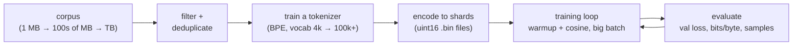

# Training from scratch

## Why this matters

In [1.13](/part-01-how-llms-work/1.13-tiny-gpt) you trained an 11-million-parameter GPT on a megabyte of Shakespeare, one token per character, for twenty minutes. Every real pretraining run does the same loop with four things changed: a real tokenizer, orders of magnitude more data, a training schedule that makes the compute count, and an evaluation setup that tells you whether it is working before you have spent the money. This chapter changes those four things one at a time on your own machine, so that "pretraining" stops being a phrase and becomes a number you can estimate: how many FLOPs, how many hours, how many dollars.

It also answers a practical question for this part of the book. After [10.3](/part-10-modifying-serving-models/10.3-lora-mlx) you know how to adapt a model somebody else trained. Here you see what that model cost its authors, and why almost nobody trains one from scratch.

**Learning goals**

- Scale the tiny GPT with a real tokenizer and a bigger corpus
- Track loss and evaluate samples
- Estimate what a real pretraining run would cost

## Explanation

The 1.13 pipeline had four stages: text, tokens, batches, loss. Scaling up changes the *contents* of each stage, not the shape.



### Tokenizer choice

[1.2](/part-01-how-llms-work/1.2-tokenization) explained byte-pair encoding. Here the question is what choosing a tokenizer does to *training*.

**What the vocabulary size trades.** A bigger vocabulary packs more text into each token, so the same corpus is fewer tokens and each training step covers more text. The costs: the embedding table and the output head both have `vocab × d_model` parameters, and the softmax is over more entries. Rare tokens appear few times in training, so their embeddings are poorly trained. With the 1.13 model (`d_model = 384`), a 65-character vocabulary costs 25k parameters per table, a 4,096-token one 1.6M, and GPT-2's 50,257 would cost 19M, more than the entire transformer stack of the tiny model (10.6M). That is why small models use small vocabularies, and why large ones, where the stack is billions of parameters, can afford 100k+.

The other half of the trade is sequence length. The same text in characters is several times as many positions as in BPE tokens (you will measure your own ratio). A context window of 256 characters is a few sentences, while 256 BPE tokens is a paragraph or two. With attention's `T²` cost (1.4), tokens are a cheaper way to see more text per FLOP.

**Train it on your training data, byte-level.** A tokenizer is a tiny model trained on a corpus, so use the same corpus (the training part only: a tokenizer that has seen the validation text flatters the validation loss slightly). Make it byte-level, as in 1.2, so no input is ever out of vocabulary. Add an end-of-text token and put it between documents, so the model learns that a story ends and an unrelated one starts. In the experiment you use the Hugging Face [`tokenizers`](https://huggingface.co/docs/tokenizers/index) library, which trains BPE in seconds on hundreds of megabytes.

**Losses stop being comparable.** This is the trap of the chapter. Cross-entropy is measured *per token*, and a token now means something different. The 1.13 run's 1.47 nats per *character* and a BPE run's 3.0 nats per *token* are not "worse" or "better" than each other. Two fixes:

- **Bits per byte (bpb).** Convert the loss into the code length of the raw text: `bpb = (loss_in_nats ÷ ln 2) × (tokens ÷ bytes)`. The best validation loss that the [nanoGPT](https://github.com/karpathy/nanoGPT) README reports for this model and corpus, 1.4697 nats per character, is `1.4697 ÷ 0.693 ≈ 2.12` bits per byte (Shakespeare is plain ASCII, one byte per character). A BPE model with 3.0 nats per token and 4 bytes per token is at `3.0 ÷ 0.693 ÷ 4 ≈ 1.08` bits per byte: on a different corpus, so you can say nothing about the two, but on the *same* corpus bpb is the comparison that survives a change of tokenizer.
- **Same corpus, different tokenizer.** The cleanest experiment: train both the character model and the BPE model on the same Shakespeare text, and compare bpb.

Perplexity, `exp(loss)` (see the Glossary), inherits the problem: it is per token.

### Data preparation at scale

Pretraining data work is mostly not machine learning. For a web corpus the steps are: extract text from HTML, filter (language, quality, length, boilerplate), deduplicate (exact and near-duplicate), tokenize, shuffle, and write out shards. The [FineWeb](https://huggingface.co/datasets/HuggingFaceFW/fineweb) dataset card describes its data as "cleaned and deduplicated english web data from CommonCrawl", processed with HuggingFace's `datatrove` library, and its paper ([The FineWeb Datasets](https://arxiv.org/abs/2406.17557)) is largely about which filters raise the quality of the models trained on it. The lesson for you: at scale, *what is in the data* moves the result as much as the model, and the filtering decisions are the least glamorous, most valuable part of the job.

Three mechanics matter even at laptop scale:

- **Split by document, not by random chunk.** Neighbouring text is correlated (1.13), and duplicates leak. If the same story is in train and validation, validation loss measures memorization. Hold out whole documents, or use the validation file the dataset gives you.
- **Store tokens, not text.** Tokenize once, write a flat array of ids. A token id must fit its storage type: `uint16` holds up to 65,535, enough for GPT-2's 50,257-token vocabulary, which is why nanoGPT and build-nanogpt store `uint16` shards (the README of [nanoGPT](https://github.com/karpathy/nanoGPT) says its `train.bin` "holds the GPT2 BPE token ids in one sequence, stored as raw uint16 bytes"). Larger vocabularies need `uint32`.
- **Shard and memory-map.** build-nanogpt's [`fineweb.py`](https://github.com/karpathy/build-nanogpt/blob/master/fineweb.py) tokenizes a 10-billion-token FineWeb-Edu sample into 100 shards of 100 million tokens each, with an end-of-text token before every document, and the training loop reads shards one at a time. `np.memmap`, which `train.py` in 1.13 already uses, is the same idea for one file.

**What to train on at laptop scale.** [TinyStories](https://arxiv.org/abs/2305.07759) (Eldan and Li) is a synthetic dataset of short stories using a small vocabulary, written by GPT-3.5 and GPT-4. Its premise fits this chapter: the paper's abstract notes that models with around 125M parameters "can rarely generate coherent and consistent English text beyond a few words even after extensive training" on ordinary web text, and asks whether coherence needs scale. With a narrow, clean distribution, small models do much better. The dataset's [Hugging Face page](https://huggingface.co/datasets/roneneldan/TinyStories) lists the files, including `TinyStoriesV2-GPT4-train.txt` (about 2.2 GB, GPT-4 generations only) and a validation file of about 22 MB. For a first scaled run you take the first few hundred megabytes. Because it is so uniform, you will *see* the model's progress in samples, which is the point. Remember the corollary: TinyStories is much easier than web text, so its losses say nothing about how a model would do on the web.

### Training efficiency on MPS

At 1.13 scale you didn't need tricks. With ten times more steps you start to care about tokens per second, the number to watch. Print it. Everything else follows from it: `time = tokens ÷ (tokens per second)`.

What the real recipes add, and what to try on the M4:

- **Batch size in tokens, and gradient accumulation.** Your batch is `batch_size × block_size` tokens per step (1.13: 64 × 256 = 16,384). Large runs use batches of hundreds of thousands to millions of tokens because gradient noise falls with batch size. If a batch doesn't fit in memory, run several smaller *micro-batches*, add up their gradients, and take one optimizer step: gradient accumulation. build-nanogpt's [`train_gpt2.py`](https://github.com/karpathy/build-nanogpt/blob/master/train_gpt2.py) asks for `total_batch_size = 524288` tokens (2¹⁹) and computes the number of accumulation steps from the micro-batch size. Remember to divide each micro-batch's loss by the number of accumulation steps.
- **A learning-rate schedule.** Ramp the rate up linearly over the first steps (warmup), then decay it along a cosine to a fraction of the peak. The 1.13 `train.py` used a constant rate. build-nanogpt does warmup for 715 steps and cosine decay for the rest of 19,073. Warmup protects the early steps, when the weights are random and gradients are wild; decay lets the model settle into a minimum at the end. This alone usually gives a visibly lower final loss.
- **Weight decay on matrices only.** build-nanogpt applies weight decay 0.1 to matrix weights and none to biases and norm parameters. Cheap to try.
- **Tied embeddings.** build-nanogpt shares the token-embedding matrix with the output head (`wte.weight = lm_head.weight`). That removes `vocab × d_model` parameters, which matters more at a 4,096-token vocabulary than at 65.
- **Lower precision.** Real runs use bfloat16 for most of the math. build-nanogpt wraps the forward pass in `torch.autocast(..., dtype=torch.bfloat16)`, and its README notes that on Apple Silicon the `mps` device type ends up treated as CPU there, with the author "not 100% sure this is the intended PyTorch way". Whether autocast to bf16 or `torch.compile` speeds up *your* model on MPS is something to measure, not assume: try each for 100 steps and compare tokens per second. Raschka's [chapter 5 bonus folders](https://github.com/rasbt/LLMs-from-scratch/tree/main/ch05) include `10_llm-training-speed` (PyTorch performance tips) and `19_cpu_mps_differences` (places where CPU and MPS differ), both worth skimming before you spend an hour on a run.
- **Fused attention.** `torch.nn.functional.scaled_dot_product_attention` replaces your explicit scores-mask-softmax code with one optimized kernel. Keep your explicit version as the reference and check the logits match.

**Don't tune blind.** Change one thing, run 200 steps, compare tokens per second *and* loss at the same step. A faster loop that trains worse is not faster.

### Evaluation during training

You can't wait for a run to finish to learn it was broken, and a loss number alone hides things. Evaluate on three levels, all cheap:

1. **Validation loss on a fixed set**, every N steps, averaged over enough batches (1.13's `eval_batches = 50`) that noise doesn't mislead you. Report it as bits per byte too. Keep the *best* checkpoint, not the last, as `train.py` does. Compare against the training loss: the gap is your overfitting meter.
2. **Fixed-prompt samples.** Every N steps, sample from the same three or four prompts with the same seed and temperature, and write them to a log. Because only the weights change between samples, you can read progress as a story: noise, word shapes, grammar, then coherence. Loss decides *whether* the model is improving; samples show *what kind* of improvement it is. At TinyStories scale, watch for the moment a story keeps a character's name for more than a sentence.
3. **Downstream benchmarks, when the model is big enough.** build-nanogpt evaluates [HellaSwag](https://github.com/karpathy/build-nanogpt/blob/master/hellaswag.py) accuracy during training (its `train_gpt2.py` imports it), because at 124M parameters, validation loss alone doesn't tell you the model has the abilities people care about. That is why it isn't part of this experiment: you judge your small model by loss and samples.

Expect these failure modes, all visible in the logs: loss at step 0 far from `ln(vocab)` (a bug, 1.13), loss going to `nan` (learning rate too high, or float problems), training loss falling while validation stays flat (overfitting, or leakage if it's *too* good), a sudden spike (a bad batch: clipping helps).

### Compute estimates

Training cost is easy to estimate and unforgiving. The rule, from [1.6](/part-01-how-llms-work/1.6-pretraining) (Kaplan et al.'s accounting): training takes about **`6 · N · D` FLOPs** for `N` parameters and `D` training tokens. Count the matrices a token goes through (blocks and the output head), not the embedding lookup tables. It ignores the attention-score FLOPs, which at 1.13's `T = 256` add roughly 5–10% (Kaplan et al.'s forward-pass count is `2N + 2 · layers · T · d_model` per token, so about `6 · layers · T · d_model` on top of `6N` for training).

**Calibrate with your own run.** The 1.13 reference run: `N ≈ 10.7M` (blocks plus head), `D = 3,000 × 64 × 256 = 49.2M` tokens. That is `6 × 10.7M × 49.2M ≈ 3.2 × 10¹⁵` FLOPs in about 20 minutes (1,200 s), so the M4 Pro delivered roughly **2.6 × 10¹² FLOP/s** on that model: 2.6 TFLOP/s. (Both numbers come from the reference run described in 1.13, a lower bound since attention FLOPs are left out. Your own measured tokens per second gives your own figure.)

**Predict the new run.** A 4,096-token vocabulary adds a `4096 × 384` output head: `N ≈ 12.2M`. At 10,000 steps of 16,384 tokens, `D ≈ 164M`:

```
C = 6 × 12.2e6 × 1.64e8 ≈ 1.2e16 FLOPs
time ≈ 1.2e16 ÷ 2.6e12 ≈ 4,600 s ≈ 77 minutes
```

Check this against your first 100 steps before you start the long run: if the estimate and the measurement disagree by more than 2×, find out why.

**Is that enough data?** [1.6](/part-01-how-llms-work/1.6-pretraining) gives the compute-optimal rule of thumb of about 20 tokens per parameter. For a model of about 14M parameters in total, that is about 280M tokens; your 164M is in the right region. The 1.13 run saw 49M tokens of a 1M-token corpus: about 49 passes over the same text, which is why it started to memorize. At 164M tokens of a corpus that is several times larger, you pass over it only a few times.

**Now scale it up.** GPT-2 small is 124M parameters. build-nanogpt trains it on 10B tokens (its `train_gpt2.py` sets 19,073 steps of 524,288 tokens). Then:

```
C = 6 × 1.24e8 × 1.0e10 ≈ 7.4e18 FLOPs
on this Mac: 7.4e18 ÷ 2.6e12 ≈ 2.9e6 s ≈ 33 days
```

That is about 600 times the compute of your 77-minute run. The build-nanogpt README says reproducing GPT-2 (124M) "is a matter of ~1hr and ~$10" on a cloud GPU box, in 2024 terms (it calls GPT-2 "~5 years ago", so it was written around 2024); the gap between 33 days and an hour is the difference between one consumer chip and a rented multi-GPU node, so the rental cost follows this formula:

```
GPU-hours = FLOPs ÷ (peak FLOP/s per GPU × utilization) ÷ 3600
cost      = GPU-hours × price per GPU-hour
```

Utilization (often called MFU, model FLOPs utilization) is the fraction of the chip's peak you actually use, typically well under 100%. Look up a current GPU rental price and a GPU's peak figures at the time you do the estimate; neither belongs in a chapter, and this book keeps model and API prices on [Landscape](/landscape).

For frontier models, plug in the numbers in [1.6](/part-01-how-llms-work/1.6-pretraining): parameters in the tens or hundreds of billions and trillions of tokens give 10²⁴ FLOPs and up, millions of GPU-hours, before counting failed runs, data work, the post-training of [1.7](/part-01-how-llms-work/1.7-post-training) and the people. The estimate is the reason the answer to "should we train our own?" is almost always "adapt an open-weight model" ([10.3](/part-10-modifying-serving-models/10.3-lora-mlx)), and "train from scratch" is for learning, for tiny specialised models on data nobody else has, and for labs.

::: info 📖 Read now
[Let's reproduce GPT-2 (124M)](https://www.youtube.com/watch?v=l8pRSuU81PU) (Karpathy) · video · ~4 h · **optional**

The lecture that goes with build-nanogpt: from an empty file to a GPT-2 (124M) reproduction, including the learning-rate schedule, gradient accumulation, mixed precision and the evaluation setup used above. You won't run a multi-GPU job, so watch it for the choices and the reasons: the order of the optimizations, what each did to the loss and the throughput, and how he sizes the batch. If four hours is too much, take the training-loop and optimization sections.
:::

::: tip 📖 Read now
[karpathy/build-nanogpt](https://github.com/karpathy/build-nanogpt) · repo · ~30 min · **essential**

Read `train_gpt2.py` and `fineweb.py` after your first scaled run, and diff them against yours. Look for: how `total_batch_size` becomes accumulation steps, the schedule function, which parameters get weight decay, the shard loader, and what it prints every step (loss, learning rate, gradient norm, tokens per second). The git history is deliberately step by step, so you can walk through it commit by commit. The README says outright that this covers pretraining only, not chat fine-tuning.
:::

::: tip 📖 Read now
[TinyStories: How Small Can Language Models Be and Still Speak Coherent English?](https://arxiv.org/abs/2305.07759) (paper, Eldan and Li, 2023) · paper · ~20 min · **essential**

The source of the dataset you train on. Look for: how they generate the stories and why a restricted vocabulary matters, how they evaluate the output (GPT-4 grades the stories like a teacher grading students' writing), and what they find about how small a model can get and still write fluent stories.
:::

::: tip 📖 Read now
[The FineWeb Datasets: Decanting the Web for the Finest Text Data at Scale](https://arxiv.org/abs/2406.17557) (paper, Penedo et al., 2024) · paper · ~30 min · **optional**

What data preparation at scale looks like. Skim the pipeline, then read the sections on deduplication and on how they judged each filter (training small models and comparing benchmark scores). The [dataset card](https://huggingface.co/datasets/HuggingFaceFW/fineweb) lists the sample sizes, if you want to try a 10-billion-token sample on a rented GPU one day.
:::

::: tip 📕 Book
Sebastian Raschka, *Build a Large Language Model (From Scratch)*, ch. 5 "Pretraining on Unlabeled Data" ([code: ch05](https://github.com/rasbt/LLMs-from-scratch/tree/main/ch05)) · book · ~2 h · **optional**

The training loop, loss evaluation and decoding as a notebook. The repo's bonus folders go beyond the book: `03_bonus_pretraining_on_gutenberg` (longer pretraining on books), `04_learning_rate_schedulers` (warmup, cosine, gradient clipping), `09_extending-tokenizers` (the GPT-2 BPE tokenizer from scratch), and the MPS notes mentioned above.
:::

::: tip 📖 Read now
[Hugging Face Tokenizers documentation](https://huggingface.co/docs/tokenizers/index) · docs · ~15 min · **optional**

The library `prepare_bpe.py` uses. Look for the quicktour's pipeline stages (including the pre-tokenizer and post-processor) and the `BpeTrainer`, then map each stage to the BPE steps of 1.2.
:::

## Practice

**Brief:** Extend the 1.13 experiment in three runs: the same Shakespeare with a BPE tokenizer (to isolate the tokenizer), then a BPE model on a larger corpus (TinyStories) trained longer with a schedule, and a compute estimate for each. Compare loss, bits per byte and samples against the 1.13 run. You write the training script and the tokenizer glue; `prepare_bpe.py` is a starter with four TODOs.

**Where:** `experiments/13-tiny-gpt/`: the same folder as 1.13, with new files next to the old ones so the 1.13 run stays your baseline. The folder README has a "Part 2 (chapter 10.5)" section with the result tables to fill in. Free: everything runs locally; log €0 in `costs.md`.

**Steps:**

1. **Baseline.** Have your 1.13 run's numbers ready: best validation loss, time per step, the final checkpoint's samples. If you no longer have them, rerun `train.py` with the defaults. Compute its bits per byte.
2. **Predict**, in the README: bytes per token for a 4,096-token BPE vocabulary on stories, step-0 loss, time per step, the compute (`6 · N · D`) of your long run, and which of tokenizer, data or steps will lower the validation bits per byte most.
3. **Tokenizer.** Fill in the TODOs in `prepare_bpe.py` and run it. Print the first and last tokens of the vocabulary: what were the first merges, and what are the last ones? Record the bytes per token in the validation set.
4. **Isolate the tokenizer.** Adapt `prepare_bpe.py` to read the 1.13 Shakespeare file (`data/input.txt`), with a vocabulary of about 1,024 (a smaller vocabulary suits a 1 MB corpus), and write to a separate folder. Copy `train.py` to `train_bpe.py` and make it read `meta.json` for the vocabulary size and the folder. Train the same model for the same number of steps. Compare validation **bits per byte** with the 1.13 run. Did BPE help on the same text? Why might it have started to overfit sooner?
5. **Upgrade the loop** in `train_bpe.py`: warmup plus cosine decay, a printed tokens-per-second, bits per byte in every evaluation, and every evaluation sampling from the same fixed prompts with a fixed seed (write them to `out_bpe/samples.txt`). Then change one thing at a time and keep what helps: weight decay on matrices only, tied embeddings, `scaled_dot_product_attention`, bf16 autocast, `torch.compile`. Measure each for 100 steps (tokens per second and loss), and write down which ones the MPS backend accepted.
6. **Scale run.** Point `train_bpe.py` at the TinyStories data. Check the 100-step speed against your estimate from step 2. Start with 10,000 steps (an hour or more: leave the Mac alone, and keep the power on). Keep the best checkpoint.
7. **Sample and compare.** Write `sample_bpe.py` (a copy of `sample.py` that decodes with `tokenizer.json`). Sample from an early and the final checkpoint, at three temperatures, and put them next to 1.13's samples. Describe the difference in kind, not just in degree.
8. **Estimate.** Fill in the compute table: FLOPs of your run, measured FLOP/s, time to train a 124M-parameter model on 10B tokens on this Mac, and the cost on a rented GPU with prices you looked up today (write down the date and the source). State how many times more compute that is than your run.
9. **Explain**, in the README: which change moved the validation loss most? Why can't the 1.13 loss be compared with this run's directly? What did the samples gain that the loss doesn't show?

**Done when:**

- `prepare_bpe.py` trains a tokenizer and writes train and validation `.bin` files, and you have the bytes per token for the validation set.
- You have 1.13 and BPE bits per byte on the **same** Shakespeare text and an explanation of the difference.
- The long run finished with a loss plot (or table) that includes the learning-rate schedule effect, the best validation loss in nats per token and bits per byte, and the tokens per second you measured.
- The README has fixed-prompt samples from at least two checkpoints of the scale run, and a side-by-side with the 1.13 run.
- Your compute estimate is within 2× of the measured time, or you can explain the gap.
- The Why section answers step 9.

**Stretch:** raise the vocabulary to 8,192 and 16,384 and look at bits per byte against the parameter cost of the larger tables; train on a 1 GB slice; or try a 10-million-token slice of FineWeb with its own tokenizer and see how much harder real web text is than stories.

## Check questions

1. Your BPE run reports a validation loss of 3.1 nats per token, and your 1.13 character model reported 1.5 nats per character. A teammate says the character model is twice as good. What is wrong with that, and what would you compute instead?

   <details><summary>Answer</summary>

   The two losses are averages over different units: a BPE token covers several characters, so a per-token loss is naturally larger and a per-character loss smaller. Convert both to **bits per byte**, `(loss ÷ ln 2) × (tokens ÷ bytes)`, on the *same* text: for the character model that is `1.5 ÷ 0.693 ≈ 2.2`; for the BPE model with, say, 4 bytes per token, `3.1 ÷ 0.693 ÷ 4 ≈ 1.1`. Even then the numbers compare only if both were evaluated on the same validation text. Different corpora make the comparison meaningless.
   </details>

2. A model with `d_model = 384` and six blocks (10.6M parameters in the blocks) gets a 50,257-token vocabulary. Why do the embedding table and output head together outweigh all six blocks, and what does the bigger vocabulary buy in return?

   <details><summary>Answer</summary>

   Each of the two tables has `vocab × d_model` entries: `50,257 × 384 ≈ 19.3M` each, so about 38.6M for both (less if tied), against about 10.6M for six blocks. A larger vocabulary compresses text into fewer tokens, so each step and each position in the context covers more text, and attention's `T²` cost applies to fewer positions. The price is the table size and rarely seen tokens with poorly trained embeddings, which is why small models use small vocabularies.
   </details>

3. You estimate a run at `6 · N · D` FLOPs and divide by the FLOP/s you measured earlier. The run takes 1.8× longer than predicted. Give two plausible reasons, none of which is "the formula is wrong".

   <details><summary>Answer</summary>

   (a) The formula leaves out the attention-score FLOPs, which grow with the context length, so a longer `block_size` than in the calibration run lowers the effective throughput. (b) The new model has a different shape: a bigger vocabulary head, or a different ratio of matrix size to overhead, changes how well it fills the GPU, so the FLOP/s measured on another model doesn't transfer. Others: evaluation and sampling time, checkpoint writes, data loading, a laptop throttling thermally, other processes. The fix is to measure tokens per second on the *new* configuration for 100 steps and extrapolate from that.
   </details>

4. Why does the training loop warm up the learning rate and then decay it, instead of keeping 3e-4 constant as 1.13 did?

   <details><summary>Answer</summary>

   At the start the weights are random and gradients are large and noisy, so a full-size step can push the model somewhere bad; warmup ramps the rate up while the model finds a reasonable region. Late in training, a large constant rate keeps the weights bouncing around the minimum with the noise of each batch; decaying (cosine to a fraction of the peak) lets them settle, which usually gives a visibly lower final loss at the same number of steps.
   </details>

5. After TinyStories training, the validation loss is a few percent better than the previous checkpoint, yet the fixed-prompt samples look the same. Another checkpoint gets the same loss and its samples are much more coherent. What do you conclude about using loss and samples together?

   <details><summary>Answer</summary>

   Loss is an average over every token, and most tokens are easy (punctuation, word endings), so a small change in average loss can come from either easy or hard tokens. Samples show whether the *hard* predictions improved: names kept across sentences, a plot that ends. Neither is sufficient alone. Loss is the number you optimise and compare precisely; fixed-prompt samples with a fixed seed catch the kind of improvement (or regression) that the average hides. Use both, and look at samples every time you look at the curve.
   </details>

## My understanding

<!-- Written by the learner, in their own words. Agents never fill this in. -->
