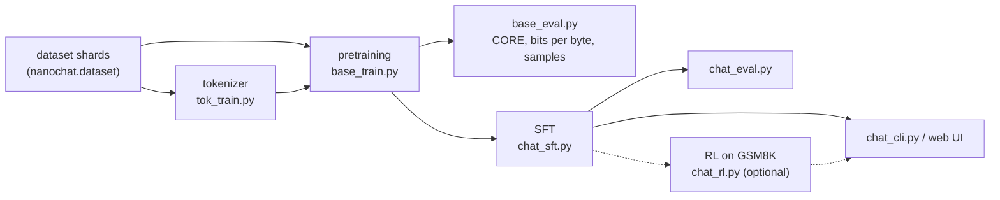

# nanochat

## Why this matters

In [10.5](/part-10-modifying-serving-models/10.5-training-from-scratch) you scaled your tiny GPT up by hand: a real tokenizer, a bigger corpus, a schedule, and an estimate of what a bigger run would cost. [nanochat](https://github.com/karpathy/nanochat) is the same journey finished. Its README calls it "the simplest experimental harness for training LLMs", with a codebase that is "minimal/hackable" and covers "all major LLM stages including tokenization, pretraining, finetuning, evaluation, and inference". One repository takes you from raw web text to a model you chat with in a terminal.

It is the best way to tie Part 1 to Part 10. Each stage of the pipeline is a chapter you have already read, written as PyTorch instead of prose. Reading it answers "what does the real thing look like?" at a size you can hold in your head. Running it tells you what the real thing costs.

This chapter is **Deeper**: you can skip it without losing anything in the Core path. Nothing here is a tool you will use at work; its value is understanding.

**Learning goals**

- Walk through every stage of nanochat
- Run what fits on your hardware (or rent a GPU briefly)
- Map each stage to the Part 1 chapters

## Explanation

::: warning This repository moves
nanochat is a research codebase under daily change. Its README, its own `dev/LEADERBOARD.md` and its scripts disagree in places (for example, the leaderboard doc says the default tokens-to-parameters ratio is 10.5; the default in `scripts/base_train.py` when this chapter was written is 12). The chapter describes the repository as it was on 2026-11-13 (last push to the repo: 2026-09-07, per the GitHub API). When a number here and the code disagree, the code wins: that is a good habit anyway.
:::

### Pipeline overview

The [speedrun script](https://github.com/karpathy/nanochat/blob/master/runs/speedrun.sh) is the reference way through the pipeline. It is a single shell file with four phases:

Two things to notice against the plan you may have had in mind:

- **There is no separate mid-training stage in the current speedrun.** The script goes from the pretrained base model to supervised fine-tuning (SFT). Older descriptions of nanochat (including the original announcement, which the README itself says "contains some deprecated information") list a mid-training step; the current repository has the three model scripts `base_train.py`, `chat_sft.py` and `chat_rl.py`. Treat any blog post about nanochat as a snapshot of an older commit.
- **Reinforcement learning is not in the speedrun.** `chat_rl.py` exists and is the last stage you could run, but `speedrun.sh` stops after SFT and its evaluation. Whether to run RL is your call.

Everything lives in two directories that mirror each other: `scripts/` holds one driver per stage, and `nanochat/` holds the library code they share (`gpt.py`, `engine.py`, `optim.py`, `tokenizer.py`, `dataloader.py`, ...). The README's file tree annotates every file. Read it first; the whole repository is small enough to read in an afternoon.

### One dial: `--depth`

nanochat's central design decision is stated in the README: it "is configured out of the box to train an entire miniseries of compute-optimal models by setting one single complexity dial: `--depth`, the number of layers in the GPT transformer model". Width, number of heads, learning-rate adjustments, training horizon and weight decay are all computed from it.

You can see the rule in `scripts/base_train.py`: `model_dim = depth × aspect_ratio` (default aspect ratio 64, rounded up to a multiple of the head dimension, default 128), and the number of heads follows from the width. The training horizon follows from `--target-param-data-ratio`: the script multiplies the number of "scaling parameters" (the transformer matrices plus the output head, not the embedding tables) by that ratio to get the token budget, then divides by the batch size to get the step count. That is exactly the "tokens per parameter" rule of thumb from [1.6](/part-01-how-llms-work/1.6-pretraining) turned into a command-line argument. The README says GPT-2 capability "happens to be approximately depth 26" (and the leaderboard doc places it between d24 and d26).

Your 10.5 model, six layers at width 384, is a depth-6 model by this rule (`6 × 64 = 384`). The CPU script below trains exactly that shape. This is not a coincidence you should read much into, but it makes the comparison honest: your hand-written GPT and nanochat's depth 6 are the same size class.

### Stage 0: data

Pretraining data is a set of Parquet shards. `nanochat/dataset.py` downloads them from a Hugging Face dataset, [`karpathy/climbmix-400b-shuffle`](https://huggingface.co/datasets/karpathy/climbmix-400b-shuffle), whose last shard is number 6,542 (the constant `MAX_SHARD` in the file). The speedrun script comments say each shard holds about 250 million characters and is about 100 MB compressed, and that about 150 shards cover a GPT-2-capability run (it downloads 170 "for padding"). The leaderboard table in the README records that the data was switched to NVIDIA ClimbMix on 4 March 2026, which cut the time-to-GPT-2 from 2.76 to 2.02 hours: the single biggest jump in that table that is not about the model or the optimizer. [10.5](/part-10-modifying-serving-models/10.5-training-from-scratch) argued that pretraining work is mostly data work; this is a worked example.

`nanochat/dataloader.py` tokenizes while training instead of reading a pre-tokenized `uint16` file as in your 1.13/10.5 experiments. Its docstring describes "BOS-aligned bestfit" packing: every row of the sequence length starts with the beginning-of-sequence token, documents are packed into rows with a best-fit algorithm, and a document is cropped only when nothing fits the remaining space (the docstring says about 35% of tokens are cropped at a sequence length of 2048, in exchange for every token seeing its whole document). Compare with the plain concatenation in 10.5.

### Stage 1: the tokenizer

`scripts/tok_train.py` trains a byte-pair-encoding tokenizer, the algorithm of [1.2](/part-01-how-llms-work/1.2-tokenization), on about two billion characters, cropping every document to 10,000 characters so one very long document does not dominate. The default vocabulary is 32,768 (2¹⁵). The BPE training is done by a Rust library the project calls `rustbpe`; `nanochat/tokenizer.py` wraps it together with `tiktoken` for fast encoding, uses a GPT-4-style regular expression to split text before merging, and reserves a set of special tokens.

The special tokens are where the *chat* part of the name lives: `<|bos|>` between documents, and `<|user_start|>`/`<|user_end|>`, `<|assistant_start|>`/`<|assistant_end|>`, `<|python_start|>`/`<|python_end|>` and `<|output_start|>`/`<|output_end|>` to mark who is speaking and when the model calls the Python tool. That is the chat template idea from [1.7](/part-01-how-llms-work/1.7-post-training), here implemented from scratch in one function (`render_conversation`) instead of a Jinja file in a model repo.

One extra output of `tok_train.py` matters for everything downstream: it saves a `token_bytes` table, the number of raw bytes of each token. The script's comment says why: this "allows us to report a loss that is invariant to the vocab size of the tokenizer". That is **bits per byte**, the metric you derived by hand in 10.5. nanochat's primary metric for a base model is `val_bpb`, not loss per token.

### Stage 2: pretraining (`base_train.py`, `gpt.py`, `optim.py`)

This is where almost all the compute goes, and where the code departs furthest from the model you wrote in 1.13. The model in `nanochat/gpt.py` is a decoder-only transformer ([1.5](/part-01-how-llms-work/1.5-transformer-block)) with the modern changes the file's header lists. The ones worth recognising:

| Feature in `gpt.py` | What it is | Where you met it |
|---|---|---|
| Rotary embeddings, no positional embeddings | Position enters by rotating queries and keys | [1.4](/part-01-how-llms-work/1.4-attention) (RoPE), Glossary |
| QK norm | Normalize queries and keys before the dot product, for stability | [1.5](/part-01-how-llms-work/1.5-transformer-block) |
| `relu²` MLP, no biases | `F.relu(x).square()` instead of GELU; no bias vectors | [1.5](/part-01-how-llms-work/1.5-transformer-block) |
| RMSNorm without learnable parameters | `F.rms_norm(x, ...)`, no scale or shift | [1.5](/part-01-how-llms-work/1.5-transformer-block) |
| Untied embedding and output head | Two separate `vocab × d_model` matrices (you tied them in 10.5) | [10.5](/part-10-modifying-serving-models/10.5-training-from-scratch) |
| Logit softcap | `15 · tanh(logits / 15)`, computed in float32 | new here |
| Grouped-query attention support | Fewer key/value heads than query heads | [1.9](/part-01-how-llms-work/1.9-kv-cache-context-window), [1.15](/part-01-how-llms-work/1.15-efficient-attention) |
| Sliding-window pattern (`SSSL`) | Three short-window layers for every full-context layer | [1.15](/part-01-how-llms-work/1.15-efficient-attention) |
| Value embeddings | Extra per-token embedding added to the values in alternating layers: many parameters, almost no FLOPs | new here |
| FlashAttention 3, with a PyTorch fallback | `nanochat/flash_attention.py` | [1.15](/part-01-how-llms-work/1.15-efficient-attention) |

Don't try to absorb all of these. Pick two (QK norm and the sliding-window pattern make good choices), find them in `gpt.py`, and write one sentence each about what breaks if you remove them. The [author's January write-up](https://github.com/karpathy/nanochat/discussions/481) gives the reasoning behind each in the "Architecture Deep Dive" section, including that value embeddings add "massive parameter count (~150M for d24) at near-zero FLOPs". That is a useful lesson in itself: a parameter count does not equal compute, so `6 · N · D` needs the right `N`. Look at `num_scaling_params()` to see which parameter groups the code counts.

**The optimizer is not AdamW.** `nanochat/optim.py` implements `MuonAdamW`: the Muon optimizer for the 2-D matrix weights inside the transformer, and AdamW for embeddings, the output head and scalars, each with its own learning rate (`gpt.py`'s `setup_optimizer` has the defaults: 0.02 for matrices, 0.2 for embeddings, 0.004 for the head). The learning rates for the AdamW groups are scaled by `1/√(d_model/768)`. In 1.13 and 10.5 you used a single learning rate for everything; this is the version of "tune the optimizer" that makes the biggest difference at scale. You do not need to derive Muon to read the file. Find the place where the update for a matrix is orthogonalized (the comments call it a polar-iteration step), and notice that the idea fits in a few lines of matrix algebra even though the file fuses it into one kernel.

**The schedule** (`get_lr_multiplier` in `base_train.py`) is linear warmup (40 steps by default), a constant stretch, then a linear warmdown over the last 65% of steps by default. The leaderboard's own notes mention tuning the warmdown ratio from 0.4 to 0.5. Compare with the warmup plus cosine of 10.5. Both ideas are the same: big steps early only after a gentle start, small steps at the end.

**Batch size and gradient accumulation.** The ideal total batch in the leaderboard doc is 524,288 tokens: `32 × 2048 × 8` (device batch size, sequence length, GPUs). When the per-GPU batch is smaller because memory is short, `base_train.py` computes `grad_accum_steps` itself, and the README says that the same code on a single GPU "will produce ~identical results (code will automatically switch to gradient accumulation), but you'll have to wait 8 times longer". The batch size is itself derived from the model size by the script (it prints "Auto-computed optimal batch size").

**Precision.** The README's "Precision / dtype" section says nanochat does not use `torch.amp.autocast`: weights are kept in float32, a custom `Linear` casts them to a global `COMPUTE_DTYPE` in the forward pass, and that dtype defaults to bfloat16 on recent NVIDIA GPUs and float32 on CPU and MPS (with bfloat16 reported to work on recent macOS, using about 25% less memory at similar speed). The `--fp8` flag, which needs an H100-class GPU, is what the leaderboard's second entry (2 February 2026) added. In 10.5 you had to *measure* whether bf16 helped on MPS; the README's table is the author's answer for his machines, and it is a claim you can test on yours.

**What it prints.** Watch `train/mfu` (model FLOPs utilization), `train/tok_per_sec` and `val_bpb` in the logs (the README recommends these three, via Weights & Biases or just the console). They are the same quantities you calibrated by hand in 10.5.

### Stage 3: evaluating a base model

`scripts/base_eval.py` reports three things: the **CORE** score, bits per byte on train and validation data, and sample generations. CORE is an average over 22 benchmarks introduced in the DCLM paper (see the [leaderboard doc](https://github.com/karpathy/nanochat/blob/master/dev/LEADERBOARD.md)); the repo's goal metric is beating the GPT-2 (1.6B) CORE score of 0.256525. Loss alone does not tell you the model has acquired abilities people care about, which is why 10.5 mentioned HellaSwag in build-nanogpt; CORE is the same idea with a wider net. The implementation is in `nanochat/core_eval.py`. Look at how a multiple-choice question is turned into a likelihood comparison between answer options: no generation is needed, so a base model that cannot chat can still be scored.

### Stage 4: supervised fine-tuning (`chat_sft.py`)

SFT, as in [1.7](/part-01-how-llms-work/1.7-post-training), turns the base model into an assistant by training on conversations. In `chat_sft.py` the training set is a `TaskMixture` of the [SmolTalk](https://huggingface.co/datasets/HuggingFaceTB/smoltalk) general conversations (the code comment says 460K rows), the MMLU auxiliary training set repeated 3 times (100K rows per epoch) so that the model learns the *format* of multiple-choice answers, and GSM8K, a set of grade-school math problems with calculator-tool use, repeated 4 times (8K rows per epoch). The epoch counts are command-line arguments (`--mmlu-epochs`, `--gsm8k-epochs`). Each conversation is rendered with the special tokens above, and the loss is only computed on the assistant's tokens.

This tells you what SFT is for: it does not add knowledge, it teaches a *protocol*: who speaks when, how to answer a multiple-choice question, when to call a tool. Compare the step counts the scripts default to (SFT's `--num-iterations` is "-1 = full epoch" over the mixture) with the pretraining horizon when you run it. The author's guide ["counting r in strawberry (and how to add abilities generally)"](https://github.com/karpathy/nanochat/discussions/164) shows how to add a new ability by adding a task here.

By default SFT starts from the pretrained checkpoint's own settings (batch size, sequence length and learning rates "inherit from pretrain" per the argument help text), and `chat_eval.py` evaluates the result on the same benchmark families.

### Stage 5: reinforcement learning (`chat_rl.py`)

[1.7](/part-01-how-llms-work/1.7-post-training) and [1.10](/part-01-how-llms-work/1.10-reasoning-models) described RL with verifiable rewards. `chat_rl.py` is the smallest version of it that you will find. The docstring is candid about how far it is from textbook GRPO (the Glossary entry): "I put GRPO in quotes because we actually end up with something a lot simpler and more similar to just REINFORCE". It deletes the KL penalty to a reference model, skips the PPO ratio and clipping because the sampling is on-policy, normalizes at the token level, and uses only `r − mean(r)` as the advantage (no division by the standard deviation).

The reward is whether the final answer to a GSM8K problem is right: `GSM8K.reward` in `tasks/gsm8k.py` just calls the evaluation function and returns `1.0` or `0.0`. The loop samples several completions per question (`--num-samples`, default 16), scores them, subtracts the group mean, and nudges the policy toward the above-average ones. That is the whole algorithm. If the abstract version in 1.10 felt hazy, this file is about 300 lines and has no framework in the way.

### Stage 6: inference (`engine.py`, `chat_cli.py`)

`nanochat/engine.py` is the inference engine ("Efficient model inference with KV Cache", per the README's file tree), and `scripts/chat_cli.py` is the terminal chat (`python -m scripts.chat_cli`, or `-p "..."` for one prompt). The engine works purely on token ids and knows nothing about tokenization. It implements the KV cache of [1.9](/part-01-how-llms-work/1.9-kv-cache-context-window) and the sampling of [1.8](/part-01-how-llms-work/1.8-sampling) (temperature and top-k), and it contains the helper that lets the model run a Python expression through the tool tokens defined in the tokenizer (the sandboxing code is in `nanochat/execution.py`; the README's file tree says it "allows the LLM to execute Python code as tool"). Compare it with your 1.13 `sample.py`, which, as its own comment says, has "no KV cache" and recomputes the whole window every step. This one carries a cache. `scripts/infer_bench.py` benchmarks latency, throughput and memory.

### Hardware requirements

The README is specific about what each path needs:

| Path | Hardware | What the README says |
|---|---|---|
| Reference speedrun (`runs/speedrun.sh`) | One 8×H100 node (80 GB per GPU) | "approximately 1.5 hours" for pretraining plus SFT; the script runs `uv sync --extra gpu` |
| Same, on A100s | An 8×A100 node | "will run just fine… but a bit slower" |
| Single GPU | One GPU of the above | Omit `torchrun`; identical results with gradient accumulation, "8 times longer" |
| GPUs with less than 80 GB | Lower `--device-batch-size` (32 → 16 → 8 → …) until it fits | The README says below 1 you need to "be more creative" |
| CPU or Apple Silicon | `runs/runcpu.sh`, `uv sync --extra cpu` | "You will not get strong results in this way" |

The README also warns about Apple Silicon: PyTorch code paths "should run on anything that supports that - xpu, mps, or etc, but I haven't personally exercised all of these code paths so there might be sharp edges". Take that literally and expect to read an error or two.

Two reasons the single-GPU claim is believable, both from this book: gradient accumulation makes the *math* identical, and the compute is the same (`6 · N · D` does not depend on how many chips share it), so the time scales by the number of chips.

### What it costs to run

Cost is `GPU-hours × price per GPU-hour`, the formula of 10.5. The README gives its own numbers: it states the GPT-2-capability model "(which cost ~$43,000 to train in 2019)" can be trained for "$48 (~2 hours of 8XH100 GPU node)", which is "~$3/GPU/hr" times 8 GPUs; on a spot instance "the total cost can be closer to ~$15". The author's [January write-up](https://github.com/karpathy/nanochat/discussions/481) puts the 2019 figure's derivation on the page: 32 TPU v3 chips for about 168 hours at $8 per chip-hour. It is a good example of how to state a cost estimate: hardware, hours and price per hour, each visible, so you can swap in today's numbers.

Two warnings about reading those figures:

- **They are the author's prices on a particular date.** GPU rental prices change; look up a current price when you plan a run, as the Landscape page does for model prices (see [Landscape](/landscape)). The leaderboard's wall-clock times are the stable part, the dollar figures the perishable part.
- **A speedrun is one successful run.** Debugging, a first attempt that goes wrong, downloading 170 shards and idle time on a rented box all cost money. Budget a multiple of the headline number. A failed attempt that you forgot to shut down is the most common way to overspend on rented GPUs.

For this book the practical version is: **running the speedrun yourself is optional and is not planned into the €30 budget.** If you rent a GPU anyway, record it in `costs.md` like any other spend. The Mac path costs nothing but electricity.

The README also describes the depth-12 "research" configuration: "~5 min pretraining runs" on the 8-GPU node, which is why it is the author's favorite scale for trying changes. A depth-12 model is about the size of GPT-1, per the README.

::: tip 📖 Read now
[karpathy/nanochat](https://github.com/karpathy/nanochat) · repo · ~90 min · **essential**

Start with the README, then open `runs/speedrun.sh` and `runs/runcpu.sh` and read each command with the stage table above beside you. Then read `nanochat/gpt.py` top to bottom (about 550 lines) and `scripts/base_train.py` (about 600). Look for: where `depth` becomes width, heads and steps; how `grad_accum_steps` is computed; what `val_bpb` needs from the tokenizer step; and which lines would have to change to add a second language to the SFT mixture.
:::

::: tip 📖 Read now
[Beating GPT-2 for <<$100: the nanochat journey](https://github.com/karpathy/nanochat/discussions/481) · article (GitHub discussion, Karpathy, 31 January 2026) · ~25 min · **essential**

The author's own account of the model, the architecture choices, the leaderboard and what changed to cut the cost. Look for: the 2019 cost derivation, the parameter-count table (which groups dominate for d24), and the reasoning behind each departure from the vanilla transformer. It describes the 29 January model; the current code has moved on, so use it for *why*, and the repository for *what*.
:::

::: info 📖 Read now
[Introducing nanochat: The best ChatGPT that $100 can buy](https://github.com/karpathy/nanochat/discussions/1) · article (GitHub discussion, Karpathy, 13 October 2025) · ~20 min · **optional**

The original walkthrough of the stages. The repository's README marks it as partly deprecated, so read it for the overall shape of the pipeline (including the mid-training stage that has since gone away) and not for commands or numbers.
:::

## Practice

**Brief:** Run nanochat's smallest configuration (`runs/runcpu.sh`, a depth-6 model) on your Mac if it works, otherwise read through it, and map every stage to the chapter it came from. Predict the cost before you run, and record what you measured.

**Where:** `experiments/39-nanochat/`: the folder has a README with prediction and result tables, a starter `predict.py` with TODOs, and a `.gitignore` for the clone. Free if you stay on the Mac; if you rent a GPU, log the cost in `costs.md`.

**Steps:**

1. **Clone and read.** Clone `karpathy/nanochat` into `experiments/39-nanochat/nanochat/` (the folder's `.gitignore` already ignores it) and write down the commit hash in the README. Read `runs/runcpu.sh` and the README's file tree. Fill in the stage table in the README: for each of the stages tokenizer, pretraining, base evaluation, SFT, RL, inference, name the script, the library file it leans on most, and the Part 1 chapter that explains the idea.
2. **Predict.** Before running anything, fill in `predict.py`: from `depth`, the aspect ratio and the vocabulary size, compute the model width, the parameters in the transformer matrices and in the output head, and the FLOPs of the `runcpu.sh` run with `6 · N · D`. Use your measured MPS FLOP/s from 10.5 to predict the time, and compare it with the "about 30 minutes on an M3 Max" in the script's comment. Write down your prediction and where your M4 should land relative to that comment.
3. **Set up.** `uv sync --extra cpu` inside the clone. If this fails, copy the error into the README and decide whether it is your environment or a "sharp edge" the README warned about.
4. **Tokenizer.** Run the dataset download, `tok_train` and `tok_eval` lines from `runcpu.sh`. Record the compression ratio the evaluation prints, and compare it with the bytes per token you measured for your own 4,096-token BPE tokenizer in 10.5. Why would a larger vocabulary and different data change it?
5. **Pretrain, if it fits.** Start the depth-6 run. After the first few steps, read the printed parameter counts, tokens per second and MFU, and compare them with your step-2 prediction. If the estimated time is more than about two hours, reduce `--num-iterations` and note by how much. Keep the Mac plugged in and awake.
6. **Base evaluation and samples.** Run `base_eval` with the small settings from the script. Record `val_bpb`. Compare it with the bits per byte of your best 10.5 run on a *different* corpus, and write down why this comparison is weaker than comparing two tokenizers on the same text.
7. **SFT and chat.** Run the SFT command and the CLI. Ask the same three questions of the base-model samples and of the SFT model ("What is the capital of France?", a request for a short story, and "Who are you?"). Describe what SFT changed in kind.
8. **Map the rest.** You will not run RL here. Read `chat_rl.py` and write, in your own words, what each of the four simplifications in its docstring removes from the GRPO algorithm in the Glossary.
9. **Cost the real thing.** Look up a current price for an 8×H100 node, write down the date and source, and compute the cost of the speedrun from the README's hours. Then compute your own Mac run's cost at your electricity rate (or call it zero and say why). If you rented a GPU for any step, put the actual charge in `costs.md`.

If the Mac run doesn't work (or you can't spare the hours), do steps 1, 2, 8 and 9 and the reading in step 6: reading plus prediction is the minimum, and the README says plainly that you "will not get strong results" this way.

**Done when:**

- The README's stage table maps all six stages to a script, a library file and a Part 1 chapter.
- `predict.py` prints your prediction, and the README records prediction next to measurement (or says the run was not possible and why).
- You have `val_bpb` and samples from the run, or a documented reason you do not.
- You can say, in the README, what the SFT stage changed in the samples.
- The cost table has a dated, sourced GPU price and your computed speedrun cost.

**Stretch:** change `--depth` to 4 and 8 for a short run each and see whether the bits per byte at a fixed number of tokens follows the ordering you expect; or read the leaderboard's PRs and pick one that improved time-to-GPT-2 and explain the change.

## Check questions

1. nanochat has a single `--depth` argument and no separate width, learning-rate or step-count arguments in the speedrun command. How does it still end up with a sensible model at each size?

   

Answer

   The code derives everything else from depth. Width is `depth × aspect_ratio` (rounded to a multiple of the head dimension), the number of heads follows from the width, learning rates for the AdamW groups scale with `1/√(width/768)`, and the number of steps comes from `--target-param-data-ratio` times the scaling parameters, divided by the batch size. The tokens-per-parameter ratio is the compute-optimal rule of thumb from 1.6 as a setting. The result is a family of compute-optimal models indexed by one integer, so a change to the code has to work at every depth to be accepted.
   

2. Why does nanochat report `val_bpb` rather than validation loss, and what in the tokenizer step makes that possible?

   

Answer

   Loss per token depends on the tokenizer: the same text has a different number of tokens under different vocabularies, so the per-token averages are not comparable (10.5). Bits per byte divides by the number of raw bytes of text instead. `tok_train.py` saves a table with the byte length of each token (and zero for special tokens), and the evaluation uses it to convert the loss to bits per byte. That makes runs with different vocabulary sizes comparable on the same validation text.
   

3. A base model after pretraining and the same model after SFT both get a multiple-choice question. Why might the SFT model score noticeably higher even though it learned almost no new facts?

   

Answer

   SFT teaches the protocol, not the knowledge. The SFT mixture includes the MMLU training set repeated several times, so the model learns to answer in the expected multiple-choice format, and the chat special tokens mark where its answer starts. The base model may know the fact but not know that it should output a single option letter in that position. The same applies to tool use: the GSM8K portion of the mixture teaches when to emit the Python-tool tokens.
   

4. The README says `chat_rl.py` is "more similar to just REINFORCE" than GRPO. Name two things it leaves out, and say what the reward is.

   

Answer

   Any two of: the KL regularization toward a reference model, the PPO ratio and clipping (it is on-policy), sequence-level normalization (it uses token-level normalization instead), and dividing the advantage by the group's standard deviation (it uses only `reward − mean`). The reward is verifiable and binary: `GSM8K.reward` returns 1.0 if the final answer to the math problem is correct and 0.0 if not.
   

5. The README says the speedrun costs about $48 at an assumed ~$3 per GPU-hour. You run the same code on one GPU, and your time is eight times longer. What happens to the cost, and why might it be higher or lower than the headline number anyway?

   

Answer

   The compute is the same (`6 · N · D` does not depend on how many chips share it), so GPU-hours are about the same and the cost is about the same: one GPU for eight times as long costs the same as eight GPUs for the original time, if the price per GPU-hour is the same. It differs in practice because your price per GPU-hour is not the author's, because a smaller or older GPU has a lower utilization (MFU) and takes more GPU-hours, because you pay for setup, downloads, failed attempts and idle time, and because a single GPU with less memory forces a smaller device batch and slower steps. A spot instance can be cheaper but can be interrupted.
   

## My understanding

<!-- Written by the learner, in their own words. Agents never fill this in. -->
