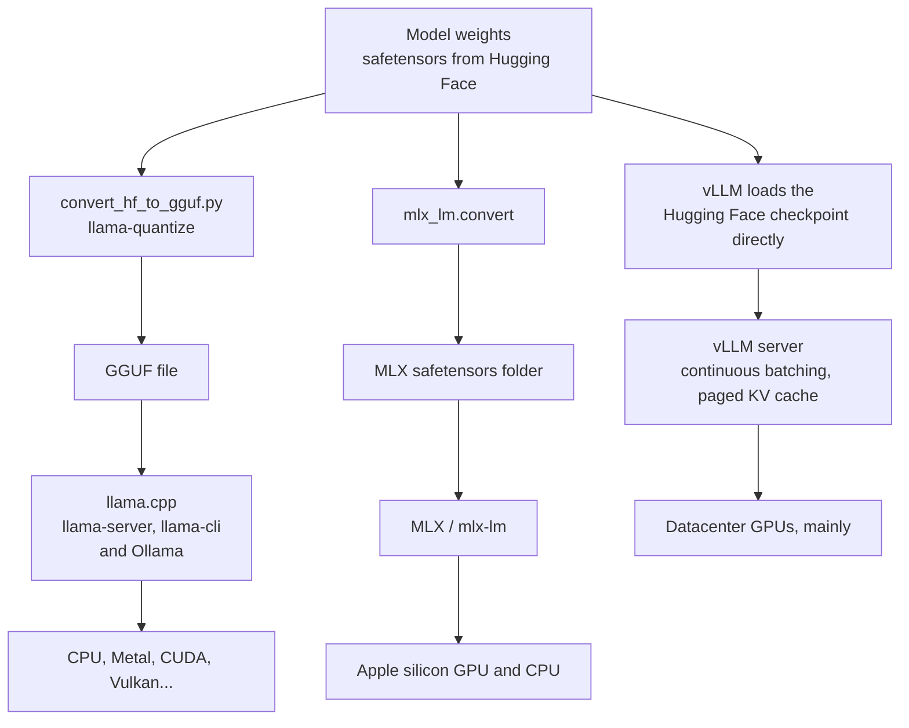
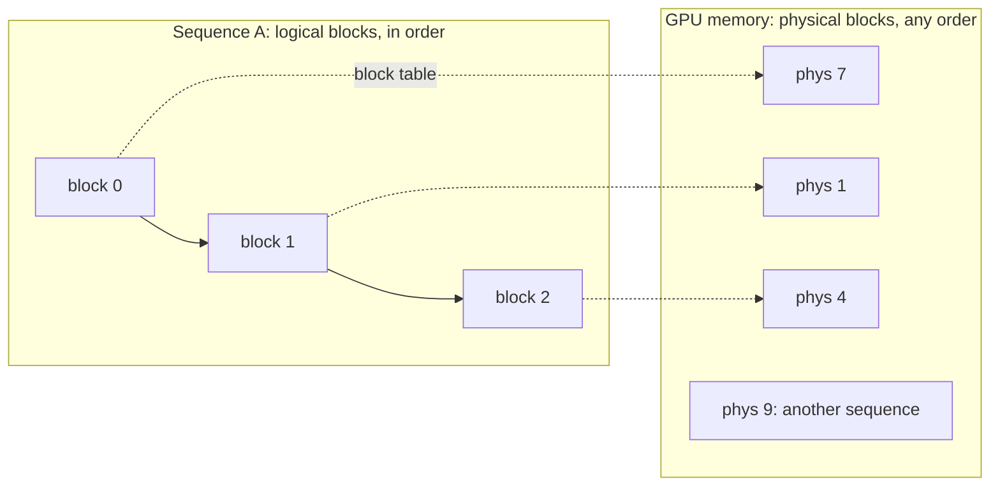

# Inference engines: llama.cpp, MLX, vLLM

## Why this matters

Everything so far in this part ended in the same place: a model file that something loads and runs. That something is an **inference engine**, and Ollama is a friendly wrapper around one. [Ollama's README](https://github.com/ollama/ollama) lists llama.cpp under "Supported backends"; you have been using an engine all along without choosing it.

Choosing it matters because the three engines in this chapter optimize for different situations. llama.cpp aims at running a model almost anywhere with minimal setup. MLX is built for one family of hardware, Apple silicon, and takes its design from it. vLLM is a server engine for many simultaneous users on datacenter GPUs. The same model file can be fast in one and slow, or impossible, in another, and "which is faster" has no answer until you say what you are measuring and for whom.

This chapter builds on [1.9](/part-01-how-llms-work/1.9-kv-cache-context-window): the KV cache is the reason a serving engine exists as a separate kind of software. Then it gives you a benchmark method and has you apply it on your own Mac.

**Learning goals**

- Compare llama.cpp, MLX and vLLM
- Benchmark MLX vs GGUF on your Mac
- Explain what a serving engine optimizes

## Explanation

### What an engine does

A model is a pile of tensors and a recipe (the architecture). An engine turns them into tokens. In every engine the same jobs recur:

1. **Load** the weights into memory in a format the engine understands.
2. **Run the math** for [prefill and decode](/part-01-how-llms-work/1.9-kv-cache-context-window), with kernels written for the target hardware.
3. **Manage the KV cache**: where it lives, how big it is, whether requests share it.
4. **Schedule requests**: one at a time, or many together.
5. **Expose an interface**: a command line, a library, an HTTP API (often OpenAI-compatible).

The engines differ in which of these they put effort into, and that follows from who they were built for.



(The vLLM branch is my simplification: vLLM can also load GGUF and several quantization formats, per its [docs home](https://docs.vllm.ai/en/latest/), but a standard Hugging Face checkpoint is its normal input.)

### llama.cpp and GGUF

The [llama.cpp README](https://github.com/ggml-org/llama.cpp) states the goal: "LLM (and VLM) inference with minimal setup and state-of-the-art performance on a wide range of hardware", as a "plain C/C++ implementation without any dependencies". The list of what that covers is the point of the project: Apple silicon ("a first-class citizen", via ARM NEON, Accelerate and Metal), x86 vector extensions, CUDA, Vulkan, SYCL, 1.5-bit to 8-bit integer quantization, and CPU+GPU hybrid inference for models larger than the video memory. It is built on the [ggml](https://github.com/ggml-org/ggml) tensor library.

Two consequences matter for you:

- **One engine, many machines.** A model that does not fit in the GPU can still run, with some layers on the CPU. You saw this in [experiment 00](/experiments/00-speed-check): `qwen3:30b-a3b` ran 6% on the CPU. An engine built for a single GPU type would simply refuse.
- **One file.** The format is [GGUF](https://github.com/ggml-org/ggml/blob/master/docs/gguf.md). Its spec lists the design goals as single-file deployment ("do not require any external files for additional information") and `mmap` compatibility ("models can be loaded using `mmap` for fast loading and saving"): the file holds weights, tokenizer and metadata, aligned so that the operating system can map it into memory instead of reading it. [10.2](/part-10-modifying-serving-models/10.2-hf-to-gguf) covered how to make one and the quantization types inside it (Q4_K_M, Q8_0 and the rest).

What you run day to day are the binaries in the repository's `tools/`. `llama-cli` chats in the terminal. `llama-server` is an HTTP server; its [README](https://github.com/ggml-org/llama.cpp/blob/master/tools/server/README.md) lists `--parallel N` (the number of server "slots", requests handled together) and `--cont-batching`, which it describes as "continuous batching (a.k.a dynamic batching)" and lists as enabled by default. So llama.cpp does batch requests: it is not only a single-user tool. It is simply not where most of its design effort goes. And `llama-bench` is the benchmarking tool you will use below.

::: info 📖 Read now
[llama.cpp README](https://github.com/ggml-org/llama.cpp) (ggml-org) · repo · ~10 min · essential

Look for: the description's list of backends and quantization levels, the "Supported backends" table (find Metal), and the quick-start commands for downloading and serving a model straight from Hugging Face. Notice how many pieces of that list you have used already without knowing it.
:::

### MLX and its model format

[MLX](https://github.com/ml-explore/mlx) is "an array framework for machine learning on Apple silicon", from Apple machine learning research. It is not an LLM engine but a NumPy- and PyTorch-like array library, with lazy computation, dynamic graph construction and function transformations such as automatic differentiation. The LLM part is a separate package, [mlx-lm](https://github.com/ml-explore/mlx-lm): "a Python package for generating text and fine-tuning large language models on Apple silicon with MLX". You used it for LoRA in [10.3](/part-10-modifying-serving-models/10.3-lora-mlx).

The design decision that matters here is **unified memory**. The MLX docs ([Unified Memory](https://ml-explore.github.io/mlx/build/html/usage/unified_memory.html)) put it this way: Apple silicon's CPU and GPU "have direct access to the same memory pool", so an MLX array has no location. You choose the device when you run an *operation*, not when you create an array, and nothing is copied between a CPU memory and a GPU memory. On a Mac this is a real advantage over frameworks designed around a discrete GPU with its own memory. The flip side is that there is one pool for everything: the model, the KV cache and your browser all share it.

**The MLX model format** is not a new file type. An MLX model is a Hugging Face-style folder: `config.json`, tokenizer files, and weights in `.safetensors`. You can see this in a community repository such as [mlx-community/Qwen3-8B-4bit](https://huggingface.co/mlx-community/Qwen3-8B-4bit) (files: `config.json`, `model.safetensors`, `tokenizer.json` and so on; I read the file list through the Hub API). The mlx-lm README says its default model comes from the [MLX Community](https://huggingface.co/mlx-community) organization on the Hub, where "thousands" of models are published in several quantizations. Converting your own is one command, which quantizes during conversion:

```sh
mlx_lm.convert --model Qwen/Qwen3-8B -q
```

The options on [`mlx_lm.convert`](https://github.com/ml-explore/mlx-lm/blob/main/mlx_lm/convert.py) include `--q-bits`, `--q-group-size`, `--q-mode` (`affine`, `mxfp4`, `nvfp4` or `mxfp8`) and `--dtype`; run it with `--help` to see the defaults on your installed version. Note what is different from GGUF: there is no family of named types like `Q4_K_M`. You pick a bit width and a group size, and the "affine" mode stores a scale and offset per group of weights ([1.12](/part-01-how-llms-work/1.12-quantization) explained groups). So "4-bit" in MLX and "Q4" in GGUF are **not** the same number of bits per weight, and their file sizes differ. Treat that as a variable in your benchmark, not a footnote.

mlx-lm also carries the long-context tools you would expect from a serving point of view ([README](https://github.com/ml-explore/mlx-lm)): a rotating fixed-size KV cache (`--max-kv-size`), a prefill step size (`--prefill-step-size`, default 2048: smaller steps use less peak memory when reading a long prompt, at some cost in speed), saved prompt caches (`mlx_lm.cache_prompt`), and KV-cache quantization in its [server](https://github.com/ml-explore/mlx-lm/blob/main/mlx_lm/SERVER.md) (`--kv-bits`). That server, `mlx_lm.server`, speaks an HTTP API "similar to the OpenAI chat API" on port 8080 by default, and its docs say it "is not recommended for production as it only implements basic security checks". It is a convenient local tool, not a deployment.

::: info 📖 Read now
[MLX LM README](https://github.com/ml-explore/mlx-lm) (ml-explore) · repo · ~10 min · essential

Look for: the quick-start commands (`mlx_lm.generate`, `mlx_lm.chat`), the `convert -q` section, and the "Long Prompts and Generations" and "Large Models" sections. The last mentions raising the system wired-memory limit with a `sysctl`: read it so you know what the warning means if you see it, and do not change that setting during this chapter.
:::

::: info 📖 Read now
[MLX docs: Unified Memory](https://ml-explore.github.io/mlx/build/html/usage/unified_memory.html) (MLX documentation) · docs · ~5 min · essential

Look for: the `stream=mx.cpu` / `stream=mx.gpu` example, where the device belongs to the operation and not to the array. Then ask what that would mean for loading a model.
:::

### vLLM and PagedAttention

[vLLM](https://docs.vllm.ai/en/latest/) describes itself as "a fast and easy-to-use library for LLM inference and serving", originally from the Sky Computing Lab at UC Berkeley. It was introduced in a [June 2023 blog post](https://blog.vllm.ai/2023/06/20/vllm.html), which claims up to 24× higher throughput than Hugging Face Transformers and up to 3.5× higher than Text Generation Inference on the authors' setups (LLaMA-7B on one A10G and LLaMA-13B on an A100 40 GB, with requests sampled from ShareGPT). Those are 2023 numbers on 2023 baselines: read them as the size of the original problem, not as a current benchmark.

The problem is the KV cache from 1.9, seen from a server's side. A server runs many requests at once, each with its own cache, and the sum must fit in GPU memory. The blog post states the difficulty: the cache is "large" (up to 1.7 GB for one LLaMA-13B sequence) and "dynamic", because its size depends on a sequence length nobody knows in advance. Before vLLM, engines typically reserved one contiguous slab per request, sized for the maximum length. The post reports that existing systems wasted 60% to 80% of memory through fragmentation and over-reservation. Memory spent on empty reservations is memory that cannot hold another request in the batch, and the number of requests in the batch is what sets throughput.

Put numbers on it with the cache size from 1.9 (Qwen3-14B: 160 KiB per token, so 5 GiB for 32,768 tokens). A server that reserves a 32k-token slab for every request spends 5 GiB per request, even if a chat turn needs 1,000 tokens (about 156 MiB). On a GPU with, say, 40 GiB left after loading the weights, that is 8 requests at once where the real usage would allow dozens. (The GPU size is invented for the arithmetic.)

**PagedAttention** is vLLM's answer, borrowed from operating systems. Following the [post](https://blog.vllm.ai/2023/06/20/vllm.html) and the [paper](https://arxiv.org/abs/2309.06180):

- Split each sequence's KV cache into fixed-size **blocks**, each holding the keys and values of a fixed number of tokens.
- Keep a **block table** per sequence that maps its logical blocks (in order) to physical blocks, which need not be contiguous. The post's analogy: blocks are pages, tokens are bytes, sequences are processes.
- Allocate physical blocks **on demand**, as tokens are generated.



Waste is now confined to the last, partly filled block of each sequence. The post reports under 4% waste in practice. With a block of 16 tokens at 160 KiB per token (my illustrative block size) that is at most 2.5 MiB wasted per request, against gigabytes reserved before.

Because blocks are addressed through a table, they can also be **shared**: two sequences can map their logical blocks to the same physical block, with reference counts and copy-on-write when one diverges. The post gives parallel sampling (several answers from one prompt) as the example, and reports up to 55% less memory for such methods. The same mechanism is what later makes prefix caching possible, which belongs to [10.8](/part-10-modifying-serving-models/10.8-serving-optimizations), together with continuous batching and speculative decoding. The [vLLM docs](https://docs.vllm.ai/en/latest/) list all of them, plus a long list of quantization formats and parallelism modes, among the reasons vLLM is fast.

The abstract of the [PagedAttention paper](https://arxiv.org/abs/2309.06180) (SOSP 2023) sums up the claim in its own words: "near-zero waste in KV cache memory" and a 2-4× throughput gain "with the same level of latency" over FasterTransformer and Orca.

::: info 📖 Read now
[vLLM: Easy, Fast, and Cheap LLM Serving with PagedAttention](https://blog.vllm.ai/2023/06/20/vllm.html) (vLLM blog, 2023) · article · ~10 min · essential

Look for: the three adjectives for the KV cache (large, dynamic, and what the third one costs), the figures of blocks and the block table, and the paragraph on sharing with copy-on-write. Then say in one sentence why fragmentation limits batch size.
:::

::: tip 📖 Read (optional)
[Efficient Memory Management for Large Language Model Serving with PagedAttention](https://arxiv.org/abs/2309.06180) (Kwon et al., SOSP 2023) · paper · ~15 min (abstract and introduction) · optional

Look for: the framing of KV-cache management as a virtual memory problem, and what the evaluation says gets *more* pronounced with longer sequences and larger models.
:::

**Does vLLM run on your Mac?** The mainstream route is a GPU server. For Apple silicon there is a community plugin, [vllm-metal](https://github.com/vllm-project/vllm-metal), which its README describes as a "plugin that enables vLLM to run on Apple Silicon Macs using MLX as the primary compute backend". I read its README but did not install it, so I do not make performance claims about it, and the practice below sticks to llama.cpp/Ollama and MLX. If you are curious, it is an easy optional extension.

### What a serving engine optimizes

Two goals pull in different directions.

| | Single user (your laptop) | Many users (a server) |
|---|---|---|
| What you feel | Time to first token and tokens per second for *your* request | Total tokens per second across everyone, and how many users fit |
| The limit | Memory bandwidth reading the weights and the cache for each token | Memory *capacity* for caches, then compute once batches are large |
| Engine effort goes to | Fast kernels, quantization, fitting a big model in small memory | Batching, KV memory management, sharing, scheduling |
| Examples here | llama.cpp, MLX | vLLM (also `llama-server` with parallel slots) |

The reasoning behind the first column comes from 1.9: decode reads all the weights and the cache for every generated token, so a single stream is bound by memory bandwidth. A rough ceiling is `tokens/s ≲ memory bandwidth ÷ bytes read per token`, where the bytes are about the size of the weights plus the cache. This is my own back-of-the-envelope reasoning, not a published formula, and your measurement will tell you how close it is. The second column follows the same logic from the other side: a batch of requests reads the weights *once* for all of them, so serving many requests at once makes better use of the bandwidth, and what limits the batch is the memory left over for caches, which is what PagedAttention attacks.

So there is no single "fastest engine". A laptop user chasing the best single-stream speed and a company serving thousands of requests are solving different problems, and a benchmark answers only the one it was designed for.

### Benchmarking methodology

You will compare MLX and GGUF on the same machine. Most benchmark mistakes are not arithmetic errors but comparisons of unequal things.

**Measure two phases separately.** Prefill (reading the prompt) is compute-bound and decode (generating) is bandwidth-bound, so they behave differently and engines are not equally good at both. `llama-bench` reports them as separate rows: its default test is `pp512` (processing a 512-token prompt) and `tg128` (generating 128 tokens), per its [README](https://github.com/ggml-org/llama.cpp/blob/master/tools/llama-bench/README.md), and `-d` sets the context depth already filled before the test. mlx-lm's [`benchmark`](https://github.com/ml-explore/mlx-lm/blob/main/mlx_lm/benchmark.py) script reports `prompt_tps` and `generation_tps` plus `peak_memory`, with prompt length `-p` (default 512) and generation length `-g` (default 1024). A single "tokens per second" number mixes the two and hides which one you improved.

**Match what you can control.**

| Variable | Why it matters |
|---|---|
| Same model and same weights precision | MLX 4-bit and Q4_K_M are different bit budgets (see above). Compute bits per weight from the file sizes and report it |
| Same prompt length and output length | Decode slows as the context grows (1.9). Compare at the same depth |
| Same sampling | Temperature 0, fixed output length (or ignore early stopping, as the mlx-lm script does by clearing the stop tokens) |
| Same context size and parallelism | Ollama's `num_ctx` and `OLLAMA_NUM_PARALLEL` change memory ([Ollama FAQ](https://github.com/ollama/ollama/blob/main/docs/faq.mdx): required RAM scales by parallel × context) |
| Same stack path | Calling an engine directly versus through Ollama's server adds overhead the other side does not have. Either measure both through a server, or both directly |
| Same clock | Time with one method. Server-reported timings and client-measured timings are not the same quantity |

**Warm up, repeat, report spread.** The first run loads weights and compiles or warms kernels. Both tools above do a warm-up run first and then repeat (`llama-bench` defaults to 5 repetitions with a `±` spread; mlx-lm to 5 trials). Report the median and the spread. A long run can also heat the chip and change clock speeds (my reasoning, not measured here); run the two engines interleaved, not one after the other, so that drift hits both.

**Measure memory the way the engine reports it, and say which.** `ollama ps` reports memory held by the loaded model; mlx-lm reports `peak_memory`; Activity Monitor's numbers are a third thing. They are not interchangeable, so compare like with like, or compare the whole system's memory pressure before and after.

**Do not generalize.** One model, one Mac, one prompt length, single stream. A result like "MLX is 20% faster here" says nothing about a 30B MoE model, long contexts, or a server with 20 simultaneous users. Write down the setup next to the number.

::: info 📖 Read now
[llama-bench README](https://github.com/ggml-org/llama.cpp/blob/master/tools/llama-bench/README.md) (llama.cpp) · docs · ~10 min · essential

Look for: the `pp` and `tg` row names, `-r` repetitions, the `-d` depth option, the output formats (`md`, `csv`, `json`) and the example table's `±` column. Decide which of those your own benchmark script needs to copy.
:::

::: tip 📖 Read (optional)
[mlx-lm `benchmark.py`](https://github.com/ml-explore/mlx-lm/blob/main/mlx_lm/benchmark.py) (ml-explore) · repo · ~5 min · optional

Look for: the warm-up call, the fake prompt built from random token ids, and the clearing of the end-of-sequence tokens "to avoid early stopping". Each is a methodology decision you will make in your own script.
:::

::: tip 📖 Read (optional)
[vLLM docs](https://docs.vllm.ai/en/latest/) (vLLM) · docs · ~10 min · optional

Look for: the feature list under "vLLM is fast with", and the section titles in the user guide's navigation (batching, prefix caching, speculative decoding, quantization). Treat it as a map of what is covered in [10.8](/part-10-modifying-serving-models/10.8-serving-optimizations).
:::

### Choosing

| If you want | Use | Why |
|---|---|---|
| The easiest local setup, one command | Ollama | A wrapper that manages models, templates and a server. Its README lists llama.cpp as a backend |
| A model that does not fit on the GPU, or a non-Apple machine | llama.cpp | CPU+GPU hybrid, many backends |
| Fine-tune and serve on a Mac, or test the Apple-native path | MLX / mlx-lm | One memory pool, LoRA and conversion in the same tool |
| Serve many users from GPU servers | vLLM | Paged KV cache, continuous batching and the rest |
| A quick check of "which is faster for me" | Benchmark both on your model with the method above | Published numbers come from other models, hardware and settings |

This table is my summary of the positions above, not a ranking.

Model sizes, prices and which models fit in memory belong on [Landscape](/landscape#what-fits-in-24-gb-of-unified-memory), not here.

## Practice

**Brief:** run the same model in MLX and in llama.cpp (through Ollama), and compare speed and memory using the method above and the experiment 00 benchmark as the starting point.

**Where:** `experiments/40-mlx-vs-gguf/`: a standalone experiment, not a `project/` step. The folder has a README skeleton with the tables to fill in. You write the benchmark script in TypeScript (`node bench.ts`, as in experiments 12 and 36); there is no Python except the `mlx-lm` tool itself.

**Steps:**

1. **Pick the pair.** Use `qwen3:8b` in Ollama (its `ollama show` output says Q4_K_M) and `mlx-community/Qwen3-8B-4bit` for MLX. Both exist as of 2026-11-13. Look up the file sizes (`ollama list`; the Hub's file listing for the MLX repo) and compute bits per weight for each, using 8.2 billion parameters (the number `ollama show` prints). Write down in the README how different the two budgets are, and predict which will decode faster and which will use more memory, with one sentence of reasoning each.
2. **Compute a ceiling.** Look up the memory bandwidth of your Mac's chip on Apple's specification page. Using the rough ceiling from "What a serving engine optimizes", estimate the maximum decode speed for each file. Then compare it with your measured number from experiment 00 for `qwen3:8b` (41.3 tok/s). Say what the gap suggests.
3. **Install MLX.** `uv tool install mlx-lm` (or a `uv` virtual environment with `mlx-lm`). Check that `mlx_lm.generate --model mlx-community/Qwen3-8B-4bit --prompt "hello"` works. Note how much it downloaded.
4. **Pin the setup.** Decide, and write in the README: prompt length (suggest two: about 100 and about 4,000 tokens), output length (suggest 256 tokens), `temperature` 0, Ollama `num_ctx` large enough for the long prompt, and thinking off (`think: false` in Ollama; for MLX, use a raw token-id prompt as `benchmark.py` does, or a chat template with thinking disabled, and say which).
5. **Measure with the tools.** Running `llama-bench` is optional (you need the llama.cpp build from [10.2](/part-10-modifying-serving-models/10.2-hf-to-gguf) and Ollama's GGUF blob). The required measurement is: `mlx_lm.benchmark --model mlx-community/Qwen3-8B-4bit -p 100 -g 256 -n 5` and again with `-p 4000`, and for Ollama the `eval_count`, `eval_duration`, `prompt_eval_count` and `prompt_eval_duration` fields of the final `/api/generate` (or `/api/chat`) response, over five runs after a warm-up. Convert durations (nanoseconds) to tokens per second yourself.
6. **Measure with your own client.** Write `bench.ts`: start `ollama serve` (already running) and `mlx_lm.server --model mlx-community/Qwen3-8B-4bit`, then send the same streaming chat request to both OpenAI-compatible endpoints and time the **time to first token** and the **decode rate** on the client, the same way for both. Run the engines **interleaved** (A, B, A, B, ...), five rounds each, and print the median and the min-max range. Compare these client numbers against the tool numbers from step 5 and say where they differ and why.
7. **Measure memory.** For Ollama: `ollama ps` while loaded. For MLX: `peak_memory` from the benchmark, and the system's memory pressure (Activity Monitor, or `memory_pressure`) before and after loading. Do not mix these in one column without saying so.
8. **Check quality, briefly.** Send the five prompts from experiment 12 to both at temperature 0 and judge the answers the same way. A faster engine that returns worse answers because of a wrong chat template is not faster in any useful sense.
9. **Write the verdict** in the README: which engine wins decode, which wins prefill, which uses less memory, by how much, at which prompt length, and how much of that is the engine and how much the different bit budget. State what your setup cannot tell you.
10. **Optional stretch:** concurrency. Fire 1, 2 and 4 requests at once at each server (`OLLAMA_NUM_PARALLEL` for Ollama; look at what `mlx_lm.server` supports) and measure total tokens per second. This is where a serving engine's design starts to show.
11. **Optional stretch:** try [vllm-metal](https://github.com/vllm-project/vllm-metal) on the same model and add a third column. Report honestly if setup takes too long to be worth it.

**Done when:** the README holds your predictions from before measuring; a table gives, for both engines and both prompt lengths, prefill speed, decode speed (median and range), time to first token and memory, with bits per weight next to each model; the tool-reported numbers and your client-measured numbers are both there and you can say why they differ; and the verdict separates the engine from the bit budget and says what the test does not cover.

Cost: free, local only. No paid API calls.

## Check questions

1. Why does a serving engine care about how KV cache memory is laid out, when a single-user engine mostly does not?

   <details><summary>Answer</summary>

   On a server the KV caches of all concurrent requests share one memory pool, and the number of requests that fit in a batch decides throughput. Reserving a contiguous maximum-length slab per request wastes most of that memory (the vLLM post reports 60% to 80% waste in earlier systems), so fewer requests run together. A single-user engine runs one sequence, so there is one cache and little to waste.
   </details>

2. In PagedAttention, what is the block table, and why does it allow two requests with the same prompt to use less memory?

   <details><summary>Answer</summary>

   The block table maps each sequence's logical blocks (in order) to physical blocks anywhere in memory, like a page table. Two sequences can map to the same physical block for the shared prompt, tracked with reference counts, and copy a block only when one of them writes something different (copy-on-write). The prompt's cache is stored once.
   </details>

3. You benchmark `qwen3:8b` in Ollama against an MLX 4-bit model and MLX is 15% faster at decode. Give two reasons the conclusion "MLX is a faster engine" might be wrong.

   <details><summary>Answer</summary>

   Any two of: the two files are not the same bits per weight, so MLX may simply read fewer bytes per token; you timed one with server-reported numbers and the other with a client clock; the prompt or context depth was not the same; one run was cold and the other warm; Ollama's server overhead was in one measurement and not the other; the chip heated up during the second run; you only tested one model at one prompt length.
   </details>

4. Why is a single "tokens per second" figure a poor way to describe an engine?

   <details><summary>Answer</summary>

   Prefill is compute-bound and decode is memory-bandwidth-bound, so an engine can be good at one and not the other, and decode speed falls as the context grows. Tools like `llama-bench` report the two separately (`pp512`, `tg128`) for that reason, and a serving workload would add throughput under concurrency as a third number.
   </details>

5. What does "unified memory" change for MLX compared with a framework built around a discrete GPU?

   <details><summary>Answer</summary>

   Arrays live in one pool that both CPU and GPU can access, so you pick the device for each operation instead of moving arrays between device memories, and nothing is copied across a bus. The same pool also holds the KV cache and everything else on the machine, which is why memory pressure on a Mac is a system-wide matter.
   </details>

## My understanding

<!-- Written by the learner, in their own words. Agents never fill this in. -->
