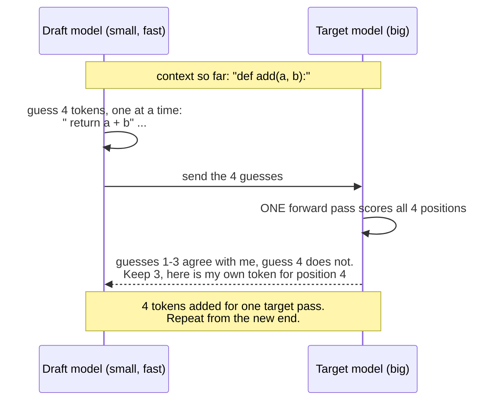
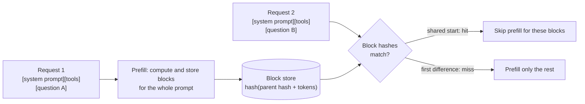

# Speculative decoding, batching, prefix caching

## Why this matters

[10.7](/part-10-modifying-serving-models/10.7-inference-engines) ended on one idea: decoding one token is limited by how fast the weights and the KV cache can be read from memory, while a server wants to turn the same hardware into many users' tokens. Four techniques do most of that work, and every one of them is a way of getting more tokens out of each trip through the weights:

- **Speculative decoding** makes *one* user's stream faster by checking several tokens per trip.
- **Continuous batching** makes *many* users share each trip.
- **PagedAttention** (introduced in 10.7) keeps enough cache memory free to let more users in.
- **Prefix caching** skips the trip entirely for a prompt start the server has already seen.

They also explain things you meet as an API user: why a cached prompt prefix is billed differently, why a cache entry expires after minutes, and why a hosted model's speed varies with how busy it is.

**Learning goals**

- Explain speculative decoding and when it helps
- Explain continuous batching and paged KV cache
- Explain prefix caching and its link to prompt-caching prices

## Explanation

### The shared starting point

From [1.9](/part-01-how-llms-work/1.9-kv-cache-context-window): generating a token means reading all the weights (and the cache) from memory once. Reading is the expensive part; the arithmetic on a single token is small. That has two consequences that the whole chapter hangs on:

1. **Checking several tokens costs about the same as producing one**, as long as the batch is small enough that the hardware is still waiting on memory. The [llama.cpp speculative decoding page](https://github.com/ggml-org/llama.cpp/blob/master/docs/speculative.md) puts it this way: computing n tokens in a batch (as in prompt processing) is more efficient than computing n sequentially (as in response generation).
2. **Serving a second user is nearly free** while the first is waiting on the same memory read. The weights are read once per step whatever the batch size; only the per-user caches are extra.

(Both are my reading of the bandwidth-bound argument in 1.9 and 10.7, not a quote. They stop being true once the batch is big enough that compute, not memory, is the bottleneck. That point depends on the hardware.)

### Speculative decoding

**The idea.** A small **draft model** guesses the next few tokens cheaply. The big **target model** then scores all the guesses in a *single* forward pass, accepts the longest correct prefix, and supplies its own next token at the first miss. If the draft was right four times in a row, you got five tokens (four guesses plus the target's own) for one pass of the big model.

**It does not change the answer.** The first two papers, [Leviathan et al. (Google)](https://arxiv.org/abs/2211.17192) and [Chen et al. (DeepMind)](https://arxiv.org/abs/2302.01318), both state this. The first describes "an algorithm to sample from autoregressive models faster without any changes to the outputs" and reports a 2X-3X speed-up on T5-XXL with identical outputs. The second reports a 2-2.5x decoding speed-up on the 70 billion parameter Chinchilla, using a "modified rejection sampling scheme which preserves the distribution of the target model". At temperature 0 the rule is simple: accept a guess only if it is the token the target would have picked anyway. For sampling at higher temperatures, the rejection scheme keeps the distribution the same. [vLLM's docs](https://docs.vllm.ai/en/latest/features/speculative_decoding/) call this "theoretically lossless up to the precision limits of hardware numerics" (batch shape can change floating-point rounding slightly) and warn that some newer methods relax verification and are not distribution preserving.

So speculative decoding is a pure speed trade: you spend a little extra compute and memory (the draft model, the rejected guesses) to save wall-clock time.

**When it helps, with a worked example.** Let `α` be the chance that each guess is accepted and `k` the number of guesses per step. If acceptance were independent for each guess (a simplification; real acceptance is correlated), the expected tokens per target pass is `1 + α + α² + … + αᵏ`. A draft step costs `c` of a target step. Then one round costs `1 + k·c` target-steps. With `k = 4` and a draft a tenth the cost (`c = 0.1`), a round costs 1.4. This is my own illustration, not a measurement:

| Acceptance `α` | Tokens per round | Speed-up vs plain decoding |
|---|---|---|
| 0.8 (predictable text) | 3.36 | about 2.4× |
| 0.5 | 1.94 | about 1.4× |
| 0.3 (hard to guess) | 1.43 | about 1.0×: no gain |

This gives the rules of thumb, and each one is something your experiment can show:

- **Predictable text speeds up most.** Code, boilerplate, JSON in a known schema, and text that repeats earlier text all have high acceptance. Creative prose has low acceptance. The llama.cpp page gives "the rewriting of source code by a LLM" as the use case for its draftless n-gram variants, which guess from text already in the context instead of from a model.
- **The draft must be cheap and agree with the target.** A draft that is too slow eats the gain (`c` grows); one that is too different gets rejected (`α` falls). It must also share the target's tokenizer, which is why people pair a model with a smaller sibling of the same family (for example Qwen3 0.6B or 1.7B for Qwen3 8B).
- **It is a latency tool for lightly loaded servers.** vLLM's page says it reduces inter-token latency "under medium-to-low QPS (queries per second), memory-bound workloads". At high load, batches are already large and compute-bound, so the extra work of rejected guesses has a real cost. That is the opposite of where batching shines.
- **It costs memory.** The draft model's weights and its own KV cache sit next to the target's. On a 24 GB Mac running an 8B model that is a real budget item.

**The variants.** The vLLM page lists several families: separate draft models, EAGLE draft models, MTP, n-gram speculation and suffix decoding. The [llama.cpp page](https://github.com/ggml-org/llama.cpp/blob/master/docs/speculative.md) lists a similar menu through its `--spec-type` option (`draft-simple`, `draft-eagle3`, `draft-mtp` and several n-gram types, among others). Three ideas separate them:

| Kind of drafter | Where the guesses come from | Trade-off |
|---|---|---|
| **Separate draft model** | A small model of the same family | Works with off-the-shelf models, no retraining. Costs memory and a second model's compute. |
| **Trained draft head (EAGLE and relatives)** | A small network trained for one specific target model that reads the target's internal hidden states (the llama.cpp page describes EAGLE-3 this way) | Higher acceptance than a standalone draft of the same size, but you need a checkpoint trained for your exact target. |
| **Multi-token prediction (MTP)** | The target model itself has extra prediction heads for the next few tokens | No separate draft model to choose or load. vLLM's page says it is for models that natively support it. [DeepSeek-V3's report](https://arxiv.org/abs/2412.19437) is an example of a model that "sets a multi-token prediction training objective", though what that training signal does at serving time is something I did not check. |
| **N-gram / prompt lookup** | Text already in the context (find the last few tokens earlier in the text, guess what followed them) | No extra model at all and almost no overhead. Only helps when the output repeats the input or itself. |

::: info 📖 Read now
[vLLM: Speculative Decoding](https://docs.vllm.ai/en/latest/features/speculative_decoding/) (vLLM docs) · docs · ~10 min · essential

Look for: the statement of which workloads it is for (medium-to-low QPS, memory-bound), the table comparing methods at low and high QPS, how MTP differs from a draft model, and the lossless-guarantees section (what "lossless" does and does not cover).
:::

::: info 📖 Read now
[llama.cpp: Speculative Decoding](https://github.com/ggml-org/llama.cpp/blob/master/docs/speculative.md) (llama.cpp docs) · docs · ~10 min · essential

Look for: the draft-model section and its options (`-md`, the number of draft tokens), which draftless n-gram types exist and what each is good for, and the note that greedy sampling is needed when you want exact output matching. You will use this page for the practice.
:::

::: info 📖 Read now
[Fast Inference from Transformers via Speculative Decoding](https://arxiv.org/abs/2211.17192) (Leviathan, Kalman, Matias, 2022) · paper · ~20 min (abstract and introduction) · optional

Look for: the two observations the abstract starts from (hard language tasks contain easy subtasks; speculative execution), and how the introduction explains why verifying several tokens in parallel is possible at all. The acceptance-rate analysis is in the body; I did not read it, so my table above comes from my own simple model, not from the paper.
:::

### Continuous batching

**The problem with a naive batch.** To use the hardware well you want to run many requests together. The obvious approach, **static batching**, groups a fixed set of requests and runs them until all are done. But requests finish at different times, because outputs have different lengths. Take four requests that need 10, 50, 200 and 40 output tokens. A static batch runs 200 steps for all four slots: 800 slot-steps, of which only 300 produce a token. The slots whose request finished early sit idle (in practice padded), and new requests wait outside until the whole batch ends.

**Continuous batching** (also called dynamic batching or in-flight batching) fixes this by making the scheduling decision **every step** instead of every batch. When a request finishes, its slot is refilled from the waiting queue right away, and a newly arrived request joins the running batch at the next step.

| Step | Static batching | Continuous batching |
|---|---|---|
| Request A (10 tokens) finishes at step 10 | Its slot idles until step 200 | A new request E takes the slot at step 11 |
| Request E arrives at step 20 | Waits until all four finish, then starts at step 201 | Starts at step 21 if a slot is free |
| Slots doing useful work | 300 of 800 slot-steps (37.5%) in this example | Close to all of them while the queue is non-empty |

The idea comes from the [Orca paper](https://www.usenix.org/conference/osdi22/presentation/yu) (OSDI 2022), which proposes "iteration-level scheduling": scheduling "at the granularity of iteration (instead of request)". Its second trick, "selective batching", batches only some operations, because requests at different positions have different sequence lengths and cannot all be stacked into one tensor.

Two practical points follow:

- **Prefill and decode mix.** A new request needs its whole prompt processed (compute-heavy prefill) while others are generating (bandwidth-heavy decode). Engines decide how to interleave them. A huge prompt arriving can stall everyone's generation unless the engine splits prefill into chunks. This is a scheduling knob you will see in server flags, and I did not verify the exact option names per engine.
- **It needs memory.** More requests in flight means more KV caches in memory at once. That is where the next technique comes in.

This is not only a datacenter feature. From 10.7: `llama-server` has `--parallel N` slots and `--cont-batching`, listed as enabled by default in its [README](https://github.com/ggml-org/llama.cpp/blob/master/tools/server/README.md).

::: info 📖 Read now
[Orca: A Distributed Serving System for Transformer-Based Generative Models](https://www.usenix.org/conference/osdi22/presentation/yu) (Yu et al., OSDI 2022) · paper · ~15 min (abstract and introduction) · optional

Look for: the problem statement about request-level scheduling (what goes wrong when a short request waits for a long one in the same batch) and the definition of iteration-level scheduling. The abstract is a good three-minute version.
:::

### Paged KV cache

You have already met this in [10.7](/part-10-modifying-serving-models/10.7-inference-engines): [PagedAttention](https://blog.vllm.ai/2023/06/20/vllm.html) stores the KV cache in fixed-size blocks reached through a per-sequence block table, allocated as a sequence grows. Here is why it belongs in a chapter about batching. Continuous batching only pays off if many requests fit in memory at once, and the maximum number that fit is set by how efficiently the cache is stored. If every request reserves a contiguous slab for the longest possible output, most of that memory sits unused, so the batch stays small. Paged storage removes the reservation, so the same memory holds a bigger batch.

Look back at the two techniques together: continuous batching decides *who* runs each step, and the paged cache decides *how many can be held*. The vLLM post is where the two arrive together, with the paper's abstract claiming "near-zero waste in KV cache memory". I did not read the paper body, so the claim for you to check there is how much of the 2-4× gain comes from the memory layout versus the scheduling.

### Prefix caching

**Prompt caching on the server side.** The KV entries for a prompt depend only on that prompt's tokens (and everything before them, because attention looks backward, as 1.9 explains). So if two requests start with the same tokens, the entries for that start are identical. **Prefix caching** keeps the entries from finished requests and reuses them: the new request skips the prefill for the shared part and begins at the first token that differs. This is the server mechanism behind the [prompt caching](/part-02-programming-with-llms/2.7-prompt-caching) you used in the API.

**How an engine finds a match.** vLLM's [design page](https://docs.vllm.ai/en/latest/design/prefix_caching/) describes a hash-based scheme: every KV block is identified by a hash of *the tokens in the block plus the hash of the block before it*. Two requests therefore hit the same block only if all the earlier tokens match too, which is the "only a prefix" rule from 1.9 made mechanical. The page says the hash also covers "extra" values such as LoRA IDs, multi-modal inputs, and cache salts "to isolate caches in multi-tenant environments", so that one customer's cache blocks cannot be matched by another's. Blocks that no running request uses are kept and evicted in LRU order (least recently used first) when memory is needed. The same page calls prefix caching "almost a free lunch" because it does not change model outputs.

**Where it pays off:** a long system prompt or tool list shared by every request, a long document with many questions, an agent loop whose context grows by appending (every step's prompt starts with the previous step's prompt), few-shot examples. **Where it does nothing:** prompts that differ at the very start (a timestamp or user name at the top), or traffic too sparse for entries to survive until the next request.

**The link to prices.** You can reason about why API providers price cached tokens separately:

- A cache hit saves the provider the *prefill compute* for those tokens. That is real money saved, so a discount on cached input is natural.
- A cache entry occupies scarce accelerator memory while it waits. That is real money spent, which explains why entries are short-lived and why some providers charge extra to *write* a cache entry or sell longer lifetimes at a higher price. That the reasons are these is my interpretation: the providers set prices as a business decision and the docs do not publish their cost model.
- It only works for an exact prefix, which is why 2.7 told you to put stable content first and changing content last. The server cannot reuse the middle of a prompt for the same reason an engine's block hash includes everything before the block.

For the actual multipliers, lifetimes and which models support caching, read [2.7](/part-02-programming-with-llms/2.7-prompt-caching) and the prices on [Landscape](/landscape#frontier-models); they change too often to copy here. Anthropic's [prompt caching docs](https://platform.claude.com/docs/en/build-with-claude/prompt-caching) are the source of truth for its API.

::: info 📖 Read now
[vLLM: Automatic Prefix Caching (design)](https://docs.vllm.ai/en/latest/design/prefix_caching/) (vLLM docs) · docs · ~10 min · essential

Look for: what goes into a block's hash (parent hash, the block's tokens, extra values), what happens when a request's blocks are all in use or all idle, and the eviction rule. Ask yourself why the hash includes the parent: what would break without it?
:::

**You can see prefix caching on your own Mac.** `llama-server` has `--cache-prompt`, listed as enabled by default in its README, and `--cache-reuse N` for reusing chunks by shifting the KV cache. Ollama (which wraps llama.cpp) typically shows a fast "second turn" in a chat for the same reason. I did not run either to confirm the speed difference, so measuring it is a possible extension of your experiment.

### Putting it together

| Technique | Optimizes | Helps most when | Costs |
|---|---|---|---|
| Speculative decoding | One user's inter-token latency | Low load, predictable output, a fast and agreeable drafter | Draft memory and compute; useless at low acceptance; hurts at high load |
| Continuous batching | Total throughput | Many concurrent requests of varied lengths | Higher latency per request as the batch grows; needs cache memory |
| Paged KV cache | How many requests fit | Long, variable-length sequences | Block-table bookkeeping and custom kernels |
| Prefix caching | Prefill time and cost | Shared long prefixes, appended contexts | Memory held for cached blocks; exact prefix only |

They stack: a production engine runs all four at once. They also pull against each other in places. Speculative decoding spends spare compute to cut latency, and continuous batching spends the same spare compute to raise throughput, so under heavy load there is nothing spare to spend.

## Practice

**Brief:** try speculative decoding in llama.cpp or MLX with a small draft model and measure the speed-up on code vs prose.

**Where:** `experiments/41-speculative/`: a standalone experiment, not a `project/` step. The folder has a README skeleton with the tables to fill in. You write any glue code in TypeScript (`node run.ts`, as in experiments 12, 36 and 40); the only non-TypeScript tools are `mlx-lm` or llama.cpp's own binaries.

**Steps:**

1. **Predict first.** In the README, write which of two prompts will speed up more, a code task (for example "write a TypeScript function that ... with types and a docstring") or a prose task (for example "write a short story about ..."), and give a number for the speed-up of each. Use the table above as your model.
2. **Pick the pair.** Target: `qwen3:8b`'s family at about 4-bit. For MLX use [`mlx-community/Qwen3-8B-4bit`](https://huggingface.co/mlx-community/Qwen3-8B-4bit) (from experiment 40) with [`mlx-community/Qwen3-0.6B-4bit`](https://huggingface.co/mlx-community/Qwen3-0.6B-4bit) as the draft. For llama.cpp use [`Qwen/Qwen3-8B-GGUF`](https://huggingface.co/Qwen/Qwen3-8B-GGUF) (`Qwen3-8B-Q4_K_M.gguf`) with [`Qwen/Qwen3-0.6B-GGUF`](https://huggingface.co/Qwen/Qwen3-0.6B-GGUF) (the repository lists a Q8_0 file). All of these repositories exist as of 2026-11-13. Pick one engine for the main measurement; the other is an optional stretch.
3. **Install and find the flags.** MLX: `uv tool install mlx-lm`, then `mlx_lm.generate --help`: the source of `mlx_lm/generate.py` has `--draft-model` and `--num-draft-tokens` options, but check the installed version. llama.cpp: `brew install llama.cpp` (the Homebrew formula exists as of today) or the release binaries, then read the [speculative page](https://github.com/ggml-org/llama.cpp/blob/master/docs/speculative.md) and `llama-server --help`: the draft options there have been renamed over time (the page lists `-md` and `--spec-draft-n-max`, `--spec-type`), so trust your installed help over this chapter.
4. **Pin the setup.** Write down in the README: temperature 0 (so the output is deterministic, and speculation's output equals the plain output), thinking off or a prompt that avoids thinking mode, output length (suggest 256 tokens), the number of draft tokens, and the same prompts in every run. Write three code prompts and three prose prompts of similar length.
5. **Baseline.** Run every prompt without a draft model, three times each. Record decode speed (tokens per second) from the tool's own report. Throw away the first run as warm-up, as in 10.7's method.
6. **With a draft model.** Run every prompt again with the draft attached. Record decode speed, and the acceptance rate if the tool reports it (look at its output; mlx-lm marks tokens that came from the draft in its generation responses, and llama.cpp prints statistics on drafted vs accepted tokens, but check what yours prints).
7. **Check the output.** At temperature 0, compare the speculative output with the baseline output for each prompt. They should be identical or nearly so. If they differ, note where, and look at the chapter's lossless caveat (hardware numerics) before assuming a bug.
8. **Vary the knob.** For one code prompt and one prose prompt, try 2, 4 and 8 draft tokens. Where does the speed-up peak, and does it peak at the same number for both?
9. **Memory.** Note memory use with and without the draft model (Activity Monitor, or the tool's peak-memory figure if it prints one, and say which). Is the draft's cost visible?
10. **Write the verdict** in the README: speed-up for code vs prose with the acceptance rates next to them, whether your prediction held, the best draft length, and one sentence on whether you would leave it on for everyday use.
11. **Optional stretch:** try a draftless n-gram mode in llama.cpp (`--spec-type ngram-simple` or similar, per the page), and measure it on the task it is meant for: asking the model to rewrite a source file with a small change, so most output repeats the input.
12. **Optional stretch:** measure prefix caching. Send the same 3,000-token prompt twice to `llama-server`, and a second time with a different last sentence. Compare time to first token across the three requests. Then change the *first* line and send it again.

**Done when:** the README holds your predictions from before measuring; a table gives, for code and prose prompts, decode tokens per second without and with the draft model (medians of the runs), the draft length used, and the acceptance rate if you could get it; you checked that outputs agree at temperature 0; and the verdict says why code and prose differ, using the acceptance rate rather than guessing, and what your setup cannot tell you (one model pair, one machine, short outputs).

Cost: free, local only. No paid API calls.

## Check questions

1. Why can a small draft model make a big model faster, even though the big model still has to run?

   

Answer

   Decoding is limited by memory reads, not arithmetic, so the big model can check several proposed tokens in one forward pass for about the cost of producing one. The draft is cheap, and every guess the target accepts is a token produced without its own pass. Each round gives at least one token (the target's own), so it is never slower in tokens per round, only in wall-clock when the draft is slow or rarely right.
   

2. Your speculative setup is 2.2× faster on a coding task and barely faster on a creative-writing task. Why, and what would you measure to confirm it?

   

Answer

   Code is more predictable (boilerplate, syntax, repeated names), so the draft's guesses are accepted more often. Creative writing has many plausible next tokens, so guesses are rejected early and each round yields little more than one token while still paying for the draft. Measure the acceptance rate (accepted draft tokens divided by drafted tokens) for both; it should be clearly higher for code.
   

3. Does speculative decoding change the text the model produces? What changes if you raise the temperature?

   

Answer

   Not in distribution: the verification step is designed so that the output has the same distribution as the target alone (Leviathan et al. and Chen et al.), up to floating-point differences in hardware. At temperature 0 that means the same tokens. At higher temperatures a rejection-sampling rule keeps the distribution identical, so individual samples still vary run to run, as they do without speculation. Acceptance is usually lower at higher temperature, so the speed-up tends to shrink. Some newer methods deliberately relax the verification and lose the guarantee.
   

4. Four requests need 10, 50, 200 and 40 tokens. What fraction of slot-steps does a static batch use productively, and how does continuous batching improve it?

   

Answer

   The static batch runs 200 steps for 4 slots, 800 slot-steps, of which 10 + 50 + 200 + 40 = 300 produce tokens: 37.5%. Continuous batching makes the scheduling choice every step, so when a request finishes its slot is given to a waiting request immediately, and new arrivals join at the next step instead of waiting for the whole batch. Slots stay busy as long as the queue has work.
   

5. Why does continuous batching depend on the paged KV cache to deliver its throughput?

   

Answer

   More requests running at once means more KV caches in memory at once. If each request reserves a contiguous slab for the maximum length, most of the reserved memory is empty and the batch size is capped early. With block-based allocation, a sequence takes memory only as it grows, so the same memory holds more concurrent requests and the scheduler can keep slots full.
   

6. A colleague puts the current time on the first line of a 5,000-token system prompt. Why does that defeat prefix caching, and why is cached input priced differently from fresh input?

   

Answer

   Each KV block is only valid, and only matched, if every token before it is identical (vLLM hashes each block together with its parent's hash). A changing first line makes the first block differ, so every later block misses too, and the whole prompt is processed from scratch each time. Put the changing part at the end. On price: a hit saves the provider prefill compute, which supports a discount, while holding the entry in accelerator memory costs something, which is one reason entries are short-lived and writes can cost extra. The docs don't publish the cost model, so that is an interpretation. Actual numbers are on Landscape and in 2.7.
   

## My understanding

<!-- Written by the learner, in their own words. Agents never fill this in. -->
