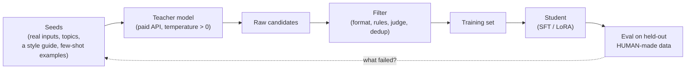

# Distillation and synthetic data

## Why this matters

Many small open models are trained on outputs of bigger ones. Distillation and synthetic data explain how, and let you make a small model good at one narrow job.

A recurring pattern in this part of the book: a large model does a task well but costs too much, is too slow, or can't run on your Mac; a small model is cheap but mediocre. The usual bridge is not a cleverer small model but *better training data for it*, and the best source of that data is often the large model itself. [1.7](/part-01-how-llms-work/1.7-post-training) said that SFT teaches format and style from a modest number of good examples, and that modern recipes mix human data with synthetic data. This chapter is the "synthetic" half: how the data is made, how to throw most of it away, and the two things that bite (quality loops and legal terms). It ends where [10.3](/part-10-modifying-serving-models/10.3-lora-mlx) began, with your commit-message LoRA, retrained on data a paid model helped to write.

**Learning goals**

- Explain distillation (logit vs output)
- Generate and filter synthetic training data
- Know the licensing and quality pitfalls

## Explanation

### Two meanings of "distillation"

The word covers two different procedures, and mixing them up causes most confusion.

**Logit (soft-label) distillation** is the original meaning. [Hinton, Vinyals and Dean (2015)](https://arxiv.org/abs/1503.02531) start from the observation that an ensemble of models is accurate but expensive to deploy, and show that its knowledge can be compressed into a single model. The student is trained to match the teacher's *full output distribution* rather than only the correct label. If a handwritten "7" gets probability 0.9 for 7, 0.09 for 1 and 0.01 for 4, the 1 and 4 carry information (which classes the teacher finds similar) that a one-hot label throws away. Applied to a language model, the "labels" are the teacher's next-token distribution at every position, and the student minimizes the divergence between its distribution and the teacher's, typically alongside the ordinary cross-entropy from [1.6](/part-01-how-llms-work/1.6-pretraining). It is a very rich training signal: one forward pass of the teacher gives a whole probability vector over the vocabulary per token, not one sampled token.

The price is access. You need the teacher's logits, so you need its weights (or an API that returns full distributions, which hosted APIs generally do not; at most they return a few top log-probs, see [1.1](/part-01-how-llms-work/1.1-next-token-prediction)). And the student must share the teacher's tokenizer, or you need an alignment trick, because the distributions are over the same vocabulary. Logit distillation is therefore what labs do *within a model family*, with their own weights.

**Output (sequence-level, "hard-label") distillation** is what everyone else does, and what people usually mean by "distilling a model" today. You prompt a strong teacher, collect its *text*, and run ordinary SFT on a student with that text. The student never sees a probability, only the one sampled continuation. That's far less information per example, but it works through any API, across tokenizers and across model families, and it needs nothing you don't already have from 10.3. The "distilled" reasoning models are the well-known case: the [DeepSeek-R1 paper](https://arxiv.org/abs/2501.12948) says in its abstract that the reasoning patterns of the large RL-trained model "can be systematically harnessed to guide and enhance the reasoning capabilities of smaller models". The pattern is the same as for commit messages, only with chains of thought as the outputs.

| | Logit distillation | Output distillation |
|---|---|---|
| Student learns from | the teacher's whole next-token distribution | the teacher's sampled text |
| Needs from the teacher | weights or logits, same tokenizer | any API that returns text |
| Signal per token | high (a full vector) | low (one token) |
| Typical user | a lab compressing its own large model | you, with a paid API and a LoRA |
| Student can exceed the teacher? | no, it is trained to imitate | only on the filtered slice you keep (see below) |

There is also an *on-policy* variant that fixes a mismatch: in output distillation the student trains on teacher-written text, but at inference it conditions on its own text, which is a different distribution. [MiniLLM](https://arxiv.org/abs/2306.08543) is one paper on training the student on sequences it generated itself, graded against the teacher. You won't implement it here; knowing it exists explains why "just SFT on teacher outputs" is a baseline and not the ceiling.

### Synthetic data generation

Output distillation is one case of a wider idea: **synthetic data** is training data produced by a model instead of collected from people. Three families cover most uses (the Hugging Face smol-course organises its synthetic-data module the same way, as instructions, preferences and critiques):

1. **Instructions and responses (SFT data).** Where the prompts come from decides the diversity. [Self-Instruct](https://arxiv.org/abs/2212.10560) starts from a small human-written seed set and has a model write new instructions and answers, bootstrapping from there; [Magpie](https://arxiv.org/abs/2406.08464) goes further and gets an aligned chat model to produce the *user prompts* by prompting it with nothing but the template's opening, so no seed set is needed. [Stanford Alpaca](https://crfm.stanford.edu/2023/03/13/alpaca.html) fine-tuned LLaMA 7B on 52K demonstrations generated with OpenAI's text-davinci-003, following the Self-Instruct recipe, for under $600 by their account. That was the moment the approach became everyone's default for small models.
2. **Preferences (DPO data, [1.7](/part-01-how-llms-work/1.7-post-training)).** Generate several answers per prompt, have a judge model rank them, keep (chosen, rejected) pairs. This is the RLAIF idea from 1.7 applied to your own data.
3. **Transformations of data you already have.** Relabelling, rewriting, summarising, translating, or turning documents into question-answer pairs. This is the safest family, because the facts come from your real documents and the model only supplies the *form*. It's also the family your practice uses: real diffs, with the teacher supplying commit messages.

The generation loop has the same shape in all three:

Two design rules make the difference between useful and useless data.

**Diversity comes from the inputs, not the sampler.** Asking a model for 5,000 examples at temperature 1 gives you 5,000 variations on its favourite twenty. The smol-course's own walkthrough shows this on a toy: basic prompting produces a usable example but, as it says, re-running it shows the data "is not that diverse". Vary the *seeds*: real inputs from your domain, a list of topics or personas crossed with task types, different few-shot examples per call. If the inputs are real (your diffs, your support tickets), you get diversity for free.

**The eval set stays human-made.** The test set from 10.3 holds your real commit messages. Generate nothing for it. If the student and the test labels both come from the same teacher, you measure agreement with that teacher, not quality, and any bias in the teacher is invisible. Keep the split taken *before* any generation, and make sure no test input is ever shown to the teacher as a few-shot example.

### Filtering and deduplication

Raw teacher output is mostly fine and partly bad, and a student imitates the bad part as faithfully as the good. Filtering is where most of the quality comes from, and, as [1.7](/part-01-how-llms-work/1.7-post-training) argued about SFT data in general, a smaller clean set usually beats a larger noisy one. Filters in rough order of cost:

| Filter | Catches | Cost |
|---|---|---|
| **Format and rule checks** (code) | wrong structure, too long, forbidden phrases, missing fields, JSON that doesn't parse, refusals ("As an AI…") | free |
| **Execution or verification** | code that doesn't run, math with the wrong answer, extraction that disagrees with the source text. Strongest where a checker exists (the RLVR idea from [1.10](/part-01-how-llms-work/1.10-reasoning-models)) | cheap |
| **Dedup, exact and near** | the repeats described below | cheap |
| **Judge scoring** (LLM-as-judge, [4.4](/part-04-evals-observability/4.4-llm-as-judge)) | fluent but wrong, off-style, generic | one more model call per row |
| **Human spot check** | whatever the above all miss, and bugs in the filters themselves | your time: read 20–50 rows |

The smol-course also notes a failure of the generation step itself that filters must catch: its EvolInstruct example makes a question more complex but, in its words, the instruction "has lost some of the original meaning", so "evolving can be a double-edged sword". A transformation that drifts from its input produces a training pair whose label no longer matches its input, which is worse than no pair.

**Deduplication** deserves its own line because synthetic data is repetitive by construction. [Lee et al. (2021)](https://arxiv.org/abs/2107.06499) found that standard language-model datasets contain many near-duplicate examples and long repeated substrings, that over 1% of the unprompted output of models trained on them is copied verbatim from the training data, and that removing duplicates lets models emit memorized text ten times less often. Their setting is pretraining, but the mechanism transfers: duplicated rows get seen more often, weigh more in the loss and are memorized first. Two levels:

- **Exact:** hash the normalized text (lowercase, collapse whitespace) and keep the first.
- **Near-duplicate:** the same row with a word changed. Cheap approximations are word-shingle overlap (Jaccard similarity) or MinHash; an embedding-similarity threshold ([1.3](/part-01-how-llms-work/1.3-embeddings)) catches paraphrases. Pick a threshold by *reading pairs* that sit just above and just below it.

Dedup on the *response* as well as the input: a teacher that opens half its answers with the same sentence is teaching the student that sentence.

One more dedup that people forget: **against the test set.** Remove any training row whose input (or near-duplicate) appears in the held-out data. The 10.3 "done when" already asks for no train/test duplicates; synthetic generation makes that leak easier, not harder.

### Model collapse

If models train on model output, and model output ends up on the web, later models train on earlier models. [Shumailov et al.](https://www.nature.com/articles/s41586-024-07566-y) (Nature, 2024; first posted as [The Curse of Recursion](https://arxiv.org/abs/2305.17493)) report that "indiscriminate use of model-generated content in training causes irreversible defects in the resulting models, in which tails of the original content distribution disappear", and call this **model collapse**. The intuition: a model's samples under-represent rare events (low temperature and finite sampling both trim the tails), so a model trained on those samples under-represents them further, and each generation narrows the distribution. Early collapse loses the rare cases while average performance may look fine, which is why it is easy to miss.

Read the claim carefully, because it is often quoted wider than it is. The setup is *recursive replacement*: each generation trains on the previous one's output, with the real data gone. [Gerstgrasser et al. (2024)](https://arxiv.org/abs/2404.01413) confirm that replacing real data with each generation's synthetic data tends toward collapse, and then show that **accumulating** synthetic data alongside the original real data avoids it, across the model sizes and settings they tried. In practice:

- Your 10.9 experiment is one generation from a strong teacher, mixed with or compared against real data. That is not the collapse regime.
- The risks that *do* apply are milder cousins: a student that only ever sees teacher text inherits the teacher's blind spots and loses the variety of real data; a synthetic set built from one prompt template is narrow; training the student again on its own outputs, round after round, is the recipe for the loop.
- Cheap protection: keep real data in the mix (or at least in the eval), vary the seeds, filter, and never let the test set be synthetic.

### Terms of service and licensing

Output distillation sends text through someone's API, and the provider's terms say what you may do with what comes back. These are contracts that change, so **read the current terms of the exact provider and plan you use**; this section tells you what to look for, not what they say today.

- **A "no competing models" clause is common.** Anthropic's [Commercial Terms](https://www.anthropic.com/legal/commercial-terms), section D.4 (checked 2026-11-13), say a customer may not "access the Services to build a competing product or service, including to train competing AI models … except as expressly approved by Anthropic". The Alpaca authors said the same about the provider they used: the data "is based on OpenAI's text-davinci-003, whose terms of use prohibit developing models that compete with OpenAI", so they released their model for research only. (OpenAI's current terms page refused automated fetching when this chapter was written, so check it yourself.) Whether a private study model counts as "competing" is a legal question this book can't answer; the safe reading is that **a model you train for yourself on your own task is the low-risk case, and a model you publish or sell is where you need to check.**
- **The student's license is a second layer.** The base model you fine-tune has its own license (Apache-2.0, a custom community license, a non-commercial one). Alpaca inherited LLaMA's non-commercial license as well. Open-weight *teachers* also have terms: some licenses restrict using outputs to train other models, some require attribution or a naming convention. Check the teacher's license before using it as a data source, not just the API's.
- **Aggregators don't remove the terms.** Calling a model through a router changes who bills you, not whose terms apply to the output. See [Landscape](/landscape#access-routes).
- **Your data is in the prompt.** In the practice below, your real diffs go to a paid API. If the code is private or belongs to an employer, that may not be allowed at all, however the training turns out. Use public repos or your own side projects, and check the provider's data-retention terms.
- **Provenance.** Keep a record for each dataset of which teacher and version, which prompt, which date and which filters produced it. When terms change or a model is retired, you need to know which of your models are affected. A `manifest.json` next to the data takes five minutes.

### The cost side

A distillation run has two costs: the teacher's tokens and your training time. The teacher's side is arithmetic you can do before you spend anything: rows × (input tokens + output tokens) × price per token, times the retry and rejection rate (if you keep 60% of rows, each kept row costs 1/0.6 as much). The prices belong on [Landscape](/landscape#frontier-models), which also notes the [Batch API](/landscape#anthropic) discount for work that can wait. Estimate with ten rows first and measure the real token counts from the API's usage field, then log the actual spend in `costs.md`.

Whether it pays off is a break-even question: the one-off cost of the dataset against the per-call saving of using a small local model instead of the teacher, over the number of calls you expect. For a narrow task at high volume the break-even is quick; for a task you run a few times a week it never arrives, and a good prompt on the big model is the better answer. This is the same "fine-tune only if a measured gap remains" advice as in 10.3, with a price attached.

### Resources

The book that frames this chapter is [Chip Huyen, *AI Engineering*, ch. 8 "Dataset Engineering"](https://github.com/chiphuyen/aie-book/blob/main/ToC.md): its table of contents lists Data Curation, Data Augmentation and Synthesis (including "AI-Powered Data Synthesis" and "Model Distillation") and Data Processing (inspect, deduplicate, clean and filter, format). It is the closest single treatment of everything above, and it is the planned resource this chapter adopted, so read it after the next two.

::: info 📖 Read now
[Distilling the Knowledge in a Neural Network](https://arxiv.org/abs/1503.02531) (Hinton, Vinyals, Dean, 2015) · paper · ~15 min (abstract and the sections on soft targets and temperature) · optional

Look for: how the teacher's softened output distribution (the "temperature" from [1.8](/part-01-how-llms-work/1.8-sampling) applied to the teacher's logits) is used as the training target, and why the small probabilities on wrong classes are the useful part. Then say in one sentence why you cannot do this through a text-only API.
:::

::: info 📖 Read now
[Hugging Face smol-course, synthetic datasets module](https://github.com/huggingface/smol-course/tree/main/v1/6_synthetic_datasets) · docs · ~30 min · essential

Look for: the three taxonomies (instructions, preferences, critiques), the toy basic-prompting example and what the module says is wrong with it, and the Self-Instruct, EvolInstruct and Magpie sections. This module lives in the course's v1 folder; the current course version covers other units, so the link is to the archived module, which still reads fine. It uses `distilabel`, a library you do not need for the practice: your pipeline is a loop of API calls you write yourself.
:::

::: info 📖 Read now
[Gerstgrasser et al., Is Model Collapse Inevitable?](https://arxiv.org/abs/2404.01413) · paper · ~15 min (abstract and introduction) · essential

Look for: the two assumptions the earlier collapse results made (data *replaces* old data) and the one this paper tests (data *accumulates*). Decide which of the two your own pipeline resembles.
:::

::: info 📖 Read now
[Shumailov et al., AI models collapse when trained on recursively generated data](https://www.nature.com/articles/s41586-024-07566-y) (Nature, 2024) · paper · ~20 min (abstract and the discussion of tails) · optional

Look for: the sentence about "tails of the original content distribution", then the toy Gaussian-mixture example that shows it with a handful of parameters.
:::

::: info 📖 Read now
[Anthropic Commercial Terms](https://www.anthropic.com/legal/commercial-terms) · docs · ~10 min (section D, "Use of the Services") · essential

Look for: D.4 "Use Restrictions". Then open the terms of whichever provider you will actually use as the teacher and find the equivalent clause, and where the terms say who owns outputs.
:::

::: info 📖 Read now
[Stanford Alpaca](https://crfm.stanford.edu/2023/03/13/alpaca.html) · article · ~10 min · optional

Look for: the "Training recipe" paragraph (what the 52K demonstrations were generated from and for how much), and the paragraph before it on why the release was restricted to research use.
:::

For depth: [Self-Instruct](https://arxiv.org/abs/2212.10560) and [Magpie](https://arxiv.org/abs/2406.08464) (the two ways to get *prompts* without writing them), [Lee et al. on deduplication](https://arxiv.org/abs/2107.06499), and [Textbooks Are All You Need](https://arxiv.org/abs/2306.11644) for the argument that a small model trained on carefully chosen synthetic data can punch well above its size. They are listed with the other resources below and optional.

## Practice

**Brief:** Generate a synthetic dataset with a paid model, filter it, and use it to retrain the 10.3 LoRA. Compare with the hand-made dataset. Log the cost.

**Where:** `experiments/38-lora/`, the same folder as 10.3 and 10.4: a standalone experiment, not a `project/` step. You need your `data/test.jsonl`, `lora_config.yaml` and `compare.py` from 10.3, and your real-commit run as the baseline. The folder's README has a "10.9" section skeleton for the results. You write the generation and filtering code in TypeScript, since it is API calls and JSON; the training side stays the same `mlx_lm.lora` commands as 10.3.

**The design.** The student task is unchanged: diff in, commit message out. The *training labels* change. For the same training diffs, a teacher model writes the commit message from a written style guide and a few examples, instead of using your real message. You then ask: how close does a student trained on teacher-written messages get to the student trained on your real ones, measured on your real test messages? Optional variant: also *generate new diffs* (a different, public repo, or have the teacher invent changes) to see whether more synthetic inputs help.

**Steps:**

1. **Check you are allowed.** Pick the teacher and read its terms (the "Terms of service" section above). Decide which repos you may send to a paid API. Use public or personal code only. Write the answer and the teacher's name, model ID and date in the README.
2. **Freeze the test set.** Reuse the 10.3 `test.jsonl` as is. Record its row count and make a hash of the file in the README so you can show it didn't change. The teacher never sees a test diff.
3. **Write the style guide.** Take your 10.3 notes on your commit style (the filters, the metrics you chose in `score()`) and turn them into a system prompt of 10–20 lines, plus three real examples taken from *train*, not test. This is the "seed" in the diagram.
4. **Predict** in the README: the student's test metrics on teacher labels against real labels, what the teacher will do differently from you, and which filter will reject the most rows. Estimate the cost with the arithmetic from "The cost side".
5. **Pilot on 10 diffs.** Write `generate.ts` (reads `data/train.jsonl`, calls the teacher once per diff, writes `synthetic/raw.jsonl` with the diff, the generated message, the model ID and the token usage). Read all ten outputs. Fix the prompt before scaling. Compute the real cost per row and extrapolate.
6. **Generate the full set.** Run with a spend cap you decide beforehand, and with retries and a resume file so a crash doesn't pay twice. Record the total tokens and cost.
7. **Filter.** Write `filter.ts` with at least: (a) your `score()` rules from 10.3 applied to the *generated* message, (b) exact and near-duplicate removal on the messages, (c) a check that the teacher didn't refuse or echo the diff. Count rows removed by each rule. Then read 30 random survivors and note what you would still remove. Optional: a judge pass with the cheapest model that works, and check its scores against your own verdicts on 20 rows before you trust it ([4.4](/part-04-evals-observability/4.4-llm-as-judge)).
8. **Write `manifest.json`** (teacher, date, prompt file hash, row counts per stage, total cost).
9. **Retrain.** Convert the filtered set to the same chat format (reuse `prepare_data.py`'s `SYSTEM` string and message shape), put it in `data_synth/` with the *original* `valid.jsonl` and `test.jsonl`, and train with the *same* `lora_config.yaml` and a different `--adapter-path`. Change nothing else: same iterations, same seed.
10. **Compare four rows on the real test set** with `compare.py`: base model, base with a good prompt, student on your real messages (10.3), student on filtered teacher messages. Report test loss and your metrics. Read ten side-by-side examples. If your synthetic row count is not the same as the real one, say how you handled that (subsample to equal size, or report both).
11. **Optional:** a mixed set (your real rows plus the teacher's on extra diffs), and a run without the filters, to measure what filtering bought.
12. **Explain** in the README: what did the teacher get right that you didn't, and the reverse? Did filtering matter? Was the cost worth it against writing 100 more labels yourself? Where do the terms of service stop you from going further with this?

**Done when:**

- The README names the teacher, its terms, and what data you are allowed to send it, and the test set's hash matches the 10.3 one.
- `synthetic/raw.jsonl`, the filtered set and `manifest.json` exist (the raw and filtered data are gitignored if they contain private diffs), with a count per filter rule and 30 read examples with your notes.
- You retrained with the same config as 10.3 and the comparison table has the four rows with at least two metrics plus test loss.
- The actual spend (from the provider's usage dashboard, not just your estimate) is in `costs.md`, with the cost per kept row.
- The Why section answers step 12 honestly, including the case where the synthetic set loses to your real one.

## Check questions

1. You want to shrink a 70B open-weight model you can run into a 7B model of the same family, and you have its weights. Which kind of distillation is available, and what does it give the student that training on the teacher's sampled text does not?

   

Answer

   Logit (soft-label) distillation: you can run the teacher and read its full next-token distribution, so the student can be trained to match it (same tokenizer, same family). Each token then carries a whole probability vector, including how plausible the *wrong* tokens were, rather than only the one token that happened to be sampled. Output distillation would still work, but it throws that information away.
   

2. A colleague generates 20,000 instruction-response pairs by calling a strong model with "write a diverse set of instructions" at temperature 1.0, and the resulting fine-tune is bland and repetitive. Name two causes and two fixes.

   

Answer

   Causes: the diversity was left to the sampler, so the teacher produced variations on its most likely instructions; and nothing was filtered or deduplicated, so near-duplicate prompts and repeated opening sentences were taught to the student many times over. Fixes: vary the inputs (real seeds, topics × task types, different few-shot examples per call, or a method like Self-Instruct or Magpie that builds prompts systematically), and filter with rules, near-duplicate removal and a spot check of 20–50 rows.
   

3. Your synthetic dataset's test set is also generated by the same teacher, and the student scores very well. Why is that number almost useless, and what do you do?

   

Answer

   The score measures agreement with the teacher's habits, not correctness or your preferred style; the teacher's own biases and mistakes are in both the training labels and the answer key. Keep the evaluation set human-made (here, your real commit messages) and split it off before any generation, and make sure none of its inputs are shown to the teacher or appear in training.
   

4. A blog post says "training on synthetic data causes model collapse", and you are about to fine-tune on 3,000 teacher-written examples. How worried should you be, and what is the relevant difference between the studies and your setup?

   

Answer

   Not very, for model collapse as studied. The collapse results are about recursive generations in which each model trains on the previous one's output and the real data is gone; Gerstgrasser et al. found that accumulating synthetic data next to the real data avoids it. A single round from a strong teacher, with your real data kept for evaluation, is not that regime. The milder risks do apply: inheriting the teacher's blind spots and losing variety, so keep real data in the mix or the eval, vary the seeds and filter.
   

5. You publish a small model on Hugging Face that you fine-tuned on a few thousand outputs of a commercial API. List the three licensing questions to answer first.

   

Answer

   (1) Do the API provider's terms for the exact plan you used allow training a model with its outputs, and is there a clause against competing models (as in Anthropic's Commercial Terms D.4 or OpenAI's terms as quoted by the Alpaca authors)? (2) Does the base model's license allow your use, such as commercial redistribution (Alpaca inherited LLaMA's non-commercial license)? (3) Did the prompts you sent contain data you had no right to send, and does the dataset itself contain third-party or private text? Keep the manifest of teacher, date and prompt so you can answer these later.
   

## My understanding

<!-- Written by the learner, in their own words. Agents never fill this in. -->
