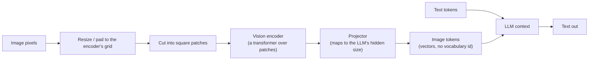

# Vision input

## Why this matters

Most of the information people work with is not plain text: receipts, invoices, screenshots, charts, slides, scanned contracts, whiteboard photos. A model that accepts images turns those into input for the same pipelines you already built: extraction into a schema ([2.5](/part-02-programming-with-llms/2.5-structured-output)), tools, agents. Screenshots are also how computer-use agents see a screen ([11.4](/part-11-multimodal/11.4-computer-browser-agents)), so this chapter is the base for that one.

The questions an engineer needs answered are practical. What does the request look like? What does an image cost, compared with the text you would otherwise send? And when is a small local model good enough? The mechanics are less strange than they look: an image becomes a block of tokens that sit in the context window next to your text, and everything you know about context size and billing applies.

**Learning goals**

- Send images and PDFs through the APIs
- Explain how images become tokens
- Use a local vision model

## Explanation

### From pixels to tokens

A text model turns a string into token ids, looks each one up in an embedding table, and runs the transformer ([1.2](/part-01-how-llms-work/1.2-tokenization), [1.3](/part-01-how-llms-work/1.3-embeddings)). A vision-language model needs the image to become the same kind of thing: a sequence of vectors of the model's hidden size. A separate **vision encoder** does that.



The encoder design most models descend from is the Vision Transformer: cut the image into fixed-size square patches, flatten each one into a vector, add position information, and run a normal transformer over the sequence of patches ([An Image is Worth 16x16 Words](https://arxiv.org/abs/2010.11929), the ViT paper). A projector then maps the encoder's output vectors into the language model's embedding space, so the language model sees them as if they were token embeddings. Image tokens are therefore *not* entries in the text vocabulary: there is no "image token 5123" you could print. They are vectors computed from the pixels, which is why a model's tokenizer chapter says little about them. The exact architecture differs per model and the labs rarely publish it for closed models; what you can rely on is what the APIs document about sizes and counting.

Two consequences follow directly.

1. **Cost scales with area, up to a cap.** More patches means more tokens. All three providers resize big images down, so there is a ceiling.
2. **Resolution is the quality knob.** Small text on a receipt needs enough patches per character. If you shrink a photo until the text is a few pixels tall, no model can read it.

### How many tokens is an image

Each provider documents its own rule, and they differ. Worked on one example: a receipt photo of 800 × 1200 pixels.

| | Rule (from the docs) | 800 × 1200 image |
|---|---|---|
| **Claude** | Patches of 28 × 28 px; an image costs ⌈width/28⌉ × ⌈height/28⌉ tokens. Images are downscaled to a model-dependent cap: 1,568 tokens (1,568 px long edge) on standard-resolution models, 4,784 tokens (2,576 px) on the high-resolution tier that Claude 4.7 and later models use ([Claude vision docs](https://platform.claude.com/docs/en/build-with-claude/vision)) | 29 × 43 = **1,247** tokens, not resized |
| **OpenAI** (patch-based models) | Patches of 32 × 32 px; billable tokens = patch count × a per-model multiplier (1.2 for `gpt-6-astra`), with a patch budget (2,500 at `high` detail for `gpt-6-astra`) ([OpenAI images guide](https://developers.openai.com/api/docs/guides/images-vision)) | 25 × 38 = 950 patches, ⌈950 × 1.2⌉ = **1,140** tokens |
| **Ollama, local** | Set by the model's own encoder; Ollama's vision docs give no token formula ([Ollama vision](https://docs.ollama.com/capabilities/vision)) | measure it: `prompt_eval_count` in the response |

OpenAI's older models (`gpt-4o`, `gpt-4.1`, `gpt-5.1`) use a different tile-based rule with a base cost plus a cost per 512 px tile, and the guide says which models use which ([OpenAI images guide](https://developers.openai.com/api/docs/guides/images-vision)). Do not memorise the formulas: look up the model you actually call, and when in doubt send one image and read `usage` in the response, exactly as you did for text in [2.1](/part-02-programming-with-llms/2.1-calling-models).

Claude's docs also say the high-resolution tier "can use up to roughly three times more visual tokens", with their own example (a 3840 × 2160 image costs 1,560 tokens on the standard tier and 4,784 on the high-resolution tier) ([Claude vision docs](https://platform.claude.com/docs/en/build-with-claude/vision)). So a bigger model tier can silently make the same screenshot cost more. To turn tokens into money, multiply by the model's input price on [Landscape](/landscape#frontier-models); an image is billed as input tokens, with no separate image fee in the Claude docs' example calculation. Prices are deliberately not repeated here.

::: info 📖 Read now
[Claude: Vision](https://platform.claude.com/docs/en/build-with-claude/vision) · docs · ~20 min · essential

Look for: the supported formats and the size and count limits per request; the patch formula and the table of cost examples; the rule that images are downscaled (and the option to get an error instead, which matters for computer use); the three ways to supply an image (base64, URL, Files API); and the advice to put images before text and to label each image when sending several.
:::

### Sending an image

All three APIs from [2.1](/part-02-programming-with-llms/2.1-calling-models) accept images, in three different shapes. The common idea: a message's content becomes a **list of parts**, some text and some image.

| | Anthropic Messages | OpenAI | Ollama native `/api/chat` |
|---|---|---|---|
| **Image part** | `{type: "image", source: {type: "base64", media_type, data}}`, or `source: {type: "url", url}`, or `{type: "file", file_id}` | a part with an image URL or a Base64 data URL; the Responses API's example is `{type: "input_image", image_url, detail}` | an `images` array on the message holding base64 strings (no data-URL prefix) |
| **Remote URL** | yes (but not on Bedrock or Google Cloud: base64 only) | yes | not on the REST API; the SDKs convert paths and URLs for you |
| **Detail knob** | none; resolution tier is set by the model | `detail`: `low`, `high`, `original` or `auto` (default `auto`) | none |

Sources: [Claude vision docs](https://platform.claude.com/docs/en/build-with-claude/vision), [OpenAI images guide](https://developers.openai.com/api/docs/guides/images-vision), [Ollama vision](https://docs.ollama.com/capabilities/vision). Ollama's OpenAI-compatible endpoint takes Base64 images in an `image_url` part and does not support image URLs ([Ollama OpenAI compatibility](https://docs.ollama.com/openai)); its page's example passes `image_url` as a plain data-URL string, so check the exact shape against your Ollama version when you write the client.

A minimal Anthropic request in TypeScript, with raw `fetch` as in 2.1 (the reply handling is the same as for text):

```ts
import { readFileSync } from "node:fs";

const data = readFileSync("receipt.jpg").toString("base64");
const res = await fetch("https://api.anthropic.com/v1/messages", {
  method: "POST",
  headers: {
    "x-api-key": process.env.ANTHROPIC_API_KEY!,
    "anthropic-version": "2026-10-21", // the version string the vision docs' examples use
    "content-type": "application/json",
  },
  body: JSON.stringify({
    model: "claude-haiku-5-5", // pick from Landscape
    max_tokens: 1024,
    messages: [{
      role: "user",
      content: [
        { type: "image", source: { type: "base64", media_type: "image/jpeg", data } },
        { type: "text", text: "Extract merchant, date and total." },
      ],
    }],
  }),
});
```

The Claude docs say it "works best when images come before text", and recommend labelling several images (`Image 1:`, `Image 2:`) with short text parts. Images in earlier turns are re-sent and re-counted on every call, because the API is stateless ([2.1](/part-02-programming-with-llms/2.1-calling-models)): a long chat about one screenshot pays for the screenshot each turn unless you use [prompt caching](/part-02-programming-with-llms/2.7-prompt-caching).

Limits to know about, all from the [Claude vision docs](https://platform.claude.com/docs/en/build-with-claude/vision): JPEG, PNG, GIF and WebP (GIFs use only the first frame); 10 MB per image (base64-encoded) on the first-party API; at most 100 images per request for 200k-context models and 600 for the others; 8000 × 8000 px maximum, and a stricter per-image dimension limit once a request has more than 20 images. OpenAI's limits are different (for example up to 1,500 images and 512 MB per request) ([OpenAI images guide](https://developers.openai.com/api/docs/guides/images-vision)). Treat limits as things you read per provider and per model, not as constants.

### PDFs

For Claude, a PDF is a `document` content block, with `source` of type `base64` (media type `application/pdf`), `url` or `file`. The API converts each page into an image *and* extracts its text, and gives the model both, so charts and scanned layouts are seen and not only the text layer. Cost follows: text for each page (the docs say typically 1,500 to 3,000 tokens per page) plus the image cost of each page, with no extra PDF fee. Limits: 128 MB per request, and 600 pages (100 when the request's context window is under 1M tokens); no password-protected files ([Claude PDF support](https://platform.claude.com/docs/en/build-with-claude/pdf-support)). A 40-page contract is therefore tens of thousands of input tokens on every call, which is the case where prompt caching pays: the PDF page shows `cache_control` on the document block.

::: info 📖 Read now
[Claude: PDF support](https://platform.claude.com/docs/en/build-with-claude/pdf-support) · docs · ~10 min · essential

Look for: the three source types, the "converts each page into an image" paragraph, the per-page token estimate, and the request limits. Decide, for a 40-page document, whether you would send the PDF whole or extract the text yourself first, and what you would lose with the second option.
:::

Other providers handle PDFs differently or only as images; for a provider whose docs you have not read, render the pages to images yourself (a PDF library or `pdftoppm`) and send them as a list of images. That route works everywhere, and you control the resolution.

### Local vision models in Ollama

Ollama runs vision-language models too. Its vision page covers the CLI (`ollama run <model> ./image.png what is in this image?`) and the `images` array on `/api/chat`, and uses `gemma4` in its examples; its OpenAI-compatibility page uses `qwen3-vl:8b` ([Ollama vision](https://docs.ollama.com/capabilities/vision), [Ollama OpenAI compatibility](https://docs.ollama.com/openai)). Both families have library pages with sizes: on 2026-11-13 the `qwen3-vl` page listed `latest` at 6.2 GB, `2b` at 1.9 GB and `4b` at 3.3 GB, and `gemma4:12b` at 7.7 GB ([qwen3-vl](https://ollama.com/library/qwen3-vl), [gemma4](https://ollama.com/library/gemma4)). Weights of that size fit comfortably in your 24 GB ([Landscape](/landscape#what-fits-in-24-gb-of-unified-memory)), but the image tokens also sit in the context, so a high-resolution image on a small `num_ctx` ([1.9](/part-01-how-llms-work/1.9-kv-cache-context-window)) can silently push your prompt out.

::: info 📖 Read now
[Ollama: Vision](https://docs.ollama.com/capabilities/vision) · docs · ~5 min · essential

Look for: the base64 requirement of the REST `images` field versus the SDKs' path handling, and which model it uses in examples. Then open the [qwen3-vl library page](https://ollama.com/library/qwen3-vl) and pick a size from the tags list.
:::

What to expect from a small local model, as a hypothesis to test in the practice rather than a result: reading clean printed text is usually fine, while small print, crumpled thermal receipts, rotated photos and "add up these line items" tend to fail first. Your experiment measures how far that holds.

::: tip 📖 Read (optional)
[An Image is Worth 16x16 Words](https://arxiv.org/abs/2010.11929) · paper · ~30 min · optional

Look for: the abstract and the section on how the image is turned into a sequence of patches; the rest is training detail.
:::

### Choosing and failure modes

| Situation | Pick |
|---|---|
| Printed, clean documents; privacy matters; high volume | local model first, measure accuracy |
| Messy photos, handwriting, dense tables | a paid model, at the highest resolution that still fits the budget |
| A digital PDF with a text layer | extract the text and skip vision unless layout matters |
| Needs exact numbers (totals, IDs) | validate with code: re-add line items, check a date's format |

Typical failures to design for: **hallucinated fields** (the model reads a total that is not on the page), **swapped digits** in small text, **ignored parts of a tall image** after downscaling, and **confident answers about an image that was not attached** because a message was built wrongly. Add a nullable field and an `"unreadable"` option to your schema from [2.5](/part-02-programming-with-llms/2.5-structured-output), so the honest answer exists.

## Practice

**Brief:** extract structured data from 5 screenshots or receipts with a local vision model and a paid one, reusing the schema and validation from [2.5](/part-02-programming-with-llms/2.5-structured-output). Compare accuracy and cost.

**Where:** `experiments/42-vision/`: a standalone experiment, not a `project/` step. The folder has a README skeleton to fill in. You write all the code in TypeScript.

**Steps:**

1. **Collect 5 images** you are allowed to use: photos of your own receipts, or screenshots of invoices, order confirmations or tables. Vary them on purpose: one clean, one dim or crooked photo, one with small print, one long (tall) receipt, one in a language other than English. Remove anything private you do not want to send to a paid API, since it leaves your machine. Keep images out of git if they are personal.
2. **Write the answer key** by hand as JSON: merchant, date, currency, line items (name, quantity, price), total. Decide which fields are mandatory.
3. **Reuse the 2.5 schema idea.** Write a Zod schema for the same fields, with a nullable total and a field that lets the model say a value is unreadable.
4. **Pull a local model.** `ollama pull qwen3-vl:8b` (check the tag on its library page first; if it is missing, pick another size from the tags list or `gemma4:12b`). Note its size and the Ollama version.
5. **Predict** in the README, before running: which images will each model fail, the token count of each image for the paid model (use the formula in the chapter and the real pixel sizes), and the cost of the whole run using prices on [Landscape](/landscape).
6. **Write one client** with a function per route (raw `fetch`): Ollama `/api/chat` with `images: [base64]`, and one paid model (for example `claude-haiku-5-5`, or a vision model through OpenRouter, checking on its page that it takes images). Use schema-constrained output where the route supports it, as in 2.5, and `temperature: 0` where allowed. For Ollama, set `num_ctx` high enough that the image fits, and `think: false` if the model supports it.
7. **Run all 5 images on both models**, save the raw replies, and score each field against your key (exact match for numbers and dates, lenient for names). Record `usage` for the paid model and `prompt_eval_count`, `eval_count` and the durations for Ollama.
8. **Compare token counts** with your step 5 predictions, and say where the formula was off (resizing, tiers, the encoder).
9. **Probe resolution.** Downscale your smallest-print image to half and a quarter size and rerun on both. Plot or tabulate accuracy against pixels.
10. **Log the spend** in `costs.md`, and write the verdict in the README: where the local model is good enough, what it costs in time per image, and the per-image price of the paid one from the measured tokens.

**Done when:** the README has your predictions, a table of field accuracy per image per model, tokens and cost per image for the paid model, time and `prompt_eval_count` for the local one, the resolution probe, and a verdict that names which failure kinds you saw. `costs.md` has the paid rows.

## Check questions

1. Why is there no entry in the text vocabulary for an image token, and what does the language model receive instead?

   <details><summary>Answer</summary>

   A vision encoder turns the pixel patches into vectors and a projector maps them into the language model's embedding space. The language model receives those vectors in the same positions where text token embeddings would go. They are computed from the pixels, not looked up by id.
   </details>

2. A 1000 × 1000 px image on a Claude model with 28 px patches: how many tokens, and what changes if you send the image at 2000 × 2000 on a standard-resolution model?

   <details><summary>Answer</summary>

   ⌈1000/28⌉ × ⌈1000/28⌉ = 36 × 36 = 1,296 tokens, which matches the docs' table. At 2000 × 2000 the image exceeds the standard tier's 1,568 px long edge and 1,568-token cap, so it is downscaled first and costs no more than about 1,568 tokens, at the price of fine detail.
   </details>

3. You ask five follow-up questions about one screenshot in a chat. Why is the fifth call more expensive than you expect, and what are two ways to reduce it?

   <details><summary>Answer</summary>

   The API is stateless, so the image is re-sent and re-counted with the whole history on every call. Reduce it by using prompt caching for the image, by extracting the information once into text and continuing from that, or by downscaling the image.
   </details>

4. A local 8B vision model reads receipts well on clean images but swaps digits on a crumpled one. How do you find out whether to fix this with a bigger model, a higher resolution, or code?

   <details><summary>Answer</summary>

   Rerun the failing image at higher resolution on the same model (a resolution problem shows up as better accuracy), then on a bigger or paid model (a capacity problem), and add code checks such as re-adding line items against the total to catch what remains. Compare cost and accuracy per option on the same five images, as the experiment does.
   </details>

## My understanding

<!-- Written by the learner, in their own words. Agents never fill this in. -->
