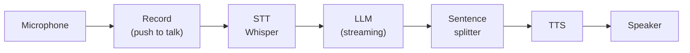

# STT and TTS pipelines

## Why this matters

Speech-to-text and text-to-speech turn any LLM app into a voice app without changing the LLM. The model still reads and writes text. Two other models sit around it: one that turns your audio into text, and one that turns the answer back into audio. That arrangement, a **cascaded pipeline**, is the oldest and most common way to build a voice assistant, and it runs on your Mac with the Ollama setup you already have.

The reason to build one yourself is the latency. A text chat can take three seconds to answer and nobody minds. A spoken answer that starts three seconds after you stop talking feels broken. The chapter gives you a way to find out where those seconds go, by stage, and to cut the biggest one first. That uses the same streaming idea from [2.2](/part-02-programming-with-llms/2.2-streaming): you don't wait for the whole answer before doing the next thing.

**Learning goals**

- Run local speech-to-text
- Run local or paid text-to-speech
- Build a cascaded voice pipeline and measure latency

## Explanation

### Two models, two directions

**Speech-to-text (STT)**, also called automatic speech recognition (ASR), maps an audio waveform to a transcript. **Text-to-speech (TTS)** maps text to a waveform. Both are ordinary neural networks you could train and run like the ones in Part 1, but their input or output is a long sequence of audio samples instead of tokens. Audio is huge compared to text: a minute of speech at 16 kHz mono has 960,000 samples, but it carries only on the order of 150 words. So both kinds of model spend their effort on compressing audio into something sequence-like (a spectrogram, or learned audio codes) and back.

Audio itself has a few facts you will meet in the code:

- **Sample rate**: samples per second. Speech models usually want 16 kHz mono input (the Whisper models do; whisper.cpp's quick start uses 16-bit WAV samples at that rate, so convert other files first). TTS models often output a different rate (24 kHz is common), so a player must be told which rate it is getting.
- **WAV vs compressed**: a WAV file is raw samples with a small header. MP3 or Opus need a decoder. For a pipeline you run on one machine, use WAV: no codec, no delay.
- **Frames and chunks**: you never process "an audio stream" as a whole. You process it in chunks (tens of milliseconds to a few seconds), the same way 2.2's parser works on chunks of bytes.

### Speech-to-text: Whisper and what came after

[Whisper](https://github.com/openai/whisper) is OpenAI's open speech recognition model. Its paper reports training on 680,000 hours of multilingual and multitask audio-transcript data scraped from the internet, with "zero-shot" use: no fine-tuning on a benchmark's own data ([Radford et al., abstract](https://arxiv.org/abs/2212.04356)). The architecture is the transformer encoder-decoder you know from the original paper, not a decoder-only LLM: a Transformer sequence-to-sequence model whose decoder is told what to do by special tokens, so one model does transcription, translation and language identification ([Whisper README](https://github.com/openai/whisper)).

The detail that shapes everything about using it: Whisper works on **30-second windows**. Its `transcribe()` "reads the entire file and processes the audio with a sliding 30-second window" ([README](https://github.com/openai/whisper)). That is a batch design. It wants a finished clip, and it is why "just stream the microphone into Whisper" is not a one-liner, and why a push-to-talk interface (record, stop, transcribe) is the simplest way to start.

The family comes in sizes, from 39 million to 1.55 billion parameters ([MLX Whisper README](https://github.com/ml-explore/mlx-examples/blob/main/whisper/README.md)), plus `turbo`, described as "an optimized version of `large-v3` that offers faster transcription speed with a minimal degradation in accuracy". The same README says `turbo` is not trained for translation, and that `.en` English-only variants exist for the smaller sizes ([Whisper README, model table](https://github.com/openai/whisper)). Sizes and exact figures change, so check the README when you pick. For a first run, a small English model is fast enough that the pipeline stays usable, and a larger one is a second experiment.

The original PyTorch code is not the fast way to run it on a Mac. Three re-implementations matter:

| Implementation | What it is | When to pick it |
|---|---|---|
| [whisper.cpp](https://github.com/ggml-org/whisper.cpp) | C/C++ port with no dependencies. The README lists Apple silicon as "first-class", with Metal and optional Core ML for the encoder, integer quantization of the models, a `whisper-server` HTTP server and a `whisper-stream` example that transcribes the microphone continuously. | A single binary you call from any language, including TypeScript via `child_process` or HTTP. |
| [MLX Whisper](https://github.com/ml-explore/mlx-examples/blob/main/whisper/README.md) (`mlx-whisper`) | Whisper on Apple's [MLX](/part-10-modifying-serving-models/10.7-inference-engines) array framework. A `mlx_whisper audio.mp3` command and a Python API. Converted models are on Hugging Face (for example [whisper-large-v3-turbo](https://huggingface.co/mlx-community/whisper-large-v3-turbo)). | You already use `uv` and Python and want the simplest Mac-native install. |
| [faster-whisper](https://github.com/SYSTRAN/faster-whisper) | Reimplementation on CTranslate2, which its README says is "up to 4 times faster than openai/whisper for the same accuracy". Its benchmarks are on NVIDIA GPUs and x86 CPUs. | Servers with a GPU. Not the first choice on a Mac. |

Both whisper.cpp and mlx-whisper need `ffmpeg` (or another way to hand them a WAV file) for anything that is not already a 16 kHz WAV; the MLX README lists `ffmpeg` as setup step one.

**Successors.** Whisper is no longer the only good option. [mlx-audio](https://github.com/Blaizzy/mlx-audio), a library that runs audio models on Apple silicon, lists Whisper and Distil-Whisper next to Parakeet (NVIDIA, English or 25 European languages) and Qwen3-ASR (Alibaba, multilingual) in its table of supported speech-to-text models. The point for you is not which wins this month, but that the interface is the same: audio file in, text (with optional timestamps) out. Keep the STT call behind one function so you can swap models. Which model is best, and on which languages, belongs to a leaderboard that goes stale, so this book doesn't rank them. (Landscape doesn't track speech models yet.)

::: info 📖 Read now
[whisper.cpp README](https://github.com/ggml-org/whisper.cpp) (ggml-org) · repo · ~15 min · essential

Look for: the quick-start (clone, download a `ggml` model, build, run `whisper-cli` on the sample), the Metal and Core ML sections for Apple silicon, the Quantization section, the Voice Activity Detection section, and the `stream` and server examples. Decide which model file you will download for the practice.
:::

**Two practical problems with STT.** First, Whisper-family models can **hallucinate on silence and noise**: given a quiet clip they sometimes produce text that nobody said. (This is widely reported; I have not found a primary-source number for how often, so treat it as something to test with an empty recording.) The usual defence is **voice activity detection (VAD)**, a small model that marks where speech is so you don't send silence to the big model. whisper.cpp supports VAD with `--vad` and the Silero VAD model, per its README. Second, accuracy is measured as **word error rate (WER)**: the share of reference words that are substituted, deleted or inserted. It is what the papers report, but a few spoken words per turn are not a benchmark, so for your own pipeline listen to the failures instead: names, numbers and code identifiers are where it hurts.

### Text-to-speech: the options

TTS has the widest range of choices, and the field moves quickly. Sort them by where they run and what you give up:

| Option | Runs | Notes |
|---|---|---|
| macOS `say` | Local, built in | Ships with the OS (`/usr/bin/say`), no install, robotic voice. Use it as the baseline and as the first thing in your pipeline: it removes TTS from the list of things that can be wrong. |
| [Kokoro](https://huggingface.co/hexgrad/Kokoro-82M) | Local | An open-weight TTS model with 82 million parameters and Apache-licensed weights, per its model card. Small enough to run in real time on a laptop. `mlx-audio` lists it with 4-bit to bf16 MLX builds. |
| Other open models via [mlx-audio](https://github.com/Blaizzy/mlx-audio) | Local | The README's quick start uses Qwen3-TTS (Alibaba) and lists several more, with voice cloning and speed control. It also starts an OpenAI-compatible server. |
| Ollama speech models | Local | Ollama's docs have a [Speech page](https://docs.ollama.com/capabilities/speech): a speech model is served through the OpenAI-compatible `/v1/audio/speech` endpoint, and the response streams while audio is generated. This is new enough that I could not confirm it on your installed version; check `ollama --version` against the docs before relying on it. |
| Hosted APIs (ElevenLabs, OpenAI and others) | Paid | Better voices and many languages, with per-character prices. ElevenLabs [documents](https://elevenlabs.io/docs/overview/capabilities/text-to-speech) several models that trade expressiveness against latency. Prices change often and are not in this chapter; read them on the provider's pricing page. |

What to look at when choosing is the same few things: **time to first audio** (not total time), the **real-time factor** (seconds of compute per second of audio: below 1 means it can keep up with playback), whether it can **stream** audio while still generating, voice quality in your language, license, and cost per character.

Two TTS behaviours explain much of the design of a pipeline:

1. **TTS quality depends on the sentence.** The model needs enough text to get the intonation right. Handing it one word at a time sounds choppy; handing it the whole answer wastes seconds. The compromise is to feed it one sentence at a time.
2. **TTS can't pronounce what an LLM writes.** Markdown, bullet lists, code blocks, URLs and emoji are noise when spoken. Tell the model in the system prompt to answer in short spoken sentences with no formatting, and strip what slips through.

### The cascaded pipeline



Each box is a model or a process you already know how to call. The arrows are the interesting part: whether a stage waits for the one before it to finish, or starts on a partial result.

The simplest version is strictly sequential: record the clip, transcribe the whole thing, send the transcript to the LLM, wait for the whole reply, synthesize all of it, play it. It works, and it is the version you build first because it is easy to debug (every intermediate result is a file or a string you can inspect). Its latency is the sum of all stages.

The better version **streams between the LLM and the TTS**, using the machinery of [2.2](/part-02-programming-with-llms/2.2-streaming): read the token stream, accumulate text in a buffer, cut it at the end of the first sentence (a `.`, `?` or `!` followed by whitespace; take care with decimals and abbreviations), and hand that sentence to TTS while the model is still writing the second. Playback of sentence 1 hides the synthesis time of sentence 2. This needs a small queue: one task generating audio, one playing it in order.

### The latency budget

What the user feels is the gap between **the moment they stop speaking and the first sound of the reply**. Call it the **time to first audio (TTFA)**. In a sequential pipeline:

```text
TTFA = STT time + LLM time to full reply + TTS time for full reply
```

and in a streaming one:

```text
TTFA = STT time + LLM time to first sentence + TTS time for first sentence
```

(plus small overheads for starting processes and the first byte of audio reaching the speaker). Here is what each term depends on:

| Stage | What drives its time | How to cut it |
|---|---|---|
| **End of speech** | In push-to-talk, the key release: zero. In hands-free use, an end-of-speech timeout, which waits for silence before it decides you are done. It is the biggest hidden cost of hands-free systems. | Push-to-talk, or a VAD with a short hang time. |
| **STT** | Clip length times model size. Whisper pads or windows to 30 seconds, so a 3-second clip does not take a tenth of a 30-second one. Model load time counts if you start a new process for every turn. | Smaller or quantized model, keep the model loaded (a server, not a new process per turn), Metal or Core ML. |
| **LLM** | Time to first token (the prompt is processed before anything comes out, see [1.8](/part-01-how-llms-work/1.8-sampling) and [1.9](/part-01-how-llms-work/1.9-kv-cache-context-window)) plus the time to write the first sentence at the decode speed. **Thinking** mode is the largest risk: the model may write hundreds of tokens you never speak before the first word of the answer. [Experiment 11](/experiments/11-thinking-tradeoff) measured how much slower it makes a simple answer. | Disable thinking (Ollama's `think: false`, see its [thinking docs](https://docs.ollama.com/capabilities/thinking)), a smaller model, a short system prompt, an instruction to answer in a sentence or two. |
| **TTS** | Time to synthesize the first sentence, plus model load. | Stream sentences, a faster model, keep it loaded. |

Work an example with made-up numbers (substitute your own measurements): STT 0.8 s, LLM first token 0.4 s, then 25 tokens a second, a 20-token first sentence, so 0.8 s more; TTS 0.5 s for a sentence. Sequential, with a 100-token reply, costs `0.8 + (0.4 + 4.0) + (0.5 × 5 sentences) = 7.7 s` before you hear anything. Streaming costs `0.8 + (0.4 + 0.8) + 0.5 = 2.5 s`. Same models, same hardware, three times faster to first sound, and the longer the reply, the bigger the gap. The streaming total is dominated by STT and the LLM's start, which is where you look next.

Two measurement rules, which are the same as for any benchmark in this book: time every stage with a monotonic clock (`performance.now()`) inside the program, because stage numbers you read off a console log are off by the printing; and run each turn several times, **discarding the first run**, which pays for loading models into memory (on a Mac, the first call to a Metal model includes compilation work). Report the median.

::: info 📖 Read now
[mlx-audio README](https://github.com/Blaizzy/mlx-audio) (Blaizzy) · repo · ~15 min · essential

Look for: the install line and the `mlx_audio.tts.generate` quick start (note the `--stream` flag), the "Supported Models" tables for TTS and STT, and the section on the web interface and OpenAI-compatible API server. That server is how you keep a model loaded between turns from a TypeScript program.
:::

::: info 📖 Read now
[Kokoro-82M model card](https://huggingface.co/hexgrad/Kokoro-82M) (Hugging Face) · docs · ~10 min · optional

Look for: the parameter count and license in the first paragraph, the releases table, the usage snippet (note the `espeak-ng` system dependency and how the pipeline yields audio in pieces), and the voices list. Think about what "82 million parameters" means for memory and speed next to the LLM you are running.
:::

::: info 📖 Read now
[Radford et al., Robust Speech Recognition via Large-Scale Weak Supervision](https://arxiv.org/abs/2212.04356) (Whisper paper) · paper · ~20 min (abstract and the model-overview section) · optional

Look for: what "weak supervision" means (transcripts that come with the audio, not hand-checked labels), the special tokens that tell the decoder which task to do, and the 30-second window. You need no more of the paper than that to run the model.
:::

::: info 📖 Read now
[Ollama: Speech](https://docs.ollama.com/capabilities/speech) (Ollama docs) · docs · ~5 min · optional

Look for: the `/v1/audio/speech` request shape, that the response streams, and which models the page names. If your Ollama is recent enough, it is the lowest-friction local TTS, because the server you already run does it.
:::

### Where this approach stops

The cascade has two weaknesses that [11.3](/part-11-multimodal/11.3-realtime-voice) addresses. It **loses information** when audio turns into text: tone, emphasis, hesitation and laughter never reach the LLM. And its stages are **turn-based**: nothing happens until you stop talking, and you cannot interrupt the reply cleanly (barge-in needs the pipeline to stop playback, cancel the LLM request and discard queued audio). Speech-to-speech models and realtime APIs trade these problems for others. For a study project, and for many production uses, the cascade stays attractive because you can swap, log and test every stage on its own, with the text in the middle being something you can read.

## Practice

**Brief:** Build a push-to-talk CLI in TypeScript: record from the microphone, transcribe locally, send the transcript to local Qwen, speak the reply. Measure each stage's latency. The code is yours to write; use the starter checklist below and the method from the chapter.

**Where:** `experiments/43-voice/` (shared with chapter 11.3, whose realtime experiment goes in the same folder: add your files and keep your README section under its own heading). Free: everything runs locally and no paid API is used. If you try a hosted TTS, record the amount in `costs.md`.

**Steps**

1. **Set up the tools.** You need a way to record, a way to play, an STT engine and a TTS engine. A path that needs little: `brew install ffmpeg` (recording and conversion), whisper.cpp built from its README (or `uv tool install mlx-whisper`), and macOS `say` as the first TTS. Pull nothing new for the LLM: use `qwen3:8b` (already pulled). Write down each tool's version in the README.
2. **Check each stage on its own, from the shell**, before writing any TypeScript: record 5 seconds to a 16 kHz mono WAV with ffmpeg (`-f avfoundation -i ":0"` is the macOS microphone input; check `ffmpeg -f avfoundation -list_devices true -i ""` for the index, and grant your terminal microphone permission); transcribe that file; send the transcript to Ollama; speak the answer with `say`. If a stage is wrong here, it will be wrong in the program, and it is easier to see here.
3. **Write the sequential version.** `node experiments/43-voice/voice.ts`: press Enter to start recording, press Enter again to stop (a child process you start and signal), then run the four stages in order with `child_process` and `fetch`. Use Ollama's native `/api/chat` with `"think": false` and a system prompt that asks for one to three short spoken sentences with no formatting.
4. **Add timing.** Take a `performance.now()` reading at: recording stopped, transcript ready, first LLM token, LLM done, first audio started, playback done. Print a table at the end of each turn.
5. **Add streaming between LLM and TTS.** Read the Ollama NDJSON stream (2.2 and [experiment 15](/experiments/15-streaming) already did the parsing), split on sentence ends, and speak each sentence while the next is generated, in order. Keep a queue so the sentences never overlap.
6. **Swap the TTS** for a local neural model (Kokoro through `mlx-audio`, or Ollama's speech endpoint if your version has it), and measure again. Keep the model loaded in a server if starting it per turn is slow.

**Measure and record** (in the experiment README): for 5 turns of the same spoken question, the median and range of each stage, for the sequential and the streaming version, with `say` and with the neural TTS. Also record: STT model and size, whether thinking was off, the length of the reply in tokens, and the time of the first (discarded) run.

**Done when**

- Speaking a question and releasing the key gets a spoken answer, and the transcript is printed next to it.
- The README has a table of per-stage median latencies for at least two configurations (sequential vs. streaming, or `say` vs. a neural voice).
- You predicted time to first audio for the streaming version from the sequential measurements before running it, and the README says how close you were and why not closer.
- You tried one failure on purpose (a silent recording, a name or number that STT gets wrong, or a reply with a list in it) and wrote down what happened and which fix you chose.

## Check questions

1. Why is Whisper awkward for live, word-by-word transcription, and what is the simplest interface that avoids the problem?

   <details><summary>Answer</summary>

   It processes audio in 30-second windows and wants a finished clip, so it is a batch model rather than one that emits words as you speak. Push-to-talk avoids the issue: you record a clip, stop, and transcribe it as a unit. Streaming variants (like the `whisper-stream` example) re-run the model on a sliding buffer of audio, which costs repeated compute.
   </details>

2. A sequential pipeline takes 7 s to first audio. Which one change brings most of that back, and why does it help more as replies get longer?

   <details><summary>Answer</summary>

   Streaming the LLM's output into the TTS sentence by sentence. Time to first audio then depends on the first sentence only, not on the length of the whole reply, so the longer the reply, the more time it saves. STT and the LLM's start-up stay as they were.
   </details>

3. You switch the LLM from Qwen3 in thinking mode to non-thinking mode, and the pipeline feels twice as fast, although tokens per second did not change. Why?

   <details><summary>Answer</summary>

   In thinking mode the model writes reasoning tokens before the answer, and none of them can be spoken, so the time to the first spoken sentence includes the whole thought. Turning thinking off removes those tokens from the path to first audio. Decode speed is the same; the number of tokens before the first useful one is not.
   </details>

4. Name two things a cascaded pipeline loses compared with a model that takes audio directly.

   <details><summary>Answer</summary>

   Anything that is in the sound but not in the words: tone, emotion, emphasis, hesitation, speaker identity. It also cannot start on the question before the speaker has finished, and barge-in (interrupting the reply) needs extra code to stop playback and cancel the request.
   </details>

5. Your STT turns a silent recording into a confident sentence. What would you add to the pipeline, and where?

   <details><summary>Answer</summary>

   Voice activity detection before the STT stage: if no speech is detected in the clip, skip the transcription and the rest of the turn. A minimum clip length or a check on the audio level helps as a cheap first guard. whisper.cpp supports VAD with Silero models.
   </details>

## My understanding

<!-- Written by the learner, in their own words. Agents never fill this in. -->
