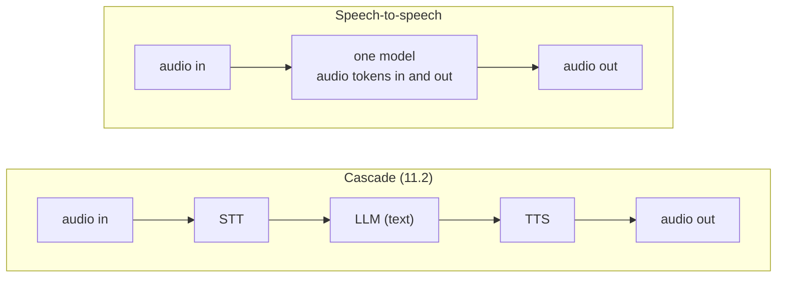
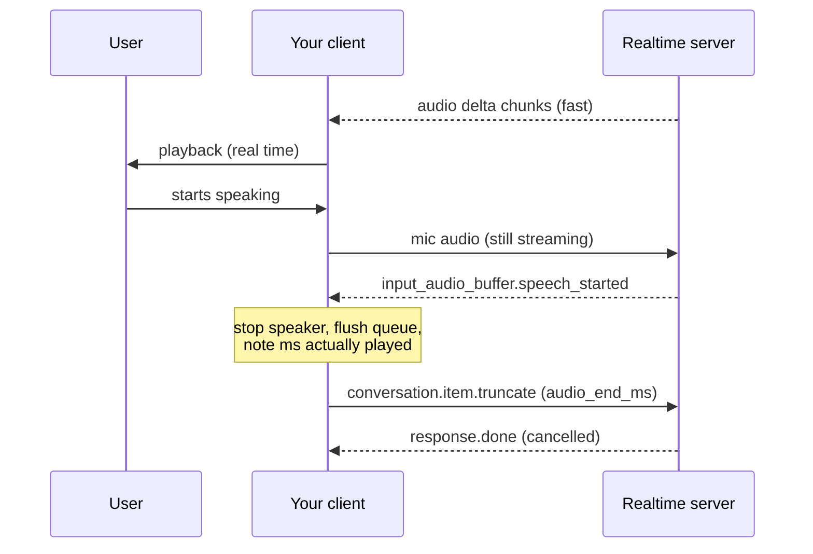

# Realtime voice agents

## Why this matters

The pipeline you built in [11.2](/part-11-multimodal/11.2-stt-tts) has a hard floor. STT cannot finish until you stop talking, the LLM cannot start until STT finishes, and the TTS cannot start until the LLM has produced a sentence. Streaming between the last two stages helped, but the chain is still a chain. Speech-to-speech ("realtime") models take audio in and give audio out through one model, over one open connection, and the server decides when you have finished speaking. The result is lower latency and a conversation you can interrupt.

It also changes what you are responsible for. In a cascade you own every stage and can swap any of them. With a realtime API you own a socket, a state machine of events, a playback queue that must stop the instant the user talks over it, and a bill that grows in a different way. This chapter is about that event protocol and the engineering around it. The ideas transfer between vendors even though the event names do not.

**Learning goals**

- Compare speech-to-speech with cascaded pipelines
- Use a realtime API
- Handle turn-taking and interruptions

## Explanation

### Cascade vs speech-to-speech

| | Cascade | Speech-to-speech |
|---|---|---|
| Models | Three you pick separately | One, from one vendor |
| What the LLM hears | A transcript: words only | The audio itself, so tone, hesitation and emphasis can reach the model |
| What the user hears | A TTS voice reading text | The model's own voice, with its own pacing |
| Latency | Sum of stages, minus what streaming overlaps | One model step to first audio, plus network |
| Control | Full: the text is a seam where you can log, filter, rewrite, or route it to a local model | Less: there is audio in the middle, and you mostly get a transcript as a by-product |
| Interruptions | You build them | Built into the protocol (see below) |
| Local on your Mac | Yes (11.2) | Not with the models in this chapter: both are hosted APIs |

Neither wins in general. A cascade is the better choice when you need the text in the middle (compliance logging, guardrails from [Part 8](/part-08-production/8.1-prompt-injection), cheap or local models, a specific voice). Speech-to-speech is the better choice when the feel of the conversation is the product. Both vendors in this chapter also let you take text out of a session: OpenAI's session can be set to text output, and sessions emit transcripts, so you can still log what was said.

### Connection: WebSocket vs WebRTC

A realtime API keeps one connection open for the whole conversation. Audio goes up as small chunks while audio comes down, and JSON events travel in both directions on the same connection.

**OpenAI** offers two transports for its Realtime API. Its conversations guide says a session is connected "through either WebRTC or WebSocket", and recommends WebRTC "rather than WebSockets" for playing output on a client device such as a browser ([Realtime conversations](https://developers.openai.com/api/docs/guides/realtime-conversations)). The getting-started page says it more directly: the session connects "over WebRTC in the browser or WebSocket on the server" ([Getting started](https://developers.openai.com/api/docs/guides/realtime)). The difference for you:

- **WebSocket.** You open a socket from a server and send base64 audio chunks as `input_audio_buffer.append` events, then receive `response.output_audio.delta` events with audio to decode and play. You handle capture, chunking, buffering and playback yourself. That is the transport for a Node process, which is why it fits the practice below.
- **WebRTC.** The browser opens a peer connection, microphone audio travels on a media track, and JSON events travel on a data channel. The browser's WebRTC stack gives you echo cancellation, jitter buffering and codecs for free, and it is built for lossy networks. Your backend stays out of the audio path: it only mints credentials. The docs show your server creating an ephemeral client secret with `POST /v1/realtime/client_secrets`, so the real API key never reaches the browser ([WebRTC guide](https://developers.openai.com/api/docs/guides/voice-webrtc?api=realtime)).

**Gemini's Live API** is described as "a stateful WebSocket connection (WSS)", with two shapes: server-to-server, where your backend connects, and client-to-server, where the frontend connects directly with short-lived ephemeral tokens in place of an API key ([Live API overview](https://aistudio.google.com/docs/live-api)). Audio is raw 16-bit PCM: 16 kHz little-endian in, 24 kHz out. The overview does not describe a WebRTC transport for the API itself.

::: warning Two OpenAI families
OpenAI's docs navigation now lists **GPT-Live** next to the **Realtime API**, each with its own getting-started, WebRTC and WebSocket pages; the WebSocket page connects to `/v1/live/sessions` rather than the Realtime API's endpoint ([WebSocket guide](https://developers.openai.com/api/docs/guides/voice-websockets?api=realtime)). I did not work out from the docs which one OpenAI intends for new projects. The concepts below (events, turn detection, interruption, tool calls) are taught with the Realtime API pages I read in full. Before you start the practice, open both, pick one, and write the choice and the reason in your README.
:::

::: info 📖 Read now
[OpenAI: Getting started with the Realtime API](https://developers.openai.com/api/docs/guides/realtime) · docs · ~10 min · essential

Look for: the two transports and which one the page assigns to the browser and which to the server, the model name in the code sample, the "barge-in, low first-audio latency, natural turn taking" use-case line, and the beta-to-GA migration notes (which headers and endpoints changed). Models are renamed often; copy the one the page shows today.
:::

::: info 📖 Read now
[OpenAI: Realtime conversations](https://developers.openai.com/api/docs/guides/realtime-conversations) · docs · ~30 min · essential

Look for: the list of client events and server events (a session is just these), the 24 kHz PCM audio format, the 60-minute session limit, the section on interrupting a response and the `conversation.item.truncate` event with its `audio_end_ms` field, and the function-calling section (the `function_call_output` item). This page is the specification of the loop you will write.
:::

### Turn detection

In a cascade, you decide when a turn ends: the key was released, or your VAD (11.2) saw silence. In a realtime session the **server** usually decides, with **server-side voice activity detection**. It listens to the incoming audio stream, finds where speech starts and stops, and in the default conversation mode commits the buffered audio and starts a response by itself.

OpenAI's VAD guide documents two modes, set on the session with `session.update` ([VAD guide](https://developers.openai.com/api/docs/guides/realtime-vad)):

- **`server_vad`**: silence-based. Parameters include `threshold` (0 to 1, how loud counts as speech), `prefix_padding_ms` (audio kept from before speech was detected) and `silence_duration_ms`: how long silence must last before the turn ends. The page says shorter values make turns "be detected more quickly".
- **`semantic_vad`**: a classifier estimates whether the user has finished their thought, so a pause after "I want to book a flight to…" is less likely to be treated as the end. Its `eagerness` setting (`low`, `medium`, `high`, or `auto`, which equals `medium`) trades responsiveness against cutting people off.

The server sends `input_audio_buffer.speech_started` and `input_audio_buffer.speech_stopped` events when it detects these boundaries. The `create_response` and `interrupt_response` options control whether detection starts a reply and whether speech cuts one off.

Gemini exposes the same knobs under different names: `automatic_activity_detection` inside `realtime_input_config`, with `start_of_speech_sensitivity`, `end_of_speech_sensitivity`, `prefix_padding_ms` and `silence_duration_ms`. Its guide says a short silence value gives the model small, incomplete audio chunks, and recommends 500 to 800 ms as a balance ([Live API capabilities](https://aistudio.google.com/docs/live-api/capabilities)).

The trade-off is the same everywhere and you will feel it in the practice: a short silence window answers fast and interrupts people mid-sentence (every "um" is a turn end); a long one is polite and slow. Semantic detection tries to get both, at the cost of a classifier you cannot inspect.

**Push-to-talk is still an option.** Both APIs let you turn automatic detection off and mark turns yourself. OpenAI: set `turn_detection` to `null`, then commit the audio buffer and request a response; the conversation guide suggests this for push-to-talk interfaces. Gemini: set `automaticActivityDetection.disabled` to `true` and send `activityStart` and `activityEnd`. Use it in noisy rooms or when the speaker is not the only sound source, since VAD can mistake a TV for a user.

### Barge-in: interrupting the model

A person who interrupts expects the assistant to stop within a fraction of a second, and expects the assistant to know what it had managed to say. Both parts need work.

**Stopping.** When the server's VAD fires `input_audio_buffer.speech_started` during a reply, the model's generation is cancelled. But your client has probably received audio faster than it plays it: a three-second sentence may arrive as 200 ms of wall-clock transmission, and sits in your playback queue. So the client must flush its own queue and stop the speaker. Gemini's guide spells this out: when VAD detects an interruption the server sends a message with an `interrupted` flag, and "you should stop playing audio and clear queued playback here" ([Live API capabilities](https://aistudio.google.com/docs/live-api/capabilities)).

**Remembering.** The server generated a whole answer, but the user heard only the first part. If the conversation history keeps the full answer, the model will later refer to things the user never heard. Gemini handles this by keeping only what was already sent to the client in the session history (same page). OpenAI's WebSocket flow makes it your job: record how many milliseconds of the item the user actually heard, then send `conversation.item.truncate` with the item id, content index and `audio_end_ms`, which removes the unplayed audio from the conversation. The docs add that the transcript for the cut part is removed as well, since the model cannot align transcript and audio exactly ([Realtime conversations](https://developers.openai.com/api/docs/guides/realtime-conversations)). So your player must count samples *played*, not samples *received*. This is the single most common thing to get wrong.

With WebRTC, the conversation guide says that the server handles the truncation for you, because the server knows what it sent on the media track (that sentence comes from a summary of the page that I could not confirm against the verbatim text; test it). Echo is the other half of the problem: if the microphone hears the assistant's own voice from the speakers, VAD will "hear a user" and interrupt the assistant with itself. Browsers cancel echo for you; a Node process reading a Mac's microphone does not. Use headphones for the practice.

### Tools in voice agents

Tool calling works as in [3.2](/part-03-agents/3.2-agent-loop): the model emits a call, you run it, you return the result, the model continues. The shape differs in two ways.

First, you are driving it with events. On OpenAI, you declare tools in the session configuration; a call arrives in the `response.done` event as a `function_call` item with `name`, `arguments` and `call_id`. You run your function, send a `conversation.item.create` event whose item has type `function_call_output`, the same `call_id` and a JSON-string `output`, then send `response.create` so the model speaks the result ([function calling section](https://developers.openai.com/api/docs/guides/realtime-conversations)). The loop from 3.2 is still there; its `while` condition is "the server keeps sending events".

Gemini's Live API gives the same loop: your client gets a tool-call message and must answer with `sendToolResponse`. The tools page says the Live API "doesn't support automatic tool response handling", unlike `generateContent` ([Tool use with Live API](https://aistudio.google.com/docs/live-api/tools)).

Second, **time is audible**. In text, a slow tool is a spinner. In voice, a slow tool is dead air, and users assume it broke. Some tactics:

- Have the model say something first ("let me check") before the call. Prompt for it.
- Keep tools fast; return summaries, not payloads. Every token you return is read aloud or paid for.
- Use asynchronous tools where the API supports them. Gemini's `NON_BLOCKING` function behaviour lets the conversation continue while a call runs; blocking functions "will still pause all interactions with the model". The response can carry a `scheduling` value: `INTERRUPT` (say it now), `WHEN_IDLE` (wait for a pause) or `SILENT` (just remember it). Support differs by model: the tools page lists some Live models as synchronous only and one as asynchronous only, so read the matrix for the model you use ([Tool use with Live API](https://aistudio.google.com/docs/live-api/tools)).
- Gate dangerous tools the way you would in Part 8. A spoken "yes, delete it" can be a misheard background voice. Confirm writes with a second, explicit step.

Also remember what the model hears when a tool returns: your output is untrusted text going into a model with a voice, and [prompt injection](/part-08-production/8.1-prompt-injection) applies exactly as it does to a text agent.

### Cost

Realtime sessions bill in tokens like text models do, but audio is tokenized too, and the costs add up differently from a text chat. I have deliberately put no prices here: they go stale and live on [Landscape](/landscape), which at the time of writing has no voice section, so read each vendor's current pricing page and write the number you used in your README.

What the OpenAI docs do tell you, in the [cost optimization guide](https://developers.openai.com/api/docs/guides/voice-latency-cost?api=realtime):

- Usage is read from the `response.done` event, with the token details split into text, audio and image tokens plus cached tokens.
- A turn's input includes the earlier turns of the conversation. The guide's example notes that the messages from the first turn are likely to be cached for turn 2, reducing the input cost. So the cost of a turn grows with how long the conversation has been, and a long session is not a linear sum of equal turns.
- Truncation lets you cap the context: setting `token_limits.post_instructions` makes older items drop from a response's input, "a good way to control token usage and cost" (same guide).

Gemini's capabilities guide describes reading token counts from `usageMetadata`, and lists session limits: audio-only sessions are limited to 15 minutes and audio plus video to 2 minutes unless you turn on context-window compression or session resumption ([session management](https://aistudio.google.com/docs/live-api/session-management)). OpenAI's maximum session duration is 60 minutes ([Realtime conversations](https://developers.openai.com/api/docs/guides/realtime-conversations)).

Practical rules: log the usage numbers from every response so you can compute cost per minute yourself; end the session when the user is done (an idle open session with always-on microphone streaming is still sending audio); and write down before you start what a minute of conversation should cost, then compare. A cascade with local STT, a local LLM and `say` costs nothing per minute but is slower, so the real comparison is cost per minute against how the conversation feels.

::: info 📖 Read now
[Gemini Live API capabilities guide](https://aistudio.google.com/docs/live-api/capabilities) · docs · ~25 min · essential

Look for: the model table (and its "preview" status), the automatic activity detection settings, the `interrupted` message and what the docs tell the client to do with it, the 16 kHz in and 24 kHz out audio formats, and the session duration limits. Compare each thing with the OpenAI page: same problem, different event names.
:::

::: info 📖 Read now
[Gemini: Tool use with Live API](https://aistudio.google.com/docs/live-api/tools) · docs · ~10 min · optional

Look for: the support matrix of synchronous and asynchronous function calling per model, the `scheduling` options for a function response, and why there is no automatic tool-response handling.
:::

::: info 📖 Read now
[OpenAI: Cost optimization (voice)](https://developers.openai.com/api/docs/guides/voice-latency-cost?api=realtime) · docs · ~15 min · optional

Look for: how a turn's tokens are counted from `response.done`, what is cached between turns, and the truncation settings.
:::

### Putting it together: a decision

Pick a cascade when you need text in the middle, a local model, or the lowest cost. Pick a realtime API when interruptions and tone matter and a hosted model is acceptable. Either way, measure: the number that matters is the one from 11.2 (time from end of speech to first audio), plus a new one, **time to stop**: how long the speaker keeps going after the user starts talking.

## Practice

**Brief:** If budget allows, connect a realtime API to one tool from `project/`. Compare feel and latency with the 11.2 pipeline. Log the cost.

**Where:** `experiments/43-voice/`, in the same folder as 11.2's push-to-talk pipeline. Add your files (`realtime.ts` is a suggested name) and keep your README section under its own heading. This costs money: set a ceiling before you start (a few euros is plenty for a handful of short sessions) and record every spend in `costs.md`. If you would go over it, do steps 1 to 3 and skip 4 and 5, and say so in the README.

**Steps**

1. **Choose and read.** Decide which API you use (see the warning above) and write the choice and why in the README. Read the pricing page and write the expected cost of a one-minute conversation before you connect anything.
2. **Connect over WebSocket from Node**, with only `fetch`/`WebSocket` from Node and no SDK. Configure the session (instructions asking for one to three short sentences, the audio format from the docs) and print every server event type as it arrives. Do not play audio yet. Send a typed text message and check that you get audio and transcript events back.
3. **Close the loop with audio.** Capture the microphone (ffmpeg's `avfoundation` input from 11.2 can write raw PCM to stdout at the sample rate the docs ask for), send it in chunks, decode the audio deltas and play them (a child process reading raw PCM from stdin works). Use headphones.
4. **Add one tool.** Take one tool you built in `project/` (`read_file` is a good choice) and declare it in the session. Handle the call event, run the function, return the output, and trigger the reply. Time how long the silence is between the user's question and the spoken answer when the tool is called.
5. **Handle an interruption.** Speak over a long answer. Stop playback and flush the queue on the speech-started event (or the vendor's equivalent), count the audio you actually played, and tell the server (truncate, if your API needs it). Then ask "what did you just say?" and check the model's answer matches what you heard.
6. **Measure and compare.** For 5 turns of the same spoken question, record time from end of speech to first audio and time to stop after an interruption. Put the 11.2 pipeline's numbers next to them. Also record the token usage from each response and the cost per minute.

**Done when**

- You can speak, hear the reply, and see every event type listed in a log.
- A tool call from `project/` works by voice end to end, and the README gives the silence length around it.
- Interrupting the model stops the audio within about a quarter of a second (measure it), and the model's next answer is consistent with what you heard before interrupting.
- The README has a table comparing the realtime session with the 11.2 pipeline: latency to first audio, time to stop, and cost per minute, plus two sentences on how each *felt*.
- The cost is logged in `costs.md`, and the README says how close your pre-connection estimate was.

## Check questions

1. Name two things a speech-to-speech model can use that a cascade throws away, and one thing a cascade gives you that speech-to-speech mostly does not.

   

Answer

   It can use tone, hesitation, emphasis and speaker characteristics, since the model hears audio rather than a transcript. A cascade gives you text in the middle: a place to log, filter, rewrite or guard, plus freedom to pick each model, including a local one.
   

2. Why does the browser use WebRTC and a server use a WebSocket, and why does the browser never get your API key?

   

Answer

   WebRTC gives the browser media tracks with echo cancellation, jitter handling and codecs built in, and suits poor networks. A server process has no WebRTC stack and wants plain control over the audio chunks, so a WebSocket fits. A browser client authenticates with a short-lived token (an ephemeral client secret on OpenAI, ephemeral tokens on Gemini) that your server mints, so a real long-lived key never reaches the user's machine.
   

3. The user interrupts, you stop the speaker, but a minute later the model refers to something the user never heard. What went wrong, and what do you send?

   

Answer

   The server's history still holds the full reply that was generated, not the part that was played. The audio was generated and sent faster than it played. On OpenAI, the client has to tell the server how much was heard with `conversation.item.truncate` and `audio_end_ms`, counted from played samples rather than received ones. Gemini keeps only what had already been sent to the client in its session history, though you still have to flush your own playback queue.
   

4. Your voice agent keeps answering while the user is still thinking mid-sentence. Which settings would you change, and what does it cost you?

   

Answer

   Lengthen the silence window (`silence_duration_ms`), or switch to semantic detection and lower its eagerness. The cost is a slower response: every extra bit of silence you wait for is added to the time to first audio. Push-to-talk removes the problem by making the user mark the turn, at the cost of the hands-free experience.
   

5. A tool call takes four seconds. What does the user experience, and name two ways to make it less awkward.

   

Answer

   Four seconds of silence, which sounds like a failure. Prompt the model to say something before it calls the tool; keep tools fast and their results short; use non-blocking or asynchronous tool calls where the API supports them, so the conversation continues and the result is announced when it arrives.
   

6. Why does a long realtime conversation cost more per minute near the end than at the start?

   

Answer

   Each response takes the earlier conversation as input, including audio tokens, so later turns carry more input. Caching reduces the price of the repeated part but not its size. Truncating old items, or ending the session, caps the growth.
   

## My understanding

<!-- Written by the learner, in their own words. Agents never fill this in. -->
